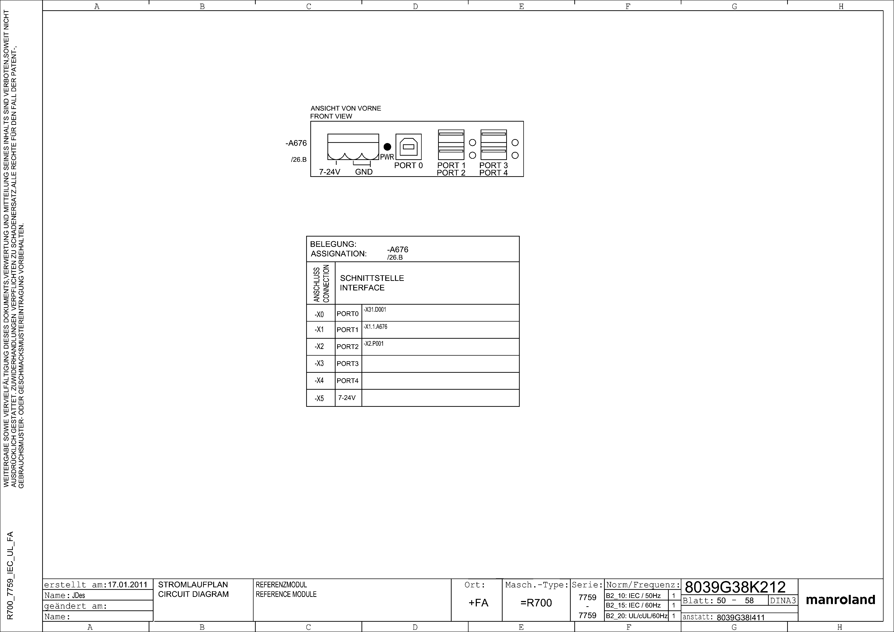

# +FA — Sheet 50 of 58 — REFERENZMODUL

**REFERENCE MODULE**

> Part of the manroland **R700** printing press IEC/UL circuit diagrams.
> Drawing class: **Stromlaufplan / Circuit diagram** (DIN A3).
> Document `+FA` covers the **Delivery** machine section.

## At a glance

| Field | Value |
|---|---|
| Document | `+FA`  (8039G38K212) |
| Sheet | **50** of 58 |
| Section (DE) | REFERENZMODUL |
| Section (EN) | REFERENCE MODULE |
| Section type | REFERENCE_MODULE — Reference module |
| Machine type | `=R700` |
| Series | `7759` |
| Created | 17.01.2011 |
| Replaces | `8039G38I411` |
| Columns used | C, D, E |
| Path numbers | — |
| Labels on sheet | 35 |
| Cross-refs out | 2 |
| Cross-refs in | 2 |

**Previous:** [+FA sheet 49](SHEET_0049.md) · **Next:** [+FA sheet 51](SHEET_0051.md) · **Document TOC:** [_TOC.md](_TOC.md)  (+FA) · **Master TOC:** [all sheets](../_MASTER_TOC.md)

## Sheet image (300 DPI, exact vector render)



_Rendered directly from the PDF vector layer at 300 DPI (1-bit), no OCR and no resampling. Use it to confirm anything ambiguous in the text below._

## Cross-references on this sheet

Each entry is a wire leaving this sheet. The printed token is `/sheet.column`; the link resolves to that sheet inside the same document.

| Ref | Target sheet | Col | Path | Destination on target | Target section | From col |
|---|---|---|---|---|---|---|
| `/26.B` | [+FA sheet 26](SHEET_0026.md) | B | — | — | USB ANSCHLUSS | C |
| `/26.B` | [+FA sheet 26](SHEET_0026.md) | B | — | — | USB ANSCHLUSS | D |

### Incoming references (sheets that point here)

Every other sheet that sends a wire to this one. `Back-ref` is the token printed on *that* sheet; `Path` is its line number.

| From sheet | Cols | Back-ref | Path | Refs | What continues there |
|---|---|---|---|---|---|
| [+FA#26](SHEET_0026.md) | B | `/26.B` | — | 2 | — |


## Devices on this sheet

| Tag | Class | Class meaning (IEC) | Col | Sub | Terminal | Sign |
|---|---|---|---|---|---|---|
| `A676` | A | Baugruppe / assembly, module, PC board | C | — | — | — |
| `X1` | X | Klemme / terminal, plug connector | C | — | — | — |
| `X2` | X | Klemme / terminal, plug connector | C | — | — | — |
| `X3` | X | Klemme / terminal, plug connector | C | — | — | — |
| `X4` | X | Klemme / terminal, plug connector | C | — | — | — |
| `X5` | X | Klemme / terminal, plug connector | C | — | — | — |
| `X0` | X | Klemme / terminal, plug connector | C | — | — | — |
| `A676` | A | Baugruppe / assembly, module, PC board | D | — | — | — |
| `X31.D001` | — | cross-device reference | D | — | — | — |
| `X1.1.A676` | — | cross-device reference | D | — | — | — |
| `X2.P001` | — | cross-device reference | D | — | — | — |

## Potentials / nets

_No named potentials on this sheet._

## Wire-end annotations (grouped as printed)

A wire that continues elsewhere is annotated with a small cluster: the destination description, the path/line number `#NN`, and the `/sheet.column` cross reference. Each row below is one such cluster exactly as it is grouped on the drawing.

| Col | Y | Path | Cross-ref | Text on the wire |
|---|---|---|---|---|
| C | 140.6 | — | — | `FRONT VIEW ANSICHT VON VORNE` |
| C | 186.0 | — | — | `A676` |
| D | 205.5 | — | — | `PWR` |
| C | 208.6 | — | `/26.B` | — |
| D | 215.8 | — | — | `7 24V GND PORT 0` |
| D | 215.8 | — | — | `PORT 2 PORT 1` |
| E | 215.8 | — | — | `PORT 3 PORT 4` |
| C | 320.6 | — | — | `BELEGUNG:` |
| D | 327.7 | — | — | `A676` |
| C | 333.4 | — | — | `ASSIGNATION:` |
| D | 339.0 | — | `/26.B` | — |
| C | 352.4 | — | — | `CONNECTION` |
| C | 356.1 | — | — | `ANSCHLUSS` |
| D | 366.0 | — | — | `INTERFACE SCHNITTSTELLE` |
| C | 409.5 | — | — | `PORT0 X31.D001` |
| C | 415.4 | — | — | `X0` |
| D | 432.2 | — | — | `X1.1.A676` |
| C | 435.1 | — | — | `X1` |
| C | 435.4 | — | — | `PORT1` |
| D | 454.8 | — | — | `X2.P001` |
| C | 457.9 | — | — | `X2` |
| C | 458.1 | — | — | `PORT2` |
| C | 480.6 | — | — | `X3` |
| C | 480.8 | — | — | `PORT3` |
| C | 503.3 | — | — | `X4` |
| C | 503.4 | — | — | `PORT4` |
| C | 526.1 | — | — | `7 24V` |
| C | 527.4 | — | — | `X5` |


## Reconstructed tables

This sheet carries tabular content (pin map / terminal assignment / index). The grid below was rebuilt from the drawing's own rule lines, so each row is exactly one physical row of the table.

### Table 1 — 6 data rows × 3 columns (at x=446.5, y=189.9)

| ASSIGNATION: | PWR GND A676 /26.B | PORT |
|---|---|---|
|  | `SCHNITTSTELLE INTERFACE` |  |
| `PORT0` | `X31.D001` |  |
| `PORT1` | `X1.1.A676` |  |
| `PORT2` | `X2.P001` |  |
| `PORT3` |  |  |
| `PORT4` |  |  |


## Notes and free text on this sheet

| Text | Col | Y (pt) |
|---|---|---|
| `ANSICHT VON VORNE` | C | 140.59 |
| `FRONT VIEW` | C | 151.17 |
| `PORT 0` | D | 215.75 |
| `7 24V` | C | 224.24 |
| `GND` | D | 224.25 |
| `PWR` | D | 205.52 |
| `PORT 1` | D | 215.75 |
| `PORT 2` | D | 225.67 |
| `PORT 3` | E | 215.75 |
| `PORT 4` | E | 225.67 |
| `BELEGUNG:` | C | 320.63 |
| `ASSIGNATION:` | C | 333.36 |
| `ANSCHLUSS` | C | 356.07 |
| `CONNECTION` | C | 352.36 |
| `SCHNITTSTELLE` | D | 365.98 |
| `INTERFACE` | D | 378.69 |
| `PORT1` | C | 435.41 |
| `PORT2` | C | 458.08 |
| `PORT3` | C | 480.76 |
| `PORT4` | C | 503.44 |
| `PORT0` | C | 414.15 |

## Complete label inventory (exact text from the drawing)

Every text object inside the drawing area of this sheet, in DIN reading order (column A→H, then top→bottom). This is the authoritative list: if a string is not here it is not printed on this sheet.

| Col | Y | X | Dir | Type | Text |
|---|---|---|---|---|---|
| C | 140.6 | 413.9 | → | text | `ANSICHT VON VORNE` |
| C | 151.2 | 413.0 | → | text | `FRONT VIEW` |
| C | 186.0 | 380.4 | → | device tag | `A676` |
| C | 208.6 | 387.8 | → | cross-reference | `/26.B` |
| C | 224.2 | 425.1 | → | text | `7 24V` |
| C | 320.6 | 413.0 | → | text | `BELEGUNG:` |
| C | 333.4 | 414.1 | → | text | `ASSIGNATION:` |
| C | 352.4 | 431.0 | ↕ | text | `CONNECTION` |
| C | 356.1 | 418.3 | ↕ | text | `ANSCHLUSS` |
| C | 414.1 | 448.4 | → | text | `PORT0` |
| C | 415.4 | 419.2 | → | device tag | `X0` |
| C | 435.1 | 419.2 | → | device tag | `X1` |
| C | 435.4 | 448.4 | → | text | `PORT1` |
| C | 457.9 | 419.2 | → | device tag | `X2` |
| C | 458.1 | 448.4 | → | text | `PORT2` |
| C | 480.6 | 419.2 | → | device tag | `X3` |
| C | 480.8 | 448.4 | → | text | `PORT3` |
| C | 503.3 | 419.2 | → | device tag | `X4` |
| C | 503.4 | 448.4 | → | text | `PORT4` |
| C | 526.1 | 450.4 | → | text | `7 24V` |
| C | 527.4 | 419.2 | → | device tag | `X5` |
| D | 205.5 | 506.4 | → | text | `PWR` |
| D | 215.7 | 525.0 | → | text | `PORT 0` |
| D | 215.7 | 582.4 | → | text | `PORT 1` |
| D | 224.3 | 473.0 | → | text | `GND` |
| D | 225.7 | 581.7 | → | text | `PORT 2` |
| D | 327.7 | 515.6 | → | device tag | `A676` |
| D | 339.0 | 515.9 | → | cross-reference | `/26.B` |
| D | 366.0 | 453.0 | → | text | `SCHNITTSTELLE` |
| D | 378.7 | 452.7 | → | text | `INTERFACE` |
| D | 409.5 | 484.4 | → | device ref | `X31.D001` |
| D | 432.2 | 484.4 | → | device ref | `X1.1.A676` |
| D | 454.8 | 484.4 | → | device ref | `X2.P001` |
| E | 215.7 | 638.4 | → | text | `PORT 3` |
| E | 225.7 | 638.4 | → | text | `PORT 4` |

## Reading-order text block

The same content as a plain block, grouped by DIN column — convenient to paste or to match against a visual description.

```text
=== Column C ===
 140.6  413.9  text         ANSICHT VON VORNE
 151.2  413.0  text         FRONT VIEW
 186.0  380.4  devtag       A676
 208.6  387.8  xref         /26.B
 224.2  425.1  text         7 24V
 320.6  413.0  text         BELEGUNG:
 333.4  414.1  text         ASSIGNATION:
 352.4  431.0  text         CONNECTION
 356.1  418.3  text         ANSCHLUSS
 414.1  448.4  text         PORT0
 415.4  419.2  devtag       X0
 435.1  419.2  devtag       X1
 435.4  448.4  text         PORT1
 457.9  419.2  devtag       X2
 458.1  448.4  text         PORT2
 480.6  419.2  devtag       X3
 480.8  448.4  text         PORT3
 503.3  419.2  devtag       X4
 503.4  448.4  text         PORT4
 526.1  450.4  text         7 24V
 527.4  419.2  devtag       X5
=== Column D ===
 205.5  506.4  text         PWR
 215.7  525.0  text         PORT 0
 215.7  582.4  text         PORT 1
 224.3  473.0  text         GND
 225.7  581.7  text         PORT 2
 327.7  515.6  devtag       A676
 339.0  515.9  xref         /26.B
 366.0  453.0  text         SCHNITTSTELLE
 378.7  452.7  text         INTERFACE
 409.5  484.4  devref       X31.D001
 432.2  484.4  devref       X1.1.A676
 454.8  484.4  devref       X2.P001
=== Column E ===
 215.7  638.4  text         PORT 3
 225.7  638.4  text         PORT 4
```

---
_Generated from the PDF vector text layer; no OCR. Source: `R700_7759_IEC_UL_FA`, sheet 50._
