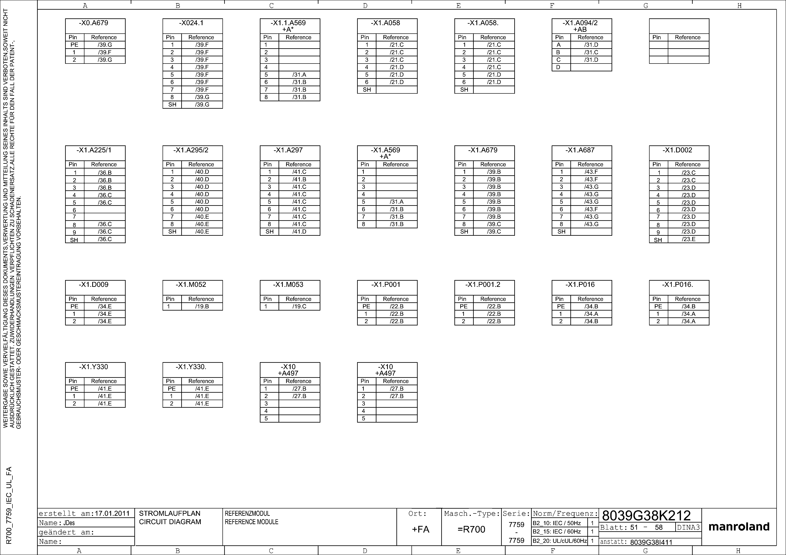

# +FA — Sheet 51 of 58 — REFERENZMODUL

**REFERENCE MODULE**

> Part of the manroland **R700** printing press IEC/UL circuit diagrams.
> Drawing class: **Stromlaufplan / Circuit diagram** (DIN A3).
> Document `+FA` covers the **Delivery** machine section.

## At a glance

| Field | Value |
|---|---|
| Document | `+FA`  (8039G38K212) |
| Sheet | **51** of 58 |
| Section (DE) | REFERENZMODUL |
| Section (EN) | REFERENCE MODULE |
| Section type | REFERENCE_MODULE — Reference module |
| Machine type | `=R700` |
| Series | `7759` |
| Created | 17.01.2011 |
| Replaces | `8039G38I411` |
| Columns used | A, B, C, D, E, F, G |
| Path numbers | — |
| Labels on sheet | 329 |
| Cross-refs out | 115 |
| Cross-refs in | 0 |

**Previous:** [+FA sheet 50](SHEET_0050.md) · **Next:** [+FA sheet 52](SHEET_0052.md) · **Document TOC:** [_TOC.md](_TOC.md)  (+FA) · **Master TOC:** [all sheets](../_MASTER_TOC.md)

## Sheet image (300 DPI, exact vector render)



_Rendered directly from the PDF vector layer at 300 DPI (1-bit), no OCR and no resampling. Use it to confirm anything ambiguous in the text below._

## Cross-references on this sheet

Each entry is a wire leaving this sheet. The printed token is `/sheet.column`; the link resolves to that sheet inside the same document.

| Ref | Target sheet | Col | Path | Destination on target | Target section | From col |
|---|---|---|---|---|---|---|
| `/39.F` | [+FA sheet 39](SHEET_0039.md) | F | — | — | OPTION: TELEPRESENCE | B |
| `/39.F` | [+FA sheet 39](SHEET_0039.md) | F | — | — | OPTION: TELEPRESENCE | B |
| `/39.F` | [+FA sheet 39](SHEET_0039.md) | F | — | — | OPTION: TELEPRESENCE | B |
| `/39.F` | [+FA sheet 39](SHEET_0039.md) | F | — | — | OPTION: TELEPRESENCE | B |
| `/39.F` | [+FA sheet 39](SHEET_0039.md) | F | — | — | OPTION: TELEPRESENCE | B |
| `/39.F` | [+FA sheet 39](SHEET_0039.md) | F | — | — | OPTION: TELEPRESENCE | B |
| `/39.F` | [+FA sheet 39](SHEET_0039.md) | F | — | — | OPTION: TELEPRESENCE | B |
| `/39.G` | [+FA sheet 39](SHEET_0039.md) | G | — | — | OPTION: TELEPRESENCE | B |
| `/39.G` | [+FA sheet 39](SHEET_0039.md) | G | — | — | OPTION: TELEPRESENCE | B |
| `/39.G` | [+FA sheet 39](SHEET_0039.md) | G | — | — | OPTION: TELEPRESENCE | A |
| `/21.C` | [+FA sheet 21](SHEET_0021.md) | C | — | — | TASTATUR: COMPUTER, MAUS | D |
| `/21.C` | [+FA sheet 21](SHEET_0021.md) | C | — | — | TASTATUR: COMPUTER, MAUS | D |
| `/21.C` | [+FA sheet 21](SHEET_0021.md) | C | — | — | TASTATUR: COMPUTER, MAUS | D |
| `/21.D` | [+FA sheet 21](SHEET_0021.md) | D | — | — | TASTATUR: COMPUTER, MAUS | D |
| `/21.D` | [+FA sheet 21](SHEET_0021.md) | D | — | — | TASTATUR: COMPUTER, MAUS | D |
| `/21.D` | [+FA sheet 21](SHEET_0021.md) | D | — | — | TASTATUR: COMPUTER, MAUS | D |
| `/21.C` | [+FA sheet 21](SHEET_0021.md) | C | — | — | TASTATUR: COMPUTER, MAUS | E |
| `/21.C` | [+FA sheet 21](SHEET_0021.md) | C | — | — | TASTATUR: COMPUTER, MAUS | E |
| `/21.C` | [+FA sheet 21](SHEET_0021.md) | C | — | — | TASTATUR: COMPUTER, MAUS | E |
| `/21.C` | [+FA sheet 21](SHEET_0021.md) | C | — | — | TASTATUR: COMPUTER, MAUS | E |
| `/21.D` | [+FA sheet 21](SHEET_0021.md) | D | — | — | TASTATUR: COMPUTER, MAUS | E |
| `/21.D` | [+FA sheet 21](SHEET_0021.md) | D | — | — | TASTATUR: COMPUTER, MAUS | E |
| `/31.D` | [+FA sheet 31](SHEET_0031.md) | D | — | — | BEIPACK | F |
| `/31.C` | [+FA sheet 31](SHEET_0031.md) | C | — | — | BEIPACK | F |
| `/31.D` | [+FA sheet 31](SHEET_0031.md) | D | — | — | BEIPACK | F |
| `/39.F` | [+FA sheet 39](SHEET_0039.md) | F | — | — | OPTION: TELEPRESENCE | A |
| `/39.G` | [+FA sheet 39](SHEET_0039.md) | G | — | — | OPTION: TELEPRESENCE | A |
| `/31.A` | [+FA sheet 31](SHEET_0031.md) | A | — | — | BEIPACK | C |
| `/31.B` | [+FA sheet 31](SHEET_0031.md) | B | — | — | BEIPACK | C |
| `/31.B` | [+FA sheet 31](SHEET_0031.md) | B | — | — | BEIPACK | C |
| `/31.B` | [+FA sheet 31](SHEET_0031.md) | B | — | — | BEIPACK | C |
| `/39.B` | [+FA sheet 39](SHEET_0039.md) | B | — | — | OPTION: TELEPRESENCE | E |
| `/39.B` | [+FA sheet 39](SHEET_0039.md) | B | — | — | OPTION: TELEPRESENCE | E |
| `/39.B` | [+FA sheet 39](SHEET_0039.md) | B | — | — | OPTION: TELEPRESENCE | E |
| `/39.B` | [+FA sheet 39](SHEET_0039.md) | B | — | — | OPTION: TELEPRESENCE | E |
| `/39.B` | [+FA sheet 39](SHEET_0039.md) | B | — | — | OPTION: TELEPRESENCE | E |
| `/39.B` | [+FA sheet 39](SHEET_0039.md) | B | — | — | OPTION: TELEPRESENCE | E |
| `/39.B` | [+FA sheet 39](SHEET_0039.md) | B | — | — | OPTION: TELEPRESENCE | E |
| `/39.C` | [+FA sheet 39](SHEET_0039.md) | C | — | — | OPTION: TELEPRESENCE | E |
| `/39.C` | [+FA sheet 39](SHEET_0039.md) | C | — | — | OPTION: TELEPRESENCE | E |
| `/43.F` | [+FA sheet 43](SHEET_0043.md) | F | — | — | — | F |
| `/43.F` | [+FA sheet 43](SHEET_0043.md) | F | — | — | — | F |
| `/43.G` | [+FA sheet 43](SHEET_0043.md) | G | — | — | — | F |
| `/43.G` | [+FA sheet 43](SHEET_0043.md) | G | — | — | — | F |
| `/43.G` | [+FA sheet 43](SHEET_0043.md) | G | — | — | — | F |
| `/40.D` | [+FA sheet 40](SHEET_0040.md) | D | — | — | OPTION: TELEPRESENCE | B |
| `/40.D` | [+FA sheet 40](SHEET_0040.md) | D | — | — | OPTION: TELEPRESENCE | B |
| `/40.D` | [+FA sheet 40](SHEET_0040.md) | D | — | — | OPTION: TELEPRESENCE | B |
| `/40.D` | [+FA sheet 40](SHEET_0040.md) | D | — | — | OPTION: TELEPRESENCE | B |
| `/40.D` | [+FA sheet 40](SHEET_0040.md) | D | — | — | OPTION: TELEPRESENCE | B |
| `/40.D` | [+FA sheet 40](SHEET_0040.md) | D | — | — | OPTION: TELEPRESENCE | B |
| `/40.E` | [+FA sheet 40](SHEET_0040.md) | E | — | — | OPTION: TELEPRESENCE | B |
| `/40.E` | [+FA sheet 40](SHEET_0040.md) | E | — | — | OPTION: TELEPRESENCE | B |
| `/40.E` | [+FA sheet 40](SHEET_0040.md) | E | — | — | OPTION: TELEPRESENCE | B |
| `/41.C` | [+FA sheet 41](SHEET_0041.md) | C | — | — | OPTION: TELEPRESENCE ODER ICP | C |
| `/41.B` | [+FA sheet 41](SHEET_0041.md) | B | — | — | OPTION: TELEPRESENCE ODER ICP | C |
| `/41.C` | [+FA sheet 41](SHEET_0041.md) | C | — | — | OPTION: TELEPRESENCE ODER ICP | C |
| `/41.C` | [+FA sheet 41](SHEET_0041.md) | C | — | — | OPTION: TELEPRESENCE ODER ICP | C |
| `/41.C` | [+FA sheet 41](SHEET_0041.md) | C | — | — | OPTION: TELEPRESENCE ODER ICP | C |
| `/41.C` | [+FA sheet 41](SHEET_0041.md) | C | — | — | OPTION: TELEPRESENCE ODER ICP | C |
| `/41.C` | [+FA sheet 41](SHEET_0041.md) | C | — | — | OPTION: TELEPRESENCE ODER ICP | C |
| `/41.C` | [+FA sheet 41](SHEET_0041.md) | C | — | — | OPTION: TELEPRESENCE ODER ICP | C |
| `/41.D` | [+FA sheet 41](SHEET_0041.md) | D | — | — | OPTION: TELEPRESENCE ODER ICP | C |
| `/36.B` | [+FA sheet 36](SHEET_0036.md) | B | — | — | OPTION: TELEPRESENCE | A |
| `/36.B` | [+FA sheet 36](SHEET_0036.md) | B | — | — | OPTION: TELEPRESENCE | A |
| `/36.B` | [+FA sheet 36](SHEET_0036.md) | B | — | — | OPTION: TELEPRESENCE | A |
| `/36.C` | [+FA sheet 36](SHEET_0036.md) | C | — | — | OPTION: TELEPRESENCE | A |
| `/36.C` | [+FA sheet 36](SHEET_0036.md) | C | — | — | OPTION: TELEPRESENCE | A |
| `/23.C` | [+FA sheet 23](SHEET_0023.md) | C | — | — | JOBCARD READER | G |
| `/23.C` | [+FA sheet 23](SHEET_0023.md) | C | — | — | JOBCARD READER | G |
| `/23.D` | [+FA sheet 23](SHEET_0023.md) | D | — | — | JOBCARD READER | G |
| `/23.D` | [+FA sheet 23](SHEET_0023.md) | D | — | — | JOBCARD READER | G |
| `/23.D` | [+FA sheet 23](SHEET_0023.md) | D | — | — | JOBCARD READER | G |
| `/23.D` | [+FA sheet 23](SHEET_0023.md) | D | — | — | JOBCARD READER | G |
| `/23.D` | [+FA sheet 23](SHEET_0023.md) | D | — | — | JOBCARD READER | G |
| `/23.D` | [+FA sheet 23](SHEET_0023.md) | D | — | — | JOBCARD READER | G |
| `/23.D` | [+FA sheet 23](SHEET_0023.md) | D | — | — | JOBCARD READER | G |
| `/23.E` | [+FA sheet 23](SHEET_0023.md) | E | — | — | JOBCARD READER | G |
| `/31.A` | [+FA sheet 31](SHEET_0031.md) | A | — | — | BEIPACK | D |
| `/31.B` | [+FA sheet 31](SHEET_0031.md) | B | — | — | BEIPACK | D |
| `/31.B` | [+FA sheet 31](SHEET_0031.md) | B | — | — | BEIPACK | D |
| `/31.B` | [+FA sheet 31](SHEET_0031.md) | B | — | — | BEIPACK | D |
| `/43.F` | [+FA sheet 43](SHEET_0043.md) | F | — | — | — | F |
| `/43.G` | [+FA sheet 43](SHEET_0043.md) | G | — | — | — | F |
| `/43.G` | [+FA sheet 43](SHEET_0043.md) | G | — | — | — | F |
| `/36.C` | [+FA sheet 36](SHEET_0036.md) | C | — | — | OPTION: TELEPRESENCE | A |
| `/36.C` | [+FA sheet 36](SHEET_0036.md) | C | — | — | OPTION: TELEPRESENCE | A |
| `/36.C` | [+FA sheet 36](SHEET_0036.md) | C | — | — | OPTION: TELEPRESENCE | A |
| `/34.E` | [+FA sheet 34](SHEET_0034.md) | E | — | — | OPTION: TELEPRESENCE , PRINTNET VORBEREITUNG: INTEGRATIONPILOTPLUS INCLUSIVE DATACOL.,INTEGRATIONP. FÜR PRESSM. PERFECT | A |
| `/19.B` | [+FA sheet 19](SHEET_0019.md) | B | — | — | LÜFTER | B |
| `/22.B` | [+FA sheet 22](SHEET_0022.md) | B | — | — | MONITOR | D |
| `/22.B` | [+FA sheet 22](SHEET_0022.md) | B | — | — | MONITOR | E |
| `/34.B` | [+FA sheet 34](SHEET_0034.md) | B | — | — | OPTION: TELEPRESENCE , PRINTNET VORBEREITUNG: INTEGRATIONPILOTPLUS INCLUSIVE DATACOL.,INTEGRATIONP. FÜR PRESSM. PERFECT | F |
| `/34.B` | [+FA sheet 34](SHEET_0034.md) | B | — | — | OPTION: TELEPRESENCE , PRINTNET VORBEREITUNG: INTEGRATIONPILOTPLUS INCLUSIVE DATACOL.,INTEGRATIONP. FÜR PRESSM. PERFECT | G |
| `/19.C` | [+FA sheet 19](SHEET_0019.md) | C | — | — | LÜFTER | C |
| `/34.E` | [+FA sheet 34](SHEET_0034.md) | E | — | — | OPTION: TELEPRESENCE , PRINTNET VORBEREITUNG: INTEGRATIONPILOTPLUS INCLUSIVE DATACOL.,INTEGRATIONP. FÜR PRESSM. PERFECT | A |
| `/34.E` | [+FA sheet 34](SHEET_0034.md) | E | — | — | OPTION: TELEPRESENCE , PRINTNET VORBEREITUNG: INTEGRATIONPILOTPLUS INCLUSIVE DATACOL.,INTEGRATIONP. FÜR PRESSM. PERFECT | A |
| `/22.B` | [+FA sheet 22](SHEET_0022.md) | B | — | — | MONITOR | D |
| `/22.B` | [+FA sheet 22](SHEET_0022.md) | B | — | — | MONITOR | D |
| `/22.B` | [+FA sheet 22](SHEET_0022.md) | B | — | — | MONITOR | E |
| `/22.B` | [+FA sheet 22](SHEET_0022.md) | B | — | — | MONITOR | E |
| `/34.A` | [+FA sheet 34](SHEET_0034.md) | A | — | — | OPTION: TELEPRESENCE , PRINTNET VORBEREITUNG: INTEGRATIONPILOTPLUS INCLUSIVE DATACOL.,INTEGRATIONP. FÜR PRESSM. PERFECT | F |
| `/34.B` | [+FA sheet 34](SHEET_0034.md) | B | — | — | OPTION: TELEPRESENCE , PRINTNET VORBEREITUNG: INTEGRATIONPILOTPLUS INCLUSIVE DATACOL.,INTEGRATIONP. FÜR PRESSM. PERFECT | F |
| `/34.A` | [+FA sheet 34](SHEET_0034.md) | A | — | — | OPTION: TELEPRESENCE , PRINTNET VORBEREITUNG: INTEGRATIONPILOTPLUS INCLUSIVE DATACOL.,INTEGRATIONP. FÜR PRESSM. PERFECT | G |
| `/34.A` | [+FA sheet 34](SHEET_0034.md) | A | — | — | OPTION: TELEPRESENCE , PRINTNET VORBEREITUNG: INTEGRATIONPILOTPLUS INCLUSIVE DATACOL.,INTEGRATIONP. FÜR PRESSM. PERFECT | G |
| `/41.E` | [+FA sheet 41](SHEET_0041.md) | E | — | — | OPTION: TELEPRESENCE ODER ICP | A |
| `/41.E` | [+FA sheet 41](SHEET_0041.md) | E | — | — | OPTION: TELEPRESENCE ODER ICP | B |
| `/27.B` | [+FA sheet 27](SHEET_0027.md) | B | — | — | TASTATUR: BEDIENUNGSPULT MASCHINE | C |
| `/27.B` | [+FA sheet 27](SHEET_0027.md) | B | — | — | TASTATUR: BEDIENUNGSPULT MASCHINE | C |
| `/27.B` | [+FA sheet 27](SHEET_0027.md) | B | — | — | TASTATUR: BEDIENUNGSPULT MASCHINE | D |
| `/27.B` | [+FA sheet 27](SHEET_0027.md) | B | — | — | TASTATUR: BEDIENUNGSPULT MASCHINE | D |
| `/41.E` | [+FA sheet 41](SHEET_0041.md) | E | — | — | OPTION: TELEPRESENCE ODER ICP | A |
| `/41.E` | [+FA sheet 41](SHEET_0041.md) | E | — | — | OPTION: TELEPRESENCE ODER ICP | A |
| `/41.E` | [+FA sheet 41](SHEET_0041.md) | E | — | — | OPTION: TELEPRESENCE ODER ICP | B |
| `/41.E` | [+FA sheet 41](SHEET_0041.md) | E | — | — | OPTION: TELEPRESENCE ODER ICP | B |

## Devices on this sheet

| Tag | Class | Class meaning (IEC) | Col | Sub | Terminal | Sign |
|---|---|---|---|---|---|---|
| `X10` | X | Klemme / terminal, plug connector | C | — | — | — |
| `+A497` | A | Baugruppe / assembly, module, PC board | C | — | — | + |
| `X10` | X | Klemme / terminal, plug connector | D | — | — | — |
| `+A497` | A | Baugruppe / assembly, module, PC board | D | — | — | + |
| `X0.A679` | — | cross-device reference | A | — | — | — |
| `X024.1` | — | cross-device reference | B | — | — | — |
| `X1.1.A569` | — | cross-device reference | C | — | — | — |
| `X1.A058` | — | cross-device reference | D | — | — | — |
| `X1.A058.` | — | cross-device reference | E | — | — | — |
| `X1.A297` | — | cross-device reference | C | — | — | — |
| `X1.A569` | — | cross-device reference | D | — | — | — |
| `X1.A679` | — | cross-device reference | E | — | — | — |
| `X1.A687` | — | cross-device reference | F | — | — | — |
| `X1.D002` | — | cross-device reference | G | — | — | — |
| `X1.D009` | — | cross-device reference | A | — | — | — |
| `X1.M052` | — | cross-device reference | B | — | — | — |
| `X1.M053` | — | cross-device reference | C | — | — | — |
| `X1.P001` | — | cross-device reference | D | — | — | — |
| `X1.P001.2` | — | cross-device reference | E | — | — | — |
| `X1.P016` | — | cross-device reference | F | — | — | — |
| `X1.P016.` | — | cross-device reference | G | — | — | — |
| `X1.Y330` | — | cross-device reference | A | — | — | — |
| `X1.Y330.` | — | cross-device reference | B | — | — | — |

## Potentials / nets

| Potential | Count | Columns | Attached devices | Terminals |
|---|---|---|---|---|
| `PE` | 8 | A, B, D, E, F, G | — | — |


A potential such as `L24+/4` or `M24+` is a named supply/return rail; every place it appears on this sheet is electrically common.

## Wire-end annotations (grouped as printed)

A wire that continues elsewhere is annotated with a small cluster: the destination description, the path/line number `#NN`, and the `/sheet.column` cross reference. Each row below is one such cluster exactly as it is grouped on the drawing.

| Col | Y | Path | Cross-ref | Text on the wire |
|---|---|---|---|---|
| A | 30.1 | — | — | `X0.A679` |
| B | 30.1 | — | — | `X024.1` |
| C | 30.1 | — | — | `X1.1.A569` |
| D | 30.1 | — | — | `X1.A058` |
| E | 30.1 | — | — | `X1.A058.` |
| F | 30.1 | — | — | `X1.A094/2` |
| C | 40.0 | — | — | `+A*` |
| F | 40.0 | — | — | `+AB` |
| A | 52.7 | — | — | `Pin Reference` |
| B | 52.7 | — | — | `Pin SH 3 4 5 6 7 8 2 1 Reference` |
| C | 52.7 | — | — | `Pin 1 2 3 4 5 6 7 8 Reference` |
| D | 52.7 | — | — | `Pin SH 3 4 5 6 2 1 Reference` |
| E | 52.7 | — | — | `Pin SH 3 4 5 6 2 1 Reference` |
| F | 52.7 | — | — | `Pin B A Reference` |
| G | 52.7 | — | — | `Pin Reference` |
| A | 64.0 | — | — | `PE` |
| A | 64.0 | — | `/39.G` | — |
| B | 64.0 | — | `/39.F`, `/39.F`, `/39.F`, `/39.F`, `/39.F`, `/39.F`, `/39.F`, `/39.G`, `/39.G` | — |
| D | 64.1 | — | `/21.C`, `/21.C`, `/21.C`, `/21.D`, `/21.D`, `/21.D` | — |
| E | 64.1 | — | `/21.C`, `/21.C`, `/21.C`, `/21.C`, `/21.D`, `/21.D` | — |
| F | 64.1 | — | `/31.D`, `/31.C`, `/31.D` | — |
| A | 75.4 | — | — | `1 2` |
| A | 75.4 | — | `/39.F`, `/39.G` | — |
| F | 86.8 | — | — | `D C` |
| C | 109.4 | — | `/31.A`, `/31.B`, `/31.B`, `/31.B` | — |
| A | 222.8 | — | — | `X1.A225/1` |
| B | 222.8 | — | — | `X1.A295/2` |
| C | 222.8 | — | — | `X1.A297` |
| D | 222.8 | — | — | `X1.A569` |
| E | 222.8 | — | — | `X1.A679` |
| F | 222.8 | — | — | `X1.A687` |
| G | 222.8 | — | — | `X1.D002` |
| D | 232.8 | — | — | `+A*` |
| A | 245.5 | — | — | `Pin SH 3 4 5 6 7 8 9 2 1 Reference` |
| B | 245.5 | — | — | `Pin SH 3 4 5 6 7 8 2 1 Reference` |
| C | 245.5 | — | — | `Pin SH 3 4 5 6 7 8 2 1 Reference` |
| D | 245.5 | — | — | `Pin 1 2 3 4 5 6 7 8 Reference` |
| E | 245.5 | — | — | `Pin SH 3 4 5 6 7 8 2 1 Reference` |
| F | 245.5 | — | — | `Pin SH 3 4 5 6 7 8 2 1 Reference` |
| G | 245.5 | — | — | `Pin SH 3 4 5 6 7 8 9 2 1 Reference` |
| B | 256.8 | — | `/40.D`, `/40.D`, `/40.D`, `/40.D`, `/40.D`, `/40.D`, `/40.E`, `/40.E`, `/40.E` | — |
| C | 256.8 | — | `/41.C`, `/41.B`, `/41.C`, `/41.C`, `/41.C`, `/41.C`, `/41.C`, `/41.C`, `/41.D` | — |
| E | 256.8 | — | `/39.B`, `/39.B`, `/39.B`, `/39.B`, `/39.B`, `/39.B`, `/39.B`, `/39.C`, `/39.C` | — |
| F | 256.8 | — | `/43.F`, `/43.F`, `/43.G`, `/43.G`, `/43.G` | — |
| A | 258.2 | — | `/36.B`, `/36.B`, `/36.B`, `/36.C`, `/36.C` | — |
| G | 258.2 | — | `/23.C`, `/23.C`, `/23.D`, `/23.D`, `/23.D`, `/23.D`, `/23.D`, `/23.D`, `/23.D`, `/23.E` | — |
| D | 302.1 | — | `/31.A`, `/31.B`, `/31.B`, `/31.B` | — |
| F | 313.5 | — | `/43.F`, `/43.G`, `/43.G` | — |
| A | 336.2 | — | `/36.C`, `/36.C`, `/36.C` | — |
| A | 426.9 | — | — | `X1.D009` |
| B | 426.9 | — | — | `X1.M052` |
| C | 426.9 | — | — | `X1.M053` |
| D | 426.9 | — | — | `X1.P001` |
| E | 426.9 | — | — | `X1.P001.2` |
| F | 426.9 | — | — | `X1.P016` |
| G | 426.9 | — | — | `X1.P016.` |
| A | 449.6 | — | — | `Pin Reference` |
| B | 449.6 | — | — | `Pin 1 Reference` |
| C | 449.6 | — | — | `Pin 1 Reference` |
| D | 449.6 | — | — | `Pin Reference` |
| E | 449.6 | — | — | `Pin Reference` |
| F | 449.6 | — | — | `Pin Reference` |
| G | 449.6 | — | — | `Pin Reference` |
| A | 460.9 | — | — | `PE` |
| A | 460.9 | — | `/34.E` | — |
| B | 460.9 | — | `/19.B` | — |
| C | 460.9 | — | `/19.C` | — |
| D | 460.9 | — | — | `PE` |
| D | 460.9 | — | `/22.B` | — |
| E | 460.9 | — | — | `PE` |
| E | 460.9 | — | `/22.B` | — |
| F | 460.9 | — | — | `PE` |
| F | 460.9 | — | `/34.B` | — |
| G | 460.9 | — | — | `PE` |
| G | 460.9 | — | `/34.B` | — |
| A | 472.2 | — | `/34.E`, `/34.E` | — |
| D | 472.2 | — | `/22.B`, `/22.B` | — |
| E | 472.2 | — | `/22.B`, `/22.B` | — |
| F | 472.2 | — | `/34.A`, `/34.B` | — |
| G | 472.2 | — | `/34.A`, `/34.A` | — |
| A | 472.3 | — | — | `1 2` |
| D | 472.3 | — | — | `1 2` |
| E | 472.3 | — | — | `1 2` |
| F | 472.3 | — | — | `1 2` |
| G | 472.3 | — | — | `1 2` |
| C | 551.6 | — | — | `+A497 X10` |
| D | 551.6 | — | — | `+A497 X10` |
| A | 551.7 | — | — | `X1.Y330` |
| B | 551.7 | — | — | `X1.Y330.` |
| A | 574.3 | — | — | `Pin Reference` |
| B | 574.3 | — | — | `Pin Reference` |
| C | 574.3 | — | — | `Pin 1 2 3 4 5 Reference` |
| D | 574.3 | — | — | `Pin 1 2 3 4 5 Reference` |
| A | 585.6 | — | — | `PE` |
| A | 585.6 | — | `/41.E` | — |
| B | 585.6 | — | — | `PE` |
| B | 585.6 | — | `/41.E` | — |
| C | 585.6 | — | `/27.B`, `/27.B` | — |
| D | 585.6 | — | `/27.B`, `/27.B` | — |
| A | 596.9 | — | `/41.E`, `/41.E` | — |
| B | 596.9 | — | `/41.E`, `/41.E` | — |
| A | 597.0 | — | — | `1 2` |
| B | 597.0 | — | — | `1 2` |


## Notes and free text on this sheet

| Text | Col | Y (pt) |
|---|---|---|
| `Pin` | A | 52.7 |
| `Reference` | A | 52.86 |
| `Pin` | B | 52.7 |
| `Reference` | B | 52.86 |
| `SH` | B | 154.77 |
| `Pin` | C | 52.7 |
| `Reference` | C | 52.86 |
| `+A*` | C | 40.02 |
| `Pin` | D | 52.7 |
| `Reference` | D | 52.86 |
| `SH` | D | 132.09 |
| `Pin` | E | 52.7 |
| `Reference` | E | 52.86 |
| `SH` | E | 132.09 |
| `Pin` | F | 52.7 |
| `Reference` | F | 52.86 |
| `A` | F | 64 |
| `B` | F | 75.34 |
| `C` | F | 86.79 |
| `D` | F | 98.13 |
| `X1.A094/2` | F | 30.08 |
| `+AB` | F | 39.98 |
| `Pin` | G | 52.7 |
| `Reference` | G | 52.86 |
| `SH` | A | 360.28 |
| `X1.A225/1` | A | 222.83 |
| `X1.A295/2` | B | 222.83 |
| `SH` | C | 347.53 |
| `+A*` | D | 232.77 |
| `SH` | F | 347.53 |
| `SH` | G | 360.28 |

## Complete label inventory (exact text from the drawing)

Every text object inside the drawing area of this sheet, in DIN reading order (column A→H, then top→bottom). This is the authoritative list: if a string is not here it is not printed on this sheet.

| Col | Y | X | Dir | Type | Text |
|---|---|---|---|---|---|
| A | 30.1 | 119.8 | → | device ref | `X0.A679` |
| A | 52.7 | 104.0 | → | text | `Pin` |
| A | 52.9 | 138.0 | → | text | `Reference` |
| A | 64.0 | 106.9 | → | potential | `PE` |
| A | 64.0 | 148.3 | → | cross-reference | `/39.G` |
| A | 75.4 | 109.7 | → | number | `1` |
| A | 75.4 | 148.8 | → | cross-reference | `/39.F` |
| A | 86.7 | 148.3 | → | cross-reference | `/39.G` |
| A | 86.8 | 110.3 | → | number | `2` |
| A | 222.8 | 116.1 | → | text | `X1.A225/1` |
| A | 245.5 | 104.0 | → | text | `Pin` |
| A | 245.6 | 138.0 | → | text | `Reference` |
| A | 258.2 | 148.5 | → | cross-reference | `/36.B` |
| A | 258.3 | 111.7 | → | number | `1` |
| A | 269.5 | 148.5 | → | cross-reference | `/36.B` |
| A | 269.6 | 110.6 | → | number | `2` |
| A | 280.9 | 148.5 | → | cross-reference | `/36.B` |
| A | 281.0 | 110.3 | → | number | `3` |
| A | 292.3 | 110.3 | → | number | `4` |
| A | 292.3 | 148.4 | → | cross-reference | `/36.C` |
| A | 303.6 | 110.3 | → | number | `5` |
| A | 303.6 | 148.4 | → | cross-reference | `/36.C` |
| A | 315.0 | 110.3 | → | number | `6` |
| A | 324.9 | 110.3 | → | number | `7` |
| A | 336.2 | 148.4 | → | cross-reference | `/36.C` |
| A | 337.6 | 110.3 | → | number | `8` |
| A | 347.5 | 148.4 | → | cross-reference | `/36.C` |
| A | 349.0 | 110.3 | → | number | `9` |
| A | 358.9 | 148.4 | → | cross-reference | `/36.C` |
| A | 360.3 | 106.2 | → | text | `SH` |
| A | 426.9 | 119.5 | → | device ref | `X1.D009` |
| A | 449.6 | 104.0 | → | text | `Pin` |
| A | 449.7 | 138.0 | → | text | `Reference` |
| A | 460.9 | 106.9 | → | potential | `PE` |
| A | 460.9 | 148.7 | → | cross-reference | `/34.E` |
| A | 472.2 | 148.7 | → | cross-reference | `/34.E` |
| A | 472.3 | 109.7 | → | number | `1` |
| A | 483.6 | 110.3 | → | number | `2` |
| A | 483.6 | 148.7 | → | cross-reference | `/34.E` |
| A | 551.7 | 120.0 | → | device ref | `X1.Y330` |
| A | 574.3 | 104.0 | → | text | `Pin` |
| A | 574.4 | 138.0 | → | text | `Reference` |
| A | 585.6 | 106.9 | → | potential | `PE` |
| A | 585.6 | 148.7 | → | cross-reference | `/41.E` |
| A | 596.9 | 148.7 | → | cross-reference | `/41.E` |
| A | 597.0 | 109.7 | → | number | `1` |
| A | 608.3 | 148.7 | → | cross-reference | `/41.E` |
| A | 608.4 | 110.3 | → | number | `2` |
| B | 30.1 | 271.4 | → | device ref | `X024.1` |
| B | 52.7 | 251.4 | → | text | `Pin` |
| B | 52.9 | 285.4 | → | text | `Reference` |
| B | 64.0 | 296.2 | → | cross-reference | `/39.F` |
| B | 64.1 | 258.8 | → | number | `1` |
| B | 75.4 | 258.5 | → | number | `2` |
| B | 75.4 | 296.2 | → | cross-reference | `/39.F` |
| B | 86.7 | 296.2 | → | cross-reference | `/39.F` |
| B | 86.8 | 258.4 | → | number | `3` |
| B | 98.1 | 258.4 | → | number | `4` |
| B | 98.1 | 296.2 | → | cross-reference | `/39.F` |
| B | 109.4 | 296.2 | → | cross-reference | `/39.F` |
| B | 109.5 | 258.4 | → | number | `5` |
| B | 120.7 | 296.2 | → | cross-reference | `/39.F` |
| B | 120.8 | 258.4 | → | number | `6` |
| B | 132.1 | 258.4 | → | number | `7` |
| B | 132.1 | 296.2 | → | cross-reference | `/39.F` |
| B | 143.4 | 295.7 | → | cross-reference | `/39.G` |
| B | 143.5 | 258.4 | → | number | `8` |
| B | 154.8 | 255.0 | → | text | `SH` |
| B | 154.8 | 295.7 | → | cross-reference | `/39.G` |
| B | 222.8 | 262.8 | → | text | `X1.A295/2` |
| B | 245.5 | 251.4 | → | text | `Pin` |
| B | 245.6 | 285.4 | → | text | `Reference` |
| B | 256.8 | 295.8 | → | cross-reference | `/40.D` |
| B | 256.9 | 258.8 | → | number | `1` |
| B | 268.2 | 258.5 | → | number | `2` |
| B | 268.2 | 295.8 | → | cross-reference | `/40.D` |
| B | 279.5 | 258.4 | → | number | `3` |
| B | 279.5 | 295.8 | → | cross-reference | `/40.D` |
| B | 290.8 | 295.8 | → | cross-reference | `/40.D` |
| B | 290.9 | 258.4 | → | number | `4` |
| B | 302.2 | 258.4 | → | number | `5` |
| B | 302.2 | 295.8 | → | cross-reference | `/40.D` |
| B | 313.5 | 295.8 | → | cross-reference | `/40.D` |
| B | 313.6 | 258.4 | → | number | `6` |
| B | 324.8 | 296.1 | → | cross-reference | `/40.E` |
| B | 324.9 | 258.4 | → | number | `7` |
| B | 336.2 | 258.4 | → | number | `8` |
| B | 336.2 | 296.1 | → | cross-reference | `/40.E` |
| B | 347.5 | 255.0 | → | text | `SH` |
| B | 347.5 | 296.1 | → | cross-reference | `/40.E` |
| B | 426.9 | 266.3 | → | device ref | `X1.M052` |
| B | 449.6 | 251.4 | → | text | `Pin` |
| B | 449.7 | 285.4 | → | text | `Reference` |
| B | 460.9 | 295.9 | → | cross-reference | `/19.B` |
| B | 461.0 | 252.9 | → | number | `1` |
| B | 551.7 | 266.3 | → | device ref | `X1.Y330.` |
| B | 574.3 | 251.4 | → | text | `Pin` |
| B | 574.4 | 285.4 | → | text | `Reference` |
| B | 585.6 | 254.3 | → | potential | `PE` |
| B | 585.6 | 296.1 | → | cross-reference | `/41.E` |
| B | 596.9 | 296.1 | → | cross-reference | `/41.E` |
| B | 597.0 | 257.1 | → | number | `1` |
| B | 608.3 | 296.1 | → | cross-reference | `/41.E` |
| B | 608.4 | 257.7 | → | number | `2` |
| C | 30.1 | 410.2 | → | device ref | `X1.1.A569` |
| C | 40.0 | 427.6 | → | text | `+A*` |
| C | 52.7 | 398.8 | → | text | `Pin` |
| C | 52.9 | 432.9 | → | text | `Reference` |
| C | 64.1 | 400.3 | → | number | `1` |
| C | 75.4 | 400.8 | → | number | `2` |
| C | 86.8 | 400.8 | → | number | `3` |
| C | 98.1 | 400.8 | → | number | `4` |
| C | 109.4 | 443.2 | → | cross-reference | `/31.A` |
| C | 109.5 | 400.8 | → | number | `5` |
| C | 120.7 | 443.3 | → | cross-reference | `/31.B` |
| C | 120.8 | 400.8 | → | number | `6` |
| C | 132.1 | 400.8 | → | number | `7` |
| C | 132.1 | 443.3 | → | cross-reference | `/31.B` |
| C | 143.4 | 443.3 | → | cross-reference | `/31.B` |
| C | 143.5 | 400.8 | → | number | `8` |
| C | 222.8 | 414.6 | → | device ref | `X1.A297` |
| C | 245.5 | 398.8 | → | text | `Pin` |
| C | 245.6 | 432.9 | → | text | `Reference` |
| C | 256.8 | 443.2 | → | cross-reference | `/41.C` |
| C | 256.9 | 406.2 | → | number | `1` |
| C | 268.1 | 443.3 | → | cross-reference | `/41.B` |
| C | 268.2 | 405.9 | → | number | `2` |
| C | 279.5 | 405.8 | → | number | `3` |
| C | 279.5 | 443.2 | → | cross-reference | `/41.C` |
| C | 290.8 | 443.2 | → | cross-reference | `/41.C` |
| C | 290.9 | 405.8 | → | number | `4` |
| C | 302.2 | 405.8 | → | number | `5` |
| C | 302.2 | 443.2 | → | cross-reference | `/41.C` |
| C | 313.5 | 443.2 | → | cross-reference | `/41.C` |
| C | 313.6 | 405.8 | → | number | `6` |
| C | 324.8 | 443.2 | → | cross-reference | `/41.C` |
| C | 324.9 | 405.8 | → | number | `7` |
| C | 336.2 | 405.8 | → | number | `8` |
| C | 336.2 | 443.2 | → | cross-reference | `/41.C` |
| C | 347.5 | 402.4 | → | text | `SH` |
| C | 347.5 | 443.2 | → | cross-reference | `/41.D` |
| C | 426.9 | 413.7 | → | device ref | `X1.M053` |
| C | 449.6 | 398.8 | → | text | `Pin` |
| C | 449.7 | 432.9 | → | text | `Reference` |
| C | 460.9 | 443.2 | → | cross-reference | `/19.C` |
| C | 461.0 | 400.3 | → | number | `1` |
| C | 551.6 | 425.5 | → | device tag | `X10` |
| C | 561.5 | 420.9 | → | device tag | `+A497` |
| C | 574.3 | 398.8 | → | text | `Pin` |
| C | 574.4 | 432.9 | → | text | `Reference` |
| C | 585.6 | 443.3 | → | cross-reference | `/27.B` |
| C | 585.7 | 400.3 | → | number | `1` |
| C | 596.9 | 443.3 | → | cross-reference | `/27.B` |
| C | 597.0 | 400.8 | → | number | `2` |
| C | 608.4 | 400.8 | → | number | `3` |
| C | 619.7 | 400.8 | → | number | `4` |
| C | 631.0 | 400.8 | → | number | `5` |
| D | 30.1 | 562.0 | → | device ref | `X1.A058` |
| D | 52.7 | 546.2 | → | text | `Pin` |
| D | 52.9 | 580.3 | → | text | `Reference` |
| D | 64.1 | 553.6 | → | number | `1` |
| D | 64.1 | 590.6 | → | cross-reference | `/21.C` |
| D | 75.4 | 553.3 | → | number | `2` |
| D | 75.4 | 590.6 | → | cross-reference | `/21.C` |
| D | 86.7 | 590.6 | → | cross-reference | `/21.C` |
| D | 86.8 | 553.2 | → | number | `3` |
| D | 98.1 | 553.2 | → | number | `4` |
| D | 98.1 | 590.6 | → | cross-reference | `/21.D` |
| D | 109.4 | 590.6 | → | cross-reference | `/21.D` |
| D | 109.5 | 553.2 | → | number | `5` |
| D | 120.8 | 553.2 | → | number | `6` |
| D | 120.8 | 590.6 | → | cross-reference | `/21.D` |
| D | 132.1 | 549.8 | → | text | `SH` |
| D | 222.8 | 562.0 | → | device ref | `X1.A569` |
| D | 232.8 | 575.0 | → | text | `+A*` |
| D | 245.5 | 546.2 | → | text | `Pin` |
| D | 245.6 | 580.3 | → | text | `Reference` |
| D | 256.9 | 547.7 | → | number | `1` |
| D | 268.2 | 548.2 | → | number | `2` |
| D | 279.5 | 548.2 | → | number | `3` |
| D | 290.9 | 548.2 | → | number | `4` |
| D | 302.1 | 590.6 | → | cross-reference | `/31.A` |
| D | 302.2 | 548.2 | → | number | `5` |
| D | 313.5 | 590.7 | → | cross-reference | `/31.B` |
| D | 313.6 | 548.2 | → | number | `6` |
| D | 324.8 | 590.7 | → | cross-reference | `/31.B` |
| D | 324.9 | 548.2 | → | number | `7` |
| D | 336.2 | 548.2 | → | number | `8` |
| D | 336.2 | 590.7 | → | cross-reference | `/31.B` |
| D | 426.9 | 562.7 | → | device ref | `X1.P001` |
| D | 449.6 | 546.2 | → | text | `Pin` |
| D | 449.7 | 580.3 | → | text | `Reference` |
| D | 460.9 | 549.1 | → | potential | `PE` |
| D | 460.9 | 590.7 | → | cross-reference | `/22.B` |
| D | 472.2 | 590.7 | → | cross-reference | `/22.B` |
| D | 472.3 | 551.9 | → | number | `1` |
| D | 483.6 | 552.5 | → | number | `2` |
| D | 483.6 | 590.7 | → | cross-reference | `/22.B` |
| D | 551.6 | 572.9 | → | device tag | `X10` |
| D | 561.5 | 568.3 | → | device tag | `+A497` |
| D | 574.3 | 546.2 | → | text | `Pin` |
| D | 574.4 | 580.3 | → | text | `Reference` |
| D | 585.6 | 590.7 | → | cross-reference | `/27.B` |
| D | 585.7 | 547.7 | → | number | `1` |
| D | 596.9 | 590.7 | → | cross-reference | `/27.B` |
| D | 597.0 | 548.2 | → | number | `2` |
| D | 608.4 | 548.2 | → | number | `3` |
| D | 619.7 | 548.2 | → | number | `4` |
| D | 631.0 | 548.2 | → | number | `5` |
| E | 30.1 | 708.2 | → | device ref | `X1.A058.` |
| E | 52.7 | 693.6 | → | text | `Pin` |
| E | 52.9 | 727.7 | → | text | `Reference` |
| E | 64.1 | 701.0 | → | number | `1` |
| E | 64.1 | 738.0 | → | cross-reference | `/21.C` |
| E | 75.4 | 700.7 | → | number | `2` |
| E | 75.4 | 738.0 | → | cross-reference | `/21.C` |
| E | 86.7 | 738.0 | → | cross-reference | `/21.C` |
| E | 86.8 | 700.6 | → | number | `3` |
| E | 98.1 | 700.6 | → | number | `4` |
| E | 98.1 | 738.0 | → | cross-reference | `/21.C` |
| E | 109.4 | 738.0 | → | cross-reference | `/21.D` |
| E | 109.5 | 700.6 | → | number | `5` |
| E | 120.8 | 700.6 | → | number | `6` |
| E | 120.8 | 738.0 | → | cross-reference | `/21.D` |
| E | 132.1 | 697.2 | → | text | `SH` |
| E | 222.8 | 709.4 | → | device ref | `X1.A679` |
| E | 245.5 | 693.6 | → | text | `Pin` |
| E | 245.6 | 727.7 | → | text | `Reference` |
| E | 256.8 | 738.1 | → | cross-reference | `/39.B` |
| E | 256.9 | 701.0 | → | number | `1` |
| E | 268.1 | 738.1 | → | cross-reference | `/39.B` |
| E | 268.2 | 700.7 | → | number | `2` |
| E | 279.5 | 700.6 | → | number | `3` |
| E | 279.5 | 738.1 | → | cross-reference | `/39.B` |
| E | 290.8 | 738.1 | → | cross-reference | `/39.B` |
| E | 290.9 | 700.6 | → | number | `4` |
| E | 302.1 | 738.1 | → | cross-reference | `/39.B` |
| E | 302.2 | 700.6 | → | number | `5` |
| E | 313.5 | 738.1 | → | cross-reference | `/39.B` |
| E | 313.6 | 700.6 | → | number | `6` |
| E | 324.8 | 738.1 | → | cross-reference | `/39.B` |
| E | 324.9 | 700.6 | → | number | `7` |
| E | 336.2 | 700.6 | → | number | `8` |
| E | 336.2 | 738.0 | → | cross-reference | `/39.C` |
| E | 347.5 | 697.2 | → | text | `SH` |
| E | 347.5 | 738.0 | → | cross-reference | `/39.C` |
| E | 426.9 | 705.0 | → | device ref | `X1.P001.2` |
| E | 449.6 | 693.6 | → | text | `Pin` |
| E | 449.7 | 727.7 | → | text | `Reference` |
| E | 460.9 | 696.5 | → | potential | `PE` |
| E | 460.9 | 738.1 | → | cross-reference | `/22.B` |
| E | 472.2 | 738.1 | → | cross-reference | `/22.B` |
| E | 472.3 | 699.3 | → | number | `1` |
| E | 483.6 | 699.9 | → | number | `2` |
| E | 483.6 | 738.1 | → | cross-reference | `/22.B` |
| F | 30.1 | 852.4 | → | text | `X1.A094/2` |
| F | 40.0 | 868.5 | → | text | `+AB` |
| F | 52.7 | 841.0 | → | text | `Pin` |
| F | 52.9 | 875.1 | → | text | `Reference` |
| F | 64.0 | 843.3 | → | text | `A` |
| F | 64.1 | 885.4 | → | cross-reference | `/31.D` |
| F | 75.3 | 842.5 | → | text | `B` |
| F | 75.4 | 885.4 | → | cross-reference | `/31.C` |
| F | 86.7 | 885.4 | → | cross-reference | `/31.D` |
| F | 86.8 | 843.0 | → | text | `C` |
| F | 98.1 | 842.5 | → | text | `D` |
| F | 222.8 | 856.8 | → | device ref | `X1.A687` |
| F | 245.5 | 841.0 | → | text | `Pin` |
| F | 245.6 | 875.1 | → | text | `Reference` |
| F | 256.8 | 885.8 | → | cross-reference | `/43.F` |
| F | 256.9 | 848.4 | → | number | `1` |
| F | 268.1 | 885.8 | → | cross-reference | `/43.F` |
| F | 268.2 | 848.1 | → | number | `2` |
| F | 279.5 | 848.0 | → | number | `3` |
| F | 279.5 | 885.3 | → | cross-reference | `/43.G` |
| F | 290.8 | 885.3 | → | cross-reference | `/43.G` |
| F | 290.9 | 848.0 | → | number | `4` |
| F | 302.2 | 848.0 | → | number | `5` |
| F | 302.2 | 885.3 | → | cross-reference | `/43.G` |
| F | 313.5 | 885.8 | → | cross-reference | `/43.F` |
| F | 313.6 | 848.0 | → | number | `6` |
| F | 324.8 | 885.3 | → | cross-reference | `/43.G` |
| F | 324.9 | 848.0 | → | number | `7` |
| F | 336.2 | 848.0 | → | number | `8` |
| F | 336.2 | 885.3 | → | cross-reference | `/43.G` |
| F | 347.5 | 844.6 | → | text | `SH` |
| F | 426.9 | 856.8 | → | device ref | `X1.P016` |
| F | 449.6 | 841.0 | → | text | `Pin` |
| F | 449.7 | 875.1 | → | text | `Reference` |
| F | 460.9 | 843.9 | → | potential | `PE` |
| F | 460.9 | 885.5 | → | cross-reference | `/34.B` |
| F | 472.2 | 885.4 | → | cross-reference | `/34.A` |
| F | 472.3 | 846.7 | → | number | `1` |
| F | 483.6 | 847.3 | → | number | `2` |
| F | 483.6 | 885.5 | → | cross-reference | `/34.B` |
| G | 52.7 | 988.4 | → | text | `Pin` |
| G | 52.9 | 1022.5 | → | text | `Reference` |
| G | 222.8 | 1003.9 | → | device ref | `X1.D002` |
| G | 245.5 | 988.4 | → | text | `Pin` |
| G | 245.6 | 1022.5 | → | text | `Reference` |
| G | 258.2 | 1032.8 | → | cross-reference | `/23.C` |
| G | 258.3 | 996.1 | → | number | `1` |
| G | 269.6 | 995.0 | → | number | `2` |
| G | 269.6 | 1032.8 | → | cross-reference | `/23.C` |
| G | 280.9 | 1032.8 | → | cross-reference | `/23.D` |
| G | 281.0 | 994.7 | → | number | `3` |
| G | 292.3 | 994.7 | → | number | `4` |
| G | 292.3 | 1032.8 | → | cross-reference | `/23.D` |
| G | 303.6 | 994.7 | → | number | `5` |
| G | 303.6 | 1032.8 | → | cross-reference | `/23.D` |
| G | 313.5 | 1032.8 | → | cross-reference | `/23.D` |
| G | 315.0 | 994.7 | → | number | `6` |
| G | 324.8 | 1032.8 | → | cross-reference | `/23.D` |
| G | 324.9 | 994.7 | → | number | `7` |
| G | 336.2 | 1032.8 | → | cross-reference | `/23.D` |
| G | 337.6 | 994.7 | → | number | `8` |
| G | 347.5 | 1032.8 | → | cross-reference | `/23.D` |
| G | 349.0 | 994.7 | → | number | `9` |
| G | 358.8 | 1033.1 | → | cross-reference | `/23.E` |
| G | 360.3 | 990.6 | → | text | `SH` |
| G | 426.9 | 1003.0 | → | device ref | `X1.P016.` |
| G | 449.6 | 988.4 | → | text | `Pin` |
| G | 449.7 | 1022.5 | → | text | `Reference` |
| G | 460.9 | 991.3 | → | potential | `PE` |
| G | 460.9 | 1032.9 | → | cross-reference | `/34.B` |
| G | 472.2 | 1032.8 | → | cross-reference | `/34.A` |
| G | 472.3 | 994.1 | → | number | `1` |
| G | 483.6 | 994.7 | → | number | `2` |
| G | 483.6 | 1032.8 | → | cross-reference | `/34.A` |

## Reading-order text block

The same content as a plain block, grouped by DIN column — convenient to paste or to match against a visual description.

```text
=== Column A ===
  30.1  119.8  devref       X0.A679
  52.7  104.0  text         Pin
  52.9  138.0  text         Reference
  64.0  106.9  net          PE
  64.0  148.3  xref         /39.G
  75.4  109.7  numeric      1
  75.4  148.8  xref         /39.F
  86.7  148.3  xref         /39.G
  86.8  110.3  numeric      2
 222.8  116.1  text         X1.A225/1
 245.5  104.0  text         Pin
 245.6  138.0  text         Reference
 258.2  148.5  xref         /36.B
 258.3  111.7  numeric      1
 269.5  148.5  xref         /36.B
 269.6  110.6  numeric      2
 280.9  148.5  xref         /36.B
 281.0  110.3  numeric      3
 292.3  110.3  numeric      4
 292.3  148.4  xref         /36.C
 303.6  110.3  numeric      5
 303.6  148.4  xref         /36.C
 315.0  110.3  numeric      6
 324.9  110.3  numeric      7
 336.2  148.4  xref         /36.C
 337.6  110.3  numeric      8
 347.5  148.4  xref         /36.C
 349.0  110.3  numeric      9
 358.9  148.4  xref         /36.C
 360.3  106.2  text         SH
 426.9  119.5  devref       X1.D009
 449.6  104.0  text         Pin
 449.7  138.0  text         Reference
 460.9  106.9  net          PE
 460.9  148.7  xref         /34.E
 472.2  148.7  xref         /34.E
 472.3  109.7  numeric      1
 483.6  110.3  numeric      2
 483.6  148.7  xref         /34.E
 551.7  120.0  devref       X1.Y330
 574.3  104.0  text         Pin
 574.4  138.0  text         Reference
 585.6  106.9  net          PE
 585.6  148.7  xref         /41.E
 596.9  148.7  xref         /41.E
 597.0  109.7  numeric      1
 608.3  148.7  xref         /41.E
 608.4  110.3  numeric      2
=== Column B ===
  30.1  271.4  devref       X024.1
  52.7  251.4  text         Pin
  52.9  285.4  text         Reference
  64.0  296.2  xref         /39.F
  64.1  258.8  numeric      1
  75.4  258.5  numeric      2
  75.4  296.2  xref         /39.F
  86.7  296.2  xref         /39.F
  86.8  258.4  numeric      3
  98.1  258.4  numeric      4
  98.1  296.2  xref         /39.F
 109.4  296.2  xref         /39.F
 109.5  258.4  numeric      5
 120.7  296.2  xref         /39.F
 120.8  258.4  numeric      6
 132.1  258.4  numeric      7
 132.1  296.2  xref         /39.F
 143.4  295.7  xref         /39.G
 143.5  258.4  numeric      8
 154.8  255.0  text         SH
 154.8  295.7  xref         /39.G
 222.8  262.8  text         X1.A295/2
 245.5  251.4  text         Pin
 245.6  285.4  text         Reference
 256.8  295.8  xref         /40.D
 256.9  258.8  numeric      1
 268.2  258.5  numeric      2
 268.2  295.8  xref         /40.D
 279.5  258.4  numeric      3
 279.5  295.8  xref         /40.D
 290.8  295.8  xref         /40.D
 290.9  258.4  numeric      4
 302.2  258.4  numeric      5
 302.2  295.8  xref         /40.D
 313.5  295.8  xref         /40.D
 313.6  258.4  numeric      6
 324.8  296.1  xref         /40.E
 324.9  258.4  numeric      7
 336.2  258.4  numeric      8
 336.2  296.1  xref         /40.E
 347.5  255.0  text         SH
 347.5  296.1  xref         /40.E
 426.9  266.3  devref       X1.M052
 449.6  251.4  text         Pin
 449.7  285.4  text         Reference
 460.9  295.9  xref         /19.B
 461.0  252.9  numeric      1
 551.7  266.3  devref       X1.Y330.
 574.3  251.4  text         Pin
 574.4  285.4  text         Reference
 585.6  254.3  net          PE
 585.6  296.1  xref         /41.E
 596.9  296.1  xref         /41.E
 597.0  257.1  numeric      1
 608.3  296.1  xref         /41.E
 608.4  257.7  numeric      2
=== Column C ===
  30.1  410.2  devref       X1.1.A569
  40.0  427.6  text         +A*
  52.7  398.8  text         Pin
  52.9  432.9  text         Reference
  64.1  400.3  numeric      1
  75.4  400.8  numeric      2
  86.8  400.8  numeric      3
  98.1  400.8  numeric      4
 109.4  443.2  xref         /31.A
 109.5  400.8  numeric      5
 120.7  443.3  xref         /31.B
 120.8  400.8  numeric      6
 132.1  400.8  numeric      7
 132.1  443.3  xref         /31.B
 143.4  443.3  xref         /31.B
 143.5  400.8  numeric      8
 222.8  414.6  devref       X1.A297
 245.5  398.8  text         Pin
 245.6  432.9  text         Reference
 256.8  443.2  xref         /41.C
 256.9  406.2  numeric      1
 268.1  443.3  xref         /41.B
 268.2  405.9  numeric      2
 279.5  405.8  numeric      3
 279.5  443.2  xref         /41.C
 290.8  443.2  xref         /41.C
 290.9  405.8  numeric      4
 302.2  405.8  numeric      5
 302.2  443.2  xref         /41.C
 313.5  443.2  xref         /41.C
 313.6  405.8  numeric      6
 324.8  443.2  xref         /41.C
 324.9  405.8  numeric      7
 336.2  405.8  numeric      8
 336.2  443.2  xref         /41.C
 347.5  402.4  text         SH
 347.5  443.2  xref         /41.D
 426.9  413.7  devref       X1.M053
 449.6  398.8  text         Pin
 449.7  432.9  text         Reference
 460.9  443.2  xref         /19.C
 461.0  400.3  numeric      1
 551.6  425.5  devtag       X10
 561.5  420.9  devtag       +A497
 574.3  398.8  text         Pin
 574.4  432.9  text         Reference
 585.6  443.3  xref         /27.B
 585.7  400.3  numeric      1
 596.9  443.3  xref         /27.B
 597.0  400.8  numeric      2
 608.4  400.8  numeric      3
 619.7  400.8  numeric      4
 631.0  400.8  numeric      5
=== Column D ===
  30.1  562.0  devref       X1.A058
  52.7  546.2  text         Pin
  52.9  580.3  text         Reference
  64.1  553.6  numeric      1
  64.1  590.6  xref         /21.C
  75.4  553.3  numeric      2
  75.4  590.6  xref         /21.C
  86.7  590.6  xref         /21.C
  86.8  553.2  numeric      3
  98.1  553.2  numeric      4
  98.1  590.6  xref         /21.D
 109.4  590.6  xref         /21.D
 109.5  553.2  numeric      5
 120.8  553.2  numeric      6
 120.8  590.6  xref         /21.D
 132.1  549.8  text         SH
 222.8  562.0  devref       X1.A569
 232.8  575.0  text         +A*
 245.5  546.2  text         Pin
 245.6  580.3  text         Reference
 256.9  547.7  numeric      1
 268.2  548.2  numeric      2
 279.5  548.2  numeric      3
 290.9  548.2  numeric      4
 302.1  590.6  xref         /31.A
 302.2  548.2  numeric      5
 313.5  590.7  xref         /31.B
 313.6  548.2  numeric      6
 324.8  590.7  xref         /31.B
 324.9  548.2  numeric      7
 336.2  548.2  numeric      8
 336.2  590.7  xref         /31.B
 426.9  562.7  devref       X1.P001
 449.6  546.2  text         Pin
 449.7  580.3  text         Reference
 460.9  549.1  net          PE
 460.9  590.7  xref         /22.B
 472.2  590.7  xref         /22.B
 472.3  551.9  numeric      1
 483.6  552.5  numeric      2
 483.6  590.7  xref         /22.B
 551.6  572.9  devtag       X10
 561.5  568.3  devtag       +A497
 574.3  546.2  text         Pin
 574.4  580.3  text         Reference
 585.6  590.7  xref         /27.B
 585.7  547.7  numeric      1
 596.9  590.7  xref         /27.B
 597.0  548.2  numeric      2
 608.4  548.2  numeric      3
 619.7  548.2  numeric      4
 631.0  548.2  numeric      5
=== Column E ===
  30.1  708.2  devref       X1.A058.
  52.7  693.6  text         Pin
  52.9  727.7  text         Reference
  64.1  701.0  numeric      1
  64.1  738.0  xref         /21.C
  75.4  700.7  numeric      2
  75.4  738.0  xref         /21.C
  86.7  738.0  xref         /21.C
  86.8  700.6  numeric      3
  98.1  700.6  numeric      4
  98.1  738.0  xref         /21.C
 109.4  738.0  xref         /21.D
 109.5  700.6  numeric      5
 120.8  700.6  numeric      6
 120.8  738.0  xref         /21.D
 132.1  697.2  text         SH
 222.8  709.4  devref       X1.A679
 245.5  693.6  text         Pin
 245.6  727.7  text         Reference
 256.8  738.1  xref         /39.B
 256.9  701.0  numeric      1
 268.1  738.1  xref         /39.B
 268.2  700.7  numeric      2
 279.5  700.6  numeric      3
 279.5  738.1  xref         /39.B
 290.8  738.1  xref         /39.B
 290.9  700.6  numeric      4
 302.1  738.1  xref         /39.B
 302.2  700.6  numeric      5
 313.5  738.1  xref         /39.B
 313.6  700.6  numeric      6
 324.8  738.1  xref         /39.B
 324.9  700.6  numeric      7
 336.2  700.6  numeric      8
 336.2  738.0  xref         /39.C
 347.5  697.2  text         SH
 347.5  738.0  xref         /39.C
 426.9  705.0  devref       X1.P001.2
 449.6  693.6  text         Pin
 449.7  727.7  text         Reference
 460.9  696.5  net          PE
 460.9  738.1  xref         /22.B
 472.2  738.1  xref         /22.B
 472.3  699.3  numeric      1
 483.6  699.9  numeric      2
 483.6  738.1  xref         /22.B
=== Column F ===
  30.1  852.4  text         X1.A094/2
  40.0  868.5  text         +AB
  52.7  841.0  text         Pin
  52.9  875.1  text         Reference
  64.0  843.3  text         A
  64.1  885.4  xref         /31.D
  75.3  842.5  text         B
  75.4  885.4  xref         /31.C
  86.7  885.4  xref         /31.D
  86.8  843.0  text         C
  98.1  842.5  text         D
 222.8  856.8  devref       X1.A687
 245.5  841.0  text         Pin
 245.6  875.1  text         Reference
 256.8  885.8  xref         /43.F
 256.9  848.4  numeric      1
 268.1  885.8  xref         /43.F
 268.2  848.1  numeric      2
 279.5  848.0  numeric      3
 279.5  885.3  xref         /43.G
 290.8  885.3  xref         /43.G
 290.9  848.0  numeric      4
 302.2  848.0  numeric      5
 302.2  885.3  xref         /43.G
 313.5  885.8  xref         /43.F
 313.6  848.0  numeric      6
 324.8  885.3  xref         /43.G
 324.9  848.0  numeric      7
 336.2  848.0  numeric      8
 336.2  885.3  xref         /43.G
 347.5  844.6  text         SH
 426.9  856.8  devref       X1.P016
 449.6  841.0  text         Pin
 449.7  875.1  text         Reference
 460.9  843.9  net          PE
 460.9  885.5  xref         /34.B
 472.2  885.4  xref         /34.A
 472.3  846.7  numeric      1
 483.6  847.3  numeric      2
 483.6  885.5  xref         /34.B
=== Column G ===
  52.7  988.4  text         Pin
  52.9 1022.5  text         Reference
 222.8 1003.9  devref       X1.D002
 245.5  988.4  text         Pin
 245.6 1022.5  text         Reference
 258.2 1032.8  xref         /23.C
 258.3  996.1  numeric      1
 269.6  995.0  numeric      2
 269.6 1032.8  xref         /23.C
 280.9 1032.8  xref         /23.D
 281.0  994.7  numeric      3
 292.3  994.7  numeric      4
 292.3 1032.8  xref         /23.D
 303.6  994.7  numeric      5
 303.6 1032.8  xref         /23.D
 313.5 1032.8  xref         /23.D
 315.0  994.7  numeric      6
 324.8 1032.8  xref         /23.D
 324.9  994.7  numeric      7
 336.2 1032.8  xref         /23.D
 337.6  994.7  numeric      8
 347.5 1032.8  xref         /23.D
 349.0  994.7  numeric      9
 358.8 1033.1  xref         /23.E
 360.3  990.6  text         SH
 426.9 1003.0  devref       X1.P016.
 449.6  988.4  text         Pin
 449.7 1022.5  text         Reference
 460.9  991.3  net          PE
 460.9 1032.9  xref         /34.B
 472.2 1032.8  xref         /34.A
 472.3  994.1  numeric      1
 483.6  994.7  numeric      2
 483.6 1032.8  xref         /34.A
```

---
_Generated from the PDF vector text layer; no OCR. Source: `R700_7759_IEC_UL_FA`, sheet 51._
