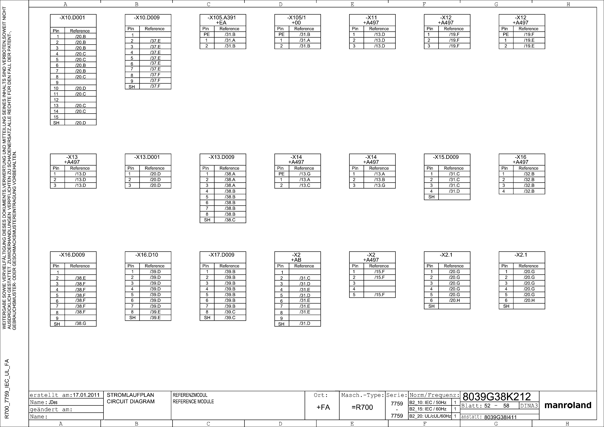

# +FA — Sheet 52 of 58 — REFERENZMODUL

**REFERENCE MODULE**

> Part of the manroland **R700** printing press IEC/UL circuit diagrams.
> Drawing class: **Stromlaufplan / Circuit diagram** (DIN A3).
> Document `+FA` covers the **Delivery** machine section.

## At a glance

| Field | Value |
|---|---|
| Document | `+FA`  (8039G38K212) |
| Sheet | **52** of 58 |
| Section (DE) | REFERENZMODUL |
| Section (EN) | REFERENCE MODULE |
| Section type | REFERENCE_MODULE — Reference module |
| Machine type | `=R700` |
| Series | `7759` |
| Created | 17.01.2011 |
| Replaces | `8039G38I411` |
| Columns used | A, B, C, D, E, F, G |
| Path numbers | — |
| Labels on sheet | 317 |
| Cross-refs out | 115 |
| Cross-refs in | 0 |

**Previous:** [+FA sheet 51](SHEET_0051.md) · **Next:** [+FA sheet 53](SHEET_0053.md) · **Document TOC:** [_TOC.md](_TOC.md)  (+FA) · **Master TOC:** [all sheets](../_MASTER_TOC.md)

## Sheet image (300 DPI, exact vector render)



_Rendered directly from the PDF vector layer at 300 DPI (1-bit), no OCR and no resampling. Use it to confirm anything ambiguous in the text below._

## Cross-references on this sheet

Each entry is a wire leaving this sheet. The printed token is `/sheet.column`; the link resolves to that sheet inside the same document.

| Ref | Target sheet | Col | Path | Destination on target | Target section | From col |
|---|---|---|---|---|---|---|
| `/31.B` | [+FA sheet 31](SHEET_0031.md) | B | — | — | BEIPACK | C |
| `/31.B` | [+FA sheet 31](SHEET_0031.md) | B | — | — | BEIPACK | D |
| `/19.F` | [+FA sheet 19](SHEET_0019.md) | F | — | — | LÜFTER | F |
| `/19.F` | [+FA sheet 19](SHEET_0019.md) | F | — | — | LÜFTER | F |
| `/19.F` | [+FA sheet 19](SHEET_0019.md) | F | — | — | LÜFTER | F |
| `/19.F` | [+FA sheet 19](SHEET_0019.md) | F | — | — | LÜFTER | G |
| `/13.D` | [+FA sheet 13](SHEET_0013.md) | D | — | — | SPANNUNGSVERSORGUNG: | E |
| `/13.D` | [+FA sheet 13](SHEET_0013.md) | D | — | — | SPANNUNGSVERSORGUNG: | E |
| `/13.D` | [+FA sheet 13](SHEET_0013.md) | D | — | — | SPANNUNGSVERSORGUNG: | E |
| `/20.B` | [+FA sheet 20](SHEET_0020.md) | B | — | — | LEITSTAND RECHNER | A |
| `/20.B` | [+FA sheet 20](SHEET_0020.md) | B | — | — | LEITSTAND RECHNER | A |
| `/20.B` | [+FA sheet 20](SHEET_0020.md) | B | — | — | LEITSTAND RECHNER | A |
| `/20.C` | [+FA sheet 20](SHEET_0020.md) | C | — | — | LEITSTAND RECHNER | A |
| `/20.C` | [+FA sheet 20](SHEET_0020.md) | C | — | — | LEITSTAND RECHNER | A |
| `/20.B` | [+FA sheet 20](SHEET_0020.md) | B | — | — | LEITSTAND RECHNER | A |
| `/20.B` | [+FA sheet 20](SHEET_0020.md) | B | — | — | LEITSTAND RECHNER | A |
| `/20.C` | [+FA sheet 20](SHEET_0020.md) | C | — | — | LEITSTAND RECHNER | A |
| `/31.A` | [+FA sheet 31](SHEET_0031.md) | A | — | — | BEIPACK | C |
| `/31.B` | [+FA sheet 31](SHEET_0031.md) | B | — | — | BEIPACK | C |
| `/31.A` | [+FA sheet 31](SHEET_0031.md) | A | — | — | BEIPACK | D |
| `/31.B` | [+FA sheet 31](SHEET_0031.md) | B | — | — | BEIPACK | D |
| `/19.E` | [+FA sheet 19](SHEET_0019.md) | E | — | — | LÜFTER | G |
| `/19.E` | [+FA sheet 19](SHEET_0019.md) | E | — | — | LÜFTER | G |
| `/37.E` | [+FA sheet 37](SHEET_0037.md) | E | — | — | OPTION: TELEPRESENCE | B |
| `/37.E` | [+FA sheet 37](SHEET_0037.md) | E | — | — | OPTION: TELEPRESENCE | B |
| `/37.E` | [+FA sheet 37](SHEET_0037.md) | E | — | — | OPTION: TELEPRESENCE | B |
| `/37.E` | [+FA sheet 37](SHEET_0037.md) | E | — | — | OPTION: TELEPRESENCE | B |
| `/37.E` | [+FA sheet 37](SHEET_0037.md) | E | — | — | OPTION: TELEPRESENCE | B |
| `/37.E` | [+FA sheet 37](SHEET_0037.md) | E | — | — | OPTION: TELEPRESENCE | B |
| `/37.F` | [+FA sheet 37](SHEET_0037.md) | F | — | — | OPTION: TELEPRESENCE | B |
| `/37.F` | [+FA sheet 37](SHEET_0037.md) | F | — | — | OPTION: TELEPRESENCE | B |
| `/37.F` | [+FA sheet 37](SHEET_0037.md) | F | — | — | OPTION: TELEPRESENCE | B |
| `/20.D` | [+FA sheet 20](SHEET_0020.md) | D | — | — | LEITSTAND RECHNER | A |
| `/20.C` | [+FA sheet 20](SHEET_0020.md) | C | — | — | LEITSTAND RECHNER | A |
| `/20.C` | [+FA sheet 20](SHEET_0020.md) | C | — | — | LEITSTAND RECHNER | A |
| `/20.C` | [+FA sheet 20](SHEET_0020.md) | C | — | — | LEITSTAND RECHNER | A |
| `/20.D` | [+FA sheet 20](SHEET_0020.md) | D | — | — | LEITSTAND RECHNER | A |
| `/38.A` | [+FA sheet 38](SHEET_0038.md) | A | — | — | OPTION: TELEPRESENCE | C |
| `/38.A` | [+FA sheet 38](SHEET_0038.md) | A | — | — | OPTION: TELEPRESENCE | C |
| `/38.A` | [+FA sheet 38](SHEET_0038.md) | A | — | — | OPTION: TELEPRESENCE | C |
| `/38.B` | [+FA sheet 38](SHEET_0038.md) | B | — | — | OPTION: TELEPRESENCE | C |
| `/38.B` | [+FA sheet 38](SHEET_0038.md) | B | — | — | OPTION: TELEPRESENCE | C |
| `/38.B` | [+FA sheet 38](SHEET_0038.md) | B | — | — | OPTION: TELEPRESENCE | C |
| `/38.B` | [+FA sheet 38](SHEET_0038.md) | B | — | — | OPTION: TELEPRESENCE | C |
| `/38.B` | [+FA sheet 38](SHEET_0038.md) | B | — | — | OPTION: TELEPRESENCE | C |
| `/38.C` | [+FA sheet 38](SHEET_0038.md) | C | — | — | OPTION: TELEPRESENCE | C |
| `/13.A` | [+FA sheet 13](SHEET_0013.md) | A | — | — | SPANNUNGSVERSORGUNG: | E |
| `/13.B` | [+FA sheet 13](SHEET_0013.md) | B | — | — | SPANNUNGSVERSORGUNG: | E |
| `/13.G` | [+FA sheet 13](SHEET_0013.md) | G | — | — | SPANNUNGSVERSORGUNG: | E |
| `/32.B` | [+FA sheet 32](SHEET_0032.md) | B | — | — | OPTION: COLORPILOT, COLORPILOTPLUS | G |
| `/32.B` | [+FA sheet 32](SHEET_0032.md) | B | — | — | OPTION: COLORPILOT, COLORPILOTPLUS | G |
| `/32.B` | [+FA sheet 32](SHEET_0032.md) | B | — | — | OPTION: COLORPILOT, COLORPILOTPLUS | G |
| `/32.B` | [+FA sheet 32](SHEET_0032.md) | B | — | — | OPTION: COLORPILOT, COLORPILOTPLUS | G |
| `/13.G` | [+FA sheet 13](SHEET_0013.md) | G | — | — | SPANNUNGSVERSORGUNG: | D |
| `/13.D` | [+FA sheet 13](SHEET_0013.md) | D | — | — | SPANNUNGSVERSORGUNG: | A |
| `/13.D` | [+FA sheet 13](SHEET_0013.md) | D | — | — | SPANNUNGSVERSORGUNG: | A |
| `/13.D` | [+FA sheet 13](SHEET_0013.md) | D | — | — | SPANNUNGSVERSORGUNG: | A |
| `/20.D` | [+FA sheet 20](SHEET_0020.md) | D | — | — | LEITSTAND RECHNER | B |
| `/20.D` | [+FA sheet 20](SHEET_0020.md) | D | — | — | LEITSTAND RECHNER | B |
| `/20.D` | [+FA sheet 20](SHEET_0020.md) | D | — | — | LEITSTAND RECHNER | B |
| `/31.C` | [+FA sheet 31](SHEET_0031.md) | C | — | — | BEIPACK | F |
| `/31.C` | [+FA sheet 31](SHEET_0031.md) | C | — | — | BEIPACK | F |
| `/31.C` | [+FA sheet 31](SHEET_0031.md) | C | — | — | BEIPACK | F |
| `/31.D` | [+FA sheet 31](SHEET_0031.md) | D | — | — | BEIPACK | F |
| `/13.A` | [+FA sheet 13](SHEET_0013.md) | A | — | — | SPANNUNGSVERSORGUNG: | D |
| `/13.C` | [+FA sheet 13](SHEET_0013.md) | C | — | — | SPANNUNGSVERSORGUNG: | D |
| `/39.B` | [+FA sheet 39](SHEET_0039.md) | B | — | — | OPTION: TELEPRESENCE | C |
| `/39.B` | [+FA sheet 39](SHEET_0039.md) | B | — | — | OPTION: TELEPRESENCE | C |
| `/39.B` | [+FA sheet 39](SHEET_0039.md) | B | — | — | OPTION: TELEPRESENCE | C |
| `/39.B` | [+FA sheet 39](SHEET_0039.md) | B | — | — | OPTION: TELEPRESENCE | C |
| `/39.B` | [+FA sheet 39](SHEET_0039.md) | B | — | — | OPTION: TELEPRESENCE | C |
| `/39.B` | [+FA sheet 39](SHEET_0039.md) | B | — | — | OPTION: TELEPRESENCE | C |
| `/39.B` | [+FA sheet 39](SHEET_0039.md) | B | — | — | OPTION: TELEPRESENCE | C |
| `/39.C` | [+FA sheet 39](SHEET_0039.md) | C | — | — | OPTION: TELEPRESENCE | C |
| `/39.C` | [+FA sheet 39](SHEET_0039.md) | C | — | — | OPTION: TELEPRESENCE | C |
| `/15.F` | [+FA sheet 15](SHEET_0015.md) | F | — | — | SPANNUNGSVERSORGUNG: | E |
| `/15.F` | [+FA sheet 15](SHEET_0015.md) | F | — | — | SPANNUNGSVERSORGUNG: | E |
| `/20.G` | [+FA sheet 20](SHEET_0020.md) | G | — | — | LEITSTAND RECHNER | F |
| `/20.G` | [+FA sheet 20](SHEET_0020.md) | G | — | — | LEITSTAND RECHNER | F |
| `/20.G` | [+FA sheet 20](SHEET_0020.md) | G | — | — | LEITSTAND RECHNER | F |
| `/20.G` | [+FA sheet 20](SHEET_0020.md) | G | — | — | LEITSTAND RECHNER | F |
| `/20.G` | [+FA sheet 20](SHEET_0020.md) | G | — | — | LEITSTAND RECHNER | F |
| `/20.H` | [+FA sheet 20](SHEET_0020.md) | H | — | — | LEITSTAND RECHNER | F |
| `/20.G` | [+FA sheet 20](SHEET_0020.md) | G | — | — | LEITSTAND RECHNER | G |
| `/20.G` | [+FA sheet 20](SHEET_0020.md) | G | — | — | LEITSTAND RECHNER | G |
| `/20.G` | [+FA sheet 20](SHEET_0020.md) | G | — | — | LEITSTAND RECHNER | G |
| `/20.G` | [+FA sheet 20](SHEET_0020.md) | G | — | — | LEITSTAND RECHNER | G |
| `/20.G` | [+FA sheet 20](SHEET_0020.md) | G | — | — | LEITSTAND RECHNER | G |
| `/20.H` | [+FA sheet 20](SHEET_0020.md) | H | — | — | LEITSTAND RECHNER | G |
| `/39.D` | [+FA sheet 39](SHEET_0039.md) | D | — | — | OPTION: TELEPRESENCE | B |
| `/39.D` | [+FA sheet 39](SHEET_0039.md) | D | — | — | OPTION: TELEPRESENCE | B |
| `/39.D` | [+FA sheet 39](SHEET_0039.md) | D | — | — | OPTION: TELEPRESENCE | B |
| `/39.D` | [+FA sheet 39](SHEET_0039.md) | D | — | — | OPTION: TELEPRESENCE | B |
| `/39.D` | [+FA sheet 39](SHEET_0039.md) | D | — | — | OPTION: TELEPRESENCE | B |
| `/39.D` | [+FA sheet 39](SHEET_0039.md) | D | — | — | OPTION: TELEPRESENCE | B |
| `/39.D` | [+FA sheet 39](SHEET_0039.md) | D | — | — | OPTION: TELEPRESENCE | B |
| `/39.E` | [+FA sheet 39](SHEET_0039.md) | E | — | — | OPTION: TELEPRESENCE | B |
| `/39.E` | [+FA sheet 39](SHEET_0039.md) | E | — | — | OPTION: TELEPRESENCE | B |
| `/38.E` | [+FA sheet 38](SHEET_0038.md) | E | — | — | OPTION: TELEPRESENCE | A |
| `/38.F` | [+FA sheet 38](SHEET_0038.md) | F | — | — | OPTION: TELEPRESENCE | A |
| `/38.F` | [+FA sheet 38](SHEET_0038.md) | F | — | — | OPTION: TELEPRESENCE | A |
| `/38.F` | [+FA sheet 38](SHEET_0038.md) | F | — | — | OPTION: TELEPRESENCE | A |
| `/38.F` | [+FA sheet 38](SHEET_0038.md) | F | — | — | OPTION: TELEPRESENCE | A |
| `/38.F` | [+FA sheet 38](SHEET_0038.md) | F | — | — | OPTION: TELEPRESENCE | A |
| `/38.F` | [+FA sheet 38](SHEET_0038.md) | F | — | — | OPTION: TELEPRESENCE | A |
| `/31.C` | [+FA sheet 31](SHEET_0031.md) | C | — | — | BEIPACK | D |
| `/31.D` | [+FA sheet 31](SHEET_0031.md) | D | — | — | BEIPACK | D |
| `/31.E` | [+FA sheet 31](SHEET_0031.md) | E | — | — | BEIPACK | D |
| `/31.D` | [+FA sheet 31](SHEET_0031.md) | D | — | — | BEIPACK | D |
| `/31.E` | [+FA sheet 31](SHEET_0031.md) | E | — | — | BEIPACK | D |
| `/31.E` | [+FA sheet 31](SHEET_0031.md) | E | — | — | BEIPACK | D |
| `/31.E` | [+FA sheet 31](SHEET_0031.md) | E | — | — | BEIPACK | D |
| `/15.F` | [+FA sheet 15](SHEET_0015.md) | F | — | — | SPANNUNGSVERSORGUNG: | E |
| `/38.G` | [+FA sheet 38](SHEET_0038.md) | G | — | — | OPTION: TELEPRESENCE | A |
| `/31.D` | [+FA sheet 31](SHEET_0031.md) | D | — | — | BEIPACK | D |

## Devices on this sheet

| Tag | Class | Class meaning (IEC) | Col | Sub | Terminal | Sign |
|---|---|---|---|---|---|---|
| `X105/1` | X | Klemme / terminal, plug connector | D | 1 | — | — |
| `X11` | X | Klemme / terminal, plug connector | E | — | — | — |
| `+A497` | A | Baugruppe / assembly, module, PC board | E | — | — | + |
| `X12` | X | Klemme / terminal, plug connector | F | — | — | — |
| `+A497` | A | Baugruppe / assembly, module, PC board | F | — | — | + |
| `+A497` | A | Baugruppe / assembly, module, PC board | G | — | — | + |
| `X12` | X | Klemme / terminal, plug connector | G | — | — | — |
| `X13` | X | Klemme / terminal, plug connector | A | — | — | — |
| `+A497` | A | Baugruppe / assembly, module, PC board | A | — | — | + |
| `+A497` | A | Baugruppe / assembly, module, PC board | D | — | — | + |
| `X14` | X | Klemme / terminal, plug connector | D | — | — | — |
| `X14` | X | Klemme / terminal, plug connector | E | — | — | — |
| `+A497` | A | Baugruppe / assembly, module, PC board | E | — | — | + |
| `X16` | X | Klemme / terminal, plug connector | G | — | — | — |
| `+A497` | A | Baugruppe / assembly, module, PC board | G | — | — | + |
| `X2` | X | Klemme / terminal, plug connector | D | — | — | — |
| `X2` | X | Klemme / terminal, plug connector | E | — | — | — |
| `+A497` | A | Baugruppe / assembly, module, PC board | E | — | — | + |
| `X10.D001` | — | cross-device reference | A | — | — | — |
| `X10.D009` | — | cross-device reference | B | — | — | — |
| `X105.A391` | — | cross-device reference | C | — | — | — |
| `X13.D001` | — | cross-device reference | B | — | — | — |
| `X13.D009` | — | cross-device reference | C | — | — | — |
| `X15.D009` | — | cross-device reference | F | — | — | — |
| `X16.D009` | — | cross-device reference | A | — | — | — |
| `X16.D10` | — | cross-device reference | B | — | — | — |
| `X17.D009` | — | cross-device reference | C | — | — | — |
| `X2.1` | — | cross-device reference | F | — | — | — |
| `X2.1` | — | cross-device reference | G | — | — | — |

## Potentials / nets

| Potential | Count | Columns | Attached devices | Terminals |
|---|---|---|---|---|
| `PE` | 4 | C, D, G | — | — |


A potential such as `L24+/4` or `M24+` is a named supply/return rail; every place it appears on this sheet is electrically common.

## Wire-end annotations (grouped as printed)

A wire that continues elsewhere is annotated with a small cluster: the destination description, the path/line number `#NN`, and the `/sheet.column` cross reference. Each row below is one such cluster exactly as it is grouped on the drawing.

| Col | Y | Path | Cross-ref | Text on the wire |
|---|---|---|---|---|
| A | 30.1 | — | — | `X10.D001` |
| B | 30.1 | — | — | `X10.D009` |
| C | 30.1 | — | — | `X105.A391 +EA` |
| D | 30.1 | — | — | `X105/1 +00` |
| E | 30.1 | — | — | `+A497 X11` |
| F | 30.1 | — | — | `+A497 X12` |
| G | 30.1 | — | — | `X12` |
| G | 40.0 | — | — | `+A497` |
| B | 52.7 | — | — | `Pin SH 3 4 5 6 7 8 9 2 1 Reference` |
| C | 52.7 | — | — | `Pin Reference` |
| D | 52.7 | — | — | `Pin Reference` |
| E | 52.7 | — | — | `Pin 1 2 3 Reference` |
| F | 52.7 | — | — | `Pin 1 2 3 Reference` |
| G | 52.7 | — | — | `Pin Reference` |
| A | 57.0 | — | — | `Pin SH 10 11 13 14 15 12 3 4 5 6 7 8 9 2 1 Reference` |
| C | 64.0 | — | — | `PE` |
| C | 64.0 | — | `/31.B` | — |
| D | 64.0 | — | — | `PE` |
| D | 64.0 | — | `/31.B` | — |
| F | 64.0 | — | `/19.F`, `/19.F`, `/19.F` | — |
| G | 64.0 | — | — | `PE` |
| G | 64.0 | — | `/19.F` | — |
| E | 64.1 | — | `/13.D`, `/13.D`, `/13.D` | — |
| A | 68.3 | — | `/20.B`, `/20.B`, `/20.B`, `/20.C`, `/20.C`, `/20.B`, `/20.B`, `/20.C` | — |
| C | 75.4 | — | — | `1 2` |
| C | 75.4 | — | `/31.A`, `/31.B` | — |
| D | 75.4 | — | — | `1 2` |
| D | 75.4 | — | `/31.A`, `/31.B` | — |
| G | 75.4 | — | — | `1 2` |
| G | 75.4 | — | `/19.E`, `/19.E` | — |
| B | 76.8 | — | `/37.E`, `/37.E`, `/37.E`, `/37.E`, `/37.E`, `/37.E`, `/37.F`, `/37.F`, `/37.F` | — |
| A | 170.4 | — | `/20.D`, `/20.C` | — |
| A | 204.4 | — | `/20.C`, `/20.C` | — |
| A | 238.4 | — | `/20.D` | — |
| A | 305.0 | — | — | `+A497 X13` |
| B | 305.0 | — | — | `X13.D001` |
| C | 305.0 | — | — | `X13.D009` |
| D | 305.0 | — | — | `X14` |
| E | 305.0 | — | — | `+A497 X14` |
| F | 305.0 | — | — | `X15.D009` |
| G | 305.0 | — | — | `+A497 X16` |
| D | 314.9 | — | — | `+A497` |
| A | 327.7 | — | — | `Pin 1 2 3 Reference` |
| B | 327.7 | — | — | `Pin 1 2 3 Reference` |
| C | 327.7 | — | — | `Pin SH 3 4 5 6 7 8 2 1 Reference` |
| D | 327.7 | — | — | `Pin Reference` |
| E | 327.7 | — | — | `Pin 1 2 3 Reference` |
| F | 327.7 | — | — | `Pin SH 3 4 2 1 Reference` |
| G | 327.7 | — | — | `Pin 1 2 3 4 Reference` |
| A | 339.0 | — | `/13.D`, `/13.D`, `/13.D` | — |
| B | 339.0 | — | `/20.D`, `/20.D`, `/20.D` | — |
| C | 339.0 | — | `/38.A`, `/38.A`, `/38.A`, `/38.B`, `/38.B`, `/38.B`, `/38.B`, `/38.B`, `/38.C` | — |
| D | 339.0 | — | — | `PE` |
| D | 339.0 | — | `/13.G` | — |
| E | 339.0 | — | `/13.A`, `/13.B`, `/13.G` | — |
| F | 339.0 | — | `/31.C`, `/31.C`, `/31.C`, `/31.D` | — |
| G | 339.0 | — | `/32.B`, `/32.B`, `/32.B`, `/32.B` | — |
| D | 350.3 | — | `/13.A`, `/13.C` | — |
| D | 350.4 | — | — | `1 2` |
| A | 497.8 | — | — | `X16.D009` |
| B | 497.8 | — | — | `X16.D10` |
| C | 497.8 | — | — | `X17.D009` |
| D | 497.8 | — | — | `+AB X2` |
| E | 497.8 | — | — | `+A497 X2` |
| F | 497.8 | — | — | `X2.1` |
| G | 497.8 | — | — | `X2.1` |
| A | 520.4 | — | — | `Pin SH 3 4 5 6 7 8 9 2 1 Reference` |
| B | 520.4 | — | — | `Pin SH 3 4 5 6 7 8 2 1 Reference` |
| C | 520.4 | — | — | `Pin SH 3 4 5 6 7 8 2 1 Reference` |
| D | 520.4 | — | — | `Pin SH 3 4 5 6 7 8 9 2 1 Reference` |
| E | 520.4 | — | — | `Pin 1 2 3 4 5 Reference` |
| F | 520.4 | — | — | `Pin SH 3 4 5 6 2 1 Reference` |
| G | 520.4 | — | — | `Pin SH 3 4 5 6 2 1 Reference` |
| C | 531.7 | — | `/39.B`, `/39.B`, `/39.B`, `/39.B`, `/39.B`, `/39.B`, `/39.B`, `/39.C`, `/39.C` | — |
| B | 531.8 | — | `/39.D`, `/39.D`, `/39.D`, `/39.D`, `/39.D`, `/39.D`, `/39.D`, `/39.E`, `/39.E` | — |
| E | 531.8 | — | `/15.F`, `/15.F` | — |
| F | 531.8 | — | `/20.G`, `/20.G`, `/20.G`, `/20.G`, `/20.G`, `/20.H` | — |
| G | 531.8 | — | `/20.G`, `/20.G`, `/20.G`, `/20.G`, `/20.G`, `/20.H` | — |
| A | 544.5 | — | `/38.E`, `/38.F`, `/38.F`, `/38.F`, `/38.F`, `/38.F`, `/38.F` | — |
| D | 544.5 | — | `/31.C`, `/31.D`, `/31.E`, `/31.D`, `/31.E`, `/31.E`, `/31.E` | — |
| E | 577.1 | — | `/15.F` | — |
| A | 633.8 | — | `/38.G` | — |
| D | 633.8 | — | `/31.D` | — |


## Notes and free text on this sheet

| Text | Col | Y (pt) |
|---|---|---|
| `Pin` | A | 56.96 |
| `Reference` | A | 57.12 |
| `SH` | A | 238.39 |
| `Pin` | B | 52.7 |
| `Reference` | B | 52.86 |
| `SH` | B | 167.53 |
| `Pin` | C | 52.7 |
| `Reference` | C | 52.86 |
| `+EA` | C | 39.98 |
| `Pin` | D | 52.7 |
| `Reference` | D | 52.86 |
| `Pin` | E | 52.7 |
| `Reference` | E | 52.86 |
| `Pin` | F | 52.7 |
| `Reference` | F | 52.86 |
| `Pin` | G | 52.7 |
| `Reference` | G | 52.86 |
| `SH` | C | 429.73 |
| `SH` | F | 384.38 |
| `SH` | D | 635.24 |
| `+AB` | D | 507.7 |
| `SH` | G | 599.81 |

## Complete label inventory (exact text from the drawing)

Every text object inside the drawing area of this sheet, in DIN reading order (column A→H, then top→bottom). This is the authoritative list: if a string is not here it is not printed on this sheet.

| Col | Y | X | Dir | Type | Text |
|---|---|---|---|---|---|
| A | 30.1 | 117.2 | → | device ref | `X10.D001` |
| A | 57.0 | 104.0 | → | text | `Pin` |
| A | 57.1 | 138.0 | → | text | `Reference` |
| A | 68.3 | 148.5 | → | cross-reference | `/20.B` |
| A | 68.4 | 111.7 | → | number | `1` |
| A | 79.6 | 148.5 | → | cross-reference | `/20.B` |
| A | 79.7 | 110.6 | → | number | `2` |
| A | 91.0 | 110.3 | → | number | `3` |
| A | 91.0 | 148.5 | → | cross-reference | `/20.B` |
| A | 102.3 | 148.4 | → | cross-reference | `/20.C` |
| A | 102.4 | 110.3 | → | number | `4` |
| A | 113.7 | 110.3 | → | number | `5` |
| A | 113.7 | 148.4 | → | cross-reference | `/20.C` |
| A | 125.0 | 110.3 | → | number | `6` |
| A | 125.0 | 148.5 | → | cross-reference | `/20.B` |
| A | 136.3 | 148.5 | → | cross-reference | `/20.B` |
| A | 136.4 | 110.3 | → | number | `7` |
| A | 147.7 | 110.3 | → | number | `8` |
| A | 147.7 | 148.4 | → | cross-reference | `/20.C` |
| A | 159.1 | 110.3 | → | number | `9` |
| A | 170.4 | 105.4 | → | number | `10` |
| A | 170.4 | 148.4 | → | cross-reference | `/20.D` |
| A | 181.7 | 105.4 | → | number | `11` |
| A | 181.7 | 148.4 | → | cross-reference | `/20.C` |
| A | 193.1 | 105.7 | → | number | `12` |
| A | 204.4 | 105.4 | → | number | `13` |
| A | 204.4 | 148.4 | → | cross-reference | `/20.C` |
| A | 215.7 | 148.4 | → | cross-reference | `/20.C` |
| A | 215.8 | 105.4 | → | number | `14` |
| A | 227.1 | 105.4 | → | number | `15` |
| A | 238.4 | 104.9 | → | text | `SH` |
| A | 238.4 | 148.4 | → | cross-reference | `/20.D` |
| A | 305.0 | 130.7 | → | device tag | `X13` |
| A | 314.9 | 126.1 | → | device tag | `+A497` |
| A | 327.7 | 104.0 | → | text | `Pin` |
| A | 327.8 | 138.0 | → | text | `Reference` |
| A | 339.0 | 148.4 | → | cross-reference | `/13.D` |
| A | 339.1 | 105.4 | → | number | `1` |
| A | 350.4 | 106.0 | → | number | `2` |
| A | 350.4 | 148.4 | → | cross-reference | `/13.D` |
| A | 361.7 | 106.0 | → | number | `3` |
| A | 361.7 | 148.4 | → | cross-reference | `/13.D` |
| A | 497.8 | 116.5 | → | device ref | `X16.D009` |
| A | 520.4 | 104.0 | → | text | `Pin` |
| A | 520.6 | 138.0 | → | text | `Reference` |
| A | 533.2 | 111.7 | → | number | `1` |
| A | 544.5 | 148.7 | → | cross-reference | `/38.E` |
| A | 544.6 | 110.6 | → | number | `2` |
| A | 555.9 | 110.3 | → | number | `3` |
| A | 555.9 | 148.8 | → | cross-reference | `/38.F` |
| A | 567.2 | 148.8 | → | cross-reference | `/38.F` |
| A | 567.3 | 110.3 | → | number | `4` |
| A | 578.5 | 148.8 | → | cross-reference | `/38.F` |
| A | 578.6 | 110.3 | → | number | `5` |
| A | 588.4 | 148.8 | → | cross-reference | `/38.F` |
| A | 589.9 | 110.3 | → | number | `6` |
| A | 599.8 | 148.8 | → | cross-reference | `/38.F` |
| A | 599.9 | 110.3 | → | number | `7` |
| A | 611.1 | 148.8 | → | cross-reference | `/38.F` |
| A | 612.6 | 110.3 | → | number | `8` |
| A | 623.9 | 110.3 | → | number | `9` |
| A | 633.8 | 148.3 | → | cross-reference | `/38.G` |
| A | 635.2 | 106.2 | → | text | `SH` |
| B | 30.1 | 263.9 | → | device ref | `X10.D009` |
| B | 52.7 | 251.4 | → | text | `Pin` |
| B | 52.9 | 285.4 | → | text | `Reference` |
| B | 65.5 | 259.1 | → | number | `1` |
| B | 76.8 | 296.1 | → | cross-reference | `/37.E` |
| B | 76.9 | 258.0 | → | number | `2` |
| B | 88.1 | 296.1 | → | cross-reference | `/37.E` |
| B | 88.2 | 257.7 | → | number | `3` |
| B | 99.5 | 257.7 | → | number | `4` |
| B | 99.5 | 296.1 | → | cross-reference | `/37.E` |
| B | 110.8 | 296.1 | → | cross-reference | `/37.E` |
| B | 110.9 | 257.7 | → | number | `5` |
| B | 120.7 | 296.1 | → | cross-reference | `/37.E` |
| B | 122.2 | 257.7 | → | number | `6` |
| B | 132.1 | 257.7 | → | number | `7` |
| B | 132.1 | 296.1 | → | cross-reference | `/37.E` |
| B | 143.4 | 296.2 | → | cross-reference | `/37.F` |
| B | 144.9 | 257.7 | → | number | `8` |
| B | 154.7 | 296.2 | → | cross-reference | `/37.F` |
| B | 156.2 | 257.7 | → | number | `9` |
| B | 166.1 | 296.2 | → | cross-reference | `/37.F` |
| B | 167.5 | 253.6 | → | text | `SH` |
| B | 305.0 | 264.6 | → | device ref | `X13.D001` |
| B | 327.7 | 251.4 | → | text | `Pin` |
| B | 327.8 | 285.4 | → | text | `Reference` |
| B | 339.0 | 295.8 | → | cross-reference | `/20.D` |
| B | 339.1 | 252.9 | → | number | `1` |
| B | 350.4 | 253.4 | → | number | `2` |
| B | 350.4 | 295.8 | → | cross-reference | `/20.D` |
| B | 361.7 | 253.4 | → | number | `3` |
| B | 361.7 | 295.8 | → | cross-reference | `/20.D` |
| B | 497.8 | 266.9 | → | device ref | `X16.D10` |
| B | 520.4 | 251.4 | → | text | `Pin` |
| B | 520.6 | 285.4 | → | text | `Reference` |
| B | 531.8 | 258.8 | → | number | `1` |
| B | 531.8 | 295.8 | → | cross-reference | `/39.D` |
| B | 543.1 | 295.8 | → | cross-reference | `/39.D` |
| B | 543.2 | 258.5 | → | number | `2` |
| B | 554.5 | 258.4 | → | number | `3` |
| B | 554.5 | 295.8 | → | cross-reference | `/39.D` |
| B | 565.8 | 258.4 | → | number | `4` |
| B | 565.8 | 295.8 | → | cross-reference | `/39.D` |
| B | 577.1 | 295.8 | → | cross-reference | `/39.D` |
| B | 577.2 | 258.4 | → | number | `5` |
| B | 588.5 | 258.4 | → | number | `6` |
| B | 588.5 | 295.8 | → | cross-reference | `/39.D` |
| B | 599.8 | 295.8 | → | cross-reference | `/39.D` |
| B | 599.9 | 258.4 | → | number | `7` |
| B | 611.1 | 296.1 | → | cross-reference | `/39.E` |
| B | 611.2 | 258.4 | → | number | `8` |
| B | 622.5 | 255.0 | → | text | `SH` |
| B | 622.5 | 296.1 | → | cross-reference | `/39.E` |
| C | 30.1 | 409.3 | → | device ref | `X105.A391` |
| C | 40.0 | 425.9 | → | text | `+EA` |
| C | 52.7 | 398.8 | → | text | `Pin` |
| C | 52.9 | 432.9 | → | text | `Reference` |
| C | 64.0 | 401.7 | → | potential | `PE` |
| C | 64.0 | 443.3 | → | cross-reference | `/31.B` |
| C | 75.4 | 404.5 | → | number | `1` |
| C | 75.4 | 443.2 | → | cross-reference | `/31.A` |
| C | 86.7 | 443.3 | → | cross-reference | `/31.B` |
| C | 86.8 | 405.1 | → | number | `2` |
| C | 305.0 | 411.3 | → | device ref | `X13.D009` |
| C | 327.7 | 398.8 | → | text | `Pin` |
| C | 327.8 | 432.9 | → | text | `Reference` |
| C | 339.0 | 443.2 | → | cross-reference | `/38.A` |
| C | 339.1 | 406.2 | → | number | `1` |
| C | 350.3 | 443.2 | → | cross-reference | `/38.A` |
| C | 350.4 | 405.9 | → | number | `2` |
| C | 361.7 | 405.8 | → | number | `3` |
| C | 361.7 | 443.2 | → | cross-reference | `/38.A` |
| C | 373.0 | 443.3 | → | cross-reference | `/38.B` |
| C | 373.1 | 405.8 | → | number | `4` |
| C | 384.3 | 443.3 | → | cross-reference | `/38.B` |
| C | 384.4 | 405.8 | → | number | `5` |
| C | 395.7 | 443.3 | → | cross-reference | `/38.B` |
| C | 395.8 | 405.8 | → | number | `6` |
| C | 407.0 | 443.3 | → | cross-reference | `/38.B` |
| C | 407.1 | 405.8 | → | number | `7` |
| C | 418.4 | 405.8 | → | number | `8` |
| C | 418.4 | 443.3 | → | cross-reference | `/38.B` |
| C | 429.7 | 402.4 | → | text | `SH` |
| C | 429.7 | 443.2 | → | cross-reference | `/38.C` |
| C | 497.8 | 411.3 | → | device ref | `X17.D009` |
| C | 520.4 | 398.8 | → | text | `Pin` |
| C | 520.6 | 432.9 | → | text | `Reference` |
| C | 531.7 | 443.3 | → | cross-reference | `/39.B` |
| C | 531.8 | 406.2 | → | number | `1` |
| C | 543.1 | 443.3 | → | cross-reference | `/39.B` |
| C | 543.2 | 405.9 | → | number | `2` |
| C | 554.4 | 443.3 | → | cross-reference | `/39.B` |
| C | 554.5 | 405.8 | → | number | `3` |
| C | 565.8 | 405.8 | → | number | `4` |
| C | 565.8 | 443.3 | → | cross-reference | `/39.B` |
| C | 577.1 | 443.3 | → | cross-reference | `/39.B` |
| C | 577.2 | 405.8 | → | number | `5` |
| C | 588.4 | 443.3 | → | cross-reference | `/39.B` |
| C | 588.5 | 405.8 | → | number | `6` |
| C | 599.8 | 443.3 | → | cross-reference | `/39.B` |
| C | 599.9 | 405.8 | → | number | `7` |
| C | 611.1 | 443.2 | → | cross-reference | `/39.C` |
| C | 611.2 | 405.8 | → | number | `8` |
| C | 622.5 | 402.4 | → | text | `SH` |
| C | 622.5 | 443.2 | → | cross-reference | `/39.C` |
| D | 30.1 | 566.2 | → | device tag | `X105/1` |
| D | 40.0 | 574.9 | → | number | `+00` |
| D | 52.7 | 546.2 | → | text | `Pin` |
| D | 52.9 | 580.3 | → | text | `Reference` |
| D | 64.0 | 549.1 | → | potential | `PE` |
| D | 64.0 | 590.7 | → | cross-reference | `/31.B` |
| D | 75.4 | 551.9 | → | number | `1` |
| D | 75.4 | 590.6 | → | cross-reference | `/31.A` |
| D | 86.7 | 590.7 | → | cross-reference | `/31.B` |
| D | 86.8 | 552.5 | → | number | `2` |
| D | 305.0 | 572.9 | → | device tag | `X14` |
| D | 314.9 | 568.3 | → | device tag | `+A497` |
| D | 327.7 | 546.2 | → | text | `Pin` |
| D | 327.8 | 580.3 | → | text | `Reference` |
| D | 339.0 | 549.1 | → | potential | `PE` |
| D | 339.0 | 590.5 | → | cross-reference | `/13.G` |
| D | 350.3 | 590.6 | → | cross-reference | `/13.A` |
| D | 350.4 | 551.9 | → | number | `1` |
| D | 361.7 | 552.5 | → | number | `2` |
| D | 361.7 | 590.6 | → | cross-reference | `/13.C` |
| D | 497.8 | 575.9 | → | device tag | `X2` |
| D | 507.7 | 573.7 | → | text | `+AB` |
| D | 520.4 | 546.2 | → | text | `Pin` |
| D | 520.6 | 580.3 | → | text | `Reference` |
| D | 533.2 | 553.9 | → | number | `1` |
| D | 544.5 | 590.6 | → | cross-reference | `/31.C` |
| D | 544.6 | 552.8 | → | number | `2` |
| D | 555.9 | 552.5 | → | number | `3` |
| D | 555.9 | 590.6 | → | cross-reference | `/31.D` |
| D | 567.2 | 590.9 | → | cross-reference | `/31.E` |
| D | 567.3 | 552.5 | → | number | `4` |
| D | 578.5 | 590.6 | → | cross-reference | `/31.D` |
| D | 578.6 | 552.5 | → | number | `5` |
| D | 588.4 | 590.9 | → | cross-reference | `/31.E` |
| D | 589.9 | 552.5 | → | number | `6` |
| D | 599.8 | 590.9 | → | cross-reference | `/31.E` |
| D | 599.9 | 552.5 | → | number | `7` |
| D | 611.1 | 590.9 | → | cross-reference | `/31.E` |
| D | 612.6 | 552.5 | → | number | `8` |
| D | 623.9 | 552.5 | → | number | `9` |
| D | 633.8 | 590.6 | → | cross-reference | `/31.D` |
| D | 635.2 | 548.4 | → | text | `SH` |
| E | 30.1 | 721.0 | → | device tag | `X11` |
| E | 40.0 | 715.7 | → | device tag | `+A497` |
| E | 52.7 | 693.6 | → | text | `Pin` |
| E | 52.9 | 727.7 | → | text | `Reference` |
| E | 64.1 | 695.1 | → | number | `1` |
| E | 64.1 | 738.0 | → | cross-reference | `/13.D` |
| E | 75.4 | 695.6 | → | number | `2` |
| E | 75.4 | 738.0 | → | cross-reference | `/13.D` |
| E | 86.7 | 738.0 | → | cross-reference | `/13.D` |
| E | 86.8 | 695.6 | → | number | `3` |
| E | 305.0 | 720.3 | → | device tag | `X14` |
| E | 314.9 | 715.7 | → | device tag | `+A497` |
| E | 327.7 | 693.6 | → | text | `Pin` |
| E | 327.8 | 727.7 | → | text | `Reference` |
| E | 339.0 | 738.0 | → | cross-reference | `/13.A` |
| E | 339.1 | 695.1 | → | number | `1` |
| E | 350.3 | 738.1 | → | cross-reference | `/13.B` |
| E | 350.4 | 695.6 | → | number | `2` |
| E | 361.7 | 695.6 | → | number | `3` |
| E | 361.7 | 737.9 | → | cross-reference | `/13.G` |
| E | 497.8 | 723.3 | → | device tag | `X2` |
| E | 507.7 | 715.7 | → | device tag | `+A497` |
| E | 520.4 | 693.6 | → | text | `Pin` |
| E | 520.6 | 727.7 | → | text | `Reference` |
| E | 531.8 | 695.1 | → | number | `1` |
| E | 531.8 | 738.4 | → | cross-reference | `/15.F` |
| E | 543.1 | 738.4 | → | cross-reference | `/15.F` |
| E | 543.2 | 695.6 | → | number | `2` |
| E | 554.5 | 695.6 | → | number | `3` |
| E | 565.8 | 695.6 | → | number | `4` |
| E | 577.1 | 738.4 | → | cross-reference | `/15.F` |
| E | 577.2 | 695.6 | → | number | `5` |
| F | 30.1 | 867.7 | → | device tag | `X12` |
| F | 40.0 | 863.1 | → | device tag | `+A497` |
| F | 52.7 | 841.0 | → | text | `Pin` |
| F | 52.9 | 875.1 | → | text | `Reference` |
| F | 64.0 | 885.8 | → | cross-reference | `/19.F` |
| F | 64.1 | 842.5 | → | number | `1` |
| F | 75.4 | 843.0 | → | number | `2` |
| F | 75.4 | 885.8 | → | cross-reference | `/19.F` |
| F | 86.7 | 885.8 | → | cross-reference | `/19.F` |
| F | 86.8 | 843.0 | → | number | `3` |
| F | 305.0 | 853.5 | → | device ref | `X15.D009` |
| F | 327.7 | 841.0 | → | text | `Pin` |
| F | 327.8 | 875.1 | → | text | `Reference` |
| F | 339.0 | 885.4 | → | cross-reference | `/31.C` |
| F | 339.1 | 848.4 | → | number | `1` |
| F | 350.4 | 848.1 | → | number | `2` |
| F | 350.4 | 885.4 | → | cross-reference | `/31.C` |
| F | 361.7 | 848.0 | → | number | `3` |
| F | 361.7 | 885.4 | → | cross-reference | `/31.C` |
| F | 373.0 | 885.4 | → | cross-reference | `/31.D` |
| F | 373.1 | 848.0 | → | number | `4` |
| F | 384.4 | 844.6 | → | text | `SH` |
| F | 497.8 | 867.0 | → | device ref | `X2.1` |
| F | 520.4 | 841.0 | → | text | `Pin` |
| F | 520.6 | 875.1 | → | text | `Reference` |
| F | 531.8 | 848.4 | → | number | `1` |
| F | 531.8 | 885.3 | → | cross-reference | `/20.G` |
| F | 543.1 | 885.3 | → | cross-reference | `/20.G` |
| F | 543.2 | 848.1 | → | number | `2` |
| F | 554.4 | 885.3 | → | cross-reference | `/20.G` |
| F | 554.5 | 848.0 | → | number | `3` |
| F | 565.8 | 848.0 | → | number | `4` |
| F | 565.8 | 885.3 | → | cross-reference | `/20.G` |
| F | 577.1 | 885.3 | → | cross-reference | `/20.G` |
| F | 577.2 | 848.0 | → | number | `5` |
| F | 588.5 | 848.0 | → | number | `6` |
| F | 588.5 | 885.7 | → | cross-reference | `/20.H` |
| F | 599.8 | 844.6 | → | text | `SH` |
| G | 30.1 | 1015.1 | → | device tag | `X12` |
| G | 40.0 | 1010.6 | → | device tag | `+A497` |
| G | 52.7 | 988.4 | → | text | `Pin` |
| G | 52.9 | 1022.5 | → | text | `Reference` |
| G | 64.0 | 991.3 | → | potential | `PE` |
| G | 64.0 | 1033.2 | → | cross-reference | `/19.F` |
| G | 75.4 | 994.1 | → | number | `1` |
| G | 75.4 | 1033.1 | → | cross-reference | `/19.E` |
| G | 86.7 | 1033.1 | → | cross-reference | `/19.E` |
| G | 86.8 | 994.7 | → | number | `2` |
| G | 305.0 | 1015.1 | → | device tag | `X16` |
| G | 314.9 | 1010.6 | → | device tag | `+A497` |
| G | 327.7 | 988.4 | → | text | `Pin` |
| G | 327.8 | 1022.5 | → | text | `Reference` |
| G | 339.0 | 1032.9 | → | cross-reference | `/32.B` |
| G | 339.1 | 989.9 | → | number | `1` |
| G | 350.3 | 1032.9 | → | cross-reference | `/32.B` |
| G | 350.4 | 990.4 | → | number | `2` |
| G | 361.7 | 990.4 | → | number | `3` |
| G | 361.7 | 1032.9 | → | cross-reference | `/32.B` |
| G | 373.0 | 1032.9 | → | cross-reference | `/32.B` |
| G | 373.1 | 990.4 | → | number | `4` |
| G | 497.8 | 1014.4 | → | device ref | `X2.1` |
| G | 520.4 | 988.4 | → | text | `Pin` |
| G | 520.6 | 1022.5 | → | text | `Reference` |
| G | 531.8 | 995.8 | → | number | `1` |
| G | 531.8 | 1032.7 | → | cross-reference | `/20.G` |
| G | 543.1 | 1032.7 | → | cross-reference | `/20.G` |
| G | 543.2 | 995.5 | → | number | `2` |
| G | 554.4 | 1032.7 | → | cross-reference | `/20.G` |
| G | 554.5 | 995.4 | → | number | `3` |
| G | 565.8 | 995.4 | → | number | `4` |
| G | 565.8 | 1032.7 | → | cross-reference | `/20.G` |
| G | 577.1 | 1032.7 | → | cross-reference | `/20.G` |
| G | 577.2 | 995.4 | → | number | `5` |
| G | 588.5 | 995.4 | → | number | `6` |
| G | 588.5 | 1033.1 | → | cross-reference | `/20.H` |
| G | 599.8 | 992.0 | → | text | `SH` |

## Reading-order text block

The same content as a plain block, grouped by DIN column — convenient to paste or to match against a visual description.

```text
=== Column A ===
  30.1  117.2  devref       X10.D001
  57.0  104.0  text         Pin
  57.1  138.0  text         Reference
  68.3  148.5  xref         /20.B
  68.4  111.7  numeric      1
  79.6  148.5  xref         /20.B
  79.7  110.6  numeric      2
  91.0  110.3  numeric      3
  91.0  148.5  xref         /20.B
 102.3  148.4  xref         /20.C
 102.4  110.3  numeric      4
 113.7  110.3  numeric      5
 113.7  148.4  xref         /20.C
 125.0  110.3  numeric      6
 125.0  148.5  xref         /20.B
 136.3  148.5  xref         /20.B
 136.4  110.3  numeric      7
 147.7  110.3  numeric      8
 147.7  148.4  xref         /20.C
 159.1  110.3  numeric      9
 170.4  105.4  numeric      10
 170.4  148.4  xref         /20.D
 181.7  105.4  numeric      11
 181.7  148.4  xref         /20.C
 193.1  105.7  numeric      12
 204.4  105.4  numeric      13
 204.4  148.4  xref         /20.C
 215.7  148.4  xref         /20.C
 215.8  105.4  numeric      14
 227.1  105.4  numeric      15
 238.4  104.9  text         SH
 238.4  148.4  xref         /20.D
 305.0  130.7  devtag       X13
 314.9  126.1  devtag       +A497
 327.7  104.0  text         Pin
 327.8  138.0  text         Reference
 339.0  148.4  xref         /13.D
 339.1  105.4  numeric      1
 350.4  106.0  numeric      2
 350.4  148.4  xref         /13.D
 361.7  106.0  numeric      3
 361.7  148.4  xref         /13.D
 497.8  116.5  devref       X16.D009
 520.4  104.0  text         Pin
 520.6  138.0  text         Reference
 533.2  111.7  numeric      1
 544.5  148.7  xref         /38.E
 544.6  110.6  numeric      2
 555.9  110.3  numeric      3
 555.9  148.8  xref         /38.F
 567.2  148.8  xref         /38.F
 567.3  110.3  numeric      4
 578.5  148.8  xref         /38.F
 578.6  110.3  numeric      5
 588.4  148.8  xref         /38.F
 589.9  110.3  numeric      6
 599.8  148.8  xref         /38.F
 599.9  110.3  numeric      7
 611.1  148.8  xref         /38.F
 612.6  110.3  numeric      8
 623.9  110.3  numeric      9
 633.8  148.3  xref         /38.G
 635.2  106.2  text         SH
=== Column B ===
  30.1  263.9  devref       X10.D009
  52.7  251.4  text         Pin
  52.9  285.4  text         Reference
  65.5  259.1  numeric      1
  76.8  296.1  xref         /37.E
  76.9  258.0  numeric      2
  88.1  296.1  xref         /37.E
  88.2  257.7  numeric      3
  99.5  257.7  numeric      4
  99.5  296.1  xref         /37.E
 110.8  296.1  xref         /37.E
 110.9  257.7  numeric      5
 120.7  296.1  xref         /37.E
 122.2  257.7  numeric      6
 132.1  257.7  numeric      7
 132.1  296.1  xref         /37.E
 143.4  296.2  xref         /37.F
 144.9  257.7  numeric      8
 154.7  296.2  xref         /37.F
 156.2  257.7  numeric      9
 166.1  296.2  xref         /37.F
 167.5  253.6  text         SH
 305.0  264.6  devref       X13.D001
 327.7  251.4  text         Pin
 327.8  285.4  text         Reference
 339.0  295.8  xref         /20.D
 339.1  252.9  numeric      1
 350.4  253.4  numeric      2
 350.4  295.8  xref         /20.D
 361.7  253.4  numeric      3
 361.7  295.8  xref         /20.D
 497.8  266.9  devref       X16.D10
 520.4  251.4  text         Pin
 520.6  285.4  text         Reference
 531.8  258.8  numeric      1
 531.8  295.8  xref         /39.D
 543.1  295.8  xref         /39.D
 543.2  258.5  numeric      2
 554.5  258.4  numeric      3
 554.5  295.8  xref         /39.D
 565.8  258.4  numeric      4
 565.8  295.8  xref         /39.D
 577.1  295.8  xref         /39.D
 577.2  258.4  numeric      5
 588.5  258.4  numeric      6
 588.5  295.8  xref         /39.D
 599.8  295.8  xref         /39.D
 599.9  258.4  numeric      7
 611.1  296.1  xref         /39.E
 611.2  258.4  numeric      8
 622.5  255.0  text         SH
 622.5  296.1  xref         /39.E
=== Column C ===
  30.1  409.3  devref       X105.A391
  40.0  425.9  text         +EA
  52.7  398.8  text         Pin
  52.9  432.9  text         Reference
  64.0  401.7  net          PE
  64.0  443.3  xref         /31.B
  75.4  404.5  numeric      1
  75.4  443.2  xref         /31.A
  86.7  443.3  xref         /31.B
  86.8  405.1  numeric      2
 305.0  411.3  devref       X13.D009
 327.7  398.8  text         Pin
 327.8  432.9  text         Reference
 339.0  443.2  xref         /38.A
 339.1  406.2  numeric      1
 350.3  443.2  xref         /38.A
 350.4  405.9  numeric      2
 361.7  405.8  numeric      3
 361.7  443.2  xref         /38.A
 373.0  443.3  xref         /38.B
 373.1  405.8  numeric      4
 384.3  443.3  xref         /38.B
 384.4  405.8  numeric      5
 395.7  443.3  xref         /38.B
 395.8  405.8  numeric      6
 407.0  443.3  xref         /38.B
 407.1  405.8  numeric      7
 418.4  405.8  numeric      8
 418.4  443.3  xref         /38.B
 429.7  402.4  text         SH
 429.7  443.2  xref         /38.C
 497.8  411.3  devref       X17.D009
 520.4  398.8  text         Pin
 520.6  432.9  text         Reference
 531.7  443.3  xref         /39.B
 531.8  406.2  numeric      1
 543.1  443.3  xref         /39.B
 543.2  405.9  numeric      2
 554.4  443.3  xref         /39.B
 554.5  405.8  numeric      3
 565.8  405.8  numeric      4
 565.8  443.3  xref         /39.B
 577.1  443.3  xref         /39.B
 577.2  405.8  numeric      5
 588.4  443.3  xref         /39.B
 588.5  405.8  numeric      6
 599.8  443.3  xref         /39.B
 599.9  405.8  numeric      7
 611.1  443.2  xref         /39.C
 611.2  405.8  numeric      8
 622.5  402.4  text         SH
 622.5  443.2  xref         /39.C
=== Column D ===
  30.1  566.2  devtag       X105/1
  40.0  574.9  numeric      +00
  52.7  546.2  text         Pin
  52.9  580.3  text         Reference
  64.0  549.1  net          PE
  64.0  590.7  xref         /31.B
  75.4  551.9  numeric      1
  75.4  590.6  xref         /31.A
  86.7  590.7  xref         /31.B
  86.8  552.5  numeric      2
 305.0  572.9  devtag       X14
 314.9  568.3  devtag       +A497
 327.7  546.2  text         Pin
 327.8  580.3  text         Reference
 339.0  549.1  net          PE
 339.0  590.5  xref         /13.G
 350.3  590.6  xref         /13.A
 350.4  551.9  numeric      1
 361.7  552.5  numeric      2
 361.7  590.6  xref         /13.C
 497.8  575.9  devtag       X2
 507.7  573.7  text         +AB
 520.4  546.2  text         Pin
 520.6  580.3  text         Reference
 533.2  553.9  numeric      1
 544.5  590.6  xref         /31.C
 544.6  552.8  numeric      2
 555.9  552.5  numeric      3
 555.9  590.6  xref         /31.D
 567.2  590.9  xref         /31.E
 567.3  552.5  numeric      4
 578.5  590.6  xref         /31.D
 578.6  552.5  numeric      5
 588.4  590.9  xref         /31.E
 589.9  552.5  numeric      6
 599.8  590.9  xref         /31.E
 599.9  552.5  numeric      7
 611.1  590.9  xref         /31.E
 612.6  552.5  numeric      8
 623.9  552.5  numeric      9
 633.8  590.6  xref         /31.D
 635.2  548.4  text         SH
=== Column E ===
  30.1  721.0  devtag       X11
  40.0  715.7  devtag       +A497
  52.7  693.6  text         Pin
  52.9  727.7  text         Reference
  64.1  695.1  numeric      1
  64.1  738.0  xref         /13.D
  75.4  695.6  numeric      2
  75.4  738.0  xref         /13.D
  86.7  738.0  xref         /13.D
  86.8  695.6  numeric      3
 305.0  720.3  devtag       X14
 314.9  715.7  devtag       +A497
 327.7  693.6  text         Pin
 327.8  727.7  text         Reference
 339.0  738.0  xref         /13.A
 339.1  695.1  numeric      1
 350.3  738.1  xref         /13.B
 350.4  695.6  numeric      2
 361.7  695.6  numeric      3
 361.7  737.9  xref         /13.G
 497.8  723.3  devtag       X2
 507.7  715.7  devtag       +A497
 520.4  693.6  text         Pin
 520.6  727.7  text         Reference
 531.8  695.1  numeric      1
 531.8  738.4  xref         /15.F
 543.1  738.4  xref         /15.F
 543.2  695.6  numeric      2
 554.5  695.6  numeric      3
 565.8  695.6  numeric      4
 577.1  738.4  xref         /15.F
 577.2  695.6  numeric      5
=== Column F ===
  30.1  867.7  devtag       X12
  40.0  863.1  devtag       +A497
  52.7  841.0  text         Pin
  52.9  875.1  text         Reference
  64.0  885.8  xref         /19.F
  64.1  842.5  numeric      1
  75.4  843.0  numeric      2
  75.4  885.8  xref         /19.F
  86.7  885.8  xref         /19.F
  86.8  843.0  numeric      3
 305.0  853.5  devref       X15.D009
 327.7  841.0  text         Pin
 327.8  875.1  text         Reference
 339.0  885.4  xref         /31.C
 339.1  848.4  numeric      1
 350.4  848.1  numeric      2
 350.4  885.4  xref         /31.C
 361.7  848.0  numeric      3
 361.7  885.4  xref         /31.C
 373.0  885.4  xref         /31.D
 373.1  848.0  numeric      4
 384.4  844.6  text         SH
 497.8  867.0  devref       X2.1
 520.4  841.0  text         Pin
 520.6  875.1  text         Reference
 531.8  848.4  numeric      1
 531.8  885.3  xref         /20.G
 543.1  885.3  xref         /20.G
 543.2  848.1  numeric      2
 554.4  885.3  xref         /20.G
 554.5  848.0  numeric      3
 565.8  848.0  numeric      4
 565.8  885.3  xref         /20.G
 577.1  885.3  xref         /20.G
 577.2  848.0  numeric      5
 588.5  848.0  numeric      6
 588.5  885.7  xref         /20.H
 599.8  844.6  text         SH
=== Column G ===
  30.1 1015.1  devtag       X12
  40.0 1010.6  devtag       +A497
  52.7  988.4  text         Pin
  52.9 1022.5  text         Reference
  64.0  991.3  net          PE
  64.0 1033.2  xref         /19.F
  75.4  994.1  numeric      1
  75.4 1033.1  xref         /19.E
  86.7 1033.1  xref         /19.E
  86.8  994.7  numeric      2
 305.0 1015.1  devtag       X16
 314.9 1010.6  devtag       +A497
 327.7  988.4  text         Pin
 327.8 1022.5  text         Reference
 339.0 1032.9  xref         /32.B
 339.1  989.9  numeric      1
 350.3 1032.9  xref         /32.B
 350.4  990.4  numeric      2
 361.7  990.4  numeric      3
 361.7 1032.9  xref         /32.B
 373.0 1032.9  xref         /32.B
 373.1  990.4  numeric      4
 497.8 1014.4  devref       X2.1
 520.4  988.4  text         Pin
 520.6 1022.5  text         Reference
 531.8  995.8  numeric      1
 531.8 1032.7  xref         /20.G
 543.1 1032.7  xref         /20.G
 543.2  995.5  numeric      2
 554.4 1032.7  xref         /20.G
 554.5  995.4  numeric      3
 565.8  995.4  numeric      4
 565.8 1032.7  xref         /20.G
 577.1 1032.7  xref         /20.G
 577.2  995.4  numeric      5
 588.5  995.4  numeric      6
 588.5 1033.1  xref         /20.H
 599.8  992.0  text         SH
```

---
_Generated from the PDF vector text layer; no OCR. Source: `R700_7759_IEC_UL_FA`, sheet 52._
