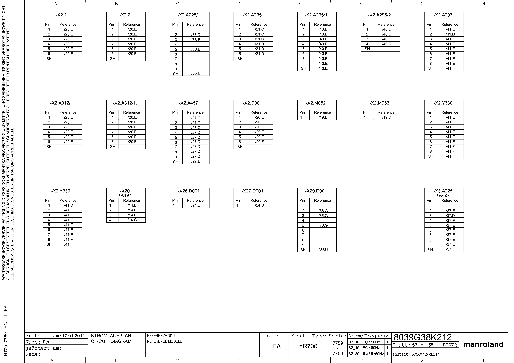

# +FA — Sheet 53 of 58 — REFERENZMODUL

**REFERENCE MODULE**

> Part of the manroland **R700** printing press IEC/UL circuit diagrams.
> Drawing class: **Stromlaufplan / Circuit diagram** (DIN A3).
> Document `+FA` covers the **Delivery** machine section.

## At a glance

| Field | Value |
|---|---|
| Document | `+FA`  (8039G38K212) |
| Sheet | **53** of 58 |
| Section (DE) | REFERENZMODUL |
| Section (EN) | REFERENCE MODULE |
| Section type | REFERENCE_MODULE — Reference module |
| Machine type | `=R700` |
| Series | `7759` |
| Created | 17.01.2011 |
| Replaces | `8039G38I411` |
| Columns used | A, B, C, D, E, F, G |
| Path numbers | — |
| Labels on sheet | 304 |
| Cross-refs out | 111 |
| Cross-refs in | 0 |

**Previous:** [+FA sheet 52](SHEET_0052.md) · **Next:** [+FA sheet 54](SHEET_0054.md) · **Document TOC:** [_TOC.md](_TOC.md)  (+FA) · **Master TOC:** [all sheets](../_MASTER_TOC.md)

## Sheet image (300 DPI, exact vector render)



_Rendered directly from the PDF vector layer at 300 DPI (1-bit), no OCR and no resampling. Use it to confirm anything ambiguous in the text below._

## Cross-references on this sheet

Each entry is a wire leaving this sheet. The printed token is `/sheet.column`; the link resolves to that sheet inside the same document.

| Ref | Target sheet | Col | Path | Destination on target | Target section | From col |
|---|---|---|---|---|---|---|
| `/20.E` | [+FA sheet 20](SHEET_0020.md) | E | — | — | LEITSTAND RECHNER | A |
| `/20.E` | [+FA sheet 20](SHEET_0020.md) | E | — | — | LEITSTAND RECHNER | A |
| `/20.F` | [+FA sheet 20](SHEET_0020.md) | F | — | — | LEITSTAND RECHNER | A |
| `/20.F` | [+FA sheet 20](SHEET_0020.md) | F | — | — | LEITSTAND RECHNER | A |
| `/20.F` | [+FA sheet 20](SHEET_0020.md) | F | — | — | LEITSTAND RECHNER | A |
| `/20.F` | [+FA sheet 20](SHEET_0020.md) | F | — | — | LEITSTAND RECHNER | A |
| `/20.E` | [+FA sheet 20](SHEET_0020.md) | E | — | — | LEITSTAND RECHNER | B |
| `/20.E` | [+FA sheet 20](SHEET_0020.md) | E | — | — | LEITSTAND RECHNER | B |
| `/20.F` | [+FA sheet 20](SHEET_0020.md) | F | — | — | LEITSTAND RECHNER | B |
| `/20.F` | [+FA sheet 20](SHEET_0020.md) | F | — | — | LEITSTAND RECHNER | B |
| `/20.F` | [+FA sheet 20](SHEET_0020.md) | F | — | — | LEITSTAND RECHNER | B |
| `/20.F` | [+FA sheet 20](SHEET_0020.md) | F | — | — | LEITSTAND RECHNER | B |
| `/41.E` | [+FA sheet 41](SHEET_0041.md) | E | — | — | OPTION: TELEPRESENCE ODER ICP | G |
| `/41.D` | [+FA sheet 41](SHEET_0041.md) | D | — | — | OPTION: TELEPRESENCE ODER ICP | G |
| `/41.E` | [+FA sheet 41](SHEET_0041.md) | E | — | — | OPTION: TELEPRESENCE ODER ICP | G |
| `/41.E` | [+FA sheet 41](SHEET_0041.md) | E | — | — | OPTION: TELEPRESENCE ODER ICP | G |
| `/41.E` | [+FA sheet 41](SHEET_0041.md) | E | — | — | OPTION: TELEPRESENCE ODER ICP | G |
| `/41.E` | [+FA sheet 41](SHEET_0041.md) | E | — | — | OPTION: TELEPRESENCE ODER ICP | G |
| `/41.E` | [+FA sheet 41](SHEET_0041.md) | E | — | — | OPTION: TELEPRESENCE ODER ICP | G |
| `/41.E` | [+FA sheet 41](SHEET_0041.md) | E | — | — | OPTION: TELEPRESENCE ODER ICP | G |
| `/41.F` | [+FA sheet 41](SHEET_0041.md) | F | — | — | OPTION: TELEPRESENCE ODER ICP | G |
| `/21.C` | [+FA sheet 21](SHEET_0021.md) | C | — | — | TASTATUR: COMPUTER, MAUS | D |
| `/21.C` | [+FA sheet 21](SHEET_0021.md) | C | — | — | TASTATUR: COMPUTER, MAUS | D |
| `/21.C` | [+FA sheet 21](SHEET_0021.md) | C | — | — | TASTATUR: COMPUTER, MAUS | D |
| `/21.D` | [+FA sheet 21](SHEET_0021.md) | D | — | — | TASTATUR: COMPUTER, MAUS | D |
| `/21.D` | [+FA sheet 21](SHEET_0021.md) | D | — | — | TASTATUR: COMPUTER, MAUS | D |
| `/21.D` | [+FA sheet 21](SHEET_0021.md) | D | — | — | TASTATUR: COMPUTER, MAUS | D |
| `/40.D` | [+FA sheet 40](SHEET_0040.md) | D | — | — | OPTION: TELEPRESENCE | E |
| `/40.D` | [+FA sheet 40](SHEET_0040.md) | D | — | — | OPTION: TELEPRESENCE | E |
| `/40.D` | [+FA sheet 40](SHEET_0040.md) | D | — | — | OPTION: TELEPRESENCE | E |
| `/40.D` | [+FA sheet 40](SHEET_0040.md) | D | — | — | OPTION: TELEPRESENCE | E |
| `/40.E` | [+FA sheet 40](SHEET_0040.md) | E | — | — | OPTION: TELEPRESENCE | E |
| `/40.E` | [+FA sheet 40](SHEET_0040.md) | E | — | — | OPTION: TELEPRESENCE | E |
| `/40.E` | [+FA sheet 40](SHEET_0040.md) | E | — | — | OPTION: TELEPRESENCE | E |
| `/40.E` | [+FA sheet 40](SHEET_0040.md) | E | — | — | OPTION: TELEPRESENCE | E |
| `/40.E` | [+FA sheet 40](SHEET_0040.md) | E | — | — | OPTION: TELEPRESENCE | E |
| `/40.C` | [+FA sheet 40](SHEET_0040.md) | C | — | — | OPTION: TELEPRESENCE | F |
| `/40.C` | [+FA sheet 40](SHEET_0040.md) | C | — | — | OPTION: TELEPRESENCE | F |
| `/40.D` | [+FA sheet 40](SHEET_0040.md) | D | — | — | OPTION: TELEPRESENCE | F |
| `/40.D` | [+FA sheet 40](SHEET_0040.md) | D | — | — | OPTION: TELEPRESENCE | F |
| `/36.D` | [+FA sheet 36](SHEET_0036.md) | D | — | — | OPTION: TELEPRESENCE | C |
| `/36.E` | [+FA sheet 36](SHEET_0036.md) | E | — | — | OPTION: TELEPRESENCE | C |
| `/36.E` | [+FA sheet 36](SHEET_0036.md) | E | — | — | OPTION: TELEPRESENCE | C |
| `/36.E` | [+FA sheet 36](SHEET_0036.md) | E | — | — | OPTION: TELEPRESENCE | C |
| `/20.E` | [+FA sheet 20](SHEET_0020.md) | E | — | — | LEITSTAND RECHNER | A |
| `/20.E` | [+FA sheet 20](SHEET_0020.md) | E | — | — | LEITSTAND RECHNER | A |
| `/20.F` | [+FA sheet 20](SHEET_0020.md) | F | — | — | LEITSTAND RECHNER | A |
| `/20.F` | [+FA sheet 20](SHEET_0020.md) | F | — | — | LEITSTAND RECHNER | A |
| `/20.F` | [+FA sheet 20](SHEET_0020.md) | F | — | — | LEITSTAND RECHNER | A |
| `/20.F` | [+FA sheet 20](SHEET_0020.md) | F | — | — | LEITSTAND RECHNER | A |
| `/20.E` | [+FA sheet 20](SHEET_0020.md) | E | — | — | LEITSTAND RECHNER | B |
| `/20.E` | [+FA sheet 20](SHEET_0020.md) | E | — | — | LEITSTAND RECHNER | B |
| `/20.E` | [+FA sheet 20](SHEET_0020.md) | E | — | — | LEITSTAND RECHNER | B |
| `/20.F` | [+FA sheet 20](SHEET_0020.md) | F | — | — | LEITSTAND RECHNER | B |
| `/20.F` | [+FA sheet 20](SHEET_0020.md) | F | — | — | LEITSTAND RECHNER | B |
| `/20.F` | [+FA sheet 20](SHEET_0020.md) | F | — | — | LEITSTAND RECHNER | B |
| `/20.E` | [+FA sheet 20](SHEET_0020.md) | E | — | — | LEITSTAND RECHNER | D |
| `/20.E` | [+FA sheet 20](SHEET_0020.md) | E | — | — | LEITSTAND RECHNER | D |
| `/20.F` | [+FA sheet 20](SHEET_0020.md) | F | — | — | LEITSTAND RECHNER | D |
| `/20.F` | [+FA sheet 20](SHEET_0020.md) | F | — | — | LEITSTAND RECHNER | D |
| `/20.F` | [+FA sheet 20](SHEET_0020.md) | F | — | — | LEITSTAND RECHNER | D |
| `/20.F` | [+FA sheet 20](SHEET_0020.md) | F | — | — | LEITSTAND RECHNER | D |
| `/19.B` | [+FA sheet 19](SHEET_0019.md) | B | — | — | LÜFTER | E |
| `/41.E` | [+FA sheet 41](SHEET_0041.md) | E | — | — | OPTION: TELEPRESENCE ODER ICP | G |
| `/41.E` | [+FA sheet 41](SHEET_0041.md) | E | — | — | OPTION: TELEPRESENCE ODER ICP | G |
| `/41.E` | [+FA sheet 41](SHEET_0041.md) | E | — | — | OPTION: TELEPRESENCE ODER ICP | G |
| `/41.E` | [+FA sheet 41](SHEET_0041.md) | E | — | — | OPTION: TELEPRESENCE ODER ICP | G |
| `/41.E` | [+FA sheet 41](SHEET_0041.md) | E | — | — | OPTION: TELEPRESENCE ODER ICP | G |
| `/41.E` | [+FA sheet 41](SHEET_0041.md) | E | — | — | OPTION: TELEPRESENCE ODER ICP | G |
| `/41.F` | [+FA sheet 41](SHEET_0041.md) | F | — | — | OPTION: TELEPRESENCE ODER ICP | G |
| `/41.F` | [+FA sheet 41](SHEET_0041.md) | F | — | — | OPTION: TELEPRESENCE ODER ICP | G |
| `/41.F` | [+FA sheet 41](SHEET_0041.md) | F | — | — | OPTION: TELEPRESENCE ODER ICP | G |
| `/19.D` | [+FA sheet 19](SHEET_0019.md) | D | — | — | LÜFTER | F |
| `/27.C` | [+FA sheet 27](SHEET_0027.md) | C | — | — | TASTATUR: BEDIENUNGSPULT MASCHINE | C |
| `/27.C` | [+FA sheet 27](SHEET_0027.md) | C | — | — | TASTATUR: BEDIENUNGSPULT MASCHINE | C |
| `/27.C` | [+FA sheet 27](SHEET_0027.md) | C | — | — | TASTATUR: BEDIENUNGSPULT MASCHINE | C |
| `/27.D` | [+FA sheet 27](SHEET_0027.md) | D | — | — | TASTATUR: BEDIENUNGSPULT MASCHINE | C |
| `/27.D` | [+FA sheet 27](SHEET_0027.md) | D | — | — | TASTATUR: BEDIENUNGSPULT MASCHINE | C |
| `/27.D` | [+FA sheet 27](SHEET_0027.md) | D | — | — | TASTATUR: BEDIENUNGSPULT MASCHINE | C |
| `/27.D` | [+FA sheet 27](SHEET_0027.md) | D | — | — | TASTATUR: BEDIENUNGSPULT MASCHINE | C |
| `/27.D` | [+FA sheet 27](SHEET_0027.md) | D | — | — | TASTATUR: BEDIENUNGSPULT MASCHINE | C |
| `/27.D` | [+FA sheet 27](SHEET_0027.md) | D | — | — | TASTATUR: BEDIENUNGSPULT MASCHINE | C |
| `/27.E` | [+FA sheet 27](SHEET_0027.md) | E | — | — | TASTATUR: BEDIENUNGSPULT MASCHINE | C |
| `/14.B` | [+FA sheet 14](SHEET_0014.md) | B | — | — | SPANNUNGSVERSORGUNG: | B |
| `/14.B` | [+FA sheet 14](SHEET_0014.md) | B | — | — | SPANNUNGSVERSORGUNG: | B |
| `/14.B` | [+FA sheet 14](SHEET_0014.md) | B | — | — | SPANNUNGSVERSORGUNG: | B |
| `/14.C` | [+FA sheet 14](SHEET_0014.md) | C | — | — | SPANNUNGSVERSORGUNG: | B |
| `/24.B` | [+FA sheet 24](SHEET_0024.md) | B | — | — | LICHTWELLENLEITER | C |
| `/41.D` | [+FA sheet 41](SHEET_0041.md) | D | — | — | OPTION: TELEPRESENCE ODER ICP | A |
| `/41.E` | [+FA sheet 41](SHEET_0041.md) | E | — | — | OPTION: TELEPRESENCE ODER ICP | A |
| `/41.E` | [+FA sheet 41](SHEET_0041.md) | E | — | — | OPTION: TELEPRESENCE ODER ICP | A |
| `/41.E` | [+FA sheet 41](SHEET_0041.md) | E | — | — | OPTION: TELEPRESENCE ODER ICP | A |
| `/41.E` | [+FA sheet 41](SHEET_0041.md) | E | — | — | OPTION: TELEPRESENCE ODER ICP | A |
| `/41.E` | [+FA sheet 41](SHEET_0041.md) | E | — | — | OPTION: TELEPRESENCE ODER ICP | A |
| `/41.E` | [+FA sheet 41](SHEET_0041.md) | E | — | — | OPTION: TELEPRESENCE ODER ICP | A |
| `/41.F` | [+FA sheet 41](SHEET_0041.md) | F | — | — | OPTION: TELEPRESENCE ODER ICP | A |
| `/41.F` | [+FA sheet 41](SHEET_0041.md) | F | — | — | OPTION: TELEPRESENCE ODER ICP | A |
| `/24.D` | [+FA sheet 24](SHEET_0024.md) | D | — | — | LICHTWELLENLEITER | D |
| `/37.E` | [+FA sheet 37](SHEET_0037.md) | E | — | — | OPTION: TELEPRESENCE | G |
| `/37.D` | [+FA sheet 37](SHEET_0037.md) | D | — | — | OPTION: TELEPRESENCE | G |
| `/37.E` | [+FA sheet 37](SHEET_0037.md) | E | — | — | OPTION: TELEPRESENCE | G |
| `/37.E` | [+FA sheet 37](SHEET_0037.md) | E | — | — | OPTION: TELEPRESENCE | G |
| `/37.E` | [+FA sheet 37](SHEET_0037.md) | E | — | — | OPTION: TELEPRESENCE | G |
| `/37.E` | [+FA sheet 37](SHEET_0037.md) | E | — | — | OPTION: TELEPRESENCE | G |
| `/37.E` | [+FA sheet 37](SHEET_0037.md) | E | — | — | OPTION: TELEPRESENCE | G |
| `/37.E` | [+FA sheet 37](SHEET_0037.md) | E | — | — | OPTION: TELEPRESENCE | G |
| `/37.F` | [+FA sheet 37](SHEET_0037.md) | F | — | — | OPTION: TELEPRESENCE | G |
| `/36.G` | [+FA sheet 36](SHEET_0036.md) | G | — | — | OPTION: TELEPRESENCE | E |
| `/36.G` | [+FA sheet 36](SHEET_0036.md) | G | — | — | OPTION: TELEPRESENCE | E |
| `/36.G` | [+FA sheet 36](SHEET_0036.md) | G | — | — | OPTION: TELEPRESENCE | E |
| `/36.H` | [+FA sheet 36](SHEET_0036.md) | H | — | — | OPTION: TELEPRESENCE | E |

## Devices on this sheet

| Tag | Class | Class meaning (IEC) | Col | Sub | Terminal | Sign |
|---|---|---|---|---|---|---|
| `X20` | X | Klemme / terminal, plug connector | B | — | — | — |
| `+A497` | A | Baugruppe / assembly, module, PC board | B | — | — | + |
| `+A497` | A | Baugruppe / assembly, module, PC board | G | — | — | + |
| `X2.2` | — | cross-device reference | A | — | — | — |
| `X2.2` | — | cross-device reference | B | — | — | — |
| `X2.A235` | — | cross-device reference | D | — | — | — |
| `X2.A297` | — | cross-device reference | G | — | — | — |
| `X2.A457` | — | cross-device reference | C | — | — | — |
| `X2.D001` | — | cross-device reference | D | — | — | — |
| `X2.M052` | — | cross-device reference | E | — | — | — |
| `X2.M053` | — | cross-device reference | F | — | — | — |
| `X2.Y330` | — | cross-device reference | G | — | — | — |
| `X2.Y330.` | — | cross-device reference | A | — | — | — |
| `X26.D001` | — | cross-device reference | C | — | — | — |
| `X27.D001` | — | cross-device reference | D | — | — | — |
| `X29.D001` | — | cross-device reference | E | — | — | — |
| `X3.A225` | — | cross-device reference | G | — | — | — |

## Potentials / nets

_No named potentials on this sheet._

## Wire-end annotations (grouped as printed)

A wire that continues elsewhere is annotated with a small cluster: the destination description, the path/line number `#NN`, and the `/sheet.column` cross reference. Each row below is one such cluster exactly as it is grouped on the drawing.

| Col | Y | Path | Cross-ref | Text on the wire |
|---|---|---|---|---|
| A | 30.1 | — | — | `X2.2` |
| B | 30.1 | — | — | `X2.2` |
| C | 30.1 | — | — | `X2.A225/1` |
| D | 30.1 | — | — | `X2.A235` |
| E | 30.1 | — | — | `X2.A295/1` |
| F | 30.1 | — | — | `X2.A295/2` |
| G | 30.1 | — | — | `X2.A297` |
| A | 52.7 | — | — | `Pin SH 3 4 5 6 2 1 Reference` |
| B | 52.7 | — | — | `Pin SH 3 4 5 6 2 1 Reference` |
| C | 52.7 | — | — | `Pin SH 3 4 5 6 7 8 9 2 1 Reference` |
| D | 52.7 | — | — | `Pin SH 3 4 5 6 2 1 Reference` |
| E | 52.7 | — | — | `Pin SH 3 4 5 6 7 8 2 1 Reference` |
| F | 52.7 | — | — | `Pin SH 3 4 2 1 Reference` |
| G | 52.7 | — | — | `Pin SH 3 4 5 6 7 8 2 1 Reference` |
| A | 64.0 | — | `/20.E`, `/20.E`, `/20.F`, `/20.F`, `/20.F`, `/20.F` | — |
| B | 64.0 | — | `/20.E`, `/20.E`, `/20.F`, `/20.F`, `/20.F`, `/20.F` | — |
| G | 64.0 | — | `/41.E`, `/41.D`, `/41.E`, `/41.E`, `/41.E`, `/41.E`, `/41.E`, `/41.E`, `/41.F` | — |
| D | 64.1 | — | `/21.C`, `/21.C`, `/21.C`, `/21.D`, `/21.D`, `/21.D` | — |
| E | 64.1 | — | `/40.D`, `/40.D`, `/40.D`, `/40.D`, `/40.E`, `/40.E`, `/40.E`, `/40.E`, `/40.E` | — |
| F | 64.1 | — | `/40.C`, `/40.C`, `/40.D`, `/40.D` | — |
| C | 76.8 | — | `/36.D`, `/36.E` | — |
| C | 110.8 | — | `/36.E` | — |
| C | 166.1 | — | `/36.E` | — |
| A | 234.2 | — | — | `X2.A312/1` |
| B | 234.2 | — | — | `X2.A312/1.` |
| C | 234.2 | — | — | `X2.A457` |
| D | 234.2 | — | — | `X2.D001` |
| E | 234.2 | — | — | `X2.M052` |
| F | 234.2 | — | — | `X2.M053` |
| G | 234.2 | — | — | `X2.Y330` |
| A | 256.8 | — | — | `Pin SH 3 4 5 6 2 1 Reference` |
| B | 256.8 | — | — | `Pin SH 3 4 5 6 2 1 Reference` |
| C | 256.8 | — | — | `Pin SH 3 4 5 6 7 8 9 2 1 Reference` |
| D | 256.8 | — | — | `Pin SH 3 4 5 6 2 1 Reference` |
| E | 256.8 | — | — | `Pin 1 Reference` |
| F | 256.8 | — | — | `Pin 1 Reference` |
| G | 256.8 | — | — | `Pin SH 3 4 5 6 7 8 2 1 Reference` |
| A | 268.1 | — | `/20.E`, `/20.E`, `/20.F`, `/20.F`, `/20.F`, `/20.F` | — |
| B | 268.1 | — | `/20.E`, `/20.E`, `/20.E`, `/20.F`, `/20.F`, `/20.F` | — |
| D | 268.1 | — | `/20.E`, `/20.E`, `/20.F`, `/20.F`, `/20.F`, `/20.F` | — |
| E | 268.1 | — | `/19.B` | — |
| G | 268.1 | — | `/41.E`, `/41.E`, `/41.E`, `/41.E`, `/41.E`, `/41.E`, `/41.F`, `/41.F`, `/41.F` | — |
| F | 268.2 | — | `/19.D` | — |
| C | 269.6 | — | `/27.C`, `/27.C`, `/27.C`, `/27.D`, `/27.D`, `/27.D`, `/27.D`, `/27.D`, `/27.D`, `/27.E` | — |
| A | 438.3 | — | — | `X2.Y330.` |
| B | 438.3 | — | — | `+A497 X20` |
| C | 438.3 | — | — | `X26.D001` |
| D | 438.3 | — | — | `X27.D001` |
| E | 438.3 | — | — | `X29.D001` |
| G | 438.3 | — | — | `X3.A225` |
| G | 448.1 | — | — | `+A497` |
| A | 460.9 | — | — | `Pin SH 3 4 5 6 7 8 2 1 Reference` |
| B | 460.9 | — | — | `Pin 1 2 3 4 Reference` |
| C | 460.9 | — | — | `Pin 1 Reference` |
| D | 460.9 | — | — | `Pin 1 Reference` |
| E | 460.9 | — | — | `Pin SH 3 4 5 6 7 8 9 2 1 Reference` |
| G | 460.9 | — | — | `Pin SH 3 4 5 6 7 8 9 2 1 Reference` |
| A | 472.2 | — | `/41.D`, `/41.E`, `/41.E`, `/41.E`, `/41.E`, `/41.E`, `/41.E`, `/41.F`, `/41.F` | — |
| B | 472.2 | — | `/14.B`, `/14.B`, `/14.B`, `/14.C` | — |
| C | 472.2 | — | `/24.B` | — |
| D | 472.2 | — | `/24.D` | — |
| E | 485.0 | — | `/36.G`, `/36.G` | — |
| G | 485.0 | — | `/37.E`, `/37.D`, `/37.E`, `/37.E`, `/37.E`, `/37.E`, `/37.E`, `/37.E`, `/37.F` | — |
| E | 519.0 | — | `/36.G` | — |
| E | 574.3 | — | `/36.H` | — |


## Notes and free text on this sheet

| Text | Col | Y (pt) |
|---|---|---|
| `Pin` | A | 52.7 |
| `Reference` | A | 52.86 |
| `SH` | A | 132.09 |
| `Pin` | B | 52.7 |
| `Reference` | B | 52.86 |
| `SH` | B | 132.09 |
| `Pin` | C | 52.7 |
| `Reference` | C | 52.86 |
| `SH` | C | 167.53 |
| `X2.A225/1` | C | 30.08 |
| `Pin` | D | 52.7 |
| `Reference` | D | 52.86 |
| `SH` | D | 132.09 |
| `Pin` | E | 52.7 |
| `Reference` | E | 52.86 |
| `SH` | E | 154.77 |
| `X2.A295/1` | E | 30.08 |
| `Pin` | F | 52.7 |
| `Reference` | F | 52.86 |
| `SH` | F | 109.42 |
| `X2.A295/2` | F | 30.08 |
| `Pin` | G | 52.7 |
| `Reference` | G | 52.86 |
| `SH` | G | 154.77 |
| `X2.A312/1` | A | 234.17 |
| `X2.A312/1.` | B | 234.18 |

## Complete label inventory (exact text from the drawing)

Every text object inside the drawing area of this sheet, in DIN reading order (column A→H, then top→bottom). This is the authoritative list: if a string is not here it is not printed on this sheet.

| Col | Y | X | Dir | Type | Text |
|---|---|---|---|---|---|
| A | 30.1 | 129.3 | → | device ref | `X2.2` |
| A | 52.7 | 104.0 | → | text | `Pin` |
| A | 52.9 | 138.0 | → | text | `Reference` |
| A | 64.0 | 148.7 | → | cross-reference | `/20.E` |
| A | 64.1 | 111.4 | → | number | `1` |
| A | 75.4 | 111.1 | → | number | `2` |
| A | 75.4 | 148.7 | → | cross-reference | `/20.E` |
| A | 86.7 | 148.8 | → | cross-reference | `/20.F` |
| A | 86.8 | 111.0 | → | number | `3` |
| A | 98.1 | 111.0 | → | number | `4` |
| A | 98.1 | 148.8 | → | cross-reference | `/20.F` |
| A | 109.4 | 148.8 | → | cross-reference | `/20.F` |
| A | 109.5 | 111.0 | → | number | `5` |
| A | 120.7 | 148.8 | → | cross-reference | `/20.F` |
| A | 120.8 | 111.0 | → | number | `6` |
| A | 132.1 | 107.6 | → | text | `SH` |
| A | 234.2 | 116.1 | → | text | `X2.A312/1` |
| A | 256.8 | 104.0 | → | text | `Pin` |
| A | 257.0 | 138.0 | → | text | `Reference` |
| A | 268.1 | 148.7 | → | cross-reference | `/20.E` |
| A | 268.2 | 111.4 | → | number | `1` |
| A | 279.5 | 111.1 | → | number | `2` |
| A | 279.5 | 148.7 | → | cross-reference | `/20.E` |
| A | 290.8 | 148.8 | → | cross-reference | `/20.F` |
| A | 290.9 | 111.0 | → | number | `3` |
| A | 302.2 | 111.0 | → | number | `4` |
| A | 302.2 | 148.8 | → | cross-reference | `/20.F` |
| A | 313.5 | 148.8 | → | cross-reference | `/20.F` |
| A | 313.6 | 111.0 | → | number | `5` |
| A | 324.8 | 148.8 | → | cross-reference | `/20.F` |
| A | 324.9 | 111.0 | → | number | `6` |
| A | 336.2 | 107.6 | → | text | `SH` |
| A | 438.3 | 118.9 | → | device ref | `X2.Y330.` |
| A | 460.9 | 104.0 | → | text | `Pin` |
| A | 461.1 | 138.0 | → | text | `Reference` |
| A | 472.3 | 111.4 | → | number | `1` |
| A | 472.3 | 148.4 | → | cross-reference | `/41.D` |
| A | 483.6 | 111.1 | → | number | `2` |
| A | 483.6 | 148.7 | → | cross-reference | `/41.E` |
| A | 494.9 | 148.7 | → | cross-reference | `/41.E` |
| A | 495.0 | 111.0 | → | number | `3` |
| A | 506.2 | 148.7 | → | cross-reference | `/41.E` |
| A | 506.3 | 111.0 | → | number | `4` |
| A | 517.6 | 111.0 | → | number | `5` |
| A | 517.6 | 148.7 | → | cross-reference | `/41.E` |
| A | 528.9 | 148.7 | → | cross-reference | `/41.E` |
| A | 529.0 | 111.0 | → | number | `6` |
| A | 540.2 | 148.7 | → | cross-reference | `/41.E` |
| A | 540.3 | 111.0 | → | number | `7` |
| A | 551.6 | 148.8 | → | cross-reference | `/41.F` |
| A | 551.7 | 111.0 | → | number | `8` |
| A | 562.9 | 148.8 | → | cross-reference | `/41.F` |
| A | 563.0 | 107.6 | → | text | `SH` |
| B | 30.1 | 276.7 | → | device ref | `X2.2` |
| B | 52.7 | 251.4 | → | text | `Pin` |
| B | 52.9 | 285.4 | → | text | `Reference` |
| B | 64.0 | 296.1 | → | cross-reference | `/20.E` |
| B | 64.1 | 258.8 | → | number | `1` |
| B | 75.4 | 258.5 | → | number | `2` |
| B | 75.4 | 296.1 | → | cross-reference | `/20.E` |
| B | 86.7 | 296.2 | → | cross-reference | `/20.F` |
| B | 86.8 | 258.4 | → | number | `3` |
| B | 98.1 | 258.4 | → | number | `4` |
| B | 98.1 | 296.2 | → | cross-reference | `/20.F` |
| B | 109.4 | 296.2 | → | cross-reference | `/20.F` |
| B | 109.5 | 258.4 | → | number | `5` |
| B | 120.7 | 296.2 | → | cross-reference | `/20.F` |
| B | 120.8 | 258.4 | → | number | `6` |
| B | 132.1 | 255.0 | → | text | `SH` |
| B | 234.2 | 261.6 | → | text | `X2.A312/1.` |
| B | 256.8 | 251.4 | → | text | `Pin` |
| B | 257.0 | 285.4 | → | text | `Reference` |
| B | 268.1 | 296.1 | → | cross-reference | `/20.E` |
| B | 268.2 | 258.8 | → | number | `1` |
| B | 279.5 | 258.5 | → | number | `2` |
| B | 279.5 | 296.1 | → | cross-reference | `/20.E` |
| B | 290.8 | 296.1 | → | cross-reference | `/20.E` |
| B | 290.9 | 258.4 | → | number | `3` |
| B | 302.2 | 258.4 | → | number | `4` |
| B | 302.2 | 296.2 | → | cross-reference | `/20.F` |
| B | 313.5 | 296.2 | → | cross-reference | `/20.F` |
| B | 313.6 | 258.4 | → | number | `5` |
| B | 324.8 | 296.2 | → | cross-reference | `/20.F` |
| B | 324.9 | 258.4 | → | number | `6` |
| B | 336.2 | 255.0 | → | text | `SH` |
| B | 438.3 | 278.1 | → | device tag | `X20` |
| B | 448.2 | 273.5 | → | device tag | `+A497` |
| B | 460.9 | 251.4 | → | text | `Pin` |
| B | 461.1 | 285.4 | → | text | `Reference` |
| B | 472.2 | 295.9 | → | cross-reference | `/14.B` |
| B | 472.3 | 252.9 | → | number | `1` |
| B | 483.6 | 253.4 | → | number | `2` |
| B | 483.6 | 295.9 | → | cross-reference | `/14.B` |
| B | 494.9 | 295.9 | → | cross-reference | `/14.B` |
| B | 495.0 | 253.4 | → | number | `3` |
| B | 506.3 | 253.4 | → | number | `4` |
| B | 506.3 | 295.8 | → | cross-reference | `/14.C` |
| C | 30.1 | 410.9 | → | text | `X2.A225/1` |
| C | 52.7 | 398.8 | → | text | `Pin` |
| C | 52.9 | 432.9 | → | text | `Reference` |
| C | 65.5 | 406.5 | → | number | `1` |
| C | 76.8 | 443.2 | → | cross-reference | `/36.D` |
| C | 76.9 | 405.4 | → | number | `2` |
| C | 88.1 | 443.5 | → | cross-reference | `/36.E` |
| C | 88.2 | 405.1 | → | number | `3` |
| C | 99.5 | 405.1 | → | number | `4` |
| C | 110.8 | 443.5 | → | cross-reference | `/36.E` |
| C | 110.9 | 405.1 | → | number | `5` |
| C | 122.2 | 405.1 | → | number | `6` |
| C | 132.1 | 405.1 | → | number | `7` |
| C | 144.9 | 405.1 | → | number | `8` |
| C | 156.2 | 405.1 | → | number | `9` |
| C | 166.1 | 443.5 | → | cross-reference | `/36.E` |
| C | 167.5 | 401.0 | → | text | `SH` |
| C | 234.2 | 414.6 | → | device ref | `X2.A457` |
| C | 256.8 | 398.8 | → | text | `Pin` |
| C | 257.0 | 432.9 | → | text | `Reference` |
| C | 269.6 | 406.5 | → | number | `1` |
| C | 269.6 | 443.2 | → | cross-reference | `/27.C` |
| C | 280.9 | 443.2 | → | cross-reference | `/27.C` |
| C | 281.0 | 405.4 | → | number | `2` |
| C | 292.3 | 405.1 | → | number | `3` |
| C | 292.3 | 443.2 | → | cross-reference | `/27.C` |
| C | 303.6 | 405.1 | → | number | `4` |
| C | 303.6 | 443.2 | → | cross-reference | `/27.D` |
| C | 314.9 | 443.2 | → | cross-reference | `/27.D` |
| C | 315.0 | 405.1 | → | number | `5` |
| C | 324.8 | 443.2 | → | cross-reference | `/27.D` |
| C | 326.3 | 405.1 | → | number | `6` |
| C | 336.2 | 405.1 | → | number | `7` |
| C | 336.2 | 443.2 | → | cross-reference | `/27.D` |
| C | 347.5 | 443.2 | → | cross-reference | `/27.D` |
| C | 349.0 | 405.1 | → | number | `8` |
| C | 358.9 | 443.2 | → | cross-reference | `/27.D` |
| C | 360.3 | 405.1 | → | number | `9` |
| C | 370.2 | 443.5 | → | cross-reference | `/27.E` |
| C | 371.6 | 401.0 | → | text | `SH` |
| C | 438.3 | 412.0 | → | device ref | `X26.D001` |
| C | 460.9 | 398.8 | → | text | `Pin` |
| C | 461.1 | 432.9 | → | text | `Reference` |
| C | 472.2 | 443.3 | → | cross-reference | `/24.B` |
| C | 472.3 | 400.3 | → | number | `1` |
| D | 30.1 | 562.0 | → | device ref | `X2.A235` |
| D | 52.7 | 546.2 | → | text | `Pin` |
| D | 52.9 | 580.3 | → | text | `Reference` |
| D | 64.1 | 553.6 | → | number | `1` |
| D | 64.1 | 590.6 | → | cross-reference | `/21.C` |
| D | 75.4 | 553.3 | → | number | `2` |
| D | 75.4 | 590.6 | → | cross-reference | `/21.C` |
| D | 86.7 | 590.6 | → | cross-reference | `/21.C` |
| D | 86.8 | 553.2 | → | number | `3` |
| D | 98.1 | 553.2 | → | number | `4` |
| D | 98.1 | 590.6 | → | cross-reference | `/21.D` |
| D | 109.4 | 590.6 | → | cross-reference | `/21.D` |
| D | 109.5 | 553.2 | → | number | `5` |
| D | 120.8 | 553.2 | → | number | `6` |
| D | 120.8 | 590.6 | → | cross-reference | `/21.D` |
| D | 132.1 | 549.8 | → | text | `SH` |
| D | 234.2 | 562.4 | → | device ref | `X2.D001` |
| D | 256.8 | 546.2 | → | text | `Pin` |
| D | 257.0 | 580.3 | → | text | `Reference` |
| D | 268.1 | 590.9 | → | cross-reference | `/20.E` |
| D | 268.2 | 553.6 | → | number | `1` |
| D | 279.5 | 553.3 | → | number | `2` |
| D | 279.5 | 590.9 | → | cross-reference | `/20.E` |
| D | 290.8 | 591.0 | → | cross-reference | `/20.F` |
| D | 290.9 | 553.2 | → | number | `3` |
| D | 302.2 | 553.2 | → | number | `4` |
| D | 302.2 | 591.0 | → | cross-reference | `/20.F` |
| D | 313.5 | 591.0 | → | cross-reference | `/20.F` |
| D | 313.6 | 553.2 | → | number | `5` |
| D | 324.8 | 591.0 | → | cross-reference | `/20.F` |
| D | 324.9 | 553.2 | → | number | `6` |
| D | 336.2 | 549.8 | → | text | `SH` |
| D | 438.3 | 559.4 | → | device ref | `X27.D001` |
| D | 460.9 | 546.2 | → | text | `Pin` |
| D | 461.1 | 580.3 | → | text | `Reference` |
| D | 472.3 | 547.7 | → | number | `1` |
| D | 472.3 | 590.6 | → | cross-reference | `/24.D` |
| E | 30.1 | 705.7 | → | text | `X2.A295/1` |
| E | 52.7 | 693.6 | → | text | `Pin` |
| E | 52.9 | 727.7 | → | text | `Reference` |
| E | 64.1 | 701.0 | → | number | `1` |
| E | 64.1 | 738.0 | → | cross-reference | `/40.D` |
| E | 75.4 | 700.7 | → | number | `2` |
| E | 75.4 | 738.0 | → | cross-reference | `/40.D` |
| E | 86.7 | 738.0 | → | cross-reference | `/40.D` |
| E | 86.8 | 700.6 | → | number | `3` |
| E | 98.1 | 700.6 | → | number | `4` |
| E | 98.1 | 738.0 | → | cross-reference | `/40.D` |
| E | 109.4 | 738.3 | → | cross-reference | `/40.E` |
| E | 109.5 | 700.6 | → | number | `5` |
| E | 120.7 | 738.3 | → | cross-reference | `/40.E` |
| E | 120.8 | 700.6 | → | number | `6` |
| E | 132.1 | 700.6 | → | number | `7` |
| E | 132.1 | 738.3 | → | cross-reference | `/40.E` |
| E | 143.4 | 738.3 | → | cross-reference | `/40.E` |
| E | 143.5 | 700.6 | → | number | `8` |
| E | 154.7 | 738.3 | → | cross-reference | `/40.E` |
| E | 154.8 | 697.2 | → | text | `SH` |
| E | 234.2 | 708.5 | → | device ref | `X2.M052` |
| E | 256.8 | 693.6 | → | text | `Pin` |
| E | 257.0 | 727.7 | → | text | `Reference` |
| E | 268.1 | 738.1 | → | cross-reference | `/19.B` |
| E | 268.2 | 695.1 | → | number | `1` |
| E | 438.3 | 706.8 | → | device ref | `X29.D001` |
| E | 460.9 | 693.6 | → | text | `Pin` |
| E | 461.1 | 727.7 | → | text | `Reference` |
| E | 473.7 | 701.3 | → | number | `1` |
| E | 485.0 | 700.2 | → | number | `2` |
| E | 485.0 | 737.9 | → | cross-reference | `/36.G` |
| E | 496.3 | 737.9 | → | cross-reference | `/36.G` |
| E | 496.4 | 699.9 | → | number | `3` |
| E | 507.7 | 699.9 | → | number | `4` |
| E | 519.0 | 737.9 | → | cross-reference | `/36.G` |
| E | 519.1 | 699.9 | → | number | `5` |
| E | 530.4 | 699.9 | → | number | `6` |
| E | 540.3 | 699.9 | → | number | `7` |
| E | 553.1 | 699.9 | → | number | `8` |
| E | 564.4 | 699.9 | → | number | `9` |
| E | 574.3 | 738.3 | → | cross-reference | `/36.H` |
| E | 575.7 | 695.8 | → | text | `SH` |
| F | 30.1 | 852.4 | → | text | `X2.A295/2` |
| F | 52.7 | 841.0 | → | text | `Pin` |
| F | 52.9 | 875.1 | → | text | `Reference` |
| F | 64.1 | 848.4 | → | number | `1` |
| F | 64.1 | 885.4 | → | cross-reference | `/40.C` |
| F | 75.4 | 848.1 | → | number | `2` |
| F | 75.4 | 885.4 | → | cross-reference | `/40.C` |
| F | 86.7 | 885.4 | → | cross-reference | `/40.D` |
| F | 86.8 | 848.0 | → | number | `3` |
| F | 98.1 | 848.0 | → | number | `4` |
| F | 98.1 | 885.4 | → | cross-reference | `/40.D` |
| F | 109.4 | 844.6 | → | text | `SH` |
| F | 234.2 | 855.9 | → | device ref | `X2.M053` |
| F | 256.8 | 841.0 | → | text | `Pin` |
| F | 257.0 | 875.1 | → | text | `Reference` |
| F | 268.2 | 842.5 | → | number | `1` |
| F | 268.2 | 885.4 | → | cross-reference | `/19.D` |
| G | 30.1 | 1004.2 | → | device ref | `X2.A297` |
| G | 52.7 | 988.4 | → | text | `Pin` |
| G | 52.9 | 1022.5 | → | text | `Reference` |
| G | 64.0 | 1033.1 | → | cross-reference | `/41.E` |
| G | 64.1 | 995.8 | → | number | `1` |
| G | 75.4 | 995.5 | → | number | `2` |
| G | 75.4 | 1032.8 | → | cross-reference | `/41.D` |
| G | 86.7 | 1033.1 | → | cross-reference | `/41.E` |
| G | 86.8 | 995.4 | → | number | `3` |
| G | 98.0 | 1033.1 | → | cross-reference | `/41.E` |
| G | 98.1 | 995.4 | → | number | `4` |
| G | 109.4 | 1033.1 | → | cross-reference | `/41.E` |
| G | 109.5 | 995.4 | → | number | `5` |
| G | 120.7 | 1033.1 | → | cross-reference | `/41.E` |
| G | 120.8 | 995.4 | → | number | `6` |
| G | 132.1 | 995.4 | → | number | `7` |
| G | 132.1 | 1033.1 | → | cross-reference | `/41.E` |
| G | 143.4 | 1033.1 | → | cross-reference | `/41.E` |
| G | 143.5 | 995.4 | → | number | `8` |
| G | 154.7 | 1033.2 | → | cross-reference | `/41.F` |
| G | 154.8 | 992.0 | → | text | `SH` |
| G | 234.2 | 1004.5 | → | device ref | `X2.Y330` |
| G | 256.8 | 988.4 | → | text | `Pin` |
| G | 257.0 | 1022.5 | → | text | `Reference` |
| G | 268.1 | 1033.1 | → | cross-reference | `/41.E` |
| G | 268.2 | 995.8 | → | number | `1` |
| G | 279.5 | 995.5 | → | number | `2` |
| G | 279.5 | 1033.1 | → | cross-reference | `/41.E` |
| G | 290.8 | 1033.1 | → | cross-reference | `/41.E` |
| G | 290.9 | 995.4 | → | number | `3` |
| G | 302.1 | 1033.1 | → | cross-reference | `/41.E` |
| G | 302.2 | 995.4 | → | number | `4` |
| G | 313.5 | 1033.1 | → | cross-reference | `/41.E` |
| G | 313.6 | 995.4 | → | number | `5` |
| G | 324.8 | 1033.1 | → | cross-reference | `/41.E` |
| G | 324.9 | 995.4 | → | number | `6` |
| G | 336.2 | 995.4 | → | number | `7` |
| G | 336.2 | 1033.2 | → | cross-reference | `/41.F` |
| G | 347.5 | 1033.2 | → | cross-reference | `/41.F` |
| G | 347.6 | 995.4 | → | number | `8` |
| G | 358.8 | 1033.2 | → | cross-reference | `/41.F` |
| G | 358.9 | 992.0 | → | text | `SH` |
| G | 438.3 | 1004.2 | → | device ref | `X3.A225` |
| G | 448.2 | 1010.6 | → | device tag | `+A497` |
| G | 460.9 | 988.4 | → | text | `Pin` |
| G | 461.1 | 1022.5 | → | text | `Reference` |
| G | 473.7 | 996.1 | → | number | `1` |
| G | 485.0 | 995.0 | → | number | `2` |
| G | 485.0 | 1033.1 | → | cross-reference | `/37.E` |
| G | 496.3 | 1032.8 | → | cross-reference | `/37.D` |
| G | 496.4 | 994.7 | → | number | `3` |
| G | 507.7 | 994.7 | → | number | `4` |
| G | 507.7 | 1033.1 | → | cross-reference | `/37.E` |
| G | 519.0 | 1033.1 | → | cross-reference | `/37.E` |
| G | 519.1 | 994.7 | → | number | `5` |
| G | 528.9 | 1033.1 | → | cross-reference | `/37.E` |
| G | 530.4 | 994.7 | → | number | `6` |
| G | 540.2 | 1033.1 | → | cross-reference | `/37.E` |
| G | 540.3 | 994.7 | → | number | `7` |
| G | 551.6 | 1033.1 | → | cross-reference | `/37.E` |
| G | 553.1 | 994.7 | → | number | `8` |
| G | 562.9 | 1033.1 | → | cross-reference | `/37.E` |
| G | 564.4 | 994.7 | → | number | `9` |
| G | 574.3 | 1033.2 | → | cross-reference | `/37.F` |
| G | 575.7 | 990.6 | → | text | `SH` |

## Reading-order text block

The same content as a plain block, grouped by DIN column — convenient to paste or to match against a visual description.

```text
=== Column A ===
  30.1  129.3  devref       X2.2
  52.7  104.0  text         Pin
  52.9  138.0  text         Reference
  64.0  148.7  xref         /20.E
  64.1  111.4  numeric      1
  75.4  111.1  numeric      2
  75.4  148.7  xref         /20.E
  86.7  148.8  xref         /20.F
  86.8  111.0  numeric      3
  98.1  111.0  numeric      4
  98.1  148.8  xref         /20.F
 109.4  148.8  xref         /20.F
 109.5  111.0  numeric      5
 120.7  148.8  xref         /20.F
 120.8  111.0  numeric      6
 132.1  107.6  text         SH
 234.2  116.1  text         X2.A312/1
 256.8  104.0  text         Pin
 257.0  138.0  text         Reference
 268.1  148.7  xref         /20.E
 268.2  111.4  numeric      1
 279.5  111.1  numeric      2
 279.5  148.7  xref         /20.E
 290.8  148.8  xref         /20.F
 290.9  111.0  numeric      3
 302.2  111.0  numeric      4
 302.2  148.8  xref         /20.F
 313.5  148.8  xref         /20.F
 313.6  111.0  numeric      5
 324.8  148.8  xref         /20.F
 324.9  111.0  numeric      6
 336.2  107.6  text         SH
 438.3  118.9  devref       X2.Y330.
 460.9  104.0  text         Pin
 461.1  138.0  text         Reference
 472.3  111.4  numeric      1
 472.3  148.4  xref         /41.D
 483.6  111.1  numeric      2
 483.6  148.7  xref         /41.E
 494.9  148.7  xref         /41.E
 495.0  111.0  numeric      3
 506.2  148.7  xref         /41.E
 506.3  111.0  numeric      4
 517.6  111.0  numeric      5
 517.6  148.7  xref         /41.E
 528.9  148.7  xref         /41.E
 529.0  111.0  numeric      6
 540.2  148.7  xref         /41.E
 540.3  111.0  numeric      7
 551.6  148.8  xref         /41.F
 551.7  111.0  numeric      8
 562.9  148.8  xref         /41.F
 563.0  107.6  text         SH
=== Column B ===
  30.1  276.7  devref       X2.2
  52.7  251.4  text         Pin
  52.9  285.4  text         Reference
  64.0  296.1  xref         /20.E
  64.1  258.8  numeric      1
  75.4  258.5  numeric      2
  75.4  296.1  xref         /20.E
  86.7  296.2  xref         /20.F
  86.8  258.4  numeric      3
  98.1  258.4  numeric      4
  98.1  296.2  xref         /20.F
 109.4  296.2  xref         /20.F
 109.5  258.4  numeric      5
 120.7  296.2  xref         /20.F
 120.8  258.4  numeric      6
 132.1  255.0  text         SH
 234.2  261.6  text         X2.A312/1.
 256.8  251.4  text         Pin
 257.0  285.4  text         Reference
 268.1  296.1  xref         /20.E
 268.2  258.8  numeric      1
 279.5  258.5  numeric      2
 279.5  296.1  xref         /20.E
 290.8  296.1  xref         /20.E
 290.9  258.4  numeric      3
 302.2  258.4  numeric      4
 302.2  296.2  xref         /20.F
 313.5  296.2  xref         /20.F
 313.6  258.4  numeric      5
 324.8  296.2  xref         /20.F
 324.9  258.4  numeric      6
 336.2  255.0  text         SH
 438.3  278.1  devtag       X20
 448.2  273.5  devtag       +A497
 460.9  251.4  text         Pin
 461.1  285.4  text         Reference
 472.2  295.9  xref         /14.B
 472.3  252.9  numeric      1
 483.6  253.4  numeric      2
 483.6  295.9  xref         /14.B
 494.9  295.9  xref         /14.B
 495.0  253.4  numeric      3
 506.3  253.4  numeric      4
 506.3  295.8  xref         /14.C
=== Column C ===
  30.1  410.9  text         X2.A225/1
  52.7  398.8  text         Pin
  52.9  432.9  text         Reference
  65.5  406.5  numeric      1
  76.8  443.2  xref         /36.D
  76.9  405.4  numeric      2
  88.1  443.5  xref         /36.E
  88.2  405.1  numeric      3
  99.5  405.1  numeric      4
 110.8  443.5  xref         /36.E
 110.9  405.1  numeric      5
 122.2  405.1  numeric      6
 132.1  405.1  numeric      7
 144.9  405.1  numeric      8
 156.2  405.1  numeric      9
 166.1  443.5  xref         /36.E
 167.5  401.0  text         SH
 234.2  414.6  devref       X2.A457
 256.8  398.8  text         Pin
 257.0  432.9  text         Reference
 269.6  406.5  numeric      1
 269.6  443.2  xref         /27.C
 280.9  443.2  xref         /27.C
 281.0  405.4  numeric      2
 292.3  405.1  numeric      3
 292.3  443.2  xref         /27.C
 303.6  405.1  numeric      4
 303.6  443.2  xref         /27.D
 314.9  443.2  xref         /27.D
 315.0  405.1  numeric      5
 324.8  443.2  xref         /27.D
 326.3  405.1  numeric      6
 336.2  405.1  numeric      7
 336.2  443.2  xref         /27.D
 347.5  443.2  xref         /27.D
 349.0  405.1  numeric      8
 358.9  443.2  xref         /27.D
 360.3  405.1  numeric      9
 370.2  443.5  xref         /27.E
 371.6  401.0  text         SH
 438.3  412.0  devref       X26.D001
 460.9  398.8  text         Pin
 461.1  432.9  text         Reference
 472.2  443.3  xref         /24.B
 472.3  400.3  numeric      1
=== Column D ===
  30.1  562.0  devref       X2.A235
  52.7  546.2  text         Pin
  52.9  580.3  text         Reference
  64.1  553.6  numeric      1
  64.1  590.6  xref         /21.C
  75.4  553.3  numeric      2
  75.4  590.6  xref         /21.C
  86.7  590.6  xref         /21.C
  86.8  553.2  numeric      3
  98.1  553.2  numeric      4
  98.1  590.6  xref         /21.D
 109.4  590.6  xref         /21.D
 109.5  553.2  numeric      5
 120.8  553.2  numeric      6
 120.8  590.6  xref         /21.D
 132.1  549.8  text         SH
 234.2  562.4  devref       X2.D001
 256.8  546.2  text         Pin
 257.0  580.3  text         Reference
 268.1  590.9  xref         /20.E
 268.2  553.6  numeric      1
 279.5  553.3  numeric      2
 279.5  590.9  xref         /20.E
 290.8  591.0  xref         /20.F
 290.9  553.2  numeric      3
 302.2  553.2  numeric      4
 302.2  591.0  xref         /20.F
 313.5  591.0  xref         /20.F
 313.6  553.2  numeric      5
 324.8  591.0  xref         /20.F
 324.9  553.2  numeric      6
 336.2  549.8  text         SH
 438.3  559.4  devref       X27.D001
 460.9  546.2  text         Pin
 461.1  580.3  text         Reference
 472.3  547.7  numeric      1
 472.3  590.6  xref         /24.D
=== Column E ===
  30.1  705.7  text         X2.A295/1
  52.7  693.6  text         Pin
  52.9  727.7  text         Reference
  64.1  701.0  numeric      1
  64.1  738.0  xref         /40.D
  75.4  700.7  numeric      2
  75.4  738.0  xref         /40.D
  86.7  738.0  xref         /40.D
  86.8  700.6  numeric      3
  98.1  700.6  numeric      4
  98.1  738.0  xref         /40.D
 109.4  738.3  xref         /40.E
 109.5  700.6  numeric      5
 120.7  738.3  xref         /40.E
 120.8  700.6  numeric      6
 132.1  700.6  numeric      7
 132.1  738.3  xref         /40.E
 143.4  738.3  xref         /40.E
 143.5  700.6  numeric      8
 154.7  738.3  xref         /40.E
 154.8  697.2  text         SH
 234.2  708.5  devref       X2.M052
 256.8  693.6  text         Pin
 257.0  727.7  text         Reference
 268.1  738.1  xref         /19.B
 268.2  695.1  numeric      1
 438.3  706.8  devref       X29.D001
 460.9  693.6  text         Pin
 461.1  727.7  text         Reference
 473.7  701.3  numeric      1
 485.0  700.2  numeric      2
 485.0  737.9  xref         /36.G
 496.3  737.9  xref         /36.G
 496.4  699.9  numeric      3
 507.7  699.9  numeric      4
 519.0  737.9  xref         /36.G
 519.1  699.9  numeric      5
 530.4  699.9  numeric      6
 540.3  699.9  numeric      7
 553.1  699.9  numeric      8
 564.4  699.9  numeric      9
 574.3  738.3  xref         /36.H
 575.7  695.8  text         SH
=== Column F ===
  30.1  852.4  text         X2.A295/2
  52.7  841.0  text         Pin
  52.9  875.1  text         Reference
  64.1  848.4  numeric      1
  64.1  885.4  xref         /40.C
  75.4  848.1  numeric      2
  75.4  885.4  xref         /40.C
  86.7  885.4  xref         /40.D
  86.8  848.0  numeric      3
  98.1  848.0  numeric      4
  98.1  885.4  xref         /40.D
 109.4  844.6  text         SH
 234.2  855.9  devref       X2.M053
 256.8  841.0  text         Pin
 257.0  875.1  text         Reference
 268.2  842.5  numeric      1
 268.2  885.4  xref         /19.D
=== Column G ===
  30.1 1004.2  devref       X2.A297
  52.7  988.4  text         Pin
  52.9 1022.5  text         Reference
  64.0 1033.1  xref         /41.E
  64.1  995.8  numeric      1
  75.4  995.5  numeric      2
  75.4 1032.8  xref         /41.D
  86.7 1033.1  xref         /41.E
  86.8  995.4  numeric      3
  98.0 1033.1  xref         /41.E
  98.1  995.4  numeric      4
 109.4 1033.1  xref         /41.E
 109.5  995.4  numeric      5
 120.7 1033.1  xref         /41.E
 120.8  995.4  numeric      6
 132.1  995.4  numeric      7
 132.1 1033.1  xref         /41.E
 143.4 1033.1  xref         /41.E
 143.5  995.4  numeric      8
 154.7 1033.2  xref         /41.F
 154.8  992.0  text         SH
 234.2 1004.5  devref       X2.Y330
 256.8  988.4  text         Pin
 257.0 1022.5  text         Reference
 268.1 1033.1  xref         /41.E
 268.2  995.8  numeric      1
 279.5  995.5  numeric      2
 279.5 1033.1  xref         /41.E
 290.8 1033.1  xref         /41.E
 290.9  995.4  numeric      3
 302.1 1033.1  xref         /41.E
 302.2  995.4  numeric      4
 313.5 1033.1  xref         /41.E
 313.6  995.4  numeric      5
 324.8 1033.1  xref         /41.E
 324.9  995.4  numeric      6
 336.2  995.4  numeric      7
 336.2 1033.2  xref         /41.F
 347.5 1033.2  xref         /41.F
 347.6  995.4  numeric      8
 358.8 1033.2  xref         /41.F
 358.9  992.0  text         SH
 438.3 1004.2  devref       X3.A225
 448.2 1010.6  devtag       +A497
 460.9  988.4  text         Pin
 461.1 1022.5  text         Reference
 473.7  996.1  numeric      1
 485.0  995.0  numeric      2
 485.0 1033.1  xref         /37.E
 496.3 1032.8  xref         /37.D
 496.4  994.7  numeric      3
 507.7  994.7  numeric      4
 507.7 1033.1  xref         /37.E
 519.0 1033.1  xref         /37.E
 519.1  994.7  numeric      5
 528.9 1033.1  xref         /37.E
 530.4  994.7  numeric      6
 540.2 1033.1  xref         /37.E
 540.3  994.7  numeric      7
 551.6 1033.1  xref         /37.E
 553.1  994.7  numeric      8
 562.9 1033.1  xref         /37.E
 564.4  994.7  numeric      9
 574.3 1033.2  xref         /37.F
 575.7  990.6  text         SH
```

---
_Generated from the PDF vector text layer; no OCR. Source: `R700_7759_IEC_UL_FA`, sheet 53._
