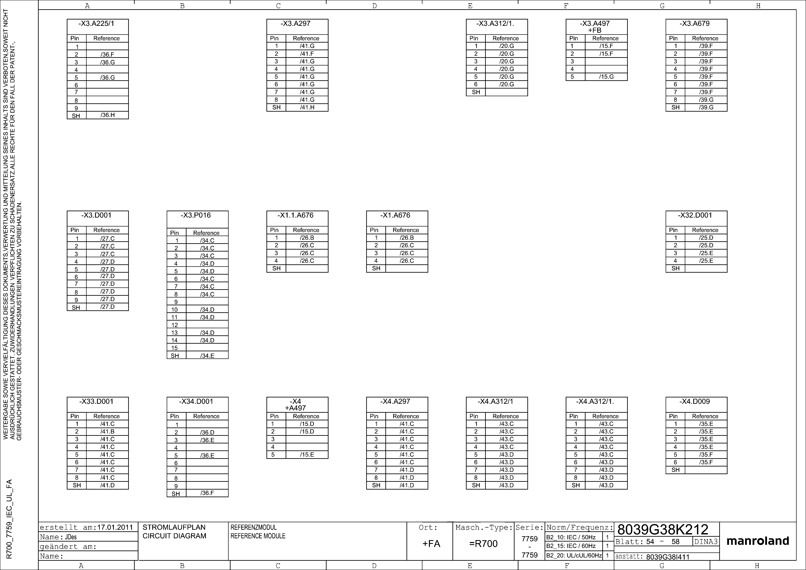

# +FA — Sheet 54 of 58 — REFERENZMODUL

**REFERENCE MODULE**

> Part of the manroland **R700** printing press IEC/UL circuit diagrams.
> Drawing class: **Stromlaufplan / Circuit diagram** (DIN A3).
> Document `+FA` covers the **Delivery** machine section.

## At a glance

| Field | Value |
|---|---|
| Document | `+FA`  (8039G38K212) |
| Sheet | **54** of 58 |
| Section (DE) | REFERENZMODUL |
| Section (EN) | REFERENCE MODULE |
| Section type | REFERENCE_MODULE — Reference module |
| Machine type | `=R700` |
| Series | `7759` |
| Created | 17.01.2011 |
| Replaces | `8039G38I411` |
| Columns used | A, B, C, D, E, F, G |
| Path numbers | — |
| Labels on sheet | 307 |
| Cross-refs out | 115 |
| Cross-refs in | 0 |

**Previous:** [+FA sheet 53](SHEET_0053.md) · **Next:** [+FA sheet 55](SHEET_0055.md) · **Document TOC:** [_TOC.md](_TOC.md)  (+FA) · **Master TOC:** [all sheets](../_MASTER_TOC.md)

## Sheet image (300 DPI, exact vector render)



_Rendered directly from the PDF vector layer at 300 DPI (1-bit), no OCR and no resampling. Use it to confirm anything ambiguous in the text below._

## Cross-references on this sheet

Each entry is a wire leaving this sheet. The printed token is `/sheet.column`; the link resolves to that sheet inside the same document.

| Ref | Target sheet | Col | Path | Destination on target | Target section | From col |
|---|---|---|---|---|---|---|
| `/15.F` | [+FA sheet 15](SHEET_0015.md) | F | — | — | SPANNUNGSVERSORGUNG: | F |
| `/15.F` | [+FA sheet 15](SHEET_0015.md) | F | — | — | SPANNUNGSVERSORGUNG: | F |
| `/39.F` | [+FA sheet 39](SHEET_0039.md) | F | — | — | OPTION: TELEPRESENCE | G |
| `/39.F` | [+FA sheet 39](SHEET_0039.md) | F | — | — | OPTION: TELEPRESENCE | G |
| `/39.F` | [+FA sheet 39](SHEET_0039.md) | F | — | — | OPTION: TELEPRESENCE | G |
| `/39.F` | [+FA sheet 39](SHEET_0039.md) | F | — | — | OPTION: TELEPRESENCE | G |
| `/39.F` | [+FA sheet 39](SHEET_0039.md) | F | — | — | OPTION: TELEPRESENCE | G |
| `/39.F` | [+FA sheet 39](SHEET_0039.md) | F | — | — | OPTION: TELEPRESENCE | G |
| `/39.F` | [+FA sheet 39](SHEET_0039.md) | F | — | — | OPTION: TELEPRESENCE | G |
| `/39.G` | [+FA sheet 39](SHEET_0039.md) | G | — | — | OPTION: TELEPRESENCE | G |
| `/39.G` | [+FA sheet 39](SHEET_0039.md) | G | — | — | OPTION: TELEPRESENCE | G |
| `/41.G` | [+FA sheet 41](SHEET_0041.md) | G | — | — | OPTION: TELEPRESENCE ODER ICP | C |
| `/20.G` | [+FA sheet 20](SHEET_0020.md) | G | — | — | LEITSTAND RECHNER | E |
| `/20.G` | [+FA sheet 20](SHEET_0020.md) | G | — | — | LEITSTAND RECHNER | E |
| `/20.G` | [+FA sheet 20](SHEET_0020.md) | G | — | — | LEITSTAND RECHNER | E |
| `/20.G` | [+FA sheet 20](SHEET_0020.md) | G | — | — | LEITSTAND RECHNER | E |
| `/20.G` | [+FA sheet 20](SHEET_0020.md) | G | — | — | LEITSTAND RECHNER | E |
| `/20.G` | [+FA sheet 20](SHEET_0020.md) | G | — | — | LEITSTAND RECHNER | E |
| `/41.F` | [+FA sheet 41](SHEET_0041.md) | F | — | — | OPTION: TELEPRESENCE ODER ICP | C |
| `/41.G` | [+FA sheet 41](SHEET_0041.md) | G | — | — | OPTION: TELEPRESENCE ODER ICP | C |
| `/41.G` | [+FA sheet 41](SHEET_0041.md) | G | — | — | OPTION: TELEPRESENCE ODER ICP | C |
| `/41.G` | [+FA sheet 41](SHEET_0041.md) | G | — | — | OPTION: TELEPRESENCE ODER ICP | C |
| `/41.G` | [+FA sheet 41](SHEET_0041.md) | G | — | — | OPTION: TELEPRESENCE ODER ICP | C |
| `/41.G` | [+FA sheet 41](SHEET_0041.md) | G | — | — | OPTION: TELEPRESENCE ODER ICP | C |
| `/41.G` | [+FA sheet 41](SHEET_0041.md) | G | — | — | OPTION: TELEPRESENCE ODER ICP | C |
| `/41.H` | [+FA sheet 41](SHEET_0041.md) | H | — | — | OPTION: TELEPRESENCE ODER ICP | C |
| `/36.F` | [+FA sheet 36](SHEET_0036.md) | F | — | — | OPTION: TELEPRESENCE | A |
| `/36.G` | [+FA sheet 36](SHEET_0036.md) | G | — | — | OPTION: TELEPRESENCE | A |
| `/15.G` | [+FA sheet 15](SHEET_0015.md) | G | — | — | SPANNUNGSVERSORGUNG: | F |
| `/36.G` | [+FA sheet 36](SHEET_0036.md) | G | — | — | OPTION: TELEPRESENCE | A |
| `/36.H` | [+FA sheet 36](SHEET_0036.md) | H | — | — | OPTION: TELEPRESENCE | A |
| `/26.B` | [+FA sheet 26](SHEET_0026.md) | B | — | — | USB ANSCHLUSS | C |
| `/26.C` | [+FA sheet 26](SHEET_0026.md) | C | — | — | USB ANSCHLUSS | C |
| `/26.C` | [+FA sheet 26](SHEET_0026.md) | C | — | — | USB ANSCHLUSS | C |
| `/26.C` | [+FA sheet 26](SHEET_0026.md) | C | — | — | USB ANSCHLUSS | C |
| `/26.B` | [+FA sheet 26](SHEET_0026.md) | B | — | — | USB ANSCHLUSS | D |
| `/26.C` | [+FA sheet 26](SHEET_0026.md) | C | — | — | USB ANSCHLUSS | D |
| `/26.C` | [+FA sheet 26](SHEET_0026.md) | C | — | — | USB ANSCHLUSS | D |
| `/26.C` | [+FA sheet 26](SHEET_0026.md) | C | — | — | USB ANSCHLUSS | D |
| `/25.D` | [+FA sheet 25](SHEET_0025.md) | D | — | — | USB ANSCHLUSS | G |
| `/25.D` | [+FA sheet 25](SHEET_0025.md) | D | — | — | USB ANSCHLUSS | G |
| `/25.E` | [+FA sheet 25](SHEET_0025.md) | E | — | — | USB ANSCHLUSS | G |
| `/25.E` | [+FA sheet 25](SHEET_0025.md) | E | — | — | USB ANSCHLUSS | G |
| `/27.C` | [+FA sheet 27](SHEET_0027.md) | C | — | — | TASTATUR: BEDIENUNGSPULT MASCHINE | A |
| `/27.C` | [+FA sheet 27](SHEET_0027.md) | C | — | — | TASTATUR: BEDIENUNGSPULT MASCHINE | A |
| `/27.C` | [+FA sheet 27](SHEET_0027.md) | C | — | — | TASTATUR: BEDIENUNGSPULT MASCHINE | A |
| `/27.D` | [+FA sheet 27](SHEET_0027.md) | D | — | — | TASTATUR: BEDIENUNGSPULT MASCHINE | A |
| `/27.D` | [+FA sheet 27](SHEET_0027.md) | D | — | — | TASTATUR: BEDIENUNGSPULT MASCHINE | A |
| `/27.D` | [+FA sheet 27](SHEET_0027.md) | D | — | — | TASTATUR: BEDIENUNGSPULT MASCHINE | A |
| `/27.D` | [+FA sheet 27](SHEET_0027.md) | D | — | — | TASTATUR: BEDIENUNGSPULT MASCHINE | A |
| `/27.D` | [+FA sheet 27](SHEET_0027.md) | D | — | — | TASTATUR: BEDIENUNGSPULT MASCHINE | A |
| `/27.D` | [+FA sheet 27](SHEET_0027.md) | D | — | — | TASTATUR: BEDIENUNGSPULT MASCHINE | A |
| `/27.D` | [+FA sheet 27](SHEET_0027.md) | D | — | — | TASTATUR: BEDIENUNGSPULT MASCHINE | A |
| `/34.C` | [+FA sheet 34](SHEET_0034.md) | C | — | — | OPTION: TELEPRESENCE , PRINTNET VORBEREITUNG: INTEGRATIONPILOTPLUS INCLUSIVE DATACOL.,INTEGRATIONP. FÜR PRESSM. PERFECT | B |
| `/34.C` | [+FA sheet 34](SHEET_0034.md) | C | — | — | OPTION: TELEPRESENCE , PRINTNET VORBEREITUNG: INTEGRATIONPILOTPLUS INCLUSIVE DATACOL.,INTEGRATIONP. FÜR PRESSM. PERFECT | B |
| `/34.C` | [+FA sheet 34](SHEET_0034.md) | C | — | — | OPTION: TELEPRESENCE , PRINTNET VORBEREITUNG: INTEGRATIONPILOTPLUS INCLUSIVE DATACOL.,INTEGRATIONP. FÜR PRESSM. PERFECT | B |
| `/34.D` | [+FA sheet 34](SHEET_0034.md) | D | — | — | OPTION: TELEPRESENCE , PRINTNET VORBEREITUNG: INTEGRATIONPILOTPLUS INCLUSIVE DATACOL.,INTEGRATIONP. FÜR PRESSM. PERFECT | B |
| `/34.D` | [+FA sheet 34](SHEET_0034.md) | D | — | — | OPTION: TELEPRESENCE , PRINTNET VORBEREITUNG: INTEGRATIONPILOTPLUS INCLUSIVE DATACOL.,INTEGRATIONP. FÜR PRESSM. PERFECT | B |
| `/34.C` | [+FA sheet 34](SHEET_0034.md) | C | — | — | OPTION: TELEPRESENCE , PRINTNET VORBEREITUNG: INTEGRATIONPILOTPLUS INCLUSIVE DATACOL.,INTEGRATIONP. FÜR PRESSM. PERFECT | B |
| `/34.C` | [+FA sheet 34](SHEET_0034.md) | C | — | — | OPTION: TELEPRESENCE , PRINTNET VORBEREITUNG: INTEGRATIONPILOTPLUS INCLUSIVE DATACOL.,INTEGRATIONP. FÜR PRESSM. PERFECT | B |
| `/34.C` | [+FA sheet 34](SHEET_0034.md) | C | — | — | OPTION: TELEPRESENCE , PRINTNET VORBEREITUNG: INTEGRATIONPILOTPLUS INCLUSIVE DATACOL.,INTEGRATIONP. FÜR PRESSM. PERFECT | B |
| `/34.D` | [+FA sheet 34](SHEET_0034.md) | D | — | — | OPTION: TELEPRESENCE , PRINTNET VORBEREITUNG: INTEGRATIONPILOTPLUS INCLUSIVE DATACOL.,INTEGRATIONP. FÜR PRESSM. PERFECT | B |
| `/34.D` | [+FA sheet 34](SHEET_0034.md) | D | — | — | OPTION: TELEPRESENCE , PRINTNET VORBEREITUNG: INTEGRATIONPILOTPLUS INCLUSIVE DATACOL.,INTEGRATIONP. FÜR PRESSM. PERFECT | B |
| `/34.D` | [+FA sheet 34](SHEET_0034.md) | D | — | — | OPTION: TELEPRESENCE , PRINTNET VORBEREITUNG: INTEGRATIONPILOTPLUS INCLUSIVE DATACOL.,INTEGRATIONP. FÜR PRESSM. PERFECT | B |
| `/34.D` | [+FA sheet 34](SHEET_0034.md) | D | — | — | OPTION: TELEPRESENCE , PRINTNET VORBEREITUNG: INTEGRATIONPILOTPLUS INCLUSIVE DATACOL.,INTEGRATIONP. FÜR PRESSM. PERFECT | B |
| `/34.E` | [+FA sheet 34](SHEET_0034.md) | E | — | — | OPTION: TELEPRESENCE , PRINTNET VORBEREITUNG: INTEGRATIONPILOTPLUS INCLUSIVE DATACOL.,INTEGRATIONP. FÜR PRESSM. PERFECT | B |
| `/35.E` | [+FA sheet 35](SHEET_0035.md) | E | — | — | — | G |
| `/35.E` | [+FA sheet 35](SHEET_0035.md) | E | — | — | — | G |
| `/35.E` | [+FA sheet 35](SHEET_0035.md) | E | — | — | — | G |
| `/35.E` | [+FA sheet 35](SHEET_0035.md) | E | — | — | — | G |
| `/35.F` | [+FA sheet 35](SHEET_0035.md) | F | — | — | — | G |
| `/35.F` | [+FA sheet 35](SHEET_0035.md) | F | — | — | — | G |
| `/41.C` | [+FA sheet 41](SHEET_0041.md) | C | — | — | OPTION: TELEPRESENCE ODER ICP | A |
| `/41.B` | [+FA sheet 41](SHEET_0041.md) | B | — | — | OPTION: TELEPRESENCE ODER ICP | A |
| `/41.C` | [+FA sheet 41](SHEET_0041.md) | C | — | — | OPTION: TELEPRESENCE ODER ICP | A |
| `/41.C` | [+FA sheet 41](SHEET_0041.md) | C | — | — | OPTION: TELEPRESENCE ODER ICP | A |
| `/41.C` | [+FA sheet 41](SHEET_0041.md) | C | — | — | OPTION: TELEPRESENCE ODER ICP | A |
| `/41.C` | [+FA sheet 41](SHEET_0041.md) | C | — | — | OPTION: TELEPRESENCE ODER ICP | A |
| `/41.C` | [+FA sheet 41](SHEET_0041.md) | C | — | — | OPTION: TELEPRESENCE ODER ICP | A |
| `/41.C` | [+FA sheet 41](SHEET_0041.md) | C | — | — | OPTION: TELEPRESENCE ODER ICP | A |
| `/41.D` | [+FA sheet 41](SHEET_0041.md) | D | — | — | OPTION: TELEPRESENCE ODER ICP | A |
| `/15.D` | [+FA sheet 15](SHEET_0015.md) | D | — | — | SPANNUNGSVERSORGUNG: | C |
| `/15.D` | [+FA sheet 15](SHEET_0015.md) | D | — | — | SPANNUNGSVERSORGUNG: | C |
| `/41.C` | [+FA sheet 41](SHEET_0041.md) | C | — | — | OPTION: TELEPRESENCE ODER ICP | D |
| `/41.C` | [+FA sheet 41](SHEET_0041.md) | C | — | — | OPTION: TELEPRESENCE ODER ICP | D |
| `/41.C` | [+FA sheet 41](SHEET_0041.md) | C | — | — | OPTION: TELEPRESENCE ODER ICP | D |
| `/41.C` | [+FA sheet 41](SHEET_0041.md) | C | — | — | OPTION: TELEPRESENCE ODER ICP | D |
| `/41.C` | [+FA sheet 41](SHEET_0041.md) | C | — | — | OPTION: TELEPRESENCE ODER ICP | D |
| `/41.C` | [+FA sheet 41](SHEET_0041.md) | C | — | — | OPTION: TELEPRESENCE ODER ICP | D |
| `/41.D` | [+FA sheet 41](SHEET_0041.md) | D | — | — | OPTION: TELEPRESENCE ODER ICP | D |
| `/41.D` | [+FA sheet 41](SHEET_0041.md) | D | — | — | OPTION: TELEPRESENCE ODER ICP | D |
| `/41.D` | [+FA sheet 41](SHEET_0041.md) | D | — | — | OPTION: TELEPRESENCE ODER ICP | D |
| `/43.C` | [+FA sheet 43](SHEET_0043.md) | C | — | — | — | E |
| `/43.C` | [+FA sheet 43](SHEET_0043.md) | C | — | — | — | E |
| `/43.C` | [+FA sheet 43](SHEET_0043.md) | C | — | — | — | E |
| `/43.C` | [+FA sheet 43](SHEET_0043.md) | C | — | — | — | E |
| `/43.D` | [+FA sheet 43](SHEET_0043.md) | D | — | — | — | E |
| `/43.D` | [+FA sheet 43](SHEET_0043.md) | D | — | — | — | E |
| `/43.D` | [+FA sheet 43](SHEET_0043.md) | D | — | — | — | E |
| `/43.D` | [+FA sheet 43](SHEET_0043.md) | D | — | — | — | E |
| `/43.D` | [+FA sheet 43](SHEET_0043.md) | D | — | — | — | E |
| `/43.C` | [+FA sheet 43](SHEET_0043.md) | C | — | — | — | F |
| `/43.C` | [+FA sheet 43](SHEET_0043.md) | C | — | — | — | F |
| `/43.C` | [+FA sheet 43](SHEET_0043.md) | C | — | — | — | F |
| `/43.C` | [+FA sheet 43](SHEET_0043.md) | C | — | — | — | F |
| `/43.C` | [+FA sheet 43](SHEET_0043.md) | C | — | — | — | F |
| `/43.D` | [+FA sheet 43](SHEET_0043.md) | D | — | — | — | F |
| `/43.D` | [+FA sheet 43](SHEET_0043.md) | D | — | — | — | F |
| `/43.D` | [+FA sheet 43](SHEET_0043.md) | D | — | — | — | F |
| `/43.D` | [+FA sheet 43](SHEET_0043.md) | D | — | — | — | F |
| `/36.D` | [+FA sheet 36](SHEET_0036.md) | D | — | — | OPTION: TELEPRESENCE | B |
| `/36.E` | [+FA sheet 36](SHEET_0036.md) | E | — | — | OPTION: TELEPRESENCE | B |
| `/15.E` | [+FA sheet 15](SHEET_0015.md) | E | — | — | SPANNUNGSVERSORGUNG: | C |
| `/36.E` | [+FA sheet 36](SHEET_0036.md) | E | — | — | OPTION: TELEPRESENCE | B |
| `/36.F` | [+FA sheet 36](SHEET_0036.md) | F | — | — | OPTION: TELEPRESENCE | B |

## Devices on this sheet

| Tag | Class | Class meaning (IEC) | Col | Sub | Terminal | Sign |
|---|---|---|---|---|---|---|
| `X4` | X | Klemme / terminal, plug connector | C | — | — | — |
| `+A497` | A | Baugruppe / assembly, module, PC board | C | — | — | + |
| `X3.A297` | — | cross-device reference | C | — | — | — |
| `X3.A497` | — | cross-device reference | F | — | — | — |
| `X3.A679` | — | cross-device reference | G | — | — | — |
| `X3.D001` | — | cross-device reference | A | — | — | — |
| `X3.P016` | — | cross-device reference | B | — | — | — |
| `X1.1.A676` | — | cross-device reference | C | — | — | — |
| `X1.A676` | — | cross-device reference | D | — | — | — |
| `X32.D001` | — | cross-device reference | G | — | — | — |
| `X33.D001` | — | cross-device reference | A | — | — | — |
| `X34.D001` | — | cross-device reference | B | — | — | — |
| `X4.A297` | — | cross-device reference | D | — | — | — |
| `X4.D009` | — | cross-device reference | G | — | — | — |

## Potentials / nets

_No named potentials on this sheet._

## Wire-end annotations (grouped as printed)

A wire that continues elsewhere is annotated with a small cluster: the destination description, the path/line number `#NN`, and the `/sheet.column` cross reference. Each row below is one such cluster exactly as it is grouped on the drawing.

| Col | Y | Path | Cross-ref | Text on the wire |
|---|---|---|---|---|
| A | 30.1 | — | — | `X3.A225/1` |
| C | 30.1 | — | — | `X3.A297` |
| E | 30.1 | — | — | `X3.A312/1.` |
| F | 30.1 | — | — | `X3.A497` |
| G | 30.1 | — | — | `X3.A679` |
| F | 40.0 | — | — | `+FB` |
| A | 52.7 | — | — | `Pin SH 3 4 5 6 7 8 9 2 1 Reference` |
| C | 52.7 | — | — | `Pin SH 3 4 5 6 7 8 2 1 Reference` |
| E | 52.7 | — | — | `Pin SH 3 4 5 6 2 1 Reference` |
| F | 52.7 | — | — | `Pin 1 2 3 4 5 Reference` |
| G | 52.7 | — | — | `Pin SH 3 4 5 6 7 8 2 1 Reference` |
| C | 64.0 | — | `/41.G` | — |
| E | 64.0 | — | `/20.G`, `/20.G`, `/20.G`, `/20.G`, `/20.G`, `/20.G` | — |
| F | 64.0 | — | `/15.F`, `/15.F` | — |
| G | 64.0 | — | `/39.F`, `/39.F`, `/39.F`, `/39.F`, `/39.F`, `/39.F`, `/39.F`, `/39.G`, `/39.G` | — |
| C | 75.4 | — | `/41.F`, `/41.G`, `/41.G`, `/41.G`, `/41.G`, `/41.G`, `/41.G`, `/41.H` | — |
| A | 76.8 | — | `/36.F`, `/36.G` | — |
| F | 109.4 | — | `/15.G` | — |
| A | 110.8 | — | `/36.G` | — |
| A | 166.1 | — | `/36.H` | — |
| B | 313.2 | — | — | `X3.P016` |
| D | 313.2 | — | — | `X1.A676` |
| G | 313.2 | — | — | `X32.D001` |
| A | 313.3 | — | — | `X3.D001` |
| C | 313.3 | — | — | `X1.1.A676` |
| A | 335.9 | — | — | `Pin SH 3 4 5 6 7 8 9 2 1 Reference` |
| C | 335.9 | — | — | `Pin SH 3 4 2 1 Reference` |
| D | 335.9 | — | — | `Pin SH 3 4 2 1 Reference` |
| G | 335.9 | — | — | `Pin SH 3 4 2 1 Reference` |
| B | 340.1 | — | — | `Pin SH 10 11 13 14 15 12 3 4 5 6 7 8 9 2 1 Reference` |
| C | 347.2 | — | `/26.B`, `/26.C`, `/26.C`, `/26.C` | — |
| D | 347.2 | — | `/26.B`, `/26.C`, `/26.C`, `/26.C` | — |
| G | 347.2 | — | `/25.D`, `/25.D`, `/25.E`, `/25.E` | — |
| A | 348.7 | — | `/27.C`, `/27.C`, `/27.C`, `/27.D`, `/27.D`, `/27.D`, `/27.D`, `/27.D`, `/27.D`, `/27.D` | — |
| B | 351.5 | — | `/34.C`, `/34.C`, `/34.C`, `/34.D`, `/34.D`, `/34.C`, `/34.C`, `/34.C` | — |
| B | 453.5 | — | `/34.D`, `/34.D` | — |
| B | 487.6 | — | `/34.D`, `/34.D` | — |
| B | 521.5 | — | `/34.E` | — |
| A | 588.2 | — | — | `X33.D001` |
| B | 588.2 | — | — | `X34.D001` |
| C | 588.2 | — | — | `+A497 X4` |
| D | 588.2 | — | — | `X4.A297` |
| E | 588.2 | — | — | `X4.A312/1` |
| F | 588.2 | — | — | `X4.A312/1.` |
| G | 588.2 | — | — | `X4.D009` |
| A | 610.8 | — | — | `Pin SH 3 4 5 6 7 8 2 1 Reference` |
| B | 610.8 | — | — | `Pin SH 3 4 5 6 7 8 9 2 1 Reference` |
| C | 610.8 | — | — | `Pin 1 2 3 4 5 Reference` |
| D | 610.8 | — | — | `Pin SH 3 4 5 6 7 8 2 1 Reference` |
| E | 610.8 | — | — | `Pin SH 3 4 5 6 7 8 2 1 Reference` |
| F | 610.8 | — | — | `Pin SH 3 4 5 6 7 8 2 1 Reference` |
| G | 610.8 | — | — | `Pin SH 3 4 5 6 2 1 Reference` |
| A | 622.2 | — | `/41.C`, `/41.B`, `/41.C`, `/41.C`, `/41.C`, `/41.C`, `/41.C`, `/41.C`, `/41.D` | — |
| C | 622.2 | — | `/15.D`, `/15.D` | — |
| D | 622.2 | — | `/41.C`, `/41.C`, `/41.C`, `/41.C`, `/41.C`, `/41.C`, `/41.D`, `/41.D`, `/41.D` | — |
| E | 622.2 | — | `/43.C`, `/43.C`, `/43.C`, `/43.C`, `/43.D`, `/43.D`, `/43.D`, `/43.D`, `/43.D` | — |
| F | 622.2 | — | `/43.C`, `/43.C`, `/43.C`, `/43.C`, `/43.C`, `/43.D`, `/43.D`, `/43.D`, `/43.D` | — |
| G | 622.2 | — | `/35.E`, `/35.E`, `/35.E`, `/35.E`, `/35.F`, `/35.F` | — |
| B | 635.0 | — | `/36.D`, `/36.E` | — |
| C | 667.5 | — | `/15.E` | — |
| B | 668.9 | — | `/36.E` | — |
| B | 724.2 | — | `/36.F` | — |


## Notes and free text on this sheet

| Text | Col | Y (pt) |
|---|---|---|
| `Pin` | A | 52.7 |
| `Reference` | A | 52.86 |
| `SH` | A | 167.53 |
| `X3.A225/1` | A | 30.08 |
| `Pin` | C | 52.7 |
| `Reference` | C | 52.86 |
| `SH` | C | 154.77 |
| `Pin` | E | 52.7 |
| `Reference` | E | 52.86 |
| `SH` | E | 132.09 |
| `X3.A312/1.` | E | 30.09 |
| `Pin` | F | 52.7 |
| `Reference` | F | 52.86 |
| `+FB` | F | 39.97 |
| `Pin` | G | 52.7 |
| `Reference` | G | 52.86 |
| `SH` | G | 154.77 |
| `Pin` | B | 340.14 |
| `Reference` | B | 340.3 |
| `SH` | B | 521.57 |
| `Pin` | D | 335.88 |
| `Reference` | D | 336.04 |
| `SH` | D | 392.6 |
| `X4.A312/1` | E | 588.22 |
| `SH` | F | 712.91 |
| `X4.A312/1.` | F | 588.23 |

## Complete label inventory (exact text from the drawing)

Every text object inside the drawing area of this sheet, in DIN reading order (column A→H, then top→bottom). This is the authoritative list: if a string is not here it is not printed on this sheet.

| Col | Y | X | Dir | Type | Text |
|---|---|---|---|---|---|
| A | 30.1 | 116.1 | → | text | `X3.A225/1` |
| A | 52.7 | 104.0 | → | text | `Pin` |
| A | 52.9 | 138.0 | → | text | `Reference` |
| A | 65.5 | 111.7 | → | number | `1` |
| A | 76.8 | 148.8 | → | cross-reference | `/36.F` |
| A | 76.9 | 110.6 | → | number | `2` |
| A | 88.1 | 148.3 | → | cross-reference | `/36.G` |
| A | 88.2 | 110.3 | → | number | `3` |
| A | 99.5 | 110.3 | → | number | `4` |
| A | 110.8 | 148.3 | → | cross-reference | `/36.G` |
| A | 110.9 | 110.3 | → | number | `5` |
| A | 122.2 | 110.3 | → | number | `6` |
| A | 132.1 | 110.3 | → | number | `7` |
| A | 144.9 | 110.3 | → | number | `8` |
| A | 156.2 | 110.3 | → | number | `9` |
| A | 166.1 | 148.7 | → | cross-reference | `/36.H` |
| A | 167.5 | 106.2 | → | text | `SH` |
| A | 313.3 | 120.2 | → | device ref | `X3.D001` |
| A | 335.9 | 104.0 | → | text | `Pin` |
| A | 336.0 | 138.0 | → | text | `Reference` |
| A | 348.7 | 111.7 | → | number | `1` |
| A | 348.7 | 148.4 | → | cross-reference | `/27.C` |
| A | 360.0 | 110.6 | → | number | `2` |
| A | 360.0 | 148.4 | → | cross-reference | `/27.C` |
| A | 371.3 | 148.4 | → | cross-reference | `/27.C` |
| A | 371.4 | 110.3 | → | number | `3` |
| A | 382.7 | 110.3 | → | number | `4` |
| A | 382.7 | 148.4 | → | cross-reference | `/27.D` |
| A | 394.0 | 148.4 | → | cross-reference | `/27.D` |
| A | 394.1 | 110.3 | → | number | `5` |
| A | 403.9 | 148.4 | → | cross-reference | `/27.D` |
| A | 405.4 | 110.3 | → | number | `6` |
| A | 415.3 | 110.3 | → | number | `7` |
| A | 415.3 | 148.4 | → | cross-reference | `/27.D` |
| A | 426.6 | 148.4 | → | cross-reference | `/27.D` |
| A | 428.1 | 110.3 | → | number | `8` |
| A | 438.0 | 148.4 | → | cross-reference | `/27.D` |
| A | 439.4 | 110.3 | → | number | `9` |
| A | 449.3 | 148.4 | → | cross-reference | `/27.D` |
| A | 450.7 | 106.2 | → | text | `SH` |
| A | 588.2 | 117.2 | → | device ref | `X33.D001` |
| A | 610.8 | 104.0 | → | text | `Pin` |
| A | 611.0 | 138.0 | → | text | `Reference` |
| A | 622.2 | 111.4 | → | number | `1` |
| A | 622.2 | 148.4 | → | cross-reference | `/41.C` |
| A | 633.5 | 148.5 | → | cross-reference | `/41.B` |
| A | 633.6 | 111.1 | → | number | `2` |
| A | 644.9 | 111.0 | → | number | `3` |
| A | 644.9 | 148.4 | → | cross-reference | `/41.C` |
| A | 656.2 | 148.4 | → | cross-reference | `/41.C` |
| A | 656.3 | 111.0 | → | number | `4` |
| A | 667.6 | 111.0 | → | number | `5` |
| A | 667.6 | 148.4 | → | cross-reference | `/41.C` |
| A | 678.9 | 111.0 | → | number | `6` |
| A | 678.9 | 148.4 | → | cross-reference | `/41.C` |
| A | 690.2 | 148.4 | → | cross-reference | `/41.C` |
| A | 690.3 | 111.0 | → | number | `7` |
| A | 701.6 | 111.0 | → | number | `8` |
| A | 701.6 | 148.4 | → | cross-reference | `/41.C` |
| A | 712.9 | 107.6 | → | text | `SH` |
| A | 712.9 | 148.4 | → | cross-reference | `/41.D` |
| B | 313.3 | 267.2 | → | device ref | `X3.P016` |
| B | 340.1 | 251.4 | → | text | `Pin` |
| B | 340.3 | 285.4 | → | text | `Reference` |
| B | 351.5 | 259.1 | → | number | `1` |
| B | 351.5 | 295.8 | → | cross-reference | `/34.C` |
| B | 362.8 | 295.8 | → | cross-reference | `/34.C` |
| B | 362.9 | 258.0 | → | number | `2` |
| B | 374.2 | 257.7 | → | number | `3` |
| B | 374.2 | 295.8 | → | cross-reference | `/34.C` |
| B | 385.5 | 295.8 | → | cross-reference | `/34.D` |
| B | 385.6 | 257.7 | → | number | `4` |
| B | 396.8 | 295.8 | → | cross-reference | `/34.D` |
| B | 396.9 | 257.7 | → | number | `5` |
| B | 408.2 | 257.7 | → | number | `6` |
| B | 408.2 | 295.8 | → | cross-reference | `/34.C` |
| B | 419.5 | 295.8 | → | cross-reference | `/34.C` |
| B | 419.6 | 257.7 | → | number | `7` |
| B | 430.9 | 257.7 | → | number | `8` |
| B | 430.9 | 295.8 | → | cross-reference | `/34.C` |
| B | 442.2 | 257.7 | → | number | `9` |
| B | 453.5 | 295.8 | → | cross-reference | `/34.D` |
| B | 453.6 | 252.9 | → | number | `10` |
| B | 464.9 | 252.9 | → | number | `11` |
| B | 464.9 | 295.8 | → | cross-reference | `/34.D` |
| B | 476.3 | 253.1 | → | number | `12` |
| B | 487.6 | 252.9 | → | number | `13` |
| B | 487.6 | 295.8 | → | cross-reference | `/34.D` |
| B | 498.9 | 252.9 | → | number | `14` |
| B | 498.9 | 295.8 | → | cross-reference | `/34.D` |
| B | 510.3 | 252.9 | → | number | `15` |
| B | 521.5 | 296.1 | → | cross-reference | `/34.E` |
| B | 521.6 | 252.3 | → | text | `SH` |
| B | 588.2 | 264.6 | → | device ref | `X34.D001` |
| B | 610.8 | 251.4 | → | text | `Pin` |
| B | 611.0 | 285.4 | → | text | `Reference` |
| B | 623.7 | 259.1 | → | number | `1` |
| B | 635.0 | 258.0 | → | number | `2` |
| B | 635.0 | 295.8 | → | cross-reference | `/36.D` |
| B | 646.3 | 257.7 | → | number | `3` |
| B | 646.3 | 296.1 | → | cross-reference | `/36.E` |
| B | 657.7 | 257.7 | → | number | `4` |
| B | 668.9 | 296.1 | → | cross-reference | `/36.E` |
| B | 669.0 | 257.7 | → | number | `5` |
| B | 680.4 | 257.7 | → | number | `6` |
| B | 690.3 | 257.7 | → | number | `7` |
| B | 703.0 | 257.7 | → | number | `8` |
| B | 714.4 | 257.7 | → | number | `9` |
| B | 724.2 | 296.2 | → | cross-reference | `/36.F` |
| B | 725.7 | 253.6 | → | text | `SH` |
| C | 30.1 | 414.6 | → | device ref | `X3.A297` |
| C | 52.7 | 398.8 | → | text | `Pin` |
| C | 52.9 | 432.9 | → | text | `Reference` |
| C | 64.0 | 443.1 | → | cross-reference | `/41.G` |
| C | 64.1 | 406.2 | → | number | `1` |
| C | 75.4 | 405.9 | → | number | `2` |
| C | 75.4 | 443.6 | → | cross-reference | `/41.F` |
| C | 86.7 | 443.1 | → | cross-reference | `/41.G` |
| C | 86.8 | 405.8 | → | number | `3` |
| C | 98.1 | 405.8 | → | number | `4` |
| C | 98.1 | 443.1 | → | cross-reference | `/41.G` |
| C | 109.4 | 443.1 | → | cross-reference | `/41.G` |
| C | 109.5 | 405.8 | → | number | `5` |
| C | 120.7 | 443.1 | → | cross-reference | `/41.G` |
| C | 120.8 | 405.8 | → | number | `6` |
| C | 132.1 | 405.8 | → | number | `7` |
| C | 132.1 | 443.1 | → | cross-reference | `/41.G` |
| C | 143.4 | 443.1 | → | cross-reference | `/41.G` |
| C | 143.5 | 405.8 | → | number | `8` |
| C | 154.8 | 402.4 | → | text | `SH` |
| C | 154.8 | 443.5 | → | cross-reference | `/41.H` |
| C | 313.3 | 410.2 | → | device ref | `X1.1.A676` |
| C | 335.9 | 398.8 | → | text | `Pin` |
| C | 336.0 | 432.9 | → | text | `Reference` |
| C | 347.2 | 443.3 | → | cross-reference | `/26.B` |
| C | 347.3 | 406.2 | → | number | `1` |
| C | 358.6 | 405.9 | → | number | `2` |
| C | 358.6 | 443.2 | → | cross-reference | `/26.C` |
| C | 369.9 | 443.2 | → | cross-reference | `/26.C` |
| C | 370.0 | 405.8 | → | number | `3` |
| C | 381.3 | 405.8 | → | number | `4` |
| C | 381.3 | 443.2 | → | cross-reference | `/26.C` |
| C | 392.6 | 402.4 | → | text | `SH` |
| C | 588.2 | 428.5 | → | device tag | `X4` |
| C | 598.1 | 420.9 | → | device tag | `+A497` |
| C | 610.8 | 398.8 | → | text | `Pin` |
| C | 611.0 | 432.9 | → | text | `Reference` |
| C | 622.2 | 400.3 | → | number | `1` |
| C | 622.2 | 443.2 | → | cross-reference | `/15.D` |
| C | 633.5 | 443.2 | → | cross-reference | `/15.D` |
| C | 633.6 | 400.8 | → | number | `2` |
| C | 644.9 | 400.8 | → | number | `3` |
| C | 656.3 | 400.8 | → | number | `4` |
| C | 667.5 | 443.5 | → | cross-reference | `/15.E` |
| C | 667.6 | 400.8 | → | number | `5` |
| D | 313.3 | 562.0 | → | device ref | `X1.A676` |
| D | 335.9 | 546.2 | → | text | `Pin` |
| D | 336.0 | 580.3 | → | text | `Reference` |
| D | 347.2 | 590.7 | → | cross-reference | `/26.B` |
| D | 347.3 | 553.6 | → | number | `1` |
| D | 358.6 | 553.3 | → | number | `2` |
| D | 358.6 | 590.6 | → | cross-reference | `/26.C` |
| D | 369.9 | 590.6 | → | cross-reference | `/26.C` |
| D | 370.0 | 553.2 | → | number | `3` |
| D | 381.3 | 553.2 | → | number | `4` |
| D | 381.3 | 590.6 | → | cross-reference | `/26.C` |
| D | 392.6 | 549.8 | → | text | `SH` |
| D | 588.2 | 562.0 | → | device ref | `X4.A297` |
| D | 610.8 | 546.2 | → | text | `Pin` |
| D | 611.0 | 580.3 | → | text | `Reference` |
| D | 622.2 | 553.6 | → | number | `1` |
| D | 622.2 | 590.6 | → | cross-reference | `/41.C` |
| D | 633.5 | 590.6 | → | cross-reference | `/41.C` |
| D | 633.6 | 553.3 | → | number | `2` |
| D | 644.9 | 553.2 | → | number | `3` |
| D | 644.9 | 590.6 | → | cross-reference | `/41.C` |
| D | 656.2 | 590.6 | → | cross-reference | `/41.C` |
| D | 656.3 | 553.2 | → | number | `4` |
| D | 667.6 | 553.2 | → | number | `5` |
| D | 667.6 | 590.6 | → | cross-reference | `/41.C` |
| D | 678.9 | 553.2 | → | number | `6` |
| D | 678.9 | 590.6 | → | cross-reference | `/41.C` |
| D | 690.2 | 590.6 | → | cross-reference | `/41.D` |
| D | 690.3 | 553.2 | → | number | `7` |
| D | 701.6 | 553.2 | → | number | `8` |
| D | 701.6 | 590.6 | → | cross-reference | `/41.D` |
| D | 712.9 | 549.8 | → | text | `SH` |
| D | 712.9 | 590.6 | → | cross-reference | `/41.D` |
| E | 30.1 | 703.8 | → | text | `X3.A312/1.` |
| E | 52.7 | 693.6 | → | text | `Pin` |
| E | 52.9 | 727.7 | → | text | `Reference` |
| E | 64.0 | 737.9 | → | cross-reference | `/20.G` |
| E | 64.1 | 701.0 | → | number | `1` |
| E | 75.4 | 700.7 | → | number | `2` |
| E | 75.4 | 737.9 | → | cross-reference | `/20.G` |
| E | 86.7 | 737.9 | → | cross-reference | `/20.G` |
| E | 86.8 | 700.6 | → | number | `3` |
| E | 98.1 | 700.6 | → | number | `4` |
| E | 98.1 | 737.9 | → | cross-reference | `/20.G` |
| E | 109.4 | 737.9 | → | cross-reference | `/20.G` |
| E | 109.5 | 700.6 | → | number | `5` |
| E | 120.7 | 737.9 | → | cross-reference | `/20.G` |
| E | 120.8 | 700.6 | → | number | `6` |
| E | 132.1 | 697.2 | → | text | `SH` |
| E | 588.2 | 705.7 | → | text | `X4.A312/1` |
| E | 610.8 | 693.6 | → | text | `Pin` |
| E | 611.0 | 727.7 | → | text | `Reference` |
| E | 622.2 | 701.0 | → | number | `1` |
| E | 622.2 | 738.0 | → | cross-reference | `/43.C` |
| E | 633.5 | 738.0 | → | cross-reference | `/43.C` |
| E | 633.6 | 700.7 | → | number | `2` |
| E | 644.9 | 700.6 | → | number | `3` |
| E | 644.9 | 738.0 | → | cross-reference | `/43.C` |
| E | 656.2 | 738.0 | → | cross-reference | `/43.C` |
| E | 656.3 | 700.6 | → | number | `4` |
| E | 667.6 | 700.6 | → | number | `5` |
| E | 667.6 | 738.0 | → | cross-reference | `/43.D` |
| E | 678.9 | 700.6 | → | number | `6` |
| E | 678.9 | 738.0 | → | cross-reference | `/43.D` |
| E | 690.2 | 738.0 | → | cross-reference | `/43.D` |
| E | 690.3 | 700.6 | → | number | `7` |
| E | 701.6 | 700.6 | → | number | `8` |
| E | 701.6 | 738.0 | → | cross-reference | `/43.D` |
| E | 712.9 | 697.2 | → | text | `SH` |
| E | 712.9 | 738.0 | → | cross-reference | `/43.D` |
| F | 30.1 | 856.8 | → | device ref | `X3.A497` |
| F | 40.0 | 868.8 | → | text | `+FB` |
| F | 52.7 | 841.0 | → | text | `Pin` |
| F | 52.9 | 875.1 | → | text | `Reference` |
| F | 64.0 | 885.8 | → | cross-reference | `/15.F` |
| F | 64.1 | 842.5 | → | number | `1` |
| F | 75.4 | 843.0 | → | number | `2` |
| F | 75.4 | 885.8 | → | cross-reference | `/15.F` |
| F | 86.8 | 843.0 | → | number | `3` |
| F | 98.1 | 843.0 | → | number | `4` |
| F | 109.4 | 885.3 | → | cross-reference | `/15.G` |
| F | 109.5 | 843.0 | → | number | `5` |
| F | 588.2 | 851.2 | → | text | `X4.A312/1.` |
| F | 610.8 | 841.0 | → | text | `Pin` |
| F | 611.0 | 875.1 | → | text | `Reference` |
| F | 622.2 | 848.4 | → | number | `1` |
| F | 622.2 | 885.4 | → | cross-reference | `/43.C` |
| F | 633.5 | 885.4 | → | cross-reference | `/43.C` |
| F | 633.6 | 848.1 | → | number | `2` |
| F | 644.9 | 848.0 | → | number | `3` |
| F | 644.9 | 885.4 | → | cross-reference | `/43.C` |
| F | 656.2 | 885.4 | → | cross-reference | `/43.C` |
| F | 656.3 | 848.0 | → | number | `4` |
| F | 667.6 | 848.0 | → | number | `5` |
| F | 667.6 | 885.4 | → | cross-reference | `/43.C` |
| F | 678.9 | 848.0 | → | number | `6` |
| F | 678.9 | 885.4 | → | cross-reference | `/43.D` |
| F | 690.2 | 885.4 | → | cross-reference | `/43.D` |
| F | 690.3 | 848.0 | → | number | `7` |
| F | 701.6 | 848.0 | → | number | `8` |
| F | 701.6 | 885.4 | → | cross-reference | `/43.D` |
| F | 712.9 | 844.6 | → | text | `SH` |
| F | 712.9 | 885.4 | → | cross-reference | `/43.D` |
| G | 30.1 | 1004.2 | → | device ref | `X3.A679` |
| G | 52.7 | 988.4 | → | text | `Pin` |
| G | 52.9 | 1022.5 | → | text | `Reference` |
| G | 64.0 | 1033.2 | → | cross-reference | `/39.F` |
| G | 64.1 | 995.8 | → | number | `1` |
| G | 75.4 | 995.5 | → | number | `2` |
| G | 75.4 | 1033.2 | → | cross-reference | `/39.F` |
| G | 86.7 | 1033.2 | → | cross-reference | `/39.F` |
| G | 86.8 | 995.4 | → | number | `3` |
| G | 98.1 | 995.4 | → | number | `4` |
| G | 98.1 | 1033.2 | → | cross-reference | `/39.F` |
| G | 109.4 | 1033.2 | → | cross-reference | `/39.F` |
| G | 109.5 | 995.4 | → | number | `5` |
| G | 120.7 | 1033.2 | → | cross-reference | `/39.F` |
| G | 120.8 | 995.4 | → | number | `6` |
| G | 132.1 | 995.4 | → | number | `7` |
| G | 132.1 | 1033.2 | → | cross-reference | `/39.F` |
| G | 143.4 | 1032.7 | → | cross-reference | `/39.G` |
| G | 143.5 | 995.4 | → | number | `8` |
| G | 154.8 | 992.0 | → | text | `SH` |
| G | 154.8 | 1032.7 | → | cross-reference | `/39.G` |
| G | 313.3 | 1001.6 | → | device ref | `X32.D001` |
| G | 335.9 | 988.4 | → | text | `Pin` |
| G | 336.0 | 1022.5 | → | text | `Reference` |
| G | 347.2 | 1032.8 | → | cross-reference | `/25.D` |
| G | 347.3 | 995.8 | → | number | `1` |
| G | 358.6 | 995.5 | → | number | `2` |
| G | 358.6 | 1032.8 | → | cross-reference | `/25.D` |
| G | 369.9 | 1033.1 | → | cross-reference | `/25.E` |
| G | 370.0 | 995.4 | → | number | `3` |
| G | 381.2 | 1033.1 | → | cross-reference | `/25.E` |
| G | 381.3 | 995.4 | → | number | `4` |
| G | 392.6 | 992.0 | → | text | `SH` |
| G | 588.2 | 1003.9 | → | device ref | `X4.D009` |
| G | 610.8 | 988.4 | → | text | `Pin` |
| G | 611.0 | 1022.5 | → | text | `Reference` |
| G | 622.2 | 995.8 | → | number | `1` |
| G | 622.2 | 1033.1 | → | cross-reference | `/35.E` |
| G | 633.5 | 1033.1 | → | cross-reference | `/35.E` |
| G | 633.6 | 995.5 | → | number | `2` |
| G | 644.8 | 1033.1 | → | cross-reference | `/35.E` |
| G | 644.9 | 995.4 | → | number | `3` |
| G | 656.2 | 1033.1 | → | cross-reference | `/35.E` |
| G | 656.3 | 995.4 | → | number | `4` |
| G | 667.5 | 1033.2 | → | cross-reference | `/35.F` |
| G | 667.6 | 995.4 | → | number | `5` |
| G | 678.9 | 995.4 | → | number | `6` |
| G | 678.9 | 1033.2 | → | cross-reference | `/35.F` |
| G | 690.2 | 992.0 | → | text | `SH` |

## Reading-order text block

The same content as a plain block, grouped by DIN column — convenient to paste or to match against a visual description.

```text
=== Column A ===
  30.1  116.1  text         X3.A225/1
  52.7  104.0  text         Pin
  52.9  138.0  text         Reference
  65.5  111.7  numeric      1
  76.8  148.8  xref         /36.F
  76.9  110.6  numeric      2
  88.1  148.3  xref         /36.G
  88.2  110.3  numeric      3
  99.5  110.3  numeric      4
 110.8  148.3  xref         /36.G
 110.9  110.3  numeric      5
 122.2  110.3  numeric      6
 132.1  110.3  numeric      7
 144.9  110.3  numeric      8
 156.2  110.3  numeric      9
 166.1  148.7  xref         /36.H
 167.5  106.2  text         SH
 313.3  120.2  devref       X3.D001
 335.9  104.0  text         Pin
 336.0  138.0  text         Reference
 348.7  111.7  numeric      1
 348.7  148.4  xref         /27.C
 360.0  110.6  numeric      2
 360.0  148.4  xref         /27.C
 371.3  148.4  xref         /27.C
 371.4  110.3  numeric      3
 382.7  110.3  numeric      4
 382.7  148.4  xref         /27.D
 394.0  148.4  xref         /27.D
 394.1  110.3  numeric      5
 403.9  148.4  xref         /27.D
 405.4  110.3  numeric      6
 415.3  110.3  numeric      7
 415.3  148.4  xref         /27.D
 426.6  148.4  xref         /27.D
 428.1  110.3  numeric      8
 438.0  148.4  xref         /27.D
 439.4  110.3  numeric      9
 449.3  148.4  xref         /27.D
 450.7  106.2  text         SH
 588.2  117.2  devref       X33.D001
 610.8  104.0  text         Pin
 611.0  138.0  text         Reference
 622.2  111.4  numeric      1
 622.2  148.4  xref         /41.C
 633.5  148.5  xref         /41.B
 633.6  111.1  numeric      2
 644.9  111.0  numeric      3
 644.9  148.4  xref         /41.C
 656.2  148.4  xref         /41.C
 656.3  111.0  numeric      4
 667.6  111.0  numeric      5
 667.6  148.4  xref         /41.C
 678.9  111.0  numeric      6
 678.9  148.4  xref         /41.C
 690.2  148.4  xref         /41.C
 690.3  111.0  numeric      7
 701.6  111.0  numeric      8
 701.6  148.4  xref         /41.C
 712.9  107.6  text         SH
 712.9  148.4  xref         /41.D
=== Column B ===
 313.3  267.2  devref       X3.P016
 340.1  251.4  text         Pin
 340.3  285.4  text         Reference
 351.5  259.1  numeric      1
 351.5  295.8  xref         /34.C
 362.8  295.8  xref         /34.C
 362.9  258.0  numeric      2
 374.2  257.7  numeric      3
 374.2  295.8  xref         /34.C
 385.5  295.8  xref         /34.D
 385.6  257.7  numeric      4
 396.8  295.8  xref         /34.D
 396.9  257.7  numeric      5
 408.2  257.7  numeric      6
 408.2  295.8  xref         /34.C
 419.5  295.8  xref         /34.C
 419.6  257.7  numeric      7
 430.9  257.7  numeric      8
 430.9  295.8  xref         /34.C
 442.2  257.7  numeric      9
 453.5  295.8  xref         /34.D
 453.6  252.9  numeric      10
 464.9  252.9  numeric      11
 464.9  295.8  xref         /34.D
 476.3  253.1  numeric      12
 487.6  252.9  numeric      13
 487.6  295.8  xref         /34.D
 498.9  252.9  numeric      14
 498.9  295.8  xref         /34.D
 510.3  252.9  numeric      15
 521.5  296.1  xref         /34.E
 521.6  252.3  text         SH
 588.2  264.6  devref       X34.D001
 610.8  251.4  text         Pin
 611.0  285.4  text         Reference
 623.7  259.1  numeric      1
 635.0  258.0  numeric      2
 635.0  295.8  xref         /36.D
 646.3  257.7  numeric      3
 646.3  296.1  xref         /36.E
 657.7  257.7  numeric      4
 668.9  296.1  xref         /36.E
 669.0  257.7  numeric      5
 680.4  257.7  numeric      6
 690.3  257.7  numeric      7
 703.0  257.7  numeric      8
 714.4  257.7  numeric      9
 724.2  296.2  xref         /36.F
 725.7  253.6  text         SH
=== Column C ===
  30.1  414.6  devref       X3.A297
  52.7  398.8  text         Pin
  52.9  432.9  text         Reference
  64.0  443.1  xref         /41.G
  64.1  406.2  numeric      1
  75.4  405.9  numeric      2
  75.4  443.6  xref         /41.F
  86.7  443.1  xref         /41.G
  86.8  405.8  numeric      3
  98.1  405.8  numeric      4
  98.1  443.1  xref         /41.G
 109.4  443.1  xref         /41.G
 109.5  405.8  numeric      5
 120.7  443.1  xref         /41.G
 120.8  405.8  numeric      6
 132.1  405.8  numeric      7
 132.1  443.1  xref         /41.G
 143.4  443.1  xref         /41.G
 143.5  405.8  numeric      8
 154.8  402.4  text         SH
 154.8  443.5  xref         /41.H
 313.3  410.2  devref       X1.1.A676
 335.9  398.8  text         Pin
 336.0  432.9  text         Reference
 347.2  443.3  xref         /26.B
 347.3  406.2  numeric      1
 358.6  405.9  numeric      2
 358.6  443.2  xref         /26.C
 369.9  443.2  xref         /26.C
 370.0  405.8  numeric      3
 381.3  405.8  numeric      4
 381.3  443.2  xref         /26.C
 392.6  402.4  text         SH
 588.2  428.5  devtag       X4
 598.1  420.9  devtag       +A497
 610.8  398.8  text         Pin
 611.0  432.9  text         Reference
 622.2  400.3  numeric      1
 622.2  443.2  xref         /15.D
 633.5  443.2  xref         /15.D
 633.6  400.8  numeric      2
 644.9  400.8  numeric      3
 656.3  400.8  numeric      4
 667.5  443.5  xref         /15.E
 667.6  400.8  numeric      5
=== Column D ===
 313.3  562.0  devref       X1.A676
 335.9  546.2  text         Pin
 336.0  580.3  text         Reference
 347.2  590.7  xref         /26.B
 347.3  553.6  numeric      1
 358.6  553.3  numeric      2
 358.6  590.6  xref         /26.C
 369.9  590.6  xref         /26.C
 370.0  553.2  numeric      3
 381.3  553.2  numeric      4
 381.3  590.6  xref         /26.C
 392.6  549.8  text         SH
 588.2  562.0  devref       X4.A297
 610.8  546.2  text         Pin
 611.0  580.3  text         Reference
 622.2  553.6  numeric      1
 622.2  590.6  xref         /41.C
 633.5  590.6  xref         /41.C
 633.6  553.3  numeric      2
 644.9  553.2  numeric      3
 644.9  590.6  xref         /41.C
 656.2  590.6  xref         /41.C
 656.3  553.2  numeric      4
 667.6  553.2  numeric      5
 667.6  590.6  xref         /41.C
 678.9  553.2  numeric      6
 678.9  590.6  xref         /41.C
 690.2  590.6  xref         /41.D
 690.3  553.2  numeric      7
 701.6  553.2  numeric      8
 701.6  590.6  xref         /41.D
 712.9  549.8  text         SH
 712.9  590.6  xref         /41.D
=== Column E ===
  30.1  703.8  text         X3.A312/1.
  52.7  693.6  text         Pin
  52.9  727.7  text         Reference
  64.0  737.9  xref         /20.G
  64.1  701.0  numeric      1
  75.4  700.7  numeric      2
  75.4  737.9  xref         /20.G
  86.7  737.9  xref         /20.G
  86.8  700.6  numeric      3
  98.1  700.6  numeric      4
  98.1  737.9  xref         /20.G
 109.4  737.9  xref         /20.G
 109.5  700.6  numeric      5
 120.7  737.9  xref         /20.G
 120.8  700.6  numeric      6
 132.1  697.2  text         SH
 588.2  705.7  text         X4.A312/1
 610.8  693.6  text         Pin
 611.0  727.7  text         Reference
 622.2  701.0  numeric      1
 622.2  738.0  xref         /43.C
 633.5  738.0  xref         /43.C
 633.6  700.7  numeric      2
 644.9  700.6  numeric      3
 644.9  738.0  xref         /43.C
 656.2  738.0  xref         /43.C
 656.3  700.6  numeric      4
 667.6  700.6  numeric      5
 667.6  738.0  xref         /43.D
 678.9  700.6  numeric      6
 678.9  738.0  xref         /43.D
 690.2  738.0  xref         /43.D
 690.3  700.6  numeric      7
 701.6  700.6  numeric      8
 701.6  738.0  xref         /43.D
 712.9  697.2  text         SH
 712.9  738.0  xref         /43.D
=== Column F ===
  30.1  856.8  devref       X3.A497
  40.0  868.8  text         +FB
  52.7  841.0  text         Pin
  52.9  875.1  text         Reference
  64.0  885.8  xref         /15.F
  64.1  842.5  numeric      1
  75.4  843.0  numeric      2
  75.4  885.8  xref         /15.F
  86.8  843.0  numeric      3
  98.1  843.0  numeric      4
 109.4  885.3  xref         /15.G
 109.5  843.0  numeric      5
 588.2  851.2  text         X4.A312/1.
 610.8  841.0  text         Pin
 611.0  875.1  text         Reference
 622.2  848.4  numeric      1
 622.2  885.4  xref         /43.C
 633.5  885.4  xref         /43.C
 633.6  848.1  numeric      2
 644.9  848.0  numeric      3
 644.9  885.4  xref         /43.C
 656.2  885.4  xref         /43.C
 656.3  848.0  numeric      4
 667.6  848.0  numeric      5
 667.6  885.4  xref         /43.C
 678.9  848.0  numeric      6
 678.9  885.4  xref         /43.D
 690.2  885.4  xref         /43.D
 690.3  848.0  numeric      7
 701.6  848.0  numeric      8
 701.6  885.4  xref         /43.D
 712.9  844.6  text         SH
 712.9  885.4  xref         /43.D
=== Column G ===
  30.1 1004.2  devref       X3.A679
  52.7  988.4  text         Pin
  52.9 1022.5  text         Reference
  64.0 1033.2  xref         /39.F
  64.1  995.8  numeric      1
  75.4  995.5  numeric      2
  75.4 1033.2  xref         /39.F
  86.7 1033.2  xref         /39.F
  86.8  995.4  numeric      3
  98.1  995.4  numeric      4
  98.1 1033.2  xref         /39.F
 109.4 1033.2  xref         /39.F
 109.5  995.4  numeric      5
 120.7 1033.2  xref         /39.F
 120.8  995.4  numeric      6
 132.1  995.4  numeric      7
 132.1 1033.2  xref         /39.F
 143.4 1032.7  xref         /39.G
 143.5  995.4  numeric      8
 154.8  992.0  text         SH
 154.8 1032.7  xref         /39.G
 313.3 1001.6  devref       X32.D001
 335.9  988.4  text         Pin
 336.0 1022.5  text         Reference
 347.2 1032.8  xref         /25.D
 347.3  995.8  numeric      1
 358.6  995.5  numeric      2
 358.6 1032.8  xref         /25.D
 369.9 1033.1  xref         /25.E
 370.0  995.4  numeric      3
 381.2 1033.1  xref         /25.E
 381.3  995.4  numeric      4
 392.6  992.0  text         SH
 588.2 1003.9  devref       X4.D009
 610.8  988.4  text         Pin
 611.0 1022.5  text         Reference
 622.2  995.8  numeric      1
 622.2 1033.1  xref         /35.E
 633.5 1033.1  xref         /35.E
 633.6  995.5  numeric      2
 644.8 1033.1  xref         /35.E
 644.9  995.4  numeric      3
 656.2 1033.1  xref         /35.E
 656.3  995.4  numeric      4
 667.5 1033.2  xref         /35.F
 667.6  995.4  numeric      5
 678.9  995.4  numeric      6
 678.9 1033.2  xref         /35.F
 690.2  992.0  text         SH
```

---
_Generated from the PDF vector text layer; no OCR. Source: `R700_7759_IEC_UL_FA`, sheet 54._
