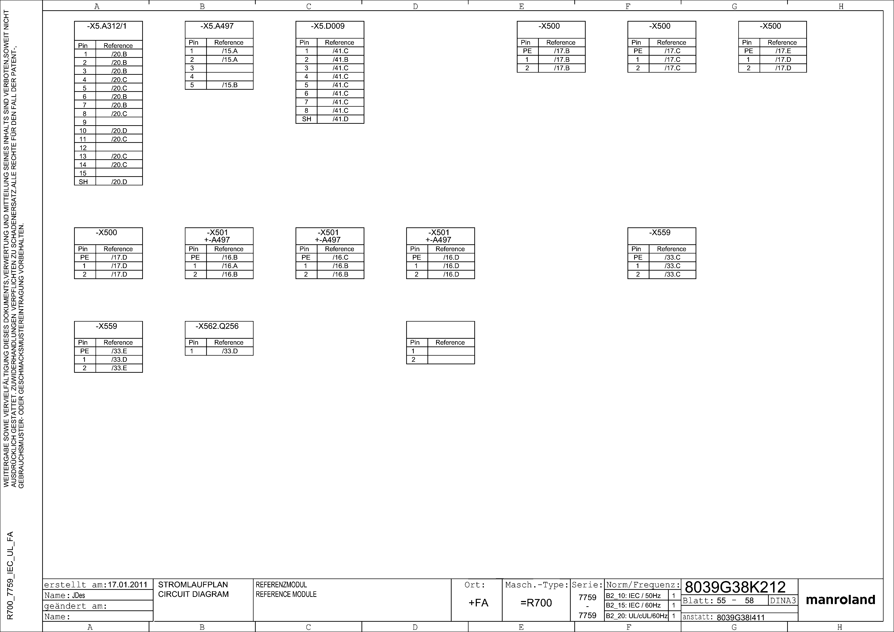

# +FA — Sheet 55 of 58 — REFERENZMODUL

**REFERENCE MODULE**

> Part of the manroland **R700** printing press IEC/UL circuit diagrams.
> Drawing class: **Stromlaufplan / Circuit diagram** (DIN A3).
> Document `+FA` covers the **Delivery** machine section.

## At a glance

| Field | Value |
|---|---|
| Document | `+FA`  (8039G38K212) |
| Sheet | **55** of 58 |
| Section (DE) | REFERENZMODUL |
| Section (EN) | REFERENCE MODULE |
| Section type | REFERENCE_MODULE — Reference module |
| Machine type | `=R700` |
| Series | `7759` |
| Created | 17.01.2011 |
| Replaces | `8039G38I411` |
| Columns used | A, B, C, D, E, F, G |
| Path numbers | — |
| Labels on sheet | 157 |
| Cross-refs out | 53 |
| Cross-refs in | 0 |

**Previous:** [+FA sheet 54](SHEET_0054.md) · **Next:** [+FA sheet 56](SHEET_0056.md) · **Document TOC:** [_TOC.md](_TOC.md)  (+FA) · **Master TOC:** [all sheets](../_MASTER_TOC.md)

## Sheet image (300 DPI, exact vector render)



_Rendered directly from the PDF vector layer at 300 DPI (1-bit), no OCR and no resampling. Use it to confirm anything ambiguous in the text below._

## Cross-references on this sheet

Each entry is a wire leaving this sheet. The printed token is `/sheet.column`; the link resolves to that sheet inside the same document.

| Ref | Target sheet | Col | Path | Destination on target | Target section | From col |
|---|---|---|---|---|---|---|
| `/15.A` | [+FA sheet 15](SHEET_0015.md) | A | — | — | SPANNUNGSVERSORGUNG: | B |
| `/15.A` | [+FA sheet 15](SHEET_0015.md) | A | — | — | SPANNUNGSVERSORGUNG: | B |
| `/17.B` | [+FA sheet 17](SHEET_0017.md) | B | — | — | SPANNUNGSVERSORGUNG: | E |
| `/17.E` | [+FA sheet 17](SHEET_0017.md) | E | — | — | SPANNUNGSVERSORGUNG: | G |
| `/41.C` | [+FA sheet 41](SHEET_0041.md) | C | — | — | OPTION: TELEPRESENCE ODER ICP | C |
| `/41.B` | [+FA sheet 41](SHEET_0041.md) | B | — | — | OPTION: TELEPRESENCE ODER ICP | C |
| `/41.C` | [+FA sheet 41](SHEET_0041.md) | C | — | — | OPTION: TELEPRESENCE ODER ICP | C |
| `/41.C` | [+FA sheet 41](SHEET_0041.md) | C | — | — | OPTION: TELEPRESENCE ODER ICP | C |
| `/41.C` | [+FA sheet 41](SHEET_0041.md) | C | — | — | OPTION: TELEPRESENCE ODER ICP | C |
| `/41.C` | [+FA sheet 41](SHEET_0041.md) | C | — | — | OPTION: TELEPRESENCE ODER ICP | C |
| `/41.C` | [+FA sheet 41](SHEET_0041.md) | C | — | — | OPTION: TELEPRESENCE ODER ICP | C |
| `/41.C` | [+FA sheet 41](SHEET_0041.md) | C | — | — | OPTION: TELEPRESENCE ODER ICP | C |
| `/41.D` | [+FA sheet 41](SHEET_0041.md) | D | — | — | OPTION: TELEPRESENCE ODER ICP | C |
| `/17.C` | [+FA sheet 17](SHEET_0017.md) | C | — | — | SPANNUNGSVERSORGUNG: | F |
| `/20.B` | [+FA sheet 20](SHEET_0020.md) | B | — | — | LEITSTAND RECHNER | A |
| `/20.B` | [+FA sheet 20](SHEET_0020.md) | B | — | — | LEITSTAND RECHNER | A |
| `/20.B` | [+FA sheet 20](SHEET_0020.md) | B | — | — | LEITSTAND RECHNER | A |
| `/20.C` | [+FA sheet 20](SHEET_0020.md) | C | — | — | LEITSTAND RECHNER | A |
| `/20.C` | [+FA sheet 20](SHEET_0020.md) | C | — | — | LEITSTAND RECHNER | A |
| `/20.B` | [+FA sheet 20](SHEET_0020.md) | B | — | — | LEITSTAND RECHNER | A |
| `/20.B` | [+FA sheet 20](SHEET_0020.md) | B | — | — | LEITSTAND RECHNER | A |
| `/20.C` | [+FA sheet 20](SHEET_0020.md) | C | — | — | LEITSTAND RECHNER | A |
| `/17.B` | [+FA sheet 17](SHEET_0017.md) | B | — | — | SPANNUNGSVERSORGUNG: | E |
| `/17.B` | [+FA sheet 17](SHEET_0017.md) | B | — | — | SPANNUNGSVERSORGUNG: | E |
| `/17.C` | [+FA sheet 17](SHEET_0017.md) | C | — | — | SPANNUNGSVERSORGUNG: | F |
| `/17.C` | [+FA sheet 17](SHEET_0017.md) | C | — | — | SPANNUNGSVERSORGUNG: | F |
| `/17.D` | [+FA sheet 17](SHEET_0017.md) | D | — | — | SPANNUNGSVERSORGUNG: | G |
| `/17.D` | [+FA sheet 17](SHEET_0017.md) | D | — | — | SPANNUNGSVERSORGUNG: | G |
| `/15.B` | [+FA sheet 15](SHEET_0015.md) | B | — | — | SPANNUNGSVERSORGUNG: | B |
| `/20.D` | [+FA sheet 20](SHEET_0020.md) | D | — | — | LEITSTAND RECHNER | A |
| `/20.C` | [+FA sheet 20](SHEET_0020.md) | C | — | — | LEITSTAND RECHNER | A |
| `/20.C` | [+FA sheet 20](SHEET_0020.md) | C | — | — | LEITSTAND RECHNER | A |
| `/20.C` | [+FA sheet 20](SHEET_0020.md) | C | — | — | LEITSTAND RECHNER | A |
| `/20.D` | [+FA sheet 20](SHEET_0020.md) | D | — | — | LEITSTAND RECHNER | A |
| `/16.B` | [+FA sheet 16](SHEET_0016.md) | B | — | — | SPANNUNGSVERSORGUNG: | B |
| `/17.D` | [+FA sheet 17](SHEET_0017.md) | D | — | — | SPANNUNGSVERSORGUNG: | A |
| `/16.C` | [+FA sheet 16](SHEET_0016.md) | C | — | — | SPANNUNGSVERSORGUNG: | C |
| `/16.D` | [+FA sheet 16](SHEET_0016.md) | D | — | — | SPANNUNGSVERSORGUNG: | D |
| `/33.C` | [+FA sheet 33](SHEET_0033.md) | C | — | — | OPTION: TELEPRESENCE , PRINTNET VORBEREITUNG: INTEGRATIONPILOTPLUS INCLUSIVE DATACOL.,INTEGRATIONP. FÜR PRESSM. PERFECT | F |
| `/16.A` | [+FA sheet 16](SHEET_0016.md) | A | — | — | SPANNUNGSVERSORGUNG: | B |
| `/16.B` | [+FA sheet 16](SHEET_0016.md) | B | — | — | SPANNUNGSVERSORGUNG: | B |
| `/16.B` | [+FA sheet 16](SHEET_0016.md) | B | — | — | SPANNUNGSVERSORGUNG: | C |
| `/16.B` | [+FA sheet 16](SHEET_0016.md) | B | — | — | SPANNUNGSVERSORGUNG: | C |
| `/17.D` | [+FA sheet 17](SHEET_0017.md) | D | — | — | SPANNUNGSVERSORGUNG: | A |
| `/17.D` | [+FA sheet 17](SHEET_0017.md) | D | — | — | SPANNUNGSVERSORGUNG: | A |
| `/16.D` | [+FA sheet 16](SHEET_0016.md) | D | — | — | SPANNUNGSVERSORGUNG: | D |
| `/16.D` | [+FA sheet 16](SHEET_0016.md) | D | — | — | SPANNUNGSVERSORGUNG: | D |
| `/33.C` | [+FA sheet 33](SHEET_0033.md) | C | — | — | OPTION: TELEPRESENCE , PRINTNET VORBEREITUNG: INTEGRATIONPILOTPLUS INCLUSIVE DATACOL.,INTEGRATIONP. FÜR PRESSM. PERFECT | F |
| `/33.C` | [+FA sheet 33](SHEET_0033.md) | C | — | — | OPTION: TELEPRESENCE , PRINTNET VORBEREITUNG: INTEGRATIONPILOTPLUS INCLUSIVE DATACOL.,INTEGRATIONP. FÜR PRESSM. PERFECT | F |
| `/33.E` | [+FA sheet 33](SHEET_0033.md) | E | — | — | OPTION: TELEPRESENCE , PRINTNET VORBEREITUNG: INTEGRATIONPILOTPLUS INCLUSIVE DATACOL.,INTEGRATIONP. FÜR PRESSM. PERFECT | A |
| `/33.D` | [+FA sheet 33](SHEET_0033.md) | D | — | — | OPTION: TELEPRESENCE , PRINTNET VORBEREITUNG: INTEGRATIONPILOTPLUS INCLUSIVE DATACOL.,INTEGRATIONP. FÜR PRESSM. PERFECT | B |
| `/33.D` | [+FA sheet 33](SHEET_0033.md) | D | — | — | OPTION: TELEPRESENCE , PRINTNET VORBEREITUNG: INTEGRATIONPILOTPLUS INCLUSIVE DATACOL.,INTEGRATIONP. FÜR PRESSM. PERFECT | A |
| `/33.E` | [+FA sheet 33](SHEET_0033.md) | E | — | — | OPTION: TELEPRESENCE , PRINTNET VORBEREITUNG: INTEGRATIONPILOTPLUS INCLUSIVE DATACOL.,INTEGRATIONP. FÜR PRESSM. PERFECT | A |

## Devices on this sheet

| Tag | Class | Class meaning (IEC) | Col | Sub | Terminal | Sign |
|---|---|---|---|---|---|---|
| `X500` | X | Klemme / terminal, plug connector | E | — | — | — |
| `X500` | X | Klemme / terminal, plug connector | F | — | — | — |
| `X500` | X | Klemme / terminal, plug connector | G | — | — | — |
| `X500` | X | Klemme / terminal, plug connector | A | — | — | — |
| `X501` | X | Klemme / terminal, plug connector | B | — | — | — |
| `X501` | X | Klemme / terminal, plug connector | C | — | — | — |
| `X501` | X | Klemme / terminal, plug connector | D | — | — | — |
| `X559` | X | Klemme / terminal, plug connector | F | — | — | — |
| `X559` | X | Klemme / terminal, plug connector | A | — | — | — |
| `X5.A497` | — | cross-device reference | B | — | — | — |
| `X5.D009` | — | cross-device reference | C | — | — | — |
| `X562.Q256` | — | cross-device reference | B | — | — | — |

## Potentials / nets

| Potential | Count | Columns | Attached devices | Terminals |
|---|---|---|---|---|
| `PE` | 9 | A, B, C, D, E, F, G | — | — |


A potential such as `L24+/4` or `M24+` is a named supply/return rail; every place it appears on this sheet is electrically common.

## Wire-end annotations (grouped as printed)

A wire that continues elsewhere is annotated with a small cluster: the destination description, the path/line number `#NN`, and the `/sheet.column` cross reference. Each row below is one such cluster exactly as it is grouped on the drawing.

| Col | Y | Path | Cross-ref | Text on the wire |
|---|---|---|---|---|
| A | 30.1 | — | — | `X5.A312/1` |
| B | 30.1 | — | — | `X5.A497` |
| C | 30.1 | — | — | `X5.D009` |
| E | 30.1 | — | — | `X500` |
| F | 30.1 | — | — | `X500` |
| G | 30.1 | — | — | `X500` |
| B | 52.7 | — | — | `Pin 1 2 3 4 5 Reference` |
| C | 52.7 | — | — | `Pin SH 3 4 5 6 7 8 2 1 Reference` |
| E | 52.7 | — | — | `Pin Reference` |
| F | 52.7 | — | — | `Pin Reference` |
| G | 52.7 | — | — | `Pin Reference` |
| A | 57.0 | — | — | `Pin SH 10 11 13 14 15 12 3 4 5 6 7 8 9 2 1 Reference` |
| B | 64.0 | — | `/15.A`, `/15.A` | — |
| E | 64.0 | — | — | `PE` |
| E | 64.0 | — | `/17.B` | — |
| F | 64.0 | — | — | `PE` |
| G | 64.0 | — | — | `PE` |
| G | 64.0 | — | `/17.E` | — |
| C | 64.1 | — | `/41.C`, `/41.B`, `/41.C`, `/41.C`, `/41.C`, `/41.C`, `/41.C`, `/41.C`, `/41.D` | — |
| F | 64.1 | — | `/17.C` | — |
| A | 68.3 | — | `/20.B`, `/20.B`, `/20.B`, `/20.C`, `/20.C`, `/20.B`, `/20.B`, `/20.C` | — |
| E | 75.4 | — | — | `1 2` |
| E | 75.4 | — | `/17.B`, `/17.B` | — |
| F | 75.4 | — | — | `1 2` |
| F | 75.4 | — | `/17.C`, `/17.C` | — |
| G | 75.4 | — | — | `1 2` |
| G | 75.4 | — | `/17.D`, `/17.D` | — |
| B | 109.4 | — | `/15.B` | — |
| A | 170.4 | — | `/20.D`, `/20.C` | — |
| A | 204.4 | — | `/20.C`, `/20.C` | — |
| A | 238.4 | — | `/20.D` | — |
| A | 305.0 | — | — | `X500` |
| B | 305.0 | — | — | `X501` |
| C | 305.0 | — | — | `X501` |
| D | 305.0 | — | — | `X501` |
| F | 305.0 | — | — | `X559` |
| B | 314.9 | — | — | `+ A497` |
| C | 314.9 | — | — | `+ A497` |
| D | 314.9 | — | — | `+ A497` |
| A | 327.7 | — | — | `Pin Reference` |
| B | 327.7 | — | — | `Pin Reference` |
| C | 327.7 | — | — | `Pin Reference` |
| D | 327.7 | — | — | `Pin Reference` |
| F | 327.7 | — | — | `Pin Reference` |
| A | 339.0 | — | — | `PE` |
| A | 339.0 | — | `/17.D` | — |
| B | 339.0 | — | — | `PE` |
| B | 339.0 | — | `/16.B` | — |
| C | 339.0 | — | — | `PE` |
| C | 339.0 | — | `/16.C` | — |
| D | 339.0 | — | — | `PE` |
| D | 339.0 | — | `/16.D` | — |
| F | 339.0 | — | — | `PE` |
| F | 339.0 | — | `/33.C` | — |
| B | 350.3 | — | `/16.A`, `/16.B` | — |
| C | 350.3 | — | `/16.B`, `/16.B` | — |
| A | 350.4 | — | — | `1 2` |
| A | 350.4 | — | `/17.D`, `/17.D` | — |
| B | 350.4 | — | — | `1 2` |
| C | 350.4 | — | — | `1 2` |
| D | 350.4 | — | — | `1 2` |
| D | 350.4 | — | `/16.D`, `/16.D` | — |
| F | 350.4 | — | — | `1 2` |
| F | 350.4 | — | `/33.C`, `/33.C` | — |
| A | 429.8 | — | — | `X559` |
| B | 429.8 | — | — | `X562.Q256` |
| A | 452.4 | — | — | `Pin Reference` |
| B | 452.4 | — | — | `Pin 1 Reference` |
| D | 452.4 | — | — | `Pin 1 2 Reference` |
| A | 463.7 | — | — | `PE` |
| A | 463.7 | — | `/33.E` | — |
| B | 463.8 | — | `/33.D` | — |
| A | 475.1 | — | — | `1 2` |
| A | 475.1 | — | `/33.D`, `/33.E` | — |


## Notes and free text on this sheet

| Text | Col | Y (pt) |
|---|---|---|
| `Pin` | A | 56.96 |
| `Reference` | A | 57.12 |
| `SH` | A | 238.39 |
| `X5.A312/1` | A | 30.08 |
| `Pin` | B | 52.7 |
| `Reference` | B | 52.86 |
| `Pin` | C | 52.7 |
| `Reference` | C | 52.86 |
| `SH` | C | 154.77 |
| `Pin` | E | 52.7 |
| `Reference` | E | 52.86 |
| `Pin` | F | 52.7 |
| `Reference` | F | 52.86 |
| `Pin` | G | 52.7 |
| `Reference` | G | 52.86 |
| `+ A497` | B | 314.94 |
| `+ A497` | C | 314.94 |
| `Pin` | D | 327.66 |
| `Reference` | D | 327.82 |
| `+ A497` | D | 314.94 |

## Complete label inventory (exact text from the drawing)

Every text object inside the drawing area of this sheet, in DIN reading order (column A→H, then top→bottom). This is the authoritative list: if a string is not here it is not printed on this sheet.

| Col | Y | X | Dir | Type | Text |
|---|---|---|---|---|---|
| A | 30.1 | 116.1 | → | text | `X5.A312/1` |
| A | 57.0 | 104.0 | → | text | `Pin` |
| A | 57.1 | 138.0 | → | text | `Reference` |
| A | 68.3 | 148.5 | → | cross-reference | `/20.B` |
| A | 68.4 | 111.7 | → | number | `1` |
| A | 79.6 | 148.5 | → | cross-reference | `/20.B` |
| A | 79.7 | 110.6 | → | number | `2` |
| A | 91.0 | 110.3 | → | number | `3` |
| A | 91.0 | 148.5 | → | cross-reference | `/20.B` |
| A | 102.3 | 148.4 | → | cross-reference | `/20.C` |
| A | 102.4 | 110.3 | → | number | `4` |
| A | 113.7 | 110.3 | → | number | `5` |
| A | 113.7 | 148.4 | → | cross-reference | `/20.C` |
| A | 125.0 | 110.3 | → | number | `6` |
| A | 125.0 | 148.5 | → | cross-reference | `/20.B` |
| A | 136.3 | 148.5 | → | cross-reference | `/20.B` |
| A | 136.4 | 110.3 | → | number | `7` |
| A | 147.7 | 110.3 | → | number | `8` |
| A | 147.7 | 148.4 | → | cross-reference | `/20.C` |
| A | 159.1 | 110.3 | → | number | `9` |
| A | 170.4 | 105.4 | → | number | `10` |
| A | 170.4 | 148.4 | → | cross-reference | `/20.D` |
| A | 181.7 | 105.4 | → | number | `11` |
| A | 181.7 | 148.4 | → | cross-reference | `/20.C` |
| A | 193.1 | 105.7 | → | number | `12` |
| A | 204.4 | 105.4 | → | number | `13` |
| A | 204.4 | 148.4 | → | cross-reference | `/20.C` |
| A | 215.7 | 148.4 | → | cross-reference | `/20.C` |
| A | 215.8 | 105.4 | → | number | `14` |
| A | 227.1 | 105.4 | → | number | `15` |
| A | 238.4 | 104.9 | → | text | `SH` |
| A | 238.4 | 148.4 | → | cross-reference | `/20.D` |
| A | 305.0 | 127.7 | → | device tag | `X500` |
| A | 327.7 | 104.0 | → | text | `Pin` |
| A | 327.8 | 138.0 | → | text | `Reference` |
| A | 339.0 | 106.9 | → | potential | `PE` |
| A | 339.0 | 148.4 | → | cross-reference | `/17.D` |
| A | 350.4 | 109.7 | → | number | `1` |
| A | 350.4 | 148.4 | → | cross-reference | `/17.D` |
| A | 361.7 | 110.3 | → | number | `2` |
| A | 361.7 | 148.4 | → | cross-reference | `/17.D` |
| A | 429.8 | 127.7 | → | device tag | `X559` |
| A | 452.4 | 104.0 | → | text | `Pin` |
| A | 452.5 | 138.0 | → | text | `Reference` |
| A | 463.7 | 106.9 | → | potential | `PE` |
| A | 463.7 | 148.7 | → | cross-reference | `/33.E` |
| A | 475.1 | 109.7 | → | number | `1` |
| A | 475.1 | 148.4 | → | cross-reference | `/33.D` |
| A | 486.4 | 148.7 | → | cross-reference | `/33.E` |
| A | 486.5 | 110.3 | → | number | `2` |
| B | 30.1 | 267.2 | → | device ref | `X5.A497` |
| B | 52.7 | 251.4 | → | text | `Pin` |
| B | 52.9 | 285.4 | → | text | `Reference` |
| B | 64.0 | 295.8 | → | cross-reference | `/15.A` |
| B | 64.1 | 252.9 | → | number | `1` |
| B | 75.4 | 253.4 | → | number | `2` |
| B | 75.4 | 295.8 | → | cross-reference | `/15.A` |
| B | 86.8 | 253.4 | → | number | `3` |
| B | 98.1 | 253.4 | → | number | `4` |
| B | 109.4 | 295.9 | → | cross-reference | `/15.B` |
| B | 109.5 | 253.4 | → | number | `5` |
| B | 305.0 | 275.8 | → | device tag | `X501` |
| B | 314.9 | 271.8 | → | text | `+ A497` |
| B | 327.7 | 251.4 | → | text | `Pin` |
| B | 327.8 | 285.4 | → | text | `Reference` |
| B | 339.0 | 254.3 | → | potential | `PE` |
| B | 339.0 | 295.9 | → | cross-reference | `/16.B` |
| B | 350.3 | 295.8 | → | cross-reference | `/16.A` |
| B | 350.4 | 257.1 | → | number | `1` |
| B | 361.7 | 257.7 | → | number | `2` |
| B | 361.7 | 295.9 | → | cross-reference | `/16.B` |
| B | 429.8 | 260.6 | → | device ref | `X562.Q256` |
| B | 452.4 | 251.4 | → | text | `Pin` |
| B | 452.5 | 285.4 | → | text | `Reference` |
| B | 463.7 | 295.8 | → | cross-reference | `/33.D` |
| B | 463.8 | 252.9 | → | number | `1` |
| C | 30.1 | 414.3 | → | device ref | `X5.D009` |
| C | 52.7 | 398.8 | → | text | `Pin` |
| C | 52.9 | 432.9 | → | text | `Reference` |
| C | 64.1 | 406.2 | → | number | `1` |
| C | 64.1 | 443.2 | → | cross-reference | `/41.C` |
| C | 75.4 | 405.9 | → | number | `2` |
| C | 75.4 | 443.3 | → | cross-reference | `/41.B` |
| C | 86.7 | 443.2 | → | cross-reference | `/41.C` |
| C | 86.8 | 405.8 | → | number | `3` |
| C | 98.1 | 405.8 | → | number | `4` |
| C | 98.1 | 443.2 | → | cross-reference | `/41.C` |
| C | 109.4 | 443.2 | → | cross-reference | `/41.C` |
| C | 109.5 | 405.8 | → | number | `5` |
| C | 120.8 | 405.8 | → | number | `6` |
| C | 120.8 | 443.2 | → | cross-reference | `/41.C` |
| C | 132.1 | 405.8 | → | number | `7` |
| C | 132.1 | 443.2 | → | cross-reference | `/41.C` |
| C | 143.4 | 443.2 | → | cross-reference | `/41.C` |
| C | 143.5 | 405.8 | → | number | `8` |
| C | 154.8 | 402.4 | → | text | `SH` |
| C | 154.8 | 443.2 | → | cross-reference | `/41.D` |
| C | 305.0 | 423.2 | → | device tag | `X501` |
| C | 314.9 | 419.2 | → | text | `+ A497` |
| C | 327.7 | 398.8 | → | text | `Pin` |
| C | 327.8 | 432.9 | → | text | `Reference` |
| C | 339.0 | 401.7 | → | potential | `PE` |
| C | 339.0 | 443.2 | → | cross-reference | `/16.C` |
| C | 350.3 | 443.3 | → | cross-reference | `/16.B` |
| C | 350.4 | 404.5 | → | number | `1` |
| C | 361.7 | 405.1 | → | number | `2` |
| C | 361.7 | 443.3 | → | cross-reference | `/16.B` |
| D | 305.0 | 570.6 | → | device tag | `X501` |
| D | 314.9 | 566.6 | → | text | `+ A497` |
| D | 327.7 | 546.2 | → | text | `Pin` |
| D | 327.8 | 580.3 | → | text | `Reference` |
| D | 339.0 | 549.1 | → | potential | `PE` |
| D | 339.0 | 590.6 | → | cross-reference | `/16.D` |
| D | 350.4 | 551.9 | → | number | `1` |
| D | 350.4 | 590.6 | → | cross-reference | `/16.D` |
| D | 361.7 | 552.5 | → | number | `2` |
| D | 361.7 | 590.6 | → | cross-reference | `/16.D` |
| D | 452.4 | 546.2 | → | text | `Pin` |
| D | 452.5 | 580.3 | → | text | `Reference` |
| D | 463.8 | 547.7 | → | number | `1` |
| D | 475.1 | 548.2 | → | number | `2` |
| E | 30.1 | 717.3 | → | device tag | `X500` |
| E | 52.7 | 693.6 | → | text | `Pin` |
| E | 52.9 | 727.7 | → | text | `Reference` |
| E | 64.0 | 696.5 | → | potential | `PE` |
| E | 64.0 | 738.1 | → | cross-reference | `/17.B` |
| E | 75.4 | 699.3 | → | number | `1` |
| E | 75.4 | 738.1 | → | cross-reference | `/17.B` |
| E | 86.7 | 738.1 | → | cross-reference | `/17.B` |
| E | 86.8 | 699.9 | → | number | `2` |
| F | 30.1 | 864.7 | → | device tag | `X500` |
| F | 52.7 | 841.0 | → | text | `Pin` |
| F | 52.9 | 875.1 | → | text | `Reference` |
| F | 64.0 | 843.9 | → | potential | `PE` |
| F | 64.1 | 885.4 | → | cross-reference | `/17.C` |
| F | 75.4 | 846.7 | → | number | `1` |
| F | 75.4 | 885.4 | → | cross-reference | `/17.C` |
| F | 86.7 | 885.4 | → | cross-reference | `/17.C` |
| F | 86.8 | 847.3 | → | number | `2` |
| F | 305.0 | 864.7 | → | device tag | `X559` |
| F | 327.7 | 841.0 | → | text | `Pin` |
| F | 327.8 | 875.1 | → | text | `Reference` |
| F | 339.0 | 843.9 | → | potential | `PE` |
| F | 339.0 | 885.4 | → | cross-reference | `/33.C` |
| F | 350.4 | 846.7 | → | number | `1` |
| F | 350.4 | 885.4 | → | cross-reference | `/33.C` |
| F | 361.7 | 847.3 | → | number | `2` |
| F | 361.7 | 885.4 | → | cross-reference | `/33.C` |
| G | 30.1 | 1012.1 | → | device tag | `X500` |
| G | 52.7 | 988.4 | → | text | `Pin` |
| G | 52.9 | 1022.5 | → | text | `Reference` |
| G | 64.0 | 991.3 | → | potential | `PE` |
| G | 64.0 | 1033.1 | → | cross-reference | `/17.E` |
| G | 75.4 | 994.1 | → | number | `1` |
| G | 75.4 | 1032.8 | → | cross-reference | `/17.D` |
| G | 86.7 | 1032.8 | → | cross-reference | `/17.D` |
| G | 86.8 | 994.7 | → | number | `2` |

## Reading-order text block

The same content as a plain block, grouped by DIN column — convenient to paste or to match against a visual description.

```text
=== Column A ===
  30.1  116.1  text         X5.A312/1
  57.0  104.0  text         Pin
  57.1  138.0  text         Reference
  68.3  148.5  xref         /20.B
  68.4  111.7  numeric      1
  79.6  148.5  xref         /20.B
  79.7  110.6  numeric      2
  91.0  110.3  numeric      3
  91.0  148.5  xref         /20.B
 102.3  148.4  xref         /20.C
 102.4  110.3  numeric      4
 113.7  110.3  numeric      5
 113.7  148.4  xref         /20.C
 125.0  110.3  numeric      6
 125.0  148.5  xref         /20.B
 136.3  148.5  xref         /20.B
 136.4  110.3  numeric      7
 147.7  110.3  numeric      8
 147.7  148.4  xref         /20.C
 159.1  110.3  numeric      9
 170.4  105.4  numeric      10
 170.4  148.4  xref         /20.D
 181.7  105.4  numeric      11
 181.7  148.4  xref         /20.C
 193.1  105.7  numeric      12
 204.4  105.4  numeric      13
 204.4  148.4  xref         /20.C
 215.7  148.4  xref         /20.C
 215.8  105.4  numeric      14
 227.1  105.4  numeric      15
 238.4  104.9  text         SH
 238.4  148.4  xref         /20.D
 305.0  127.7  devtag       X500
 327.7  104.0  text         Pin
 327.8  138.0  text         Reference
 339.0  106.9  net          PE
 339.0  148.4  xref         /17.D
 350.4  109.7  numeric      1
 350.4  148.4  xref         /17.D
 361.7  110.3  numeric      2
 361.7  148.4  xref         /17.D
 429.8  127.7  devtag       X559
 452.4  104.0  text         Pin
 452.5  138.0  text         Reference
 463.7  106.9  net          PE
 463.7  148.7  xref         /33.E
 475.1  109.7  numeric      1
 475.1  148.4  xref         /33.D
 486.4  148.7  xref         /33.E
 486.5  110.3  numeric      2
=== Column B ===
  30.1  267.2  devref       X5.A497
  52.7  251.4  text         Pin
  52.9  285.4  text         Reference
  64.0  295.8  xref         /15.A
  64.1  252.9  numeric      1
  75.4  253.4  numeric      2
  75.4  295.8  xref         /15.A
  86.8  253.4  numeric      3
  98.1  253.4  numeric      4
 109.4  295.9  xref         /15.B
 109.5  253.4  numeric      5
 305.0  275.8  devtag       X501
 314.9  271.8  text         + A497
 327.7  251.4  text         Pin
 327.8  285.4  text         Reference
 339.0  254.3  net          PE
 339.0  295.9  xref         /16.B
 350.3  295.8  xref         /16.A
 350.4  257.1  numeric      1
 361.7  257.7  numeric      2
 361.7  295.9  xref         /16.B
 429.8  260.6  devref       X562.Q256
 452.4  251.4  text         Pin
 452.5  285.4  text         Reference
 463.7  295.8  xref         /33.D
 463.8  252.9  numeric      1
=== Column C ===
  30.1  414.3  devref       X5.D009
  52.7  398.8  text         Pin
  52.9  432.9  text         Reference
  64.1  406.2  numeric      1
  64.1  443.2  xref         /41.C
  75.4  405.9  numeric      2
  75.4  443.3  xref         /41.B
  86.7  443.2  xref         /41.C
  86.8  405.8  numeric      3
  98.1  405.8  numeric      4
  98.1  443.2  xref         /41.C
 109.4  443.2  xref         /41.C
 109.5  405.8  numeric      5
 120.8  405.8  numeric      6
 120.8  443.2  xref         /41.C
 132.1  405.8  numeric      7
 132.1  443.2  xref         /41.C
 143.4  443.2  xref         /41.C
 143.5  405.8  numeric      8
 154.8  402.4  text         SH
 154.8  443.2  xref         /41.D
 305.0  423.2  devtag       X501
 314.9  419.2  text         + A497
 327.7  398.8  text         Pin
 327.8  432.9  text         Reference
 339.0  401.7  net          PE
 339.0  443.2  xref         /16.C
 350.3  443.3  xref         /16.B
 350.4  404.5  numeric      1
 361.7  405.1  numeric      2
 361.7  443.3  xref         /16.B
=== Column D ===
 305.0  570.6  devtag       X501
 314.9  566.6  text         + A497
 327.7  546.2  text         Pin
 327.8  580.3  text         Reference
 339.0  549.1  net          PE
 339.0  590.6  xref         /16.D
 350.4  551.9  numeric      1
 350.4  590.6  xref         /16.D
 361.7  552.5  numeric      2
 361.7  590.6  xref         /16.D
 452.4  546.2  text         Pin
 452.5  580.3  text         Reference
 463.8  547.7  numeric      1
 475.1  548.2  numeric      2
=== Column E ===
  30.1  717.3  devtag       X500
  52.7  693.6  text         Pin
  52.9  727.7  text         Reference
  64.0  696.5  net          PE
  64.0  738.1  xref         /17.B
  75.4  699.3  numeric      1
  75.4  738.1  xref         /17.B
  86.7  738.1  xref         /17.B
  86.8  699.9  numeric      2
=== Column F ===
  30.1  864.7  devtag       X500
  52.7  841.0  text         Pin
  52.9  875.1  text         Reference
  64.0  843.9  net          PE
  64.1  885.4  xref         /17.C
  75.4  846.7  numeric      1
  75.4  885.4  xref         /17.C
  86.7  885.4  xref         /17.C
  86.8  847.3  numeric      2
 305.0  864.7  devtag       X559
 327.7  841.0  text         Pin
 327.8  875.1  text         Reference
 339.0  843.9  net          PE
 339.0  885.4  xref         /33.C
 350.4  846.7  numeric      1
 350.4  885.4  xref         /33.C
 361.7  847.3  numeric      2
 361.7  885.4  xref         /33.C
=== Column G ===
  30.1 1012.1  devtag       X500
  52.7  988.4  text         Pin
  52.9 1022.5  text         Reference
  64.0  991.3  net          PE
  64.0 1033.1  xref         /17.E
  75.4  994.1  numeric      1
  75.4 1032.8  xref         /17.D
  86.7 1032.8  xref         /17.D
  86.8  994.7  numeric      2
```

---
_Generated from the PDF vector text layer; no OCR. Source: `R700_7759_IEC_UL_FA`, sheet 55._
