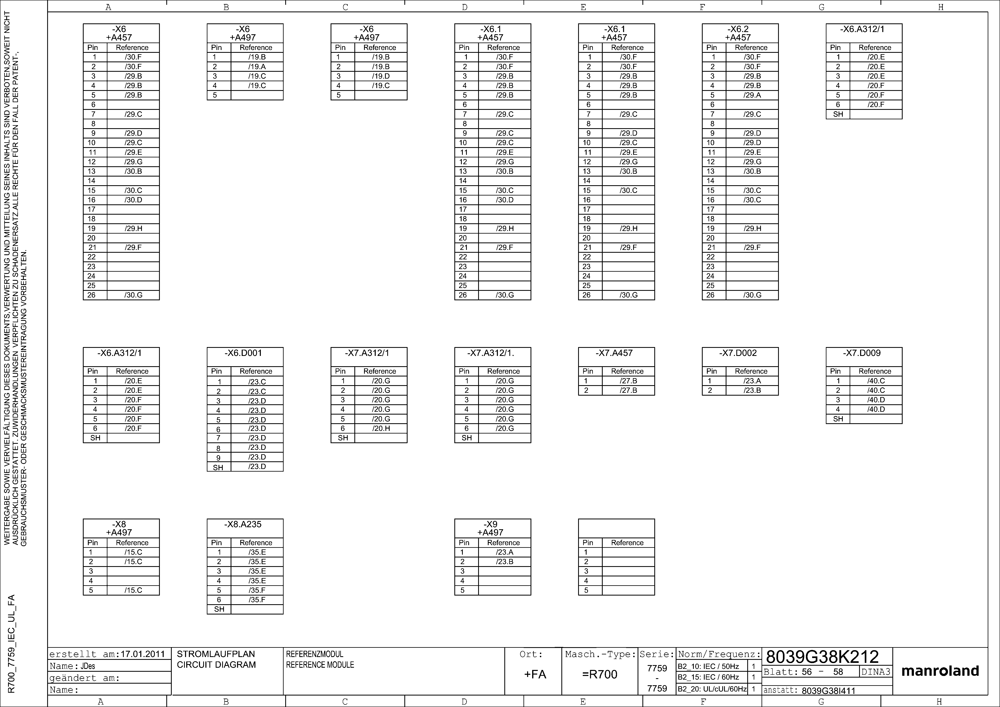

# +FA — Sheet 56 of 58 — REFERENZMODUL

**REFERENCE MODULE**

> Part of the manroland **R700** printing press IEC/UL circuit diagrams.
> Drawing class: **Stromlaufplan / Circuit diagram** (DIN A3).
> Document `+FA` covers the **Delivery** machine section.

## At a glance

| Field | Value |
|---|---|
| Document | `+FA`  (8039G38K212) |
| Sheet | **56** of 58 |
| Section (DE) | REFERENZMODUL |
| Section (EN) | REFERENCE MODULE |
| Section type | REFERENCE_MODULE — Reference module |
| Machine type | `=R700` |
| Series | `7759` |
| Created | 17.01.2011 |
| Replaces | `8039G38I411` |
| Columns used | A, B, C, D, E, F, G |
| Path numbers | — |
| Labels on sheet | 368 |
| Cross-refs out | 124 |
| Cross-refs in | 0 |

**Previous:** [+FA sheet 55](SHEET_0055.md) · **Next:** [+FA sheet 57](SHEET_0057.md) · **Document TOC:** [_TOC.md](_TOC.md)  (+FA) · **Master TOC:** [all sheets](../_MASTER_TOC.md)

## Sheet image (300 DPI, exact vector render)



_Rendered directly from the PDF vector layer at 300 DPI (1-bit), no OCR and no resampling. Use it to confirm anything ambiguous in the text below._

## Cross-references on this sheet

Each entry is a wire leaving this sheet. The printed token is `/sheet.column`; the link resolves to that sheet inside the same document.

| Ref | Target sheet | Col | Path | Destination on target | Target section | From col |
|---|---|---|---|---|---|---|
| `/19.B` | [+FA sheet 19](SHEET_0019.md) | B | — | — | LÜFTER | B |
| `/19.A` | [+FA sheet 19](SHEET_0019.md) | A | — | — | LÜFTER | B |
| `/19.C` | [+FA sheet 19](SHEET_0019.md) | C | — | — | LÜFTER | B |
| `/19.C` | [+FA sheet 19](SHEET_0019.md) | C | — | — | LÜFTER | B |
| `/19.B` | [+FA sheet 19](SHEET_0019.md) | B | — | — | LÜFTER | C |
| `/19.B` | [+FA sheet 19](SHEET_0019.md) | B | — | — | LÜFTER | C |
| `/19.D` | [+FA sheet 19](SHEET_0019.md) | D | — | — | LÜFTER | C |
| `/19.C` | [+FA sheet 19](SHEET_0019.md) | C | — | — | LÜFTER | C |
| `/20.E` | [+FA sheet 20](SHEET_0020.md) | E | — | — | LEITSTAND RECHNER | G |
| `/20.E` | [+FA sheet 20](SHEET_0020.md) | E | — | — | LEITSTAND RECHNER | G |
| `/20.E` | [+FA sheet 20](SHEET_0020.md) | E | — | — | LEITSTAND RECHNER | G |
| `/20.F` | [+FA sheet 20](SHEET_0020.md) | F | — | — | LEITSTAND RECHNER | G |
| `/20.F` | [+FA sheet 20](SHEET_0020.md) | F | — | — | LEITSTAND RECHNER | G |
| `/20.F` | [+FA sheet 20](SHEET_0020.md) | F | — | — | LEITSTAND RECHNER | G |
| `/30.F` | [+FA sheet 30](SHEET_0030.md) | F | — | — | TASTATUR: MASCHINENSTEUERUNG | A |
| `/30.F` | [+FA sheet 30](SHEET_0030.md) | F | — | — | TASTATUR: MASCHINENSTEUERUNG | A |
| `/29.B` | [+FA sheet 29](SHEET_0029.md) | B | — | — | TASTATUR: MASCHINENSTEUERUNG | A |
| `/29.B` | [+FA sheet 29](SHEET_0029.md) | B | — | — | TASTATUR: MASCHINENSTEUERUNG | A |
| `/29.B` | [+FA sheet 29](SHEET_0029.md) | B | — | — | TASTATUR: MASCHINENSTEUERUNG | A |
| `/30.F` | [+FA sheet 30](SHEET_0030.md) | F | — | — | TASTATUR: MASCHINENSTEUERUNG | D |
| `/30.F` | [+FA sheet 30](SHEET_0030.md) | F | — | — | TASTATUR: MASCHINENSTEUERUNG | D |
| `/29.B` | [+FA sheet 29](SHEET_0029.md) | B | — | — | TASTATUR: MASCHINENSTEUERUNG | D |
| `/29.B` | [+FA sheet 29](SHEET_0029.md) | B | — | — | TASTATUR: MASCHINENSTEUERUNG | D |
| `/29.B` | [+FA sheet 29](SHEET_0029.md) | B | — | — | TASTATUR: MASCHINENSTEUERUNG | D |
| `/30.F` | [+FA sheet 30](SHEET_0030.md) | F | — | — | TASTATUR: MASCHINENSTEUERUNG | E |
| `/30.F` | [+FA sheet 30](SHEET_0030.md) | F | — | — | TASTATUR: MASCHINENSTEUERUNG | E |
| `/29.B` | [+FA sheet 29](SHEET_0029.md) | B | — | — | TASTATUR: MASCHINENSTEUERUNG | E |
| `/29.B` | [+FA sheet 29](SHEET_0029.md) | B | — | — | TASTATUR: MASCHINENSTEUERUNG | E |
| `/29.B` | [+FA sheet 29](SHEET_0029.md) | B | — | — | TASTATUR: MASCHINENSTEUERUNG | E |
| `/30.F` | [+FA sheet 30](SHEET_0030.md) | F | — | — | TASTATUR: MASCHINENSTEUERUNG | F |
| `/30.F` | [+FA sheet 30](SHEET_0030.md) | F | — | — | TASTATUR: MASCHINENSTEUERUNG | F |
| `/29.B` | [+FA sheet 29](SHEET_0029.md) | B | — | — | TASTATUR: MASCHINENSTEUERUNG | F |
| `/29.B` | [+FA sheet 29](SHEET_0029.md) | B | — | — | TASTATUR: MASCHINENSTEUERUNG | F |
| `/29.A` | [+FA sheet 29](SHEET_0029.md) | A | — | — | TASTATUR: MASCHINENSTEUERUNG | F |
| `/29.C` | [+FA sheet 29](SHEET_0029.md) | C | — | — | TASTATUR: MASCHINENSTEUERUNG | A |
| `/29.C` | [+FA sheet 29](SHEET_0029.md) | C | — | — | TASTATUR: MASCHINENSTEUERUNG | D |
| `/29.C` | [+FA sheet 29](SHEET_0029.md) | C | — | — | TASTATUR: MASCHINENSTEUERUNG | E |
| `/29.C` | [+FA sheet 29](SHEET_0029.md) | C | — | — | TASTATUR: MASCHINENSTEUERUNG | F |
| `/29.D` | [+FA sheet 29](SHEET_0029.md) | D | — | — | TASTATUR: MASCHINENSTEUERUNG | A |
| `/29.C` | [+FA sheet 29](SHEET_0029.md) | C | — | — | TASTATUR: MASCHINENSTEUERUNG | A |
| `/29.E` | [+FA sheet 29](SHEET_0029.md) | E | — | — | TASTATUR: MASCHINENSTEUERUNG | A |
| `/29.G` | [+FA sheet 29](SHEET_0029.md) | G | — | — | TASTATUR: MASCHINENSTEUERUNG | A |
| `/30.B` | [+FA sheet 30](SHEET_0030.md) | B | — | — | TASTATUR: MASCHINENSTEUERUNG | A |
| `/29.C` | [+FA sheet 29](SHEET_0029.md) | C | — | — | TASTATUR: MASCHINENSTEUERUNG | D |
| `/29.C` | [+FA sheet 29](SHEET_0029.md) | C | — | — | TASTATUR: MASCHINENSTEUERUNG | D |
| `/29.E` | [+FA sheet 29](SHEET_0029.md) | E | — | — | TASTATUR: MASCHINENSTEUERUNG | D |
| `/29.G` | [+FA sheet 29](SHEET_0029.md) | G | — | — | TASTATUR: MASCHINENSTEUERUNG | D |
| `/30.B` | [+FA sheet 30](SHEET_0030.md) | B | — | — | TASTATUR: MASCHINENSTEUERUNG | D |
| `/29.D` | [+FA sheet 29](SHEET_0029.md) | D | — | — | TASTATUR: MASCHINENSTEUERUNG | E |
| `/29.C` | [+FA sheet 29](SHEET_0029.md) | C | — | — | TASTATUR: MASCHINENSTEUERUNG | E |
| `/29.E` | [+FA sheet 29](SHEET_0029.md) | E | — | — | TASTATUR: MASCHINENSTEUERUNG | E |
| `/29.G` | [+FA sheet 29](SHEET_0029.md) | G | — | — | TASTATUR: MASCHINENSTEUERUNG | E |
| `/30.B` | [+FA sheet 30](SHEET_0030.md) | B | — | — | TASTATUR: MASCHINENSTEUERUNG | E |
| `/29.D` | [+FA sheet 29](SHEET_0029.md) | D | — | — | TASTATUR: MASCHINENSTEUERUNG | F |
| `/29.D` | [+FA sheet 29](SHEET_0029.md) | D | — | — | TASTATUR: MASCHINENSTEUERUNG | F |
| `/29.E` | [+FA sheet 29](SHEET_0029.md) | E | — | — | TASTATUR: MASCHINENSTEUERUNG | F |
| `/29.G` | [+FA sheet 29](SHEET_0029.md) | G | — | — | TASTATUR: MASCHINENSTEUERUNG | F |
| `/30.B` | [+FA sheet 30](SHEET_0030.md) | B | — | — | TASTATUR: MASCHINENSTEUERUNG | F |
| `/30.C` | [+FA sheet 30](SHEET_0030.md) | C | — | — | TASTATUR: MASCHINENSTEUERUNG | A |
| `/30.D` | [+FA sheet 30](SHEET_0030.md) | D | — | — | TASTATUR: MASCHINENSTEUERUNG | A |
| `/30.C` | [+FA sheet 30](SHEET_0030.md) | C | — | — | TASTATUR: MASCHINENSTEUERUNG | D |
| `/30.D` | [+FA sheet 30](SHEET_0030.md) | D | — | — | TASTATUR: MASCHINENSTEUERUNG | D |
| `/30.C` | [+FA sheet 30](SHEET_0030.md) | C | — | — | TASTATUR: MASCHINENSTEUERUNG | E |
| `/30.C` | [+FA sheet 30](SHEET_0030.md) | C | — | — | TASTATUR: MASCHINENSTEUERUNG | F |
| `/30.C` | [+FA sheet 30](SHEET_0030.md) | C | — | — | TASTATUR: MASCHINENSTEUERUNG | F |
| `/29.H` | [+FA sheet 29](SHEET_0029.md) | H | — | — | TASTATUR: MASCHINENSTEUERUNG | A |
| `/29.H` | [+FA sheet 29](SHEET_0029.md) | H | — | — | TASTATUR: MASCHINENSTEUERUNG | D |
| `/29.H` | [+FA sheet 29](SHEET_0029.md) | H | — | — | TASTATUR: MASCHINENSTEUERUNG | E |
| `/29.H` | [+FA sheet 29](SHEET_0029.md) | H | — | — | TASTATUR: MASCHINENSTEUERUNG | F |
| `/29.F` | [+FA sheet 29](SHEET_0029.md) | F | — | — | TASTATUR: MASCHINENSTEUERUNG | A |
| `/29.F` | [+FA sheet 29](SHEET_0029.md) | F | — | — | TASTATUR: MASCHINENSTEUERUNG | D |
| `/29.F` | [+FA sheet 29](SHEET_0029.md) | F | — | — | TASTATUR: MASCHINENSTEUERUNG | E |
| `/29.F` | [+FA sheet 29](SHEET_0029.md) | F | — | — | TASTATUR: MASCHINENSTEUERUNG | F |
| `/30.G` | [+FA sheet 30](SHEET_0030.md) | G | — | — | TASTATUR: MASCHINENSTEUERUNG | A |
| `/30.G` | [+FA sheet 30](SHEET_0030.md) | G | — | — | TASTATUR: MASCHINENSTEUERUNG | D |
| `/30.G` | [+FA sheet 30](SHEET_0030.md) | G | — | — | TASTATUR: MASCHINENSTEUERUNG | E |
| `/30.G` | [+FA sheet 30](SHEET_0030.md) | G | — | — | TASTATUR: MASCHINENSTEUERUNG | F |
| `/20.E` | [+FA sheet 20](SHEET_0020.md) | E | — | — | LEITSTAND RECHNER | A |
| `/20.E` | [+FA sheet 20](SHEET_0020.md) | E | — | — | LEITSTAND RECHNER | A |
| `/20.F` | [+FA sheet 20](SHEET_0020.md) | F | — | — | LEITSTAND RECHNER | A |
| `/20.F` | [+FA sheet 20](SHEET_0020.md) | F | — | — | LEITSTAND RECHNER | A |
| `/20.F` | [+FA sheet 20](SHEET_0020.md) | F | — | — | LEITSTAND RECHNER | A |
| `/20.F` | [+FA sheet 20](SHEET_0020.md) | F | — | — | LEITSTAND RECHNER | A |
| `/27.B` | [+FA sheet 27](SHEET_0027.md) | B | — | — | TASTATUR: BEDIENUNGSPULT MASCHINE | E |
| `/27.B` | [+FA sheet 27](SHEET_0027.md) | B | — | — | TASTATUR: BEDIENUNGSPULT MASCHINE | E |
| `/23.A` | [+FA sheet 23](SHEET_0023.md) | A | — | — | JOBCARD READER | F |
| `/23.B` | [+FA sheet 23](SHEET_0023.md) | B | — | — | JOBCARD READER | F |
| `/20.G` | [+FA sheet 20](SHEET_0020.md) | G | — | — | LEITSTAND RECHNER | C |
| `/20.G` | [+FA sheet 20](SHEET_0020.md) | G | — | — | LEITSTAND RECHNER | C |
| `/20.G` | [+FA sheet 20](SHEET_0020.md) | G | — | — | LEITSTAND RECHNER | C |
| `/20.G` | [+FA sheet 20](SHEET_0020.md) | G | — | — | LEITSTAND RECHNER | C |
| `/20.G` | [+FA sheet 20](SHEET_0020.md) | G | — | — | LEITSTAND RECHNER | C |
| `/20.H` | [+FA sheet 20](SHEET_0020.md) | H | — | — | LEITSTAND RECHNER | C |
| `/20.G` | [+FA sheet 20](SHEET_0020.md) | G | — | — | LEITSTAND RECHNER | D |
| `/20.G` | [+FA sheet 20](SHEET_0020.md) | G | — | — | LEITSTAND RECHNER | D |
| `/20.G` | [+FA sheet 20](SHEET_0020.md) | G | — | — | LEITSTAND RECHNER | D |
| `/20.G` | [+FA sheet 20](SHEET_0020.md) | G | — | — | LEITSTAND RECHNER | D |
| `/20.G` | [+FA sheet 20](SHEET_0020.md) | G | — | — | LEITSTAND RECHNER | D |
| `/20.G` | [+FA sheet 20](SHEET_0020.md) | G | — | — | LEITSTAND RECHNER | D |
| `/40.C` | [+FA sheet 40](SHEET_0040.md) | C | — | — | OPTION: TELEPRESENCE | G |
| `/40.C` | [+FA sheet 40](SHEET_0040.md) | C | — | — | OPTION: TELEPRESENCE | G |
| `/40.D` | [+FA sheet 40](SHEET_0040.md) | D | — | — | OPTION: TELEPRESENCE | G |
| `/40.D` | [+FA sheet 40](SHEET_0040.md) | D | — | — | OPTION: TELEPRESENCE | G |
| `/23.C` | [+FA sheet 23](SHEET_0023.md) | C | — | — | JOBCARD READER | B |
| `/23.C` | [+FA sheet 23](SHEET_0023.md) | C | — | — | JOBCARD READER | B |
| `/23.D` | [+FA sheet 23](SHEET_0023.md) | D | — | — | JOBCARD READER | B |
| `/23.D` | [+FA sheet 23](SHEET_0023.md) | D | — | — | JOBCARD READER | B |
| `/23.D` | [+FA sheet 23](SHEET_0023.md) | D | — | — | JOBCARD READER | B |
| `/23.D` | [+FA sheet 23](SHEET_0023.md) | D | — | — | JOBCARD READER | B |
| `/23.D` | [+FA sheet 23](SHEET_0023.md) | D | — | — | JOBCARD READER | B |
| `/23.D` | [+FA sheet 23](SHEET_0023.md) | D | — | — | JOBCARD READER | B |
| `/23.D` | [+FA sheet 23](SHEET_0023.md) | D | — | — | JOBCARD READER | B |
| `/23.D` | [+FA sheet 23](SHEET_0023.md) | D | — | — | JOBCARD READER | B |
| `/35.E` | [+FA sheet 35](SHEET_0035.md) | E | — | — | — | B |
| `/35.E` | [+FA sheet 35](SHEET_0035.md) | E | — | — | — | B |
| `/35.E` | [+FA sheet 35](SHEET_0035.md) | E | — | — | — | B |
| `/35.E` | [+FA sheet 35](SHEET_0035.md) | E | — | — | — | B |
| `/35.F` | [+FA sheet 35](SHEET_0035.md) | F | — | — | — | B |
| `/35.F` | [+FA sheet 35](SHEET_0035.md) | F | — | — | — | B |
| `/23.A` | [+FA sheet 23](SHEET_0023.md) | A | — | — | JOBCARD READER | D |
| `/23.B` | [+FA sheet 23](SHEET_0023.md) | B | — | — | JOBCARD READER | D |
| `/15.C` | [+FA sheet 15](SHEET_0015.md) | C | — | — | SPANNUNGSVERSORGUNG: | A |
| `/15.C` | [+FA sheet 15](SHEET_0015.md) | C | — | — | SPANNUNGSVERSORGUNG: | A |
| `/15.C` | [+FA sheet 15](SHEET_0015.md) | C | — | — | SPANNUNGSVERSORGUNG: | A |

## Devices on this sheet

| Tag | Class | Class meaning (IEC) | Col | Sub | Terminal | Sign |
|---|---|---|---|---|---|---|
| `X6` | X | Klemme / terminal, plug connector | A | — | — | — |
| `+A457` | A | Baugruppe / assembly, module, PC board | A | — | — | + |
| `X6` | X | Klemme / terminal, plug connector | B | — | — | — |
| `+A497` | A | Baugruppe / assembly, module, PC board | B | — | — | + |
| `X6` | X | Klemme / terminal, plug connector | C | — | — | — |
| `+A497` | A | Baugruppe / assembly, module, PC board | C | — | — | + |
| `+A457` | A | Baugruppe / assembly, module, PC board | D | — | — | + |
| `+A457` | A | Baugruppe / assembly, module, PC board | E | — | — | + |
| `+A457` | A | Baugruppe / assembly, module, PC board | F | — | — | + |
| `X8` | X | Klemme / terminal, plug connector | A | — | — | — |
| `+A497` | A | Baugruppe / assembly, module, PC board | A | — | — | + |
| `X9` | X | Klemme / terminal, plug connector | D | — | — | — |
| `+A497` | A | Baugruppe / assembly, module, PC board | D | — | — | + |
| `X6.1` | — | cross-device reference | D | — | — | — |
| `X6.1` | — | cross-device reference | E | — | — | — |
| `X6.2` | — | cross-device reference | F | — | — | — |
| `X6.D001` | — | cross-device reference | B | — | — | — |
| `X7.A457` | — | cross-device reference | E | — | — | — |
| `X7.D002` | — | cross-device reference | F | — | — | — |
| `X7.D009` | — | cross-device reference | G | — | — | — |
| `X8.A235` | — | cross-device reference | B | — | — | — |

## Potentials / nets

_No named potentials on this sheet._

## Wire-end annotations (grouped as printed)

A wire that continues elsewhere is annotated with a small cluster: the destination description, the path/line number `#NN`, and the `/sheet.column` cross reference. Each row below is one such cluster exactly as it is grouped on the drawing.

| Col | Y | Path | Cross-ref | Text on the wire |
|---|---|---|---|---|
| A | 30.1 | — | — | `+A457 X6` |
| B | 30.1 | — | — | `+A497 X6` |
| C | 30.1 | — | — | `+A497 X6` |
| D | 30.1 | — | — | `+A457 X6.1` |
| E | 30.1 | — | — | `+A457 X6.1` |
| F | 30.1 | — | — | `+A457 X6.2` |
| G | 30.1 | — | — | `X6.A312/1` |
| A | 52.7 | — | — | `Pin 10 13 14 15 16 17 18 19 20 23 24 25 26 12 22 11 21 3 4 5 6 7 8 9 2 1 Reference` |
| B | 52.7 | — | — | `Pin 1 2 3 4 5 Reference` |
| C | 52.7 | — | — | `Pin 1 2 3 4 5 Reference` |
| D | 52.7 | — | — | `Pin 10 13 14 15 16 17 18 19 20 23 24 25 26 12 22 11 21 3 4 5 6 7 8 9 2 1 Reference` |
| E | 52.7 | — | — | `Pin 10 13 14 15 16 17 18 19 20 23 24 25 26 12 22 11 21 3 4 5 6 7 8 9 2 1 Reference` |
| F | 52.7 | — | — | `Pin 10 13 14 15 16 17 18 19 20 23 24 25 26 12 22 11 21 3 4 5 6 7 8 9 2 1 Reference` |
| G | 52.7 | — | — | `Pin SH 3 4 5 6 2 1 Reference` |
| A | 64.0 | — | `/30.F`, `/30.F`, `/29.B`, `/29.B`, `/29.B` | — |
| B | 64.0 | — | `/19.B`, `/19.A`, `/19.C`, `/19.C` | — |
| C | 64.0 | — | `/19.B`, `/19.B`, `/19.D`, `/19.C` | — |
| D | 64.0 | — | `/30.F`, `/30.F`, `/29.B`, `/29.B`, `/29.B` | — |
| E | 64.0 | — | `/30.F`, `/30.F`, `/29.B`, `/29.B`, `/29.B` | — |
| F | 64.0 | — | `/30.F`, `/30.F`, `/29.B`, `/29.B`, `/29.A` | — |
| G | 64.0 | — | `/20.E`, `/20.E`, `/20.E`, `/20.F`, `/20.F`, `/20.F` | — |
| A | 132.1 | — | `/29.C` | — |
| D | 132.1 | — | `/29.C` | — |
| E | 132.1 | — | `/29.C` | — |
| F | 132.1 | — | `/29.C` | — |
| A | 154.8 | — | `/29.D`, `/29.C`, `/29.E`, `/29.G`, `/30.B` | — |
| D | 154.8 | — | `/29.C`, `/29.C`, `/29.E`, `/29.G`, `/30.B` | — |
| E | 154.8 | — | `/29.D`, `/29.C`, `/29.E`, `/29.G`, `/30.B` | — |
| F | 154.8 | — | `/29.D`, `/29.D`, `/29.E`, `/29.G`, `/30.B` | — |
| A | 222.8 | — | `/30.C`, `/30.D` | — |
| D | 222.8 | — | `/30.C`, `/30.D` | — |
| E | 222.8 | — | `/30.C` | — |
| F | 222.8 | — | `/30.C`, `/30.C` | — |
| A | 268.2 | — | `/29.H` | — |
| D | 268.2 | — | `/29.H` | — |
| E | 268.2 | — | `/29.H` | — |
| F | 268.2 | — | `/29.H` | — |
| A | 290.8 | — | `/29.F` | — |
| D | 290.8 | — | `/29.F` | — |
| E | 290.8 | — | `/29.F` | — |
| F | 290.8 | — | `/29.F` | — |
| A | 347.5 | — | `/30.G` | — |
| D | 347.5 | — | `/30.G` | — |
| E | 347.5 | — | `/30.G` | — |
| F | 347.5 | — | `/30.G` | — |
| A | 415.6 | — | — | `X6.A312/1` |
| B | 415.6 | — | — | `X6.D001` |
| C | 415.6 | — | — | `X7.A312/1` |
| D | 415.6 | — | — | `X7.A312/1.` |
| E | 415.6 | — | — | `X7.A457` |
| F | 415.6 | — | — | `X7.D002` |
| G | 415.6 | — | — | `X7.D009` |
| A | 438.2 | — | — | `Pin SH 3 4 5 6 2 1 Reference` |
| B | 438.2 | — | — | `Pin SH 3 4 5 6 7 8 9 2 1 Reference` |
| C | 438.2 | — | — | `Pin SH 3 4 5 6 2 1 Reference` |
| D | 438.2 | — | — | `Pin SH 3 4 5 6 2 1 Reference` |
| E | 438.2 | — | — | `Pin 1 2 Reference` |
| F | 438.2 | — | — | `Pin 1 2 Reference` |
| G | 438.2 | — | — | `Pin SH 3 4 2 1 Reference` |
| A | 449.5 | — | `/20.E`, `/20.E`, `/20.F`, `/20.F`, `/20.F`, `/20.F` | — |
| E | 449.5 | — | `/27.B`, `/27.B` | — |
| F | 449.5 | — | `/23.A`, `/23.B` | — |
| C | 449.6 | — | `/20.G`, `/20.G`, `/20.G`, `/20.G`, `/20.G`, `/20.H` | — |
| D | 449.6 | — | `/20.G`, `/20.G`, `/20.G`, `/20.G`, `/20.G`, `/20.G` | — |
| G | 449.6 | — | `/40.C`, `/40.C`, `/40.D`, `/40.D` | — |
| B | 451.0 | — | `/23.C`, `/23.C`, `/23.D`, `/23.D`, `/23.D`, `/23.D`, `/23.D`, `/23.D`, `/23.D`, `/23.D` | — |
| A | 619.7 | — | — | `+A497 X8` |
| B | 619.7 | — | — | `X8.A235` |
| D | 619.7 | — | — | `+A497 X9` |
| A | 642.3 | — | — | `Pin 1 2 3 4 5 Reference` |
| B | 642.3 | — | — | `Pin SH 3 4 5 6 2 1 Reference` |
| D | 642.3 | — | — | `Pin 1 2 3 4 5 Reference` |
| E | 642.3 | — | — | `Pin 1 2 3 4 5 Reference` |
| B | 653.6 | — | `/35.E`, `/35.E`, `/35.E`, `/35.E`, `/35.F`, `/35.F` | — |
| D | 653.6 | — | `/23.A`, `/23.B` | — |
| A | 653.7 | — | `/15.C`, `/15.C` | — |
| A | 699.0 | — | `/15.C` | — |


## Notes and free text on this sheet

| Text | Col | Y (pt) |
|---|---|---|
| `Pin` | A | 52.7 |
| `Reference` | A | 52.86 |
| `Pin` | B | 52.7 |
| `Reference` | B | 52.86 |
| `Pin` | C | 52.7 |
| `Reference` | C | 52.86 |
| `Pin` | D | 52.7 |
| `Reference` | D | 52.86 |
| `Pin` | E | 52.7 |
| `Reference` | E | 52.86 |
| `Pin` | F | 52.7 |
| `Reference` | F | 52.86 |
| `Pin` | G | 52.7 |
| `Reference` | G | 52.86 |
| `SH` | G | 132.09 |
| `X6.A312/1` | G | 30.08 |
| `SH` | A | 517.6 |
| `X6.A312/1` | A | 415.59 |
| `SH` | B | 553.04 |
| `SH` | C | 517.6 |
| `X7.A312/1` | C | 415.59 |
| `SH` | D | 517.6 |
| `X7.A312/1.` | D | 415.6 |

## Complete label inventory (exact text from the drawing)

Every text object inside the drawing area of this sheet, in DIN reading order (column A→H, then top→bottom). This is the authoritative list: if a string is not here it is not printed on this sheet.

| Col | Y | X | Dir | Type | Text |
|---|---|---|---|---|---|
| A | 30.1 | 133.7 | → | device tag | `X6` |
| A | 40.0 | 126.1 | → | device tag | `+A457` |
| A | 52.7 | 104.0 | → | text | `Pin` |
| A | 52.9 | 138.0 | → | text | `Reference` |
| A | 64.0 | 148.8 | → | cross-reference | `/30.F` |
| A | 64.1 | 110.3 | → | number | `1` |
| A | 75.4 | 109.1 | → | number | `2` |
| A | 75.4 | 148.8 | → | cross-reference | `/30.F` |
| A | 86.7 | 148.5 | → | cross-reference | `/29.B` |
| A | 86.8 | 108.9 | → | number | `3` |
| A | 98.0 | 148.5 | → | cross-reference | `/29.B` |
| A | 98.1 | 108.9 | → | number | `4` |
| A | 109.4 | 148.5 | → | cross-reference | `/29.B` |
| A | 109.5 | 108.9 | → | number | `5` |
| A | 120.8 | 108.9 | → | number | `6` |
| A | 132.1 | 108.9 | → | number | `7` |
| A | 132.1 | 148.4 | → | cross-reference | `/29.C` |
| A | 143.5 | 108.9 | → | number | `8` |
| A | 154.8 | 108.9 | → | number | `9` |
| A | 154.8 | 148.4 | → | cross-reference | `/29.D` |
| A | 166.1 | 148.4 | → | cross-reference | `/29.C` |
| A | 166.2 | 104.0 | → | number | `10` |
| A | 177.4 | 148.7 | → | cross-reference | `/29.E` |
| A | 177.5 | 105.4 | → | number | `11` |
| A | 188.8 | 104.3 | → | number | `12` |
| A | 188.8 | 148.3 | → | cross-reference | `/29.G` |
| A | 200.1 | 148.5 | → | cross-reference | `/30.B` |
| A | 200.2 | 104.0 | → | number | `13` |
| A | 211.5 | 104.0 | → | number | `14` |
| A | 222.8 | 104.0 | → | number | `15` |
| A | 222.8 | 148.4 | → | cross-reference | `/30.C` |
| A | 234.1 | 148.4 | → | cross-reference | `/30.D` |
| A | 234.2 | 104.0 | → | number | `16` |
| A | 245.5 | 104.0 | → | number | `17` |
| A | 256.9 | 104.0 | → | number | `18` |
| A | 268.2 | 104.0 | → | number | `19` |
| A | 268.2 | 148.7 | → | cross-reference | `/29.H` |
| A | 279.5 | 104.0 | → | number | `20` |
| A | 290.8 | 148.8 | → | cross-reference | `/29.F` |
| A | 290.9 | 105.4 | → | number | `21` |
| A | 302.2 | 104.3 | → | number | `22` |
| A | 313.6 | 104.0 | → | number | `23` |
| A | 324.9 | 104.0 | → | number | `24` |
| A | 336.2 | 104.0 | → | number | `25` |
| A | 347.5 | 148.3 | → | cross-reference | `/30.G` |
| A | 347.6 | 104.0 | → | number | `26` |
| A | 415.6 | 116.1 | → | text | `X6.A312/1` |
| A | 438.2 | 104.0 | → | text | `Pin` |
| A | 438.4 | 138.0 | → | text | `Reference` |
| A | 449.5 | 148.7 | → | cross-reference | `/20.E` |
| A | 449.6 | 111.4 | → | number | `1` |
| A | 460.9 | 148.7 | → | cross-reference | `/20.E` |
| A | 461.0 | 111.1 | → | number | `2` |
| A | 472.2 | 148.8 | → | cross-reference | `/20.F` |
| A | 472.3 | 111.0 | → | number | `3` |
| A | 483.6 | 111.0 | → | number | `4` |
| A | 483.6 | 148.8 | → | cross-reference | `/20.F` |
| A | 494.9 | 148.8 | → | cross-reference | `/20.F` |
| A | 495.0 | 111.0 | → | number | `5` |
| A | 506.2 | 148.8 | → | cross-reference | `/20.F` |
| A | 506.3 | 111.0 | → | number | `6` |
| A | 517.6 | 107.6 | → | text | `SH` |
| A | 619.7 | 133.7 | → | device tag | `X8` |
| A | 629.6 | 126.1 | → | device tag | `+A497` |
| A | 642.3 | 104.0 | → | text | `Pin` |
| A | 642.5 | 138.0 | → | text | `Reference` |
| A | 653.7 | 105.4 | → | number | `1` |
| A | 653.7 | 148.4 | → | cross-reference | `/15.C` |
| A | 665.0 | 106.0 | → | number | `2` |
| A | 665.0 | 148.4 | → | cross-reference | `/15.C` |
| A | 676.4 | 106.0 | → | number | `3` |
| A | 687.7 | 106.0 | → | number | `4` |
| A | 699.0 | 148.4 | → | cross-reference | `/15.C` |
| A | 699.1 | 106.0 | → | number | `5` |
| B | 30.1 | 281.1 | → | device tag | `X6` |
| B | 40.0 | 273.5 | → | device tag | `+A497` |
| B | 52.7 | 251.4 | → | text | `Pin` |
| B | 52.9 | 285.4 | → | text | `Reference` |
| B | 64.0 | 295.9 | → | cross-reference | `/19.B` |
| B | 64.1 | 252.9 | → | number | `1` |
| B | 75.4 | 253.4 | → | number | `2` |
| B | 75.4 | 295.8 | → | cross-reference | `/19.A` |
| B | 86.7 | 295.8 | → | cross-reference | `/19.C` |
| B | 86.8 | 253.4 | → | number | `3` |
| B | 98.1 | 253.4 | → | number | `4` |
| B | 98.1 | 295.8 | → | cross-reference | `/19.C` |
| B | 109.5 | 253.4 | → | number | `5` |
| B | 415.6 | 267.6 | → | device ref | `X6.D001` |
| B | 438.2 | 251.4 | → | text | `Pin` |
| B | 438.4 | 285.4 | → | text | `Reference` |
| B | 451.0 | 259.1 | → | number | `1` |
| B | 451.0 | 295.8 | → | cross-reference | `/23.C` |
| B | 462.3 | 295.8 | → | cross-reference | `/23.C` |
| B | 462.4 | 258.0 | → | number | `2` |
| B | 473.7 | 257.7 | → | number | `3` |
| B | 473.7 | 295.8 | → | cross-reference | `/23.D` |
| B | 485.0 | 257.7 | → | number | `4` |
| B | 485.0 | 295.8 | → | cross-reference | `/23.D` |
| B | 496.3 | 295.8 | → | cross-reference | `/23.D` |
| B | 496.4 | 257.7 | → | number | `5` |
| B | 506.3 | 295.8 | → | cross-reference | `/23.D` |
| B | 507.7 | 257.7 | → | number | `6` |
| B | 517.6 | 257.7 | → | number | `7` |
| B | 517.6 | 295.8 | → | cross-reference | `/23.D` |
| B | 528.9 | 295.8 | → | cross-reference | `/23.D` |
| B | 530.4 | 257.7 | → | number | `8` |
| B | 540.3 | 295.8 | → | cross-reference | `/23.D` |
| B | 541.7 | 257.7 | → | number | `9` |
| B | 551.6 | 295.8 | → | cross-reference | `/23.D` |
| B | 553.0 | 253.6 | → | text | `SH` |
| B | 619.7 | 267.2 | → | device ref | `X8.A235` |
| B | 642.3 | 251.4 | → | text | `Pin` |
| B | 642.5 | 285.4 | → | text | `Reference` |
| B | 653.6 | 296.1 | → | cross-reference | `/35.E` |
| B | 653.7 | 258.8 | → | number | `1` |
| B | 665.0 | 258.5 | → | number | `2` |
| B | 665.0 | 296.1 | → | cross-reference | `/35.E` |
| B | 676.3 | 296.1 | → | cross-reference | `/35.E` |
| B | 676.4 | 258.4 | → | number | `3` |
| B | 687.7 | 258.4 | → | number | `4` |
| B | 687.7 | 296.1 | → | cross-reference | `/35.E` |
| B | 699.0 | 296.2 | → | cross-reference | `/35.F` |
| B | 699.1 | 258.4 | → | number | `5` |
| B | 710.3 | 296.2 | → | cross-reference | `/35.F` |
| B | 710.4 | 258.4 | → | number | `6` |
| B | 721.7 | 255.0 | → | text | `SH` |
| C | 30.1 | 428.5 | → | device tag | `X6` |
| C | 40.0 | 420.9 | → | device tag | `+A497` |
| C | 52.7 | 398.8 | → | text | `Pin` |
| C | 52.9 | 432.9 | → | text | `Reference` |
| C | 64.0 | 443.3 | → | cross-reference | `/19.B` |
| C | 64.1 | 400.3 | → | number | `1` |
| C | 75.4 | 400.8 | → | number | `2` |
| C | 75.4 | 443.3 | → | cross-reference | `/19.B` |
| C | 86.7 | 443.2 | → | cross-reference | `/19.D` |
| C | 86.8 | 400.8 | → | number | `3` |
| C | 98.1 | 400.8 | → | number | `4` |
| C | 98.1 | 443.2 | → | cross-reference | `/19.C` |
| C | 109.5 | 400.8 | → | number | `5` |
| C | 415.6 | 410.9 | → | text | `X7.A312/1` |
| C | 438.2 | 398.8 | → | text | `Pin` |
| C | 438.4 | 432.9 | → | text | `Reference` |
| C | 449.6 | 406.2 | → | number | `1` |
| C | 449.6 | 443.1 | → | cross-reference | `/20.G` |
| C | 460.9 | 443.1 | → | cross-reference | `/20.G` |
| C | 461.0 | 405.9 | → | number | `2` |
| C | 472.2 | 443.1 | → | cross-reference | `/20.G` |
| C | 472.3 | 405.8 | → | number | `3` |
| C | 483.6 | 405.8 | → | number | `4` |
| C | 483.6 | 443.1 | → | cross-reference | `/20.G` |
| C | 494.9 | 443.1 | → | cross-reference | `/20.G` |
| C | 495.0 | 405.8 | → | number | `5` |
| C | 506.3 | 405.8 | → | number | `6` |
| C | 506.3 | 443.5 | → | cross-reference | `/20.H` |
| C | 517.6 | 402.4 | → | text | `SH` |
| D | 30.1 | 572.2 | → | device ref | `X6.1` |
| D | 40.0 | 568.3 | → | device tag | `+A457` |
| D | 52.7 | 546.2 | → | text | `Pin` |
| D | 52.9 | 580.3 | → | text | `Reference` |
| D | 64.0 | 591.0 | → | cross-reference | `/30.F` |
| D | 64.1 | 552.5 | → | number | `1` |
| D | 75.4 | 551.3 | → | number | `2` |
| D | 75.4 | 591.0 | → | cross-reference | `/30.F` |
| D | 86.7 | 590.7 | → | cross-reference | `/29.B` |
| D | 86.8 | 551.1 | → | number | `3` |
| D | 98.0 | 590.7 | → | cross-reference | `/29.B` |
| D | 98.1 | 551.1 | → | number | `4` |
| D | 109.4 | 590.7 | → | cross-reference | `/29.B` |
| D | 109.5 | 551.1 | → | number | `5` |
| D | 120.8 | 551.1 | → | number | `6` |
| D | 132.1 | 551.1 | → | number | `7` |
| D | 132.1 | 590.6 | → | cross-reference | `/29.C` |
| D | 143.5 | 551.1 | → | number | `8` |
| D | 154.8 | 551.1 | → | number | `9` |
| D | 154.8 | 590.6 | → | cross-reference | `/29.C` |
| D | 166.1 | 590.6 | → | cross-reference | `/29.C` |
| D | 166.2 | 546.2 | → | number | `10` |
| D | 177.4 | 590.9 | → | cross-reference | `/29.E` |
| D | 177.5 | 547.7 | → | number | `11` |
| D | 188.8 | 546.5 | → | number | `12` |
| D | 188.8 | 590.5 | → | cross-reference | `/29.G` |
| D | 200.1 | 590.7 | → | cross-reference | `/30.B` |
| D | 200.2 | 546.2 | → | number | `13` |
| D | 211.5 | 546.2 | → | number | `14` |
| D | 222.8 | 546.2 | → | number | `15` |
| D | 222.8 | 590.6 | → | cross-reference | `/30.C` |
| D | 234.1 | 590.6 | → | cross-reference | `/30.D` |
| D | 234.2 | 546.2 | → | number | `16` |
| D | 245.5 | 546.2 | → | number | `17` |
| D | 256.9 | 546.2 | → | number | `18` |
| D | 268.2 | 546.2 | → | number | `19` |
| D | 268.2 | 590.9 | → | cross-reference | `/29.H` |
| D | 279.5 | 546.2 | → | number | `20` |
| D | 290.8 | 591.0 | → | cross-reference | `/29.F` |
| D | 290.9 | 547.7 | → | number | `21` |
| D | 302.2 | 546.5 | → | number | `22` |
| D | 313.6 | 546.2 | → | number | `23` |
| D | 324.9 | 546.2 | → | number | `24` |
| D | 336.2 | 546.2 | → | number | `25` |
| D | 347.5 | 590.5 | → | cross-reference | `/30.G` |
| D | 347.6 | 546.2 | → | number | `26` |
| D | 415.6 | 556.4 | → | text | `X7.A312/1.` |
| D | 438.2 | 546.2 | → | text | `Pin` |
| D | 438.4 | 580.3 | → | text | `Reference` |
| D | 449.6 | 553.6 | → | number | `1` |
| D | 449.6 | 590.5 | → | cross-reference | `/20.G` |
| D | 460.9 | 590.5 | → | cross-reference | `/20.G` |
| D | 461.0 | 553.3 | → | number | `2` |
| D | 472.2 | 590.5 | → | cross-reference | `/20.G` |
| D | 472.3 | 553.2 | → | number | `3` |
| D | 483.6 | 553.2 | → | number | `4` |
| D | 483.6 | 590.5 | → | cross-reference | `/20.G` |
| D | 494.9 | 590.5 | → | cross-reference | `/20.G` |
| D | 495.0 | 553.2 | → | number | `5` |
| D | 506.3 | 553.2 | → | number | `6` |
| D | 506.3 | 590.5 | → | cross-reference | `/20.G` |
| D | 517.6 | 549.8 | → | text | `SH` |
| D | 619.7 | 575.9 | → | device tag | `X9` |
| D | 629.6 | 568.3 | → | device tag | `+A497` |
| D | 642.3 | 546.2 | → | text | `Pin` |
| D | 642.5 | 580.3 | → | text | `Reference` |
| D | 653.6 | 590.6 | → | cross-reference | `/23.A` |
| D | 653.7 | 547.7 | → | number | `1` |
| D | 665.0 | 548.2 | → | number | `2` |
| D | 665.0 | 590.7 | → | cross-reference | `/23.B` |
| D | 676.4 | 548.2 | → | number | `3` |
| D | 687.7 | 548.2 | → | number | `4` |
| D | 699.1 | 548.2 | → | number | `5` |
| E | 30.1 | 719.6 | → | device ref | `X6.1` |
| E | 40.0 | 715.7 | → | device tag | `+A457` |
| E | 52.7 | 693.6 | → | text | `Pin` |
| E | 52.9 | 727.7 | → | text | `Reference` |
| E | 64.0 | 738.4 | → | cross-reference | `/30.F` |
| E | 64.1 | 699.9 | → | number | `1` |
| E | 75.4 | 698.7 | → | number | `2` |
| E | 75.4 | 738.4 | → | cross-reference | `/30.F` |
| E | 86.7 | 738.1 | → | cross-reference | `/29.B` |
| E | 86.8 | 698.5 | → | number | `3` |
| E | 98.0 | 738.1 | → | cross-reference | `/29.B` |
| E | 98.1 | 698.5 | → | number | `4` |
| E | 109.4 | 738.1 | → | cross-reference | `/29.B` |
| E | 109.5 | 698.5 | → | number | `5` |
| E | 120.8 | 698.5 | → | number | `6` |
| E | 132.1 | 698.5 | → | number | `7` |
| E | 132.1 | 738.0 | → | cross-reference | `/29.C` |
| E | 143.5 | 698.5 | → | number | `8` |
| E | 154.8 | 698.5 | → | number | `9` |
| E | 154.8 | 738.0 | → | cross-reference | `/29.D` |
| E | 166.1 | 738.0 | → | cross-reference | `/29.C` |
| E | 166.2 | 693.6 | → | number | `10` |
| E | 177.4 | 738.3 | → | cross-reference | `/29.E` |
| E | 177.5 | 695.1 | → | number | `11` |
| E | 188.8 | 693.9 | → | number | `12` |
| E | 188.8 | 737.9 | → | cross-reference | `/29.G` |
| E | 200.1 | 738.1 | → | cross-reference | `/30.B` |
| E | 200.2 | 693.6 | → | number | `13` |
| E | 211.5 | 693.6 | → | number | `14` |
| E | 222.8 | 693.6 | → | number | `15` |
| E | 222.8 | 738.0 | → | cross-reference | `/30.C` |
| E | 234.2 | 693.6 | → | number | `16` |
| E | 245.5 | 693.6 | → | number | `17` |
| E | 256.9 | 693.6 | → | number | `18` |
| E | 268.2 | 693.6 | → | number | `19` |
| E | 268.2 | 738.3 | → | cross-reference | `/29.H` |
| E | 279.5 | 693.6 | → | number | `20` |
| E | 290.8 | 738.4 | → | cross-reference | `/29.F` |
| E | 290.9 | 695.1 | → | number | `21` |
| E | 302.2 | 693.9 | → | number | `22` |
| E | 313.6 | 693.6 | → | number | `23` |
| E | 324.9 | 693.6 | → | number | `24` |
| E | 336.2 | 693.6 | → | number | `25` |
| E | 347.5 | 737.9 | → | cross-reference | `/30.G` |
| E | 347.6 | 693.6 | → | number | `26` |
| E | 415.6 | 709.4 | → | device ref | `X7.A457` |
| E | 438.2 | 693.6 | → | text | `Pin` |
| E | 438.4 | 727.7 | → | text | `Reference` |
| E | 449.5 | 738.1 | → | cross-reference | `/27.B` |
| E | 449.6 | 695.1 | → | number | `1` |
| E | 460.9 | 738.1 | → | cross-reference | `/27.B` |
| E | 461.0 | 695.6 | → | number | `2` |
| E | 642.3 | 693.6 | → | text | `Pin` |
| E | 642.5 | 727.7 | → | text | `Reference` |
| E | 653.7 | 695.1 | → | number | `1` |
| E | 665.0 | 695.6 | → | number | `2` |
| E | 676.4 | 695.6 | → | number | `3` |
| E | 687.7 | 695.6 | → | number | `4` |
| E | 699.1 | 695.6 | → | number | `5` |
| F | 30.1 | 866.3 | → | device ref | `X6.2` |
| F | 40.0 | 863.1 | → | device tag | `+A457` |
| F | 52.7 | 841.0 | → | text | `Pin` |
| F | 52.9 | 875.1 | → | text | `Reference` |
| F | 64.0 | 885.8 | → | cross-reference | `/30.F` |
| F | 64.1 | 847.3 | → | number | `1` |
| F | 75.4 | 846.1 | → | number | `2` |
| F | 75.4 | 885.8 | → | cross-reference | `/30.F` |
| F | 86.7 | 885.5 | → | cross-reference | `/29.B` |
| F | 86.8 | 845.9 | → | number | `3` |
| F | 98.0 | 885.5 | → | cross-reference | `/29.B` |
| F | 98.1 | 845.9 | → | number | `4` |
| F | 109.4 | 885.4 | → | cross-reference | `/29.A` |
| F | 109.5 | 845.9 | → | number | `5` |
| F | 120.8 | 845.9 | → | number | `6` |
| F | 132.1 | 845.9 | → | number | `7` |
| F | 132.1 | 885.4 | → | cross-reference | `/29.C` |
| F | 143.5 | 845.9 | → | number | `8` |
| F | 154.8 | 845.9 | → | number | `9` |
| F | 154.8 | 885.4 | → | cross-reference | `/29.D` |
| F | 166.1 | 885.4 | → | cross-reference | `/29.D` |
| F | 166.2 | 841.0 | → | number | `10` |
| F | 177.4 | 885.7 | → | cross-reference | `/29.E` |
| F | 177.5 | 842.5 | → | number | `11` |
| F | 188.8 | 841.3 | → | number | `12` |
| F | 188.8 | 885.3 | → | cross-reference | `/29.G` |
| F | 200.1 | 885.5 | → | cross-reference | `/30.B` |
| F | 200.2 | 841.0 | → | number | `13` |
| F | 211.5 | 841.0 | → | number | `14` |
| F | 222.8 | 841.0 | → | number | `15` |
| F | 222.8 | 885.4 | → | cross-reference | `/30.C` |
| F | 234.1 | 885.4 | → | cross-reference | `/30.C` |
| F | 234.2 | 841.0 | → | number | `16` |
| F | 245.5 | 841.0 | → | number | `17` |
| F | 256.9 | 841.0 | → | number | `18` |
| F | 268.2 | 841.0 | → | number | `19` |
| F | 268.2 | 885.7 | → | cross-reference | `/29.H` |
| F | 279.5 | 841.0 | → | number | `20` |
| F | 290.8 | 885.8 | → | cross-reference | `/29.F` |
| F | 290.9 | 842.5 | → | number | `21` |
| F | 302.2 | 841.3 | → | number | `22` |
| F | 313.6 | 841.0 | → | number | `23` |
| F | 324.9 | 841.0 | → | number | `24` |
| F | 336.2 | 841.0 | → | number | `25` |
| F | 347.5 | 885.3 | → | cross-reference | `/30.G` |
| F | 347.6 | 841.0 | → | number | `26` |
| F | 415.6 | 856.5 | → | device ref | `X7.D002` |
| F | 438.2 | 841.0 | → | text | `Pin` |
| F | 438.4 | 875.1 | → | text | `Reference` |
| F | 449.5 | 885.4 | → | cross-reference | `/23.A` |
| F | 449.6 | 842.5 | → | number | `1` |
| F | 460.9 | 885.5 | → | cross-reference | `/23.B` |
| F | 461.0 | 843.0 | → | number | `2` |
| G | 30.1 | 1000.5 | → | text | `X6.A312/1` |
| G | 52.7 | 988.4 | → | text | `Pin` |
| G | 52.9 | 1022.5 | → | text | `Reference` |
| G | 64.0 | 1033.1 | → | cross-reference | `/20.E` |
| G | 64.1 | 995.8 | → | number | `1` |
| G | 75.4 | 995.5 | → | number | `2` |
| G | 75.4 | 1033.1 | → | cross-reference | `/20.E` |
| G | 86.7 | 1033.1 | → | cross-reference | `/20.E` |
| G | 86.8 | 995.4 | → | number | `3` |
| G | 98.1 | 995.4 | → | number | `4` |
| G | 98.1 | 1033.2 | → | cross-reference | `/20.F` |
| G | 109.4 | 1033.2 | → | cross-reference | `/20.F` |
| G | 109.5 | 995.4 | → | number | `5` |
| G | 120.7 | 1033.2 | → | cross-reference | `/20.F` |
| G | 120.8 | 995.4 | → | number | `6` |
| G | 132.1 | 992.0 | → | text | `SH` |
| G | 415.6 | 1003.9 | → | device ref | `X7.D009` |
| G | 438.2 | 988.4 | → | text | `Pin` |
| G | 438.4 | 1022.5 | → | text | `Reference` |
| G | 449.6 | 995.8 | → | number | `1` |
| G | 449.6 | 1032.8 | → | cross-reference | `/40.C` |
| G | 460.9 | 1032.8 | → | cross-reference | `/40.C` |
| G | 461.0 | 995.5 | → | number | `2` |
| G | 472.3 | 995.4 | → | number | `3` |
| G | 472.3 | 1032.8 | → | cross-reference | `/40.D` |
| G | 483.6 | 995.4 | → | number | `4` |
| G | 483.6 | 1032.8 | → | cross-reference | `/40.D` |
| G | 494.9 | 992.0 | → | text | `SH` |

## Reading-order text block

The same content as a plain block, grouped by DIN column — convenient to paste or to match against a visual description.

```text
=== Column A ===
  30.1  133.7  devtag       X6
  40.0  126.1  devtag       +A457
  52.7  104.0  text         Pin
  52.9  138.0  text         Reference
  64.0  148.8  xref         /30.F
  64.1  110.3  numeric      1
  75.4  109.1  numeric      2
  75.4  148.8  xref         /30.F
  86.7  148.5  xref         /29.B
  86.8  108.9  numeric      3
  98.0  148.5  xref         /29.B
  98.1  108.9  numeric      4
 109.4  148.5  xref         /29.B
 109.5  108.9  numeric      5
 120.8  108.9  numeric      6
 132.1  108.9  numeric      7
 132.1  148.4  xref         /29.C
 143.5  108.9  numeric      8
 154.8  108.9  numeric      9
 154.8  148.4  xref         /29.D
 166.1  148.4  xref         /29.C
 166.2  104.0  numeric      10
 177.4  148.7  xref         /29.E
 177.5  105.4  numeric      11
 188.8  104.3  numeric      12
 188.8  148.3  xref         /29.G
 200.1  148.5  xref         /30.B
 200.2  104.0  numeric      13
 211.5  104.0  numeric      14
 222.8  104.0  numeric      15
 222.8  148.4  xref         /30.C
 234.1  148.4  xref         /30.D
 234.2  104.0  numeric      16
 245.5  104.0  numeric      17
 256.9  104.0  numeric      18
 268.2  104.0  numeric      19
 268.2  148.7  xref         /29.H
 279.5  104.0  numeric      20
 290.8  148.8  xref         /29.F
 290.9  105.4  numeric      21
 302.2  104.3  numeric      22
 313.6  104.0  numeric      23
 324.9  104.0  numeric      24
 336.2  104.0  numeric      25
 347.5  148.3  xref         /30.G
 347.6  104.0  numeric      26
 415.6  116.1  text         X6.A312/1
 438.2  104.0  text         Pin
 438.4  138.0  text         Reference
 449.5  148.7  xref         /20.E
 449.6  111.4  numeric      1
 460.9  148.7  xref         /20.E
 461.0  111.1  numeric      2
 472.2  148.8  xref         /20.F
 472.3  111.0  numeric      3
 483.6  111.0  numeric      4
 483.6  148.8  xref         /20.F
 494.9  148.8  xref         /20.F
 495.0  111.0  numeric      5
 506.2  148.8  xref         /20.F
 506.3  111.0  numeric      6
 517.6  107.6  text         SH
 619.7  133.7  devtag       X8
 629.6  126.1  devtag       +A497
 642.3  104.0  text         Pin
 642.5  138.0  text         Reference
 653.7  105.4  numeric      1
 653.7  148.4  xref         /15.C
 665.0  106.0  numeric      2
 665.0  148.4  xref         /15.C
 676.4  106.0  numeric      3
 687.7  106.0  numeric      4
 699.0  148.4  xref         /15.C
 699.1  106.0  numeric      5
=== Column B ===
  30.1  281.1  devtag       X6
  40.0  273.5  devtag       +A497
  52.7  251.4  text         Pin
  52.9  285.4  text         Reference
  64.0  295.9  xref         /19.B
  64.1  252.9  numeric      1
  75.4  253.4  numeric      2
  75.4  295.8  xref         /19.A
  86.7  295.8  xref         /19.C
  86.8  253.4  numeric      3
  98.1  253.4  numeric      4
  98.1  295.8  xref         /19.C
 109.5  253.4  numeric      5
 415.6  267.6  devref       X6.D001
 438.2  251.4  text         Pin
 438.4  285.4  text         Reference
 451.0  259.1  numeric      1
 451.0  295.8  xref         /23.C
 462.3  295.8  xref         /23.C
 462.4  258.0  numeric      2
 473.7  257.7  numeric      3
 473.7  295.8  xref         /23.D
 485.0  257.7  numeric      4
 485.0  295.8  xref         /23.D
 496.3  295.8  xref         /23.D
 496.4  257.7  numeric      5
 506.3  295.8  xref         /23.D
 507.7  257.7  numeric      6
 517.6  257.7  numeric      7
 517.6  295.8  xref         /23.D
 528.9  295.8  xref         /23.D
 530.4  257.7  numeric      8
 540.3  295.8  xref         /23.D
 541.7  257.7  numeric      9
 551.6  295.8  xref         /23.D
 553.0  253.6  text         SH
 619.7  267.2  devref       X8.A235
 642.3  251.4  text         Pin
 642.5  285.4  text         Reference
 653.6  296.1  xref         /35.E
 653.7  258.8  numeric      1
 665.0  258.5  numeric      2
 665.0  296.1  xref         /35.E
 676.3  296.1  xref         /35.E
 676.4  258.4  numeric      3
 687.7  258.4  numeric      4
 687.7  296.1  xref         /35.E
 699.0  296.2  xref         /35.F
 699.1  258.4  numeric      5
 710.3  296.2  xref         /35.F
 710.4  258.4  numeric      6
 721.7  255.0  text         SH
=== Column C ===
  30.1  428.5  devtag       X6
  40.0  420.9  devtag       +A497
  52.7  398.8  text         Pin
  52.9  432.9  text         Reference
  64.0  443.3  xref         /19.B
  64.1  400.3  numeric      1
  75.4  400.8  numeric      2
  75.4  443.3  xref         /19.B
  86.7  443.2  xref         /19.D
  86.8  400.8  numeric      3
  98.1  400.8  numeric      4
  98.1  443.2  xref         /19.C
 109.5  400.8  numeric      5
 415.6  410.9  text         X7.A312/1
 438.2  398.8  text         Pin
 438.4  432.9  text         Reference
 449.6  406.2  numeric      1
 449.6  443.1  xref         /20.G
 460.9  443.1  xref         /20.G
 461.0  405.9  numeric      2
 472.2  443.1  xref         /20.G
 472.3  405.8  numeric      3
 483.6  405.8  numeric      4
 483.6  443.1  xref         /20.G
 494.9  443.1  xref         /20.G
 495.0  405.8  numeric      5
 506.3  405.8  numeric      6
 506.3  443.5  xref         /20.H
 517.6  402.4  text         SH
=== Column D ===
  30.1  572.2  devref       X6.1
  40.0  568.3  devtag       +A457
  52.7  546.2  text         Pin
  52.9  580.3  text         Reference
  64.0  591.0  xref         /30.F
  64.1  552.5  numeric      1
  75.4  551.3  numeric      2
  75.4  591.0  xref         /30.F
  86.7  590.7  xref         /29.B
  86.8  551.1  numeric      3
  98.0  590.7  xref         /29.B
  98.1  551.1  numeric      4
 109.4  590.7  xref         /29.B
 109.5  551.1  numeric      5
 120.8  551.1  numeric      6
 132.1  551.1  numeric      7
 132.1  590.6  xref         /29.C
 143.5  551.1  numeric      8
 154.8  551.1  numeric      9
 154.8  590.6  xref         /29.C
 166.1  590.6  xref         /29.C
 166.2  546.2  numeric      10
 177.4  590.9  xref         /29.E
 177.5  547.7  numeric      11
 188.8  546.5  numeric      12
 188.8  590.5  xref         /29.G
 200.1  590.7  xref         /30.B
 200.2  546.2  numeric      13
 211.5  546.2  numeric      14
 222.8  546.2  numeric      15
 222.8  590.6  xref         /30.C
 234.1  590.6  xref         /30.D
 234.2  546.2  numeric      16
 245.5  546.2  numeric      17
 256.9  546.2  numeric      18
 268.2  546.2  numeric      19
 268.2  590.9  xref         /29.H
 279.5  546.2  numeric      20
 290.8  591.0  xref         /29.F
 290.9  547.7  numeric      21
 302.2  546.5  numeric      22
 313.6  546.2  numeric      23
 324.9  546.2  numeric      24
 336.2  546.2  numeric      25
 347.5  590.5  xref         /30.G
 347.6  546.2  numeric      26
 415.6  556.4  text         X7.A312/1.
 438.2  546.2  text         Pin
 438.4  580.3  text         Reference
 449.6  553.6  numeric      1
 449.6  590.5  xref         /20.G
 460.9  590.5  xref         /20.G
 461.0  553.3  numeric      2
 472.2  590.5  xref         /20.G
 472.3  553.2  numeric      3
 483.6  553.2  numeric      4
 483.6  590.5  xref         /20.G
 494.9  590.5  xref         /20.G
 495.0  553.2  numeric      5
 506.3  553.2  numeric      6
 506.3  590.5  xref         /20.G
 517.6  549.8  text         SH
 619.7  575.9  devtag       X9
 629.6  568.3  devtag       +A497
 642.3  546.2  text         Pin
 642.5  580.3  text         Reference
 653.6  590.6  xref         /23.A
 653.7  547.7  numeric      1
 665.0  548.2  numeric      2
 665.0  590.7  xref         /23.B
 676.4  548.2  numeric      3
 687.7  548.2  numeric      4
 699.1  548.2  numeric      5
=== Column E ===
  30.1  719.6  devref       X6.1
  40.0  715.7  devtag       +A457
  52.7  693.6  text         Pin
  52.9  727.7  text         Reference
  64.0  738.4  xref         /30.F
  64.1  699.9  numeric      1
  75.4  698.7  numeric      2
  75.4  738.4  xref         /30.F
  86.7  738.1  xref         /29.B
  86.8  698.5  numeric      3
  98.0  738.1  xref         /29.B
  98.1  698.5  numeric      4
 109.4  738.1  xref         /29.B
 109.5  698.5  numeric      5
 120.8  698.5  numeric      6
 132.1  698.5  numeric      7
 132.1  738.0  xref         /29.C
 143.5  698.5  numeric      8
 154.8  698.5  numeric      9
 154.8  738.0  xref         /29.D
 166.1  738.0  xref         /29.C
 166.2  693.6  numeric      10
 177.4  738.3  xref         /29.E
 177.5  695.1  numeric      11
 188.8  693.9  numeric      12
 188.8  737.9  xref         /29.G
 200.1  738.1  xref         /30.B
 200.2  693.6  numeric      13
 211.5  693.6  numeric      14
 222.8  693.6  numeric      15
 222.8  738.0  xref         /30.C
 234.2  693.6  numeric      16
 245.5  693.6  numeric      17
 256.9  693.6  numeric      18
 268.2  693.6  numeric      19
 268.2  738.3  xref         /29.H
 279.5  693.6  numeric      20
 290.8  738.4  xref         /29.F
 290.9  695.1  numeric      21
 302.2  693.9  numeric      22
 313.6  693.6  numeric      23
 324.9  693.6  numeric      24
 336.2  693.6  numeric      25
 347.5  737.9  xref         /30.G
 347.6  693.6  numeric      26
 415.6  709.4  devref       X7.A457
 438.2  693.6  text         Pin
 438.4  727.7  text         Reference
 449.5  738.1  xref         /27.B
 449.6  695.1  numeric      1
 460.9  738.1  xref         /27.B
 461.0  695.6  numeric      2
 642.3  693.6  text         Pin
 642.5  727.7  text         Reference
 653.7  695.1  numeric      1
 665.0  695.6  numeric      2
 676.4  695.6  numeric      3
 687.7  695.6  numeric      4
 699.1  695.6  numeric      5
=== Column F ===
  30.1  866.3  devref       X6.2
  40.0  863.1  devtag       +A457
  52.7  841.0  text         Pin
  52.9  875.1  text         Reference
  64.0  885.8  xref         /30.F
  64.1  847.3  numeric      1
  75.4  846.1  numeric      2
  75.4  885.8  xref         /30.F
  86.7  885.5  xref         /29.B
  86.8  845.9  numeric      3
  98.0  885.5  xref         /29.B
  98.1  845.9  numeric      4
 109.4  885.4  xref         /29.A
 109.5  845.9  numeric      5
 120.8  845.9  numeric      6
 132.1  845.9  numeric      7
 132.1  885.4  xref         /29.C
 143.5  845.9  numeric      8
 154.8  845.9  numeric      9
 154.8  885.4  xref         /29.D
 166.1  885.4  xref         /29.D
 166.2  841.0  numeric      10
 177.4  885.7  xref         /29.E
 177.5  842.5  numeric      11
 188.8  841.3  numeric      12
 188.8  885.3  xref         /29.G
 200.1  885.5  xref         /30.B
 200.2  841.0  numeric      13
 211.5  841.0  numeric      14
 222.8  841.0  numeric      15
 222.8  885.4  xref         /30.C
 234.1  885.4  xref         /30.C
 234.2  841.0  numeric      16
 245.5  841.0  numeric      17
 256.9  841.0  numeric      18
 268.2  841.0  numeric      19
 268.2  885.7  xref         /29.H
 279.5  841.0  numeric      20
 290.8  885.8  xref         /29.F
 290.9  842.5  numeric      21
 302.2  841.3  numeric      22
 313.6  841.0  numeric      23
 324.9  841.0  numeric      24
 336.2  841.0  numeric      25
 347.5  885.3  xref         /30.G
 347.6  841.0  numeric      26
 415.6  856.5  devref       X7.D002
 438.2  841.0  text         Pin
 438.4  875.1  text         Reference
 449.5  885.4  xref         /23.A
 449.6  842.5  numeric      1
 460.9  885.5  xref         /23.B
 461.0  843.0  numeric      2
=== Column G ===
  30.1 1000.5  text         X6.A312/1
  52.7  988.4  text         Pin
  52.9 1022.5  text         Reference
  64.0 1033.1  xref         /20.E
  64.1  995.8  numeric      1
  75.4  995.5  numeric      2
  75.4 1033.1  xref         /20.E
  86.7 1033.1  xref         /20.E
  86.8  995.4  numeric      3
  98.1  995.4  numeric      4
  98.1 1033.2  xref         /20.F
 109.4 1033.2  xref         /20.F
 109.5  995.4  numeric      5
 120.7 1033.2  xref         /20.F
 120.8  995.4  numeric      6
 132.1  992.0  text         SH
 415.6 1003.9  devref       X7.D009
 438.2  988.4  text         Pin
 438.4 1022.5  text         Reference
 449.6  995.8  numeric      1
 449.6 1032.8  xref         /40.C
 460.9 1032.8  xref         /40.C
 461.0  995.5  numeric      2
 472.3  995.4  numeric      3
 472.3 1032.8  xref         /40.D
 483.6  995.4  numeric      4
 483.6 1032.8  xref         /40.D
 494.9  992.0  text         SH
```

---
_Generated from the PDF vector text layer; no OCR. Source: `R700_7759_IEC_UL_FA`, sheet 56._
