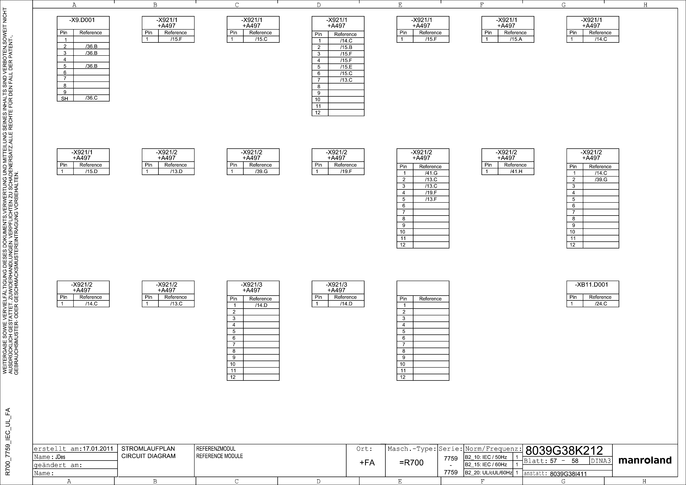

# +FA — Sheet 57 of 58 — REFERENZMODUL

**REFERENCE MODULE**

> Part of the manroland **R700** printing press IEC/UL circuit diagrams.
> Drawing class: **Stromlaufplan / Circuit diagram** (DIN A3).
> Document `+FA` covers the **Delivery** machine section.

## At a glance

| Field | Value |
|---|---|
| Document | `+FA`  (8039G38K212) |
| Sheet | **57** of 58 |
| Section (DE) | REFERENZMODUL |
| Section (EN) | REFERENCE MODULE |
| Section type | REFERENCE_MODULE — Reference module |
| Machine type | `=R700` |
| Series | `7759` |
| Created | 17.01.2011 |
| Replaces | `8039G38I411` |
| Columns used | A, B, C, D, E, F, G |
| Path numbers | — |
| Labels on sheet | 193 |
| Cross-refs out | 33 |
| Cross-refs in | 0 |

**Previous:** [+FA sheet 56](SHEET_0056.md) · **Next:** [+FA sheet 58](SHEET_0058.md) · **Document TOC:** [_TOC.md](_TOC.md)  (+FA) · **Master TOC:** [all sheets](../_MASTER_TOC.md)

## Sheet image (300 DPI, exact vector render)



_Rendered directly from the PDF vector layer at 300 DPI (1-bit), no OCR and no resampling. Use it to confirm anything ambiguous in the text below._

## Cross-references on this sheet

Each entry is a wire leaving this sheet. The printed token is `/sheet.column`; the link resolves to that sheet inside the same document.

| Ref | Target sheet | Col | Path | Destination on target | Target section | From col |
|---|---|---|---|---|---|---|
| `/15.A` | [+FA sheet 15](SHEET_0015.md) | A | — | — | SPANNUNGSVERSORGUNG: | F |
| `/15.F` | [+FA sheet 15](SHEET_0015.md) | F | — | — | SPANNUNGSVERSORGUNG: | B |
| `/15.F` | [+FA sheet 15](SHEET_0015.md) | F | — | — | SPANNUNGSVERSORGUNG: | E |
| `/15.C` | [+FA sheet 15](SHEET_0015.md) | C | — | — | SPANNUNGSVERSORGUNG: | C |
| `/14.C` | [+FA sheet 14](SHEET_0014.md) | C | — | — | SPANNUNGSVERSORGUNG: | G |
| `/14.C` | [+FA sheet 14](SHEET_0014.md) | C | — | — | SPANNUNGSVERSORGUNG: | D |
| `/15.B` | [+FA sheet 15](SHEET_0015.md) | B | — | — | SPANNUNGSVERSORGUNG: | D |
| `/15.F` | [+FA sheet 15](SHEET_0015.md) | F | — | — | SPANNUNGSVERSORGUNG: | D |
| `/15.F` | [+FA sheet 15](SHEET_0015.md) | F | — | — | SPANNUNGSVERSORGUNG: | D |
| `/15.E` | [+FA sheet 15](SHEET_0015.md) | E | — | — | SPANNUNGSVERSORGUNG: | D |
| `/15.C` | [+FA sheet 15](SHEET_0015.md) | C | — | — | SPANNUNGSVERSORGUNG: | D |
| `/13.C` | [+FA sheet 13](SHEET_0013.md) | C | — | — | SPANNUNGSVERSORGUNG: | D |
| `/36.B` | [+FA sheet 36](SHEET_0036.md) | B | — | — | OPTION: TELEPRESENCE | A |
| `/36.B` | [+FA sheet 36](SHEET_0036.md) | B | — | — | OPTION: TELEPRESENCE | A |
| `/36.B` | [+FA sheet 36](SHEET_0036.md) | B | — | — | OPTION: TELEPRESENCE | A |
| `/36.C` | [+FA sheet 36](SHEET_0036.md) | C | — | — | OPTION: TELEPRESENCE | A |
| `/19.F` | [+FA sheet 19](SHEET_0019.md) | F | — | — | LÜFTER | D |
| `/39.G` | [+FA sheet 39](SHEET_0039.md) | G | — | — | OPTION: TELEPRESENCE | C |
| `/15.D` | [+FA sheet 15](SHEET_0015.md) | D | — | — | SPANNUNGSVERSORGUNG: | A |
| `/13.D` | [+FA sheet 13](SHEET_0013.md) | D | — | — | SPANNUNGSVERSORGUNG: | B |
| `/41.H` | [+FA sheet 41](SHEET_0041.md) | H | — | — | OPTION: TELEPRESENCE ODER ICP | F |
| `/41.G` | [+FA sheet 41](SHEET_0041.md) | G | — | — | OPTION: TELEPRESENCE ODER ICP | E |
| `/13.C` | [+FA sheet 13](SHEET_0013.md) | C | — | — | SPANNUNGSVERSORGUNG: | E |
| `/13.C` | [+FA sheet 13](SHEET_0013.md) | C | — | — | SPANNUNGSVERSORGUNG: | E |
| `/19.F` | [+FA sheet 19](SHEET_0019.md) | F | — | — | LÜFTER | E |
| `/13.F` | [+FA sheet 13](SHEET_0013.md) | F | — | — | SPANNUNGSVERSORGUNG: | E |
| `/14.C` | [+FA sheet 14](SHEET_0014.md) | C | — | — | SPANNUNGSVERSORGUNG: | G |
| `/39.G` | [+FA sheet 39](SHEET_0039.md) | G | — | — | OPTION: TELEPRESENCE | G |
| `/14.C` | [+FA sheet 14](SHEET_0014.md) | C | — | — | SPANNUNGSVERSORGUNG: | A |
| `/13.C` | [+FA sheet 13](SHEET_0013.md) | C | — | — | SPANNUNGSVERSORGUNG: | B |
| `/14.D` | [+FA sheet 14](SHEET_0014.md) | D | — | — | SPANNUNGSVERSORGUNG: | D |
| `/24.C` | [+FA sheet 24](SHEET_0024.md) | C | — | — | LICHTWELLENLEITER | G |
| `/14.D` | [+FA sheet 14](SHEET_0014.md) | D | — | — | SPANNUNGSVERSORGUNG: | C |

## Devices on this sheet

| Tag | Class | Class meaning (IEC) | Col | Sub | Terminal | Sign |
|---|---|---|---|---|---|---|
| `X921/1` | X | Klemme / terminal, plug connector | B | 1 | — | — |
| `+A497` | A | Baugruppe / assembly, module, PC board | B | — | — | + |
| `X921/1` | X | Klemme / terminal, plug connector | C | 1 | — | — |
| `+A497` | A | Baugruppe / assembly, module, PC board | C | — | — | + |
| `X921/1` | X | Klemme / terminal, plug connector | D | 1 | — | — |
| `+A497` | A | Baugruppe / assembly, module, PC board | D | — | — | + |
| `X921/1` | X | Klemme / terminal, plug connector | E | 1 | — | — |
| `+A497` | A | Baugruppe / assembly, module, PC board | E | — | — | + |
| `X921/1` | X | Klemme / terminal, plug connector | F | 1 | — | — |
| `+A497` | A | Baugruppe / assembly, module, PC board | F | — | — | + |
| `X921/1` | X | Klemme / terminal, plug connector | G | 1 | — | — |
| `+A497` | A | Baugruppe / assembly, module, PC board | G | — | — | + |
| `X921/1` | X | Klemme / terminal, plug connector | A | 1 | — | — |
| `+A497` | A | Baugruppe / assembly, module, PC board | A | — | — | + |
| `X921/2` | X | Klemme / terminal, plug connector | B | 2 | — | — |
| `+A497` | A | Baugruppe / assembly, module, PC board | B | — | — | + |
| `X921/2` | X | Klemme / terminal, plug connector | C | 2 | — | — |
| `+A497` | A | Baugruppe / assembly, module, PC board | C | — | — | + |
| `X921/2` | X | Klemme / terminal, plug connector | D | 2 | — | — |
| `+A497` | A | Baugruppe / assembly, module, PC board | D | — | — | + |
| `X921/2` | X | Klemme / terminal, plug connector | E | 2 | — | — |
| `+A497` | A | Baugruppe / assembly, module, PC board | E | — | — | + |
| `X921/2` | X | Klemme / terminal, plug connector | F | 2 | — | — |
| `+A497` | A | Baugruppe / assembly, module, PC board | F | — | — | + |
| `X921/2` | X | Klemme / terminal, plug connector | G | 2 | — | — |
| `+A497` | A | Baugruppe / assembly, module, PC board | G | — | — | + |
| `X921/2` | X | Klemme / terminal, plug connector | A | 2 | — | — |
| `+A497` | A | Baugruppe / assembly, module, PC board | A | — | — | + |
| `X921/2` | X | Klemme / terminal, plug connector | B | 2 | — | — |
| `+A497` | A | Baugruppe / assembly, module, PC board | B | — | — | + |
| `X921/3` | X | Klemme / terminal, plug connector | C | 3 | — | — |
| `+A497` | A | Baugruppe / assembly, module, PC board | C | — | — | + |
| `X921/3` | X | Klemme / terminal, plug connector | D | 3 | — | — |
| `+A497` | A | Baugruppe / assembly, module, PC board | D | — | — | + |
| `X9.D001` | — | cross-device reference | A | — | — | — |
| `XB11.D001` | — | cross-device reference | G | — | — | — |

## Potentials / nets

_No named potentials on this sheet._

## Wire-end annotations (grouped as printed)

A wire that continues elsewhere is annotated with a small cluster: the destination description, the path/line number `#NN`, and the `/sheet.column` cross reference. Each row below is one such cluster exactly as it is grouped on the drawing.

| Col | Y | Path | Cross-ref | Text on the wire |
|---|---|---|---|---|
| A | 30.1 | — | — | `X9.D001` |
| B | 30.1 | — | — | `X921/1` |
| C | 30.1 | — | — | `X921/1` |
| D | 30.1 | — | — | `X921/1` |
| E | 30.1 | — | — | `X921/1` |
| F | 30.1 | — | — | `X921/1` |
| G | 30.1 | — | — | `X921/1` |
| B | 40.0 | — | — | `+A497` |
| C | 40.0 | — | — | `+A497` |
| D | 40.0 | — | — | `+A497` |
| E | 40.0 | — | — | `+A497` |
| F | 40.0 | — | — | `+A497` |
| G | 40.0 | — | — | `+A497` |
| A | 52.7 | — | — | `Pin SH 3 4 5 6 7 8 9 2 1 Reference` |
| B | 52.7 | — | — | `Pin 1 Reference` |
| C | 52.7 | — | — | `Pin 1 Reference` |
| E | 52.7 | — | — | `Pin 1 Reference` |
| F | 52.7 | — | — | `Pin 1 Reference` |
| G | 52.7 | — | — | `Pin 1 Reference` |
| D | 55.5 | — | — | `Pin 10 12 11 3 4 5 6 7 8 9 2 1 Reference` |
| B | 64.0 | — | `/15.F` | — |
| E | 64.0 | — | `/15.F` | — |
| F | 64.0 | — | `/15.A` | — |
| C | 64.1 | — | `/15.C` | — |
| G | 64.1 | — | `/14.C` | — |
| D | 66.9 | — | `/14.C`, `/15.B`, `/15.F`, `/15.F`, `/15.E`, `/15.C`, `/13.C` | — |
| A | 76.8 | — | `/36.B`, `/36.B` | — |
| A | 110.8 | — | `/36.B` | — |
| A | 166.1 | — | `/36.C` | — |
| A | 259.7 | — | — | `X921/1` |
| B | 259.7 | — | — | `X921/2` |
| C | 259.7 | — | — | `X921/2` |
| D | 259.7 | — | — | `X921/2` |
| E | 259.7 | — | — | `X921/2` |
| F | 259.7 | — | — | `X921/2` |
| G | 259.7 | — | — | `X921/2` |
| A | 269.6 | — | — | `+A497` |
| B | 269.6 | — | — | `+A497` |
| C | 269.6 | — | — | `+A497` |
| D | 269.6 | — | — | `+A497` |
| E | 269.6 | — | — | `+A497` |
| F | 269.6 | — | — | `+A497` |
| G | 269.6 | — | — | `+A497` |
| A | 282.3 | — | — | `Pin 1 Reference` |
| B | 282.3 | — | — | `Pin 1 Reference` |
| C | 282.3 | — | — | `Pin 1 Reference` |
| D | 282.3 | — | — | `Pin 1 Reference` |
| F | 282.3 | — | — | `Pin 1 Reference` |
| E | 285.1 | — | — | `Pin 10 12 11 3 4 5 6 7 8 9 2 1 Reference` |
| G | 285.1 | — | — | `Pin 10 12 11 3 4 5 6 7 8 9 2 1 Reference` |
| D | 293.6 | — | `/19.F` | — |
| A | 293.7 | — | `/15.D` | — |
| B | 293.7 | — | `/13.D` | — |
| C | 293.7 | — | `/39.G` | — |
| F | 293.7 | — | `/41.H` | — |
| E | 296.5 | — | `/41.G`, `/13.C`, `/13.C`, `/19.F`, `/13.F` | — |
| G | 296.5 | — | `/14.C`, `/39.G` | — |
| A | 489.3 | — | — | `X921/2` |
| B | 489.3 | — | — | `X921/2` |
| C | 489.3 | — | — | `X921/3` |
| D | 489.3 | — | — | `X921/3` |
| G | 489.3 | — | — | `XB11.D001` |
| A | 499.2 | — | — | `+A497` |
| B | 499.2 | — | — | `+A497` |
| C | 499.2 | — | — | `+A497` |
| D | 499.2 | — | — | `+A497` |
| A | 511.9 | — | — | `Pin 1 Reference` |
| B | 511.9 | — | — | `Pin 1 Reference` |
| D | 511.9 | — | — | `Pin 1 Reference` |
| G | 511.9 | — | — | `Pin 1 Reference` |
| C | 514.8 | — | — | `Pin 10 12 11 3 4 5 6 7 8 9 2 1 Reference` |
| E | 514.8 | — | — | `Pin 10 12 11 3 4 5 6 7 8 9 2 1 Reference` |
| A | 523.3 | — | `/14.C` | — |
| B | 523.3 | — | `/13.C` | — |
| D | 523.3 | — | `/14.D` | — |
| G | 523.3 | — | `/24.C` | — |
| C | 526.1 | — | `/14.D` | — |


## Notes and free text on this sheet

| Text | Col | Y (pt) |
|---|---|---|
| `Pin` | A | 52.7 |
| `Reference` | A | 52.86 |
| `SH` | A | 167.53 |
| `Pin` | B | 52.7 |
| `Reference` | B | 52.86 |
| `Pin` | C | 52.7 |
| `Reference` | C | 52.86 |
| `Pin` | D | 55.54 |
| `Reference` | D | 55.7 |
| `Pin` | E | 52.7 |
| `Reference` | E | 52.86 |
| `Pin` | F | 52.7 |
| `Reference` | F | 52.86 |
| `Pin` | G | 52.7 |
| `Reference` | G | 52.86 |

## Complete label inventory (exact text from the drawing)

Every text object inside the drawing area of this sheet, in DIN reading order (column A→H, then top→bottom). This is the authoritative list: if a string is not here it is not printed on this sheet.

| Col | Y | X | Dir | Type | Text |
|---|---|---|---|---|---|
| A | 30.1 | 120.2 | → | device ref | `X9.D001` |
| A | 52.7 | 104.0 | → | text | `Pin` |
| A | 52.9 | 138.0 | → | text | `Reference` |
| A | 65.5 | 111.7 | → | number | `1` |
| A | 76.8 | 148.5 | → | cross-reference | `/36.B` |
| A | 76.9 | 110.6 | → | number | `2` |
| A | 88.1 | 148.5 | → | cross-reference | `/36.B` |
| A | 88.2 | 110.3 | → | number | `3` |
| A | 99.5 | 110.3 | → | number | `4` |
| A | 110.8 | 148.5 | → | cross-reference | `/36.B` |
| A | 110.9 | 110.3 | → | number | `5` |
| A | 122.2 | 110.3 | → | number | `6` |
| A | 132.1 | 110.3 | → | number | `7` |
| A | 144.9 | 110.3 | → | number | `8` |
| A | 156.2 | 110.3 | → | number | `9` |
| A | 166.1 | 148.4 | → | cross-reference | `/36.C` |
| A | 167.5 | 106.2 | → | text | `SH` |
| A | 259.7 | 124.0 | → | device tag | `X921/1` |
| A | 269.6 | 126.1 | → | device tag | `+A497` |
| A | 282.3 | 104.0 | → | text | `Pin` |
| A | 282.5 | 138.0 | → | text | `Reference` |
| A | 293.7 | 105.4 | → | number | `1` |
| A | 293.7 | 148.4 | → | cross-reference | `/15.D` |
| A | 489.3 | 123.3 | → | device tag | `X921/2` |
| A | 499.2 | 126.1 | → | device tag | `+A497` |
| A | 511.9 | 104.0 | → | text | `Pin` |
| A | 512.1 | 138.0 | → | text | `Reference` |
| A | 523.3 | 105.4 | → | number | `1` |
| A | 523.3 | 148.4 | → | cross-reference | `/14.C` |
| B | 30.1 | 271.4 | → | device tag | `X921/1` |
| B | 40.0 | 273.5 | → | device tag | `+A497` |
| B | 52.7 | 251.4 | → | text | `Pin` |
| B | 52.9 | 285.4 | → | text | `Reference` |
| B | 64.0 | 296.2 | → | cross-reference | `/15.F` |
| B | 64.1 | 252.9 | → | number | `1` |
| B | 259.7 | 270.7 | → | device tag | `X921/2` |
| B | 269.6 | 273.5 | → | device tag | `+A497` |
| B | 282.3 | 251.4 | → | text | `Pin` |
| B | 282.5 | 285.4 | → | text | `Reference` |
| B | 293.7 | 252.9 | → | number | `1` |
| B | 293.7 | 295.8 | → | cross-reference | `/13.D` |
| B | 489.3 | 270.7 | → | device tag | `X921/2` |
| B | 499.2 | 273.5 | → | device tag | `+A497` |
| B | 511.9 | 251.4 | → | text | `Pin` |
| B | 512.1 | 285.4 | → | text | `Reference` |
| B | 523.3 | 252.9 | → | number | `1` |
| B | 523.3 | 295.8 | → | cross-reference | `/13.C` |
| C | 30.1 | 418.8 | → | device tag | `X921/1` |
| C | 40.0 | 420.9 | → | device tag | `+A497` |
| C | 52.7 | 398.8 | → | text | `Pin` |
| C | 52.9 | 432.9 | → | text | `Reference` |
| C | 64.1 | 400.3 | → | number | `1` |
| C | 64.1 | 443.2 | → | cross-reference | `/15.C` |
| C | 259.7 | 418.1 | → | device tag | `X921/2` |
| C | 269.6 | 420.9 | → | device tag | `+A497` |
| C | 282.3 | 398.8 | → | text | `Pin` |
| C | 282.5 | 432.9 | → | text | `Reference` |
| C | 293.7 | 400.3 | → | number | `1` |
| C | 293.7 | 443.1 | → | cross-reference | `/39.G` |
| C | 489.3 | 418.1 | → | device tag | `X921/3` |
| C | 499.2 | 420.9 | → | device tag | `+A497` |
| C | 514.8 | 398.8 | → | text | `Pin` |
| C | 514.9 | 432.9 | → | text | `Reference` |
| C | 526.1 | 443.2 | → | cross-reference | `/14.D` |
| C | 526.2 | 405.1 | → | number | `1` |
| C | 537.5 | 403.9 | → | number | `2` |
| C | 548.8 | 403.7 | → | number | `3` |
| C | 560.2 | 403.7 | → | number | `4` |
| C | 571.5 | 403.7 | → | number | `5` |
| C | 582.8 | 403.7 | → | number | `6` |
| C | 594.2 | 403.7 | → | number | `7` |
| C | 605.5 | 403.7 | → | number | `8` |
| C | 616.9 | 403.7 | → | number | `9` |
| C | 628.2 | 398.8 | → | number | `10` |
| C | 639.5 | 400.3 | → | number | `11` |
| C | 650.9 | 399.1 | → | number | `12` |
| D | 30.1 | 566.2 | → | device tag | `X921/1` |
| D | 40.0 | 568.3 | → | device tag | `+A497` |
| D | 55.5 | 546.2 | → | text | `Pin` |
| D | 55.7 | 580.3 | → | text | `Reference` |
| D | 66.9 | 552.5 | → | number | `1` |
| D | 66.9 | 590.6 | → | cross-reference | `/14.C` |
| D | 78.2 | 590.7 | → | cross-reference | `/15.B` |
| D | 78.3 | 551.3 | → | number | `2` |
| D | 89.6 | 551.1 | → | number | `3` |
| D | 89.6 | 591.0 | → | cross-reference | `/15.F` |
| D | 100.9 | 591.0 | → | cross-reference | `/15.F` |
| D | 101.0 | 551.1 | → | number | `4` |
| D | 112.2 | 590.9 | → | cross-reference | `/15.E` |
| D | 112.3 | 551.1 | → | number | `5` |
| D | 123.6 | 551.1 | → | number | `6` |
| D | 123.6 | 590.6 | → | cross-reference | `/15.C` |
| D | 134.9 | 590.6 | → | cross-reference | `/13.C` |
| D | 135.0 | 551.1 | → | number | `7` |
| D | 146.3 | 551.1 | → | number | `8` |
| D | 157.6 | 551.1 | → | number | `9` |
| D | 169.0 | 546.2 | → | number | `10` |
| D | 180.3 | 547.7 | → | number | `11` |
| D | 191.7 | 546.5 | → | number | `12` |
| D | 259.7 | 565.5 | → | device tag | `X921/2` |
| D | 269.6 | 568.3 | → | device tag | `+A497` |
| D | 282.3 | 546.2 | → | text | `Pin` |
| D | 282.5 | 580.3 | → | text | `Reference` |
| D | 293.6 | 591.0 | → | cross-reference | `/19.F` |
| D | 293.7 | 547.7 | → | number | `1` |
| D | 489.3 | 565.5 | → | device tag | `X921/3` |
| D | 499.2 | 568.3 | → | device tag | `+A497` |
| D | 511.9 | 546.2 | → | text | `Pin` |
| D | 512.1 | 580.3 | → | text | `Reference` |
| D | 523.3 | 547.7 | → | number | `1` |
| D | 523.3 | 590.6 | → | cross-reference | `/14.D` |
| E | 30.1 | 713.6 | → | device tag | `X921/1` |
| E | 40.0 | 715.7 | → | device tag | `+A497` |
| E | 52.7 | 693.6 | → | text | `Pin` |
| E | 52.9 | 727.7 | → | text | `Reference` |
| E | 64.0 | 738.4 | → | cross-reference | `/15.F` |
| E | 64.1 | 695.1 | → | number | `1` |
| E | 259.7 | 712.9 | → | device tag | `X921/2` |
| E | 269.6 | 715.7 | → | device tag | `+A497` |
| E | 285.1 | 693.6 | → | text | `Pin` |
| E | 285.3 | 727.7 | → | text | `Reference` |
| E | 296.5 | 699.9 | → | number | `1` |
| E | 296.5 | 737.9 | → | cross-reference | `/41.G` |
| E | 307.8 | 738.0 | → | cross-reference | `/13.C` |
| E | 307.9 | 698.7 | → | number | `2` |
| E | 319.2 | 698.5 | → | number | `3` |
| E | 319.2 | 738.0 | → | cross-reference | `/13.C` |
| E | 330.5 | 738.4 | → | cross-reference | `/19.F` |
| E | 330.6 | 698.5 | → | number | `4` |
| E | 341.8 | 738.4 | → | cross-reference | `/13.F` |
| E | 341.9 | 698.5 | → | number | `5` |
| E | 353.2 | 698.5 | → | number | `6` |
| E | 364.6 | 698.5 | → | number | `7` |
| E | 375.9 | 698.5 | → | number | `8` |
| E | 387.3 | 698.5 | → | number | `9` |
| E | 398.6 | 693.6 | → | number | `10` |
| E | 409.9 | 695.1 | → | number | `11` |
| E | 421.3 | 693.9 | → | number | `12` |
| E | 514.8 | 693.6 | → | text | `Pin` |
| E | 514.9 | 727.7 | → | text | `Reference` |
| E | 526.2 | 699.9 | → | number | `1` |
| E | 537.5 | 698.7 | → | number | `2` |
| E | 548.8 | 698.5 | → | number | `3` |
| E | 560.2 | 698.5 | → | number | `4` |
| E | 571.5 | 698.5 | → | number | `5` |
| E | 582.8 | 698.5 | → | number | `6` |
| E | 594.2 | 698.5 | → | number | `7` |
| E | 605.5 | 698.5 | → | number | `8` |
| E | 616.9 | 698.5 | → | number | `9` |
| E | 628.2 | 693.6 | → | number | `10` |
| E | 639.5 | 695.1 | → | number | `11` |
| E | 650.9 | 693.9 | → | number | `12` |
| F | 30.1 | 861.0 | → | device tag | `X921/1` |
| F | 40.0 | 863.1 | → | device tag | `+A497` |
| F | 52.7 | 841.0 | → | text | `Pin` |
| F | 52.9 | 875.1 | → | text | `Reference` |
| F | 64.0 | 885.4 | → | cross-reference | `/15.A` |
| F | 64.1 | 842.5 | → | number | `1` |
| F | 259.7 | 860.3 | → | device tag | `X921/2` |
| F | 269.6 | 863.1 | → | device tag | `+A497` |
| F | 282.3 | 841.0 | → | text | `Pin` |
| F | 282.5 | 875.1 | → | text | `Reference` |
| F | 293.7 | 842.5 | → | number | `1` |
| F | 293.7 | 885.7 | → | cross-reference | `/41.H` |
| G | 30.1 | 1008.4 | → | device tag | `X921/1` |
| G | 40.0 | 1010.6 | → | device tag | `+A497` |
| G | 52.7 | 988.4 | → | text | `Pin` |
| G | 52.9 | 1022.5 | → | text | `Reference` |
| G | 64.1 | 989.9 | → | number | `1` |
| G | 64.1 | 1032.8 | → | cross-reference | `/14.C` |
| G | 259.7 | 1007.7 | → | device tag | `X921/2` |
| G | 269.6 | 1010.6 | → | device tag | `+A497` |
| G | 285.1 | 988.4 | → | text | `Pin` |
| G | 285.3 | 1022.5 | → | text | `Reference` |
| G | 296.5 | 994.7 | → | number | `1` |
| G | 296.5 | 1032.8 | → | cross-reference | `/14.C` |
| G | 307.8 | 1032.7 | → | cross-reference | `/39.G` |
| G | 307.9 | 993.5 | → | number | `2` |
| G | 319.2 | 993.3 | → | number | `3` |
| G | 330.6 | 993.3 | → | number | `4` |
| G | 341.9 | 993.3 | → | number | `5` |
| G | 353.2 | 993.3 | → | number | `6` |
| G | 364.6 | 993.3 | → | number | `7` |
| G | 375.9 | 993.3 | → | number | `8` |
| G | 387.3 | 993.3 | → | number | `9` |
| G | 398.6 | 988.4 | → | number | `10` |
| G | 409.9 | 989.9 | → | number | `11` |
| G | 421.3 | 988.7 | → | number | `12` |
| G | 489.3 | 998.1 | → | device ref | `XB11.D001` |
| G | 511.9 | 988.4 | → | text | `Pin` |
| G | 512.1 | 1022.5 | → | text | `Reference` |
| G | 523.3 | 989.9 | → | number | `1` |
| G | 523.3 | 1032.8 | → | cross-reference | `/24.C` |

## Reading-order text block

The same content as a plain block, grouped by DIN column — convenient to paste or to match against a visual description.

```text
=== Column A ===
  30.1  120.2  devref       X9.D001
  52.7  104.0  text         Pin
  52.9  138.0  text         Reference
  65.5  111.7  numeric      1
  76.8  148.5  xref         /36.B
  76.9  110.6  numeric      2
  88.1  148.5  xref         /36.B
  88.2  110.3  numeric      3
  99.5  110.3  numeric      4
 110.8  148.5  xref         /36.B
 110.9  110.3  numeric      5
 122.2  110.3  numeric      6
 132.1  110.3  numeric      7
 144.9  110.3  numeric      8
 156.2  110.3  numeric      9
 166.1  148.4  xref         /36.C
 167.5  106.2  text         SH
 259.7  124.0  devtag       X921/1
 269.6  126.1  devtag       +A497
 282.3  104.0  text         Pin
 282.5  138.0  text         Reference
 293.7  105.4  numeric      1
 293.7  148.4  xref         /15.D
 489.3  123.3  devtag       X921/2
 499.2  126.1  devtag       +A497
 511.9  104.0  text         Pin
 512.1  138.0  text         Reference
 523.3  105.4  numeric      1
 523.3  148.4  xref         /14.C
=== Column B ===
  30.1  271.4  devtag       X921/1
  40.0  273.5  devtag       +A497
  52.7  251.4  text         Pin
  52.9  285.4  text         Reference
  64.0  296.2  xref         /15.F
  64.1  252.9  numeric      1
 259.7  270.7  devtag       X921/2
 269.6  273.5  devtag       +A497
 282.3  251.4  text         Pin
 282.5  285.4  text         Reference
 293.7  252.9  numeric      1
 293.7  295.8  xref         /13.D
 489.3  270.7  devtag       X921/2
 499.2  273.5  devtag       +A497
 511.9  251.4  text         Pin
 512.1  285.4  text         Reference
 523.3  252.9  numeric      1
 523.3  295.8  xref         /13.C
=== Column C ===
  30.1  418.8  devtag       X921/1
  40.0  420.9  devtag       +A497
  52.7  398.8  text         Pin
  52.9  432.9  text         Reference
  64.1  400.3  numeric      1
  64.1  443.2  xref         /15.C
 259.7  418.1  devtag       X921/2
 269.6  420.9  devtag       +A497
 282.3  398.8  text         Pin
 282.5  432.9  text         Reference
 293.7  400.3  numeric      1
 293.7  443.1  xref         /39.G
 489.3  418.1  devtag       X921/3
 499.2  420.9  devtag       +A497
 514.8  398.8  text         Pin
 514.9  432.9  text         Reference
 526.1  443.2  xref         /14.D
 526.2  405.1  numeric      1
 537.5  403.9  numeric      2
 548.8  403.7  numeric      3
 560.2  403.7  numeric      4
 571.5  403.7  numeric      5
 582.8  403.7  numeric      6
 594.2  403.7  numeric      7
 605.5  403.7  numeric      8
 616.9  403.7  numeric      9
 628.2  398.8  numeric      10
 639.5  400.3  numeric      11
 650.9  399.1  numeric      12
=== Column D ===
  30.1  566.2  devtag       X921/1
  40.0  568.3  devtag       +A497
  55.5  546.2  text         Pin
  55.7  580.3  text         Reference
  66.9  552.5  numeric      1
  66.9  590.6  xref         /14.C
  78.2  590.7  xref         /15.B
  78.3  551.3  numeric      2
  89.6  551.1  numeric      3
  89.6  591.0  xref         /15.F
 100.9  591.0  xref         /15.F
 101.0  551.1  numeric      4
 112.2  590.9  xref         /15.E
 112.3  551.1  numeric      5
 123.6  551.1  numeric      6
 123.6  590.6  xref         /15.C
 134.9  590.6  xref         /13.C
 135.0  551.1  numeric      7
 146.3  551.1  numeric      8
 157.6  551.1  numeric      9
 169.0  546.2  numeric      10
 180.3  547.7  numeric      11
 191.7  546.5  numeric      12
 259.7  565.5  devtag       X921/2
 269.6  568.3  devtag       +A497
 282.3  546.2  text         Pin
 282.5  580.3  text         Reference
 293.6  591.0  xref         /19.F
 293.7  547.7  numeric      1
 489.3  565.5  devtag       X921/3
 499.2  568.3  devtag       +A497
 511.9  546.2  text         Pin
 512.1  580.3  text         Reference
 523.3  547.7  numeric      1
 523.3  590.6  xref         /14.D
=== Column E ===
  30.1  713.6  devtag       X921/1
  40.0  715.7  devtag       +A497
  52.7  693.6  text         Pin
  52.9  727.7  text         Reference
  64.0  738.4  xref         /15.F
  64.1  695.1  numeric      1
 259.7  712.9  devtag       X921/2
 269.6  715.7  devtag       +A497
 285.1  693.6  text         Pin
 285.3  727.7  text         Reference
 296.5  699.9  numeric      1
 296.5  737.9  xref         /41.G
 307.8  738.0  xref         /13.C
 307.9  698.7  numeric      2
 319.2  698.5  numeric      3
 319.2  738.0  xref         /13.C
 330.5  738.4  xref         /19.F
 330.6  698.5  numeric      4
 341.8  738.4  xref         /13.F
 341.9  698.5  numeric      5
 353.2  698.5  numeric      6
 364.6  698.5  numeric      7
 375.9  698.5  numeric      8
 387.3  698.5  numeric      9
 398.6  693.6  numeric      10
 409.9  695.1  numeric      11
 421.3  693.9  numeric      12
 514.8  693.6  text         Pin
 514.9  727.7  text         Reference
 526.2  699.9  numeric      1
 537.5  698.7  numeric      2
 548.8  698.5  numeric      3
 560.2  698.5  numeric      4
 571.5  698.5  numeric      5
 582.8  698.5  numeric      6
 594.2  698.5  numeric      7
 605.5  698.5  numeric      8
 616.9  698.5  numeric      9
 628.2  693.6  numeric      10
 639.5  695.1  numeric      11
 650.9  693.9  numeric      12
=== Column F ===
  30.1  861.0  devtag       X921/1
  40.0  863.1  devtag       +A497
  52.7  841.0  text         Pin
  52.9  875.1  text         Reference
  64.0  885.4  xref         /15.A
  64.1  842.5  numeric      1
 259.7  860.3  devtag       X921/2
 269.6  863.1  devtag       +A497
 282.3  841.0  text         Pin
 282.5  875.1  text         Reference
 293.7  842.5  numeric      1
 293.7  885.7  xref         /41.H
=== Column G ===
  30.1 1008.4  devtag       X921/1
  40.0 1010.6  devtag       +A497
  52.7  988.4  text         Pin
  52.9 1022.5  text         Reference
  64.1  989.9  numeric      1
  64.1 1032.8  xref         /14.C
 259.7 1007.7  devtag       X921/2
 269.6 1010.6  devtag       +A497
 285.1  988.4  text         Pin
 285.3 1022.5  text         Reference
 296.5  994.7  numeric      1
 296.5 1032.8  xref         /14.C
 307.8 1032.7  xref         /39.G
 307.9  993.5  numeric      2
 319.2  993.3  numeric      3
 330.6  993.3  numeric      4
 341.9  993.3  numeric      5
 353.2  993.3  numeric      6
 364.6  993.3  numeric      7
 375.9  993.3  numeric      8
 387.3  993.3  numeric      9
 398.6  988.4  numeric      10
 409.9  989.9  numeric      11
 421.3  988.7  numeric      12
 489.3  998.1  devref       XB11.D001
 511.9  988.4  text         Pin
 512.1 1022.5  text         Reference
 523.3  989.9  numeric      1
 523.3 1032.8  xref         /24.C
```

---
_Generated from the PDF vector text layer; no OCR. Source: `R700_7759_IEC_UL_FA`, sheet 57._
