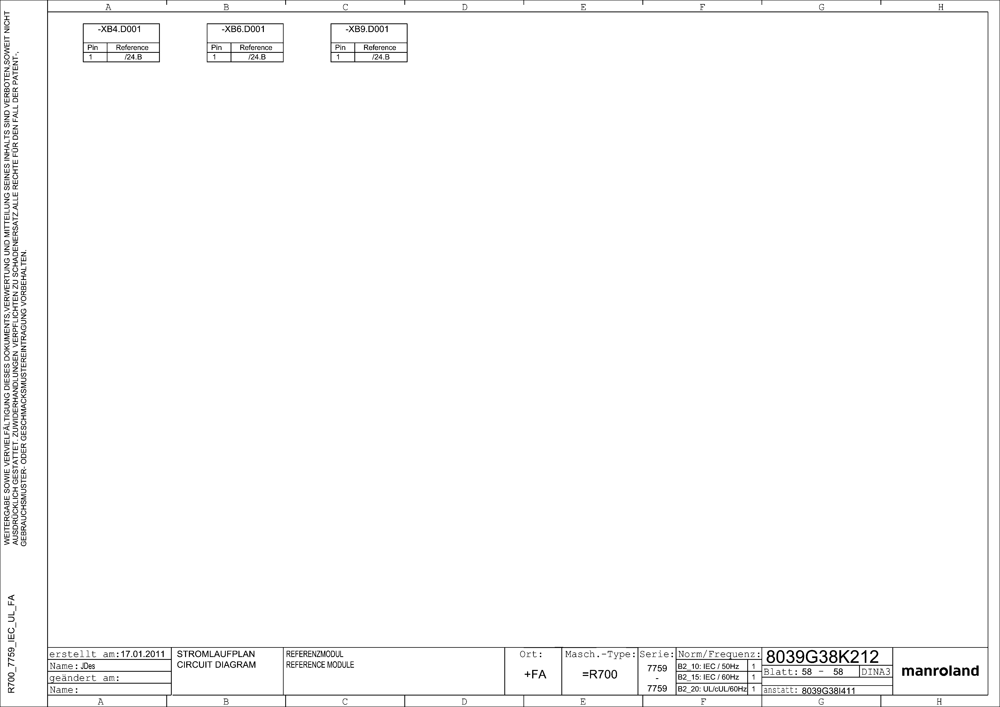

# +FA — Sheet 58 of 58 — REFERENZMODUL

**REFERENCE MODULE**

> Part of the manroland **R700** printing press IEC/UL circuit diagrams.
> Drawing class: **Stromlaufplan / Circuit diagram** (DIN A3).
> Document `+FA` covers the **Delivery** machine section.

## At a glance

| Field | Value |
|---|---|
| Document | `+FA`  (8039G38K212) |
| Sheet | **58** of 58 |
| Section (DE) | REFERENZMODUL |
| Section (EN) | REFERENCE MODULE |
| Section type | REFERENCE_MODULE — Reference module |
| Machine type | `=R700` |
| Series | `7759` |
| Created | 17.01.2011 |
| Replaces | `8039G38I411` |
| Columns used | A, B, C |
| Path numbers | — |
| Labels on sheet | 15 |
| Cross-refs out | 3 |
| Cross-refs in | 0 |

**Previous:** [+FA sheet 57](SHEET_0057.md) · **Next:** [+Jx sheet 1](../Jx/SHEET_0001.md) · **Document TOC:** [_TOC.md](_TOC.md)  (+FA) · **Master TOC:** [all sheets](../_MASTER_TOC.md)

## Sheet image (300 DPI, exact vector render)



_Rendered directly from the PDF vector layer at 300 DPI (1-bit), no OCR and no resampling. Use it to confirm anything ambiguous in the text below._

## Cross-references on this sheet

Each entry is a wire leaving this sheet. The printed token is `/sheet.column`; the link resolves to that sheet inside the same document.

| Ref | Target sheet | Col | Path | Destination on target | Target section | From col |
|---|---|---|---|---|---|---|
| `/24.B` | [+FA sheet 24](SHEET_0024.md) | B | — | — | LICHTWELLENLEITER | A |
| `/24.B` | [+FA sheet 24](SHEET_0024.md) | B | — | — | LICHTWELLENLEITER | B |
| `/24.B` | [+FA sheet 24](SHEET_0024.md) | B | — | — | LICHTWELLENLEITER | C |

## Devices on this sheet

| Tag | Class | Class meaning (IEC) | Col | Sub | Terminal | Sign |
|---|---|---|---|---|---|---|
| `XB4.D001` | — | cross-device reference | A | — | — | — |
| `XB6.D001` | — | cross-device reference | B | — | — | — |
| `XB9.D001` | — | cross-device reference | C | — | — | — |

## Potentials / nets

_No named potentials on this sheet._

## Wire-end annotations (grouped as printed)

A wire that continues elsewhere is annotated with a small cluster: the destination description, the path/line number `#NN`, and the `/sheet.column` cross reference. Each row below is one such cluster exactly as it is grouped on the drawing.

| Col | Y | Path | Cross-ref | Text on the wire |
|---|---|---|---|---|
| A | 30.1 | — | — | `XB4.D001` |
| B | 30.1 | — | — | `XB6.D001` |
| C | 30.1 | — | — | `XB9.D001` |
| A | 52.7 | — | — | `Pin 1 Reference` |
| B | 52.7 | — | — | `Pin 1 Reference` |
| C | 52.7 | — | — | `Pin 1 Reference` |
| A | 64.0 | — | `/24.B` | — |
| B | 64.0 | — | `/24.B` | — |
| C | 64.0 | — | `/24.B` | — |


## Notes and free text on this sheet

| Text | Col | Y (pt) |
|---|---|---|
| `Pin` | A | 52.7 |
| `Reference` | A | 52.86 |
| `Pin` | B | 52.7 |
| `Reference` | B | 52.86 |
| `Pin` | C | 52.7 |
| `Reference` | C | 52.86 |

## Complete label inventory (exact text from the drawing)

Every text object inside the drawing area of this sheet, in DIN reading order (column A→H, then top→bottom). This is the authoritative list: if a string is not here it is not printed on this sheet.

| Col | Y | X | Dir | Type | Text |
|---|---|---|---|---|---|
| A | 30.1 | 116.6 | → | device ref | `XB4.D001` |
| A | 52.7 | 104.0 | → | text | `Pin` |
| A | 52.9 | 138.0 | → | text | `Reference` |
| A | 64.0 | 148.5 | → | cross-reference | `/24.B` |
| A | 64.1 | 105.4 | → | number | `1` |
| B | 30.1 | 264.0 | → | device ref | `XB6.D001` |
| B | 52.7 | 251.4 | → | text | `Pin` |
| B | 52.9 | 285.4 | → | text | `Reference` |
| B | 64.0 | 295.9 | → | cross-reference | `/24.B` |
| B | 64.1 | 252.9 | → | number | `1` |
| C | 30.1 | 411.4 | → | device ref | `XB9.D001` |
| C | 52.7 | 398.8 | → | text | `Pin` |
| C | 52.9 | 432.9 | → | text | `Reference` |
| C | 64.0 | 443.3 | → | cross-reference | `/24.B` |
| C | 64.1 | 400.3 | → | number | `1` |

## Reading-order text block

The same content as a plain block, grouped by DIN column — convenient to paste or to match against a visual description.

```text
=== Column A ===
  30.1  116.6  devref       XB4.D001
  52.7  104.0  text         Pin
  52.9  138.0  text         Reference
  64.0  148.5  xref         /24.B
  64.1  105.4  numeric      1
=== Column B ===
  30.1  264.0  devref       XB6.D001
  52.7  251.4  text         Pin
  52.9  285.4  text         Reference
  64.0  295.9  xref         /24.B
  64.1  252.9  numeric      1
=== Column C ===
  30.1  411.4  devref       XB9.D001
  52.7  398.8  text         Pin
  52.9  432.9  text         Reference
  64.0  443.3  xref         /24.B
  64.1  400.3  numeric      1
```

---
_Generated from the PDF vector text layer; no OCR. Source: `R700_7759_IEC_UL_FA`, sheet 58._
