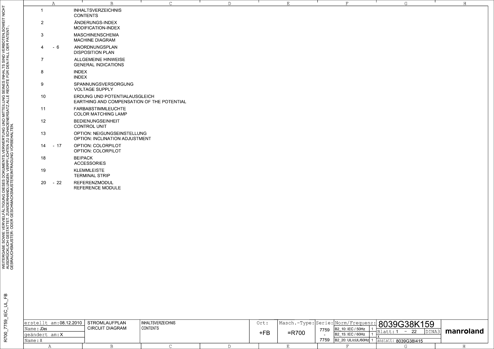

# +FB — Sheet 1 of 22 — INHALTSVERZEICHNIS

**CONTENTS**

> Part of the manroland **R700** printing press IEC/UL circuit diagrams.
> Drawing class: **Stromlaufplan / Circuit diagram** (DIN A3).
> Document `+FB` covers the **Delivery / Coating module** machine section.

## At a glance

| Field | Value |
|---|---|
| Document | `+FB`  (8039G38K159) |
| Sheet | **1** of 22 |
| Section (DE) | INHALTSVERZEICHNIS |
| Section (EN) | CONTENTS |
| Section type | TOC — Contents |
| Machine type | `=R700` |
| Series | `7759` |
| Created | 08.12.2010 |
| Replaces | `8039G38I415` |
| Columns used | A, B |
| Path numbers | — |
| Labels on sheet | 48 |
| Cross-refs out | 0 |
| Cross-refs in | 0 |

**Next:** [+FB sheet 2](SHEET_0002.md) · **Document TOC:** [_TOC.md](_TOC.md)  (+FB) · **Master TOC:** [all sheets](../_MASTER_TOC.md)

## Sheet image (300 DPI, exact vector render)



_Rendered directly from the PDF vector layer at 300 DPI (1-bit), no OCR and no resampling. Use it to confirm anything ambiguous in the text below._

## Cross-references on this sheet

Each entry is a wire leaving this sheet. The printed token is `/sheet.column`; the link resolves to that sheet inside the same document.

_No outgoing cross-references on this sheet._

## Devices on this sheet

_No device designators on this sheet._

## Potentials / nets

_No named potentials on this sheet._

## Wire-end annotations (grouped as printed)

A wire that continues elsewhere is annotated with a small cluster: the destination description, the path/line number `#NN`, and the `/sheet.column` cross reference. Each row below is one such cluster exactly as it is grouped on the drawing.

| Col | Y | Path | Cross-ref | Text on the wire |
|---|---|---|---|---|
| A | 20.1 | — | — | `1 INHALTSVERZEICHNIS CONTENTS` |
| A | 49.8 | — | — | `2 MODIFICATION INDEX ÄNDERUNGS INDEX` |
| A | 79.5 | — | — | `3 MASCHINENSCHEMA MACHINE DIAGRAM` |
| A | 109.2 | — | — | `4 6 DISPOSITION PLAN ANORDNUNGSPLAN` |
| B | 138.9 | — | — | `7 GENERAL INDICATIONS ALLGEMEINE HINWEISE` |
| A | 168.6 | — | — | `8 INDEX INDEX` |
| B | 198.3 | — | — | `9 SPANNUNGSVERSORGUNG` |
| B | 211.1 | — | — | `VOLTAGE SUPPLY` |
| B | 228.0 | — | — | `10 ERDUNG UND POTENTIALAUSGLEICH EARTHING AND COMPENSATION OF THE POTENTIAL` |
| B | 257.7 | — | — | `11 FARBABSTIMMLEUCHTE COLOR MATCHING LAMP` |
| A | 287.4 | — | — | `12 BEDIENUNGSEINHEIT CONTROL UNIT` |
| B | 317.1 | — | — | `13 OPTION: NEIGUNGSEINSTELLUNG OPTION: INCLINATION ADJUSTMENT` |
| A | 346.8 | — | — | `14 17 OPTION: COLORPILOT OPTION: COLORPILOT` |
| A | 376.5 | — | — | `18 BEIPACK` |
| B | 389.2 | — | — | `ACCESSORIES` |
| A | 406.2 | — | — | `19 KLEMMLEISTE` |
| B | 419.0 | — | — | `TERMINAL STRIP` |
| A | 435.9 | — | — | `20 22 REFERENZMODUL REFERENCE MODULE` |


## Notes and free text on this sheet

| Text | Col | Y (pt) |
|---|---|---|
| `INHALTSVERZEICHNIS` | B | 20.19 |
| `CONTENTS` | B | 32.84 |
| `ÄNDERUNGS INDEX` | B | 49.87 |
| `MODIFICATION INDEX` | B | 62.61 |
| `MASCHINENSCHEMA` | B | 79.57 |
| `MACHINE DIAGRAM` | B | 92.28 |
| `ANORDNUNGSPLAN` | B | 109.25 |
| `DISPOSITION PLAN` | B | 121.99 |
| `ALLGEMEINE HINWEISE` | B | 138.96 |
| `GENERAL INDICATIONS` | B | 151.68 |
| `INDEX` | A | 168.69 |
| `SPANNUNGSVERSORGUNG` | B | 198.35 |
| `VOLTAGE SUPPLY` | B | 211.06 |
| `ERDUNG UND POTENTIALAUSGLEICH` | B | 228.06 |
| `EARTHING AND COMPENSATION OF THE POTENTIAL` | B | 240.76 |
| `FARBABSTIMMLEUCHTE` | B | 257.75 |
| `COLOR MATCHING LAMP` | B | 270.45 |
| `BEDIENUNGSEINHEIT` | B | 287.48 |
| `CONTROL UNIT` | B | 300.16 |
| `OPTION: NEIGUNGSEINSTELLUNG` | B | 317.17 |
| `OPTION: INCLINATION ADJUSTMENT` | B | 329.87 |
| `OPTION: COLORPILOT` | B | 346.87 |
| `BEIPACK` | B | 376.56 |
| `ACCESSORIES` | B | 389.25 |
| `KLEMMLEISTE` | B | 406.25 |
| `TERMINAL STRIP` | B | 418.96 |
| `REFERENZMODUL` | B | 435.93 |
| `REFERENCE MODULE` | B | 448.63 |

## Complete label inventory (exact text from the drawing)

Every text object inside the drawing area of this sheet, in DIN reading order (column A→H, then top→bottom). This is the authoritative list: if a string is not here it is not printed on this sheet.

| Col | Y | X | Dir | Type | Text |
|---|---|---|---|---|---|
| A | 20.1 | 98.1 | → | number | `1` |
| A | 49.8 | 98.9 | → | number | `2` |
| A | 79.5 | 98.6 | → | number | `3` |
| A | 109.2 | 98.9 | → | number | `4` |
| A | 109.3 | 127.3 | → | number | `6` |
| A | 138.9 | 98.9 | → | number | `7` |
| A | 168.6 | 98.6 | → | number | `8` |
| A | 168.7 | 177.7 | → | text | `INDEX` |
| A | 181.4 | 177.7 | → | text | `INDEX` |
| A | 198.3 | 98.6 | → | number | `9` |
| A | 228.0 | 98.1 | → | number | `10` |
| A | 257.7 | 98.1 | → | number | `11` |
| A | 287.4 | 98.1 | → | number | `12` |
| A | 317.1 | 98.1 | → | number | `13` |
| A | 346.8 | 98.1 | → | number | `14` |
| A | 346.9 | 127.3 | → | number | `17` |
| A | 376.5 | 98.1 | → | number | `18` |
| A | 406.2 | 98.1 | → | number | `19` |
| A | 435.9 | 98.9 | → | number | `20` |
| A | 436.0 | 127.3 | → | number | `22` |
| B | 20.2 | 177.7 | → | text | `INHALTSVERZEICHNIS` |
| B | 32.8 | 178.0 | → | text | `CONTENTS` |
| B | 49.9 | 178.9 | → | text | `ÄNDERUNGS INDEX` |
| B | 62.6 | 177.7 | → | text | `MODIFICATION INDEX` |
| B | 79.6 | 177.7 | → | text | `MASCHINENSCHEMA` |
| B | 92.3 | 177.7 | → | text | `MACHINE DIAGRAM` |
| B | 109.2 | 178.9 | → | text | `ANORDNUNGSPLAN` |
| B | 122.0 | 177.7 | → | text | `DISPOSITION PLAN` |
| B | 139.0 | 178.9 | → | text | `ALLGEMEINE HINWEISE` |
| B | 151.7 | 178.0 | → | text | `GENERAL INDICATIONS` |
| B | 198.3 | 178.0 | → | text | `SPANNUNGSVERSORGUNG` |
| B | 211.1 | 178.6 | → | text | `VOLTAGE SUPPLY` |
| B | 228.1 | 177.7 | → | text | `ERDUNG UND POTENTIALAUSGLEICH` |
| B | 240.8 | 177.7 | → | text | `EARTHING AND COMPENSATION OF THE POTENTIAL` |
| B | 257.7 | 177.7 | → | text | `FARBABSTIMMLEUCHTE` |
| B | 270.5 | 178.0 | → | text | `COLOR MATCHING LAMP` |
| B | 287.5 | 177.7 | → | text | `BEDIENUNGSEINHEIT` |
| B | 300.2 | 178.0 | → | text | `CONTROL UNIT` |
| B | 317.2 | 178.0 | → | text | `OPTION: NEIGUNGSEINSTELLUNG` |
| B | 329.9 | 178.0 | → | text | `OPTION: INCLINATION ADJUSTMENT` |
| B | 346.9 | 178.0 | → | text | `OPTION: COLORPILOT` |
| B | 359.6 | 178.0 | → | text | `OPTION: COLORPILOT` |
| B | 376.6 | 177.7 | → | text | `BEIPACK` |
| B | 389.3 | 178.9 | → | text | `ACCESSORIES` |
| B | 406.2 | 177.7 | → | text | `KLEMMLEISTE` |
| B | 419.0 | 178.3 | → | text | `TERMINAL STRIP` |
| B | 435.9 | 177.7 | → | text | `REFERENZMODUL` |
| B | 448.6 | 177.7 | → | text | `REFERENCE MODULE` |

## Reading-order text block

The same content as a plain block, grouped by DIN column — convenient to paste or to match against a visual description.

```text
=== Column A ===
  20.1   98.1  numeric      1
  49.8   98.9  numeric      2
  79.5   98.6  numeric      3
 109.2   98.9  numeric      4
 109.3  127.3  numeric      6
 138.9   98.9  numeric      7
 168.6   98.6  numeric      8
 168.7  177.7  text         INDEX
 181.4  177.7  text         INDEX
 198.3   98.6  numeric      9
 228.0   98.1  numeric      10
 257.7   98.1  numeric      11
 287.4   98.1  numeric      12
 317.1   98.1  numeric      13
 346.8   98.1  numeric      14
 346.9  127.3  numeric      17
 376.5   98.1  numeric      18
 406.2   98.1  numeric      19
 435.9   98.9  numeric      20
 436.0  127.3  numeric      22
=== Column B ===
  20.2  177.7  text         INHALTSVERZEICHNIS
  32.8  178.0  text         CONTENTS
  49.9  178.9  text         ÄNDERUNGS INDEX
  62.6  177.7  text         MODIFICATION INDEX
  79.6  177.7  text         MASCHINENSCHEMA
  92.3  177.7  text         MACHINE DIAGRAM
 109.2  178.9  text         ANORDNUNGSPLAN
 122.0  177.7  text         DISPOSITION PLAN
 139.0  178.9  text         ALLGEMEINE HINWEISE
 151.7  178.0  text         GENERAL INDICATIONS
 198.3  178.0  text         SPANNUNGSVERSORGUNG
 211.1  178.6  text         VOLTAGE SUPPLY
 228.1  177.7  text         ERDUNG UND POTENTIALAUSGLEICH
 240.8  177.7  text         EARTHING AND COMPENSATION OF THE POTENTIAL
 257.7  177.7  text         FARBABSTIMMLEUCHTE
 270.5  178.0  text         COLOR MATCHING LAMP
 287.5  177.7  text         BEDIENUNGSEINHEIT
 300.2  178.0  text         CONTROL UNIT
 317.2  178.0  text         OPTION: NEIGUNGSEINSTELLUNG
 329.9  178.0  text         OPTION: INCLINATION ADJUSTMENT
 346.9  178.0  text         OPTION: COLORPILOT
 359.6  178.0  text         OPTION: COLORPILOT
 376.6  177.7  text         BEIPACK
 389.3  178.9  text         ACCESSORIES
 406.2  177.7  text         KLEMMLEISTE
 419.0  178.3  text         TERMINAL STRIP
 435.9  177.7  text         REFERENZMODUL
 448.6  177.7  text         REFERENCE MODULE
```

---
_Generated from the PDF vector text layer; no OCR. Source: `R700_7759_IEC_UL_FB`, sheet 1._
