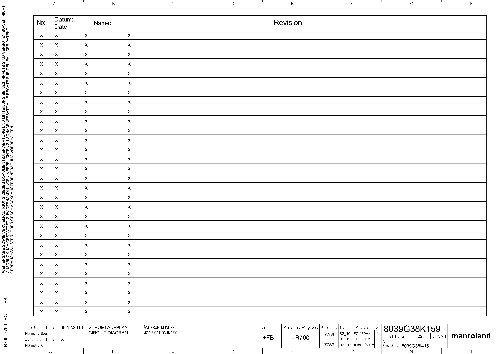

# +FB — Sheet 2 of 22 — ÄNDERUNGS INDEX

**MODIFICATION INDEX**

> Part of the manroland **R700** printing press IEC/UL circuit diagrams.
> Drawing class: **Stromlaufplan / Circuit diagram** (DIN A3).
> Document `+FB` covers the **Delivery / Coating module** machine section.

## At a glance

| Field | Value |
|---|---|
| Document | `+FB`  (8039G38K159) |
| Sheet | **2** of 22 |
| Section (DE) | ÄNDERUNGS INDEX |
| Section (EN) | MODIFICATION INDEX |
| Section type | REVISION — Modification index |
| Machine type | `=R700` |
| Series | `7759` |
| Created | 08.12.2010 |
| Replaces | `8039G38I415` |
| Columns used | A, B, E |
| Path numbers | — |
| Labels on sheet | 125 |
| Cross-refs out | 0 |
| Cross-refs in | 0 |

**Previous:** [+FB sheet 1](SHEET_0001.md) · **Next:** [+FB sheet 3](SHEET_0003.md) · **Document TOC:** [_TOC.md](_TOC.md)  (+FB) · **Master TOC:** [all sheets](../_MASTER_TOC.md)

## Sheet image (300 DPI, exact vector render)



_Rendered directly from the PDF vector layer at 300 DPI (1-bit), no OCR and no resampling. Use it to confirm anything ambiguous in the text below._

## Cross-references on this sheet

Each entry is a wire leaving this sheet. The printed token is `/sheet.column`; the link resolves to that sheet inside the same document.

_No outgoing cross-references on this sheet._

## Devices on this sheet

_No device designators on this sheet._

## Potentials / nets

_No named potentials on this sheet._

## Wire-end annotations (grouped as printed)

A wire that continues elsewhere is annotated with a small cluster: the destination description, the path/line number `#NN`, and the `/sheet.column` cross reference. Each row below is one such cluster exactly as it is grouped on the drawing.

| Col | Y | Path | Cross-ref | Text on the wire |
|---|---|---|---|---|
| C | 40.1 | — | — | `No: Datum: Date: Name: Revision:` |
| A | 79.7 | — | — | `X` |
| A | 79.7 | — | — | `X` |
| B | 79.7 | — | — | `X` |
| B | 79.7 | — | — | `X` |
| A | 102.3 | — | — | `X` |
| A | 102.3 | — | — | `X` |
| B | 102.3 | — | — | `X` |
| B | 102.3 | — | — | `X` |
| A | 125.0 | — | — | `X` |
| A | 125.0 | — | — | `X` |
| B | 125.0 | — | — | `X` |
| B | 125.0 | — | — | `X` |
| A | 147.7 | — | — | `X` |
| A | 147.7 | — | — | `X` |
| B | 147.7 | — | — | `X` |
| B | 147.7 | — | — | `X` |
| A | 170.4 | — | — | `X` |
| A | 170.4 | — | — | `X` |
| B | 170.4 | — | — | `X` |
| B | 170.4 | — | — | `X` |
| A | 193.1 | — | — | `X` |
| A | 193.1 | — | — | `X` |
| B | 193.1 | — | — | `X` |
| B | 193.1 | — | — | `X` |
| A | 215.7 | — | — | `X` |
| A | 215.7 | — | — | `X` |
| B | 215.7 | — | — | `X` |
| B | 215.7 | — | — | `X` |
| A | 238.4 | — | — | `X` |
| A | 238.4 | — | — | `X` |
| B | 238.4 | — | — | `X` |
| B | 238.4 | — | — | `X` |
| A | 261.1 | — | — | `X` |
| A | 261.1 | — | — | `X` |
| B | 261.1 | — | — | `X` |
| B | 261.1 | — | — | `X` |
| A | 283.8 | — | — | `X` |
| A | 283.8 | — | — | `X` |
| B | 283.8 | — | — | `X` |
| B | 283.8 | — | — | `X` |
| A | 306.4 | — | — | `X` |
| A | 306.4 | — | — | `X` |
| B | 306.4 | — | — | `X` |
| B | 306.4 | — | — | `X` |
| A | 329.1 | — | — | `X` |
| A | 329.1 | — | — | `X` |
| B | 329.1 | — | — | `X` |
| B | 329.1 | — | — | `X` |
| A | 351.8 | — | — | `X` |
| A | 351.8 | — | — | `X` |
| B | 351.8 | — | — | `X` |
| B | 351.8 | — | — | `X` |
| A | 374.5 | — | — | `X` |
| A | 374.5 | — | — | `X` |
| B | 374.5 | — | — | `X` |
| B | 374.5 | — | — | `X` |
| A | 397.1 | — | — | `X` |
| A | 397.1 | — | — | `X` |
| B | 397.1 | — | — | `X` |
| B | 397.1 | — | — | `X` |
| A | 419.8 | — | — | `X` |
| A | 419.8 | — | — | `X` |
| B | 419.8 | — | — | `X` |
| B | 419.8 | — | — | `X` |
| A | 442.5 | — | — | `X` |
| A | 442.5 | — | — | `X` |
| B | 442.5 | — | — | `X` |
| B | 442.5 | — | — | `X` |
| A | 465.2 | — | — | `X` |
| A | 465.2 | — | — | `X` |
| B | 465.2 | — | — | `X` |
| B | 465.2 | — | — | `X` |
| A | 487.9 | — | — | `X` |
| A | 487.9 | — | — | `X` |
| B | 487.9 | — | — | `X` |
| B | 487.9 | — | — | `X` |
| A | 510.5 | — | — | `X` |
| A | 510.5 | — | — | `X` |
| B | 510.5 | — | — | `X` |
| B | 510.5 | — | — | `X` |
| A | 533.2 | — | — | `X` |
| A | 533.2 | — | — | `X` |
| B | 533.2 | — | — | `X` |
| B | 533.2 | — | — | `X` |
| A | 555.9 | — | — | `X` |
| A | 555.9 | — | — | `X` |
| B | 555.9 | — | — | `X` |
| B | 555.9 | — | — | `X` |
| A | 578.6 | — | — | `X` |
| A | 578.6 | — | — | `X` |
| B | 578.6 | — | — | `X` |
| B | 578.6 | — | — | `X` |
| A | 601.2 | — | — | `X` |
| A | 601.2 | — | — | `X` |
| B | 601.2 | — | — | `X` |
| B | 601.2 | — | — | `X` |
| A | 623.9 | — | — | `X` |
| A | 623.9 | — | — | `X` |
| B | 623.9 | — | — | `X` |
| B | 623.9 | — | — | `X` |
| A | 646.6 | — | — | `X` |
| A | 646.6 | — | — | `X` |
| B | 646.6 | — | — | `X` |
| B | 646.6 | — | — | `X` |
| A | 669.3 | — | — | `X` |
| A | 669.3 | — | — | `X` |
| B | 669.3 | — | — | `X` |
| B | 669.3 | — | — | `X` |
| A | 692.0 | — | — | `X` |
| A | 692.0 | — | — | `X` |
| B | 692.0 | — | — | `X` |
| B | 692.0 | — | — | `X` |
| A | 714.6 | — | — | `X` |
| A | 714.6 | — | — | `X` |
| B | 714.6 | — | — | `X` |
| B | 714.6 | — | — | `X` |
| A | 737.3 | — | — | `X` |
| A | 737.3 | — | — | `X` |
| B | 737.3 | — | — | `X` |
| B | 737.3 | — | — | `X` |


## Notes and free text on this sheet

| Text | Col | Y (pt) |
|---|---|---|
| `No:` | A | 47.84 |
| `Revision:` | E | 45.93 |
| `Datum:` | A | 40.12 |
| `Date:` | A | 57.21 |
| `Name:` | B | 48.64 |

## Complete label inventory (exact text from the drawing)

Every text object inside the drawing area of this sheet, in DIN reading order (column A→H, then top→bottom). This is the authoritative list: if a string is not here it is not printed on this sheet.

| Col | Y | X | Dir | Type | Text |
|---|---|---|---|---|---|
| A | 40.1 | 129.3 | → | text | `Datum:` |
| A | 47.8 | 87.7 | → | text | `No:` |
| A | 57.2 | 129.3 | → | text | `Date:` |
| A | 79.7 | 95.0 | → | not fitted | `X` |
| A | 79.7 | 130.4 | → | not fitted | `X` |
| A | 102.3 | 95.0 | → | not fitted | `X` |
| A | 102.3 | 130.4 | → | not fitted | `X` |
| A | 125.0 | 95.0 | → | not fitted | `X` |
| A | 125.0 | 130.4 | → | not fitted | `X` |
| A | 147.7 | 95.0 | → | not fitted | `X` |
| A | 147.7 | 130.4 | → | not fitted | `X` |
| A | 170.4 | 95.0 | → | not fitted | `X` |
| A | 170.4 | 130.4 | → | not fitted | `X` |
| A | 193.1 | 95.0 | → | not fitted | `X` |
| A | 193.1 | 130.4 | → | not fitted | `X` |
| A | 215.7 | 95.0 | → | not fitted | `X` |
| A | 215.7 | 130.4 | → | not fitted | `X` |
| A | 238.4 | 95.0 | → | not fitted | `X` |
| A | 238.4 | 130.4 | → | not fitted | `X` |
| A | 261.1 | 95.0 | → | not fitted | `X` |
| A | 261.1 | 130.4 | → | not fitted | `X` |
| A | 283.8 | 95.0 | → | not fitted | `X` |
| A | 283.8 | 130.4 | → | not fitted | `X` |
| A | 306.4 | 95.0 | → | not fitted | `X` |
| A | 306.4 | 130.4 | → | not fitted | `X` |
| A | 329.1 | 95.0 | → | not fitted | `X` |
| A | 329.1 | 130.4 | → | not fitted | `X` |
| A | 351.8 | 95.0 | → | not fitted | `X` |
| A | 351.8 | 130.4 | → | not fitted | `X` |
| A | 374.5 | 95.0 | → | not fitted | `X` |
| A | 374.5 | 130.4 | → | not fitted | `X` |
| A | 397.2 | 95.0 | → | not fitted | `X` |
| A | 397.2 | 130.4 | → | not fitted | `X` |
| A | 419.8 | 95.0 | → | not fitted | `X` |
| A | 419.8 | 130.4 | → | not fitted | `X` |
| A | 442.5 | 95.0 | → | not fitted | `X` |
| A | 442.5 | 130.4 | → | not fitted | `X` |
| A | 465.2 | 95.0 | → | not fitted | `X` |
| A | 465.2 | 130.4 | → | not fitted | `X` |
| A | 487.9 | 95.0 | → | not fitted | `X` |
| A | 487.9 | 130.4 | → | not fitted | `X` |
| A | 510.5 | 95.0 | → | not fitted | `X` |
| A | 510.5 | 130.4 | → | not fitted | `X` |
| A | 533.2 | 95.0 | → | not fitted | `X` |
| A | 533.2 | 130.4 | → | not fitted | `X` |
| A | 555.9 | 95.0 | → | not fitted | `X` |
| A | 555.9 | 130.4 | → | not fitted | `X` |
| A | 578.6 | 95.0 | → | not fitted | `X` |
| A | 578.6 | 130.4 | → | not fitted | `X` |
| A | 601.2 | 95.0 | → | not fitted | `X` |
| A | 601.2 | 130.4 | → | not fitted | `X` |
| A | 623.9 | 95.0 | → | not fitted | `X` |
| A | 623.9 | 130.4 | → | not fitted | `X` |
| A | 646.6 | 95.0 | → | not fitted | `X` |
| A | 646.6 | 130.4 | → | not fitted | `X` |
| A | 669.3 | 95.0 | → | not fitted | `X` |
| A | 669.3 | 130.4 | → | not fitted | `X` |
| A | 692.0 | 95.0 | → | not fitted | `X` |
| A | 692.0 | 130.4 | → | not fitted | `X` |
| A | 714.6 | 95.0 | → | not fitted | `X` |
| A | 714.6 | 130.4 | → | not fitted | `X` |
| A | 737.3 | 95.0 | → | not fitted | `X` |
| A | 737.3 | 130.4 | → | not fitted | `X` |
| B | 48.6 | 222.8 | → | text | `Name:` |
| B | 79.7 | 201.3 | → | not fitted | `X` |
| B | 79.7 | 303.3 | → | not fitted | `X` |
| B | 102.3 | 201.3 | → | not fitted | `X` |
| B | 102.3 | 303.3 | → | not fitted | `X` |
| B | 125.0 | 201.3 | → | not fitted | `X` |
| B | 125.0 | 303.3 | → | not fitted | `X` |
| B | 147.7 | 201.3 | → | not fitted | `X` |
| B | 147.7 | 303.3 | → | not fitted | `X` |
| B | 170.4 | 201.3 | → | not fitted | `X` |
| B | 170.4 | 303.3 | → | not fitted | `X` |
| B | 193.1 | 201.3 | → | not fitted | `X` |
| B | 193.1 | 303.3 | → | not fitted | `X` |
| B | 215.7 | 201.3 | → | not fitted | `X` |
| B | 215.7 | 303.3 | → | not fitted | `X` |
| B | 238.4 | 201.3 | → | not fitted | `X` |
| B | 238.4 | 303.3 | → | not fitted | `X` |
| B | 261.1 | 201.3 | → | not fitted | `X` |
| B | 261.1 | 303.3 | → | not fitted | `X` |
| B | 283.8 | 201.3 | → | not fitted | `X` |
| B | 283.8 | 303.3 | → | not fitted | `X` |
| B | 306.4 | 201.3 | → | not fitted | `X` |
| B | 306.4 | 303.3 | → | not fitted | `X` |
| B | 329.1 | 201.3 | → | not fitted | `X` |
| B | 329.1 | 303.3 | → | not fitted | `X` |
| B | 351.8 | 201.3 | → | not fitted | `X` |
| B | 351.8 | 303.3 | → | not fitted | `X` |
| B | 374.5 | 201.3 | → | not fitted | `X` |
| B | 374.5 | 303.3 | → | not fitted | `X` |
| B | 397.2 | 201.3 | → | not fitted | `X` |
| B | 397.2 | 303.3 | → | not fitted | `X` |
| B | 419.8 | 201.3 | → | not fitted | `X` |
| B | 419.8 | 303.3 | → | not fitted | `X` |
| B | 442.5 | 201.3 | → | not fitted | `X` |
| B | 442.5 | 303.3 | → | not fitted | `X` |
| B | 465.2 | 201.3 | → | not fitted | `X` |
| B | 465.2 | 303.3 | → | not fitted | `X` |
| B | 487.9 | 201.3 | → | not fitted | `X` |
| B | 487.9 | 303.3 | → | not fitted | `X` |
| B | 510.5 | 201.3 | → | not fitted | `X` |
| B | 510.5 | 303.3 | → | not fitted | `X` |
| B | 533.2 | 201.3 | → | not fitted | `X` |
| B | 533.2 | 303.3 | → | not fitted | `X` |
| B | 555.9 | 201.3 | → | not fitted | `X` |
| B | 555.9 | 303.3 | → | not fitted | `X` |
| B | 578.6 | 201.3 | → | not fitted | `X` |
| B | 578.6 | 303.3 | → | not fitted | `X` |
| B | 601.2 | 201.3 | → | not fitted | `X` |
| B | 601.2 | 303.3 | → | not fitted | `X` |
| B | 623.9 | 201.3 | → | not fitted | `X` |
| B | 623.9 | 303.3 | → | not fitted | `X` |
| B | 646.6 | 201.3 | → | not fitted | `X` |
| B | 646.6 | 303.3 | → | not fitted | `X` |
| B | 669.3 | 201.3 | → | not fitted | `X` |
| B | 669.3 | 303.3 | → | not fitted | `X` |
| B | 692.0 | 201.3 | → | not fitted | `X` |
| B | 692.0 | 303.3 | → | not fitted | `X` |
| B | 714.6 | 201.3 | → | not fitted | `X` |
| B | 714.6 | 303.3 | → | not fitted | `X` |
| B | 737.3 | 201.3 | → | not fitted | `X` |
| B | 737.3 | 303.3 | → | not fitted | `X` |
| E | 45.9 | 650.6 | → | text | `Revision:` |

## Reading-order text block

The same content as a plain block, grouped by DIN column — convenient to paste or to match against a visual description.

```text
=== Column A ===
  40.1  129.3  text         Datum:
  47.8   87.7  text         No:
  57.2  129.3  text         Date:
  79.7   95.0  placeholder  X
  79.7  130.4  placeholder  X
 102.3   95.0  placeholder  X
 102.3  130.4  placeholder  X
 125.0   95.0  placeholder  X
 125.0  130.4  placeholder  X
 147.7   95.0  placeholder  X
 147.7  130.4  placeholder  X
 170.4   95.0  placeholder  X
 170.4  130.4  placeholder  X
 193.1   95.0  placeholder  X
 193.1  130.4  placeholder  X
 215.7   95.0  placeholder  X
 215.7  130.4  placeholder  X
 238.4   95.0  placeholder  X
 238.4  130.4  placeholder  X
 261.1   95.0  placeholder  X
 261.1  130.4  placeholder  X
 283.8   95.0  placeholder  X
 283.8  130.4  placeholder  X
 306.4   95.0  placeholder  X
 306.4  130.4  placeholder  X
 329.1   95.0  placeholder  X
 329.1  130.4  placeholder  X
 351.8   95.0  placeholder  X
 351.8  130.4  placeholder  X
 374.5   95.0  placeholder  X
 374.5  130.4  placeholder  X
 397.2   95.0  placeholder  X
 397.2  130.4  placeholder  X
 419.8   95.0  placeholder  X
 419.8  130.4  placeholder  X
 442.5   95.0  placeholder  X
 442.5  130.4  placeholder  X
 465.2   95.0  placeholder  X
 465.2  130.4  placeholder  X
 487.9   95.0  placeholder  X
 487.9  130.4  placeholder  X
 510.5   95.0  placeholder  X
 510.5  130.4  placeholder  X
 533.2   95.0  placeholder  X
 533.2  130.4  placeholder  X
 555.9   95.0  placeholder  X
 555.9  130.4  placeholder  X
 578.6   95.0  placeholder  X
 578.6  130.4  placeholder  X
 601.2   95.0  placeholder  X
 601.2  130.4  placeholder  X
 623.9   95.0  placeholder  X
 623.9  130.4  placeholder  X
 646.6   95.0  placeholder  X
 646.6  130.4  placeholder  X
 669.3   95.0  placeholder  X
 669.3  130.4  placeholder  X
 692.0   95.0  placeholder  X
 692.0  130.4  placeholder  X
 714.6   95.0  placeholder  X
 714.6  130.4  placeholder  X
 737.3   95.0  placeholder  X
 737.3  130.4  placeholder  X
=== Column B ===
  48.6  222.8  text         Name:
  79.7  201.3  placeholder  X
  79.7  303.3  placeholder  X
 102.3  201.3  placeholder  X
 102.3  303.3  placeholder  X
 125.0  201.3  placeholder  X
 125.0  303.3  placeholder  X
 147.7  201.3  placeholder  X
 147.7  303.3  placeholder  X
 170.4  201.3  placeholder  X
 170.4  303.3  placeholder  X
 193.1  201.3  placeholder  X
 193.1  303.3  placeholder  X
 215.7  201.3  placeholder  X
 215.7  303.3  placeholder  X
 238.4  201.3  placeholder  X
 238.4  303.3  placeholder  X
 261.1  201.3  placeholder  X
 261.1  303.3  placeholder  X
 283.8  201.3  placeholder  X
 283.8  303.3  placeholder  X
 306.4  201.3  placeholder  X
 306.4  303.3  placeholder  X
 329.1  201.3  placeholder  X
 329.1  303.3  placeholder  X
 351.8  201.3  placeholder  X
 351.8  303.3  placeholder  X
 374.5  201.3  placeholder  X
 374.5  303.3  placeholder  X
 397.2  201.3  placeholder  X
 397.2  303.3  placeholder  X
 419.8  201.3  placeholder  X
 419.8  303.3  placeholder  X
 442.5  201.3  placeholder  X
 442.5  303.3  placeholder  X
 465.2  201.3  placeholder  X
 465.2  303.3  placeholder  X
 487.9  201.3  placeholder  X
 487.9  303.3  placeholder  X
 510.5  201.3  placeholder  X
 510.5  303.3  placeholder  X
 533.2  201.3  placeholder  X
 533.2  303.3  placeholder  X
 555.9  201.3  placeholder  X
 555.9  303.3  placeholder  X
 578.6  201.3  placeholder  X
 578.6  303.3  placeholder  X
 601.2  201.3  placeholder  X
 601.2  303.3  placeholder  X
 623.9  201.3  placeholder  X
 623.9  303.3  placeholder  X
 646.6  201.3  placeholder  X
 646.6  303.3  placeholder  X
 669.3  201.3  placeholder  X
 669.3  303.3  placeholder  X
 692.0  201.3  placeholder  X
 692.0  303.3  placeholder  X
 714.6  201.3  placeholder  X
 714.6  303.3  placeholder  X
 737.3  201.3  placeholder  X
 737.3  303.3  placeholder  X
=== Column E ===
  45.9  650.6  text         Revision:
```

---
_Generated from the PDF vector text layer; no OCR. Source: `R700_7759_IEC_UL_FB`, sheet 2._
