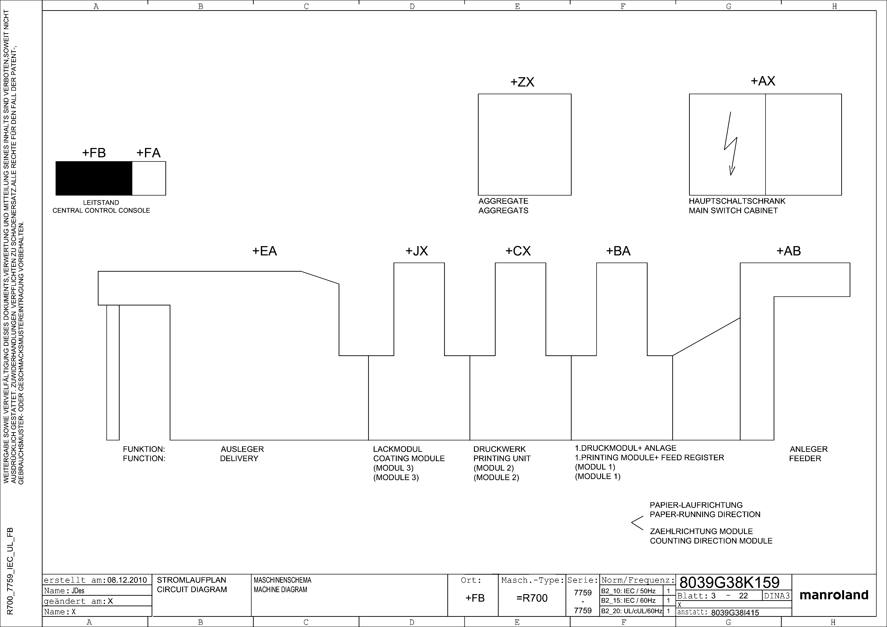

# +FB — Sheet 3 of 22 — MASCHINENSCHEMA

**MACHINE**

> Part of the manroland **R700** printing press IEC/UL circuit diagrams.
> Drawing class: **Stromlaufplan / Circuit diagram** (DIN A3).
> Document `+FB` covers the **Delivery / Coating module** machine section.

## At a glance

| Field | Value |
|---|---|
| Document | `+FB`  (8039G38K159) |
| Sheet | **3** of 22 |
| Section (DE) | MASCHINENSCHEMA |
| Section (EN) | MACHINE |
| Section type | MACHINE_LAYOUT — Machine diagram |
| Machine type | `=R700` |
| Series | `7759` |
| Created | 08.12.2010 |
| Replaces | `8039G38I415` |
| Columns used | A, B, C, D, E, F, G, H |
| Path numbers | — |
| Labels on sheet | 37 |
| Cross-refs out | 0 |
| Cross-refs in | 0 |

**Previous:** [+FB sheet 2](SHEET_0002.md) · **Next:** [+FB sheet 4](SHEET_0004.md) · **Document TOC:** [_TOC.md](_TOC.md)  (+FB) · **Master TOC:** [all sheets](../_MASTER_TOC.md)

## Sheet image (300 DPI, exact vector render)



_Rendered directly from the PDF vector layer at 300 DPI (1-bit), no OCR and no resampling. Use it to confirm anything ambiguous in the text below._

## Cross-references on this sheet

Each entry is a wire leaving this sheet. The printed token is `/sheet.column`; the link resolves to that sheet inside the same document.

_No outgoing cross-references on this sheet._

## Devices on this sheet

_No device designators on this sheet._

## Potentials / nets

_No named potentials on this sheet._

## Wire-end annotations (grouped as printed)

A wire that continues elsewhere is annotated with a small cluster: the destination description, the path/line number `#NN`, and the `/sheet.column` cross reference. Each row below is one such cluster exactly as it is grouped on the drawing.

| Col | Y | Path | Cross-ref | Text on the wire |
|---|---|---|---|---|
| F | 101.2 | — | — | `+ZX +AX` |
| A | 197.6 | — | — | `+FB +FA` |
| G | 265.3 | — | — | `HAUPTSCHALTSCHRANK MAIN SWITCH CABINET` |
| E | 265.4 | — | — | `AGGREGATE AGGREGATS` |
| A | 268.1 | — | — | `CENTRAL CONTROL CONSOLE LEITSTAND` |
| E | 329.4 | — | — | `+EA +JX +CX +BA +AB` |
| F | 597.0 | — | — | `1.DRUCKMODUL+ ANLAGE 1.PRINTING MODULE+ FEED REGISTER (MODUL 1) (MODULE 1)` |
| B | 598.4 | — | — | `DELIVERY AUSLEGER` |
| D | 598.4 | — | — | `LACKMODUL COATING MODULE (MODUL 3) (MODULE 3)` |
| E | 598.4 | — | — | `DRUCKWERK PRINTING UNIT (MODUL 2) (MODULE 2)` |
| H | 598.4 | — | — | `FEEDER ANLEGER` |
| A | 598.5 | — | — | `FUNKTION: FUNCTION:` |
| G | 673.6 | — | — | `PAPIER LAUFRICHTUNG PAPER RUNNING DIRECTION` |
| G | 709.0 | — | — | `COUNTING DIRECTION MODULE ZAEHLRICHTUNG MODULE` |


## Notes and free text on this sheet

| Text | Col | Y (pt) |
|---|---|---|
| `+FB` | A | 197.59 |
| `+FA` | B | 197.59 |
| `FUNKTION:` | A | 598.45 |
| `FUNCTION:` | A | 611.14 |
| `AUSLEGER` | B | 598.41 |
| `DELIVERY` | B | 611.18 |
| `LACKMODUL` | D | 598.42 |
| `COATING MODULE` | D | 611.13 |
| `(MODUL 3)` | D | 623.83 |
| `(MODULE 3)` | D | 636.51 |
| `DRUCKWERK` | E | 598.37 |
| `PRINTING UNIT` | E | 611.18 |
| `(MODUL 2)` | E | 623.83 |
| `(MODULE 2)` | E | 636.51 |
| `1.DRUCKMODUL+ ANLAGE` | F | 597.01 |
| `1.PRINTING MODULE+ FEED REGISTER` | F | 609.72 |
| `(MODUL 1)` | F | 622.41 |
| `(MODULE 1)` | F | 635.1 |
| `ANLEGER` | H | 598.41 |
| `FEEDER` | H | 611.1 |
| `PAPIER LAUFRICHTUNG` | G | 673.56 |
| `PAPER RUNNING DIRECTION` | G | 686.27 |
| `ZAEHLRICHTUNG MODULE` | G | 708.98 |
| `COUNTING DIRECTION MODULE` | G | 721.7 |
| `LEITSTAND` | A | 268.14 |
| `CENTRAL CONTROL CONSOLE` | A | 278.8 |
| `+ZX` | E | 102.63 |
| `+AX` | G | 101.24 |
| `+EA` | C | 329.43 |
| `+JX` | D | 329.41 |
| `+CX` | E | 329.39 |
| `+BA` | F | 329.43 |
| `+AB` | H | 329.43 |
| `AGGREGATE` | E | 265.35 |
| `AGGREGATS` | E | 278.04 |
| `HAUPTSCHALTSCHRANK` | G | 265.34 |
| `MAIN SWITCH CABINET` | G | 278.06 |

## Complete label inventory (exact text from the drawing)

Every text object inside the drawing area of this sheet, in DIN reading order (column A→H, then top→bottom). This is the authoritative list: if a string is not here it is not printed on this sheet.

| Col | Y | X | Dir | Type | Text |
|---|---|---|---|---|---|
| A | 197.6 | 109.8 | → | text | `+FB` |
| A | 268.1 | 111.5 | → | text | `LEITSTAND` |
| A | 278.8 | 70.6 | → | text | `CENTRAL CONTROL CONSOLE` |
| A | 598.5 | 165.0 | → | text | `FUNKTION:` |
| A | 611.1 | 165.0 | → | text | `FUNCTION:` |
| B | 197.6 | 183.0 | → | text | `+FA` |
| B | 598.4 | 296.5 | → | text | `AUSLEGER` |
| B | 611.2 | 295.4 | → | text | `DELIVERY` |
| C | 329.4 | 338.5 | → | text | `+EA` |
| D | 329.4 | 544.1 | → | text | `+JX` |
| D | 598.4 | 500.9 | → | text | `LACKMODUL` |
| D | 611.1 | 501.2 | → | text | `COATING MODULE` |
| D | 623.8 | 501.2 | → | text | `(MODUL 3)` |
| D | 636.5 | 501.2 | → | text | `(MODULE 3)` |
| E | 102.6 | 684.9 | → | text | `+ZX` |
| E | 265.3 | 642.3 | → | text | `AGGREGATE` |
| E | 278.0 | 642.3 | → | text | `AGGREGATS` |
| E | 329.4 | 678.2 | → | text | `+CX` |
| E | 598.4 | 635.5 | → | text | `DRUCKWERK` |
| E | 611.2 | 635.5 | → | text | `PRINTING UNIT` |
| E | 623.8 | 635.8 | → | text | `(MODUL 2)` |
| E | 636.5 | 635.8 | → | text | `(MODULE 2)` |
| F | 329.4 | 813.3 | → | text | `+BA` |
| F | 597.0 | 771.3 | → | text | `1.DRUCKMODUL+ ANLAGE` |
| F | 609.7 | 771.3 | → | text | `1.PRINTING MODULE+ FEED REGISTER` |
| F | 622.4 | 771.9 | → | text | `(MODUL 1)` |
| F | 635.1 | 771.9 | → | text | `(MODULE 1)` |
| G | 101.2 | 1007.6 | → | text | `+AX` |
| G | 265.3 | 924.7 | → | text | `HAUPTSCHALTSCHRANK` |
| G | 278.1 | 924.7 | → | text | `MAIN SWITCH CABINET` |
| G | 673.6 | 872.2 | → | text | `PAPIER LAUFRICHTUNG` |
| G | 686.3 | 872.2 | → | text | `PAPER RUNNING DIRECTION` |
| G | 709.0 | 872.8 | → | text | `ZAEHLRICHTUNG MODULE` |
| G | 721.7 | 872.5 | → | text | `COUNTING DIRECTION MODULE` |
| H | 329.4 | 1042.0 | → | text | `+AB` |
| H | 598.4 | 1060.4 | → | text | `ANLEGER` |
| H | 611.1 | 1059.3 | → | text | `FEEDER` |

## Reading-order text block

The same content as a plain block, grouped by DIN column — convenient to paste or to match against a visual description.

```text
=== Column A ===
 197.6  109.8  text         +FB
 268.1  111.5  text         LEITSTAND
 278.8   70.6  text         CENTRAL CONTROL CONSOLE
 598.5  165.0  text         FUNKTION:
 611.1  165.0  text         FUNCTION:
=== Column B ===
 197.6  183.0  text         +FA
 598.4  296.5  text         AUSLEGER
 611.2  295.4  text         DELIVERY
=== Column C ===
 329.4  338.5  text         +EA
=== Column D ===
 329.4  544.1  text         +JX
 598.4  500.9  text         LACKMODUL
 611.1  501.2  text         COATING MODULE
 623.8  501.2  text         (MODUL 3)
 636.5  501.2  text         (MODULE 3)
=== Column E ===
 102.6  684.9  text         +ZX
 265.3  642.3  text         AGGREGATE
 278.0  642.3  text         AGGREGATS
 329.4  678.2  text         +CX
 598.4  635.5  text         DRUCKWERK
 611.2  635.5  text         PRINTING UNIT
 623.8  635.8  text         (MODUL 2)
 636.5  635.8  text         (MODULE 2)
=== Column F ===
 329.4  813.3  text         +BA
 597.0  771.3  text         1.DRUCKMODUL+ ANLAGE
 609.7  771.3  text         1.PRINTING MODULE+ FEED REGISTER
 622.4  771.9  text         (MODUL 1)
 635.1  771.9  text         (MODULE 1)
=== Column G ===
 101.2 1007.6  text         +AX
 265.3  924.7  text         HAUPTSCHALTSCHRANK
 278.1  924.7  text         MAIN SWITCH CABINET
 673.6  872.2  text         PAPIER LAUFRICHTUNG
 686.3  872.2  text         PAPER RUNNING DIRECTION
 709.0  872.8  text         ZAEHLRICHTUNG MODULE
 721.7  872.5  text         COUNTING DIRECTION MODULE
=== Column H ===
 329.4 1042.0  text         +AB
 598.4 1060.4  text         ANLEGER
 611.1 1059.3  text         FEEDER
```

---
_Generated from the PDF vector text layer; no OCR. Source: `R700_7759_IEC_UL_FB`, sheet 3._
