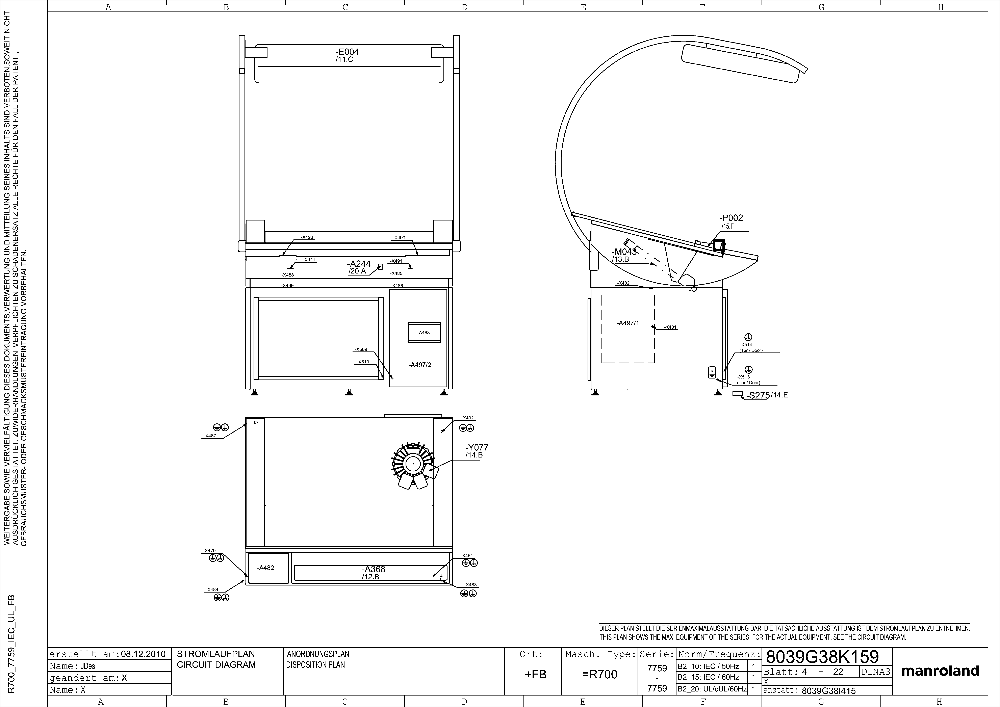

# +FB — Sheet 4 of 22 — ANORDNUNGSPLAN

**DISPOSITION PLAN**

> Part of the manroland **R700** printing press IEC/UL circuit diagrams.
> Drawing class: **Stromlaufplan / Circuit diagram** (DIN A3).
> Document `+FB` covers the **Delivery / Coating module** machine section.

## At a glance

| Field | Value |
|---|---|
| Document | `+FB`  (8039G38K159) |
| Sheet | **4** of 22 |
| Section (DE) | ANORDNUNGSPLAN |
| Section (EN) | DISPOSITION PLAN |
| Section type | ARRANGEMENT — Disposition plan |
| Machine type | `=R700` |
| Series | `7759` |
| Created | 08.12.2010 |
| Replaces | `8039G38I415` |
| Columns used | B, C, D, E, F, G |
| Path numbers | — |
| Labels on sheet | 42 |
| Cross-refs out | 6 |
| Cross-refs in | 1 |

**Previous:** [+FB sheet 3](SHEET_0003.md) · **Next:** [+FB sheet 5](SHEET_0005.md) · **Document TOC:** [_TOC.md](_TOC.md)  (+FB) · **Master TOC:** [all sheets](../_MASTER_TOC.md)

## Sheet image (300 DPI, exact vector render)



_Rendered directly from the PDF vector layer at 300 DPI (1-bit), no OCR and no resampling. Use it to confirm anything ambiguous in the text below._

## Cross-references on this sheet

Each entry is a wire leaving this sheet. The printed token is `/sheet.column`; the link resolves to that sheet inside the same document.

| Ref | Target sheet | Col | Path | Destination on target | Target section | From col |
|---|---|---|---|---|---|---|
| `/11.C` | [+FB sheet 11](SHEET_0011.md) | C | — | E004 | FARBABSTIMMLEUCHTE | C |
| `/15.F` | [+FB sheet 15](SHEET_0015.md) | F | — | — | OPTION: COLORPILOT | F |
| `/13.B` | [+FB sheet 13](SHEET_0013.md) | B | — | M043 | OPTION: NEIGUNGSEINSTELLUNG | E |
| `/20.A` | [+FB sheet 20](SHEET_0020.md) | A | — | — | REFERENZMODUL | C |
| `/14.B` | [+FB sheet 14](SHEET_0014.md) | B | — | Y077 | OPTION: COLORPILOT | D |
| `/12.B` | [+FB sheet 12](SHEET_0012.md) | B | — | A368 | BEDIENUNGSEINHEIT | C |

### Incoming references (sheets that point here)

Every other sheet that sends a wire to this one. `Back-ref` is the token printed on *that* sheet; `Path` is its line number.

| From sheet | Cols | Back-ref | Path | Refs | What continues there |
|---|---|---|---|---|---|
| [+FB#11](SHEET_0011.md) | C | `/11.C` | — | 1 | 8C37H51A040 |


## Devices on this sheet

| Tag | Class | Class meaning (IEC) | Col | Sub | Terminal | Sign |
|---|---|---|---|---|---|---|
| `P002` | P | Messgeraet / measuring instrument, meter | F | — | — | — |
| `Y077` | Y | Magnetventil / solenoid valve, actuator | D | — | — | — |
| `A368` | A | Baugruppe / assembly, module, PC board | C | — | — | — |
| `E004` | E | Sonstiges / miscellaneous, lamp | C | — | — | — |
| `A244` | A | Baugruppe / assembly, module, PC board | C | — | — | — |
| `A497/2` | A | Baugruppe / assembly, module, PC board | D | 2 | — | — |
| `X488` | X | Klemme / terminal, plug connector | C | — | — | — |
| `X489` | X | Klemme / terminal, plug connector | C | — | — | — |
| `X485` | X | Klemme / terminal, plug connector | C | — | — | — |
| `X486` | X | Klemme / terminal, plug connector | C | — | — | — |
| `A463` | A | Baugruppe / assembly, module, PC board | D | — | — | — |
| `A497/1` | A | Baugruppe / assembly, module, PC board | E | 1 | — | — |
| `A482` | A | Baugruppe / assembly, module, PC board | B | — | — | — |
| `X509` | X | Klemme / terminal, plug connector | C | — | — | — |
| `X510` | X | Klemme / terminal, plug connector | C | — | — | — |
| `X493` | X | Klemme / terminal, plug connector | C | — | — | — |
| `X441` | X | Klemme / terminal, plug connector | C | — | — | — |
| `X491` | X | Klemme / terminal, plug connector | C | — | — | — |
| `X490` | X | Klemme / terminal, plug connector | C | — | — | — |
| `X487` | X | Klemme / terminal, plug connector | B | — | — | — |
| `X484` | X | Klemme / terminal, plug connector | B | — | — | — |
| `X479` | X | Klemme / terminal, plug connector | B | — | — | — |
| `X451` | X | Klemme / terminal, plug connector | D | — | — | — |
| `X513` | X | Klemme / terminal, plug connector | F | — | — | — |
| `X514` | X | Klemme / terminal, plug connector | F | — | — | — |
| `X481` | X | Klemme / terminal, plug connector | F | — | — | — |
| `X482` | X | Klemme / terminal, plug connector | E | — | — | — |
| `X483` | X | Klemme / terminal, plug connector | D | — | — | — |
| `X492` | X | Klemme / terminal, plug connector | D | — | — | — |
| `S275/14.E` | — | cross-device reference | G | — | — | — |

## Potentials / nets

| Potential | Count | Columns | Attached devices | Terminals |
|---|---|---|---|---|
| `M043` | 1 | E | — | — |


A potential such as `L24+/4` or `M24+` is a named supply/return rail; every place it appears on this sheet is electrically common.

## Wire-end annotations (grouped as printed)

A wire that continues elsewhere is annotated with a small cluster: the destination description, the path/line number `#NN`, and the `/sheet.column` cross reference. Each row below is one such cluster exactly as it is grouped on the drawing.

| Col | Y | Path | Cross-ref | Text on the wire |
|---|---|---|---|---|
| C | 57.0 | — | `/11.C` | `E004` |
| F | 254.8 | — | — | `P002` |
| F | 266.7 | — | `/15.F` | — |
| C | 280.1 | — | — | `X493` |
| C | 280.7 | — | — | `X490` |
| E | 295.1 | — | `/13.B` | `M043` |
| C | 306.8 | — | — | `X441 X491` |
| C | 309.5 | — | — | `A244` |
| C | 318.9 | — | `/20.A` | — |
| C | 323.2 | — | — | `X485` |
| C | 325.1 | — | — | `X488` |
| E | 334.7 | — | — | `X482` |
| C | 337.6 | — | — | `X489` |
| C | 337.8 | — | — | `X486` |
| E | 381.5 | — | — | `A497/1` |
| F | 387.1 | — | — | `X481` |
| D | 393.8 | — | — | `A463` |
| F | 408.1 | — | — | `(Tür / Door) X514` |
| C | 413.5 | — | — | `X509` |
| C | 428.4 | — | — | `X510` |
| D | 431.0 | — | — | `A497/2` |
| F | 440.5 | — | — | `EBP` |
| F | 446.5 | — | — | `(Tür / Door) X513` |
| G | 466.2 | — | — | `S275/14.E` |
| D | 495.2 | — | — | `X492` |
| B | 516.6 | — | — | `X487` |
| D | 528.2 | — | `/14.B` | `Y077` |
| B | 653.5 | — | — | `X479` |
| D | 659.4 | — | — | `X451` |
| B | 672.8 | — | — | `A482` |
| C | 673.2 | — | `/12.B` | `A368` |
| D | 694.0 | — | — | `X483` |
| B | 699.6 | — | — | `X484` |
| G | 745.4 | — | — | `DIESER PLAN STELLT DIE SERIENMAXIMALAUSSTATTUNG DAR. DIE TATSÄCHLICHE AUSSTATTUNG IST DEM STROMLAUFPLAN ZU ENTNEHMEN.` |
| F | 756.1 | — | — | `THIS PLAN SHOWS THE MAX. EQUIPMENT OF THE SERIES. FOR THE ACTUAL EQUIPMENT, SEE THE CIRCUIT DIAGRAM.` |


## Reconstructed tables

This sheet carries tabular content (pin map / terminal assignment / index). The grid below was rebuilt from the drawing's own rule lines, so each row is exactly one physical row of the table.

### Table 1 — 3 data rows × 2 columns (at x=315.0, y=52.9) — **E004 /11.C X493**

| X488 | X441 A244 /20.A |
|---|---|
| `X489` |  |
|  | `X509 X510` |
| `A482` | `A368 /12.B` |


### Table 2 — 4 data rows × 2 columns (at x=463.4, y=52.9)

| C1 | C2 |
|---|---|
| `X490` |  |
| `X491 X485` |  |
| `X486` |  |
|  | `A463 A497/2` |


### Table 3 — 2 data rows × 2 columns (at x=716.6, y=342.7)

| A497/1 | X481 |
|---|---|
|  | `EBP` |
| `DIESER PLAN STELLT THIS PLAN SHOWS` | `DIE SERIENMAXIMALAUSSTATTUNG THE MAX. EQUIPMENT OF` |


## Notes and free text on this sheet

| Text | Col | Y (pt) |
|---|---|---|
| `DIESER PLAN STELLT DIE SERIENMAXIMALAUSSTATTUNG DAR. DIE TATSÄCHLICHE AUSSTATTUNG IST DEM STROMLAUFPLAN ZU ENTNEHMEN.` | G | 745.43 |
| `THIS PLAN SHOWS THE MAX. EQUIPMENT OF THE SERIES. FOR THE ACTUAL EQUIPMENT, SEE THE CIRCUIT DIAGRAM.` | F | 756.06 |
| `EBP` | F | 440.53 |
| `(Tür / Door)` | F | 453.36 |

## Complete label inventory (exact text from the drawing)

Every text object inside the drawing area of this sheet, in DIN reading order (column A→H, then top→bottom). This is the authoritative list: if a string is not here it is not printed on this sheet.

| Col | Y | X | Dir | Type | Text |
|---|---|---|---|---|---|
| B | 516.6 | 242.7 | → | device tag | `X487` |
| B | 653.5 | 241.9 | → | device tag | `X479` |
| B | 672.7 | 306.1 | → | device tag | `A482` |
| B | 699.6 | 245.2 | → | device tag | `X484` |
| C | 57.0 | 399.4 | → | device tag | `E004` |
| C | 66.9 | 399.7 | → | cross-reference | `/11.C` |
| C | 280.2 | 358.2 | → | device tag | `X493` |
| C | 280.7 | 467.8 | → | device tag | `X490` |
| C | 306.7 | 360.7 | → | device tag | `X441` |
| C | 308.6 | 464.4 | → | device tag | `X491` |
| C | 309.5 | 413.3 | → | device tag | `A244` |
| C | 318.9 | 415.0 | → | cross-reference | `/20.A` |
| C | 323.2 | 464.4 | → | device tag | `X485` |
| C | 325.1 | 335.2 | → | device tag | `X488` |
| C | 337.6 | 334.8 | → | device tag | `X489` |
| C | 337.8 | 465.1 | → | device tag | `X486` |
| C | 413.5 | 422.4 | → | device tag | `X509` |
| C | 428.5 | 424.8 | → | device tag | `X510` |
| C | 673.2 | 430.7 | → | device tag | `A368` |
| C | 683.0 | 431.0 | → | cross-reference | `/12.B` |
| D | 393.8 | 497.0 | → | device tag | `A463` |
| D | 431.0 | 486.5 | → | device tag | `A497/2` |
| D | 495.2 | 549.3 | → | device tag | `X492` |
| D | 528.3 | 554.0 | → | device tag | `Y077` |
| D | 538.0 | 554.3 | → | cross-reference | `/14.B` |
| D | 659.4 | 548.5 | → | device tag | `X451` |
| D | 694.0 | 552.9 | → | device tag | `X483` |
| E | 295.1 | 728.2 | → | potential | `M043` |
| E | 305.0 | 728.5 | → | cross-reference | `/13.B` |
| E | 334.7 | 734.9 | → | device tag | `X482` |
| E | 381.5 | 734.3 | → | device tag | `A497/1` |
| F | 254.9 | 856.5 | → | device tag | `P002` |
| F | 266.7 | 859.3 | → | cross-reference | `/15.F` |
| F | 387.1 | 790.8 | → | device tag | `X481` |
| F | 408.1 | 880.8 | → | device tag | `X514` |
| F | 414.9 | 880.5 | → | text | `(Tür / Door)` |
| F | 440.5 | 845.0 | → | text | `EBP` |
| F | 446.5 | 877.9 | → | device tag | `X513` |
| F | 453.4 | 877.6 | → | text | `(Tür / Door)` |
| F | 756.1 | 714.0 | → | text | `THIS PLAN SHOWS THE MAX. EQUIPMENT OF THE SERIES. FOR THE ACTUAL EQUIPMENT, SEE THE CIRCUIT DIAGRAM.` |
| G | 466.2 | 888.5 | → | device ref | `S275/14.E` |
| G | 745.4 | 713.5 | → | text | `DIESER PLAN STELLT DIE SERIENMAXIMALAUSSTATTUNG DAR. DIE TATSÄCHLICHE AUSSTATTUNG IST DEM STROMLAUFPLAN ZU ENTNEHMEN.` |

## Reading-order text block

The same content as a plain block, grouped by DIN column — convenient to paste or to match against a visual description.

```text
=== Column B ===
 516.6  242.7  devtag       X487
 653.5  241.9  devtag       X479
 672.7  306.1  devtag       A482
 699.6  245.2  devtag       X484
=== Column C ===
  57.0  399.4  devtag       E004
  66.9  399.7  xref         /11.C
 280.2  358.2  devtag       X493
 280.7  467.8  devtag       X490
 306.7  360.7  devtag       X441
 308.6  464.4  devtag       X491
 309.5  413.3  devtag       A244
 318.9  415.0  xref         /20.A
 323.2  464.4  devtag       X485
 325.1  335.2  devtag       X488
 337.6  334.8  devtag       X489
 337.8  465.1  devtag       X486
 413.5  422.4  devtag       X509
 428.5  424.8  devtag       X510
 673.2  430.7  devtag       A368
 683.0  431.0  xref         /12.B
=== Column D ===
 393.8  497.0  devtag       A463
 431.0  486.5  devtag       A497/2
 495.2  549.3  devtag       X492
 528.3  554.0  devtag       Y077
 538.0  554.3  xref         /14.B
 659.4  548.5  devtag       X451
 694.0  552.9  devtag       X483
=== Column E ===
 295.1  728.2  net          M043
 305.0  728.5  xref         /13.B
 334.7  734.9  devtag       X482
 381.5  734.3  devtag       A497/1
=== Column F ===
 254.9  856.5  devtag       P002
 266.7  859.3  xref         /15.F
 387.1  790.8  devtag       X481
 408.1  880.8  devtag       X514
 414.9  880.5  text         (Tür / Door)
 440.5  845.0  text         EBP
 446.5  877.9  devtag       X513
 453.4  877.6  text         (Tür / Door)
 756.1  714.0  text         THIS PLAN SHOWS THE MAX. EQUIPMENT OF THE SERIES. FOR THE ACTUAL EQUIPMENT, SEE THE CIRCUIT DIAGRAM.
=== Column G ===
 466.2  888.5  devref       S275/14.E
 745.4  713.5  text         DIESER PLAN STELLT DIE SERIENMAXIMALAUSSTATTUNG DAR. DIE TATSÄCHLICHE AUSSTATTUNG IST DEM STROMLAUFPLAN ZU ENTNEHMEN.
```

---
_Generated from the PDF vector text layer; no OCR. Source: `R700_7759_IEC_UL_FB`, sheet 4._
