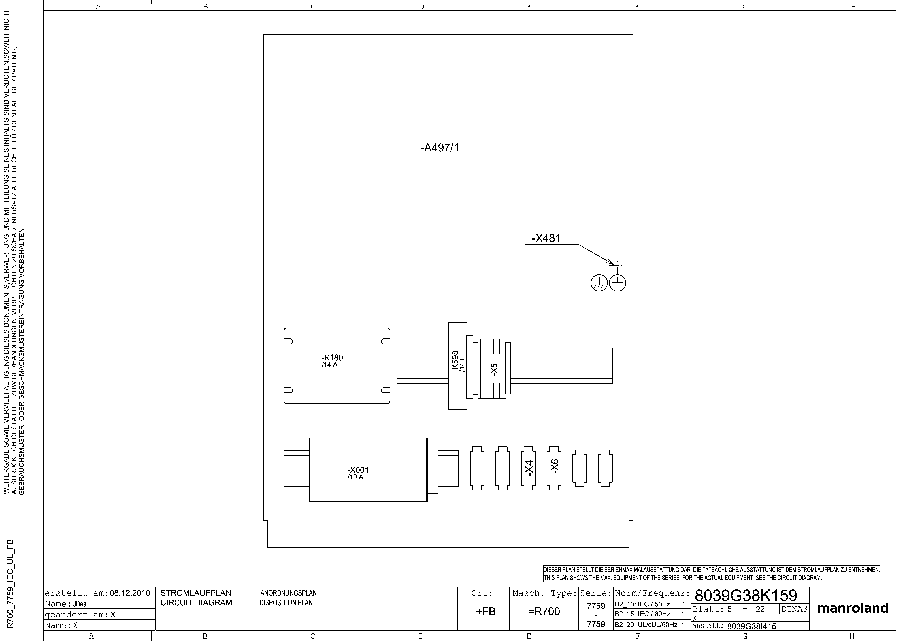

# +FB — Sheet 5 of 22 — ANORDNUNGSPLAN

**DISPOSITION PLAN**

> Part of the manroland **R700** printing press IEC/UL circuit diagrams.
> Drawing class: **Stromlaufplan / Circuit diagram** (DIN A3).
> Document `+FB` covers the **Delivery / Coating module** machine section.

## At a glance

| Field | Value |
|---|---|
| Document | `+FB`  (8039G38K159) |
| Sheet | **5** of 22 |
| Section (DE) | ANORDNUNGSPLAN |
| Section (EN) | DISPOSITION PLAN |
| Section type | ARRANGEMENT — Disposition plan |
| Machine type | `=R700` |
| Series | `7759` |
| Created | 08.12.2010 |
| Replaces | `8039G38I415` |
| Columns used | C, D, E, F, G |
| Path numbers | — |
| Labels on sheet | 13 |
| Cross-refs out | 3 |
| Cross-refs in | 1 |

**Previous:** [+FB sheet 4](SHEET_0004.md) · **Next:** [+FB sheet 6](SHEET_0006.md) · **Document TOC:** [_TOC.md](_TOC.md)  (+FB) · **Master TOC:** [all sheets](../_MASTER_TOC.md)

## Sheet image (300 DPI, exact vector render)



_Rendered directly from the PDF vector layer at 300 DPI (1-bit), no OCR and no resampling. Use it to confirm anything ambiguous in the text below._

## Cross-references on this sheet

Each entry is a wire leaving this sheet. The printed token is `/sheet.column`; the link resolves to that sheet inside the same document.

| Ref | Target sheet | Col | Path | Destination on target | Target section | From col |
|---|---|---|---|---|---|---|
| `/14.A` | [+FB sheet 14](SHEET_0014.md) | A | — | K180 | OPTION: COLORPILOT | C |
| `/14.F` | [+FB sheet 14](SHEET_0014.md) | F | — | — | OPTION: COLORPILOT | D |
| `/19.A` | [+FB sheet 19](SHEET_0019.md) | A | — | X001 | KLEMMLEISTE | C |

### Incoming references (sheets that point here)

Every other sheet that sends a wire to this one. `Back-ref` is the token printed on *that* sheet; `Path` is its line number.

| From sheet | Cols | Back-ref | Path | Refs | What continues there |
|---|---|---|---|---|---|
| [+FB#14](SHEET_0014.md) | B | `/14.B` | — | 1 | 8Z37D51A008 PE A2 |


## Devices on this sheet

| Tag | Class | Class meaning (IEC) | Col | Sub | Terminal | Sign |
|---|---|---|---|---|---|---|
| `K598` | K | Relais / relay, contactor | D | — | — | — |
| `K180` | K | Relais / relay, contactor | C | — | — | — |
| `X001` | X | Klemme / terminal, plug connector | C | — | — | — |
| `X6` | X | Klemme / terminal, plug connector | E | — | — | — |
| `X4` | X | Klemme / terminal, plug connector | E | — | — | — |
| `A497/1` | A | Baugruppe / assembly, module, PC board | D | 1 | — | — |
| `X481` | X | Klemme / terminal, plug connector | E | — | — | — |
| `X5` | X | Klemme / terminal, plug connector | E | — | — | — |

## Potentials / nets

_No named potentials on this sheet._

## Wire-end annotations (grouped as printed)

A wire that continues elsewhere is annotated with a small cluster: the destination description, the path/line number `#NN`, and the `/sheet.column` cross reference. Each row below is one such cluster exactly as it is grouped on the drawing.

| Col | Y | Path | Cross-ref | Text on the wire |
|---|---|---|---|---|
| D | 187.6 | — | — | `A497/1` |
| E | 306.4 | — | — | `X481` |
| D | 460.4 | — | — | `K598` |
| C | 465.2 | — | `/14.A` | `K180` |
| D | 468.4 | — | `/14.F` | — |
| E | 477.3 | — | — | `X5` |
| E | 602.6 | — | — | `X6` |
| E | 603.8 | — | — | `X4` |
| C | 612.6 | — | `/19.A` | `X001` |
| G | 745.4 | — | — | `DIESER PLAN STELLT DIE SERIENMAXIMALAUSSTATTUNG DAR. DIE TATSÄCHLICHE AUSSTATTUNG IST DEM STROMLAUFPLAN ZU ENTNEHMEN.` |
| F | 756.1 | — | — | `THIS PLAN SHOWS THE MAX. EQUIPMENT OF THE SERIES. FOR THE ACTUAL EQUIPMENT, SEE THE CIRCUIT DIAGRAM.` |


## Reconstructed tables

This sheet carries tabular content (pin map / terminal assignment / index). The grid below was rebuilt from the drawing's own rule lines, so each row is exactly one physical row of the table.

### Table 1 — 2 data rows × 1 columns (at x=406.1, y=45.4)

| C1 |
|---|
| `K180 /14.A` |
| `X001 /19.A` |


### Table 2 — 0 data rows × 3 columns (at x=575.1, y=45.4) — **A497/1**

_none_


### Table 3 — 0 data rows × 6 columns (at x=713.3, y=45.4) — **X481 X6**

_none_


## Notes and free text on this sheet

| Text | Col | Y (pt) |
|---|---|---|
| `DIESER PLAN STELLT DIE SERIENMAXIMALAUSSTATTUNG DAR. DIE TATSÄCHLICHE AUSSTATTUNG IST DEM STROMLAUFPLAN ZU ENTNEHMEN.` | G | 745.43 |
| `THIS PLAN SHOWS THE MAX. EQUIPMENT OF THE SERIES. FOR THE ACTUAL EQUIPMENT, SEE THE CIRCUIT DIAGRAM.` | F | 756.06 |

## Complete label inventory (exact text from the drawing)

Every text object inside the drawing area of this sheet, in DIN reading order (column A→H, then top→bottom). This is the authoritative list: if a string is not here it is not printed on this sheet.

| Col | Y | X | Dir | Type | Text |
|---|---|---|---|---|---|
| C | 465.2 | 422.1 | → | device tag | `K180` |
| C | 475.1 | 422.4 | → | cross-reference | `/14.A` |
| C | 612.6 | 456.1 | → | device tag | `X001` |
| C | 622.5 | 456.4 | → | cross-reference | `/19.A` |
| D | 187.6 | 551.8 | → | device tag | `A497/1` |
| D | 460.5 | 592.9 | ↕ | device tag | `K598` |
| D | 468.4 | 602.8 | ↕ | cross-reference | `/14.F` |
| E | 306.4 | 698.0 | → | device tag | `X481` |
| E | 477.3 | 643.9 | ↕ | device tag | `X5` |
| E | 602.6 | 722.7 | ↕ | device tag | `X6` |
| E | 603.8 | 688.3 | ↕ | device tag | `X4` |
| F | 756.1 | 714.0 | → | text | `THIS PLAN SHOWS THE MAX. EQUIPMENT OF THE SERIES. FOR THE ACTUAL EQUIPMENT, SEE THE CIRCUIT DIAGRAM.` |
| G | 745.4 | 713.5 | → | text | `DIESER PLAN STELLT DIE SERIENMAXIMALAUSSTATTUNG DAR. DIE TATSÄCHLICHE AUSSTATTUNG IST DEM STROMLAUFPLAN ZU ENTNEHMEN.` |

## Reading-order text block

The same content as a plain block, grouped by DIN column — convenient to paste or to match against a visual description.

```text
=== Column C ===
 465.2  422.1  devtag       K180
 475.1  422.4  xref         /14.A
 612.6  456.1  devtag       X001
 622.5  456.4  xref         /19.A
=== Column D ===
 187.6  551.8  devtag       A497/1
 460.5  592.9  devtag       K598
 468.4  602.8  xref         /14.F
=== Column E ===
 306.4  698.0  devtag       X481
 477.3  643.9  devtag       X5
 602.6  722.7  devtag       X6
 603.8  688.3  devtag       X4
=== Column F ===
 756.1  714.0  text         THIS PLAN SHOWS THE MAX. EQUIPMENT OF THE SERIES. FOR THE ACTUAL EQUIPMENT, SEE THE CIRCUIT DIAGRAM.
=== Column G ===
 745.4  713.5  text         DIESER PLAN STELLT DIE SERIENMAXIMALAUSSTATTUNG DAR. DIE TATSÄCHLICHE AUSSTATTUNG IST DEM STROMLAUFPLAN ZU ENTNEHMEN.
```

---
_Generated from the PDF vector text layer; no OCR. Source: `R700_7759_IEC_UL_FB`, sheet 5._
