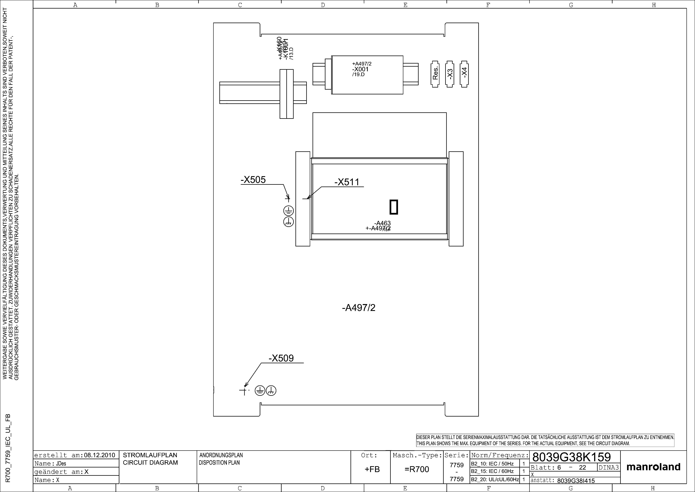

# +FB — Sheet 6 of 22 — ANORDNUNGSPLAN

**DISPOSITION PLAN**

> Part of the manroland **R700** printing press IEC/UL circuit diagrams.
> Drawing class: **Stromlaufplan / Circuit diagram** (DIN A3).
> Document `+FB` covers the **Delivery / Coating module** machine section.

## At a glance

| Field | Value |
|---|---|
| Document | `+FB`  (8039G38K159) |
| Sheet | **6** of 22 |
| Section (DE) | ANORDNUNGSPLAN |
| Section (EN) | DISPOSITION PLAN |
| Section type | ARRANGEMENT — Disposition plan |
| Machine type | `=R700` |
| Series | `7759` |
| Created | 08.12.2010 |
| Replaces | `8039G38I415` |
| Columns used | C, D, E, F, G |
| Path numbers | — |
| Labels on sheet | 20 |
| Cross-refs out | 4 |
| Cross-refs in | 0 |

**Previous:** [+FB sheet 5](SHEET_0005.md) · **Next:** [+FB sheet 7](SHEET_0007.md) · **Document TOC:** [_TOC.md](_TOC.md)  (+FB) · **Master TOC:** [all sheets](../_MASTER_TOC.md)

## Sheet image (300 DPI, exact vector render)



_Rendered directly from the PDF vector layer at 300 DPI (1-bit), no OCR and no resampling. Use it to confirm anything ambiguous in the text below._

## Cross-references on this sheet

Each entry is a wire leaving this sheet. The printed token is `/sheet.column`; the link resolves to that sheet inside the same document.

| Ref | Target sheet | Col | Path | Destination on target | Target section | From col |
|---|---|---|---|---|---|---|
| `/13.D` | [+FB sheet 13](SHEET_0013.md) | D | — | K160/1 +A497/2 | OPTION: NEIGUNGSEINSTELLUNG | D |
| `/13.D` | [+FB sheet 13](SHEET_0013.md) | D | — | — | OPTION: NEIGUNGSEINSTELLUNG | D |
| `/19.D` | [+FB sheet 19](SHEET_0019.md) | D | — | — | KLEMMLEISTE | D |
| `/15.F` | [+FB sheet 15](SHEET_0015.md) | F | — | + A497/2 | OPTION: COLORPILOT | E |

## Devices on this sheet

| Tag | Class | Class meaning (IEC) | Col | Sub | Terminal | Sign |
|---|---|---|---|---|---|---|
| `A463` | A | Baugruppe / assembly, module, PC board | E | — | — | — |
| `K160` | K | Relais / relay, contactor | C | — | — | — |
| `K160/1` | K | Relais / relay, contactor | D | 1 | — | — |
| `+A497/2` | A | Baugruppe / assembly, module, PC board | C | 2 | — | + |
| `X001` | X | Klemme / terminal, plug connector | D | — | — | — |
| `+A497/2` | A | Baugruppe / assembly, module, PC board | D | 2 | — | + |
| `X3` | X | Klemme / terminal, plug connector | F | — | — | — |
| `X4` | X | Klemme / terminal, plug connector | F | — | — | — |
| `A497/2` | A | Baugruppe / assembly, module, PC board | D | 2 | — | — |
| `X511` | X | Klemme / terminal, plug connector | D | — | — | — |
| `X505` | X | Klemme / terminal, plug connector | C | — | — | — |
| `X509` | X | Klemme / terminal, plug connector | C | — | — | — |
| `Res.` | — | cross-device reference | E | — | — | — |

## Potentials / nets

_No named potentials on this sheet._

## Wire-end annotations (grouped as printed)

A wire that continues elsewhere is annotated with a small cluster: the destination description, the path/line number `#NN`, and the `/sheet.column` cross reference. Each row below is one such cluster exactly as it is grouped on the drawing.

| Col | Y | Path | Cross-ref | Text on the wire |
|---|---|---|---|---|
| C | 62.6 | — | — | `K160` |
| D | 65.2 | — | `/13.D` | `+A497/2 K160/1` |
| D | 81.1 | — | `/13.D` | — |
| D | 105.2 | — | — | `+A497/2 X001` |
| E | 112.9 | — | — | `Res.` |
| F | 114.7 | — | — | `X4` |
| F | 117.7 | — | — | `X3` |
| D | 123.6 | — | `/19.D` | — |
| D | 300.2 | — | — | `X505 X511` |
| E | 377.3 | — | — | `A463` |
| E | 385.8 | — | `/15.F` | `+ A497/2` |
| D | 519.4 | — | — | `A497/2` |
| C | 605.8 | — | — | `X509` |
| G | 745.4 | — | — | `DIESER PLAN STELLT DIE SERIENMAXIMALAUSSTATTUNG DAR. DIE TATSÄCHLICHE AUSSTATTUNG IST DEM STROMLAUFPLAN ZU ENTNEHMEN.` |
| F | 756.1 | — | — | `THIS PLAN SHOWS THE MAX. EQUIPMENT OF THE SERIES. FOR THE ACTUAL EQUIPMENT, SEE THE CIRCUIT DIAGRAM.` |


## Reconstructed tables

This sheet carries tabular content (pin map / terminal assignment / index). The grid below was rebuilt from the drawing's own rule lines, so each row is exactly one physical row of the table.

### Table 1 — 2 data rows × 4 columns (at x=418.8, y=39.1)

|  | K160 | K160/1 +A497/2 /13.D | /13.D |
|---|---|---|---|
| `X505` |  |  |  |
|  |  | `X509` |  |


### Table 2 — 4 data rows × 1 columns (at x=567.7, y=39.1)

| C1 |
|---|
| `+A497/2 X001 /19.D` |
| `X511` |
| `A463 + A497/2 /15.F` |
| `A497/2` |


### Table 3 — 1 data rows × 5 columns (at x=716.6, y=39.1)

|  | Res. |  | X3 |  |
|---|---|---|---|---|
| `DIESER THIS` | `PLAN PLAN` | `SHOWS` |  | `DIE THE` |


### Table 4 — 2 data rows × 1 columns (at x=793.7, y=39.1)

| C1 |
|---|
| `X4` |
| `MAX.` |


## Notes and free text on this sheet

| Text | Col | Y (pt) |
|---|---|---|
| `+ A497/2` | E | 385.82 |
| `DIESER PLAN STELLT DIE SERIENMAXIMALAUSSTATTUNG DAR. DIE TATSÄCHLICHE AUSSTATTUNG IST DEM STROMLAUFPLAN ZU ENTNEHMEN.` | G | 745.43 |
| `THIS PLAN SHOWS THE MAX. EQUIPMENT OF THE SERIES. FOR THE ACTUAL EQUIPMENT, SEE THE CIRCUIT DIAGRAM.` | F | 756.06 |

## Complete label inventory (exact text from the drawing)

Every text object inside the drawing area of this sheet, in DIN reading order (column A→H, then top→bottom). This is the authoritative list: if a string is not here it is not printed on this sheet.

| Col | Y | X | Dir | Type | Text |
|---|---|---|---|---|---|
| C | 62.6 | 473.7 | ↕ | device tag | `K160` |
| C | 69.5 | 476.5 | ↕ | device tag | `+A497/2` |
| C | 300.2 | 412.2 | → | device tag | `X505` |
| C | 605.8 | 460.3 | → | device tag | `X509` |
| D | 65.2 | 485.0 | ↕ | device tag | `K160/1` |
| D | 69.7 | 483.6 | ↕ | cross-reference | `/13.D` |
| D | 81.1 | 494.9 | ↕ | cross-reference | `/13.D` |
| D | 105.2 | 603.5 | → | device tag | `+A497/2` |
| D | 113.7 | 603.5 | → | device tag | `X001` |
| D | 123.6 | 603.8 | → | cross-reference | `/19.D` |
| D | 304.5 | 573.2 | → | device tag | `X511` |
| D | 519.4 | 586.2 | → | device tag | `A497/2` |
| E | 112.9 | 740.9 | ↕ | device ref | `Res.` |
| E | 377.3 | 641.2 | → | device tag | `A463` |
| E | 385.8 | 626.2 | → | text | `+ A497/2` |
| E | 389.7 | 654.9 | → | cross-reference | `/15.F` |
| F | 114.7 | 790.4 | ↕ | device tag | `X4` |
| F | 117.6 | 766.0 | ↕ | device tag | `X3` |
| F | 756.1 | 714.0 | → | text | `THIS PLAN SHOWS THE MAX. EQUIPMENT OF THE SERIES. FOR THE ACTUAL EQUIPMENT, SEE THE CIRCUIT DIAGRAM.` |
| G | 745.4 | 713.5 | → | text | `DIESER PLAN STELLT DIE SERIENMAXIMALAUSSTATTUNG DAR. DIE TATSÄCHLICHE AUSSTATTUNG IST DEM STROMLAUFPLAN ZU ENTNEHMEN.` |

## Reading-order text block

The same content as a plain block, grouped by DIN column — convenient to paste or to match against a visual description.

```text
=== Column C ===
  62.6  473.7  devtag       K160
  69.5  476.5  devtag       +A497/2
 300.2  412.2  devtag       X505
 605.8  460.3  devtag       X509
=== Column D ===
  65.2  485.0  devtag       K160/1
  69.7  483.6  xref         /13.D
  81.1  494.9  xref         /13.D
 105.2  603.5  devtag       +A497/2
 113.7  603.5  devtag       X001
 123.6  603.8  xref         /19.D
 304.5  573.2  devtag       X511
 519.4  586.2  devtag       A497/2
=== Column E ===
 112.9  740.9  devref       Res.
 377.3  641.2  devtag       A463
 385.8  626.2  text         + A497/2
 389.7  654.9  xref         /15.F
=== Column F ===
 114.7  790.4  devtag       X4
 117.6  766.0  devtag       X3
 756.1  714.0  text         THIS PLAN SHOWS THE MAX. EQUIPMENT OF THE SERIES. FOR THE ACTUAL EQUIPMENT, SEE THE CIRCUIT DIAGRAM.
=== Column G ===
 745.4  713.5  text         DIESER PLAN STELLT DIE SERIENMAXIMALAUSSTATTUNG DAR. DIE TATSÄCHLICHE AUSSTATTUNG IST DEM STROMLAUFPLAN ZU ENTNEHMEN.
```

---
_Generated from the PDF vector text layer; no OCR. Source: `R700_7759_IEC_UL_FB`, sheet 6._
