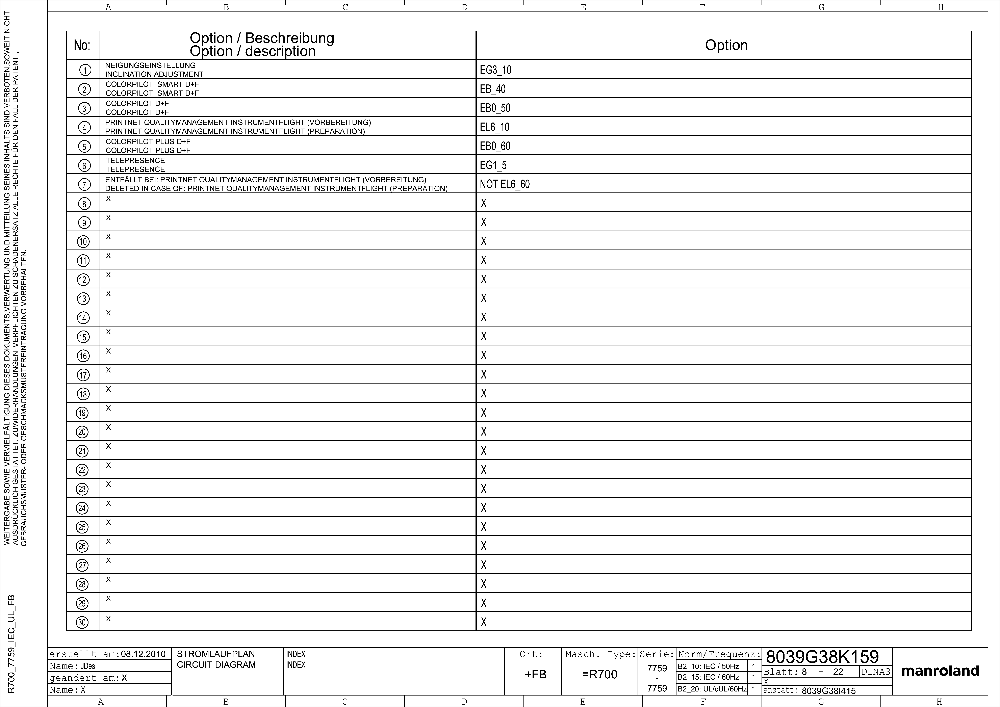

# +FB — Sheet 8 of 22 — INDEX

**INDEX**

> Part of the manroland **R700** printing press IEC/UL circuit diagrams.
> Drawing class: **Stromlaufplan / Circuit diagram** (DIN A3).
> Document `+FB` covers the **Delivery / Coating module** machine section.

## At a glance

| Field | Value |
|---|---|
| Document | `+FB`  (8039G38K159) |
| Sheet | **8** of 22 |
| Section (DE) | INDEX |
| Section (EN) | INDEX |
| Section type | INDEX — Index |
| Machine type | `=R700` |
| Series | `7759` |
| Created | 08.12.2010 |
| Replaces | `8039G38I415` |
| Columns used | A, B, D, F |
| Path numbers | — |
| Labels on sheet | 101 |
| Cross-refs out | 0 |
| Cross-refs in | 0 |

**Previous:** [+FB sheet 7](SHEET_0007.md) · **Next:** [+FB sheet 9](SHEET_0009.md) · **Document TOC:** [_TOC.md](_TOC.md)  (+FB) · **Master TOC:** [all sheets](../_MASTER_TOC.md)

## Sheet image (300 DPI, exact vector render)



_Rendered directly from the PDF vector layer at 300 DPI (1-bit), no OCR and no resampling. Use it to confirm anything ambiguous in the text below._

## Cross-references on this sheet

Each entry is a wire leaving this sheet. The printed token is `/sheet.column`; the link resolves to that sheet inside the same document.

_No outgoing cross-references on this sheet._

## Devices on this sheet

_No device designators on this sheet._

## Potentials / nets

_No named potentials on this sheet._

## Wire-end annotations (grouped as printed)

A wire that continues elsewhere is annotated with a small cluster: the destination description, the path/line number `#NN`, and the `/sheet.column` cross reference. Each row below is one such cluster exactly as it is grouped on the drawing.

| Col | Y | Path | Cross-ref | Text on the wire |
|---|---|---|---|---|
| D | 37.5 | — | — | `No: Option / Beschreibung Option / description Option` |
| A | 74.0 | — | — | `NEIGUNGSEINSTELLUNG INCLINATION ADJUSTMENT` |
| D | 78.6 | — | — | `EG3_10` |
| A | 80.2 | — | — | `1` |
| B | 96.7 | — | — | `PRINTNET QUALITYMANAGEMENT INSTRUMENTFLIGHT (VORBEREITUNG) PRINTNET QUALITYMANAGEMENT INSTRUMENTFLIGHT (PREPARATION) COLORPILOT SMART D+F COLORPILOT SMART D+F COLORPILOT D+F COLORPILOT D+F` |
| D | 101.3 | — | — | `EB_40` |
| A | 103.4 | — | — | `2` |
| D | 124.0 | — | — | `EB0_50` |
| A | 126.0 | — | — | `3` |
| D | 146.6 | — | — | `EL6_10` |
| A | 148.8 | — | — | `4` |
| B | 164.7 | — | — | `ENTFÄLLT BEI: PRINTNET QUALITYMANAGEMENT INSTRUMENTFLIGHT (VORBEREITUNG) DELETED IN CASE OF: PRINTNET QUALITYMANAGEMENT INSTRUMENTFLIGHT (PREPARATION) COLORPILOT PLUS D+F COLORPILOT PLUS D+F TELEPRESENCE TELEPRESENCE` |
| D | 169.3 | — | — | `EB0_60` |
| A | 171.4 | — | — | `5` |
| D | 192.0 | — | — | `EG1_5` |
| A | 194.1 | — | — | `6` |
| D | 214.7 | — | — | `NOT EL6_60` |
| A | 216.8 | — | — | `7` |
| A | 232.7 | — | — | `X` |
| D | 237.4 | — | — | `X` |
| A | 239.4 | — | — | `8` |
| A | 255.3 | — | — | `X` |
| D | 260.1 | — | — | `X` |
| A | 262.1 | — | — | `9` |
| A | 278.0 | — | — | `X` |
| D | 282.8 | — | — | `X` |
| A | 284.1 | — | — | `10` |
| A | 300.7 | — | — | `X` |
| D | 305.5 | — | — | `X` |
| A | 306.6 | — | — | `11` |
| A | 323.4 | — | — | `X` |
| D | 328.1 | — | — | `X` |
| A | 329.5 | — | — | `12` |
| A | 346.1 | — | — | `X` |
| D | 350.8 | — | — | `X` |
| A | 352.1 | — | — | `13` |
| A | 368.7 | — | — | `X` |
| D | 373.5 | — | — | `X` |
| A | 375.5 | — | — | `14` |
| A | 391.4 | — | — | `X` |
| D | 396.2 | — | — | `X` |
| A | 398.2 | — | — | `15` |
| A | 414.1 | — | — | `X` |
| D | 418.9 | — | — | `X` |
| A | 420.2 | — | — | `16` |
| A | 436.8 | — | — | `X` |
| D | 441.5 | — | — | `X` |
| A | 443.6 | — | — | `17` |
| A | 459.4 | — | — | `X` |
| D | 464.2 | — | — | `X` |
| A | 466.2 | — | — | `18` |
| A | 482.1 | — | — | `X` |
| D | 486.9 | — | — | `X` |
| A | 488.2 | — | — | `19` |
| A | 504.8 | — | — | `X` |
| D | 509.6 | — | — | `X` |
| A | 511.0 | — | — | `20` |
| A | 527.5 | — | — | `X` |
| D | 532.2 | — | — | `X` |
| A | 533.5 | — | — | `21` |
| A | 550.1 | — | — | `X` |
| D | 554.9 | — | — | `X` |
| A | 556.4 | — | — | `22` |
| A | 572.8 | — | — | `X` |
| D | 577.6 | — | — | `X` |
| A | 579.0 | — | — | `23` |
| A | 595.5 | — | — | `X` |
| D | 600.3 | — | — | `X` |
| A | 601.7 | — | — | `24` |
| A | 618.2 | — | — | `X` |
| D | 623.0 | — | — | `X` |
| A | 624.4 | — | — | `25` |
| A | 640.9 | — | — | `X` |
| D | 645.6 | — | — | `X` |
| A | 647.1 | — | — | `26` |
| A | 663.5 | — | — | `X` |
| D | 668.3 | — | — | `X` |
| A | 669.7 | — | — | `27` |
| A | 686.2 | — | — | `X` |
| D | 691.0 | — | — | `X` |
| A | 692.4 | — | — | `28` |
| A | 708.9 | — | — | `X` |
| D | 713.7 | — | — | `X` |
| A | 715.1 | — | — | `29` |
| A | 733.0 | — | — | `X` |
| D | 736.3 | — | — | `X` |
| A | 737.7 | — | — | `30` |


## Notes and free text on this sheet

| Text | Col | Y (pt) |
|---|---|---|
| `No:` | A | 47.84 |
| `Option` | F | 45.97 |
| `Option / Beschreibung` | B | 37.47 |
| `Option / description` | B | 53.05 |
| `EG3_10` | D | 78.58 |
| `EB_40` | D | 101.26 |
| `EB0_50` | D | 123.95 |
| `EL6_10` | D | 146.61 |
| `EB0_60` | D | 169.3 |
| `EG1_5` | D | 191.96 |
| `NOT EL6_60` | D | 214.66 |
| `NEIGUNGSEINSTELLUNG` | A | 73.98 |
| `INCLINATION ADJUSTMENT` | A | 84.61 |
| `COLORPILOT SMART D+F` | A | 96.66 |
| `COLORPILOT D+F` | A | 119.34 |
| `PRINTNET QUALITYMANAGEMENT INSTRUMENTFLIGHT (VORBEREITUNG)` | B | 142.02 |
| `PRINTNET QUALITYMANAGEMENT INSTRUMENTFLIGHT (PREPARATION)` | B | 152.65 |
| `COLORPILOT PLUS D+F` | A | 164.69 |
| `TELEPRESENCE` | A | 187.35 |
| `ENTFÄLLT BEI: PRINTNET QUALITYMANAGEMENT INSTRUMENTFLIGHT (VORBEREITUNG)` | B | 210.04 |
| `DELETED IN CASE OF: PRINTNET QUALITYMANAGEMENT INSTRUMENTFLIGHT (PREPARATION)` | B | 220.67 |

## Complete label inventory (exact text from the drawing)

Every text object inside the drawing area of this sheet, in DIN reading order (column A→H, then top→bottom). This is the authoritative list: if a string is not here it is not printed on this sheet.

| Col | Y | X | Dir | Type | Text |
|---|---|---|---|---|---|
| A | 47.8 | 87.7 | → | text | `No:` |
| A | 74.0 | 125.3 | → | text | `NEIGUNGSEINSTELLUNG` |
| A | 80.2 | 98.9 | → | number | `1` |
| A | 84.6 | 125.3 | → | text | `INCLINATION ADJUSTMENT` |
| A | 96.7 | 125.9 | → | text | `COLORPILOT SMART D+F` |
| A | 103.4 | 98.1 | → | number | `2` |
| A | 107.3 | 125.9 | → | text | `COLORPILOT SMART D+F` |
| A | 119.3 | 125.9 | → | text | `COLORPILOT D+F` |
| A | 126.0 | 98.1 | → | number | `3` |
| A | 130.0 | 125.9 | → | text | `COLORPILOT D+F` |
| A | 148.8 | 98.1 | → | number | `4` |
| A | 164.7 | 125.9 | → | text | `COLORPILOT PLUS D+F` |
| A | 171.4 | 98.1 | → | number | `5` |
| A | 175.3 | 125.9 | → | text | `COLORPILOT PLUS D+F` |
| A | 187.4 | 125.9 | → | text | `TELEPRESENCE` |
| A | 194.1 | 98.1 | → | number | `6` |
| A | 198.0 | 125.9 | → | text | `TELEPRESENCE` |
| A | 216.8 | 98.1 | → | number | `7` |
| A | 232.7 | 126.1 | → | not fitted | `X` |
| A | 239.4 | 98.1 | → | number | `8` |
| A | 255.3 | 126.1 | → | not fitted | `X` |
| A | 262.1 | 98.1 | → | number | `9` |
| A | 278.0 | 126.1 | → | not fitted | `X` |
| A | 284.1 | 94.4 | → | number | `10` |
| A | 300.7 | 126.1 | → | not fitted | `X` |
| A | 306.6 | 94.0 | → | number | `11` |
| A | 323.4 | 126.1 | → | not fitted | `X` |
| A | 329.5 | 93.7 | → | number | `12` |
| A | 346.1 | 126.1 | → | not fitted | `X` |
| A | 352.2 | 93.7 | → | number | `13` |
| A | 368.7 | 126.1 | → | not fitted | `X` |
| A | 375.5 | 93.7 | → | number | `14` |
| A | 391.4 | 126.1 | → | not fitted | `X` |
| A | 398.2 | 93.7 | → | number | `15` |
| A | 414.1 | 126.1 | → | not fitted | `X` |
| A | 420.2 | 94.4 | → | number | `16` |
| A | 436.8 | 126.1 | → | not fitted | `X` |
| A | 443.6 | 94.4 | → | number | `17` |
| A | 459.4 | 126.1 | → | not fitted | `X` |
| A | 466.2 | 94.4 | → | number | `18` |
| A | 482.1 | 126.1 | → | not fitted | `X` |
| A | 488.2 | 93.0 | → | number | `19` |
| A | 504.8 | 126.1 | → | not fitted | `X` |
| A | 511.0 | 93.2 | → | number | `20` |
| A | 527.5 | 126.1 | → | not fitted | `X` |
| A | 533.5 | 93.5 | → | number | `21` |
| A | 550.1 | 126.1 | → | not fitted | `X` |
| A | 556.3 | 93.2 | → | number | `22` |
| A | 572.8 | 126.1 | → | not fitted | `X` |
| A | 579.0 | 93.2 | → | number | `23` |
| A | 595.5 | 126.1 | → | not fitted | `X` |
| A | 601.7 | 93.2 | → | number | `24` |
| A | 618.2 | 126.1 | → | not fitted | `X` |
| A | 624.4 | 93.2 | → | number | `25` |
| A | 640.9 | 126.1 | → | not fitted | `X` |
| A | 647.1 | 93.2 | → | number | `26` |
| A | 663.5 | 126.1 | → | not fitted | `X` |
| A | 669.7 | 93.9 | → | number | `27` |
| A | 686.2 | 126.1 | → | not fitted | `X` |
| A | 692.4 | 93.2 | → | number | `28` |
| A | 708.9 | 126.1 | → | not fitted | `X` |
| A | 715.1 | 93.2 | → | number | `29` |
| A | 733.0 | 126.1 | → | not fitted | `X` |
| A | 737.7 | 93.1 | → | number | `30` |
| B | 37.5 | 225.9 | → | text | `Option / Beschreibung` |
| B | 53.0 | 225.9 | → | text | `Option / description` |
| B | 142.0 | 125.3 | → | text | `PRINTNET QUALITYMANAGEMENT INSTRUMENTFLIGHT (VORBEREITUNG)` |
| B | 152.6 | 125.3 | → | text | `PRINTNET QUALITYMANAGEMENT INSTRUMENTFLIGHT (PREPARATION)` |
| B | 210.0 | 125.3 | → | text | `ENTFÄLLT BEI: PRINTNET QUALITYMANAGEMENT INSTRUMENTFLIGHT (VORBEREITUNG)` |
| B | 220.7 | 125.3 | → | text | `DELETED IN CASE OF: PRINTNET QUALITYMANAGEMENT INSTRUMENTFLIGHT (PREPARATION)` |
| D | 78.6 | 571.5 | → | text | `EG3_10` |
| D | 101.3 | 571.5 | → | text | `EB_40` |
| D | 123.9 | 571.5 | → | text | `EB0_50` |
| D | 146.6 | 571.5 | → | text | `EL6_10` |
| D | 169.3 | 571.5 | → | text | `EB0_60` |
| D | 192.0 | 571.5 | → | text | `EG1_5` |
| D | 214.7 | 571.5 | → | text | `NOT EL6_60` |
| D | 237.4 | 572.6 | → | not fitted | `X` |
| D | 260.1 | 572.6 | → | not fitted | `X` |
| D | 282.8 | 572.6 | → | not fitted | `X` |
| D | 305.5 | 572.6 | → | not fitted | `X` |
| D | 328.2 | 572.6 | → | not fitted | `X` |
| D | 350.8 | 572.6 | → | not fitted | `X` |
| D | 373.5 | 572.6 | → | not fitted | `X` |
| D | 396.2 | 572.6 | → | not fitted | `X` |
| D | 418.9 | 572.6 | → | not fitted | `X` |
| D | 441.5 | 572.6 | → | not fitted | `X` |
| D | 464.2 | 572.6 | → | not fitted | `X` |
| D | 486.9 | 572.6 | → | not fitted | `X` |
| D | 509.6 | 572.6 | → | not fitted | `X` |
| D | 532.2 | 572.6 | → | not fitted | `X` |
| D | 554.9 | 572.6 | → | not fitted | `X` |
| D | 577.6 | 572.6 | → | not fitted | `X` |
| D | 600.3 | 572.6 | → | not fitted | `X` |
| D | 623.0 | 572.6 | → | not fitted | `X` |
| D | 645.6 | 572.6 | → | not fitted | `X` |
| D | 668.3 | 572.6 | → | not fitted | `X` |
| D | 691.0 | 572.6 | → | not fitted | `X` |
| D | 713.7 | 572.6 | → | not fitted | `X` |
| D | 736.3 | 572.6 | → | not fitted | `X` |
| F | 46.0 | 839.6 | → | text | `Option` |

## Reading-order text block

The same content as a plain block, grouped by DIN column — convenient to paste or to match against a visual description.

```text
=== Column A ===
  47.8   87.7  text         No:
  74.0  125.3  text         NEIGUNGSEINSTELLUNG
  80.2   98.9  numeric      1
  84.6  125.3  text         INCLINATION ADJUSTMENT
  96.7  125.9  text         COLORPILOT SMART D+F
 103.4   98.1  numeric      2
 107.3  125.9  text         COLORPILOT SMART D+F
 119.3  125.9  text         COLORPILOT D+F
 126.0   98.1  numeric      3
 130.0  125.9  text         COLORPILOT D+F
 148.8   98.1  numeric      4
 164.7  125.9  text         COLORPILOT PLUS D+F
 171.4   98.1  numeric      5
 175.3  125.9  text         COLORPILOT PLUS D+F
 187.4  125.9  text         TELEPRESENCE
 194.1   98.1  numeric      6
 198.0  125.9  text         TELEPRESENCE
 216.8   98.1  numeric      7
 232.7  126.1  placeholder  X
 239.4   98.1  numeric      8
 255.3  126.1  placeholder  X
 262.1   98.1  numeric      9
 278.0  126.1  placeholder  X
 284.1   94.4  numeric      10
 300.7  126.1  placeholder  X
 306.6   94.0  numeric      11
 323.4  126.1  placeholder  X
 329.5   93.7  numeric      12
 346.1  126.1  placeholder  X
 352.2   93.7  numeric      13
 368.7  126.1  placeholder  X
 375.5   93.7  numeric      14
 391.4  126.1  placeholder  X
 398.2   93.7  numeric      15
 414.1  126.1  placeholder  X
 420.2   94.4  numeric      16
 436.8  126.1  placeholder  X
 443.6   94.4  numeric      17
 459.4  126.1  placeholder  X
 466.2   94.4  numeric      18
 482.1  126.1  placeholder  X
 488.2   93.0  numeric      19
 504.8  126.1  placeholder  X
 511.0   93.2  numeric      20
 527.5  126.1  placeholder  X
 533.5   93.5  numeric      21
 550.1  126.1  placeholder  X
 556.3   93.2  numeric      22
 572.8  126.1  placeholder  X
 579.0   93.2  numeric      23
 595.5  126.1  placeholder  X
 601.7   93.2  numeric      24
 618.2  126.1  placeholder  X
 624.4   93.2  numeric      25
 640.9  126.1  placeholder  X
 647.1   93.2  numeric      26
 663.5  126.1  placeholder  X
 669.7   93.9  numeric      27
 686.2  126.1  placeholder  X
 692.4   93.2  numeric      28
 708.9  126.1  placeholder  X
 715.1   93.2  numeric      29
 733.0  126.1  placeholder  X
 737.7   93.1  numeric      30
=== Column B ===
  37.5  225.9  text         Option / Beschreibung
  53.0  225.9  text         Option / description
 142.0  125.3  text         PRINTNET QUALITYMANAGEMENT INSTRUMENTFLIGHT (VORBEREITUNG)
 152.6  125.3  text         PRINTNET QUALITYMANAGEMENT INSTRUMENTFLIGHT (PREPARATION)
 210.0  125.3  text         ENTFÄLLT BEI: PRINTNET QUALITYMANAGEMENT INSTRUMENTFLIGHT (VORBEREITUNG)
 220.7  125.3  text         DELETED IN CASE OF: PRINTNET QUALITYMANAGEMENT INSTRUMENTFLIGHT (PREPARATION)
=== Column D ===
  78.6  571.5  text         EG3_10
 101.3  571.5  text         EB_40
 123.9  571.5  text         EB0_50
 146.6  571.5  text         EL6_10
 169.3  571.5  text         EB0_60
 192.0  571.5  text         EG1_5
 214.7  571.5  text         NOT EL6_60
 237.4  572.6  placeholder  X
 260.1  572.6  placeholder  X
 282.8  572.6  placeholder  X
 305.5  572.6  placeholder  X
 328.2  572.6  placeholder  X
 350.8  572.6  placeholder  X
 373.5  572.6  placeholder  X
 396.2  572.6  placeholder  X
 418.9  572.6  placeholder  X
 441.5  572.6  placeholder  X
 464.2  572.6  placeholder  X
 486.9  572.6  placeholder  X
 509.6  572.6  placeholder  X
 532.2  572.6  placeholder  X
 554.9  572.6  placeholder  X
 577.6  572.6  placeholder  X
 600.3  572.6  placeholder  X
 623.0  572.6  placeholder  X
 645.6  572.6  placeholder  X
 668.3  572.6  placeholder  X
 691.0  572.6  placeholder  X
 713.7  572.6  placeholder  X
 736.3  572.6  placeholder  X
=== Column F ===
  46.0  839.6  text         Option
```

---
_Generated from the PDF vector text layer; no OCR. Source: `R700_7759_IEC_UL_FB`, sheet 8._
