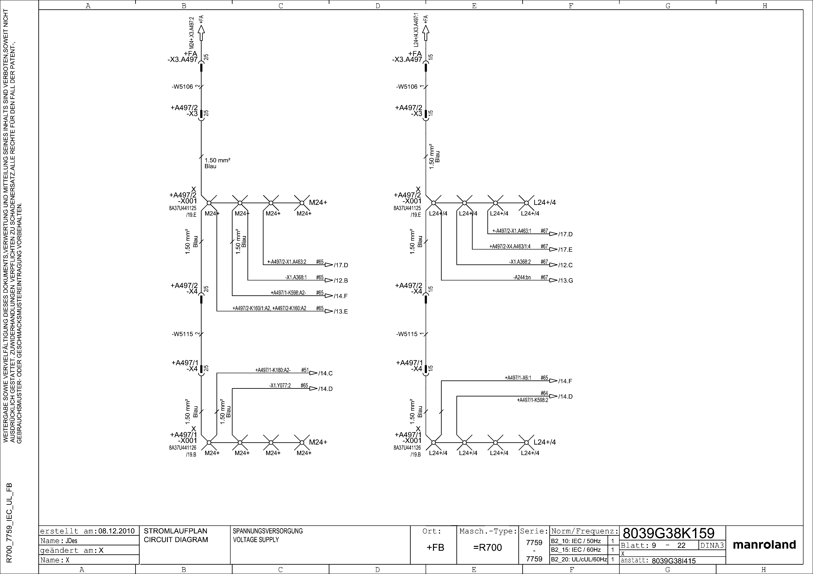

# +FB — Sheet 9 of 22 — SPANNUNGSVERSORGUNG

**VOLTAGE SUPPLY**

> Part of the manroland **R700** printing press IEC/UL circuit diagrams.
> Drawing class: **Stromlaufplan / Circuit diagram** (DIN A3).
> Document `+FB` covers the **Delivery / Coating module** machine section.

## At a glance

| Field | Value |
|---|---|
| Document | `+FB`  (8039G38K159) |
| Sheet | **9** of 22 |
| Section (DE) | SPANNUNGSVERSORGUNG |
| Section (EN) | VOLTAGE SUPPLY |
| Section type | POWER_SUPPLY — Voltage supply |
| Machine type | `=R700` |
| Series | `7759` |
| Created | 08.12.2010 |
| Replaces | `8039G38I415` |
| Columns used | B, C, D, E, F |
| Path numbers | 51, 64, 65, 67 |
| Labels on sheet | 128 |
| Cross-refs out | 16 |
| Cross-refs in | 30 |

**Previous:** [+FB sheet 8](SHEET_0008.md) · **Next:** [+FB sheet 10](SHEET_0010.md) · **Document TOC:** [_TOC.md](_TOC.md)  (+FB) · **Master TOC:** [all sheets](../_MASTER_TOC.md)

## Sheet image (300 DPI, exact vector render)



_Rendered directly from the PDF vector layer at 300 DPI (1-bit), no OCR and no resampling. Use it to confirm anything ambiguous in the text below._

## Cross-references on this sheet

Each entry is a wire leaving this sheet. The printed token is `/sheet.column`; the link resolves to that sheet inside the same document.

| Ref | Target sheet | Col | Path | Destination on target | Target section | From col |
|---|---|---|---|---|---|---|
| `/19.E` | [+FB sheet 19](SHEET_0019.md) | E | — | L24+/4 L24+/4 L24+/4 L24+/4 | KLEMMLEISTE | E |
| `/19.E` | [+FB sheet 19](SHEET_0019.md) | E | — | M24+ M24+ M24+ M24+ | KLEMMLEISTE | C |
| `/17.D` | [+FB sheet 17](SHEET_0017.md) | D | `#67` | + A497/2 X1.A463:1 | OPTION: COLORPILOT | F |
| `/17.E` | [+FB sheet 17](SHEET_0017.md) | E | `#67` | +A497/2 X4.A463/1:4 | OPTION: COLORPILOT | F |
| `/12.C` | [+FB sheet 12](SHEET_0012.md) | C | `#67` | X1.A368:2 | BEDIENUNGSEINHEIT | F |
| `/17.D` | [+FB sheet 17](SHEET_0017.md) | D | `#65` | + A497/2 X1.A463:2 | OPTION: COLORPILOT | C |
| `/12.B` | [+FB sheet 12](SHEET_0012.md) | B | `#65` | X1.A368:1 | BEDIENUNGSEINHEIT | C |
| `/13.G` | [+FB sheet 13](SHEET_0013.md) | G | `#67` | A244:bn | OPTION: NEIGUNGSEINSTELLUNG | F |
| `/14.F` | [+FB sheet 14](SHEET_0014.md) | F | `#65` | +A497/1 K598:A2 | OPTION: COLORPILOT | C |
| `/13.E` | [+FB sheet 13](SHEET_0013.md) | E | `#65` | +A497/2 K160/1:A2, +A497/2 K160:A2 | OPTION: NEIGUNGSEINSTELLUNG | C |
| `/14.C` | [+FB sheet 14](SHEET_0014.md) | C | `#51` | +A497/1 K180:A2 | OPTION: COLORPILOT | C |
| `/14.F` | [+FB sheet 14](SHEET_0014.md) | F | `#65` | +A497/1 X6:1 | OPTION: COLORPILOT | F |
| `/14.D` | [+FB sheet 14](SHEET_0014.md) | D | `#65` | X1.Y077:2 | OPTION: COLORPILOT | C |
| `/14.D` | [+FB sheet 14](SHEET_0014.md) | D | `#64` | +A497/1 K598:2 | OPTION: COLORPILOT | F |
| `/19.B` | [+FB sheet 19](SHEET_0019.md) | B | — | L24+/4 L24+/4 L24+/4 L24+/4 | KLEMMLEISTE | E |
| `/19.B` | [+FB sheet 19](SHEET_0019.md) | B | — | M24+ M24+ M24+ M24+ | KLEMMLEISTE | C |

### Incoming references (sheets that point here)

Every other sheet that sends a wire to this one. `Back-ref` is the token printed on *that* sheet; `Path` is its line number.

| From sheet | Cols | Back-ref | Path | Refs | What continues there |
|---|---|---|---|---|---|
| [+FB#12](SHEET_0012.md) | B, C | `/12.B`, `/12.C` | — | 2 | +A497/2 X001:L24+/4; +A497/2 X001:M24+ |
| [+FB#13](SHEET_0013.md) | E, G | `/13.E`, `/13.G` | `#65`, `#67` | 2 | +A497/2 X001:L24+/4; +A497/2 X001:M24+ |
| [+FB#14](SHEET_0014.md) | C, D, F | `/14.C`, `/14.D`, `/14.F` | `#51`, `#64`, `#65` | 5 | +A497/1 X001:L24+/4; +A497/1 X001:M24+; +A497/2 X001:M24+ |
| [+FB#17](SHEET_0017.md) | D, E | `/17.D`, `/17.E` | `#65`, `#67` | 3 | +A497/2 X001:L24+/4; +A497/2 X001:M24+ |
| [+FB#19](SHEET_0019.md) | B, D | `/19.B`, `/19.D` | — | 4 | X /10.A X X X X X X X X X X; X X X X X X X X X X X X X 8A37U441125 |
| [+FB#21](SHEET_0021.md) | A, B, D, E, F, G | `/21.A`, `/21.B`, `/21.D`, `/21.E`, `/21.F`, `/21.G` | — | 14 | — |


## Devices on this sheet

| Tag | Class | Class meaning (IEC) | Col | Sub | Terminal | Sign |
|---|---|---|---|---|---|---|
| `A244:bn` | A | Baugruppe / assembly, module, PC board | E | — | bn | — |
| `+A497/1` | A | Baugruppe / assembly, module, PC board | B | 1 | — | + |
| `X4` | X | Klemme / terminal, plug connector | B | — | — | — |
| `+A497/1` | A | Baugruppe / assembly, module, PC board | D | 1 | — | + |
| `X4` | X | Klemme / terminal, plug connector | D | — | — | — |
| `+A497/2` | A | Baugruppe / assembly, module, PC board | B | 2 | — | + |
| `X4` | X | Klemme / terminal, plug connector | B | — | — | — |
| `+A497/2` | A | Baugruppe / assembly, module, PC board | D | 2 | — | + |
| `X4` | X | Klemme / terminal, plug connector | D | — | — | — |
| `+A497/2` | A | Baugruppe / assembly, module, PC board | D | 2 | — | + |
| `X3` | X | Klemme / terminal, plug connector | D | — | — | — |
| `+A497/2` | A | Baugruppe / assembly, module, PC board | B | 2 | — | + |
| `X3` | X | Klemme / terminal, plug connector | B | — | — | — |
| `+A497/1` | A | Baugruppe / assembly, module, PC board | D | 1 | — | + |
| `X001` | X | Klemme / terminal, plug connector | D | — | — | — |
| `+A497/1` | A | Baugruppe / assembly, module, PC board | B | 1 | — | + |
| `X001` | X | Klemme / terminal, plug connector | B | — | — | — |
| `+A497/2` | A | Baugruppe / assembly, module, PC board | D | 2 | — | + |
| `X001` | X | Klemme / terminal, plug connector | D | — | — | — |
| `+A497/2` | A | Baugruppe / assembly, module, PC board | B | 2 | — | + |
| `X001` | X | Klemme / terminal, plug connector | B | — | — | — |
| `W5115` | W | Kabel / cable, line, bus | D | — | — | — |
| `W5115` | W | Kabel / cable, line, bus | B | — | — | — |
| `W5106` | W | Kabel / cable, line, bus | D | — | — | — |
| `W5106` | W | Kabel / cable, line, bus | B | — | — | — |
| `X1.Y077:2` | — | cross-device reference | C | — | 2 | — |
| `X1.A368:1` | — | cross-device reference | C | — | 1 | — |
| `X1.A368:2` | — | cross-device reference | E | — | 2 | — |
| `X3.A497` | — | cross-device reference | B | — | — | — |
| `X3.A497` | — | cross-device reference | D | — | — | — |

## Potentials / nets

| Potential | Count | Columns | Attached devices | Terminals |
|---|---|---|---|---|
| `L24+/4` | 11 | D, E, F | `A497`, `X3` | `1` |
| `M24+` | 11 | B, C | `A497`, `X3` | `2` |


A potential such as `L24+/4` or `M24+` is a named supply/return rail; every place it appears on this sheet is electrically common.

## Conductor data

Each label annotates **the wire beside it**, not the sheet. These summaries are inventories of what is printed; they are not a per-wire map. For a specific conductor, read the label that sits on that wire (see the label inventory below, or the sheet image).

**Cross-section labels printed on this sheet:** 1.5 mm² (×8)

**Wire-colour labels printed on this sheet:** BL = blau / blue (×8)

**Cross-section + colour appearing together in one annotation block:**

| Cross-section | Colour (DE) | Colour (EN) | Blocks containing both |
|---|---|---|---|
| 1.5 mm² | blau | blue | 8 |


_This counts annotation blocks that carry both labels. It can be lower than the number of individual labels above, because a block may hold two cross-section labels or two colour labels._

## Wire-end annotations (grouped as printed)

A wire that continues elsewhere is annotated with a small cluster: the destination description, the path/line number `#NN`, and the `/sheet.column` cross reference. Each row below is one such cluster exactly as it is grouped on the drawing.

| Col | Y | Path | Cross-ref | Text on the wire |
|---|---|---|---|---|
| D | 18.1 | — | — | `L24+/4.X3.A497:1` |
| B | 22.6 | — | — | `+FA` |
| E | 22.6 | — | — | `+FA` |
| B | 24.9 | — | — | `M24+.X3.A497:2` |
| B | 74.0 | — | — | `X3.A497 +FA` |
| D | 74.0 | — | — | `X3.A497 +FA` |
| B | 79.3 | — | — | `2/5` |
| E | 79.7 | — | — | `1/5` |
| B | 123.3 | — | — | `W5106` |
| D | 123.3 | — | — | `W5106` |
| B | 124.2 | — | — | `2` |
| D | 124.2 | — | — | `1` |
| B | 153.4 | — | — | `+A497/2` |
| D | 153.4 | — | — | `+A497/2` |
| B | 161.5 | — | — | `2/5` |
| B | 161.9 | — | — | `X3` |
| D | 161.9 | — | — | `X3` |
| E | 161.9 | — | — | `1/5` |
| E | 211.0 | — | — | `1.50 mm² Blau` |
| B | 231.2 | — | — | `1.50 mm² Blau` |
| B | 273.0 | — | — | `+A497/2 X` |
| D | 273.0 | — | — | `+A497/2 X` |
| B | 290.0 | — | — | `8A37U441125 X001` |
| D | 290.0 | — | — | `8A37U441125 X001` |
| C | 292.3 | — | — | `M24+` |
| F | 292.3 | — | — | `L24+/4` |
| C | 309.3 | — | `/19.E` | `M24+ M24+ M24+ M24+` |
| E | 309.3 | — | `/19.E` | `L24+/4 L24+/4 L24+/4 L24+/4` |
| B | 335.8 | — | — | `1.50 mm² 1.50 mm² Blau Blau` |
| C | 335.8 | — | — | `1.50 mm² Blau` |
| D | 335.8 | — | — | `1.50 mm² 1.50 mm² Blau Blau` |
| F | 335.8 | `#67` | `/17.D` | `+ A497/2 X1.A463:1` |
| F | 358.5 | `#67` | `/17.E` | `+A497/2 X4.A463/1:4` |
| C | 381.2 | `#65` | `/17.D` | `+ A497/2 X1.A463:2` |
| F | 381.2 | `#67` | `/12.C` | `X1.A368:2` |
| C | 403.8 | `#65` | `/12.B` | `X1.A368:1` |
| F | 403.9 | `#67` | `/13.G` | `A244:bn` |
| B | 414.1 | — | — | `+A497/2` |
| D | 414.1 | — | — | `+A497/2` |
| B | 419.5 | — | — | `2/5` |
| E | 419.9 | — | — | `1/5` |
| B | 422.7 | — | — | `X4` |
| D | 422.7 | — | — | `X4` |
| C | 426.6 | `#65` | `/14.F` | `+A497/1 K598:A2` |
| C | 449.2 | `#65` | `/13.E` | `+A497/2 K160/1:A2, +A497/2 K160:A2` |
| B | 486.1 | — | — | `W5115` |
| D | 486.1 | — | — | `W5115` |
| B | 487.0 | — | — | `2` |
| D | 487.1 | — | — | `1` |
| B | 527.5 | — | — | `+A497/1` |
| D | 527.5 | — | — | `+A497/1` |
| B | 535.7 | — | — | `2/5` |
| B | 536.1 | — | — | `X4` |
| D | 536.1 | — | — | `X4` |
| E | 536.1 | — | — | `1/5` |
| C | 539.8 | `#51` | `/14.C` | `+A497/1 K180:A2` |
| F | 551.2 | `#65` | `/14.F` | `+A497/1 X6:1` |
| C | 562.6 | `#65` | `/14.D` | `X1.Y077:2` |
| F | 574.0 | `#64` | `/14.D` | `+A497/1 K598:2` |
| B | 585.2 | — | — | `1.50 mm² Blau` |
| B | 624.5 | — | — | `+A497/1 X` |
| D | 624.5 | — | — | `+A497/1 X` |
| B | 641.5 | — | — | `8A37U441126 X001` |
| D | 641.5 | — | — | `8A37U441126 X001` |
| C | 643.8 | — | — | `M24+` |
| F | 643.8 | — | — | `L24+/4` |
| C | 660.8 | — | `/19.B` | `M24+ M24+ M24+ M24+` |
| E | 660.8 | — | `/19.B` | `L24+/4 L24+/4 L24+/4 L24+/4` |


## Reconstructed tables

This sheet carries tabular content (pin map / terminal assignment / index). The grid below was rebuilt from the drawing's own rule lines, so each row is exactly one physical row of the table.

### Table 1 — 2 data rows × 1 columns (at x=294.8, y=388.3)

| C1 |
|---|
| `2/5` |
| `2/5` |


## Notes and free text on this sheet

| Text | Col | Y (pt) |
|---|---|---|
| `+FA` | B | 22.55 |
| `+FA` | E | 22.55 |
| `+A497/2 K160/1:A2, +A497/2 K160:A2` | C | 449.22 |
| `+A497/1 X6:1` | E | 551.23 |
| `+A497/1 K598:A2` | C | 426.55 |
| `+A497/1 K598:2` | F | 583.86 |
| `+A497/1 K180:A2` | C | 539.93 |
| `+FA` | D | 73.99 |
| `+A497/2 X4.A463/1:4` | E | 358.51 |
| `+ A497/2 X1.A463:1` | E | 335.82 |
| `+ A497/2 X1.A463:2` | C | 381.19 |
| `8A37U441126` | D | 653.9 |
| `8A37U441126` | B | 653.9 |
| `8A37U441125` | D | 302.41 |
| `8A37U441125` | B | 302.41 |

## Complete label inventory (exact text from the drawing)

Every text object inside the drawing area of this sheet, in DIN reading order (column A→H, then top→bottom). This is the authoritative list: if a string is not here it is not printed on this sheet.

| Col | Y | X | Dir | Type | Text |
|---|---|---|---|---|---|
| B | 22.5 | 291.9 | ↕ | text | `+FA` |
| B | 24.9 | 277.7 | ↕ | potential | `M24+.X3.A497:2` |
| B | 74.0 | 269.0 | → | text | `+FA` |
| B | 79.3 | 298.9 | ↕ | pin pair | `2/5` |
| B | 82.5 | 245.5 | → | device ref | `X3.A497` |
| B | 123.3 | 251.4 | → | device tag | `W5106` |
| B | 124.2 | 286.1 | ↕ | number | `2` |
| B | 153.4 | 249.7 | → | device tag | `+A497/2` |
| B | 161.5 | 298.9 | ↕ | pin pair | `2/5` |
| B | 161.9 | 273.3 | → | device tag | `X3` |
| B | 231.2 | 299.6 | → | cross-section | `1.50 mm²` |
| B | 239.9 | 299.6 | → | wire colour | `Blau` |
| B | 273.0 | 280.1 | → | not fitted | `X` |
| B | 281.5 | 247.7 | → | device tag | `+A497/2` |
| B | 290.0 | 260.8 | → | device tag | `X001` |
| B | 302.4 | 247.8 | → | text | `8A37U441125` |
| B | 309.3 | 299.9 | → | potential | `M24+` |
| B | 312.3 | 272.9 | → | cross-reference | `/19.E` |
| B | 335.8 | 270.9 | ↕ | cross-section | `1.50 mm²` |
| B | 345.8 | 282.4 | ↕ | wire colour | `Blau` |
| B | 414.2 | 249.7 | → | device tag | `+A497/2` |
| B | 419.5 | 298.9 | ↕ | pin pair | `2/5` |
| B | 422.7 | 273.3 | → | device tag | `X4` |
| B | 486.1 | 251.4 | → | device tag | `W5115` |
| B | 487.0 | 286.1 | ↕ | number | `2` |
| B | 527.5 | 251.1 | → | device tag | `+A497/1` |
| B | 535.7 | 298.9 | ↕ | pin pair | `2/5` |
| B | 536.1 | 273.3 | → | device tag | `X4` |
| B | 585.2 | 270.9 | ↕ | cross-section | `1.50 mm²` |
| B | 585.2 | 322.0 | ↕ | cross-section | `1.50 mm²` |
| B | 595.3 | 282.4 | ↕ | wire colour | `Blau` |
| B | 595.3 | 330.6 | ↕ | wire colour | `Blau` |
| B | 624.5 | 280.1 | → | not fitted | `X` |
| B | 633.0 | 249.2 | → | device tag | `+A497/1` |
| B | 641.5 | 260.8 | → | device tag | `X001` |
| B | 653.9 | 247.8 | → | text | `8A37U441126` |
| B | 660.8 | 299.9 | → | potential | `M24+` |
| B | 663.8 | 272.7 | → | cross-reference | `/19.B` |
| C | 292.3 | 452.7 | → | potential | `M24+` |
| C | 309.3 | 343.8 | → | potential | `M24+` |
| C | 309.3 | 389.2 | → | potential | `M24+` |
| C | 309.3 | 434.6 | → | potential | `M24+` |
| C | 335.8 | 344.6 | ↕ | cross-section | `1.50 mm²` |
| C | 345.8 | 353.2 | ↕ | wire colour | `Blau` |
| C | 381.2 | 391.6 | → | text | `+ A497/2 X1.A463:2` |
| C | 381.2 | 463.3 | → | path no. | `#65` |
| C | 403.8 | 417.8 | → | device ref | `X1.A368:1` |
| C | 403.9 | 463.3 | → | path no. | `#65` |
| C | 426.5 | 396.7 | → | text | `+A497/1 K598:A2` |
| C | 426.6 | 463.3 | → | path no. | `#65` |
| C | 449.2 | 340.7 | → | text | `+A497/2 K160/1:A2, +A497/2 K160:A2` |
| C | 449.2 | 463.3 | → | path no. | `#65` |
| C | 539.8 | 441.7 | → | path no. | `#51` |
| C | 539.9 | 374.0 | → | text | `+A497/1 K180:A2` |
| C | 543.8 | 466.3 | → | cross-reference | `/14.C` |
| C | 562.6 | 394.3 | → | device ref | `X1.Y077:2` |
| C | 562.6 | 440.6 | → | path no. | `#65` |
| C | 566.5 | 466.3 | → | cross-reference | `/14.D` |
| C | 643.8 | 452.7 | → | potential | `M24+` |
| C | 660.8 | 343.8 | → | potential | `M24+` |
| C | 660.8 | 389.2 | → | potential | `M24+` |
| C | 660.8 | 434.6 | → | potential | `M24+` |
| D | 18.1 | 606.5 | ↕ | potential | `L24+/4.X3.A497:1` |
| D | 74.0 | 597.8 | → | text | `+FA` |
| D | 82.5 | 574.3 | → | device ref | `X3.A497` |
| D | 123.3 | 580.3 | → | device tag | `W5106` |
| D | 124.2 | 614.5 | ↕ | number | `1` |
| D | 153.4 | 578.6 | → | device tag | `+A497/2` |
| D | 161.9 | 602.1 | → | device tag | `X3` |
| D | 273.0 | 608.9 | → | not fitted | `X` |
| D | 281.5 | 576.6 | → | device tag | `+A497/2` |
| D | 290.0 | 589.6 | → | device tag | `X001` |
| D | 302.4 | 576.6 | → | text | `8A37U441125` |
| D | 312.3 | 601.7 | → | cross-reference | `/19.E` |
| D | 335.8 | 599.8 | ↕ | cross-section | `1.50 mm²` |
| D | 345.8 | 611.2 | ↕ | wire colour | `Blau` |
| D | 385.1 | 489.0 | → | cross-reference | `/17.D` |
| D | 407.7 | 489.0 | → | cross-reference | `/12.B` |
| D | 414.2 | 578.6 | → | device tag | `+A497/2` |
| D | 422.7 | 602.1 | → | device tag | `X4` |
| D | 430.4 | 489.0 | → | cross-reference | `/14.F` |
| D | 453.1 | 489.0 | → | cross-reference | `/13.E` |
| D | 486.1 | 580.3 | → | device tag | `W5115` |
| D | 487.1 | 614.5 | ↕ | number | `1` |
| D | 527.5 | 580.0 | → | device tag | `+A497/1` |
| D | 536.1 | 602.1 | → | device tag | `X4` |
| D | 585.2 | 599.8 | ↕ | cross-section | `1.50 mm²` |
| D | 595.3 | 611.2 | ↕ | wire colour | `Blau` |
| D | 624.5 | 608.9 | → | not fitted | `X` |
| D | 633.0 | 578.0 | → | device tag | `+A497/1` |
| D | 641.5 | 589.6 | → | device tag | `X001` |
| D | 653.9 | 576.6 | → | text | `8A37U441126` |
| D | 663.8 | 601.5 | → | cross-reference | `/19.B` |
| E | 22.5 | 620.7 | ↕ | text | `+FA` |
| E | 79.7 | 627.7 | ↕ | pin pair | `1/5` |
| E | 161.9 | 627.7 | ↕ | pin pair | `1/5` |
| E | 211.0 | 628.1 | ↕ | cross-section | `1.50 mm²` |
| E | 221.1 | 636.7 | ↕ | wire colour | `Blau` |
| E | 309.3 | 628.4 | → | potential | `L24+/4` |
| E | 309.3 | 672.4 | → | potential | `L24+/4` |
| E | 309.3 | 717.7 | → | potential | `L24+/4` |
| E | 335.8 | 721.3 | → | text | `+ A497/2 X1.A463:1` |
| E | 358.5 | 717.0 | → | text | `+A497/2 X4.A463/1:4` |
| E | 381.2 | 745.8 | → | device ref | `X1.A368:2` |
| E | 403.9 | 751.9 | → | device tag | `A244:bn` |
| E | 419.9 | 627.7 | ↕ | pin pair | `1/5` |
| E | 536.1 | 627.7 | ↕ | pin pair | `1/5` |
| E | 551.2 | 739.6 | → | text | `+A497/1 X6:1` |
| E | 660.8 | 628.4 | → | potential | `L24+/4` |
| E | 660.8 | 672.4 | → | potential | `L24+/4` |
| E | 660.8 | 717.7 | → | potential | `L24+/4` |
| F | 292.3 | 781.5 | → | potential | `L24+/4` |
| F | 309.3 | 763.1 | → | potential | `L24+/4` |
| F | 335.9 | 792.1 | → | path no. | `#67` |
| F | 339.7 | 817.8 | → | cross-reference | `/17.D` |
| F | 358.5 | 792.1 | → | path no. | `#67` |
| F | 362.4 | 817.8 | → | cross-reference | `/17.E` |
| F | 381.2 | 792.1 | → | path no. | `#67` |
| F | 385.1 | 817.8 | → | cross-reference | `/12.C` |
| F | 403.9 | 792.1 | → | path no. | `#67` |
| F | 407.8 | 817.8 | → | cross-reference | `/13.G` |
| F | 551.3 | 792.1 | → | path no. | `#65` |
| F | 555.1 | 817.8 | → | cross-reference | `/14.F` |
| F | 574.0 | 792.1 | → | path no. | `#64` |
| F | 577.8 | 817.8 | → | cross-reference | `/14.D` |
| F | 583.9 | 757.4 | → | text | `+A497/1 K598:2` |
| F | 643.8 | 781.5 | → | potential | `L24+/4` |
| F | 660.8 | 763.1 | → | potential | `L24+/4` |

## Reading-order text block

The same content as a plain block, grouped by DIN column — convenient to paste or to match against a visual description.

```text
=== Column B ===
  22.5  291.9  text         +FA
  24.9  277.7  net          M24+.X3.A497:2
  74.0  269.0  text         +FA
  79.3  298.9  pinpair      2/5
  82.5  245.5  devref       X3.A497
 123.3  251.4  devtag       W5106
 124.2  286.1  numeric      2
 153.4  249.7  devtag       +A497/2
 161.5  298.9  pinpair      2/5
 161.9  273.3  devtag       X3
 231.2  299.6  xsection     1.50 mm²
 239.9  299.6  colour       Blau
 273.0  280.1  placeholder  X
 281.5  247.7  devtag       +A497/2
 290.0  260.8  devtag       X001
 302.4  247.8  text         8A37U441125
 309.3  299.9  net          M24+
 312.3  272.9  xref         /19.E
 335.8  270.9  xsection     1.50 mm²
 345.8  282.4  colour       Blau
 414.2  249.7  devtag       +A497/2
 419.5  298.9  pinpair      2/5
 422.7  273.3  devtag       X4
 486.1  251.4  devtag       W5115
 487.0  286.1  numeric      2
 527.5  251.1  devtag       +A497/1
 535.7  298.9  pinpair      2/5
 536.1  273.3  devtag       X4
 585.2  270.9  xsection     1.50 mm²
 585.2  322.0  xsection     1.50 mm²
 595.3  282.4  colour       Blau
 595.3  330.6  colour       Blau
 624.5  280.1  placeholder  X
 633.0  249.2  devtag       +A497/1
 641.5  260.8  devtag       X001
 653.9  247.8  text         8A37U441126
 660.8  299.9  net          M24+
 663.8  272.7  xref         /19.B
=== Column C ===
 292.3  452.7  net          M24+
 309.3  343.8  net          M24+
 309.3  389.2  net          M24+
 309.3  434.6  net          M24+
 335.8  344.6  xsection     1.50 mm²
 345.8  353.2  colour       Blau
 381.2  391.6  text         + A497/2 X1.A463:2
 381.2  463.3  path         #65
 403.8  417.8  devref       X1.A368:1
 403.9  463.3  path         #65
 426.5  396.7  text         +A497/1 K598:A2
 426.6  463.3  path         #65
 449.2  340.7  text         +A497/2 K160/1:A2, +A497/2 K160:A2
 449.2  463.3  path         #65
 539.8  441.7  path         #51
 539.9  374.0  text         +A497/1 K180:A2
 543.8  466.3  xref         /14.C
 562.6  394.3  devref       X1.Y077:2
 562.6  440.6  path         #65
 566.5  466.3  xref         /14.D
 643.8  452.7  net          M24+
 660.8  343.8  net          M24+
 660.8  389.2  net          M24+
 660.8  434.6  net          M24+
=== Column D ===
  18.1  606.5  net          L24+/4.X3.A497:1
  74.0  597.8  text         +FA
  82.5  574.3  devref       X3.A497
 123.3  580.3  devtag       W5106
 124.2  614.5  numeric      1
 153.4  578.6  devtag       +A497/2
 161.9  602.1  devtag       X3
 273.0  608.9  placeholder  X
 281.5  576.6  devtag       +A497/2
 290.0  589.6  devtag       X001
 302.4  576.6  text         8A37U441125
 312.3  601.7  xref         /19.E
 335.8  599.8  xsection     1.50 mm²
 345.8  611.2  colour       Blau
 385.1  489.0  xref         /17.D
 407.7  489.0  xref         /12.B
 414.2  578.6  devtag       +A497/2
 422.7  602.1  devtag       X4
 430.4  489.0  xref         /14.F
 453.1  489.0  xref         /13.E
 486.1  580.3  devtag       W5115
 487.1  614.5  numeric      1
 527.5  580.0  devtag       +A497/1
 536.1  602.1  devtag       X4
 585.2  599.8  xsection     1.50 mm²
 595.3  611.2  colour       Blau
 624.5  608.9  placeholder  X
 633.0  578.0  devtag       +A497/1
 641.5  589.6  devtag       X001
 653.9  576.6  text         8A37U441126
 663.8  601.5  xref         /19.B
=== Column E ===
  22.5  620.7  text         +FA
  79.7  627.7  pinpair      1/5
 161.9  627.7  pinpair      1/5
 211.0  628.1  xsection     1.50 mm²
 221.1  636.7  colour       Blau
 309.3  628.4  net          L24+/4
 309.3  672.4  net          L24+/4
 309.3  717.7  net          L24+/4
 335.8  721.3  text         + A497/2 X1.A463:1
 358.5  717.0  text         +A497/2 X4.A463/1:4
 381.2  745.8  devref       X1.A368:2
 403.9  751.9  devtag       A244:bn
 419.9  627.7  pinpair      1/5
 536.1  627.7  pinpair      1/5
 551.2  739.6  text         +A497/1 X6:1
 660.8  628.4  net          L24+/4
 660.8  672.4  net          L24+/4
 660.8  717.7  net          L24+/4
=== Column F ===
 292.3  781.5  net          L24+/4
 309.3  763.1  net          L24+/4
 335.9  792.1  path         #67
 339.7  817.8  xref         /17.D
 358.5  792.1  path         #67
 362.4  817.8  xref         /17.E
 381.2  792.1  path         #67
 385.1  817.8  xref         /12.C
 403.9  792.1  path         #67
 407.8  817.8  xref         /13.G
 551.3  792.1  path         #65
 555.1  817.8  xref         /14.F
 574.0  792.1  path         #64
 577.8  817.8  xref         /14.D
 583.9  757.4  text         +A497/1 K598:2
 643.8  781.5  net          L24+/4
 660.8  763.1  net          L24+/4
```

---
_Generated from the PDF vector text layer; no OCR. Source: `R700_7759_IEC_UL_FB`, sheet 9._
