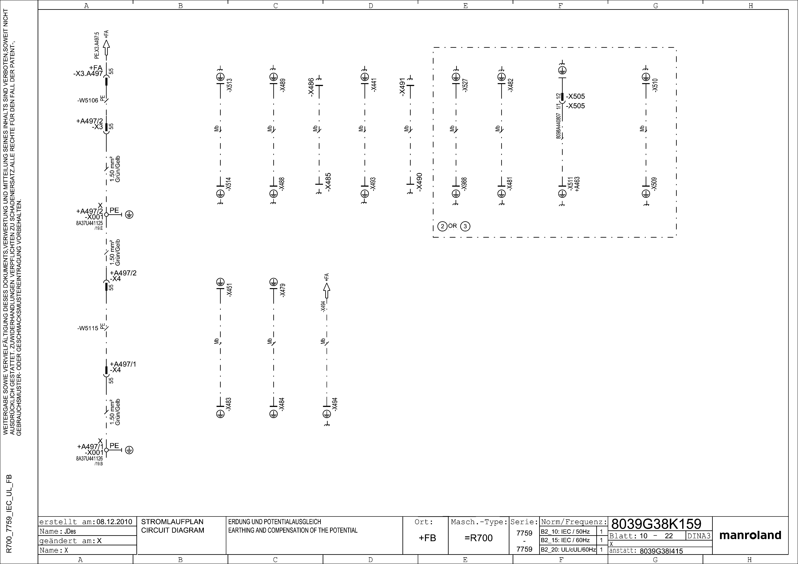

# +FB — Sheet 10 of 22 — ERDUNG UND POTENTIALAUSGLEICH

**EARTHING AND COMPENSATION OF THE POTENTIAL**

> Part of the manroland **R700** printing press IEC/UL circuit diagrams.
> Drawing class: **Stromlaufplan / Circuit diagram** (DIN A3).
> Document `+FB` covers the **Delivery / Coating module** machine section.

## At a glance

| Field | Value |
|---|---|
| Document | `+FB`  (8039G38K159) |
| Sheet | **10** of 22 |
| Section (DE) | ERDUNG UND POTENTIALAUSGLEICH |
| Section (EN) | EARTHING AND COMPENSATION OF THE POTENTIAL |
| Section type | EARTHING — Earthing / potential compensation |
| Machine type | `=R700` |
| Series | `7759` |
| Created | 08.12.2010 |
| Replaces | `8039G38I415` |
| Columns used | A, B, C, D, E, F, G |
| Path numbers | — |
| Labels on sheet | 80 |
| Cross-refs out | 2 |
| Cross-refs in | 10 |

**Previous:** [+FB sheet 9](SHEET_0009.md) · **Next:** [+FB sheet 11](SHEET_0011.md) · **Document TOC:** [_TOC.md](_TOC.md)  (+FB) · **Master TOC:** [all sheets](../_MASTER_TOC.md)

## Sheet image (300 DPI, exact vector render)



_Rendered directly from the PDF vector layer at 300 DPI (1-bit), no OCR and no resampling. Use it to confirm anything ambiguous in the text below._

## Cross-references on this sheet

Each entry is a wire leaving this sheet. The printed token is `/sheet.column`; the link resolves to that sheet inside the same document.

| Ref | Target sheet | Col | Path | Destination on target | Target section | From col |
|---|---|---|---|---|---|---|
| `/19.E` | [+FB sheet 19](SHEET_0019.md) | E | — | OR 2 3 | KLEMMLEISTE | C |
| `/19.B` | [+FB sheet 19](SHEET_0019.md) | B | — | — | KLEMMLEISTE | A |

### Incoming references (sheets that point here)

Every other sheet that sends a wire to this one. `Back-ref` is the token printed on *that* sheet; `Path` is its line number.

| From sheet | Cols | Back-ref | Path | Refs | What continues there |
|---|---|---|---|---|---|
| [+FB#19](SHEET_0019.md) | D | `/19.D` | — | 1 | X X X X X X X X X X X X X 8A37U441125 |
| [+FB#21](SHEET_0021.md) | A, B, D, E, F, G | `/21.A`, `/21.B`, `/21.D`, `/21.E`, `/21.F`, `/21.G` | — | 7 | X; X X |
| [+FB#22](SHEET_0022.md) | A, B | `/22.A`, `/22.B` | — | 2 | — |


## Devices on this sheet

| Tag | Class | Class meaning (IEC) | Col | Sub | Terminal | Sign |
|---|---|---|---|---|---|---|
| `+A497/1` | A | Baugruppe / assembly, module, PC board | A | 1 | — | + |
| `X4` | X | Klemme / terminal, plug connector | A | — | — | — |
| `X514` | X | Klemme / terminal, plug connector | C | — | — | — |
| `X513` | X | Klemme / terminal, plug connector | C | — | — | — |
| `X489` | X | Klemme / terminal, plug connector | C | — | — | — |
| `X488` | X | Klemme / terminal, plug connector | C | — | — | — |
| `X486` | X | Klemme / terminal, plug connector | C | — | — | — |
| `X485` | X | Klemme / terminal, plug connector | D | — | — | — |
| `X441` | X | Klemme / terminal, plug connector | D | — | — | — |
| `X493` | X | Klemme / terminal, plug connector | D | — | — | — |
| `X491` | X | Klemme / terminal, plug connector | D | — | — | — |
| `X490` | X | Klemme / terminal, plug connector | E | — | — | — |
| `X988` | X | Klemme / terminal, plug connector | E | — | — | — |
| `X527` | X | Klemme / terminal, plug connector | E | — | — | — |
| `X482` | X | Klemme / terminal, plug connector | E | — | — | — |
| `X481` | X | Klemme / terminal, plug connector | E | — | — | — |
| `X509` | X | Klemme / terminal, plug connector | G | — | — | — |
| `X510` | X | Klemme / terminal, plug connector | G | — | — | — |
| `X511` | X | Klemme / terminal, plug connector | F | — | — | — |
| `+A463` | A | Baugruppe / assembly, module, PC board | F | — | — | + |
| `X505` | X | Klemme / terminal, plug connector | F | — | — | — |
| `X505` | X | Klemme / terminal, plug connector | F | — | — | — |
| `X483` | X | Klemme / terminal, plug connector | C | — | — | — |
| `X484` | X | Klemme / terminal, plug connector | C | — | — | — |
| `X451` | X | Klemme / terminal, plug connector | C | — | — | — |
| `X479` | X | Klemme / terminal, plug connector | C | — | — | — |
| `X494` | X | Klemme / terminal, plug connector | D | — | — | — |
| `X494` | X | Klemme / terminal, plug connector | D | — | — | — |
| `+A497/2` | A | Baugruppe / assembly, module, PC board | A | 2 | — | + |
| `X4` | X | Klemme / terminal, plug connector | A | — | — | — |
| `+A497/2` | A | Baugruppe / assembly, module, PC board | A | 2 | — | + |
| `X3` | X | Klemme / terminal, plug connector | A | — | — | — |
| `+A497/1` | A | Baugruppe / assembly, module, PC board | A | 1 | — | + |
| `X001` | X | Klemme / terminal, plug connector | A | — | — | — |
| `+A497/2` | A | Baugruppe / assembly, module, PC board | A | 2 | — | + |
| `X001` | X | Klemme / terminal, plug connector | A | — | — | — |
| `W5106` | W | Kabel / cable, line, bus | A | — | — | — |
| `W5115` | W | Kabel / cable, line, bus | A | — | — | — |
| `X3.A497` | — | cross-device reference | A | — | — | — |

## Potentials / nets

| Potential | Count | Columns | Attached devices | Terminals |
|---|---|---|---|---|
| `PE` | 5 | A | `A497`, `X3` | `5` |


A potential such as `L24+/4` or `M24+` is a named supply/return rail; every place it appears on this sheet is electrically common.

## Conductor data

Each label annotates **the wire beside it**, not the sheet. These summaries are inventories of what is printed; they are not a per-wire map. For a specific conductor, read the label that sits on that wire (see the label inventory below, or the sheet image).

**Cross-section labels printed on this sheet:** 1.5 mm² (×3)

## Wire-end annotations (grouped as printed)

A wire that continues elsewhere is annotated with a small cluster: the destination description, the path/line number `#NN`, and the `/sheet.column` cross reference. Each row below is one such cluster exactly as it is grouped on the drawing.

| Col | Y | Path | Cross-ref | Text on the wire |
|---|---|---|---|---|
| A | 45.2 | — | — | `+FA` |
| A | 47.9 | — | — | `PE.X3.A497:5` |
| A | 96.7 | — | — | `X3.A497 +FA` |
| A | 102.0 | — | — | `5/5` |
| D | 115.4 | — | — | `X491` |
| C | 116.1 | — | — | `X486` |
| D | 116.3 | — | — | `X493 X441` |
| C | 117.2 | — | — | `X514 X513` |
| C | 117.2 | — | — | `X488 X489` |
| E | 117.2 | — | — | `X988 X527` |
| E | 117.2 | — | — | `X481 X482` |
| G | 117.2 | — | — | `X509 X510` |
| F | 139.2 | — | — | `1/2` |
| F | 139.2 | — | — | `X505` |
| A | 142.2 | — | — | `PE` |
| A | 145.9 | — | — | `W5106` |
| F | 153.4 | — | — | `X505` |
| F | 154.2 | — | — | `1/1` |
| F | 168.6 | — | — | `8098A440807` |
| A | 176.0 | — | — | `+A497/2` |
| A | 184.2 | — | — | `5/5 5/5` |
| A | 184.6 | — | — | `X3` |
| B | 187.5 | — | — | `Mb Mb` |
| C | 187.5 | — | — | `Mb` |
| C | 187.5 | — | — | `Mb` |
| D | 187.5 | — | — | `Mb` |
| D | 187.5 | — | — | `Mb` |
| E | 187.5 | — | — | `Mb` |
| E | 187.5 | — | — | `Mb` |
| G | 187.5 | — | — | `Mb` |
| A | 232.3 | — | — | `1.50 mm² Grün/Gelb` |
| D | 257.8 | — | — | `X485` |
| E | 257.8 | — | — | `X490` |
| F | 263.7 | — | — | `X511` |
| F | 263.7 | — | — | `+A463` |
| A | 302.2 | — | — | `+A497/2 X` |
| A | 309.3 | — | — | `PE` |
| A | 319.2 | — | — | `8A37U441125 X001` |
| C | 333.4 | — | `/19.E` | `2 OR 3` |
| A | 357.0 | — | — | `1.50 mm² Grün/Gelb` |
| A | 402.8 | — | — | `+A497/2 X4` |
| D | 408.1 | — | — | `X494 +FA` |
| C | 422.5 | — | — | `X451` |
| C | 423.4 | — | — | `X479` |
| A | 482.4 | — | — | `PE` |
| A | 486.1 | — | — | `W5115` |
| C | 504.9 | — | — | `Mb` |
| D | 504.9 | — | — | `Mb` |
| A | 538.9 | — | — | `+A497/1 X4` |
| A | 563.8 | — | — | `5/5` |
| C | 593.5 | — | — | `X483` |
| C | 593.5 | — | — | `X484` |
| D | 593.5 | — | — | `X494` |
| A | 595.1 | — | — | `1.50 mm² Grün/Gelb` |
| A | 653.7 | — | — | `+A497/1 X` |
| A | 660.8 | — | — | `PE` |
| A | 670.7 | — | — | `8A37U441126 X001` |
| A | 689.8 | — | `/19.B` | — |


## Device order codes printed on this sheet

> **These are NOT device part numbers and must not be attributed to a single device.** They are order/manufacturing codes that sit inside the same annotation cluster as a device, with no printed label and no leader line binding them to one item. Measured across the whole set: such codes appear on **8 of 1,351 sheets** (see `01_SYSTEM/A_HOW_TO_READ.md` §8.1).

| Token | Col | Y (pt) | What it is |
|---|---|---|---|
| `8098A440807` | F | 168.6 | order code |


## Notes and free text on this sheet

| Text | Col | Y (pt) |
|---|---|---|
| `+FA` | A | 45.22 |
| `+FA` | D | 408.06 |
| `8A37U441126` | A | 681.68 |
| `8A37U441125` | A | 330.19 |
| `OR` | E | 333.38 |
| `Grün/Gelb` | A | 232.3 |
| `Mb` | B | 187.46 |
| `Mb` | C | 504.94 |
| `Mb` | G | 187.46 |
| `Mb` | D | 187.46 |
| `Mb` | E | 187.46 |

## Complete label inventory (exact text from the drawing)

Every text object inside the drawing area of this sheet, in DIN reading order (column A→H, then top→bottom). This is the authoritative list: if a string is not here it is not printed on this sheet.

| Col | Y | X | Dir | Type | Text |
|---|---|---|---|---|---|
| A | 45.2 | 155.8 | ↕ | text | `+FA` |
| A | 47.9 | 141.6 | ↕ | potential | `PE.X3.A497:5` |
| A | 96.7 | 132.9 | → | text | `+FA` |
| A | 102.0 | 162.9 | ↕ | pin pair | `5/5` |
| A | 105.2 | 109.4 | → | device ref | `X3.A497` |
| A | 142.2 | 150.0 | ↕ | potential | `PE` |
| A | 145.9 | 115.4 | → | device tag | `W5106` |
| A | 176.0 | 113.7 | → | device tag | `+A497/2` |
| A | 184.2 | 162.9 | ↕ | pin pair | `5/5` |
| A | 184.6 | 137.2 | → | device tag | `X3` |
| A | 232.3 | 171.8 | ↕ | text | `Grün/Gelb` |
| A | 233.7 | 163.2 | ↕ | cross-section | `1.50 mm²` |
| A | 302.2 | 146.0 | → | not fitted | `X` |
| A | 309.3 | 163.6 | → | potential | `PE` |
| A | 310.7 | 113.7 | → | device tag | `+A497/2` |
| A | 319.2 | 126.7 | → | device tag | `X001` |
| A | 330.2 | 113.7 | → | text | `8A37U441125` |
| A | 338.3 | 141.4 | → | cross-reference | `/19.E` |
| A | 357.0 | 171.8 | ↕ | text | `Grün/Gelb` |
| A | 358.4 | 163.2 | ↕ | cross-section | `1.50 mm²` |
| A | 402.8 | 163.8 | → | device tag | `+A497/2` |
| A | 411.3 | 164.1 | → | device tag | `X4` |
| A | 424.9 | 162.9 | ↕ | pin pair | `5/5` |
| A | 482.4 | 150.0 | ↕ | potential | `PE` |
| A | 486.1 | 115.4 | → | device tag | `W5115` |
| A | 538.9 | 163.8 | → | device tag | `+A497/1` |
| A | 547.4 | 164.1 | → | device tag | `X4` |
| A | 563.8 | 162.9 | ↕ | pin pair | `5/5` |
| A | 595.1 | 171.8 | ↕ | text | `Grün/Gelb` |
| A | 596.6 | 163.2 | ↕ | cross-section | `1.50 mm²` |
| A | 653.7 | 146.0 | → | not fitted | `X` |
| A | 660.8 | 163.6 | → | potential | `PE` |
| A | 662.2 | 115.1 | → | device tag | `+A497/1` |
| A | 670.7 | 126.7 | → | device tag | `X001` |
| A | 681.7 | 113.7 | → | text | `8A37U441126` |
| A | 689.8 | 141.4 | → | cross-reference | `/19.B` |
| B | 187.5 | 320.2 | ↕ | text | `Mb` |
| B | 504.9 | 320.2 | ↕ | text | `Mb` |
| C | 116.1 | 459.5 | ↕ | device tag | `X486` |
| C | 117.2 | 338.9 | ↕ | device tag | `X513` |
| C | 117.2 | 418.2 | ↕ | device tag | `X489` |
| C | 187.5 | 399.6 | ↕ | text | `Mb` |
| C | 187.5 | 467.6 | ↕ | text | `Mb` |
| C | 264.6 | 337.5 | ↕ | device tag | `X514` |
| C | 264.6 | 416.8 | ↕ | device tag | `X488` |
| C | 422.5 | 338.8 | ↕ | device tag | `X451` |
| C | 423.4 | 418.2 | ↕ | device tag | `X479` |
| C | 504.9 | 399.6 | ↕ | text | `Mb` |
| C | 593.5 | 337.5 | ↕ | device tag | `X483` |
| C | 593.5 | 416.8 | ↕ | device tag | `X484` |
| D | 115.4 | 595.6 | ↕ | device tag | `X491` |
| D | 116.3 | 554.2 | ↕ | device tag | `X441` |
| D | 187.5 | 535.7 | ↕ | text | `Mb` |
| D | 187.5 | 603.7 | ↕ | text | `Mb` |
| D | 257.8 | 485.0 | ↕ | device tag | `X485` |
| D | 264.6 | 552.9 | ↕ | device tag | `X493` |
| D | 408.1 | 484.6 | ↕ | text | `+FA` |
| D | 449.3 | 479.3 | ↕ | device tag | `X494` |
| D | 504.9 | 479.0 | ↕ | text | `Mb` |
| D | 593.5 | 496.2 | ↕ | device tag | `X494` |
| E | 117.2 | 690.4 | ↕ | device tag | `X527` |
| E | 117.2 | 758.4 | ↕ | device tag | `X482` |
| E | 187.5 | 671.7 | ↕ | text | `Mb` |
| E | 187.5 | 739.8 | ↕ | text | `Mb` |
| E | 257.8 | 621.1 | ↕ | device tag | `X490` |
| E | 263.7 | 756.9 | ↕ | device tag | `X481` |
| E | 264.6 | 689.0 | ↕ | device tag | `X988` |
| E | 333.4 | 668.7 | → | text | `OR` |
| E | 333.9 | 657.9 | → | number | `2` |
| E | 333.9 | 691.8 | → | number | `3` |
| F | 139.2 | 830.4 | ↕ | pin pair | `1/2` |
| F | 139.2 | 844.4 | → | device tag | `X505` |
| F | 153.4 | 844.4 | → | device tag | `X505` |
| F | 154.2 | 830.2 | ↕ | pin pair | `1/1` |
| F | 168.6 | 830.5 | ↕ | ordercode | `8098A440807` |
| F | 263.7 | 847.6 | ↕ | device tag | `X511` |
| F | 263.7 | 857.6 | ↕ | device tag | `+A463` |
| G | 117.2 | 973.8 | ↕ | device tag | `X510` |
| G | 187.5 | 955.2 | ↕ | text | `Mb` |
| G | 264.6 | 972.4 | ↕ | device tag | `X509` |

## Reading-order text block

The same content as a plain block, grouped by DIN column — convenient to paste or to match against a visual description.

```text
=== Column A ===
  45.2  155.8  text         +FA
  47.9  141.6  net          PE.X3.A497:5
  96.7  132.9  text         +FA
 102.0  162.9  pinpair      5/5
 105.2  109.4  devref       X3.A497
 142.2  150.0  net          PE
 145.9  115.4  devtag       W5106
 176.0  113.7  devtag       +A497/2
 184.2  162.9  pinpair      5/5
 184.6  137.2  devtag       X3
 232.3  171.8  text         Grün/Gelb
 233.7  163.2  xsection     1.50 mm²
 302.2  146.0  placeholder  X
 309.3  163.6  net          PE
 310.7  113.7  devtag       +A497/2
 319.2  126.7  devtag       X001
 330.2  113.7  text         8A37U441125
 338.3  141.4  xref         /19.E
 357.0  171.8  text         Grün/Gelb
 358.4  163.2  xsection     1.50 mm²
 402.8  163.8  devtag       +A497/2
 411.3  164.1  devtag       X4
 424.9  162.9  pinpair      5/5
 482.4  150.0  net          PE
 486.1  115.4  devtag       W5115
 538.9  163.8  devtag       +A497/1
 547.4  164.1  devtag       X4
 563.8  162.9  pinpair      5/5
 595.1  171.8  text         Grün/Gelb
 596.6  163.2  xsection     1.50 mm²
 653.7  146.0  placeholder  X
 660.8  163.6  net          PE
 662.2  115.1  devtag       +A497/1
 670.7  126.7  devtag       X001
 681.7  113.7  text         8A37U441126
 689.8  141.4  xref         /19.B
=== Column B ===
 187.5  320.2  text         Mb
 504.9  320.2  text         Mb
=== Column C ===
 116.1  459.5  devtag       X486
 117.2  338.9  devtag       X513
 117.2  418.2  devtag       X489
 187.5  399.6  text         Mb
 187.5  467.6  text         Mb
 264.6  337.5  devtag       X514
 264.6  416.8  devtag       X488
 422.5  338.8  devtag       X451
 423.4  418.2  devtag       X479
 504.9  399.6  text         Mb
 593.5  337.5  devtag       X483
 593.5  416.8  devtag       X484
=== Column D ===
 115.4  595.6  devtag       X491
 116.3  554.2  devtag       X441
 187.5  535.7  text         Mb
 187.5  603.7  text         Mb
 257.8  485.0  devtag       X485
 264.6  552.9  devtag       X493
 408.1  484.6  text         +FA
 449.3  479.3  devtag       X494
 504.9  479.0  text         Mb
 593.5  496.2  devtag       X494
=== Column E ===
 117.2  690.4  devtag       X527
 117.2  758.4  devtag       X482
 187.5  671.7  text         Mb
 187.5  739.8  text         Mb
 257.8  621.1  devtag       X490
 263.7  756.9  devtag       X481
 264.6  689.0  devtag       X988
 333.4  668.7  text         OR
 333.9  657.9  numeric      2
 333.9  691.8  numeric      3
=== Column F ===
 139.2  830.4  pinpair      1/2
 139.2  844.4  devtag       X505
 153.4  844.4  devtag       X505
 154.2  830.2  pinpair      1/1
 168.6  830.5  ordercode    8098A440807
 263.7  847.6  devtag       X511
 263.7  857.6  devtag       +A463
=== Column G ===
 117.2  973.8  devtag       X510
 187.5  955.2  text         Mb
 264.6  972.4  devtag       X509
```

---
_Generated from the PDF vector text layer; no OCR. Source: `R700_7759_IEC_UL_FB`, sheet 10._
