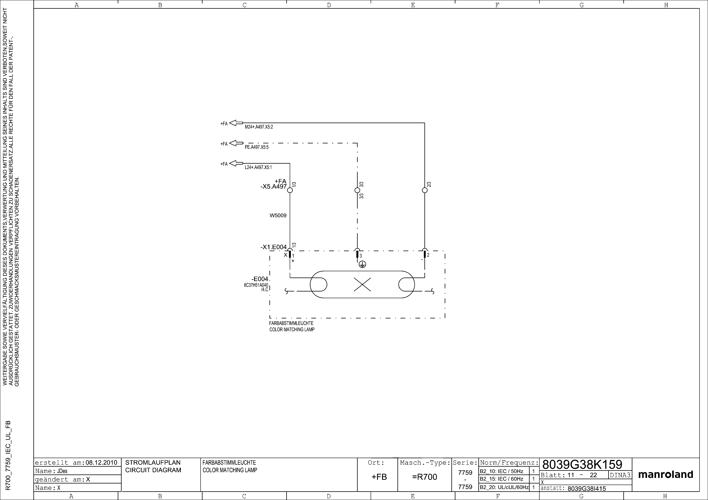

# +FB — Sheet 11 of 22 — FARBABSTIMMLEUCHTE

**COLOR MATCHING LAMP**

> Part of the manroland **R700** printing press IEC/UL circuit diagrams.
> Drawing class: **Stromlaufplan / Circuit diagram** (DIN A3).
> Document `+FB` covers the **Delivery / Coating module** machine section.

## At a glance

| Field | Value |
|---|---|
| Document | `+FB`  (8039G38K159) |
| Sheet | **11** of 22 |
| Section (DE) | FARBABSTIMMLEUCHTE |
| Section (EN) | COLOR MATCHING LAMP |
| Section type | LIGHTING — Colour matching lamp |
| Machine type | `=R700` |
| Series | `7759` |
| Created | 08.12.2010 |
| Replaces | `8039G38I415` |
| Columns used | C, D, E |
| Path numbers | — |
| Labels on sheet | 25 |
| Cross-refs out | 1 |
| Cross-refs in | 10 |

**Previous:** [+FB sheet 10](SHEET_0010.md) · **Next:** [+FB sheet 12](SHEET_0012.md) · **Document TOC:** [_TOC.md](_TOC.md)  (+FB) · **Master TOC:** [all sheets](../_MASTER_TOC.md)

## Sheet image (300 DPI, exact vector render)



_Rendered directly from the PDF vector layer at 300 DPI (1-bit), no OCR and no resampling. Use it to confirm anything ambiguous in the text below._

## Cross-references on this sheet

Each entry is a wire leaving this sheet. The printed token is `/sheet.column`; the link resolves to that sheet inside the same document.

| Ref | Target sheet | Col | Path | Destination on target | Target section | From col |
|---|---|---|---|---|---|---|
| `/4.C` | [+FB sheet 4](SHEET_0004.md) | C | — | 8C37H51A040 | ANORDNUNGSPLAN | C |

### Incoming references (sheets that point here)

Every other sheet that sends a wire to this one. `Back-ref` is the token printed on *that* sheet; `Path` is its line number.

| From sheet | Cols | Back-ref | Path | Refs | What continues there |
|---|---|---|---|---|---|
| [+FB#4](SHEET_0004.md) | C | `/4.C` | — | 1 | E004 |
| [+FB#21](SHEET_0021.md) | D | `/21.D` | — | 3 | — |
| [+FB#22](SHEET_0022.md) | F, G | `/22.F`, `/22.G` | — | 6 | — |


## Devices on this sheet

| Tag | Class | Class meaning (IEC) | Col | Sub | Terminal | Sign |
|---|---|---|---|---|---|---|
| `E004` | E | Sonstiges / miscellaneous, lamp | C | — | — | — |
| `W5009` | W | Kabel / cable, line, bus | C | — | — | — |
| `X1.E004` | — | cross-device reference | C | — | — | — |
| `X5.A497` | — | cross-device reference | C | — | — | — |

## Potentials / nets

| Potential | Count | Columns | Attached devices | Terminals |
|---|---|---|---|---|
| `L24+` | 1 | C | `A497`, `X5` | `1` |
| `M24+` | 1 | C | `A497`, `X5` | `2` |
| `PE` | 1 | C | `A497`, `X5` | `5` |


A potential such as `L24+/4` or `M24+` is a named supply/return rail; every place it appears on this sheet is electrically common.

## Wire-end annotations (grouped as printed)

A wire that continues elsewhere is annotated with a small cluster: the destination description, the path/line number `#NN`, and the `/sheet.column` cross reference. Each row below is one such cluster exactly as it is grouped on the drawing.

| Col | Y | Path | Cross-ref | Text on the wire |
|---|---|---|---|---|
| C | 205.4 | — | — | `+FA M24+.A497.X5:2` |
| C | 239.4 | — | — | `+FA PE.A497.X5:5` |
| C | 273.4 | — | — | `+FA L24+.A497.X5:1` |
| C | 300.8 | — | — | `X5.A497 +FA` |
| D | 306.1 | — | — | `3/3 3/3` |
| E | 306.1 | — | — | `2/3` |
| D | 306.5 | — | — | `1/3` |
| C | 358.8 | — | — | `W5009` |
| D | 408.6 | — | — | `1/3` |
| C | 411.3 | — | — | `X1.E004` |
| D | 425.4 | — | — | `X 1 3 2` |
| D | 435.4 | — | — | `+` |
| C | 465.2 | — | — | `E004` |
| C | 477.2 | — | `/4.C` | `8C37H51A040` |
| D | 541.3 | — | — | `FARBABSTIMMLEUCHTE` |
| D | 552.0 | — | — | `COLOR MATCHING LAMP` |


## Notes and free text on this sheet

| Text | Col | Y (pt) |
|---|---|---|
| `+FA` | C | 273.44 |
| `FARBABSTIMMLEUCHTE` | D | 541.34 |
| `COLOR MATCHING LAMP` | D | 551.99 |
| `8C37H51A040` | C | 477.19 |

## Complete label inventory (exact text from the drawing)

Every text object inside the drawing area of this sheet, in DIN reading order (column A→H, then top→bottom). This is the authoritative list: if a string is not here it is not printed on this sheet.

| Col | Y | X | Dir | Type | Text |
|---|---|---|---|---|---|
| C | 205.4 | 370.9 | → | text | `+FA` |
| C | 210.8 | 412.2 | → | potential | `M24+.A497.X5:2` |
| C | 239.4 | 370.9 | → | text | `+FA` |
| C | 244.8 | 411.9 | → | potential | `PE.A497.X5:5` |
| C | 273.4 | 370.9 | → | text | `+FA` |
| C | 278.8 | 411.9 | → | potential | `L24+.A497.X5:1` |
| C | 300.8 | 461.8 | → | text | `+FA` |
| C | 309.3 | 438.2 | → | device ref | `X5.A497` |
| C | 358.8 | 453.5 | → | device tag | `W5009` |
| C | 411.3 | 438.2 | → | device ref | `X1.E004` |
| C | 425.4 | 477.4 | → | not fitted | `X` |
| C | 465.2 | 422.9 | → | device tag | `E004` |
| C | 477.2 | 410.4 | → | text | `8C37H51A040` |
| C | 484.6 | 439.4 | → | cross-reference | `/4.C` |
| D | 306.1 | 605.1 | ↕ | pin pair | `3/3` |
| D | 306.5 | 491.6 | ↕ | pin pair | `1/3` |
| D | 325.7 | 605.1 | ↕ | pin pair | `3/3` |
| D | 408.6 | 491.6 | ↕ | pin pair | `1/3` |
| D | 427.4 | 491.0 | → | number | `1` |
| D | 427.9 | 604.9 | → | number | `3` |
| D | 435.4 | 490.1 | → | number | `+` |
| D | 541.3 | 452.7 | → | text | `FARBABSTIMMLEUCHTE` |
| D | 552.0 | 453.3 | → | text | `COLOR MATCHING LAMP` |
| E | 306.1 | 718.5 | ↕ | pin pair | `2/3` |
| E | 426.4 | 718.3 | → | number | `2` |

## Reading-order text block

The same content as a plain block, grouped by DIN column — convenient to paste or to match against a visual description.

```text
=== Column C ===
 205.4  370.9  text         +FA
 210.8  412.2  net          M24+.A497.X5:2
 239.4  370.9  text         +FA
 244.8  411.9  net          PE.A497.X5:5
 273.4  370.9  text         +FA
 278.8  411.9  net          L24+.A497.X5:1
 300.8  461.8  text         +FA
 309.3  438.2  devref       X5.A497
 358.8  453.5  devtag       W5009
 411.3  438.2  devref       X1.E004
 425.4  477.4  placeholder  X
 465.2  422.9  devtag       E004
 477.2  410.4  text         8C37H51A040
 484.6  439.4  xref         /4.C
=== Column D ===
 306.1  605.1  pinpair      3/3
 306.5  491.6  pinpair      1/3
 325.7  605.1  pinpair      3/3
 408.6  491.6  pinpair      1/3
 427.4  491.0  numeric      1
 427.9  604.9  numeric      3
 435.4  490.1  numeric      +
 541.3  452.7  text         FARBABSTIMMLEUCHTE
 552.0  453.3  text         COLOR MATCHING LAMP
=== Column E ===
 306.1  718.5  pinpair      2/3
 426.4  718.3  numeric      2
```

---
_Generated from the PDF vector text layer; no OCR. Source: `R700_7759_IEC_UL_FB`, sheet 11._
