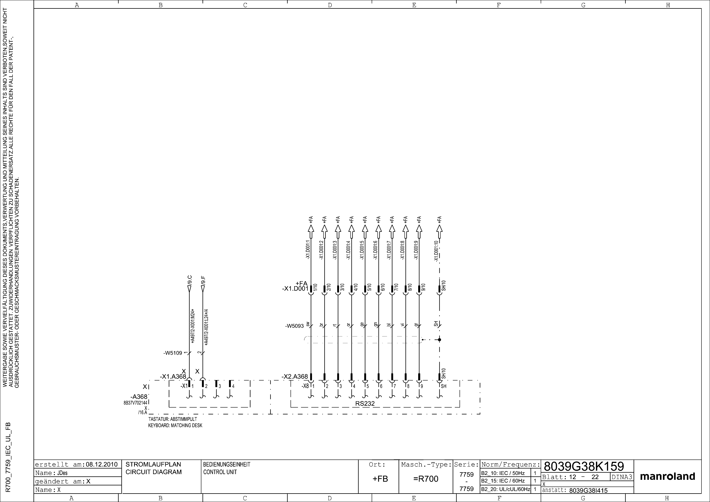

# +FB — Sheet 12 of 22 — BEDIENUNGSEINHEIT

**CONTROL UNIT**

> Part of the manroland **R700** printing press IEC/UL circuit diagrams.
> Drawing class: **Stromlaufplan / Circuit diagram** (DIN A3).
> Document `+FB` covers the **Delivery / Coating module** machine section.

## At a glance

| Field | Value |
|---|---|
| Document | `+FB`  (8039G38K159) |
| Sheet | **12** of 22 |
| Section (DE) | BEDIENUNGSEINHEIT |
| Section (EN) | CONTROL UNIT |
| Section type | CONTROL_UNIT — Control unit |
| Machine type | `=R700` |
| Series | `7759` |
| Created | 08.12.2010 |
| Replaces | `8039G38I415` |
| Columns used | B, C, D, E |
| Path numbers | — |
| Labels on sheet | 78 |
| Cross-refs out | 3 |
| Cross-refs in | 26 |

**Previous:** [+FB sheet 11](SHEET_0011.md) · **Next:** [+FB sheet 13](SHEET_0013.md) · **Document TOC:** [_TOC.md](_TOC.md)  (+FB) · **Master TOC:** [all sheets](../_MASTER_TOC.md)

## Sheet image (300 DPI, exact vector render)



_Rendered directly from the PDF vector layer at 300 DPI (1-bit), no OCR and no resampling. Use it to confirm anything ambiguous in the text below._

## Cross-references on this sheet

Each entry is a wire leaving this sheet. The printed token is `/sheet.column`; the link resolves to that sheet inside the same document.

| Ref | Target sheet | Col | Path | Destination on target | Target section | From col |
|---|---|---|---|---|---|---|
| `/9.C` | [+FB sheet 9](SHEET_0009.md) | C | — | +A497/2 X001:M24+ | SPANNUNGSVERSORGUNG | B |
| `/9.F` | [+FB sheet 9](SHEET_0009.md) | F | — | +A497/2 X001:L24+/4 | SPANNUNGSVERSORGUNG | C |
| `/16.A` | [+FB sheet 16](SHEET_0016.md) | A | — | X | OPTION: COLORPILOT | B |

### Incoming references (sheets that point here)

Every other sheet that sends a wire to this one. `Back-ref` is the token printed on *that* sheet; `Path` is its line number.

| From sheet | Cols | Back-ref | Path | Refs | What continues there |
|---|---|---|---|---|---|
| [+FB#4](SHEET_0004.md) | C | `/4.C` | — | 1 | A368 |
| [+FB#9](SHEET_0009.md) | C, F | `/9.C`, `/9.F` | `#65`, `#67` | 2 | X1.A368:1; X1.A368:2 |
| [+FB#16](SHEET_0016.md) | A | `/16.A` | — | 1 | — |
| [+FB#21](SHEET_0021.md) | A, C | `/21.A`, `/21.C` | — | 22 | — |


## Devices on this sheet

| Tag | Class | Class meaning (IEC) | Col | Sub | Terminal | Sign |
|---|---|---|---|---|---|---|
| `A368` | A | Baugruppe / assembly, module, PC board | B | — | — | — |
| `X8` | X | Klemme / terminal, plug connector | D | — | — | — |
| `RS232` | RS |  | D | — | — | — |
| `W5109` | W | Kabel / cable, line, bus | B | — | — | — |
| `W5093` | W | Kabel / cable, line, bus | D | — | — | — |
| `X2.A368` | — | cross-device reference | D | — | — | — |
| `X1.D001:1` | — | cross-device reference | D | — | 1 | — |
| `X1.D001:2` | — | cross-device reference | D | — | 2 | — |
| `X1.D001:3` | — | cross-device reference | D | — | 3 | — |
| `X1.D001:4` | — | cross-device reference | D | — | 4 | — |
| `X1.D001:5` | — | cross-device reference | D | — | 5 | — |
| `X1.D001:6` | — | cross-device reference | E | — | 6 | — |
| `X1.D001:7` | — | cross-device reference | E | — | 7 | — |
| `X1.D001:8` | — | cross-device reference | E | — | 8 | — |
| `X1.D001:9` | — | cross-device reference | E | — | 9 | — |
| `X1.D001:10` | — | cross-device reference | E | — | 10 | — |
| `X1.A368` | — | cross-device reference | B | — | — | — |
| `X1.D001` | — | cross-device reference | D | — | — | — |

## Potentials / nets

_No named potentials on this sheet._

## Wire-end annotations (grouped as printed)

A wire that continues elsewhere is annotated with a small cluster: the destination description, the path/line number `#NN`, and the `/sheet.column` cross reference. Each row below is one such cluster exactly as it is grouped on the drawing.

| Col | Y | Path | Cross-ref | Text on the wire |
|---|---|---|---|---|
| D | 362.7 | — | — | `X1.D001:1 +FA` |
| D | 362.7 | — | — | `X1.D001:2 +FA` |
| D | 362.7 | — | — | `X1.D001:3 +FA` |
| D | 362.7 | — | — | `X1.D001:4 +FA` |
| D | 362.7 | — | — | `X1.D001:5 +FA` |
| E | 362.7 | — | — | `X1.D001:6 +FA` |
| E | 362.7 | — | — | `X1.D001:7 +FA` |
| E | 362.7 | — | — | `X1.D001:8 +FA` |
| E | 362.7 | — | — | `X1.D001:9 +FA` |
| E | 362.7 | — | — | `X1.D001:10 +FA` |
| B | 461.5 | — | `/9.C` | `+A497/2 X001:M24+` |
| C | 462.3 | — | `/9.F` | `+A497/2 X001:L24+/4` |
| E | 470.4 | — | — | `SH/10 SH/10` |
| D | 470.8 | — | — | `X1.D001 +FA` |
| D | 475.6 | — | — | `2/10` |
| D | 475.6 | — | — | `3/10` |
| D | 475.6 | — | — | `4/10` |
| D | 475.6 | — | — | `5/10` |
| E | 475.6 | — | — | `6/10` |
| E | 475.6 | — | — | `7/10` |
| E | 475.6 | — | — | `8/10` |
| E | 475.6 | — | — | `9/10` |
| D | 476.0 | — | — | `1/10` |
| E | 538.4 | — | — | `SH` |
| D | 539.7 | — | — | `sw` |
| E | 540.3 | — | — | `gn` |
| D | 540.6 | — | — | `ge` |
| E | 541.9 | — | — | `gr` |
| D | 542.1 | — | — | `br` |
| D | 542.1 | — | — | `or` |
| E | 542.5 | — | — | `bl` |
| E | 542.5 | — | — | `vi` |
| D | 542.8 | — | — | `W5093` |
| D | 543.6 | — | — | `rt` |
| B | 588.1 | — | — | `W5109` |
| B | 589.1 | — | — | `1` |
| B | 589.1 | — | — | `2` |
| B | 618.2 | — | — | `X1.A368 X` |
| B | 618.2 | — | — | `X` |
| D | 626.8 | — | — | `X2.A368` |
| D | 643.5 | — | — | `X1 1 2 3 4 X8 1 2 3 4 5 6 7 8 9` |
| B | 643.8 | — | — | `X` |
| E | 644.7 | — | — | `SH` |
| B | 660.8 | — | — | `A368` |
| C | 672.1 | — | — | `8B37V702144 RS232` |
| B | 681.6 | — | `/16.A` | `X` |
| B | 700.1 | — | — | `KEYBOARD: MATCHING DESK TASTATUR: ABSTIMMPULT` |


## Notes and free text on this sheet

| Text | Col | Y (pt) |
|---|---|---|
| `+FA` | D | 362.7 |
| `+FA` | E | 362.7 |
| `+A497/2 X001:M24+` | B | 518.18 |
| `+A497/2 X001:L24+/4` | C | 518.46 |
| `SH/10` | E | 470.37 |
| `X1 1` | B | 643.47 |
| `8B37V702144` | B | 672.77 |
| `TASTATUR: ABSTIMMPULT` | B | 700.08 |
| `KEYBOARD: MATCHING DESK` | B | 710.71 |
| `SH` | E | 644.71 |
| `sw` | D | 539.72 |
| `gr` | E | 541.85 |
| `vi` | E | 542.5 |
| `bl` | E | 542.5 |
| `gn` | E | 540.28 |
| `ge` | D | 540.56 |
| `or` | D | 542.06 |
| `rt` | D | 543.58 |
| `br` | D | 542.06 |

## Complete label inventory (exact text from the drawing)

Every text object inside the drawing area of this sheet, in DIN reading order (column A→H, then top→bottom). This is the authoritative list: if a string is not here it is not printed on this sheet.

| Col | Y | X | Dir | Type | Text |
|---|---|---|---|---|---|
| B | 461.5 | 314.2 | ↕ | cross-reference | `/9.C` |
| B | 518.2 | 320.3 | ↕ | text | `+A497/2 X001:M24+` |
| B | 588.1 | 274.1 | → | device tag | `W5109` |
| B | 589.1 | 308.4 | ↕ | number | `1` |
| B | 589.1 | 331.4 | ↕ | number | `2` |
| B | 618.3 | 304.7 | → | not fitted | `X` |
| B | 618.3 | 327.4 | → | not fitted | `X` |
| B | 626.8 | 268.2 | → | device ref | `X1.A368` |
| B | 643.5 | 302.9 | → | text | `X1 1` |
| B | 643.8 | 239.5 | → | not fitted | `X` |
| B | 660.8 | 218.8 | → | device tag | `A368` |
| B | 672.8 | 207.5 | → | text | `8B37V702144` |
| B | 681.6 | 242.4 | → | not fitted | `X` |
| B | 688.7 | 231.9 | → | cross-reference | `/16.A` |
| B | 700.1 | 249.2 | → | text | `TASTATUR: ABSTIMMPULT` |
| B | 710.7 | 248.6 | → | text | `KEYBOARD: MATCHING DESK` |
| C | 462.3 | 336.9 | ↕ | cross-reference | `/9.F` |
| C | 518.5 | 342.9 | ↕ | text | `+A497/2 X001:L24+/4` |
| C | 644.7 | 344.1 | → | number | `2` |
| C | 644.7 | 366.8 | → | number | `3` |
| C | 644.7 | 389.5 | → | number | `4` |
| D | 362.7 | 518.6 | ↕ | text | `+FA` |
| D | 362.7 | 541.3 | ↕ | text | `+FA` |
| D | 362.7 | 564.0 | ↕ | text | `+FA` |
| D | 362.7 | 586.7 | ↕ | text | `+FA` |
| D | 362.7 | 609.3 | ↕ | text | `+FA` |
| D | 402.5 | 513.2 | ↕ | device ref | `X1.D001:1` |
| D | 403.7 | 536.0 | ↕ | device ref | `X1.D001:2` |
| D | 403.9 | 558.6 | ↕ | device ref | `X1.D001:3` |
| D | 403.9 | 581.3 | ↕ | device ref | `X1.D001:4` |
| D | 403.9 | 604.0 | ↕ | device ref | `X1.D001:5` |
| D | 470.8 | 495.8 | → | text | `+FA` |
| D | 475.6 | 548.4 | ↕ | pin pair | `2/10` |
| D | 475.6 | 571.1 | ↕ | pin pair | `3/10` |
| D | 475.6 | 593.8 | ↕ | pin pair | `4/10` |
| D | 475.6 | 616.4 | ↕ | pin pair | `5/10` |
| D | 476.0 | 525.7 | ↕ | pin pair | `1/10` |
| D | 479.4 | 473.1 | → | device ref | `X1.D001` |
| D | 539.7 | 513.0 | ↕ | text | `sw` |
| D | 540.6 | 603.8 | ↕ | text | `ge` |
| D | 542.1 | 535.7 | ↕ | text | `br` |
| D | 542.1 | 581.2 | ↕ | text | `or` |
| D | 542.8 | 478.2 | → | device tag | `W5093` |
| D | 543.6 | 558.2 | ↕ | text | `rt` |
| D | 626.8 | 472.3 | → | device ref | `X2.A368` |
| D | 643.6 | 506.0 | → | device tag | `X8` |
| D | 644.3 | 523.6 | → | number | `1` |
| D | 644.7 | 546.8 | → | number | `2` |
| D | 644.7 | 569.5 | → | number | `3` |
| D | 644.7 | 592.2 | → | number | `4` |
| D | 644.7 | 614.8 | → | number | `5` |
| D | 672.1 | 595.8 | → | device tag | `RS232` |
| E | 362.7 | 632.0 | ↕ | text | `+FA` |
| E | 362.7 | 654.7 | ↕ | text | `+FA` |
| E | 362.7 | 677.4 | ↕ | text | `+FA` |
| E | 362.7 | 700.1 | ↕ | text | `+FA` |
| E | 362.7 | 734.1 | ↕ | text | `+FA` |
| E | 403.9 | 626.7 | ↕ | device ref | `X1.D001:6` |
| E | 403.9 | 649.3 | ↕ | device ref | `X1.D001:7` |
| E | 403.9 | 672.0 | ↕ | device ref | `X1.D001:8` |
| E | 403.9 | 694.7 | ↕ | device ref | `X1.D001:9` |
| E | 403.9 | 728.7 | ↕ | device ref | `X1.D001:10` |
| E | 470.4 | 741.2 | ↕ | text | `SH/10` |
| E | 475.6 | 639.1 | ↕ | pin pair | `6/10` |
| E | 475.6 | 661.8 | ↕ | pin pair | `7/10` |
| E | 475.6 | 684.5 | ↕ | pin pair | `8/10` |
| E | 475.6 | 707.2 | ↕ | pin pair | `9/10` |
| E | 538.4 | 728.3 | ↕ | text | `SH` |
| E | 540.3 | 626.3 | ↕ | text | `gn` |
| E | 541.9 | 694.4 | ↕ | text | `gr` |
| E | 542.5 | 648.9 | ↕ | text | `bl` |
| E | 542.5 | 671.7 | ↕ | text | `vi` |
| E | 617.8 | 741.2 | ↕ | text | `SH/10` |
| E | 644.7 | 637.5 | → | number | `6` |
| E | 644.7 | 660.2 | → | number | `7` |
| E | 644.7 | 682.9 | → | number | `8` |
| E | 644.7 | 705.5 | → | number | `9` |
| E | 644.7 | 739.6 | → | text | `SH` |

## Reading-order text block

The same content as a plain block, grouped by DIN column — convenient to paste or to match against a visual description.

```text
=== Column B ===
 461.5  314.2  xref         /9.C
 518.2  320.3  text         +A497/2 X001:M24+
 588.1  274.1  devtag       W5109
 589.1  308.4  numeric      1
 589.1  331.4  numeric      2
 618.3  304.7  placeholder  X
 618.3  327.4  placeholder  X
 626.8  268.2  devref       X1.A368
 643.5  302.9  text         X1 1
 643.8  239.5  placeholder  X
 660.8  218.8  devtag       A368
 672.8  207.5  text         8B37V702144
 681.6  242.4  placeholder  X
 688.7  231.9  xref         /16.A
 700.1  249.2  text         TASTATUR: ABSTIMMPULT
 710.7  248.6  text         KEYBOARD: MATCHING DESK
=== Column C ===
 462.3  336.9  xref         /9.F
 518.5  342.9  text         +A497/2 X001:L24+/4
 644.7  344.1  numeric      2
 644.7  366.8  numeric      3
 644.7  389.5  numeric      4
=== Column D ===
 362.7  518.6  text         +FA
 362.7  541.3  text         +FA
 362.7  564.0  text         +FA
 362.7  586.7  text         +FA
 362.7  609.3  text         +FA
 402.5  513.2  devref       X1.D001:1
 403.7  536.0  devref       X1.D001:2
 403.9  558.6  devref       X1.D001:3
 403.9  581.3  devref       X1.D001:4
 403.9  604.0  devref       X1.D001:5
 470.8  495.8  text         +FA
 475.6  548.4  pinpair      2/10
 475.6  571.1  pinpair      3/10
 475.6  593.8  pinpair      4/10
 475.6  616.4  pinpair      5/10
 476.0  525.7  pinpair      1/10
 479.4  473.1  devref       X1.D001
 539.7  513.0  text         sw
 540.6  603.8  text         ge
 542.1  535.7  text         br
 542.1  581.2  text         or
 542.8  478.2  devtag       W5093
 543.6  558.2  text         rt
 626.8  472.3  devref       X2.A368
 643.6  506.0  devtag       X8
 644.3  523.6  numeric      1
 644.7  546.8  numeric      2
 644.7  569.5  numeric      3
 644.7  592.2  numeric      4
 644.7  614.8  numeric      5
 672.1  595.8  devtag       RS232
=== Column E ===
 362.7  632.0  text         +FA
 362.7  654.7  text         +FA
 362.7  677.4  text         +FA
 362.7  700.1  text         +FA
 362.7  734.1  text         +FA
 403.9  626.7  devref       X1.D001:6
 403.9  649.3  devref       X1.D001:7
 403.9  672.0  devref       X1.D001:8
 403.9  694.7  devref       X1.D001:9
 403.9  728.7  devref       X1.D001:10
 470.4  741.2  text         SH/10
 475.6  639.1  pinpair      6/10
 475.6  661.8  pinpair      7/10
 475.6  684.5  pinpair      8/10
 475.6  707.2  pinpair      9/10
 538.4  728.3  text         SH
 540.3  626.3  text         gn
 541.9  694.4  text         gr
 542.5  648.9  text         bl
 542.5  671.7  text         vi
 617.8  741.2  text         SH/10
 644.7  637.5  numeric      6
 644.7  660.2  numeric      7
 644.7  682.9  numeric      8
 644.7  705.5  numeric      9
 644.7  739.6  text         SH
```

---
_Generated from the PDF vector text layer; no OCR. Source: `R700_7759_IEC_UL_FB`, sheet 12._
