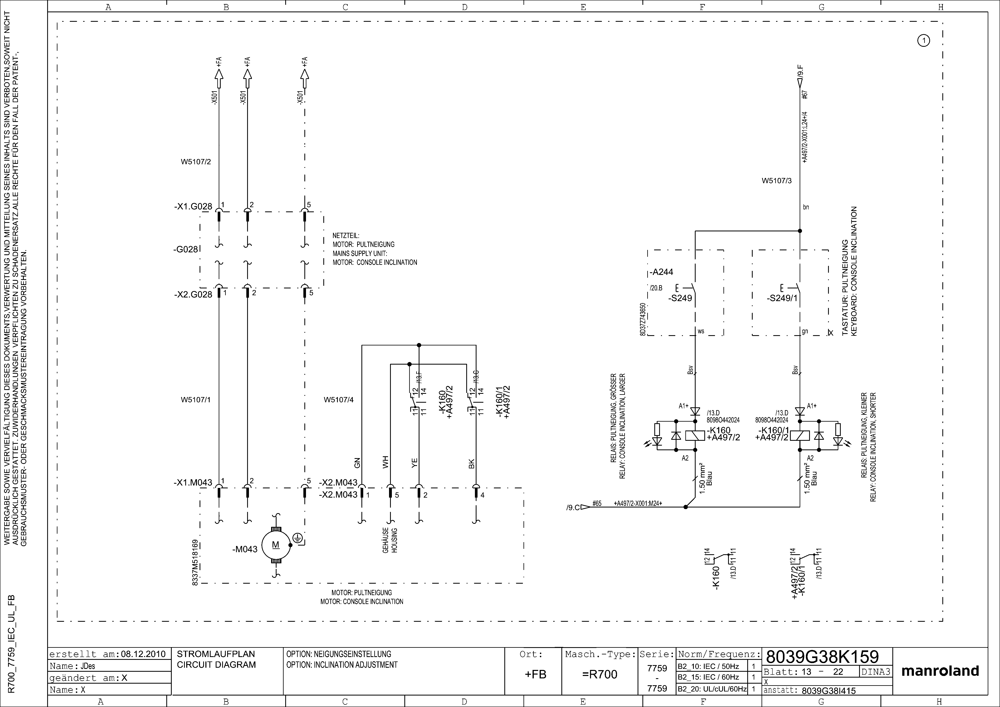

# +FB — Sheet 13 of 22 — OPTION: NEIGUNGSEINSTELLUNG

**OPTION: INCLINATION ADJUSTMENT**

> Part of the manroland **R700** printing press IEC/UL circuit diagrams.
> Drawing class: **Stromlaufplan / Circuit diagram** (DIN A3).
> Document `+FB` covers the **Delivery / Coating module** machine section.

## At a glance

| Field | Value |
|---|---|
| Document | `+FB`  (8039G38K159) |
| Sheet | **13** of 22 |
| Section (DE) | OPTION: NEIGUNGSEINSTELLUNG |
| Section (EN) | OPTION: INCLINATION ADJUSTMENT |
| Section type | OPTION — Inclination adjustment |
| Machine type | `=R700` |
| Series | `7759` |
| Created | 08.12.2010 |
| Replaces | `8039G38I415` |
| Columns used | B, C, D, E, F, G, H |
| Path numbers | 65, 67 |
| Labels on sheet | 109 |
| Cross-refs out | 9 |
| Cross-refs in | 12 |

**Previous:** [+FB sheet 12](SHEET_0012.md) · **Next:** [+FB sheet 14](SHEET_0014.md) · **Document TOC:** [_TOC.md](_TOC.md)  (+FB) · **Master TOC:** [all sheets](../_MASTER_TOC.md)

## Sheet image (300 DPI, exact vector render)



_Rendered directly from the PDF vector layer at 300 DPI (1-bit), no OCR and no resampling. Use it to confirm anything ambiguous in the text below._

## Cross-references on this sheet

Each entry is a wire leaving this sheet. The printed token is `/sheet.column`; the link resolves to that sheet inside the same document.

| Ref | Target sheet | Col | Path | Destination on target | Target section | From col |
|---|---|---|---|---|---|---|
| `/9.F` | [+FB sheet 9](SHEET_0009.md) | F | `#67` | +A497/2 X001:L24+/4 | SPANNUNGSVERSORGUNG | G |
| `/20.B` | [+FB sheet 20](SHEET_0020.md) | B | — | — | REFERENZMODUL | F |
| `/13.G` | [+FB sheet 13](SHEET_0013.md) | G | — | 12 14 11 11 | OPTION: NEIGUNGSEINSTELLUNG | D |
| `/13.F` | [+FB sheet 13](SHEET_0013.md) | F | — | 12 14 11 11 | OPTION: NEIGUNGSEINSTELLUNG | D |
| `/13.D` | [+FB sheet 13](SHEET_0013.md) | D | — | 8098O442024 | OPTION: NEIGUNGSEINSTELLUNG | F |
| `/13.D` | [+FB sheet 13](SHEET_0013.md) | D | — | 8098O442024 | OPTION: NEIGUNGSEINSTELLUNG | G |
| `/9.C` | [+FB sheet 9](SHEET_0009.md) | C | `#65` | +A497/2 X001:M24+ | SPANNUNGSVERSORGUNG | E |
| `/13.D` | [+FB sheet 13](SHEET_0013.md) | D | — | 11 | OPTION: NEIGUNGSEINSTELLUNG | F |
| `/13.D` | [+FB sheet 13](SHEET_0013.md) | D | — | 11 | OPTION: NEIGUNGSEINSTELLUNG | G |

### Incoming references (sheets that point here)

Every other sheet that sends a wire to this one. `Back-ref` is the token printed on *that* sheet; `Path` is its line number.

| From sheet | Cols | Back-ref | Path | Refs | What continues there |
|---|---|---|---|---|---|
| [+FB#4](SHEET_0004.md) | E | `/4.E` | — | 1 | M043 |
| [+FB#6](SHEET_0006.md) | D | `/6.D` | — | 2 | K160/1 +A497/2 |
| [+FB#9](SHEET_0009.md) | C, F | `/9.C`, `/9.F` | `#65`, `#67` | 2 | +A497/2 K160/1:A2, +A497/2 K160:A2; A244:bn |
| [+FB#13](SHEET_0013.md) | D, F, G | `/13.D`, `/13.F`, `/13.G` | — | 6 | 11; 12 14 11 11; 8098O442024 |
| [+FB#20](SHEET_0020.md) | B | `/20.B` | — | 1 | S249 S249/1 |


## Devices on this sheet

| Tag | Class | Class meaning (IEC) | Col | Sub | Terminal | Sign |
|---|---|---|---|---|---|---|
| `X501` | X | Klemme / terminal, plug connector | B | — | — | — |
| `X501` | X | Klemme / terminal, plug connector | B | — | — | — |
| `X501` | X | Klemme / terminal, plug connector | C | — | — | — |
| `K160` | K | Relais / relay, contactor | F | — | — | — |
| `A2` | A | Baugruppe / assembly, module, PC board | F | — | — | — |
| `K160` | K | Relais / relay, contactor | F | — | — | — |
| `+A497/2` | A | Baugruppe / assembly, module, PC board | F | 2 | — | + |
| `K160` | K | Relais / relay, contactor | D | — | — | — |
| `+A497/2` | A | Baugruppe / assembly, module, PC board | D | 2 | — | + |
| `K160/1` | K | Relais / relay, contactor | G | 1 | — | — |
| `+A497/2` | A | Baugruppe / assembly, module, PC board | G | 2 | — | + |
| `A2` | A | Baugruppe / assembly, module, PC board | G | — | — | — |
| `K160/1` | K | Relais / relay, contactor | G | 1 | — | — |
| `+A497/2` | A | Baugruppe / assembly, module, PC board | G | 2 | — | + |
| `K160/1` | K | Relais / relay, contactor | D | 1 | — | — |
| `+A497/2` | A | Baugruppe / assembly, module, PC board | D | 2 | — | + |
| `G028` | G | Stromversorgung / power supply | B | — | — | — |
| `A244` | A | Baugruppe / assembly, module, PC board | F | — | — | — |
| `S249` | S | Schalter / switch | F | — | — | — |
| `S249/1` | S | Schalter / switch | G | 1 | — | — |
| `W5107/2` | W | Kabel / cable, line, bus | B | 2 | — | — |
| `W5107/1` | W | Kabel / cable, line, bus | B | 1 | — | — |
| `W5107/4` | W | Kabel / cable, line, bus | C | 4 | — | — |
| `W5107/3` | W | Kabel / cable, line, bus | G | 3 | — | — |
| `X2.M043` | — | cross-device reference | C | — | — | — |
| `X2.M043` | — | cross-device reference | C | — | — | — |
| `X1.M043` | — | cross-device reference | B | — | — | — |
| `X1.G028` | — | cross-device reference | B | — | — | — |
| `X2.G028` | — | cross-device reference | B | — | — | — |

## Potentials / nets

| Potential | Count | Columns | Attached devices | Terminals |
|---|---|---|---|---|
| `M043` | 1 | B | — | — |


A potential such as `L24+/4` or `M24+` is a named supply/return rail; every place it appears on this sheet is electrically common.

## Conductor data

Each label annotates **the wire beside it**, not the sheet. These summaries are inventories of what is printed; they are not a per-wire map. For a specific conductor, read the label that sits on that wire (see the label inventory below, or the sheet image).

**Cross-section labels printed on this sheet:** 1.5 mm² (×2)

**Wire-colour labels printed on this sheet:** BL = blau / blue (×2)

**Cross-section + colour appearing together in one annotation block:**

| Cross-section | Colour (DE) | Colour (EN) | Blocks containing both |
|---|---|---|---|
| 1.5 mm² | blau | blue | 2 |


_This counts annotation blocks that carry both labels. It can be lower than the number of individual labels above, because a block may hold two cross-section labels or two colour labels._

## Wire-end annotations (grouped as printed)

A wire that continues elsewhere is annotated with a small cluster: the destination description, the path/line number `#NN`, and the `/sheet.column` cross reference. Each row below is one such cluster exactly as it is grouped on the drawing.

| Col | Y | Path | Cross-ref | Text on the wire |
|---|---|---|---|---|
| H | 44.3 | — | — | `1` |
| B | 67.9 | — | — | `X501 +FA` |
| B | 67.9 | — | — | `X501 +FA` |
| C | 67.9 | — | — | `X501 +FA` |
| G | 76.8 | `#67` | `/9.F` | `+A497/2 X001:L24+/4` |
| B | 188.7 | — | — | `W5107/2` |
| G | 211.4 | — | — | `W5107/3` |
| B | 239.8 | — | — | `X1.G028 1 2 5` |
| G | 243.6 | — | — | `bn` |
| G | 245.5 | — | — | `KEYBOARD: CONSOLE INCLINATION` |
| C | 277.7 | — | — | `NETZTEIL: MOTOR: PULTNEIGUNG MAINS SUPPLY UNIT: MOTOR: CONSOLE INCLINATION` |
| G | 285.2 | — | — | `TASTATUR: PULTNEIGUNG` |
| B | 292.3 | — | — | `G028` |
| F | 319.2 | — | — | `A244` |
| F | 340.1 | — | `/20.B` | — |
| B | 344.7 | — | — | `X2.G028 1 2 5` |
| F | 350.4 | — | — | `S249 S249/1` |
| F | 360.8 | — | — | `8D37Z743650` |
| F | 391.1 | — | — | `ws gn` |
| G | 392.8 | — | — | `X` |
| F | 435.4 | — | — | `Bsv` |
| G | 435.4 | — | — | `Bsv` |
| D | 440.9 | — | `/13.G` | `12 11 14 11` |
| D | 442.0 | — | `/13.F` | `12 11 14 11` |
| E | 444.8 | — | — | `RELAIS: PULTNEIGUNG, GRÖSSER` |
| E | 444.8 | — | — | `RELAY: CONSOLE INCLINATION, LARGER` |
| D | 459.1 | — | — | `+A497/2` |
| D | 459.1 | — | — | `+A497/2` |
| D | 459.6 | — | — | `K160/1` |
| D | 464.7 | — | — | `K160` |
| G | 467.4 | — | — | `RELAIS: PULTNEIGUNG, KLEINER` |
| G | 467.4 | — | — | `RELAY: CONSOLE INCLINATION, SHORTER` |
| B | 472.2 | — | — | `W5107/1 W5107/4` |
| F | 480.4 | — | — | `A1+` |
| G | 480.4 | — | — | `A1+` |
| F | 488.9 | — | `/13.D` | `8098O442024` |
| G | 488.9 | — | `/13.D` | `8098O442024` |
| F | 507.7 | — | — | `+A497/2 K160` |
| G | 507.7 | — | — | `+A497/2 K160/1` |
| C | 542.7 | — | — | `WH` |
| F | 542.7 | — | — | `A2` |
| G | 542.7 | — | — | `A2` |
| C | 544.9 | — | — | `GN` |
| D | 545.3 | — | — | `YE` |
| D | 546.6 | — | — | `BK` |
| F | 551.2 | — | — | `1.50 mm² Blau` |
| G | 551.2 | — | — | `1.50 mm² Blau` |
| B | 568.7 | — | — | `1 2 5` |
| B | 570.1 | — | — | `X1.M043` |
| C | 570.1 | — | — | `X2.M043` |
| C | 584.2 | — | — | `X2.M043` |
| D | 585.7 | — | — | `1 5 2 4` |
| E | 596.6 | `#65` | `/9.C` | `+A497/2 X001:M24+` |
| C | 627.9 | — | — | `GEHÄUSE` |
| C | 628.9 | — | — | `HOUSING` |
| B | 642.3 | — | — | `8337M518169` |
| B | 643.8 | — | — | `M043 M` |
| F | 652.3 | — | — | `11` |
| G | 652.3 | — | — | `11` |
| F | 652.7 | — | — | `12 14` |
| G | 652.7 | — | — | `12 14` |
| F | 663.7 | — | `/13.D` | `11` |
| G | 663.7 | — | `/13.D` | `11` |
| G | 672.7 | — | — | `+A497/2 K160/1` |
| F | 674.1 | — | — | `K160` |
| C | 702.9 | — | — | `MOTOR: CONSOLE INCLINATION MOTOR: PULTNEIGUNG` |


## Reconstructed tables

This sheet carries tabular content (pin map / terminal assignment / index). The grid below was rebuilt from the drawing's own rule lines, so each row is exactly one physical row of the table.

### Table 1 — 3 data rows × 4 columns (at x=771.0, y=275.0)

| /20.B | A244 | S249 | ws |
|---|---|---|---|
|  |  | `Bsv A1+` | `/13.D 8098O442024` |
|  |  |  | `K160 +A497/2` |
|  |  | `A2` | `mm² Blau 1.50` |


### Table 2 — 3 data rows × 2 columns (at x=895.7, y=275.0)

| S249/1 | gn |
|---|---|
| `Bsv /13.D 8098O442024` | `A1+` |
| `K160/1 +A497/2` |  |
|  | `A2 mm² Blau 1.50` |


## Device order codes printed on this sheet

> **These are NOT device part numbers and must not be attributed to a single device.** They are order/manufacturing codes that sit inside the same annotation cluster as a device, with no printed label and no leader line binding them to one item. Measured across the whole set: such codes appear on **8 of 1,351 sheets** (see `01_SYSTEM/A_HOW_TO_READ.md` §8.1).

| Token | Col | Y (pt) | What it is |
|---|---|---|---|
| `8098O442024` | F | 497.4 | order code |
| `8098O442024` | G | 497.4 | order code |
| `8337M518169` | B | 642.3 | order code |


## Notes and free text on this sheet

| Text | Col | Y (pt) |
|---|---|---|
| `+A497/2 X001:L24+/4` | G | 132.94 |
| `+A497/2 X001:M24+` | E | 596.63 |
| `+FA` | B | 67.9 |
| `+FA` | C | 67.9 |
| `A1+` | F | 480.36 |
| `RELAIS: PULTNEIGUNG, GRÖSSER` | E | 444.76 |
| `RELAY: CONSOLE INCLINATION, LARGER` | E | 444.76 |
| `A1+` | G | 480.36 |
| `RELAIS: PULTNEIGUNG, KLEINER` | G | 467.44 |
| `RELAY: CONSOLE INCLINATION, SHORTER` | G | 467.43 |
| `M` | B | 643.8 |
| `MOTOR: PULTNEIGUNG` | C | 702.92 |
| `MOTOR: CONSOLE INCLINATION` | C | 713.55 |
| `NETZTEIL:` | C | 277.66 |
| `MAINS SUPPLY UNIT:` | C | 298.96 |
| `GEHÄUSE` | C | 627.9 |
| `HOUSING` | C | 628.91 |
| `ws` | F | 391.1 |
| `gn` | G | 391.05 |
| `bn` | G | 243.62 |
| `8D37Z743650` | F | 360.76 |
| `TASTATUR: PULTNEIGUNG` | G | 285.17 |
| `KEYBOARD: CONSOLE INCLINATION` | G | 245.48 |
| `GN` | C | 544.86 |
| `WH` | C | 542.69 |
| `YE` | D | 545.34 |
| `BK` | D | 546.56 |
| `Bsv` | F | 435.38 |
| `Bsv` | G | 435.38 |

## Complete label inventory (exact text from the drawing)

Every text object inside the drawing area of this sheet, in DIN reading order (column A→H, then top→bottom). This is the authoritative list: if a string is not here it is not printed on this sheet.

| Col | Y | X | Dir | Type | Text |
|---|---|---|---|---|---|
| B | 67.9 | 257.9 | ↕ | text | `+FA` |
| B | 67.9 | 291.9 | ↕ | text | `+FA` |
| B | 107.7 | 252.4 | ↕ | device tag | `X501` |
| B | 107.7 | 286.4 | ↕ | device tag | `X501` |
| B | 188.7 | 215.4 | → | device tag | `W5107/2` |
| B | 239.9 | 262.8 | → | number | `1` |
| B | 239.9 | 297.4 | → | number | `2` |
| B | 241.3 | 207.5 | → | device ref | `X1.G028` |
| B | 292.3 | 206.4 | → | device tag | `G028` |
| B | 344.7 | 265.6 | → | number | `1` |
| B | 344.7 | 300.2 | → | number | `2` |
| B | 346.1 | 207.5 | → | device ref | `X2.G028` |
| B | 472.2 | 215.4 | → | device tag | `W5107/1` |
| B | 568.7 | 262.8 | → | number | `1` |
| B | 568.7 | 297.4 | → | number | `2` |
| B | 570.1 | 206.9 | → | device ref | `X1.M043` |
| B | 642.3 | 228.5 | ↕ | ordercode | `8337M518169` |
| B | 643.8 | 323.7 | → | text | `M` |
| B | 649.4 | 276.7 | → | potential | `M043` |
| C | 67.9 | 359.9 | ↕ | text | `+FA` |
| C | 107.7 | 354.5 | ↕ | device tag | `X501` |
| C | 239.9 | 365.4 | → | number | `5` |
| C | 277.7 | 396.0 | → | text | `NETZTEIL:` |
| C | 288.4 | 396.3 | → | text | `MOTOR: PULTNEIGUNG` |
| C | 299.0 | 396.3 | → | text | `MAINS SUPPLY UNIT:` |
| C | 309.6 | 396.3 | → | text | `MOTOR: CONSOLE INCLINATION` |
| C | 344.7 | 368.2 | → | number | `5` |
| C | 472.2 | 385.5 | → | device tag | `W5107/4` |
| C | 542.7 | 455.1 | ↕ | text | `WH` |
| C | 544.9 | 421.7 | ↕ | text | `GN` |
| C | 568.7 | 365.4 | → | number | `5` |
| C | 570.1 | 379.8 | → | device ref | `X2.M043` |
| C | 584.3 | 379.8 | → | device ref | `X2.M043` |
| C | 585.7 | 435.7 | → | number | `1` |
| C | 585.7 | 470.3 | → | number | `5` |
| C | 627.9 | 456.3 | ↕ | text | `GEHÄUSE` |
| C | 628.9 | 466.9 | ↕ | text | `HOUSING` |
| C | 702.9 | 395.0 | → | text | `MOTOR: PULTNEIGUNG` |
| C | 713.6 | 381.7 | → | text | `MOTOR: CONSOLE INCLINATION` |
| D | 440.9 | 564.0 | ↕ | cross-reference | `/13.G` |
| D | 442.0 | 496.0 | ↕ | cross-reference | `/13.F` |
| D | 459.1 | 530.4 | ↕ | device tag | `+A497/2` |
| D | 459.1 | 598.4 | ↕ | device tag | `+A497/2` |
| D | 459.6 | 589.9 | ↕ | device tag | `K160/1` |
| D | 461.8 | 490.7 | ↕ | number | `12` |
| D | 461.8 | 500.6 | ↕ | number | `14` |
| D | 461.8 | 558.7 | ↕ | number | `12` |
| D | 461.8 | 568.7 | ↕ | number | `14` |
| D | 464.7 | 521.9 | ↕ | device tag | `K160` |
| D | 485.9 | 490.7 | ↕ | number | `11` |
| D | 485.9 | 500.6 | ↕ | number | `11` |
| D | 485.9 | 558.7 | ↕ | number | `11` |
| D | 485.9 | 568.7 | ↕ | number | `11` |
| D | 545.3 | 489.6 | ↕ | text | `YE` |
| D | 546.6 | 557.6 | ↕ | text | `BK` |
| D | 585.7 | 504.3 | → | number | `2` |
| D | 585.7 | 572.3 | → | number | `4` |
| E | 444.8 | 727.7 | ↕ | text | `RELAIS: PULTNEIGUNG, GRÖSSER` |
| E | 444.8 | 738.3 | ↕ | text | `RELAY: CONSOLE INCLINATION, LARGER` |
| E | 596.6 | 705.8 | → | path no. | `#65` |
| E | 596.6 | 731.1 | → | text | `+A497/2 X001:M24+` |
| E | 600.5 | 674.4 | → | cross-reference | `/9.C` |
| F | 319.2 | 773.6 | → | device tag | `A244` |
| F | 340.0 | 773.9 | → | cross-reference | `/20.B` |
| F | 350.4 | 795.7 | → | device tag | `S249` |
| F | 360.8 | 762.5 | ↕ | text | `8D37Z743650` |
| F | 391.1 | 830.8 | → | text | `ws` |
| F | 435.4 | 819.1 | ↕ | text | `Bsv` |
| F | 480.4 | 808.3 | → | text | `A1+` |
| F | 488.9 | 841.9 | → | cross-reference | `/13.D` |
| F | 497.4 | 841.6 | → | ordercode | `8098O442024` |
| F | 507.7 | 841.6 | → | device tag | `K160` |
| F | 516.2 | 841.3 | → | device tag | `+A497/2` |
| F | 542.7 | 812.0 | → | device tag | `A2` |
| F | 551.2 | 832.2 | ↕ | cross-section | `1.50 mm²` |
| F | 561.3 | 840.8 | ↕ | wire colour | `Blau` |
| F | 652.3 | 869.9 | ↕ | number | `11` |
| F | 652.7 | 838.9 | ↕ | number | `12 14` |
| F | 663.7 | 869.9 | ↕ | number | `11` |
| F | 674.1 | 847.9 | ↕ | device tag | `K160` |
| F | 674.4 | 870.2 | ↕ | cross-reference | `/13.D` |
| G | 76.8 | 949.1 | ↕ | cross-reference | `/9.F` |
| G | 107.4 | 955.2 | ↕ | path no. | `#67` |
| G | 132.9 | 955.2 | ↕ | text | `+A497/2 X001:L24+/4` |
| G | 211.4 | 907.1 | → | device tag | `W5107/3` |
| G | 243.6 | 956.1 | → | text | `bn` |
| G | 245.5 | 1013.0 | ↕ | text | `KEYBOARD: CONSOLE INCLINATION` |
| G | 285.2 | 1002.3 | ↕ | text | `TASTATUR: PULTNEIGUNG` |
| G | 350.4 | 913.0 | → | device tag | `S249/1` |
| G | 391.1 | 955.0 | → | text | `gn` |
| G | 392.8 | 986.5 | → | not fitted | `X` |
| G | 435.4 | 943.8 | ↕ | text | `Bsv` |
| G | 467.4 | 1026.1 | ↕ | text | `RELAIS: PULTNEIGUNG, KLEINER` |
| G | 467.4 | 1036.7 | ↕ | text | `RELAY: CONSOLE INCLINATION, SHORTER` |
| G | 480.4 | 960.9 | → | text | `A1+` |
| G | 488.9 | 923.6 | → | cross-reference | `/13.D` |
| G | 497.4 | 899.3 | → | ordercode | `8098O442024` |
| G | 507.7 | 903.1 | → | device tag | `K160/1` |
| G | 516.2 | 898.9 | → | device tag | `+A497/2` |
| G | 542.7 | 960.9 | → | device tag | `A2` |
| G | 551.2 | 956.9 | ↕ | cross-section | `1.50 mm²` |
| G | 561.3 | 965.5 | ↕ | wire colour | `Blau` |
| G | 652.3 | 972.0 | ↕ | number | `11` |
| G | 652.7 | 940.9 | ↕ | number | `12 14` |
| G | 663.7 | 972.0 | ↕ | number | `11` |
| G | 672.7 | 949.9 | ↕ | device tag | `K160/1` |
| G | 674.1 | 941.4 | ↕ | device tag | `+A497/2` |
| G | 674.4 | 972.2 | ↕ | cross-reference | `/13.D` |
| H | 44.3 | 1097.9 | → | number | `1` |

## Reading-order text block

The same content as a plain block, grouped by DIN column — convenient to paste or to match against a visual description.

```text
=== Column B ===
  67.9  257.9  text         +FA
  67.9  291.9  text         +FA
 107.7  252.4  devtag       X501
 107.7  286.4  devtag       X501
 188.7  215.4  devtag       W5107/2
 239.9  262.8  numeric      1
 239.9  297.4  numeric      2
 241.3  207.5  devref       X1.G028
 292.3  206.4  devtag       G028
 344.7  265.6  numeric      1
 344.7  300.2  numeric      2
 346.1  207.5  devref       X2.G028
 472.2  215.4  devtag       W5107/1
 568.7  262.8  numeric      1
 568.7  297.4  numeric      2
 570.1  206.9  devref       X1.M043
 642.3  228.5  ordercode    8337M518169
 643.8  323.7  text         M
 649.4  276.7  net          M043
=== Column C ===
  67.9  359.9  text         +FA
 107.7  354.5  devtag       X501
 239.9  365.4  numeric      5
 277.7  396.0  text         NETZTEIL:
 288.4  396.3  text         MOTOR: PULTNEIGUNG
 299.0  396.3  text         MAINS SUPPLY UNIT:
 309.6  396.3  text         MOTOR: CONSOLE INCLINATION
 344.7  368.2  numeric      5
 472.2  385.5  devtag       W5107/4
 542.7  455.1  text         WH
 544.9  421.7  text         GN
 568.7  365.4  numeric      5
 570.1  379.8  devref       X2.M043
 584.3  379.8  devref       X2.M043
 585.7  435.7  numeric      1
 585.7  470.3  numeric      5
 627.9  456.3  text         GEHÄUSE
 628.9  466.9  text         HOUSING
 702.9  395.0  text         MOTOR: PULTNEIGUNG
 713.6  381.7  text         MOTOR: CONSOLE INCLINATION
=== Column D ===
 440.9  564.0  xref         /13.G
 442.0  496.0  xref         /13.F
 459.1  530.4  devtag       +A497/2
 459.1  598.4  devtag       +A497/2
 459.6  589.9  devtag       K160/1
 461.8  490.7  numeric      12
 461.8  500.6  numeric      14
 461.8  558.7  numeric      12
 461.8  568.7  numeric      14
 464.7  521.9  devtag       K160
 485.9  490.7  numeric      11
 485.9  500.6  numeric      11
 485.9  558.7  numeric      11
 485.9  568.7  numeric      11
 545.3  489.6  text         YE
 546.6  557.6  text         BK
 585.7  504.3  numeric      2
 585.7  572.3  numeric      4
=== Column E ===
 444.8  727.7  text         RELAIS: PULTNEIGUNG, GRÖSSER
 444.8  738.3  text         RELAY: CONSOLE INCLINATION, LARGER
 596.6  705.8  path         #65
 596.6  731.1  text         +A497/2 X001:M24+
 600.5  674.4  xref         /9.C
=== Column F ===
 319.2  773.6  devtag       A244
 340.0  773.9  xref         /20.B
 350.4  795.7  devtag       S249
 360.8  762.5  text         8D37Z743650
 391.1  830.8  text         ws
 435.4  819.1  text         Bsv
 480.4  808.3  text         A1+
 488.9  841.9  xref         /13.D
 497.4  841.6  ordercode    8098O442024
 507.7  841.6  devtag       K160
 516.2  841.3  devtag       +A497/2
 542.7  812.0  devtag       A2
 551.2  832.2  xsection     1.50 mm²
 561.3  840.8  colour       Blau
 652.3  869.9  numeric      11
 652.7  838.9  numeric      12 14
 663.7  869.9  numeric      11
 674.1  847.9  devtag       K160
 674.4  870.2  xref         /13.D
=== Column G ===
  76.8  949.1  xref         /9.F
 107.4  955.2  path         #67
 132.9  955.2  text         +A497/2 X001:L24+/4
 211.4  907.1  devtag       W5107/3
 243.6  956.1  text         bn
 245.5 1013.0  text         KEYBOARD: CONSOLE INCLINATION
 285.2 1002.3  text         TASTATUR: PULTNEIGUNG
 350.4  913.0  devtag       S249/1
 391.1  955.0  text         gn
 392.8  986.5  placeholder  X
 435.4  943.8  text         Bsv
 467.4 1026.1  text         RELAIS: PULTNEIGUNG, KLEINER
 467.4 1036.7  text         RELAY: CONSOLE INCLINATION, SHORTER
 480.4  960.9  text         A1+
 488.9  923.6  xref         /13.D
 497.4  899.3  ordercode    8098O442024
 507.7  903.1  devtag       K160/1
 516.2  898.9  devtag       +A497/2
 542.7  960.9  devtag       A2
 551.2  956.9  xsection     1.50 mm²
 561.3  965.5  colour       Blau
 652.3  972.0  numeric      11
 652.7  940.9  numeric      12 14
 663.7  972.0  numeric      11
 672.7  949.9  devtag       K160/1
 674.1  941.4  devtag       +A497/2
 674.4  972.2  xref         /13.D
=== Column H ===
  44.3 1097.9  numeric      1
```

---
_Generated from the PDF vector text layer; no OCR. Source: `R700_7759_IEC_UL_FB`, sheet 13._
