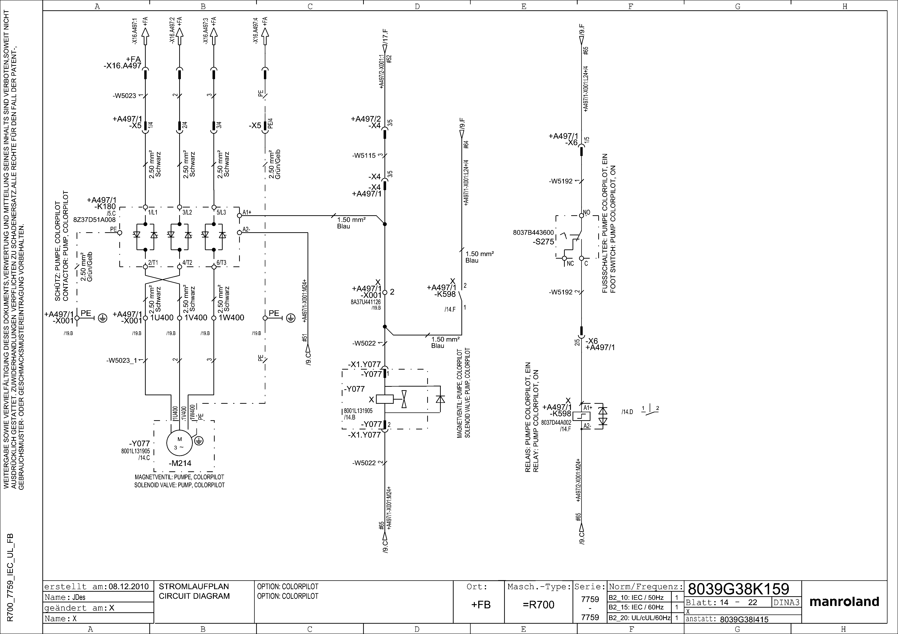

# +FB — Sheet 14 of 22 — OPTION: COLORPILOT

**OPTION: COLORPILOT**

> Part of the manroland **R700** printing press IEC/UL circuit diagrams.
> Drawing class: **Stromlaufplan / Circuit diagram** (DIN A3).
> Document `+FB` covers the **Delivery / Coating module** machine section.

## At a glance

| Field | Value |
|---|---|
| Document | `+FB`  (8039G38K159) |
| Sheet | **14** of 22 |
| Section (DE) | OPTION: COLORPILOT |
| Section (EN) | OPTION: COLORPILOT |
| Section type | OPTION — ColorPilot |
| Machine type | `=R700` |
| Series | `7759` |
| Created | 08.12.2010 |
| Replaces | `8039G38I415` |
| Columns used | A, B, C, D, E, F |
| Path numbers | 51, 52, 64, 65 |
| Labels on sheet | 174 |
| Cross-refs out | 18 |
| Cross-refs in | 46 |

**Previous:** [+FB sheet 13](SHEET_0013.md) · **Next:** [+FB sheet 15](SHEET_0015.md) · **Document TOC:** [_TOC.md](_TOC.md)  (+FB) · **Master TOC:** [all sheets](../_MASTER_TOC.md)

## Sheet image (300 DPI, exact vector render)



_Rendered directly from the PDF vector layer at 300 DPI (1-bit), no OCR and no resampling. Use it to confirm anything ambiguous in the text below._

## Cross-references on this sheet

Each entry is a wire leaving this sheet. The printed token is `/sheet.column`; the link resolves to that sheet inside the same document.

| Ref | Target sheet | Col | Path | Destination on target | Target section | From col |
|---|---|---|---|---|---|---|
| `/9.F` | [+FB sheet 9](SHEET_0009.md) | F | `#65` | +A497/1 X001:L24+/4 | SPANNUNGSVERSORGUNG | F |
| `/17.F` | [+FB sheet 17](SHEET_0017.md) | F | `#52` | +A497/2 X001:1 | OPTION: COLORPILOT | D |
| `/9.F` | [+FB sheet 9](SHEET_0009.md) | F | `#64` | +A497/1 X001:L24+/4 | SPANNUNGSVERSORGUNG | D |
| `/5.C` | [+FB sheet 5](SHEET_0005.md) | C | — | 8Z37D51A008 PE A2 | ANORDNUNGSPLAN | B |
| `/9.C` | [+FB sheet 9](SHEET_0009.md) | C | `#51` | +A497/1 X001:M24+ | SPANNUNGSVERSORGUNG | C |
| `/14.F` | [+FB sheet 14](SHEET_0014.md) | F | — | 1 | OPTION: COLORPILOT | D |
| `/19.B` | [+FB sheet 19](SHEET_0019.md) | B | — | — | KLEMMLEISTE | D |
| `/19.B` | [+FB sheet 19](SHEET_0019.md) | B | — | — | KLEMMLEISTE | A |
| `/19.B` | [+FB sheet 19](SHEET_0019.md) | B | — | — | KLEMMLEISTE | A |
| `/19.B` | [+FB sheet 19](SHEET_0019.md) | B | — | — | KLEMMLEISTE | B |
| `/19.B` | [+FB sheet 19](SHEET_0019.md) | B | — | — | KLEMMLEISTE | B |
| `/19.B` | [+FB sheet 19](SHEET_0019.md) | B | — | — | KLEMMLEISTE | B |
| `/9.C` | [+FB sheet 9](SHEET_0009.md) | C | `#65` | +A497/2 X001:M24+ | SPANNUNGSVERSORGUNG | F |
| `/14.D` | [+FB sheet 14](SHEET_0014.md) | D | — | 1 2 | OPTION: COLORPILOT | F |
| `/14.B` | [+FB sheet 14](SHEET_0014.md) | B | — | 8001L131905 | OPTION: COLORPILOT | C |
| `/14.F` | [+FB sheet 14](SHEET_0014.md) | F | — | 8037D44A002 A2 | OPTION: COLORPILOT | E |
| `/14.C` | [+FB sheet 14](SHEET_0014.md) | C | — | 8001L131905 | OPTION: COLORPILOT | A |
| `/9.C` | [+FB sheet 9](SHEET_0009.md) | C | `#65` | — | SPANNUNGSVERSORGUNG | D |

### Incoming references (sheets that point here)

Every other sheet that sends a wire to this one. `Back-ref` is the token printed on *that* sheet; `Path` is its line number.

| From sheet | Cols | Back-ref | Path | Refs | What continues there |
|---|---|---|---|---|---|
| [+FB#4](SHEET_0004.md) | D | `/4.D` | — | 1 | Y077 |
| [+FB#5](SHEET_0005.md) | C, D | `/5.C`, `/5.D` | — | 2 | K180 |
| [+FB#9](SHEET_0009.md) | C, F | `/9.C`, `/9.F` | `#51`, `#64`, `#65` | 5 | +A497/1 K180:A2; +A497/1 K598:2; +A497/1 K598:A2; +A497/1 X6:1; X1.Y077:2 |
| [+FB#14](SHEET_0014.md) | A, C, D, E, F | `/14.A`, `/14.C`, `/14.D`, `/14.E`, `/14.F` | — | 5 | 1; 1 2; 8001L131905; 8037D44A002 A2 |
| [+FB#17](SHEET_0017.md) | F | `/17.F` | `#52` | 1 | +A497/2 X4:3 |
| [+FB#19](SHEET_0019.md) | B | `/19.B` | — | 6 | X /10.A X X X X X X X X X X |
| [+FB#21](SHEET_0021.md) | A, B, E, F, G | `/21.A`, `/21.B`, `/21.E`, `/21.F`, `/21.G` | — | 14 | — |
| [+FB#22](SHEET_0022.md) | C, D, E | `/22.C`, `/22.D`, `/22.E` | — | 12 | — |


## Devices on this sheet

| Tag | Class | Class meaning (IEC) | Col | Sub | Terminal | Sign |
|---|---|---|---|---|---|---|
| `+A497/1` | A | Baugruppe / assembly, module, PC board | E | 1 | — | + |
| `X6` | X | Klemme / terminal, plug connector | E | — | — | — |
| `+A497/1` | A | Baugruppe / assembly, module, PC board | F | 1 | — | + |
| `X6` | X | Klemme / terminal, plug connector | F | — | — | — |
| `X4` | X | Klemme / terminal, plug connector | D | — | — | — |
| `+A497/1` | A | Baugruppe / assembly, module, PC board | D | 1 | — | + |
| `X4` | X | Klemme / terminal, plug connector | D | — | — | — |
| `+A497/1` | A | Baugruppe / assembly, module, PC board | A | 1 | — | + |
| `X5` | X | Klemme / terminal, plug connector | A | — | — | — |
| `X5` | X | Klemme / terminal, plug connector | B | — | — | — |
| `+A497/2` | A | Baugruppe / assembly, module, PC board | D | 2 | — | + |
| `X4` | X | Klemme / terminal, plug connector | D | — | — | — |
| `Y077` | Y | Magnetventil / solenoid valve, actuator | C | — | — | — |
| `Y077` | Y | Magnetventil / solenoid valve, actuator | D | — | — | — |
| `Y077` | Y | Magnetventil / solenoid valve, actuator | D | — | — | — |
| `Y077` | Y | Magnetventil / solenoid valve, actuator | A | — | — | — |
| `S275` | S | Schalter / switch | E | — | — | — |
| `K598` | K | Relais / relay, contactor | D | — | — | — |
| `+A497/1` | A | Baugruppe / assembly, module, PC board | D | 1 | — | + |
| `+A497/1` | A | Baugruppe / assembly, module, PC board | A | 1 | — | + |
| `K180` | K | Relais / relay, contactor | A | — | — | — |
| `A2` | A | Baugruppe / assembly, module, PC board | B | — | — | — |
| `+A497/1` | A | Baugruppe / assembly, module, PC board | E | 1 | — | + |
| `K598` | K | Relais / relay, contactor | E | — | — | — |
| `A2` | A | Baugruppe / assembly, module, PC board | F | — | — | — |
| `+A497/1` | A | Baugruppe / assembly, module, PC board | A | 1 | — | + |
| `X001` | X | Klemme / terminal, plug connector | A | — | — | — |
| `+A497/1` | A | Baugruppe / assembly, module, PC board | A | 1 | — | + |
| `X001` | X | Klemme / terminal, plug connector | A | — | — | — |
| `+A497/1` | A | Baugruppe / assembly, module, PC board | D | 1 | — | + |
| `X001` | X | Klemme / terminal, plug connector | D | — | — | — |
| `W5192` | W | Kabel / cable, line, bus | E | — | — | — |
| `W5023` | W | Kabel / cable, line, bus | A | — | — | — |
| `W5022` | W | Kabel / cable, line, bus | D | — | — | — |
| `W5022` | W | Kabel / cable, line, bus | D | — | — | — |
| `W5115` | W | Kabel / cable, line, bus | D | — | — | — |
| `W5192` | W | Kabel / cable, line, bus | E | — | — | — |
| `X16.A497:1` | — | cross-device reference | A | — | 1 | — |
| `X16.A497:2` | — | cross-device reference | B | — | 2 | — |
| `X16.A497:3` | — | cross-device reference | B | — | 3 | — |
| `X16.A497:4` | — | cross-device reference | B | — | 4 | — |
| `X1.Y077` | — | cross-device reference | D | — | — | — |
| `X1.Y077` | — | cross-device reference | D | — | — | — |
| `X16.A497` | — | cross-device reference | A | — | — | — |

## Potentials / nets

| Potential | Count | Columns | Attached devices | Terminals |
|---|---|---|---|---|
| `M214` | 1 | B | — | — |
| `PE` | 7 | A, B, C | — | — |


A potential such as `L24+/4` or `M24+` is a named supply/return rail; every place it appears on this sheet is electrically common.

## Conductor data

Each label annotates **the wire beside it**, not the sheet. These summaries are inventories of what is printed; they are not a per-wire map. For a specific conductor, read the label that sits on that wire (see the label inventory below, or the sheet image).

**Cross-section labels printed on this sheet:** 1.5 mm² (×3), 2.5 mm² (×8)

**Wire-colour labels printed on this sheet:** BL = blau / blue (×3), SW = schwarz / black (×6)

**Cross-section + colour appearing together in one annotation block:**

| Cross-section | Colour (DE) | Colour (EN) | Blocks containing both |
|---|---|---|---|
| 1.5 mm² | blau | blue | 3 |
| 2.5 mm² | schwarz | black | 6 |


_This counts annotation blocks that carry both labels. It can be lower than the number of individual labels above, because a block may hold two cross-section labels or two colour labels._

## Wire-end annotations (grouped as printed)

A wire that continues elsewhere is annotated with a small cluster: the destination description, the path/line number `#NN`, and the `/sheet.column` cross reference. Each row below is one such cluster exactly as it is grouped on the drawing.

| Col | Y | Path | Cross-ref | Text on the wire |
|---|---|---|---|---|
| A | 22.6 | — | — | `+FA` |
| B | 22.6 | — | — | `X16.A497:2 +FA` |
| B | 22.6 | — | — | `X16.A497:3 +FA` |
| C | 22.6 | — | — | `+FA` |
| B | 23.5 | — | — | `X16.A497:4` |
| A | 23.8 | — | — | `X16.A497:1` |
| F | 31.5 | `#65` | `/9.F` | `+A497/1 X001:L24+/4` |
| D | 38.0 | `#52` | `/17.F` | `+A497/2 X001:1` |
| A | 74.0 | — | — | `X16.A497 +FA` |
| C | 119.5 | — | — | `PE` |
| A | 123.3 | — | — | `W5023` |
| A | 124.2 | — | — | `1` |
| B | 124.2 | — | — | `2` |
| B | 124.3 | — | — | `3` |
| A | 153.4 | — | — | `+A497/1` |
| D | 153.4 | — | — | `+A497/2` |
| D | 156.2 | `#64` | `/9.F` | `+A497/1 X001:L24+/4` |
| C | 156.9 | — | — | `PE/4` |
| D | 158.7 | — | — | `3/5` |
| B | 161.5 | — | — | `2/4` |
| B | 161.5 | — | — | `3/4` |
| A | 161.9 | — | — | `X5` |
| B | 161.9 | — | — | `1/4` |
| B | 161.9 | — | — | `X5` |
| D | 161.9 | — | — | `X4` |
| E | 176.0 | — | — | `+A497/1` |
| F | 181.8 | — | — | `1/5` |
| E | 184.6 | — | — | `X6` |
| C | 198.3 | — | — | `2.50 mm² Grün/Gelb` |
| B | 199.4 | — | — | `2.50 mm² Schwarz` |
| B | 199.4 | — | — | `2.50 mm² Schwarz` |
| B | 199.4 | — | — | `2.50 mm² Schwarz` |
| D | 202.6 | — | — | `W5115` |
| D | 203.6 | — | — | `3` |
| F | 203.8 | — | — | `FUSSSCHALTER: PUMPE COLORPILOT, EIN` |
| F | 219.4 | — | — | `FOOT SWITCH: PUMP COLORPILOT, ON` |
| D | 226.7 | — | — | `3/5` |
| D | 229.9 | — | — | `X4` |
| E | 236.6 | — | — | `W5192` |
| F | 237.6 | — | — | `1` |
| D | 244.1 | — | — | `X4` |
| D | 252.6 | — | — | `+A497/1` |
| A | 252.8 | — | — | `CONTACTOR: PUMP, COLORPILOT` |
| A | 261.1 | — | — | `+A497/1` |
| A | 266.7 | — | — | `SCHÜTZ: PUMPE, COLORPILOT` |
| A | 269.6 | — | — | `K180` |
| B | 279.0 | — | — | `1/L1` |
| B | 279.1 | — | — | `3/L2` |
| B | 279.1 | — | — | `5/L3` |
| B | 279.1 | — | — | `A1+` |
| F | 279.1 | — | — | `NO` |
| B | 280.5 | — | `/5.C` | `8Z37D51A008 PE A2` |
| C | 287.9 | — | — | `1.50 mm² Blau` |
| E | 305.0 | — | — | `8037B443600 S275` |
| E | 333.3 | — | — | `1.50 mm² Blau` |
| A | 334.4 | — | — | `2.50 mm² Grün/Gelb` |
| B | 345.6 | — | — | `2/T1` |
| B | 345.7 | — | — | `4/T2` |
| B | 345.7 | — | — | `6/T3` |
| F | 347.1 | — | — | `NC C` |
| D | 368.8 | — | — | `+A497/1 X` |
| D | 370.2 | — | — | `+A497/1 X` |
| C | 370.9 | `#51` | `/9.C` | `+A497/1 X001:M24+` |
| D | 376.2 | — | — | `2` |
| B | 378.2 | — | — | `2.50 mm² Schwarz` |
| B | 378.2 | — | — | `2.50 mm² Schwarz` |
| B | 378.8 | — | — | `2.50 mm² Schwarz` |
| D | 382.9 | — | — | `8A37U441126 X001 2` |
| E | 384.0 | — | — | `W5192` |
| F | 385.0 | — | — | `2` |
| D | 385.8 | — | — | `K598` |
| D | 404.7 | — | `/14.F` | `1` |
| D | 406.4 | — | `/19.B` | — |
| A | 411.3 | — | — | `PE` |
| C | 411.3 | — | — | `PE` |
| A | 412.7 | — | — | `+A497/1` |
| A | 412.7 | — | — | `+A497/1` |
| B | 416.9 | — | — | `1W400` |
| A | 417.0 | — | — | `X001 1U400` |
| B | 417.0 | — | — | `1V400` |
| A | 421.2 | — | — | `X001` |
| A | 440.4 | — | `/19.B` | — |
| A | 440.4 | — | `/19.B` | — |
| B | 440.4 | — | `/19.B` | — |
| B | 440.4 | — | `/19.B` | — |
| B | 440.4 | — | `/19.B` | — |
| D | 446.7 | — | — | `1.50 mm² Blau` |
| F | 448.2 | — | — | `+A497/1 X6` |
| F | 450.4 | `#65` | `/9.C` | `2/5 +A497/2 X001:M24+` |
| D | 452.1 | — | — | `W5022` |
| D | 453.1 | — | — | `1` |
| D | 461.7 | — | — | `SOLENOID VALVE: PUMP, COLORPILOT` |
| D | 463.5 | — | — | `MAGNETVENTIL: PUMPE, COLORPILOT` |
| C | 471.0 | — | — | `PE` |
| A | 474.8 | — | — | `W5023_1` |
| B | 475.7 | — | — | `2` |
| A | 475.8 | — | — | `1` |
| B | 475.8 | — | — | `3` |
| D | 479.4 | — | — | `X1.Y077` |
| E | 480.8 | — | — | `RELAIS: PUMPE COLORPILOT, EIN` |
| E | 491.0 | — | — | `RELAY: PUMP COLORPILOT, ON` |
| D | 492.2 | — | — | `Y077` |
| D | 492.6 | — | — | `1` |
| C | 512.0 | — | — | `Y077` |
| D | 526.1 | — | — | `X` |
| E | 527.5 | — | — | `+A497/1 X` |
| B | 537.4 | — | — | `1W400 PE` |
| F | 538.5 | — | — | `A1+` |
| F | 538.8 | — | `/14.D` | `1 2` |
| B | 539.4 | — | — | `1U400` |
| B | 539.6 | — | — | `1V400` |
| C | 542.8 | — | `/14.B` | `8001L131905` |
| E | 544.5 | — | — | `K598` |
| E | 558.4 | — | `/14.F` | `8037D44A002 A2` |
| D | 558.8 | — | — | `Y077` |
| D | 561.0 | — | — | `2` |
| D | 573.0 | — | — | `X1.Y077` |
| B | 580.1 | — | — | `M` |
| B | 584.3 | — | — | `Y077 3 ~` |
| A | 596.3 | — | `/14.C` | `8001L131905` |
| B | 610.5 | — | — | `M214` |
| D | 610.8 | — | — | `W5022` |
| D | 611.7 | — | — | `2` |
| B | 630.6 | — | — | `SOLENOID VALVE: PUMP, COLORPILOT MAGNETVENTIL: PUMPE, COLORPILOT` |
| D | 645.9 | — | — | `+A497/1 X001:M24+` |
| D | 692.6 | `#65` | `/9.C` | — |


## Reconstructed tables

This sheet carries tabular content (pin map / terminal assignment / index). The grid below was rebuilt from the drawing's own rule lines, so each row is exactly one physical row of the table.

### Table 1 — 2 data rows × 8 columns (at x=102.0, y=286.3) — **8Z37D51A008 PE**

| Grün/Gelb mm² 2.50 PE | +A497/1 X001 /19.B |  | 2/T1 mm² 2.50 | Schwarz 1U400 /19.B |  | 4/T2 mm² 2.50 | Schwarz 1V400 |
|---|---|---|---|---|---|---|---|
|  | `W5023_1` | `1` |  |  | `2` |  |  |
|  |  |  |  |  |  |  | `1W400` |


### Table 2 — 4 data rows × 8 columns (at x=272.1, y=286.3)

|  |  |  | A2 |  | 1.50 mm² Blau |  |  |
|---|---|---|---|---|---|---|---|
| `/19.B` | `6/T3 mm² 2.50` | `Schwarz 1W400` | `/19.B` | `+A497/1 X001:M24+ PE` | `X +A497/1 X001 8A37U441126 /19.B` | `2` | `X +A497/1 K598 /14.F` |
| `3` |  |  | `PE` | `#51` | `W5022 1 /9.C X1.Y077 Y077` | `1.50 Blau 1` | `mm² COLORPILOT` |
|  |  |  |  |  | `Y077 X` |  | `PUMPE,` |
|  |  |  |  |  | `8001L131905` |  |  |


## Device order codes printed on this sheet

> **These are NOT device part numbers and must not be attributed to a single device.** They are order/manufacturing codes that sit inside the same annotation cluster as a device, with no printed label and no leader line binding them to one item. Measured across the whole set: such codes appear on **8 of 1,351 sheets** (see `01_SYSTEM/A_HOW_TO_READ.md` §8.1).

| Token | Col | Y (pt) | What it is |
|---|---|---|---|
| `8001L131905` | C | 542.8 | order code |
| `8001L131905` | A | 596.3 | order code |
| `8037B443600` | E | 305.0 | order code |
| `8037D44A002` | E | 558.4 | order code |


## Notes and free text on this sheet

| Text | Col | Y (pt) |
|---|---|---|
| `+FA` | A | 22.55 |
| `+FA` | B | 22.55 |
| `+FA` | C | 22.55 |
| `+A497/1 X001:L24+/4` | F | 87.59 |
| `+A497/2 X001:M24+` | F | 609.02 |
| `+A497/1 X001:M24+` | D | 645.87 |
| `+A497/1 X001:L24+/4` | D | 212.32 |
| `+A497/1 X001:M24+` | C | 370.91 |
| `+A497/2 X001:1` | D | 72 |
| `MAGNETVENTIL: PUMPE, COLORPILOT` | D | 463.49 |
| `SOLENOID VALVE: PUMP, COLORPILOT` | D | 461.68 |
| `M` | B | 580.15 |
| `1U400` | B | 539.42 |
| `1V400` | B | 539.62 |
| `1W400` | B | 537.4 |
| `MAGNETVENTIL: PUMPE, COLORPILOT` | B | 630.63 |
| `SOLENOID VALVE: PUMP, COLORPILOT` | B | 641.26 |
| `NC` | E | 347.12 |
| `C` | F | 347.12 |
| `NO` | F | 279.07 |
| `FUSSSCHALTER: PUMPE COLORPILOT, EIN` | F | 203.82 |
| `FOOT SWITCH: PUMP COLORPILOT, ON` | F | 219.41 |
| `SCHÜTZ: PUMPE, COLORPILOT` | A | 266.74 |
| `CONTACTOR: PUMP, COLORPILOT` | A | 252.85 |
| `1/L1` | B | 278.99 |
| `2/T1` | B | 345.63 |
| `3/L2` | B | 279.1 |
| `4/T2` | B | 345.7 |
| `5/L3` | B | 279.12 |
| `6/T3` | B | 345.72 |
| `A1+` | B | 279.1 |
| `8Z37D51A008` | A | 288.03 |
| `A1+` | F | 538.47 |
| `RELAIS: PUMPE COLORPILOT, EIN` | E | 480.76 |
| `RELAY: PUMP COLORPILOT, ON` | E | 490.96 |
| `8A37U441126` | D | 398.22 |
| `W5023_1` | A | 474.77 |
| `Grün/Gelb` | C | 198.29 |
| `Grün/Gelb` | A | 334.35 |

## Complete label inventory (exact text from the drawing)

Every text object inside the drawing area of this sheet, in DIN reading order (column A→H, then top→bottom). This is the authoritative list: if a string is not here it is not printed on this sheet.

| Col | Y | X | Dir | Type | Text |
|---|---|---|---|---|---|
| A | 22.5 | 189.8 | ↕ | text | `+FA` |
| A | 23.8 | 175.6 | ↕ | device ref | `X16.A497:1` |
| A | 74.0 | 167.0 | → | text | `+FA` |
| A | 82.5 | 137.5 | → | device ref | `X16.A497` |
| A | 123.3 | 149.4 | → | device tag | `W5023` |
| A | 124.2 | 183.6 | ↕ | number | `1` |
| A | 153.4 | 149.1 | → | device tag | `+A497/1` |
| A | 161.9 | 171.2 | → | device tag | `X5` |
| A | 252.8 | 83.2 | ↕ | text | `CONTACTOR: PUMP, COLORPILOT` |
| A | 261.1 | 115.1 | → | device tag | `+A497/1` |
| A | 266.7 | 72.6 | ↕ | text | `SCHÜTZ: PUMPE, COLORPILOT` |
| A | 269.6 | 125.3 | → | device tag | `K180` |
| A | 280.5 | 141.8 | → | cross-reference | `/5.C` |
| A | 288.0 | 97.2 | → | text | `8Z37D51A008` |
| A | 301.6 | 146.2 | → | potential | `PE` |
| A | 334.3 | 115.1 | ↕ | text | `Grün/Gelb` |
| A | 335.5 | 106.5 | ↕ | cross-section | `2.50 mm²` |
| A | 411.3 | 106.9 | → | potential | `PE` |
| A | 412.7 | 58.4 | → | device tag | `+A497/1` |
| A | 412.7 | 149.1 | → | device tag | `+A497/1` |
| A | 421.2 | 70.0 | → | device tag | `X001` |
| A | 421.2 | 160.7 | → | device tag | `X001` |
| A | 440.4 | 84.7 | → | cross-reference | `/19.B` |
| A | 440.4 | 175.4 | → | cross-reference | `/19.B` |
| A | 474.8 | 141.2 | → | text | `W5023_1` |
| A | 475.7 | 183.6 | ↕ | number | `1` |
| A | 584.3 | 171.2 | → | device tag | `Y077` |
| A | 596.3 | 160.9 | → | ordercode | `8001L131905` |
| A | 605.1 | 183.7 | → | cross-reference | `/14.C` |
| B | 22.5 | 235.2 | ↕ | text | `+FA` |
| B | 22.5 | 280.5 | ↕ | text | `+FA` |
| B | 23.1 | 225.2 | ↕ | device ref | `X16.A497:2` |
| B | 23.5 | 336.0 | ↕ | device ref | `X16.A497:4` |
| B | 23.9 | 269.7 | ↕ | device ref | `X16.A497:3` |
| B | 124.2 | 229.4 | ↕ | number | `2` |
| B | 124.3 | 274.8 | ↕ | number | `3` |
| B | 161.5 | 242.2 | ↕ | pin pair | `2/4` |
| B | 161.5 | 287.6 | ↕ | pin pair | `3/4` |
| B | 161.9 | 196.8 | ↕ | pin pair | `1/4` |
| B | 161.9 | 330.0 | → | device tag | `X5` |
| B | 199.4 | 197.2 | ↕ | cross-section | `2.50 mm²` |
| B | 199.4 | 242.6 | ↕ | cross-section | `2.50 mm²` |
| B | 199.4 | 287.9 | ↕ | cross-section | `2.50 mm²` |
| B | 201.5 | 205.8 | ↕ | wire colour | `Schwarz` |
| B | 201.5 | 251.2 | ↕ | wire colour | `Schwarz` |
| B | 201.5 | 296.5 | ↕ | wire colour | `Schwarz` |
| B | 279.0 | 196.2 | → | text | `1/L1` |
| B | 279.1 | 242.1 | → | text | `3/L2` |
| B | 279.1 | 287.4 | → | text | `5/L3` |
| B | 279.1 | 321.7 | → | text | `A1+` |
| B | 301.8 | 321.7 | → | device tag | `A2` |
| B | 345.6 | 196.7 | → | text | `2/T1` |
| B | 345.7 | 242.1 | → | text | `4/T2` |
| B | 345.7 | 287.4 | → | text | `6/T3` |
| B | 378.2 | 242.6 | ↕ | cross-section | `2.50 mm²` |
| B | 378.2 | 288.2 | ↕ | cross-section | `2.50 mm²` |
| B | 378.8 | 197.2 | ↕ | cross-section | `2.50 mm²` |
| B | 380.3 | 251.2 | ↕ | wire colour | `Schwarz` |
| B | 380.3 | 296.8 | ↕ | wire colour | `Schwarz` |
| B | 380.9 | 205.8 | ↕ | wire colour | `Schwarz` |
| B | 416.9 | 289.4 | → | text | `1W400` |
| B | 417.0 | 198.7 | → | text | `1U400` |
| B | 417.0 | 244.1 | → | text | `1V400` |
| B | 440.4 | 220.8 | → | cross-reference | `/19.B` |
| B | 440.4 | 266.1 | → | cross-reference | `/19.B` |
| B | 440.4 | 334.2 | → | cross-reference | `/19.B` |
| B | 475.7 | 229.4 | ↕ | number | `2` |
| B | 475.8 | 274.8 | ↕ | number | `3` |
| B | 537.4 | 252.1 | ↕ | text | `1W400` |
| B | 539.4 | 229.5 | ↕ | text | `1U400` |
| B | 539.6 | 240.8 | ↕ | text | `1V400` |
| B | 549.0 | 263.4 | ↕ | potential | `PE` |
| B | 580.1 | 235.3 | → | text | `M` |
| B | 589.7 | 230.7 | → | other | `3 ~` |
| B | 610.5 | 223.9 | → | potential | `M214` |
| B | 630.6 | 178.9 | → | text | `MAGNETVENTIL: PUMPE, COLORPILOT` |
| B | 641.3 | 178.3 | → | text | `SOLENOID VALVE: PUMP, COLORPILOT` |
| C | 22.5 | 348.6 | ↕ | text | `+FA` |
| C | 119.5 | 342.7 | ↕ | potential | `PE` |
| C | 156.9 | 355.6 | ↕ | potential | `PE/4` |
| C | 198.3 | 364.6 | ↕ | text | `Grün/Gelb` |
| C | 199.4 | 356.0 | ↕ | cross-section | `2.50 mm²` |
| C | 287.9 | 447.0 | → | cross-section | `1.50 mm²` |
| C | 296.6 | 447.0 | → | wire colour | `Blau` |
| C | 370.9 | 401.0 | ↕ | text | `+A497/1 X001:M24+` |
| C | 411.3 | 356.3 | → | potential | `PE` |
| C | 442.8 | 400.9 | ↕ | path no. | `#51` |
| C | 468.9 | 404.9 | ↕ | cross-reference | `/9.C` |
| C | 471.0 | 342.7 | ↕ | potential | `PE` |
| C | 512.0 | 456.1 | → | device tag | `Y077` |
| C | 542.8 | 456.1 | → | ordercode | `8001L131905` |
| C | 551.2 | 456.4 | → | cross-reference | `/14.B` |
| D | 38.0 | 507.0 | ↕ | cross-reference | `/17.F` |
| D | 72.0 | 503.1 | ↕ | text | `+A497/2 X001:1` |
| D | 73.1 | 513.0 | ↕ | path no. | `#52` |
| D | 153.4 | 465.2 | → | device tag | `+A497/2` |
| D | 156.2 | 609.0 | ↕ | cross-reference | `/9.F` |
| D | 158.7 | 514.4 | ↕ | pin pair | `3/5` |
| D | 161.9 | 488.7 | → | device tag | `X4` |
| D | 186.8 | 615.1 | ↕ | path no. | `#64` |
| D | 202.6 | 466.9 | → | device tag | `W5115` |
| D | 203.6 | 501.6 | ↕ | number | `3` |
| D | 212.3 | 615.1 | ↕ | text | `+A497/1 X001:L24+/4` |
| D | 226.7 | 514.4 | ↕ | pin pair | `3/5` |
| D | 229.9 | 488.7 | → | device tag | `X4` |
| D | 244.1 | 488.7 | → | device tag | `X4` |
| D | 252.6 | 466.6 | → | device tag | `+A497/1` |
| D | 368.8 | 596.7 | → | not fitted | `X` |
| D | 370.2 | 497.5 | → | not fitted | `X` |
| D | 376.2 | 614.8 | → | number | `2` |
| D | 377.3 | 565.8 | → | device tag | `+A497/1` |
| D | 378.7 | 466.6 | → | device tag | `+A497/1` |
| D | 382.9 | 517.0 | → | number | `2` |
| D | 385.8 | 576.0 | → | device tag | `K598` |
| D | 387.2 | 478.2 | → | device tag | `X001` |
| D | 398.2 | 465.2 | → | text | `8A37U441126` |
| D | 404.7 | 614.3 | → | number | `1` |
| D | 406.4 | 492.9 | → | cross-reference | `/19.B` |
| D | 408.1 | 589.7 | → | cross-reference | `/14.F` |
| D | 446.7 | 571.7 | → | cross-section | `1.50 mm²` |
| D | 452.1 | 467.1 | → | device tag | `W5022` |
| D | 453.1 | 501.1 | ↕ | number | `1` |
| D | 455.3 | 571.7 | → | wire colour | `Blau` |
| D | 461.7 | 617.2 | ↕ | text | `SOLENOID VALVE: PUMP, COLORPILOT` |
| D | 463.5 | 606.5 | ↕ | text | `MAGNETVENTIL: PUMPE, COLORPILOT` |
| D | 479.4 | 461.5 | → | device ref | `X1.Y077` |
| D | 492.2 | 478.8 | → | device tag | `Y077` |
| D | 492.6 | 512.2 | → | number | `1` |
| D | 526.1 | 489.0 | → | not fitted | `X` |
| D | 558.8 | 478.8 | → | device tag | `Y077` |
| D | 561.0 | 514.2 | → | number | `2` |
| D | 573.0 | 461.5 | → | device ref | `X1.Y077` |
| D | 610.8 | 467.1 | → | device tag | `W5022` |
| D | 611.7 | 501.5 | ↕ | number | `2` |
| D | 645.9 | 513.0 | ↕ | text | `+A497/1 X001:M24+` |
| D | 692.6 | 503.1 | ↕ | path no. | `#65` |
| D | 718.3 | 507.0 | ↕ | cross-reference | `/9.C` |
| E | 176.0 | 727.4 | → | device tag | `+A497/1` |
| E | 184.6 | 749.5 | → | device tag | `X6` |
| E | 236.6 | 727.9 | → | device tag | `W5192` |
| E | 305.0 | 680.3 | → | ordercode | `8037B443600` |
| E | 316.4 | 706.4 | → | device tag | `S275` |
| E | 333.3 | 617.1 | → | cross-section | `1.50 mm²` |
| E | 341.9 | 617.1 | → | wire colour | `Blau` |
| E | 347.1 | 751.7 | → | text | `NC` |
| E | 384.0 | 727.9 | → | device tag | `W5192` |
| E | 480.8 | 696.2 | ↕ | text | `RELAIS: PUMPE COLORPILOT, EIN` |
| E | 491.0 | 706.8 | ↕ | text | `RELAY: PUMP COLORPILOT, ON` |
| E | 527.5 | 749.8 | → | not fitted | `X` |
| E | 536.0 | 718.9 | → | device tag | `+A497/1` |
| E | 544.6 | 729.1 | → | device tag | `K598` |
| E | 558.4 | 717.7 | → | ordercode | `8037D44A002` |
| E | 566.8 | 742.8 | → | cross-reference | `/14.F` |
| F | 31.5 | 767.7 | ↕ | cross-reference | `/9.F` |
| F | 62.1 | 773.8 | ↕ | path no. | `#65` |
| F | 87.6 | 773.8 | ↕ | text | `+A497/1 X001:L24+/4` |
| F | 181.8 | 775.1 | ↕ | pin pair | `1/5` |
| F | 203.8 | 798.2 | ↕ | text | `FUSSSCHALTER: PUMPE COLORPILOT, EIN` |
| F | 219.4 | 808.8 | ↕ | text | `FOOT SWITCH: PUMP COLORPILOT, ON` |
| F | 237.6 | 761.9 | ↕ | number | `1` |
| F | 279.1 | 773.0 | → | text | `NO` |
| F | 347.1 | 775.0 | → | text | `C` |
| F | 385.0 | 762.3 | ↕ | number | `2` |
| F | 448.2 | 776.4 | → | device tag | `X6` |
| F | 450.4 | 762.4 | ↕ | pin pair | `2/5` |
| F | 456.7 | 776.1 | → | device tag | `+A497/1` |
| F | 538.5 | 773.9 | → | text | `A1+` |
| F | 538.8 | 850.7 | → | number | `1` |
| F | 538.8 | 870.0 | → | number | `2` |
| F | 544.2 | 824.4 | → | cross-reference | `/14.D` |
| F | 562.6 | 773.9 | → | device tag | `A2` |
| F | 609.0 | 763.9 | ↕ | text | `+A497/2 X001:M24+` |
| F | 681.3 | 763.9 | ↕ | path no. | `#65` |
| F | 707.0 | 767.7 | ↕ | cross-reference | `/9.C` |

## Reading-order text block

The same content as a plain block, grouped by DIN column — convenient to paste or to match against a visual description.

```text
=== Column A ===
  22.5  189.8  text         +FA
  23.8  175.6  devref       X16.A497:1
  74.0  167.0  text         +FA
  82.5  137.5  devref       X16.A497
 123.3  149.4  devtag       W5023
 124.2  183.6  numeric      1
 153.4  149.1  devtag       +A497/1
 161.9  171.2  devtag       X5
 252.8   83.2  text         CONTACTOR: PUMP, COLORPILOT
 261.1  115.1  devtag       +A497/1
 266.7   72.6  text         SCHÜTZ: PUMPE, COLORPILOT
 269.6  125.3  devtag       K180
 280.5  141.8  xref         /5.C
 288.0   97.2  text         8Z37D51A008
 301.6  146.2  net          PE
 334.3  115.1  text         Grün/Gelb
 335.5  106.5  xsection     2.50 mm²
 411.3  106.9  net          PE
 412.7   58.4  devtag       +A497/1
 412.7  149.1  devtag       +A497/1
 421.2   70.0  devtag       X001
 421.2  160.7  devtag       X001
 440.4   84.7  xref         /19.B
 440.4  175.4  xref         /19.B
 474.8  141.2  text         W5023_1
 475.7  183.6  numeric      1
 584.3  171.2  devtag       Y077
 596.3  160.9  ordercode    8001L131905
 605.1  183.7  xref         /14.C
=== Column B ===
  22.5  235.2  text         +FA
  22.5  280.5  text         +FA
  23.1  225.2  devref       X16.A497:2
  23.5  336.0  devref       X16.A497:4
  23.9  269.7  devref       X16.A497:3
 124.2  229.4  numeric      2
 124.3  274.8  numeric      3
 161.5  242.2  pinpair      2/4
 161.5  287.6  pinpair      3/4
 161.9  196.8  pinpair      1/4
 161.9  330.0  devtag       X5
 199.4  197.2  xsection     2.50 mm²
 199.4  242.6  xsection     2.50 mm²
 199.4  287.9  xsection     2.50 mm²
 201.5  205.8  colour       Schwarz
 201.5  251.2  colour       Schwarz
 201.5  296.5  colour       Schwarz
 279.0  196.2  text         1/L1
 279.1  242.1  text         3/L2
 279.1  287.4  text         5/L3
 279.1  321.7  text         A1+
 301.8  321.7  devtag       A2
 345.6  196.7  text         2/T1
 345.7  242.1  text         4/T2
 345.7  287.4  text         6/T3
 378.2  242.6  xsection     2.50 mm²
 378.2  288.2  xsection     2.50 mm²
 378.8  197.2  xsection     2.50 mm²
 380.3  251.2  colour       Schwarz
 380.3  296.8  colour       Schwarz
 380.9  205.8  colour       Schwarz
 416.9  289.4  text         1W400
 417.0  198.7  text         1U400
 417.0  244.1  text         1V400
 440.4  220.8  xref         /19.B
 440.4  266.1  xref         /19.B
 440.4  334.2  xref         /19.B
 475.7  229.4  numeric      2
 475.8  274.8  numeric      3
 537.4  252.1  text         1W400
 539.4  229.5  text         1U400
 539.6  240.8  text         1V400
 549.0  263.4  net          PE
 580.1  235.3  text         M
 589.7  230.7  other        3 ~
 610.5  223.9  net          M214
 630.6  178.9  text         MAGNETVENTIL: PUMPE, COLORPILOT
 641.3  178.3  text         SOLENOID VALVE: PUMP, COLORPILOT
=== Column C ===
  22.5  348.6  text         +FA
 119.5  342.7  net          PE
 156.9  355.6  net          PE/4
 198.3  364.6  text         Grün/Gelb
 199.4  356.0  xsection     2.50 mm²
 287.9  447.0  xsection     1.50 mm²
 296.6  447.0  colour       Blau
 370.9  401.0  text         +A497/1 X001:M24+
 411.3  356.3  net          PE
 442.8  400.9  path         #51
 468.9  404.9  xref         /9.C
 471.0  342.7  net          PE
 512.0  456.1  devtag       Y077
 542.8  456.1  ordercode    8001L131905
 551.2  456.4  xref         /14.B
=== Column D ===
  38.0  507.0  xref         /17.F
  72.0  503.1  text         +A497/2 X001:1
  73.1  513.0  path         #52
 153.4  465.2  devtag       +A497/2
 156.2  609.0  xref         /9.F
 158.7  514.4  pinpair      3/5
 161.9  488.7  devtag       X4
 186.8  615.1  path         #64
 202.6  466.9  devtag       W5115
 203.6  501.6  numeric      3
 212.3  615.1  text         +A497/1 X001:L24+/4
 226.7  514.4  pinpair      3/5
 229.9  488.7  devtag       X4
 244.1  488.7  devtag       X4
 252.6  466.6  devtag       +A497/1
 368.8  596.7  placeholder  X
 370.2  497.5  placeholder  X
 376.2  614.8  numeric      2
 377.3  565.8  devtag       +A497/1
 378.7  466.6  devtag       +A497/1
 382.9  517.0  numeric      2
 385.8  576.0  devtag       K598
 387.2  478.2  devtag       X001
 398.2  465.2  text         8A37U441126
 404.7  614.3  numeric      1
 406.4  492.9  xref         /19.B
 408.1  589.7  xref         /14.F
 446.7  571.7  xsection     1.50 mm²
 452.1  467.1  devtag       W5022
 453.1  501.1  numeric      1
 455.3  571.7  colour       Blau
 461.7  617.2  text         SOLENOID VALVE: PUMP, COLORPILOT
 463.5  606.5  text         MAGNETVENTIL: PUMPE, COLORPILOT
 479.4  461.5  devref       X1.Y077
 492.2  478.8  devtag       Y077
 492.6  512.2  numeric      1
 526.1  489.0  placeholder  X
 558.8  478.8  devtag       Y077
 561.0  514.2  numeric      2
 573.0  461.5  devref       X1.Y077
 610.8  467.1  devtag       W5022
 611.7  501.5  numeric      2
 645.9  513.0  text         +A497/1 X001:M24+
 692.6  503.1  path         #65
 718.3  507.0  xref         /9.C
=== Column E ===
 176.0  727.4  devtag       +A497/1
 184.6  749.5  devtag       X6
 236.6  727.9  devtag       W5192
 305.0  680.3  ordercode    8037B443600
 316.4  706.4  devtag       S275
 333.3  617.1  xsection     1.50 mm²
 341.9  617.1  colour       Blau
 347.1  751.7  text         NC
 384.0  727.9  devtag       W5192
 480.8  696.2  text         RELAIS: PUMPE COLORPILOT, EIN
 491.0  706.8  text         RELAY: PUMP COLORPILOT, ON
 527.5  749.8  placeholder  X
 536.0  718.9  devtag       +A497/1
 544.6  729.1  devtag       K598
 558.4  717.7  ordercode    8037D44A002
 566.8  742.8  xref         /14.F
=== Column F ===
  31.5  767.7  xref         /9.F
  62.1  773.8  path         #65
  87.6  773.8  text         +A497/1 X001:L24+/4
 181.8  775.1  pinpair      1/5
 203.8  798.2  text         FUSSSCHALTER: PUMPE COLORPILOT, EIN
 219.4  808.8  text         FOOT SWITCH: PUMP COLORPILOT, ON
 237.6  761.9  numeric      1
 279.1  773.0  text         NO
 347.1  775.0  text         C
 385.0  762.3  numeric      2
 448.2  776.4  devtag       X6
 450.4  762.4  pinpair      2/5
 456.7  776.1  devtag       +A497/1
 538.5  773.9  text         A1+
 538.8  850.7  numeric      1
 538.8  870.0  numeric      2
 544.2  824.4  xref         /14.D
 562.6  773.9  devtag       A2
 609.0  763.9  text         +A497/2 X001:M24+
 681.3  763.9  path         #65
 707.0  767.7  xref         /9.C
```

---
_Generated from the PDF vector text layer; no OCR. Source: `R700_7759_IEC_UL_FB`, sheet 14._
