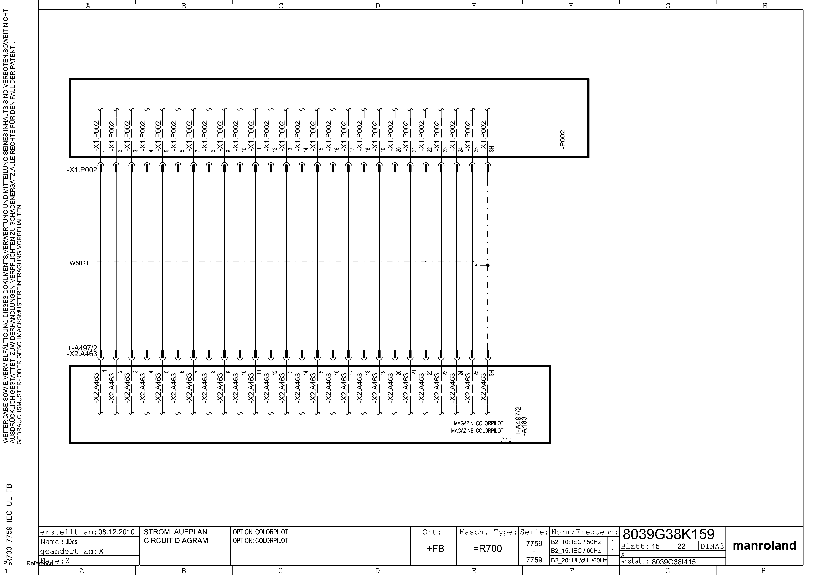

# +FB — Sheet 15 of 22 — OPTION: COLORPILOT

**OPTION: COLORPILOT**

> Part of the manroland **R700** printing press IEC/UL circuit diagrams.
> Drawing class: **Stromlaufplan / Circuit diagram** (DIN A3).
> Document `+FB` covers the **Delivery / Coating module** machine section.

## At a glance

| Field | Value |
|---|---|
| Document | `+FB`  (8039G38K159) |
| Sheet | **15** of 22 |
| Section (DE) | OPTION: COLORPILOT |
| Section (EN) | OPTION: COLORPILOT |
| Section type | OPTION — ColorPilot |
| Machine type | `=R700` |
| Series | `7759` |
| Created | 08.12.2010 |
| Replaces | `8039G38I415` |
| Columns used | A, B, C, D, E, F |
| Path numbers | — |
| Labels on sheet | 114 |
| Cross-refs out | 1 |
| Cross-refs in | 2 |

**Previous:** [+FB sheet 14](SHEET_0014.md) · **Next:** [+FB sheet 16](SHEET_0016.md) · **Document TOC:** [_TOC.md](_TOC.md)  (+FB) · **Master TOC:** [all sheets](../_MASTER_TOC.md)

## Sheet image (300 DPI, exact vector render)



_Rendered directly from the PDF vector layer at 300 DPI (1-bit), no OCR and no resampling. Use it to confirm anything ambiguous in the text below._

## Cross-references on this sheet

Each entry is a wire leaving this sheet. The printed token is `/sheet.column`; the link resolves to that sheet inside the same document.

| Ref | Target sheet | Col | Path | Destination on target | Target section | From col |
|---|---|---|---|---|---|---|
| `/17.D` | [+FB sheet 17](SHEET_0017.md) | D | — | — | OPTION: COLORPILOT | E |

### Incoming references (sheets that point here)

Every other sheet that sends a wire to this one. `Back-ref` is the token printed on *that* sheet; `Path` is its line number.

| From sheet | Cols | Back-ref | Path | Refs | What continues there |
|---|---|---|---|---|---|
| [+FB#4](SHEET_0004.md) | F | `/4.F` | — | 1 | — |
| [+FB#6](SHEET_0006.md) | E | `/6.E` | — | 1 | + A497/2 |


## Devices on this sheet

| Tag | Class | Class meaning (IEC) | Col | Sub | Terminal | Sign |
|---|---|---|---|---|---|---|
| `A463` | A | Baugruppe / assembly, module, PC board | F | — | — | — |
| `P002` | P | Messgeraet / measuring instrument, meter | F | — | — | — |
| `W5021` | W | Kabel / cable, line, bus | A | — | — | — |
| `X2.A463.` | — | cross-device reference | A | — | — | — |
| `X2.A463.` | — | cross-device reference | A | — | — | — |
| `X2.A463.` | — | cross-device reference | A | — | — | — |
| `X2.A463.` | — | cross-device reference | B | — | — | — |
| `X2.A463.` | — | cross-device reference | B | — | — | — |
| `X2.A463.` | — | cross-device reference | B | — | — | — |
| `X2.A463.` | — | cross-device reference | B | — | — | — |
| `X2.A463.` | — | cross-device reference | B | — | — | — |
| `X2.A463.` | — | cross-device reference | B | — | — | — |
| `X2.A463.` | — | cross-device reference | C | — | — | — |
| `X2.A463.` | — | cross-device reference | C | — | — | — |
| `X2.A463.` | — | cross-device reference | C | — | — | — |
| `X2.A463.` | — | cross-device reference | C | — | — | — |
| `X2.A463.` | — | cross-device reference | C | — | — | — |
| `X2.A463.` | — | cross-device reference | C | — | — | — |
| `X2.A463.` | — | cross-device reference | C | — | — | — |
| `X2.A463.` | — | cross-device reference | D | — | — | — |
| `X2.A463.` | — | cross-device reference | D | — | — | — |
| `X2.A463.` | — | cross-device reference | D | — | — | — |
| `X2.A463.` | — | cross-device reference | D | — | — | — |
| `X2.A463.` | — | cross-device reference | D | — | — | — |
| `X2.A463.` | — | cross-device reference | D | — | — | — |
| `X2.A463.` | — | cross-device reference | E | — | — | — |
| `X2.A463.` | — | cross-device reference | E | — | — | — |
| `X2.A463.` | — | cross-device reference | E | — | — | — |
| `X2.A463.` | — | cross-device reference | E | — | — | — |
| `X1.P002.` | — | cross-device reference | A | — | — | — |
| `X1.P002.` | — | cross-device reference | A | — | — | — |
| `X1.P002.` | — | cross-device reference | A | — | — | — |
| `X1.P002.` | — | cross-device reference | B | — | — | — |
| `X1.P002.` | — | cross-device reference | B | — | — | — |
| `X1.P002.` | — | cross-device reference | B | — | — | — |
| `X1.P002.` | — | cross-device reference | B | — | — | — |
| `X1.P002.` | — | cross-device reference | B | — | — | — |
| `X1.P002.` | — | cross-device reference | B | — | — | — |
| `X1.P002.` | — | cross-device reference | C | — | — | — |
| `X1.P002.` | — | cross-device reference | C | — | — | — |
| `X1.P002.` | — | cross-device reference | C | — | — | — |
| `X1.P002.` | — | cross-device reference | C | — | — | — |
| `X1.P002.` | — | cross-device reference | C | — | — | — |
| `X1.P002.` | — | cross-device reference | C | — | — | — |
| `X1.P002.` | — | cross-device reference | C | — | — | — |
| `X1.P002.` | — | cross-device reference | D | — | — | — |
| `X1.P002.` | — | cross-device reference | D | — | — | — |
| `X1.P002.` | — | cross-device reference | D | — | — | — |
| `X1.P002.` | — | cross-device reference | D | — | — | — |
| `X1.P002.` | — | cross-device reference | D | — | — | — |
| `X1.P002.` | — | cross-device reference | D | — | — | — |
| `X1.P002.` | — | cross-device reference | E | — | — | — |
| `X1.P002.` | — | cross-device reference | E | — | — | — |
| `X1.P002.` | — | cross-device reference | E | — | — | — |
| `X1.P002.` | — | cross-device reference | E | — | — | — |
| `X1.P002` | — | cross-device reference | A | — | — | — |
| `X2.A463` | — | cross-device reference | A | — | — | — |

## Potentials / nets

_No named potentials on this sheet._

## Wire-end annotations (grouped as printed)

A wire that continues elsewhere is annotated with a small cluster: the destination description, the path/line number `#NN`, and the `/sheet.column` cross reference. Each row below is one such cluster exactly as it is grouped on the drawing.

| Col | Y | Path | Cross-ref | Text on the wire |
|---|---|---|---|---|
| A | 174.3 | — | — | `X1.P002. 1` |
| A | 174.3 | — | — | `X1.P002. 2` |
| A | 174.3 | — | — | `X1.P002. 3` |
| B | 174.3 | — | — | `X1.P002. 4` |
| B | 174.3 | — | — | `X1.P002. 5` |
| B | 174.3 | — | — | `X1.P002. 6` |
| B | 174.3 | — | — | `X1.P002. 7` |
| B | 174.3 | — | — | `X1.P002. 8` |
| B | 174.3 | — | — | `X1.P002. 9` |
| C | 174.3 | — | — | `X1.P002. 10` |
| C | 174.3 | — | — | `X1.P002. 11` |
| C | 174.3 | — | — | `X1.P002. 12` |
| C | 174.3 | — | — | `X1.P002. 13` |
| C | 174.3 | — | — | `X1.P002. 14` |
| C | 174.3 | — | — | `X1.P002. 15` |
| D | 174.3 | — | — | `X1.P002. 16` |
| D | 174.3 | — | — | `X1.P002. 17` |
| D | 174.3 | — | — | `X1.P002. 18` |
| D | 174.3 | — | — | `X1.P002. 19` |
| D | 174.3 | — | — | `X1.P002. 20` |
| D | 174.3 | — | — | `X1.P002. 21` |
| D | 174.3 | — | — | `X1.P002. 22` |
| E | 174.3 | — | — | `X1.P002. 23` |
| E | 174.3 | — | — | `X1.P002. 24` |
| E | 174.3 | — | — | `X1.P002. 25` |
| E | 174.3 | — | — | `X1.P002. SH` |
| F | 190.2 | — | — | `P002` |
| A | 244.1 | — | — | `X1.P002` |
| A | 381.5 | — | — | `W5021` |
| A | 504.9 | — | — | `X2.A463 + A497/2` |
| A | 541.1 | — | — | `X2.A463. 1` |
| C | 541.1 | — | — | `X2.A463. 11` |
| D | 541.1 | — | — | `X2.A463. 21` |
| E | 542.0 | — | — | `X2.A463. SH` |
| A | 542.3 | — | — | `X2.A463. 2` |
| C | 542.3 | — | — | `X2.A463. 12` |
| D | 542.3 | — | — | `X2.A463. 22` |
| A | 542.5 | — | — | `X2.A463. 3` |
| B | 542.5 | — | — | `X2.A463. 4` |
| B | 542.5 | — | — | `X2.A463. 5` |
| B | 542.5 | — | — | `X2.A463. 6` |
| B | 542.5 | — | — | `X2.A463. 7` |
| B | 542.5 | — | — | `X2.A463. 8` |
| B | 542.5 | — | — | `X2.A463. 9` |
| C | 542.5 | — | — | `X2.A463. 10` |
| C | 542.5 | — | — | `X2.A463. 13` |
| C | 542.5 | — | — | `X2.A463. 14` |
| C | 542.5 | — | — | `X2.A463. 15` |
| D | 542.5 | — | — | `X2.A463. 16` |
| D | 542.5 | — | — | `X2.A463. 17` |
| D | 542.5 | — | — | `X2.A463. 18` |
| D | 542.5 | — | — | `X2.A463. 19` |
| D | 542.5 | — | — | `X2.A463. 20` |
| E | 542.5 | — | — | `X2.A463. 23` |
| E | 542.5 | — | — | `X2.A463. 24` |
| E | 542.5 | — | — | `X2.A463. 25` |
| E | 595.0 | — | — | `+ A497/2 A463` |
| E | 617.2 | — | — | `MAGAZINE: COLORPILOT MAGAZIN: COLORPILOT` |
| E | 641.4 | — | `/17.D` | — |


## Reconstructed tables

This sheet carries tabular content (pin map / terminal assignment / index). The grid below was rebuilt from the drawing's own rule lines, so each row is exactly one physical row of the table.

### Table 1 — 4 data rows × 28 columns (at x=102.0, y=116.2)

| X1.P002. | X1.P002. 1 | X1.P002. 2 | X1.P002. 3 | X1.P002. 4 | X1.P002. 5 | X1.P002. 6 | X1.P002. 7 | X1.P002. 8 | X1.P002. 9 | X1.P002. 10 | X1.P002. 11 | X1.P002. 12 | X1.P002. 13 | X1.P002. 14 | X1.P002. 15 | X1.P002. 16 | X1.P002. 17 | X1.P002. 18 | X1.P002. 19 | X1.P002. 20 | X1.P002. 21 | X1.P002. 22 | X1.P002. 23 | X1.P002. 24 | X1.P002. 25 | SH | P002 |
|---|---|---|---|---|---|---|---|---|---|---|---|---|---|---|---|---|---|---|---|---|---|---|---|---|---|---|---|
| `X1.P002` |  |  |  |  |  |  |  |  |  |  |  |  |  |  |  |  |  |  |  |  |  |  |  |  |  |  |  |
| `W5021` |  |  |  |  |  |  |  |  |  |  |  |  |  |  |  |  |  |  |  |  |  |  |  |  |  |  |  |
| `+ A497/2 X2.A463` |  |  |  |  |  |  |  |  |  |  |  |  |  |  |  |  |  |  |  |  |  |  |  |  |  |  |  |
| `X2.A463.` | `1 X2.A463.` | `2 X2.A463.` | `3 X2.A463.` | `4 X2.A463.` | `5 X2.A463.` | `6 X2.A463.` | `7 X2.A463.` | `8 X2.A463.` | `9 X2.A463.` | `10 X2.A463.` | `11 X2.A463.` | `12 X2.A463.` | `13 X2.A463.` | `14 X2.A463.` | `15 X2.A463.` | `16 X2.A463.` | `17 X2.A463.` | `18 X2.A463.` | `19 X2.A463.` | `20 X2.A463.` | `21 X2.A463.` | `22 X2.A463.` | `23 X2.A463.` | `24 X2.A463. MAGAZIN: MAGAZINE:` | `25 X2.A463.` | `SH + A497/2 A463 COLORPILOT COLORPILOT /17.D` |  |


## Notes and free text on this sheet

| Text | Col | Y (pt) |
|---|---|---|
| `+ A497/2` | E | 594.99 |
| `MAGAZIN: COLORPILOT` | E | 617.17 |
| `MAGAZINE: COLORPILOT` | E | 627.8 |
| `SH` | E | 541.99 |
| `+ A497/2` | A | 504.87 |

## Complete label inventory (exact text from the drawing)

Every text object inside the drawing area of this sheet, in DIN reading order (column A→H, then top→bottom). This is the authoritative list: if a string is not here it is not printed on this sheet.

| Col | Y | X | Dir | Type | Text |
|---|---|---|---|---|---|
| A | 174.3 | 136.4 | ↕ | device ref | `X1.P002.` |
| A | 174.3 | 159.1 | ↕ | device ref | `X1.P002.` |
| A | 174.3 | 181.7 | ↕ | device ref | `X1.P002.` |
| A | 219.1 | 172.7 | ↕ | number | `2` |
| A | 219.2 | 149.6 | ↕ | number | `1` |
| A | 219.2 | 195.4 | ↕ | number | `3` |
| A | 244.1 | 98.1 | → | device ref | `X1.P002` |
| A | 381.5 | 102.0 | → | device tag | `W5021` |
| A | 504.9 | 98.9 | → | text | `+ A497/2` |
| A | 513.4 | 98.1 | → | device ref | `X2.A463` |
| A | 541.1 | 149.6 | ↕ | number | `1` |
| A | 542.3 | 172.7 | ↕ | number | `2` |
| A | 542.6 | 195.4 | ↕ | number | `3` |
| A | 543.1 | 136.4 | ↕ | device ref | `X2.A463.` |
| A | 543.1 | 159.1 | ↕ | device ref | `X2.A463.` |
| A | 543.1 | 181.7 | ↕ | device ref | `X2.A463.` |
| B | 174.3 | 204.4 | ↕ | device ref | `X1.P002.` |
| B | 174.3 | 227.1 | ↕ | device ref | `X1.P002.` |
| B | 174.3 | 249.8 | ↕ | device ref | `X1.P002.` |
| B | 174.3 | 272.4 | ↕ | device ref | `X1.P002.` |
| B | 174.3 | 295.1 | ↕ | device ref | `X1.P002.` |
| B | 174.3 | 317.8 | ↕ | device ref | `X1.P002.` |
| B | 219.2 | 218.1 | ↕ | number | `4` |
| B | 219.2 | 240.8 | ↕ | number | `5` |
| B | 219.2 | 263.5 | ↕ | number | `6` |
| B | 219.2 | 286.1 | ↕ | number | `7` |
| B | 219.2 | 308.8 | ↕ | number | `8` |
| B | 219.2 | 331.5 | ↕ | number | `9` |
| B | 542.6 | 218.1 | ↕ | number | `4` |
| B | 542.6 | 240.8 | ↕ | number | `5` |
| B | 542.6 | 263.5 | ↕ | number | `6` |
| B | 542.6 | 286.1 | ↕ | number | `7` |
| B | 542.6 | 308.8 | ↕ | number | `8` |
| B | 542.6 | 331.5 | ↕ | number | `9` |
| B | 543.1 | 204.4 | ↕ | device ref | `X2.A463.` |
| B | 543.1 | 227.1 | ↕ | device ref | `X2.A463.` |
| B | 543.1 | 249.8 | ↕ | device ref | `X2.A463.` |
| B | 543.1 | 272.4 | ↕ | device ref | `X2.A463.` |
| B | 543.1 | 295.1 | ↕ | device ref | `X2.A463.` |
| B | 543.1 | 317.8 | ↕ | device ref | `X2.A463.` |
| C | 174.3 | 340.5 | ↕ | device ref | `X1.P002.` |
| C | 174.3 | 363.2 | ↕ | device ref | `X1.P002.` |
| C | 174.3 | 385.8 | ↕ | device ref | `X1.P002.` |
| C | 174.3 | 408.5 | ↕ | device ref | `X1.P002.` |
| C | 174.3 | 431.2 | ↕ | device ref | `X1.P002.` |
| C | 174.3 | 453.9 | ↕ | device ref | `X1.P002.` |
| C | 174.3 | 476.5 | ↕ | device ref | `X1.P002.` |
| C | 215.8 | 376.7 | ↕ | number | `11` |
| C | 216.1 | 399.5 | ↕ | number | `12` |
| C | 216.2 | 354.2 | ↕ | number | `10` |
| C | 216.2 | 422.2 | ↕ | number | `13` |
| C | 216.2 | 444.9 | ↕ | number | `14` |
| C | 216.2 | 467.6 | ↕ | number | `15` |
| C | 541.1 | 376.7 | ↕ | number | `11` |
| C | 542.3 | 399.5 | ↕ | number | `12` |
| C | 542.6 | 354.2 | ↕ | number | `10` |
| C | 542.6 | 422.2 | ↕ | number | `13` |
| C | 542.6 | 444.9 | ↕ | number | `14` |
| C | 542.6 | 467.6 | ↕ | number | `15` |
| C | 543.1 | 340.5 | ↕ | device ref | `X2.A463.` |
| C | 543.1 | 363.2 | ↕ | device ref | `X2.A463.` |
| C | 543.1 | 385.8 | ↕ | device ref | `X2.A463.` |
| C | 543.1 | 408.5 | ↕ | device ref | `X2.A463.` |
| C | 543.1 | 431.2 | ↕ | device ref | `X2.A463.` |
| C | 543.1 | 453.9 | ↕ | device ref | `X2.A463.` |
| C | 543.1 | 476.5 | ↕ | device ref | `X2.A463.` |
| D | 174.3 | 499.2 | ↕ | device ref | `X1.P002.` |
| D | 174.3 | 521.9 | ↕ | device ref | `X1.P002.` |
| D | 174.3 | 544.6 | ↕ | device ref | `X1.P002.` |
| D | 174.3 | 567.2 | ↕ | device ref | `X1.P002.` |
| D | 174.3 | 589.9 | ↕ | device ref | `X1.P002.` |
| D | 174.3 | 612.6 | ↕ | device ref | `X1.P002.` |
| D | 215.4 | 603.5 | ↕ | number | `21` |
| D | 215.8 | 581.0 | ↕ | number | `20` |
| D | 216.2 | 490.2 | ↕ | number | `16` |
| D | 216.2 | 512.9 | ↕ | number | `17` |
| D | 216.2 | 535.6 | ↕ | number | `18` |
| D | 216.2 | 558.3 | ↕ | number | `19` |
| D | 541.1 | 603.5 | ↕ | number | `21` |
| D | 542.6 | 490.2 | ↕ | number | `16` |
| D | 542.6 | 512.9 | ↕ | number | `17` |
| D | 542.6 | 535.6 | ↕ | number | `18` |
| D | 542.6 | 558.3 | ↕ | number | `19` |
| D | 542.6 | 581.0 | ↕ | number | `20` |
| D | 543.1 | 499.2 | ↕ | device ref | `X2.A463.` |
| D | 543.1 | 521.9 | ↕ | device ref | `X2.A463.` |
| D | 543.1 | 544.6 | ↕ | device ref | `X2.A463.` |
| D | 543.1 | 567.2 | ↕ | device ref | `X2.A463.` |
| D | 543.1 | 589.9 | ↕ | device ref | `X2.A463.` |
| D | 543.1 | 612.6 | ↕ | device ref | `X2.A463.` |
| E | 174.3 | 635.3 | ↕ | device ref | `X1.P002.` |
| E | 174.3 | 658.0 | ↕ | device ref | `X1.P002.` |
| E | 174.3 | 680.6 | ↕ | device ref | `X1.P002.` |
| E | 174.3 | 703.3 | ↕ | device ref | `X1.P002.` |
| E | 213.8 | 717.0 | ↕ | text | `SH` |
| E | 215.7 | 626.3 | ↕ | number | `22` |
| E | 215.8 | 649.0 | ↕ | number | `23` |
| E | 215.8 | 671.7 | ↕ | number | `24` |
| E | 215.8 | 694.4 | ↕ | number | `25` |
| E | 542.0 | 717.0 | ↕ | text | `SH` |
| E | 542.3 | 626.3 | ↕ | number | `22` |
| E | 542.6 | 649.0 | ↕ | number | `23` |
| E | 542.6 | 671.7 | ↕ | number | `24` |
| E | 542.6 | 694.4 | ↕ | number | `25` |
| E | 543.1 | 635.3 | ↕ | device ref | `X2.A463.` |
| E | 543.1 | 658.0 | ↕ | device ref | `X2.A463.` |
| E | 543.1 | 680.6 | ↕ | device ref | `X2.A463.` |
| E | 543.1 | 703.3 | ↕ | device ref | `X2.A463.` |
| E | 595.0 | 754.3 | ↕ | text | `+ A497/2` |
| E | 617.2 | 665.0 | → | text | `MAGAZIN: COLORPILOT` |
| E | 627.8 | 660.8 | → | text | `MAGAZINE: COLORPILOT` |
| E | 641.4 | 734.2 | → | cross-reference | `/17.D` |
| F | 190.2 | 819.5 | ↕ | device tag | `P002` |
| F | 609.7 | 762.8 | ↕ | device tag | `A463` |

## Reading-order text block

The same content as a plain block, grouped by DIN column — convenient to paste or to match against a visual description.

```text
=== Column A ===
 174.3  136.4  devref       X1.P002.
 174.3  159.1  devref       X1.P002.
 174.3  181.7  devref       X1.P002.
 219.1  172.7  numeric      2
 219.2  149.6  numeric      1
 219.2  195.4  numeric      3
 244.1   98.1  devref       X1.P002
 381.5  102.0  devtag       W5021
 504.9   98.9  text         + A497/2
 513.4   98.1  devref       X2.A463
 541.1  149.6  numeric      1
 542.3  172.7  numeric      2
 542.6  195.4  numeric      3
 543.1  136.4  devref       X2.A463.
 543.1  159.1  devref       X2.A463.
 543.1  181.7  devref       X2.A463.
=== Column B ===
 174.3  204.4  devref       X1.P002.
 174.3  227.1  devref       X1.P002.
 174.3  249.8  devref       X1.P002.
 174.3  272.4  devref       X1.P002.
 174.3  295.1  devref       X1.P002.
 174.3  317.8  devref       X1.P002.
 219.2  218.1  numeric      4
 219.2  240.8  numeric      5
 219.2  263.5  numeric      6
 219.2  286.1  numeric      7
 219.2  308.8  numeric      8
 219.2  331.5  numeric      9
 542.6  218.1  numeric      4
 542.6  240.8  numeric      5
 542.6  263.5  numeric      6
 542.6  286.1  numeric      7
 542.6  308.8  numeric      8
 542.6  331.5  numeric      9
 543.1  204.4  devref       X2.A463.
 543.1  227.1  devref       X2.A463.
 543.1  249.8  devref       X2.A463.
 543.1  272.4  devref       X2.A463.
 543.1  295.1  devref       X2.A463.
 543.1  317.8  devref       X2.A463.
=== Column C ===
 174.3  340.5  devref       X1.P002.
 174.3  363.2  devref       X1.P002.
 174.3  385.8  devref       X1.P002.
 174.3  408.5  devref       X1.P002.
 174.3  431.2  devref       X1.P002.
 174.3  453.9  devref       X1.P002.
 174.3  476.5  devref       X1.P002.
 215.8  376.7  numeric      11
 216.1  399.5  numeric      12
 216.2  354.2  numeric      10
 216.2  422.2  numeric      13
 216.2  444.9  numeric      14
 216.2  467.6  numeric      15
 541.1  376.7  numeric      11
 542.3  399.5  numeric      12
 542.6  354.2  numeric      10
 542.6  422.2  numeric      13
 542.6  444.9  numeric      14
 542.6  467.6  numeric      15
 543.1  340.5  devref       X2.A463.
 543.1  363.2  devref       X2.A463.
 543.1  385.8  devref       X2.A463.
 543.1  408.5  devref       X2.A463.
 543.1  431.2  devref       X2.A463.
 543.1  453.9  devref       X2.A463.
 543.1  476.5  devref       X2.A463.
=== Column D ===
 174.3  499.2  devref       X1.P002.
 174.3  521.9  devref       X1.P002.
 174.3  544.6  devref       X1.P002.
 174.3  567.2  devref       X1.P002.
 174.3  589.9  devref       X1.P002.
 174.3  612.6  devref       X1.P002.
 215.4  603.5  numeric      21
 215.8  581.0  numeric      20
 216.2  490.2  numeric      16
 216.2  512.9  numeric      17
 216.2  535.6  numeric      18
 216.2  558.3  numeric      19
 541.1  603.5  numeric      21
 542.6  490.2  numeric      16
 542.6  512.9  numeric      17
 542.6  535.6  numeric      18
 542.6  558.3  numeric      19
 542.6  581.0  numeric      20
 543.1  499.2  devref       X2.A463.
 543.1  521.9  devref       X2.A463.
 543.1  544.6  devref       X2.A463.
 543.1  567.2  devref       X2.A463.
 543.1  589.9  devref       X2.A463.
 543.1  612.6  devref       X2.A463.
=== Column E ===
 174.3  635.3  devref       X1.P002.
 174.3  658.0  devref       X1.P002.
 174.3  680.6  devref       X1.P002.
 174.3  703.3  devref       X1.P002.
 213.8  717.0  text         SH
 215.7  626.3  numeric      22
 215.8  649.0  numeric      23
 215.8  671.7  numeric      24
 215.8  694.4  numeric      25
 542.0  717.0  text         SH
 542.3  626.3  numeric      22
 542.6  649.0  numeric      23
 542.6  671.7  numeric      24
 542.6  694.4  numeric      25
 543.1  635.3  devref       X2.A463.
 543.1  658.0  devref       X2.A463.
 543.1  680.6  devref       X2.A463.
 543.1  703.3  devref       X2.A463.
 595.0  754.3  text         + A497/2
 617.2  665.0  text         MAGAZIN: COLORPILOT
 627.8  660.8  text         MAGAZINE: COLORPILOT
 641.4  734.2  xref         /17.D
=== Column F ===
 190.2  819.5  devtag       P002
 609.7  762.8  devtag       A463
```

---
_Generated from the PDF vector text layer; no OCR. Source: `R700_7759_IEC_UL_FB`, sheet 15._
