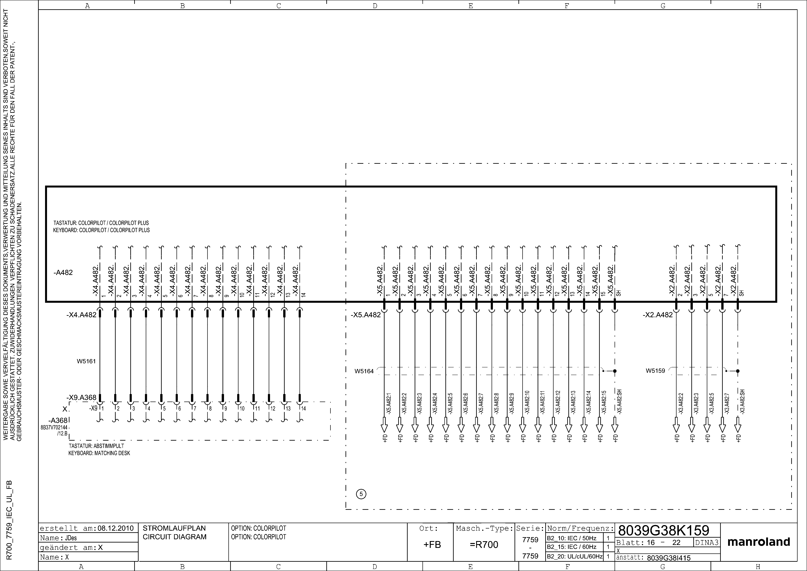

# +FB — Sheet 16 of 22 — OPTION: COLORPILOT

**OPTION: COLORPILOT**

> Part of the manroland **R700** printing press IEC/UL circuit diagrams.
> Drawing class: **Stromlaufplan / Circuit diagram** (DIN A3).
> Document `+FB` covers the **Delivery / Coating module** machine section.

## At a glance

| Field | Value |
|---|---|
| Document | `+FB`  (8039G38K159) |
| Sheet | **16** of 22 |
| Section (DE) | OPTION: COLORPILOT |
| Section (EN) | OPTION: COLORPILOT |
| Section type | OPTION — ColorPilot |
| Machine type | `=R700` |
| Series | `7759` |
| Created | 08.12.2010 |
| Replaces | `8039G38I415` |
| Columns used | A, B, C, D, E, F, G, H |
| Path numbers | — |
| Labels on sheet | 143 |
| Cross-refs out | 1 |
| Cross-refs in | 15 |

**Previous:** [+FB sheet 15](SHEET_0015.md) · **Next:** [+FB sheet 17](SHEET_0017.md) · **Document TOC:** [_TOC.md](_TOC.md)  (+FB) · **Master TOC:** [all sheets](../_MASTER_TOC.md)

## Sheet image (300 DPI, exact vector render)



_Rendered directly from the PDF vector layer at 300 DPI (1-bit), no OCR and no resampling. Use it to confirm anything ambiguous in the text below._

## Cross-references on this sheet

Each entry is a wire leaving this sheet. The printed token is `/sheet.column`; the link resolves to that sheet inside the same document.

| Ref | Target sheet | Col | Path | Destination on target | Target section | From col |
|---|---|---|---|---|---|---|
| `/12.B` | [+FB sheet 12](SHEET_0012.md) | B | — | — | BEDIENUNGSEINHEIT | A |

### Incoming references (sheets that point here)

Every other sheet that sends a wire to this one. `Back-ref` is the token printed on *that* sheet; `Path` is its line number.

| From sheet | Cols | Back-ref | Path | Refs | What continues there |
|---|---|---|---|---|---|
| [+FB#12](SHEET_0012.md) | B | `/12.B` | — | 1 | X |
| [+FB#22](SHEET_0022.md) | B | `/22.B` | — | 14 | — |


## Devices on this sheet

| Tag | Class | Class meaning (IEC) | Col | Sub | Terminal | Sign |
|---|---|---|---|---|---|---|
| `A482` | A | Baugruppe / assembly, module, PC board | A | — | — | — |
| `A368` | A | Baugruppe / assembly, module, PC board | A | — | — | — |
| `W5161` | W | Kabel / cable, line, bus | A | — | — | — |
| `W5164` | W | Kabel / cable, line, bus | D | — | — | — |
| `W5159` | W | Kabel / cable, line, bus | G | — | — | — |
| `X4.A482.` | — | cross-device reference | A | — | — | — |
| `X4.A482.` | — | cross-device reference | A | — | — | — |
| `X4.A482.` | — | cross-device reference | A | — | — | — |
| `X4.A482.` | — | cross-device reference | B | — | — | — |
| `X4.A482.` | — | cross-device reference | B | — | — | — |
| `X4.A482.` | — | cross-device reference | B | — | — | — |
| `X4.A482.` | — | cross-device reference | B | — | — | — |
| `X4.A482.` | — | cross-device reference | B | — | — | — |
| `X4.A482.` | — | cross-device reference | B | — | — | — |
| `X4.A482.` | — | cross-device reference | C | — | — | — |
| `X4.A482.` | — | cross-device reference | C | — | — | — |
| `X4.A482.` | — | cross-device reference | C | — | — | — |
| `X4.A482.` | — | cross-device reference | C | — | — | — |
| `X4.A482.` | — | cross-device reference | C | — | — | — |
| `X9.A368` | — | cross-device reference | A | — | — | — |
| `X5.A482.` | — | cross-device reference | D | — | — | — |
| `X5.A482.` | — | cross-device reference | D | — | — | — |
| `X5.A482.` | — | cross-device reference | D | — | — | — |
| `X5.A482.` | — | cross-device reference | E | — | — | — |
| `X5.A482.` | — | cross-device reference | E | — | — | — |
| `X5.A482.` | — | cross-device reference | E | — | — | — |
| `X5.A482.` | — | cross-device reference | E | — | — | — |
| `X5.A482.` | — | cross-device reference | E | — | — | — |
| `X5.A482.` | — | cross-device reference | E | — | — | — |
| `X5.A482.` | — | cross-device reference | E | — | — | — |
| `X5.A482.` | — | cross-device reference | F | — | — | — |
| `X5.A482.` | — | cross-device reference | F | — | — | — |
| `X5.A482.` | — | cross-device reference | F | — | — | — |
| `X5.A482.` | — | cross-device reference | F | — | — | — |
| `X5.A482.` | — | cross-device reference | F | — | — | — |
| `X5.A482.` | — | cross-device reference | F | — | — | — |
| `X5.A482` | — | cross-device reference | D | — | — | — |
| `X5.A482:1` | — | cross-device reference | D | — | 1 | — |
| `X5.A482:2` | — | cross-device reference | D | — | 2 | — |
| `X5.A482:3` | — | cross-device reference | D | — | 3 | — |
| `X5.A482:4` | — | cross-device reference | E | — | 4 | — |
| `X5.A482:5` | — | cross-device reference | E | — | 5 | — |
| `X5.A482:6` | — | cross-device reference | E | — | 6 | — |
| `X5.A482:7` | — | cross-device reference | E | — | 7 | — |
| `X5.A482:8` | — | cross-device reference | E | — | 8 | — |
| `X5.A482:9` | — | cross-device reference | E | — | 9 | — |
| `X5.A482:10` | — | cross-device reference | F | — | 10 | — |
| `X5.A482:11` | — | cross-device reference | F | — | 11 | — |
| `X5.A482:12` | — | cross-device reference | F | — | 12 | — |
| `X5.A482:13` | — | cross-device reference | F | — | 13 | — |
| `X5.A482:14` | — | cross-device reference | F | — | 14 | — |
| `X5.A482:15` | — | cross-device reference | F | — | 15 | — |
| `X5.A482:SH` | — | cross-device reference | G | — | SH | — |
| `X2.A482.` | — | cross-device reference | G | — | — | — |
| `X2.A482.` | — | cross-device reference | G | — | — | — |
| `X2.A482.` | — | cross-device reference | G | — | — | — |
| `X2.A482.` | — | cross-device reference | H | — | — | — |
| `X2.A482.` | — | cross-device reference | H | — | — | — |
| `X2.A482` | — | cross-device reference | G | — | — | — |
| `X3.A482:2` | — | cross-device reference | G | — | 2 | — |
| `X3.A482:3` | — | cross-device reference | G | — | 3 | — |
| `X3.A482:5` | — | cross-device reference | H | — | 5 | — |
| `X3.A482:7` | — | cross-device reference | H | — | 7 | — |
| `X3.A482:SH` | — | cross-device reference | H | — | SH | — |
| `X4.A482` | — | cross-device reference | A | — | — | — |

## Potentials / nets

_No named potentials on this sheet._

## Wire-end annotations (grouped as printed)

A wire that continues elsewhere is annotated with a small cluster: the destination description, the path/line number `#NN`, and the `/sheet.column` cross reference. Each row below is one such cluster exactly as it is grouped on the drawing.

| Col | Y | Path | Cross-ref | Text on the wire |
|---|---|---|---|---|
| A | 325.9 | — | — | `KEYBOARD: COLORPILOT / COLORPILOT PLUS TASTATUR: COLORPILOT / COLORPILOT PLUS` |
| A | 389.8 | — | — | `X4.A482. 1` |
| A | 389.8 | — | — | `X4.A482. 2` |
| A | 389.8 | — | — | `X4.A482. 3` |
| B | 389.8 | — | — | `X4.A482. 4` |
| B | 389.8 | — | — | `X4.A482. 5` |
| B | 389.8 | — | — | `X4.A482. 6` |
| B | 389.8 | — | — | `X4.A482. 7` |
| B | 389.8 | — | — | `X4.A482. 8` |
| B | 389.8 | — | — | `X4.A482. 9` |
| C | 389.8 | — | — | `X4.A482. 10` |
| C | 389.8 | — | — | `X4.A482. 11` |
| C | 389.8 | — | — | `X4.A482. 12` |
| C | 389.8 | — | — | `X4.A482. 13` |
| C | 389.8 | — | — | `X4.A482. 14` |
| D | 389.8 | — | — | `X5.A482. 1` |
| D | 389.8 | — | — | `X5.A482. 2` |
| D | 389.8 | — | — | `X5.A482. 3` |
| E | 389.8 | — | — | `X5.A482. 4` |
| E | 389.8 | — | — | `X5.A482. 5` |
| E | 389.8 | — | — | `X5.A482. 6` |
| E | 389.8 | — | — | `X5.A482. 7` |
| E | 389.8 | — | — | `X5.A482. 8` |
| E | 389.8 | — | — | `X5.A482. 9` |
| F | 389.8 | — | — | `X5.A482. 10` |
| F | 389.8 | — | — | `X5.A482. 11` |
| F | 389.8 | — | — | `X5.A482. 12` |
| F | 389.8 | — | — | `X5.A482. 13` |
| F | 389.8 | — | — | `X5.A482. 14` |
| F | 389.8 | — | — | `X5.A482. 15` |
| F | 389.8 | — | — | `X5.A482. SH` |
| G | 389.8 | — | — | `X2.A482. 2` |
| G | 389.8 | — | — | `X2.A482. 3` |
| G | 389.8 | — | — | `X2.A482. 5` |
| H | 389.8 | — | — | `X2.A482. 7` |
| H | 389.8 | — | — | `X2.A482. SH` |
| A | 397.1 | — | — | `A482` |
| A | 459.5 | — | — | `X4.A482` |
| D | 459.5 | — | — | `X5.A482` |
| G | 459.5 | — | — | `X2.A482` |
| A | 528.9 | — | — | `W5161` |
| E | 542.7 | — | — | `W5164 W5159` |
| G | 574.1 | — | — | `+FD X5.A482:SH` |
| H | 574.1 | — | — | `+FD X3.A482:SH` |
| F | 575.7 | — | — | `+FD X5.A482:11` |
| F | 576.0 | — | — | `+FD X5.A482:12` |
| F | 576.1 | — | — | `+FD X5.A482:10` |
| F | 576.1 | — | — | `+FD X5.A482:13` |
| F | 576.1 | — | — | `+FD X5.A482:14` |
| F | 576.1 | — | — | `+FD X5.A482:15` |
| D | 579.1 | — | — | `+FD X5.A482:1` |
| D | 579.4 | — | — | `+FD X5.A482:2` |
| G | 579.4 | — | — | `+FD X3.A482:2` |
| D | 579.5 | — | — | `+FD X5.A482:3` |
| E | 579.5 | — | — | `+FD X5.A482:4` |
| E | 579.5 | — | — | `+FD X5.A482:5` |
| E | 579.5 | — | — | `+FD X5.A482:6` |
| E | 579.5 | — | — | `+FD X5.A482:7` |
| E | 579.5 | — | — | `+FD X5.A482:8` |
| E | 579.5 | — | — | `+FD X5.A482:9` |
| G | 579.5 | — | — | `+FD X3.A482:3` |
| G | 579.5 | — | — | `+FD X3.A482:5` |
| H | 579.5 | — | — | `+FD X3.A482:7` |
| A | 581.4 | — | — | `X9.A368` |
| B | 598.2 | — | — | `X9 1 2 3 4 5 6 7 8 9 10 11 12 13 14` |
| A | 598.4 | — | — | `X` |
| A | 615.4 | — | — | `A368` |
| A | 627.4 | — | — | `8B37V702144` |
| A | 636.3 | — | `/12.B` | — |
| A | 654.7 | — | — | `KEYBOARD: MATCHING DESK TASTATUR: ABSTIMMPULT` |
| D | 724.6 | — | — | `5` |


## Notes and free text on this sheet

| Text | Col | Y (pt) |
|---|---|---|
| `TASTATUR: COLORPILOT / COLORPILOT PLUS` | A | 325.91 |
| `KEYBOARD: COLORPILOT / COLORPILOT PLUS` | A | 336.53 |
| `SH` | G | 427.84 |
| `+FD` | D | 640.35 |
| `+FD` | E | 640.35 |
| `+FD` | F | 640.35 |
| `+FD` | G | 640.35 |
| `SH` | H | 427.84 |
| `+FD` | H | 640.35 |
| `X9 1` | A | 598.23 |
| `8B37V702144` | A | 627.42 |
| `TASTATUR: ABSTIMMPULT` | A | 654.72 |
| `KEYBOARD: MATCHING DESK` | A | 665.35 |

## Complete label inventory (exact text from the drawing)

Every text object inside the drawing area of this sheet, in DIN reading order (column A→H, then top→bottom). This is the authoritative list: if a string is not here it is not printed on this sheet.

| Col | Y | X | Dir | Type | Text |
|---|---|---|---|---|---|
| A | 325.9 | 79.1 | → | text | `TASTATUR: COLORPILOT / COLORPILOT PLUS` |
| A | 336.5 | 78.5 | → | text | `KEYBOARD: COLORPILOT / COLORPILOT PLUS` |
| A | 389.8 | 136.4 | ↕ | device ref | `X4.A482.` |
| A | 389.8 | 159.1 | ↕ | device ref | `X4.A482.` |
| A | 389.8 | 181.7 | ↕ | device ref | `X4.A482.` |
| A | 397.2 | 79.1 | → | device tag | `A482` |
| A | 434.6 | 149.6 | ↕ | number | `1` |
| A | 434.6 | 172.7 | ↕ | number | `2` |
| A | 434.7 | 195.4 | ↕ | number | `3` |
| A | 459.5 | 98.1 | → | device ref | `X4.A482` |
| A | 528.9 | 113.4 | → | device tag | `W5161` |
| A | 581.4 | 98.1 | → | device ref | `X9.A368` |
| A | 598.2 | 131.8 | → | text | `X9 1` |
| A | 598.4 | 92.1 | → | not fitted | `X` |
| A | 599.3 | 172.6 | → | number | `2` |
| A | 599.4 | 195.3 | → | number | `3` |
| A | 615.4 | 71.4 | → | device tag | `A368` |
| A | 627.4 | 60.1 | → | text | `8B37V702144` |
| A | 636.3 | 84.7 | → | cross-reference | `/12.B` |
| A | 654.7 | 101.8 | → | text | `TASTATUR: ABSTIMMPULT` |
| A | 665.4 | 101.2 | → | text | `KEYBOARD: MATCHING DESK` |
| B | 389.8 | 204.4 | ↕ | device ref | `X4.A482.` |
| B | 389.8 | 227.1 | ↕ | device ref | `X4.A482.` |
| B | 389.8 | 249.8 | ↕ | device ref | `X4.A482.` |
| B | 389.8 | 272.4 | ↕ | device ref | `X4.A482.` |
| B | 389.8 | 295.1 | ↕ | device ref | `X4.A482.` |
| B | 389.8 | 317.8 | ↕ | device ref | `X4.A482.` |
| B | 434.7 | 218.1 | ↕ | number | `4` |
| B | 434.7 | 240.8 | ↕ | number | `5` |
| B | 434.7 | 263.5 | ↕ | number | `6` |
| B | 434.7 | 286.1 | ↕ | number | `7` |
| B | 434.7 | 308.8 | ↕ | number | `8` |
| B | 434.7 | 331.5 | ↕ | number | `9` |
| B | 599.4 | 218.0 | → | number | `4` |
| B | 599.4 | 240.7 | → | number | `5` |
| B | 599.4 | 263.3 | → | number | `6` |
| B | 599.4 | 286.0 | → | number | `7` |
| B | 599.4 | 308.7 | → | number | `8` |
| B | 599.4 | 331.4 | → | number | `9` |
| C | 389.8 | 340.5 | ↕ | device ref | `X4.A482.` |
| C | 389.8 | 363.2 | ↕ | device ref | `X4.A482.` |
| C | 389.8 | 385.8 | ↕ | device ref | `X4.A482.` |
| C | 389.8 | 408.5 | ↕ | device ref | `X4.A482.` |
| C | 389.8 | 431.2 | ↕ | device ref | `X4.A482.` |
| C | 431.2 | 376.7 | ↕ | number | `11` |
| C | 431.6 | 354.2 | ↕ | number | `10` |
| C | 431.6 | 399.5 | ↕ | number | `12` |
| C | 431.6 | 422.2 | ↕ | number | `13` |
| C | 431.6 | 444.9 | ↕ | number | `14` |
| C | 599.2 | 376.2 | → | number | `11` |
| C | 599.3 | 398.8 | → | number | `12` |
| C | 599.4 | 353.5 | → | number | `10` |
| C | 599.4 | 421.5 | → | number | `13` |
| C | 599.4 | 444.2 | → | number | `14` |
| D | 389.8 | 555.9 | ↕ | device ref | `X5.A482.` |
| D | 389.8 | 578.6 | ↕ | device ref | `X5.A482.` |
| D | 389.8 | 601.3 | ↕ | device ref | `X5.A482.` |
| D | 433.2 | 569.1 | ↕ | number | `1` |
| D | 433.2 | 592.2 | ↕ | number | `2` |
| D | 433.2 | 615.0 | ↕ | number | `3` |
| D | 459.5 | 517.6 | → | device ref | `X5.A482` |
| D | 543.4 | 523.2 | → | device tag | `W5164` |
| D | 579.1 | 570.8 | ↕ | device ref | `X5.A482:1` |
| D | 579.4 | 593.5 | ↕ | device ref | `X5.A482:2` |
| D | 579.5 | 616.2 | ↕ | device ref | `X5.A482:3` |
| D | 640.3 | 565.4 | ↕ | text | `+FD` |
| D | 640.3 | 588.1 | ↕ | text | `+FD` |
| D | 640.3 | 610.8 | ↕ | text | `+FD` |
| D | 724.6 | 530.5 | → | number | `5` |
| E | 389.8 | 623.9 | ↕ | device ref | `X5.A482.` |
| E | 389.8 | 646.6 | ↕ | device ref | `X5.A482.` |
| E | 389.8 | 669.3 | ↕ | device ref | `X5.A482.` |
| E | 389.8 | 692.0 | ↕ | device ref | `X5.A482.` |
| E | 389.8 | 714.6 | ↕ | device ref | `X5.A482.` |
| E | 389.8 | 737.3 | ↕ | device ref | `X5.A482.` |
| E | 389.8 | 760.0 | ↕ | device ref | `X5.A482.` |
| E | 433.2 | 637.6 | ↕ | number | `4` |
| E | 433.2 | 660.3 | ↕ | number | `5` |
| E | 433.2 | 683.0 | ↕ | number | `6` |
| E | 433.2 | 705.7 | ↕ | number | `7` |
| E | 433.2 | 728.3 | ↕ | number | `8` |
| E | 433.2 | 751.0 | ↕ | number | `9` |
| E | 579.5 | 638.8 | ↕ | device ref | `X5.A482:4` |
| E | 579.5 | 661.5 | ↕ | device ref | `X5.A482:5` |
| E | 579.5 | 684.2 | ↕ | device ref | `X5.A482:6` |
| E | 579.5 | 706.9 | ↕ | device ref | `X5.A482:7` |
| E | 579.5 | 729.6 | ↕ | device ref | `X5.A482:8` |
| E | 579.5 | 752.2 | ↕ | device ref | `X5.A482:9` |
| E | 640.3 | 633.5 | ↕ | text | `+FD` |
| E | 640.3 | 656.1 | ↕ | text | `+FD` |
| E | 640.3 | 678.8 | ↕ | text | `+FD` |
| E | 640.3 | 701.5 | ↕ | text | `+FD` |
| E | 640.3 | 724.2 | ↕ | text | `+FD` |
| E | 640.3 | 746.8 | ↕ | text | `+FD` |
| F | 389.8 | 782.7 | ↕ | device ref | `X5.A482.` |
| F | 389.8 | 805.4 | ↕ | device ref | `X5.A482.` |
| F | 389.8 | 828.0 | ↕ | device ref | `X5.A482.` |
| F | 389.8 | 850.7 | ↕ | device ref | `X5.A482.` |
| F | 389.8 | 873.4 | ↕ | device ref | `X5.A482.` |
| F | 389.8 | 896.1 | ↕ | device ref | `X5.A482.` |
| F | 429.8 | 796.2 | ↕ | number | `11` |
| F | 430.1 | 819.0 | ↕ | number | `12` |
| F | 430.2 | 773.7 | ↕ | number | `10` |
| F | 430.2 | 841.7 | ↕ | number | `13` |
| F | 430.2 | 864.4 | ↕ | number | `14` |
| F | 430.2 | 887.1 | ↕ | number | `15` |
| F | 575.7 | 797.6 | ↕ | device ref | `X5.A482:11` |
| F | 576.0 | 820.3 | ↕ | device ref | `X5.A482:12` |
| F | 576.1 | 774.9 | ↕ | device ref | `X5.A482:10` |
| F | 576.1 | 842.9 | ↕ | device ref | `X5.A482:13` |
| F | 576.1 | 865.6 | ↕ | device ref | `X5.A482:14` |
| F | 576.1 | 888.3 | ↕ | device ref | `X5.A482:15` |
| F | 640.3 | 769.5 | ↕ | text | `+FD` |
| F | 640.3 | 792.2 | ↕ | text | `+FD` |
| F | 640.3 | 814.9 | ↕ | text | `+FD` |
| F | 640.3 | 837.6 | ↕ | text | `+FD` |
| F | 640.3 | 860.2 | ↕ | text | `+FD` |
| F | 640.3 | 882.9 | ↕ | text | `+FD` |
| G | 389.8 | 986.8 | ↕ | device ref | `X2.A482.` |
| G | 389.8 | 1009.5 | ↕ | device ref | `X2.A482.` |
| G | 389.8 | 1032.1 | ↕ | device ref | `X2.A482.` |
| G | 427.8 | 909.7 | ↕ | text | `SH` |
| G | 433.2 | 1000.4 | ↕ | number | `2` |
| G | 433.2 | 1023.1 | ↕ | number | `3` |
| G | 459.5 | 948.5 | → | device ref | `X2.A482` |
| G | 542.7 | 952.9 | → | device tag | `W5159` |
| G | 574.1 | 911.0 | ↕ | device ref | `X5.A482:SH` |
| G | 579.4 | 1001.7 | ↕ | device ref | `X3.A482:2` |
| G | 579.5 | 1024.4 | ↕ | device ref | `X3.A482:3` |
| G | 640.3 | 905.6 | ↕ | text | `+FD` |
| G | 640.3 | 996.3 | ↕ | text | `+FD` |
| G | 640.3 | 1019.0 | ↕ | text | `+FD` |
| G | 640.3 | 1041.6 | ↕ | text | `+FD` |
| H | 389.8 | 1054.8 | ↕ | device ref | `X2.A482.` |
| H | 389.8 | 1077.5 | ↕ | device ref | `X2.A482.` |
| H | 427.8 | 1091.2 | ↕ | text | `SH` |
| H | 433.2 | 1045.8 | ↕ | number | `5` |
| H | 433.2 | 1068.5 | ↕ | number | `7` |
| H | 574.1 | 1092.4 | ↕ | device ref | `X3.A482:SH` |
| H | 579.5 | 1047.0 | ↕ | device ref | `X3.A482:5` |
| H | 579.5 | 1069.7 | ↕ | device ref | `X3.A482:7` |
| H | 640.3 | 1064.3 | ↕ | text | `+FD` |
| H | 640.3 | 1087.0 | ↕ | text | `+FD` |

## Reading-order text block

The same content as a plain block, grouped by DIN column — convenient to paste or to match against a visual description.

```text
=== Column A ===
 325.9   79.1  text         TASTATUR: COLORPILOT / COLORPILOT PLUS
 336.5   78.5  text         KEYBOARD: COLORPILOT / COLORPILOT PLUS
 389.8  136.4  devref       X4.A482.
 389.8  159.1  devref       X4.A482.
 389.8  181.7  devref       X4.A482.
 397.2   79.1  devtag       A482
 434.6  149.6  numeric      1
 434.6  172.7  numeric      2
 434.7  195.4  numeric      3
 459.5   98.1  devref       X4.A482
 528.9  113.4  devtag       W5161
 581.4   98.1  devref       X9.A368
 598.2  131.8  text         X9 1
 598.4   92.1  placeholder  X
 599.3  172.6  numeric      2
 599.4  195.3  numeric      3
 615.4   71.4  devtag       A368
 627.4   60.1  text         8B37V702144
 636.3   84.7  xref         /12.B
 654.7  101.8  text         TASTATUR: ABSTIMMPULT
 665.4  101.2  text         KEYBOARD: MATCHING DESK
=== Column B ===
 389.8  204.4  devref       X4.A482.
 389.8  227.1  devref       X4.A482.
 389.8  249.8  devref       X4.A482.
 389.8  272.4  devref       X4.A482.
 389.8  295.1  devref       X4.A482.
 389.8  317.8  devref       X4.A482.
 434.7  218.1  numeric      4
 434.7  240.8  numeric      5
 434.7  263.5  numeric      6
 434.7  286.1  numeric      7
 434.7  308.8  numeric      8
 434.7  331.5  numeric      9
 599.4  218.0  numeric      4
 599.4  240.7  numeric      5
 599.4  263.3  numeric      6
 599.4  286.0  numeric      7
 599.4  308.7  numeric      8
 599.4  331.4  numeric      9
=== Column C ===
 389.8  340.5  devref       X4.A482.
 389.8  363.2  devref       X4.A482.
 389.8  385.8  devref       X4.A482.
 389.8  408.5  devref       X4.A482.
 389.8  431.2  devref       X4.A482.
 431.2  376.7  numeric      11
 431.6  354.2  numeric      10
 431.6  399.5  numeric      12
 431.6  422.2  numeric      13
 431.6  444.9  numeric      14
 599.2  376.2  numeric      11
 599.3  398.8  numeric      12
 599.4  353.5  numeric      10
 599.4  421.5  numeric      13
 599.4  444.2  numeric      14
=== Column D ===
 389.8  555.9  devref       X5.A482.
 389.8  578.6  devref       X5.A482.
 389.8  601.3  devref       X5.A482.
 433.2  569.1  numeric      1
 433.2  592.2  numeric      2
 433.2  615.0  numeric      3
 459.5  517.6  devref       X5.A482
 543.4  523.2  devtag       W5164
 579.1  570.8  devref       X5.A482:1
 579.4  593.5  devref       X5.A482:2
 579.5  616.2  devref       X5.A482:3
 640.3  565.4  text         +FD
 640.3  588.1  text         +FD
 640.3  610.8  text         +FD
 724.6  530.5  numeric      5
=== Column E ===
 389.8  623.9  devref       X5.A482.
 389.8  646.6  devref       X5.A482.
 389.8  669.3  devref       X5.A482.
 389.8  692.0  devref       X5.A482.
 389.8  714.6  devref       X5.A482.
 389.8  737.3  devref       X5.A482.
 389.8  760.0  devref       X5.A482.
 433.2  637.6  numeric      4
 433.2  660.3  numeric      5
 433.2  683.0  numeric      6
 433.2  705.7  numeric      7
 433.2  728.3  numeric      8
 433.2  751.0  numeric      9
 579.5  638.8  devref       X5.A482:4
 579.5  661.5  devref       X5.A482:5
 579.5  684.2  devref       X5.A482:6
 579.5  706.9  devref       X5.A482:7
 579.5  729.6  devref       X5.A482:8
 579.5  752.2  devref       X5.A482:9
 640.3  633.5  text         +FD
 640.3  656.1  text         +FD
 640.3  678.8  text         +FD
 640.3  701.5  text         +FD
 640.3  724.2  text         +FD
 640.3  746.8  text         +FD
=== Column F ===
 389.8  782.7  devref       X5.A482.
 389.8  805.4  devref       X5.A482.
 389.8  828.0  devref       X5.A482.
 389.8  850.7  devref       X5.A482.
 389.8  873.4  devref       X5.A482.
 389.8  896.1  devref       X5.A482.
 429.8  796.2  numeric      11
 430.1  819.0  numeric      12
 430.2  773.7  numeric      10
 430.2  841.7  numeric      13
 430.2  864.4  numeric      14
 430.2  887.1  numeric      15
 575.7  797.6  devref       X5.A482:11
 576.0  820.3  devref       X5.A482:12
 576.1  774.9  devref       X5.A482:10
 576.1  842.9  devref       X5.A482:13
 576.1  865.6  devref       X5.A482:14
 576.1  888.3  devref       X5.A482:15
 640.3  769.5  text         +FD
 640.3  792.2  text         +FD
 640.3  814.9  text         +FD
 640.3  837.6  text         +FD
 640.3  860.2  text         +FD
 640.3  882.9  text         +FD
=== Column G ===
 389.8  986.8  devref       X2.A482.
 389.8 1009.5  devref       X2.A482.
 389.8 1032.1  devref       X2.A482.
 427.8  909.7  text         SH
 433.2 1000.4  numeric      2
 433.2 1023.1  numeric      3
 459.5  948.5  devref       X2.A482
 542.7  952.9  devtag       W5159
 574.1  911.0  devref       X5.A482:SH
 579.4 1001.7  devref       X3.A482:2
 579.5 1024.4  devref       X3.A482:3
 640.3  905.6  text         +FD
 640.3  996.3  text         +FD
 640.3 1019.0  text         +FD
 640.3 1041.6  text         +FD
=== Column H ===
 389.8 1054.8  devref       X2.A482.
 389.8 1077.5  devref       X2.A482.
 427.8 1091.2  text         SH
 433.2 1045.8  numeric      5
 433.2 1068.5  numeric      7
 574.1 1092.4  devref       X3.A482:SH
 579.5 1047.0  devref       X3.A482:5
 579.5 1069.7  devref       X3.A482:7
 640.3 1064.3  text         +FD
 640.3 1087.0  text         +FD
```

---
_Generated from the PDF vector text layer; no OCR. Source: `R700_7759_IEC_UL_FB`, sheet 16._
