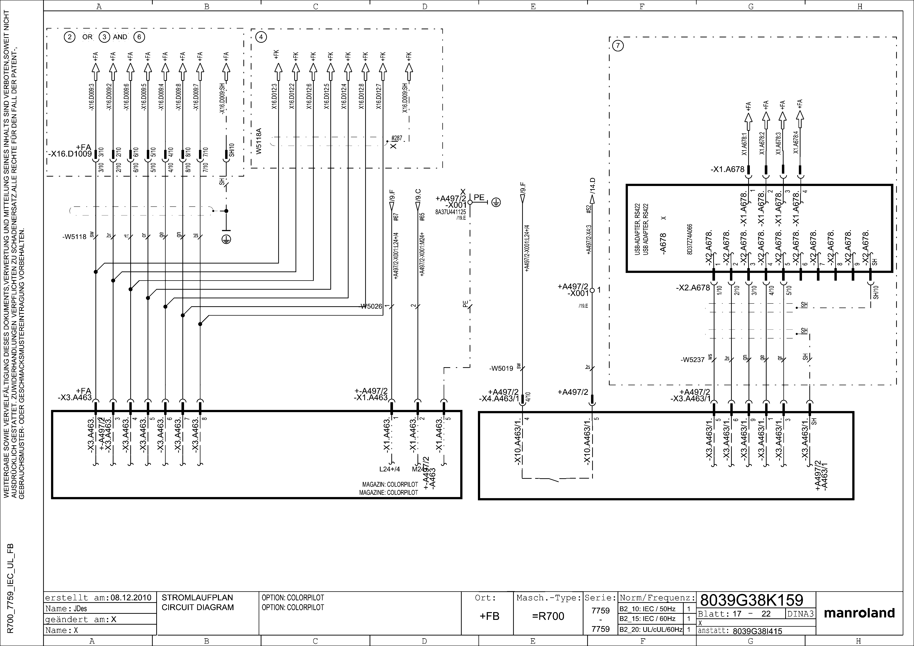

# +FB — Sheet 17 of 22 — OPTION: COLORPILOT

**OPTION: COLORPILOT**

> Part of the manroland **R700** printing press IEC/UL circuit diagrams.
> Drawing class: **Stromlaufplan / Circuit diagram** (DIN A3).
> Document `+FB` covers the **Delivery / Coating module** machine section.

## At a glance

| Field | Value |
|---|---|
| Document | `+FB`  (8039G38K159) |
| Sheet | **17** of 22 |
| Section (DE) | OPTION: COLORPILOT |
| Section (EN) | OPTION: COLORPILOT |
| Section type | OPTION — ColorPilot |
| Machine type | `=R700` |
| Series | `7759` |
| Created | 08.12.2010 |
| Replaces | `8039G38I415` |
| Columns used | A, B, C, D, E, F, G, H |
| Path numbers | 52, 65, 67, 287 |
| Labels on sheet | 209 |
| Cross-refs out | 6 |
| Cross-refs in | 37 |

**Previous:** [+FB sheet 16](SHEET_0016.md) · **Next:** [+FB sheet 18](SHEET_0018.md) · **Document TOC:** [_TOC.md](_TOC.md)  (+FB) · **Master TOC:** [all sheets](../_MASTER_TOC.md)

## Sheet image (300 DPI, exact vector render)



_Rendered directly from the PDF vector layer at 300 DPI (1-bit), no OCR and no resampling. Use it to confirm anything ambiguous in the text below._

## Cross-references on this sheet

Each entry is a wire leaving this sheet. The printed token is `/sheet.column`; the link resolves to that sheet inside the same document.

| Ref | Target sheet | Col | Path | Destination on target | Target section | From col |
|---|---|---|---|---|---|---|
| `/14.D` | [+FB sheet 14](SHEET_0014.md) | D | `#52` | +A497/2 X4:3 | OPTION: COLORPILOT | F |
| `/9.F` | [+FB sheet 9](SHEET_0009.md) | F | — | +A497/2 X001:L24+/4 | SPANNUNGSVERSORGUNG | E |
| `/9.C` | [+FB sheet 9](SHEET_0009.md) | C | `#65` | +A497/2 X001:M24+ | SPANNUNGSVERSORGUNG | D |
| `/9.F` | [+FB sheet 9](SHEET_0009.md) | F | `#67` | +A497/2 X001:L24+/4 | SPANNUNGSVERSORGUNG | D |
| `/19.E` | [+FB sheet 19](SHEET_0019.md) | E | — | — | KLEMMLEISTE | D |
| `/19.E` | [+FB sheet 19](SHEET_0019.md) | E | — | — | KLEMMLEISTE | E |

### Incoming references (sheets that point here)

Every other sheet that sends a wire to this one. `Back-ref` is the token printed on *that* sheet; `Path` is its line number.

| From sheet | Cols | Back-ref | Path | Refs | What continues there |
|---|---|---|---|---|---|
| [+FB#9](SHEET_0009.md) | C, F | `/9.C`, `/9.F` | `#65`, `#67` | 3 | + A497/2 X1.A463:1; + A497/2 X1.A463:2; +A497/2 X4.A463/1:4 |
| [+FB#14](SHEET_0014.md) | D | `/14.D` | `#52` | 1 | +A497/2 X001:1 |
| [+FB#15](SHEET_0015.md) | E | `/15.E` | — | 1 | — |
| [+FB#19](SHEET_0019.md) | D | `/19.D` | — | 2 | X X X X X X X X X X X X X 8A37U441125 |
| [+FB#21](SHEET_0021.md) | A, B, C, D | `/21.A`, `/21.B`, `/21.C`, `/21.D` | — | 28 | X; X X; X X X X |
| [+FB#22](SHEET_0022.md) | A | `/22.A` | — | 2 | X X X |


## Devices on this sheet

| Tag | Class | Class meaning (IEC) | Col | Sub | Terminal | Sign |
|---|---|---|---|---|---|---|
| `A463/1` | A | Baugruppe / assembly, module, PC board | H | 1 | — | — |
| `+A497/2` | A | Baugruppe / assembly, module, PC board | H | 2 | — | + |
| `+A497/2` | A | Baugruppe / assembly, module, PC board | F | 2 | — | + |
| `+A497/2` | A | Baugruppe / assembly, module, PC board | E | 2 | — | + |
| `+A497/2` | A | Baugruppe / assembly, module, PC board | E | 2 | — | + |
| `A463` | A | Baugruppe / assembly, module, PC board | D | — | — | — |
| `+A497/2` | A | Baugruppe / assembly, module, PC board | D | 2 | — | + |
| `X001` | X | Klemme / terminal, plug connector | D | — | — | — |
| `+A497/2` | A | Baugruppe / assembly, module, PC board | E | 2 | — | + |
| `X001` | X | Klemme / terminal, plug connector | E | — | — | — |
| `A678` | A | Baugruppe / assembly, module, PC board | F | — | — | — |
| `W5019` | W | Kabel / cable, line, bus | E | — | — | — |
| `W5026` | W | Kabel / cable, line, bus | D | — | — | — |
| `W5237` | W | Kabel / cable, line, bus | F | — | — | — |
| `W5118` | W | Kabel / cable, line, bus | A | — | — | — |
| `X1.A463.` | — | cross-device reference | D | — | — | — |
| `X1.A463.` | — | cross-device reference | D | — | — | — |
| `X1.A463.` | — | cross-device reference | D | — | — | — |
| `X3.A463.` | — | cross-device reference | A | — | — | — |
| `X3.A463.` | — | cross-device reference | A | — | — | — |
| `X3.A463.` | — | cross-device reference | A | — | — | — |
| `X3.A463.` | — | cross-device reference | A | — | — | — |
| `X3.A463.` | — | cross-device reference | B | — | — | — |
| `X3.A463.` | — | cross-device reference | B | — | — | — |
| `X3.A463.` | — | cross-device reference | B | — | — | — |
| `X1.A463` | — | cross-device reference | D | — | — | — |
| `X2.A678` | — | cross-device reference | F | — | — | — |
| `X1.A678.` | — | cross-device reference | G | — | — | — |
| `X1.A678.` | — | cross-device reference | G | — | — | — |
| `X1.A678.` | — | cross-device reference | G | — | — | — |
| `X1.A678.` | — | cross-device reference | G | — | — | — |
| `X2.A678.` | — | cross-device reference | G | — | — | — |
| `X2.A678.` | — | cross-device reference | G | — | — | — |
| `X2.A678.` | — | cross-device reference | G | — | — | — |
| `X2.A678.` | — | cross-device reference | G | — | — | — |
| `X2.A678.` | — | cross-device reference | G | — | — | — |
| `X2.A678.` | — | cross-device reference | G | — | — | — |
| `X2.A678.` | — | cross-device reference | H | — | — | — |
| `X2.A678.` | — | cross-device reference | H | — | — | — |
| `X2.A678.` | — | cross-device reference | H | — | — | — |
| `X2.A678.` | — | cross-device reference | H | — | — | — |
| `X1.A678` | — | cross-device reference | G | — | — | — |
| `X1.A678:1` | — | cross-device reference | G | — | 1 | — |
| `X1.A678:2` | — | cross-device reference | G | — | 2 | — |
| `X1.A678:3` | — | cross-device reference | G | — | 3 | — |
| `X1.A678:4` | — | cross-device reference | G | — | 4 | — |
| `X3.A463` | — | cross-device reference | A | — | — | — |
| `X16.D1009` | — | cross-device reference | A | — | — | — |
| `X16.D009:3` | — | cross-device reference | A | — | 3 | — |
| `X16.D009:2` | — | cross-device reference | A | — | 2 | — |
| `X16.D009:6` | — | cross-device reference | A | — | 6 | — |
| `X16.D009:5` | — | cross-device reference | A | — | 5 | — |
| `X16.D009:4` | — | cross-device reference | B | — | 4 | — |
| `X16.D009:8` | — | cross-device reference | B | — | 8 | — |
| `X16.D009:7` | — | cross-device reference | B | — | 7 | — |
| `X16.D009:SH` | — | cross-device reference | B | — | SH | — |
| `X16.D012:3` | — | cross-device reference | C | — | 3 | — |
| `X16.D012:2` | — | cross-device reference | C | — | 2 | — |
| `X16.D012:6` | — | cross-device reference | C | — | 6 | — |
| `X16.D012:5` | — | cross-device reference | C | — | 5 | — |
| `X16.D012:4` | — | cross-device reference | C | — | 4 | — |
| `X16.D012:8` | — | cross-device reference | C | — | 8 | — |
| `X16.D012:7` | — | cross-device reference | D | — | 7 | — |
| `X16.D009:SH` | — | cross-device reference | D | — | SH | — |

## Potentials / nets

| Potential | Count | Columns | Attached devices | Terminals |
|---|---|---|---|---|
| `L24+/4` | 1 | D | — | — |
| `M24+` | 1 | D | — | — |
| `PE` | 2 | D, E | — | — |


A potential such as `L24+/4` or `M24+` is a named supply/return rail; every place it appears on this sheet is electrically common.

## Wire-end annotations (grouped as printed)

A wire that continues elsewhere is annotated with a small cluster: the destination description, the path/line number `#NN`, and the `/sheet.column` cross reference. Each row below is one such cluster exactly as it is grouped on the drawing.

| Col | Y | Path | Cross-ref | Text on the wire |
|---|---|---|---|---|
| B | 44.2 | — | — | `2 OR 3 AND 6 4` |
| F | 55.6 | — | — | `7` |
| C | 65.1 | — | — | `X16.D012:3 +FK` |
| A | 67.9 | — | — | `X16.D009:3 +FA` |
| A | 67.9 | — | — | `X16.D009:2 +FA` |
| A | 67.9 | — | — | `X16.D009:6 +FA` |
| A | 67.9 | — | — | `X16.D009:5 +FA` |
| B | 67.9 | — | — | `X16.D009:4 +FA` |
| B | 67.9 | — | — | `X16.D009:8 +FA` |
| B | 67.9 | — | — | `X16.D009:7 +FA` |
| B | 67.9 | — | — | `X16.D009:SH +FA` |
| C | 67.9 | — | — | `X16.D012:2 +FK` |
| C | 67.9 | — | — | `X16.D012:6 +FK` |
| C | 67.9 | — | — | `X16.D012:5 +FK` |
| C | 67.9 | — | — | `X16.D012:4 +FK` |
| C | 67.9 | — | — | `X16.D012:8 +FK` |
| D | 67.9 | — | — | `X16.D012:7 +FK` |
| D | 67.9 | — | — | `X16.D009:SH +FK` |
| G | 129.6 | — | — | `X1.A678:4 +FA` |
| G | 131.2 | — | — | `X1.A678:2 +FA` |
| G | 131.2 | — | — | `X1.A678:3 +FA` |
| G | 133.0 | — | — | `X1.A678:1 +FA` |
| B | 167.0 | — | — | `W5118A` |
| D | 177.1 | `#287` | — | — |
| B | 186.9 | — | — | `SH/10` |
| D | 187.1 | — | — | `X` |
| A | 187.4 | — | — | `X16.D1009 +FA` |
| A | 192.1 | — | — | `3/10` |
| A | 192.1 | — | — | `2/10` |
| A | 192.1 | — | — | `6/10` |
| B | 192.1 | — | — | `5/10` |
| B | 192.1 | — | — | `4/10` |
| B | 192.1 | — | — | `8/10` |
| B | 192.1 | — | — | `7/10` |
| A | 212.3 | — | — | `3/10` |
| A | 212.3 | — | — | `2/10` |
| A | 212.3 | — | — | `6/10` |
| B | 212.3 | — | — | `5/10` |
| B | 212.3 | — | — | `4/10` |
| B | 212.3 | — | — | `8/10` |
| B | 212.3 | — | — | `7/10` |
| G | 216.0 | — | — | `X1.A678` |
| F | 231.4 | `#52` | `/14.D` | `+A497/2 X4:3` |
| B | 232.2 | — | — | `SH` |
| E | 237.0 | — | `/9.F` | `+A497/2 X001:L24+/4 4/10` |
| D | 245.5 | — | — | `+A497/2 X` |
| D | 246.1 | `#65` | `/9.C` | `+A497/2 X001:M24+` |
| G | 246.3 | — | — | `X1.A678. 1` |
| D | 246.9 | `#67` | `/9.F` | `+A497/2 X001:L24+/4` |
| G | 247.5 | — | — | `X1.A678. 2` |
| G | 247.8 | — | — | `X1.A678. 3` |
| G | 247.8 | — | — | `X1.A678. 4` |
| E | 252.6 | — | — | `PE` |
| D | 262.5 | — | — | `8A37U441125 X001` |
| F | 265.1 | — | — | `USB ADAPTER, RS422` |
| F | 265.3 | — | — | `USB ADAPTER, RS422` |
| D | 281.6 | — | `/19.E` | — |
| F | 282.1 | — | — | `A678 X` |
| F | 291.9 | — | — | `8D37Z74A066` |
| G | 299.1 | — | — | `X2.A678. 1` |
| G | 299.1 | — | — | `X2.A678. 2` |
| G | 299.1 | — | — | `X2.A678. 3` |
| G | 299.1 | — | — | `X2.A678. 4` |
| G | 299.1 | — | — | `X2.A678. 5` |
| G | 299.1 | — | — | `X2.A678. 6` |
| H | 299.1 | — | — | `X2.A678. 7` |
| H | 299.1 | — | — | `X2.A678. 8` |
| H | 299.1 | — | — | `X2.A678. 9` |
| H | 299.1 | — | — | `X2.A678. SH` |
| A | 301.6 | — | — | `sw` |
| B | 302.2 | — | — | `gn` |
| B | 302.4 | — | — | `ge` |
| A | 303.9 | — | — | `br` |
| A | 303.9 | — | — | `or` |
| B | 304.4 | — | — | `bl` |
| A | 304.7 | — | — | `W5118` |
| A | 305.5 | — | — | `rt` |
| E | 368.9 | — | — | `+A497/2` |
| F | 370.3 | — | — | `X2.A678` |
| G | 372.5 | — | — | `1/10` |
| G | 372.5 | — | — | `2/10` |
| G | 372.5 | — | — | `3/10` |
| G | 372.5 | — | — | `4/10` |
| G | 372.5 | — | — | `5/10` |
| H | 372.5 | — | — | `SH/10` |
| E | 373.1 | — | — | `X001 1` |
| D | 391.7 | — | — | `PE` |
| G | 393.9 | — | — | `SH` |
| D | 395.4 | — | — | `W5026` |
| D | 396.3 | — | — | `2` |
| D | 396.4 | — | — | `1` |
| E | 396.5 | — | `/19.E` | — |
| G | 427.9 | — | — | `SH` |
| H | 460.5 | — | — | `SH` |
| G | 461.2 | — | — | `ws` |
| G | 462.4 | — | — | `gn` |
| G | 462.7 | — | — | `ge` |
| G | 463.9 | — | — | `gr` |
| G | 464.1 | — | — | `br` |
| F | 464.9 | — | — | `W5237` |
| E | 473.2 | — | — | `sw` |
| F | 475.5 | — | — | `br` |
| E | 476.2 | — | — | `W5019` |
| A | 504.9 | — | — | `X3.A463 +FA` |
| D | 504.9 | — | — | `X1.A463 + A497/2` |
| E | 506.3 | — | — | `X4.A463/1 +A497/2` |
| E | 506.3 | — | — | `+A497/2` |
| F | 506.3 | — | — | `X3.A463/1 +A497/2` |
| D | 542.5 | — | — | `X1.A463. 1` |
| A | 543.1 | — | — | `X3.A463. 2` |
| A | 543.1 | — | — | `+ A497/2 X3.A463. 3` |
| A | 543.1 | — | — | `X3.A463. 4` |
| A | 543.1 | — | — | `X3.A463. 5` |
| B | 543.1 | — | — | `X3.A463. 6` |
| B | 543.1 | — | — | `X3.A463. 7` |
| B | 543.1 | — | — | `X3.A463. 8` |
| D | 543.1 | — | — | `X1.A463. 2` |
| D | 543.1 | — | — | `X1.A463. 5` |
| E | 544.0 | — | — | `X10.A463/1. 4` |
| F | 544.0 | — | — | `X10.A463/1. 5` |
| G | 544.0 | — | — | `X3.A463/1. 1` |
| G | 544.6 | — | — | `X3.A463/1. 5` |
| G | 544.6 | — | — | `X3.A463/1. 6` |
| G | 544.6 | — | — | `X3.A463/1. 9` |
| G | 544.6 | — | — | `X3.A463/1. 3` |
| H | 544.6 | — | — | `X3.A463/1. SH` |
| D | 595.0 | — | — | `+ A497/2 A463` |
| H | 599.9 | — | — | `+A497/2 A463/1` |
| D | 607.5 | — | — | `L24+/4 M24+` |
| D | 628.5 | — | — | `MAGAZINE: COLORPILOT MAGAZIN: COLORPILOT` |


## Reconstructed tables

This sheet carries tabular content (pin map / terminal assignment / index). The grid below was rebuilt from the drawing's own rule lines, so each row is exactly one physical row of the table.

### Table 1 — 3 data rows × 9 columns (at x=68.0, y=178.6) — **W5118A**

| +FA X16.D1009 | 3/10 3/10 | 2/10 2/10 | 6/10 6/10 | 5/10 5/10 | 4/10 4/10 | 8/10 8/10 | 7/10 7/10 SH | SH/10 |
|---|---|---|---|---|---|---|---|---|
| `sw W5118` | `br` | `rt` | `or` | `ge` | `gn` | `bl` |  |  |
| `+FA X3.A463` |  |  |  |  |  |  |  |  |
| `X3.A463.` | `X3.A463. 2 + A497/2` | `X3.A463. 3` | `X3.A463. 4` | `X3.A463. 5` | `X3.A463. 6` | `X3.A463. 7` | `8` |  |


### Table 2 — 6 data rows × 7 columns (at x=476.2, y=178.6) — **#287 X**

|  |  |  |  |  | +A497/2 X001 | X |
|---|---|---|---|---|---|---|
|  |  |  |  |  | `8A37U441125` |  |
|  |  | `#67 +A497/2 X001:L24+/4` |  | `#65 +A497/2 X001:M24+` |  | `/19.E` |
|  | `1` |  | `2` |  |  | `PE` |
| `W5026` |  |  |  |  |  |  |
| `+ A497/2 X1.A463` |  |  |  |  |  |  |
| `MAGAZIN: MAGAZINE:` | `X1.A463. L24+/4` | `1 COLORPILOT COLORPILOT` | `X1.A463.` | `X1.A463. 2 + A497/2 M24+ A463` | `5` |  |


### Table 3 — 7 data rows × 3 columns (at x=624.0, y=178.6)

| PE | /9.F | /14.D |
|---|---|---|
|  | `#52` |  |
|  | `+A497/2 X001:L24+/4 +A497/2 X4:3` |  |
|  | `+A497/2` |  |
|  | `X001` | `1` |
|  | `/19.E` |  |
| `sw W5019 +A497/2 X4.A463/1` | `br +A497/2 4/10` |  |
| `X10.A463/1.` | `4 X10.A463/1.` | `5` |


### Table 4 — 5 data rows × 11 columns (at x=930.2, y=240.9)

| X2.A678. 1 | X1.A678. X2.A678. 2 | 1 X1.A678. X2.A678. 3 | 2 X1.A678. X2.A678. 4 | 3 X1.A678. X2.A678. 5 | 4 6 | X2.A678. | X2.A678. 7 | X2.A678. 8 | X2.A678. 9 | SH |
|---|---|---|---|---|---|---|---|---|---|---|
| `1/10` | `2/10` | `3/10` | `4/10` | `5/10` |  |  |  |  |  | `SH/10` |
|  |  |  |  |  | `SH` |  |  |  |  |  |
|  |  |  |  |  | `SH` |  |  |  |  |  |
| `br` | `gn` | `ge` | `gr` |  | `SH` |  |  |  |  |  |
| `X3.A463/1. 5` | `X3.A463/1. 6` | `X3.A463/1. 9` | `1 X3.A463/1.` | `3` | `X3.A463/1.` | `SH` | `A463/1` |  |  |  |


## Notes and free text on this sheet

| Text | Col | Y (pt) |
|---|---|---|
| `X3.A463/1.` | G | 544.59 |
| `X3.A463/1` | F | 514.85 |
| `SH` | H | 544.87 |
| `X3.A463/1.` | H | 544.59 |
| `X10.A463/1.` | E | 544.59 |
| `X10.A463/1.` | F | 544.59 |
| `X4.A463/1` | E | 514.85 |
| `+A497/2 X001:L24+/4` | E | 293.15 |
| `+A497/2 X001:M24+` | D | 302.74 |
| `+A497/2 X001:L24+/4` | D | 303.02 |
| `+A497/2 X4:3` | F | 293.15 |
| `+ A497/2` | D | 594.99 |
| `MAGAZIN: COLORPILOT` | D | 628.5 |
| `MAGAZINE: COLORPILOT` | D | 639.13 |
| `+ A497/2` | A | 543.69 |
| `SH` | G | 427.91 |
| `8A37U441125` | D | 273.49 |
| `8D37Z74A066` | F | 291.92 |
| `USB ADAPTER, RS422` | F | 265.07 |
| `+FA` | G | 133 |
| `SH/10` | H | 372.52 |
| `+FA` | A | 504.86 |
| `SH/10` | B | 186.91 |
| `+FA` | B | 67.9 |
| `+FK` | C | 65.06 |
| `+FK` | D | 67.9 |
| `OR` | A | 44.25 |
| `AND` | A | 44.24 |
| `W5118A` | B | 166.96 |
| `sw` | E | 473.16 |
| `br` | F | 475.49 |
| `ws` | G | 461.25 |
| `br` | G | 464.15 |
| `gn` | G | 462.38 |
| `ge` | G | 462.66 |
| `gr` | G | 463.95 |
| `SH` | B | 232.25 |
| `gn` | B | 302.17 |
| `bl` | B | 304.39 |
| `ge` | B | 302.45 |
| `or` | A | 303.95 |
| `rt` | A | 305.47 |
| `sw` | A | 301.61 |
| `br` | A | 303.95 |

## Complete label inventory (exact text from the drawing)

Every text object inside the drawing area of this sheet, in DIN reading order (column A→H, then top→bottom). This is the authoritative list: if a string is not here it is not printed on this sheet.

| Col | Y | X | Dir | Type | Text |
|---|---|---|---|---|---|
| A | 44.2 | 147.4 | → | text | `AND` |
| A | 44.3 | 88.4 | → | number | `2` |
| A | 44.3 | 107.4 | → | text | `OR` |
| A | 44.3 | 133.7 | → | number | `3` |
| A | 44.3 | 179.0 | → | number | `6` |
| A | 67.9 | 121.8 | ↕ | text | `+FA` |
| A | 67.9 | 144.5 | ↕ | text | `+FA` |
| A | 67.9 | 167.1 | ↕ | text | `+FA` |
| A | 67.9 | 189.8 | ↕ | text | `+FA` |
| A | 108.9 | 139.1 | ↕ | device ref | `X16.D009:2` |
| A | 109.1 | 116.4 | ↕ | device ref | `X16.D009:3` |
| A | 109.1 | 161.8 | ↕ | device ref | `X16.D009:6` |
| A | 109.1 | 184.5 | ↕ | device ref | `X16.D009:5` |
| A | 187.4 | 98.9 | → | text | `+FA` |
| A | 192.1 | 128.9 | ↕ | pin pair | `3/10` |
| A | 192.1 | 151.6 | ↕ | pin pair | `2/10` |
| A | 192.1 | 174.2 | ↕ | pin pair | `6/10` |
| A | 195.9 | 62.9 | → | device ref | `X16.D1009` |
| A | 212.3 | 128.9 | ↕ | pin pair | `3/10` |
| A | 212.3 | 151.6 | ↕ | pin pair | `2/10` |
| A | 212.3 | 174.2 | ↕ | pin pair | `6/10` |
| A | 301.6 | 116.1 | ↕ | text | `sw` |
| A | 303.9 | 138.8 | ↕ | text | `br` |
| A | 303.9 | 184.3 | ↕ | text | `or` |
| A | 304.7 | 81.4 | → | device tag | `W5118` |
| A | 305.5 | 161.3 | ↕ | text | `rt` |
| A | 504.9 | 98.9 | → | text | `+FA` |
| A | 513.4 | 75.4 | → | device ref | `X3.A463` |
| A | 543.1 | 113.7 | ↕ | device ref | `X3.A463.` |
| A | 543.1 | 136.4 | ↕ | device ref | `X3.A463.` |
| A | 543.1 | 159.1 | ↕ | device ref | `X3.A463.` |
| A | 543.1 | 181.7 | ↕ | device ref | `X3.A463.` |
| A | 543.7 | 127.3 | ↕ | number | `2` |
| A | 543.7 | 127.9 | ↕ | text | `+ A497/2` |
| A | 544.0 | 150.1 | ↕ | number | `3` |
| A | 544.0 | 172.7 | ↕ | number | `4` |
| A | 544.0 | 195.4 | ↕ | number | `5` |
| B | 44.3 | 337.7 | → | number | `4` |
| B | 67.9 | 212.5 | ↕ | text | `+FA` |
| B | 67.9 | 235.2 | ↕ | text | `+FA` |
| B | 67.9 | 257.9 | ↕ | text | `+FA` |
| B | 67.9 | 291.9 | ↕ | text | `+FA` |
| B | 108.6 | 286.5 | ↕ | device ref | `X16.D009:SH` |
| B | 109.1 | 207.1 | ↕ | device ref | `X16.D009:4` |
| B | 109.1 | 229.8 | ↕ | device ref | `X16.D009:8` |
| B | 109.1 | 252.5 | ↕ | device ref | `X16.D009:7` |
| B | 167.0 | 333.3 | ↕ | text | `W5118A` |
| B | 186.9 | 299.0 | ↕ | text | `SH/10` |
| B | 192.1 | 196.9 | ↕ | pin pair | `5/10` |
| B | 192.1 | 219.6 | ↕ | pin pair | `4/10` |
| B | 192.1 | 242.3 | ↕ | pin pair | `8/10` |
| B | 192.1 | 264.9 | ↕ | pin pair | `7/10` |
| B | 212.3 | 196.9 | ↕ | pin pair | `5/10` |
| B | 212.3 | 219.6 | ↕ | pin pair | `4/10` |
| B | 212.3 | 242.3 | ↕ | pin pair | `8/10` |
| B | 212.3 | 264.9 | ↕ | pin pair | `7/10` |
| B | 232.2 | 286.1 | ↕ | text | `SH` |
| B | 302.2 | 229.5 | ↕ | text | `gn` |
| B | 302.5 | 206.9 | ↕ | text | `ge` |
| B | 304.4 | 252.0 | ↕ | text | `bl` |
| B | 543.1 | 204.4 | ↕ | device ref | `X3.A463.` |
| B | 543.1 | 227.1 | ↕ | device ref | `X3.A463.` |
| B | 543.1 | 249.8 | ↕ | device ref | `X3.A463.` |
| B | 544.0 | 218.1 | ↕ | number | `6` |
| B | 544.0 | 240.8 | ↕ | number | `7` |
| B | 544.0 | 263.5 | ↕ | number | `8` |
| C | 65.1 | 357.1 | ↕ | text | `+FK` |
| C | 67.9 | 382.6 | ↕ | text | `+FK` |
| C | 67.9 | 405.3 | ↕ | text | `+FK` |
| C | 67.9 | 427.9 | ↕ | text | `+FK` |
| C | 67.9 | 450.6 | ↕ | text | `+FK` |
| C | 67.9 | 473.3 | ↕ | text | `+FK` |
| C | 108.9 | 377.2 | ↕ | device ref | `X16.D012:2` |
| C | 109.1 | 354.6 | ↕ | device ref | `X16.D012:3` |
| C | 109.1 | 399.9 | ↕ | device ref | `X16.D012:6` |
| C | 109.1 | 422.6 | ↕ | device ref | `X16.D012:5` |
| C | 109.1 | 445.3 | ↕ | device ref | `X16.D012:4` |
| C | 109.1 | 467.9 | ↕ | device ref | `X16.D012:8` |
| D | 67.9 | 496.0 | ↕ | text | `+FK` |
| D | 67.9 | 530.0 | ↕ | text | `+FK` |
| D | 108.6 | 524.6 | ↕ | device ref | `X16.D009:SH` |
| D | 109.1 | 490.6 | ↕ | device ref | `X16.D012:7` |
| D | 177.1 | 510.2 | → | path no. | `#287` |
| D | 187.1 | 507.7 | ↕ | not fitted | `X` |
| D | 245.5 | 599.5 | → | not fitted | `X` |
| D | 246.0 | 541.0 | ↕ | cross-reference | `/9.C` |
| D | 246.9 | 506.9 | ↕ | cross-reference | `/9.F` |
| D | 254.0 | 567.2 | → | device tag | `+A497/2` |
| D | 262.5 | 580.3 | → | device tag | `X001` |
| D | 273.5 | 567.3 | → | text | `8A37U441125` |
| D | 277.5 | 513.0 | ↕ | path no. | `#67` |
| D | 277.5 | 547.0 | ↕ | path no. | `#65` |
| D | 281.7 | 594.9 | → | cross-reference | `/19.E` |
| D | 302.7 | 547.0 | ↕ | text | `+A497/2 X001:M24+` |
| D | 303.0 | 513.0 | ↕ | text | `+A497/2 X001:L24+/4` |
| D | 391.7 | 603.5 | ↕ | potential | `PE` |
| D | 395.4 | 466.9 | → | device tag | `W5026` |
| D | 396.3 | 535.5 | ↕ | number | `2` |
| D | 396.4 | 501.1 | ↕ | number | `1` |
| D | 504.9 | 461.8 | → | text | `+ A497/2` |
| D | 513.4 | 460.9 | → | device ref | `X1.A463` |
| D | 542.6 | 512.5 | ↕ | number | `1` |
| D | 543.1 | 499.2 | ↕ | device ref | `X1.A463.` |
| D | 543.1 | 533.2 | ↕ | device ref | `X1.A463.` |
| D | 543.1 | 567.2 | ↕ | device ref | `X1.A463.` |
| D | 543.7 | 546.9 | ↕ | number | `2` |
| D | 544.0 | 580.9 | ↕ | number | `5` |
| D | 595.0 | 550.2 | ↕ | text | `+ A497/2` |
| D | 607.5 | 494.3 | → | potential | `L24+/4` |
| D | 607.6 | 536.7 | → | potential | `M24+` |
| D | 609.7 | 558.7 | ↕ | device tag | `A463` |
| D | 628.5 | 472.2 | → | text | `MAGAZIN: COLORPILOT` |
| D | 639.1 | 468.0 | → | text | `MAGAZINE: COLORPILOT` |
| E | 237.0 | 677.4 | ↕ | cross-reference | `/9.F` |
| E | 252.6 | 617.1 | → | potential | `PE` |
| E | 293.2 | 683.5 | ↕ | text | `+A497/2 X001:L24+/4` |
| E | 368.8 | 726.4 | → | device tag | `+A497/2` |
| E | 377.4 | 739.4 | → | device tag | `X001` |
| E | 396.5 | 754.1 | → | cross-reference | `/19.E` |
| E | 473.2 | 672.1 | ↕ | text | `sw` |
| E | 476.2 | 637.3 | → | device tag | `W5019` |
| E | 506.3 | 635.6 | → | device tag | `+A497/2` |
| E | 506.3 | 726.4 | → | device tag | `+A497/2` |
| E | 511.1 | 684.9 | ↕ | pin pair | `4/10` |
| E | 514.9 | 624.0 | → | text | `X4.A463/1` |
| E | 544.0 | 683.4 | ↕ | number | `4` |
| E | 544.6 | 669.7 | ↕ | text | `X10.A463/1.` |
| F | 55.6 | 802.6 | → | number | `7` |
| F | 231.4 | 768.2 | ↕ | cross-reference | `/14.D` |
| F | 265.1 | 827.6 | ↕ | text | `USB ADAPTER, RS422` |
| F | 265.3 | 838.3 | ↕ | text | `USB ADAPTER, RS422` |
| F | 267.4 | 764.3 | ↕ | path no. | `#52` |
| F | 282.1 | 861.6 | ↕ | not fitted | `X` |
| F | 291.9 | 895.7 | ↕ | text | `8D37Z74A066` |
| F | 293.2 | 764.3 | ↕ | text | `+A497/2 X4:3` |
| F | 303.6 | 859.2 | ↕ | device tag | `A678` |
| F | 370.3 | 880.8 | → | device ref | `X2.A678` |
| F | 373.1 | 777.4 | → | number | `1` |
| F | 464.9 | 886.8 | → | device tag | `W5237` |
| F | 475.5 | 762.8 | ↕ | text | `br` |
| F | 506.3 | 885.1 | → | device tag | `+A497/2` |
| F | 514.9 | 873.5 | → | text | `X3.A463/1` |
| F | 544.0 | 774.1 | ↕ | number | `5` |
| F | 544.6 | 760.4 | ↕ | text | `X10.A463/1.` |
| G | 129.6 | 1039.3 | ↕ | text | `+FA` |
| G | 131.2 | 995.1 | ↕ | text | `+FA` |
| G | 131.2 | 1016.6 | ↕ | text | `+FA` |
| G | 133.0 | 972.2 | ↕ | text | `+FA` |
| G | 170.9 | 1033.9 | ↕ | device ref | `X1.A678:4` |
| G | 172.1 | 989.8 | ↕ | device ref | `X1.A678:2` |
| G | 172.4 | 1011.2 | ↕ | device ref | `X1.A678:3` |
| G | 172.8 | 966.7 | ↕ | device ref | `X1.A678:1` |
| G | 216.0 | 925.8 | → | device ref | `X1.A678` |
| G | 246.3 | 977.3 | ↕ | number | `1` |
| G | 247.5 | 1000.4 | ↕ | number | `2` |
| G | 247.7 | 1023.1 | ↕ | number | `3` |
| G | 248.3 | 964.1 | ↕ | device ref | `X1.A678.` |
| G | 248.3 | 986.8 | ↕ | device ref | `X1.A678.` |
| G | 248.3 | 1009.5 | ↕ | device ref | `X1.A678.` |
| G | 248.3 | 1032.1 | ↕ | device ref | `X1.A678.` |
| G | 299.1 | 918.7 | ↕ | device ref | `X2.A678.` |
| G | 299.1 | 941.4 | ↕ | device ref | `X2.A678.` |
| G | 299.1 | 964.1 | ↕ | device ref | `X2.A678.` |
| G | 299.1 | 986.8 | ↕ | device ref | `X2.A678.` |
| G | 299.1 | 1009.5 | ↕ | device ref | `X2.A678.` |
| G | 299.1 | 1032.1 | ↕ | device ref | `X2.A678.` |
| G | 342.4 | 955.0 | ↕ | number | `2` |
| G | 342.5 | 932.0 | ↕ | number | `1` |
| G | 342.5 | 977.8 | ↕ | number | `3` |
| G | 342.5 | 1000.5 | ↕ | number | `4` |
| G | 342.5 | 1023.1 | ↕ | number | `5` |
| G | 372.5 | 934.3 | ↕ | pin pair | `1/10` |
| G | 372.5 | 957.0 | ↕ | pin pair | `2/10` |
| G | 372.5 | 979.7 | ↕ | pin pair | `3/10` |
| G | 372.5 | 1002.4 | ↕ | pin pair | `4/10` |
| G | 372.5 | 1025.0 | ↕ | pin pair | `5/10` |
| G | 393.9 | 1043.3 | → | text | `SH` |
| G | 427.9 | 1043.3 | → | text | `SH` |
| G | 461.3 | 921.6 | ↕ | text | `ws` |
| G | 462.4 | 966.9 | ↕ | text | `gn` |
| G | 462.7 | 989.7 | ↕ | text | `ge` |
| G | 464.0 | 1012.3 | ↕ | text | `gr` |
| G | 464.2 | 944.2 | ↕ | text | `br` |
| G | 544.0 | 1000.4 | ↕ | number | `1` |
| G | 544.6 | 919.1 | ↕ | text | `X3.A463/1.` |
| G | 544.6 | 941.8 | ↕ | text | `X3.A463/1.` |
| G | 544.6 | 964.5 | ↕ | text | `X3.A463/1.` |
| G | 544.6 | 987.2 | ↕ | text | `X3.A463/1.` |
| G | 544.6 | 1009.9 | ↕ | text | `X3.A463/1.` |
| G | 545.4 | 932.8 | ↕ | number | `5` |
| G | 545.4 | 955.5 | ↕ | number | `6` |
| G | 545.4 | 978.2 | ↕ | number | `9` |
| G | 545.4 | 1023.5 | ↕ | number | `3` |
| H | 247.7 | 1045.8 | ↕ | number | `4` |
| H | 299.1 | 1054.8 | ↕ | device ref | `X2.A678.` |
| H | 299.1 | 1077.5 | ↕ | device ref | `X2.A678.` |
| H | 299.1 | 1100.2 | ↕ | device ref | `X2.A678.` |
| H | 299.1 | 1122.8 | ↕ | device ref | `X2.A678.` |
| H | 337.1 | 1136.5 | ↕ | text | `SH` |
| H | 342.5 | 1045.8 | ↕ | number | `6` |
| H | 342.5 | 1068.5 | ↕ | number | `7` |
| H | 342.5 | 1091.2 | ↕ | number | `8` |
| H | 342.5 | 1113.9 | ↕ | number | `9` |
| H | 372.5 | 1138.4 | ↕ | text | `SH/10` |
| H | 460.5 | 1046.2 | ↕ | text | `SH` |
| H | 544.6 | 1043.9 | ↕ | text | `X3.A463/1.` |
| H | 544.9 | 1057.6 | ↕ | text | `SH` |
| H | 599.9 | 1060.9 | ↕ | device tag | `+A497/2` |
| H | 602.4 | 1069.4 | ↕ | device tag | `A463/1` |

## Reading-order text block

The same content as a plain block, grouped by DIN column — convenient to paste or to match against a visual description.

```text
=== Column A ===
  44.2  147.4  text         AND
  44.3   88.4  numeric      2
  44.3  107.4  text         OR
  44.3  133.7  numeric      3
  44.3  179.0  numeric      6
  67.9  121.8  text         +FA
  67.9  144.5  text         +FA
  67.9  167.1  text         +FA
  67.9  189.8  text         +FA
 108.9  139.1  devref       X16.D009:2
 109.1  116.4  devref       X16.D009:3
 109.1  161.8  devref       X16.D009:6
 109.1  184.5  devref       X16.D009:5
 187.4   98.9  text         +FA
 192.1  128.9  pinpair      3/10
 192.1  151.6  pinpair      2/10
 192.1  174.2  pinpair      6/10
 195.9   62.9  devref       X16.D1009
 212.3  128.9  pinpair      3/10
 212.3  151.6  pinpair      2/10
 212.3  174.2  pinpair      6/10
 301.6  116.1  text         sw
 303.9  138.8  text         br
 303.9  184.3  text         or
 304.7   81.4  devtag       W5118
 305.5  161.3  text         rt
 504.9   98.9  text         +FA
 513.4   75.4  devref       X3.A463
 543.1  113.7  devref       X3.A463.
 543.1  136.4  devref       X3.A463.
 543.1  159.1  devref       X3.A463.
 543.1  181.7  devref       X3.A463.
 543.7  127.3  numeric      2
 543.7  127.9  text         + A497/2
 544.0  150.1  numeric      3
 544.0  172.7  numeric      4
 544.0  195.4  numeric      5
=== Column B ===
  44.3  337.7  numeric      4
  67.9  212.5  text         +FA
  67.9  235.2  text         +FA
  67.9  257.9  text         +FA
  67.9  291.9  text         +FA
 108.6  286.5  devref       X16.D009:SH
 109.1  207.1  devref       X16.D009:4
 109.1  229.8  devref       X16.D009:8
 109.1  252.5  devref       X16.D009:7
 167.0  333.3  text         W5118A
 186.9  299.0  text         SH/10
 192.1  196.9  pinpair      5/10
 192.1  219.6  pinpair      4/10
 192.1  242.3  pinpair      8/10
 192.1  264.9  pinpair      7/10
 212.3  196.9  pinpair      5/10
 212.3  219.6  pinpair      4/10
 212.3  242.3  pinpair      8/10
 212.3  264.9  pinpair      7/10
 232.2  286.1  text         SH
 302.2  229.5  text         gn
 302.5  206.9  text         ge
 304.4  252.0  text         bl
 543.1  204.4  devref       X3.A463.
 543.1  227.1  devref       X3.A463.
 543.1  249.8  devref       X3.A463.
 544.0  218.1  numeric      6
 544.0  240.8  numeric      7
 544.0  263.5  numeric      8
=== Column C ===
  65.1  357.1  text         +FK
  67.9  382.6  text         +FK
  67.9  405.3  text         +FK
  67.9  427.9  text         +FK
  67.9  450.6  text         +FK
  67.9  473.3  text         +FK
 108.9  377.2  devref       X16.D012:2
 109.1  354.6  devref       X16.D012:3
 109.1  399.9  devref       X16.D012:6
 109.1  422.6  devref       X16.D012:5
 109.1  445.3  devref       X16.D012:4
 109.1  467.9  devref       X16.D012:8
=== Column D ===
  67.9  496.0  text         +FK
  67.9  530.0  text         +FK
 108.6  524.6  devref       X16.D009:SH
 109.1  490.6  devref       X16.D012:7
 177.1  510.2  path         #287
 187.1  507.7  placeholder  X
 245.5  599.5  placeholder  X
 246.0  541.0  xref         /9.C
 246.9  506.9  xref         /9.F
 254.0  567.2  devtag       +A497/2
 262.5  580.3  devtag       X001
 273.5  567.3  text         8A37U441125
 277.5  513.0  path         #67
 277.5  547.0  path         #65
 281.7  594.9  xref         /19.E
 302.7  547.0  text         +A497/2 X001:M24+
 303.0  513.0  text         +A497/2 X001:L24+/4
 391.7  603.5  net          PE
 395.4  466.9  devtag       W5026
 396.3  535.5  numeric      2
 396.4  501.1  numeric      1
 504.9  461.8  text         + A497/2
 513.4  460.9  devref       X1.A463
 542.6  512.5  numeric      1
 543.1  499.2  devref       X1.A463.
 543.1  533.2  devref       X1.A463.
 543.1  567.2  devref       X1.A463.
 543.7  546.9  numeric      2
 544.0  580.9  numeric      5
 595.0  550.2  text         + A497/2
 607.5  494.3  net          L24+/4
 607.6  536.7  net          M24+
 609.7  558.7  devtag       A463
 628.5  472.2  text         MAGAZIN: COLORPILOT
 639.1  468.0  text         MAGAZINE: COLORPILOT
=== Column E ===
 237.0  677.4  xref         /9.F
 252.6  617.1  net          PE
 293.2  683.5  text         +A497/2 X001:L24+/4
 368.8  726.4  devtag       +A497/2
 377.4  739.4  devtag       X001
 396.5  754.1  xref         /19.E
 473.2  672.1  text         sw
 476.2  637.3  devtag       W5019
 506.3  635.6  devtag       +A497/2
 506.3  726.4  devtag       +A497/2
 511.1  684.9  pinpair      4/10
 514.9  624.0  text         X4.A463/1
 544.0  683.4  numeric      4
 544.6  669.7  text         X10.A463/1.
=== Column F ===
  55.6  802.6  numeric      7
 231.4  768.2  xref         /14.D
 265.1  827.6  text         USB ADAPTER, RS422
 265.3  838.3  text         USB ADAPTER, RS422
 267.4  764.3  path         #52
 282.1  861.6  placeholder  X
 291.9  895.7  text         8D37Z74A066
 293.2  764.3  text         +A497/2 X4:3
 303.6  859.2  devtag       A678
 370.3  880.8  devref       X2.A678
 373.1  777.4  numeric      1
 464.9  886.8  devtag       W5237
 475.5  762.8  text         br
 506.3  885.1  devtag       +A497/2
 514.9  873.5  text         X3.A463/1
 544.0  774.1  numeric      5
 544.6  760.4  text         X10.A463/1.
=== Column G ===
 129.6 1039.3  text         +FA
 131.2  995.1  text         +FA
 131.2 1016.6  text         +FA
 133.0  972.2  text         +FA
 170.9 1033.9  devref       X1.A678:4
 172.1  989.8  devref       X1.A678:2
 172.4 1011.2  devref       X1.A678:3
 172.8  966.7  devref       X1.A678:1
 216.0  925.8  devref       X1.A678
 246.3  977.3  numeric      1
 247.5 1000.4  numeric      2
 247.7 1023.1  numeric      3
 248.3  964.1  devref       X1.A678.
 248.3  986.8  devref       X1.A678.
 248.3 1009.5  devref       X1.A678.
 248.3 1032.1  devref       X1.A678.
 299.1  918.7  devref       X2.A678.
 299.1  941.4  devref       X2.A678.
 299.1  964.1  devref       X2.A678.
 299.1  986.8  devref       X2.A678.
 299.1 1009.5  devref       X2.A678.
 299.1 1032.1  devref       X2.A678.
 342.4  955.0  numeric      2
 342.5  932.0  numeric      1
 342.5  977.8  numeric      3
 342.5 1000.5  numeric      4
 342.5 1023.1  numeric      5
 372.5  934.3  pinpair      1/10
 372.5  957.0  pinpair      2/10
 372.5  979.7  pinpair      3/10
 372.5 1002.4  pinpair      4/10
 372.5 1025.0  pinpair      5/10
 393.9 1043.3  text         SH
 427.9 1043.3  text         SH
 461.3  921.6  text         ws
 462.4  966.9  text         gn
 462.7  989.7  text         ge
 464.0 1012.3  text         gr
 464.2  944.2  text         br
 544.0 1000.4  numeric      1
 544.6  919.1  text         X3.A463/1.
 544.6  941.8  text         X3.A463/1.
 544.6  964.5  text         X3.A463/1.
 544.6  987.2  text         X3.A463/1.
 544.6 1009.9  text         X3.A463/1.
 545.4  932.8  numeric      5
 545.4  955.5  numeric      6
 545.4  978.2  numeric      9
 545.4 1023.5  numeric      3
=== Column H ===
 247.7 1045.8  numeric      4
 299.1 1054.8  devref       X2.A678.
 299.1 1077.5  devref       X2.A678.
 299.1 1100.2  devref       X2.A678.
 299.1 1122.8  devref       X2.A678.
 337.1 1136.5  text         SH
 342.5 1045.8  numeric      6
 342.5 1068.5  numeric      7
 342.5 1091.2  numeric      8
 342.5 1113.9  numeric      9
 372.5 1138.4  text         SH/10
 460.5 1046.2  text         SH
 544.6 1043.9  text         X3.A463/1.
 544.9 1057.6  text         SH
 599.9 1060.9  devtag       +A497/2
 602.4 1069.4  devtag       A463/1
```

---
_Generated from the PDF vector text layer; no OCR. Source: `R700_7759_IEC_UL_FB`, sheet 17._
