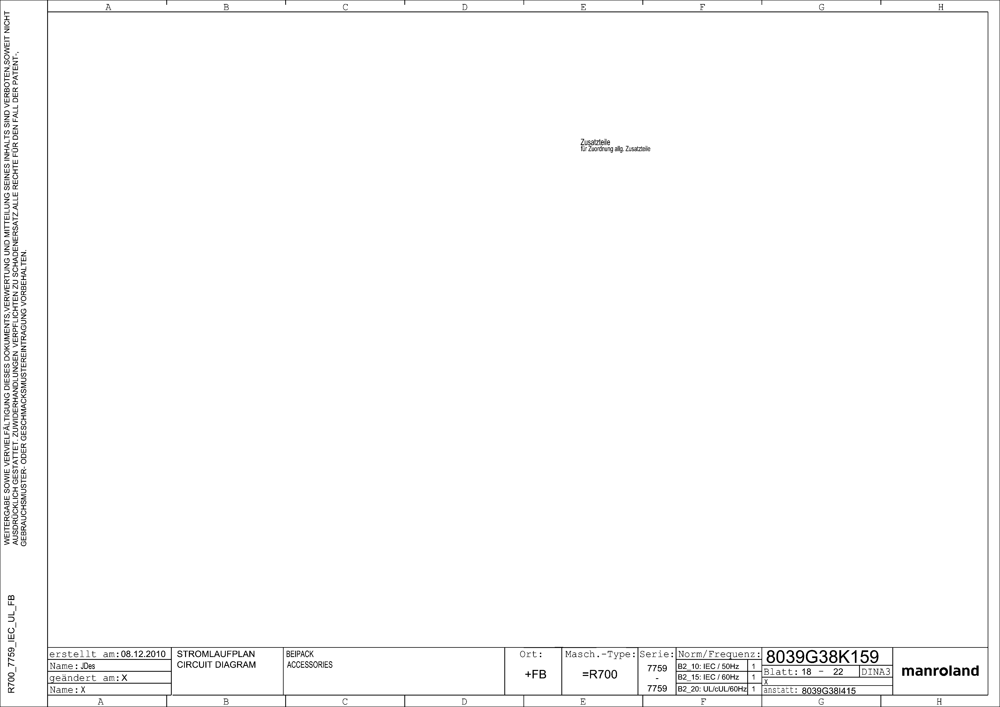

# +FB — Sheet 18 of 22 — BEIPACK

**ACCESSORIES**

> Part of the manroland **R700** printing press IEC/UL circuit diagrams.
> Drawing class: **Stromlaufplan / Circuit diagram** (DIN A3).
> Document `+FB` covers the **Delivery / Coating module** machine section.

## At a glance

| Field | Value |
|---|---|
| Document | `+FB`  (8039G38K159) |
| Sheet | **18** of 22 |
| Section (DE) | BEIPACK |
| Section (EN) | ACCESSORIES |
| Section type | ACCESSORIES — Accessories |
| Machine type | `=R700` |
| Series | `7759` |
| Created | 08.12.2010 |
| Replaces | `8039G38I415` |
| Columns used | E |
| Path numbers | — |
| Labels on sheet | 2 |
| Cross-refs out | 0 |
| Cross-refs in | 0 |

**Previous:** [+FB sheet 17](SHEET_0017.md) · **Next:** [+FB sheet 19](SHEET_0019.md) · **Document TOC:** [_TOC.md](_TOC.md)  (+FB) · **Master TOC:** [all sheets](../_MASTER_TOC.md)

## Sheet image (300 DPI, exact vector render)



_Rendered directly from the PDF vector layer at 300 DPI (1-bit), no OCR and no resampling. Use it to confirm anything ambiguous in the text below._

## Cross-references on this sheet

Each entry is a wire leaving this sheet. The printed token is `/sheet.column`; the link resolves to that sheet inside the same document.

_No outgoing cross-references on this sheet._

## Devices on this sheet

_No device designators on this sheet._

## Potentials / nets

_No named potentials on this sheet._

## Wire-end annotations (grouped as printed)

A wire that continues elsewhere is annotated with a small cluster: the destination description, the path/line number `#NN`, and the `/sheet.column` cross reference. Each row below is one such cluster exactly as it is grouped on the drawing.

| Col | Y | Path | Cross-ref | Text on the wire |
|---|---|---|---|---|
| E | 166.1 | — | — | `Zusatzteile für Zuordnung allg. Zusatzteile` |


## Notes and free text on this sheet

| Text | Col | Y (pt) |
|---|---|---|
| `Zusatzteile` | E | 166.13 |
| `für Zuordnung allg. Zusatzteile` | E | 174.31 |

## Complete label inventory (exact text from the drawing)

Every text object inside the drawing area of this sheet, in DIN reading order (column A→H, then top→bottom). This is the authoritative list: if a string is not here it is not printed on this sheet.

| Col | Y | X | Dir | Type | Text |
|---|---|---|---|---|---|
| E | 166.1 | 691.4 | → | text | `Zusatzteile` |
| E | 174.3 | 691.7 | → | text | `für Zuordnung allg. Zusatzteile` |

## Reading-order text block

The same content as a plain block, grouped by DIN column — convenient to paste or to match against a visual description.

```text
=== Column E ===
 166.1  691.4  text         Zusatzteile
 174.3  691.7  text         für Zuordnung allg. Zusatzteile
```

---
_Generated from the PDF vector text layer; no OCR. Source: `R700_7759_IEC_UL_FB`, sheet 18._
