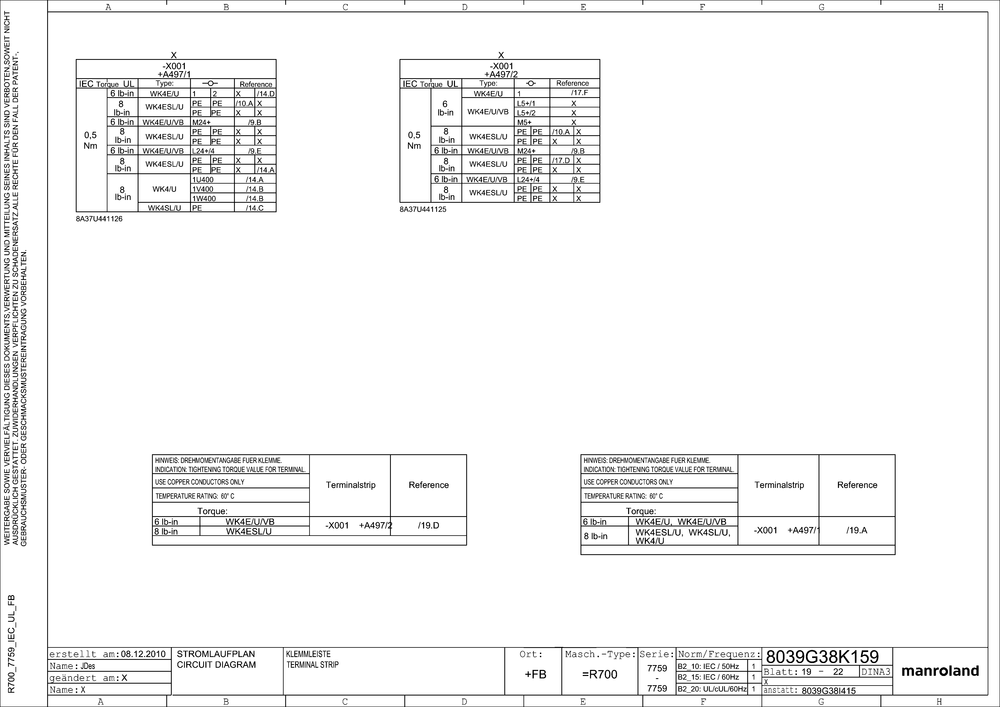

# +FB — Sheet 19 of 22 — KLEMMLEISTE

**TERMINAL STRIP**

> Part of the manroland **R700** printing press IEC/UL circuit diagrams.
> Drawing class: **Stromlaufplan / Circuit diagram** (DIN A3).
> Document `+FB` covers the **Delivery / Coating module** machine section.

## At a glance

| Field | Value |
|---|---|
| Document | `+FB`  (8039G38K159) |
| Sheet | **19** of 22 |
| Section (DE) | KLEMMLEISTE |
| Section (EN) | TERMINAL STRIP |
| Section type | TERMINALS — Terminal strip |
| Machine type | `=R700` |
| Series | `7759` |
| Created | 08.12.2010 |
| Replaces | `8039G38I415` |
| Columns used | A, B, C, D, E, F, G |
| Path numbers | — |
| Labels on sheet | 156 |
| Cross-refs out | 15 |
| Cross-refs in | 18 |

**Previous:** [+FB sheet 18](SHEET_0018.md) · **Next:** [+FB sheet 20](SHEET_0020.md) · **Document TOC:** [_TOC.md](_TOC.md)  (+FB) · **Master TOC:** [all sheets](../_MASTER_TOC.md)

## Sheet image (300 DPI, exact vector render)



_Rendered directly from the PDF vector layer at 300 DPI (1-bit), no OCR and no resampling. Use it to confirm anything ambiguous in the text below._

## Cross-references on this sheet

Each entry is a wire leaving this sheet. The printed token is `/sheet.column`; the link resolves to that sheet inside the same document.

| Ref | Target sheet | Col | Path | Destination on target | Target section | From col |
|---|---|---|---|---|---|---|
| `/17.F` | [+FB sheet 17](SHEET_0017.md) | F | — | X X X X X X X X X X X X X 8A37U441125 | OPTION: COLORPILOT | D |
| `/10.A` | [+FB sheet 10](SHEET_0010.md) | A | — | X X X X X X X X X X X X X 8A37U441125 | ERDUNG UND POTENTIALAUSGLEICH | D |
| `/9.B` | [+FB sheet 9](SHEET_0009.md) | B | — | X X X X X X X X X X X X X 8A37U441125 | SPANNUNGSVERSORGUNG | D |
| `/17.D` | [+FB sheet 17](SHEET_0017.md) | D | — | X X X X X X X X X X X X X 8A37U441125 | OPTION: COLORPILOT | D |
| `/9.E` | [+FB sheet 9](SHEET_0009.md) | E | — | X X X X X X X X X X X X X 8A37U441125 | SPANNUNGSVERSORGUNG | D |
| `/14.D` | [+FB sheet 14](SHEET_0014.md) | D | — | X /10.A X X X X X X X X X X | OPTION: COLORPILOT | B |
| `/9.B` | [+FB sheet 9](SHEET_0009.md) | B | — | X /10.A X X X X X X X X X X | SPANNUNGSVERSORGUNG | B |
| `/9.E` | [+FB sheet 9](SHEET_0009.md) | E | — | X /10.A X X X X X X X X X X | SPANNUNGSVERSORGUNG | B |
| `/14.A` | [+FB sheet 14](SHEET_0014.md) | A | — | X /10.A X X X X X X X X X X | OPTION: COLORPILOT | B |
| `/14.A` | [+FB sheet 14](SHEET_0014.md) | A | — | X /10.A X X X X X X X X X X | OPTION: COLORPILOT | B |
| `/14.B` | [+FB sheet 14](SHEET_0014.md) | B | — | X /10.A X X X X X X X X X X | OPTION: COLORPILOT | B |
| `/14.B` | [+FB sheet 14](SHEET_0014.md) | B | — | X /10.A X X X X X X X X X X | OPTION: COLORPILOT | B |
| `/14.C` | [+FB sheet 14](SHEET_0014.md) | C | — | X /10.A X X X X X X X X X X | OPTION: COLORPILOT | B |
| `/19.D` | [+FB sheet 19](SHEET_0019.md) | D | — | +A497/2 X001 WK4ESL/U | KLEMMLEISTE | C |
| `/19.A` | [+FB sheet 19](SHEET_0019.md) | A | — | +A497/1 X001 | KLEMMLEISTE | G |

### Incoming references (sheets that point here)

Every other sheet that sends a wire to this one. `Back-ref` is the token printed on *that* sheet; `Path` is its line number.

| From sheet | Cols | Back-ref | Path | Refs | What continues there |
|---|---|---|---|---|---|
| [+FB#5](SHEET_0005.md) | C | `/5.C` | — | 1 | X001 |
| [+FB#6](SHEET_0006.md) | D | `/6.D` | — | 1 | — |
| [+FB#9](SHEET_0009.md) | C, E | `/9.C`, `/9.E` | — | 4 | L24+/4 L24+/4 L24+/4 L24+/4; M24+ M24+ M24+ M24+ |
| [+FB#10](SHEET_0010.md) | A, C | `/10.A`, `/10.C` | — | 2 | OR 2 3 |
| [+FB#14](SHEET_0014.md) | A, B, D | `/14.A`, `/14.B`, `/14.D` | — | 6 | — |
| [+FB#17](SHEET_0017.md) | D, E | `/17.D`, `/17.E` | — | 2 | — |
| [+FB#19](SHEET_0019.md) | C, G | `/19.C`, `/19.G` | — | 2 | +A497/1 X001; +A497/2 X001 WK4ESL/U |


## Devices on this sheet

| Tag | Class | Class meaning (IEC) | Col | Sub | Terminal | Sign |
|---|---|---|---|---|---|---|
| `X001` | X | Klemme / terminal, plug connector | G | — | — | — |
| `+A497/1` | A | Baugruppe / assembly, module, PC board | G | 1 | — | + |
| `+A497/1` | A | Baugruppe / assembly, module, PC board | B | 1 | — | + |
| `X001` | X | Klemme / terminal, plug connector | B | — | — | — |
| `+A497/2` | A | Baugruppe / assembly, module, PC board | D | 2 | — | + |
| `X001` | X | Klemme / terminal, plug connector | D | — | — | — |
| `X001` | X | Klemme / terminal, plug connector | C | — | — | — |
| `+A497/2` | A | Baugruppe / assembly, module, PC board | C | 2 | — | + |

## Potentials / nets

| Potential | Count | Columns | Attached devices | Terminals |
|---|---|---|---|---|
| `L24+/4` | 2 | B, E | — | — |
| `L5+/1` | 1 | E | — | — |
| `L5+/2` | 1 | E | — | — |
| `M24+` | 2 | B, E | — | — |
| `M5+` | 1 | E | — | — |
| `PE` | 13 | B | — | — |


A potential such as `L24+/4` or `M24+` is a named supply/return rail; every place it appears on this sheet is electrically common.

## Wire-end annotations (grouped as printed)

A wire that continues elsewhere is annotated with a small cluster: the destination description, the path/line number `#NN`, and the `/sheet.column` cross reference. Each row below is one such cluster exactly as it is grouped on the drawing.

| Col | Y | Path | Cross-ref | Text on the wire |
|---|---|---|---|---|
| B | 61.2 | — | — | `X` |
| D | 61.2 | — | — | `X` |
| B | 74.0 | — | — | `X001` |
| D | 74.0 | — | — | `X001` |
| B | 83.9 | — | — | `+A497/1` |
| D | 83.9 | — | — | `+A497/2` |
| A | 95.2 | — | — | `IEC Torque UL Type:` |
| D | 95.2 | — | — | `IEC Torque UL Type:` |
| E | 95.4 | — | — | `Reference` |
| B | 96.8 | — | — | `Reference` |
| D | 106.6 | — | `/17.F`, `/10.A`, `/9.B`, `/17.D`, `/9.E` | `8A37U441125 X X X X X X X X X X X X X` |
| A | 106.7 | — | — | `6 lb in` |
| A | 107.9 | — | — | `WK4E/U` |
| B | 107.9 | — | `/14.D`, `/9.B`, `/9.E`, `/14.A`, `/14.A`, `/14.B`, `/14.B`, `/14.C` | `X /10.A X X X X X X X X X X` |
| D | 107.9 | — | — | `WK4E/U` |
| B | 108.0 | — | — | `1 PE PE PE PE L24+/4 PE PE 1U400 1V400 1W400 PE M24+ PE PE PE PE PE PE 2` |
| E | 108.0 | — | — | `1 L5+/1 L5+/2 PE PE PE PE PE PE PE PE L24+/4 PE PE PE PE M5+ M24+` |
| A | 119.3 | — | — | `8` |
| D | 119.3 | — | — | `6` |
| A | 123.5 | — | — | `WK4ESL/U` |
| D | 129.2 | — | — | `WK4E/U/VB` |
| A | 129.4 | — | — | `lb in` |
| D | 129.4 | — | — | `lb in` |
| A | 140.7 | — | — | `6 lb in` |
| A | 141.9 | — | — | `WK4E/U/VB` |
| A | 151.9 | — | — | `8` |
| D | 151.9 | — | — | `8` |
| A | 156.2 | — | — | `Nm 0,5` |
| D | 156.2 | — | — | `Nm 0,5` |
| A | 158.9 | — | — | `WK4ESL/U` |
| D | 158.9 | — | — | `WK4ESL/U` |
| A | 162.0 | — | — | `6 lb in lb in` |
| D | 162.0 | — | — | `lb in` |
| D | 174.8 | — | — | `6 lb in` |
| A | 175.9 | — | — | `WK4E/U/VB` |
| D | 175.9 | — | — | `WK4E/U/VB` |
| A | 187.4 | — | — | `8` |
| D | 187.4 | — | — | `8` |
| A | 191.6 | — | — | `WK4ESL/U` |
| D | 191.6 | — | — | `WK4ESL/U` |
| A | 196.1 | — | — | `lb in` |
| D | 196.1 | — | — | `lb in` |
| D | 208.8 | — | — | `6 lb in` |
| D | 210.0 | — | — | `WK4E/U/VB` |
| A | 221.3 | — | — | `WK4/U` |
| A | 221.4 | — | — | `8` |
| D | 221.4 | — | — | `8` |
| D | 225.6 | — | — | `WK4ESL/U` |
| A | 230.1 | — | — | `lb in` |
| D | 230.1 | — | — | `lb in` |
| A | 244.0 | — | — | `WK4SL/U` |
| A | 256.9 | — | — | `8A37U441126` |
| B | 545.6 | — | — | `HINWEIS: DREHMOMENTANGABE FUER KLEMME. INDICATION: TIGHTENING TORQUE VALUE FOR TERMINAL.` |
| F | 545.6 | — | — | `HINWEIS: DREHMOMENTANGABE FUER KLEMME. INDICATION: TIGHTENING TORQUE VALUE FOR TERMINAL.` |
| B | 571.1 | — | — | `USE COPPER CONDUCTORS ONLY` |
| E | 571.1 | — | — | `USE COPPER CONDUCTORS ONLY` |
| C | 573.0 | — | — | `Terminalstrip Reference` |
| G | 573.0 | — | — | `Terminalstrip Reference` |
| B | 588.1 | — | — | `TEMPERATURE RATING: 60° C` |
| E | 588.1 | — | — | `TEMPERATURE RATING: 60° C` |
| B | 604.1 | — | — | `Torque:` |
| E | 604.1 | — | — | `Torque:` |
| B | 616.8 | — | — | `8 lb in 6 lb in WK4E/U/VB` |
| F | 616.8 | — | — | `6 lb in WK4E/U, WK4E/U/VB WK4ESL/U, WK4SL/U, WK4/U` |
| C | 621.1 | — | `/19.D` | `WK4ESL/U X001 +A497/2` |
| G | 626.8 | — | `/19.A` | `X001 +A497/1` |
| E | 634.0 | — | — | `8 lb in` |


## Reconstructed tables

This sheet carries tabular content (pin map / terminal assignment / index). The grid below was rebuilt from the drawing's own rule lines, so each row is exactly one physical row of the table.

### Table 1 — 18 data rows × 15 columns (at x=127.6, y=93.5)

| UL Torque | Type: |  |  |  |  | Reference |  | IEC | UL Torque | Type: |  |  | Reference |  |
|---|---|---|---|---|---|---|---|---|---|---|---|---|---|---|
| `6 lb in` | `WK4E/U` | `1` |  | `2` | `X` | `/14.D` |  |  |  | `WK4E/U` | `1` |  |  | `/17.F` |
| `8` |  | `PE` |  | `PE` | `/10.A` | `X` |  |  | `6` |  | `L5+/1` |  |  | `X` |
| `lb in` | `WK4ESL/U` | `PE` |  | `PE` | `X` | `X` |  |  | `lb in` | `WK4E/U/VB` | `L5+/2` |  |  | `X` |
| `6 lb in` | `WK4E/U/VB` |  | `M24+` |  |  | `/9.B` |  |  |  |  | `M5+` |  |  | `X` |
| `8` |  | `PE` |  | `PE` | `X` | `X` |  | `0,5` | `8` |  | `PE` | `PE` | `/10.A` | `X` |
| `lb in` | `WK4ESL/U` | `PE` |  | `PE` | `X` | `X` |  |  | `lb in` | `WK4ESL/U` | `PE` | `PE` | `X` | `X` |
| `6 lb in` | `WK4E/U/VB` |  | `L24+/4` |  |  | `/9.E` |  | `Nm` | `6 lb in` | `WK4E/U/VB` | `M24+` |  |  | `/9.B` |
| `8` |  | `PE` |  | `PE` | `X` | `X` |  |  | `8` |  | `PE` | `PE` | `/17.D` | `X` |
| `lb in` | `WK4ESL/U` | `PE` |  | `PE` | `X` | `/14.A` |  |  | `lb in` | `WK4ESL/U` | `PE` | `PE` | `X` | `X` |
|  |  |  | `1U400` |  |  | `/14.A` |  |  | `6 lb in` | `WK4E/U/VB` | `L24+/4` |  |  | `/9.E` |
| `8` | `WK4/U` |  | `1V400` |  |  | `/14.B` |  |  | `8` |  | `PE` | `PE` | `X` | `X` |
| `lb in` |  |  | `1W400` |  |  | `/14.B` |  |  | `lb in` | `WK4ESL/U` | `PE` | `PE` | `X` | `X` |
|  | `WK4SL/U HINWEIS: INDICATION:` | `PE` | `TIGHTENING` | `DREHMOMENTANGABE TORQUE` | `FUER` | `/14.C KLEMME. VALUE FOR TERMINAL.` |  | `8A37U441125` |  |  |  |  |  | `HINWEIS: INDICATION:` |
|  | `USE COPPER` |  | `CONDUCTORS` |  | `ONLY` |  | `Terminalstrip` | `Reference` |  |  |  |  |  | `USE COPPER` |
|  | `TEMPERATURE` |  | `RATING:` | `60° C` |  |  |  |  |  |  |  |  |  | `TEMPERATURE` |
|  | `6 lb in` |  |  | `Torque:` | `WK4E/U/VB` |  | `+A497/2 X001` | `/19.D` |  |  |  |  |  | `6 lb in` |
|  | `8 lb in` |  |  |  | `WK4ESL/U` |  |  |  |  |  |  |  |  |  |
|  |  |  |  |  |  |  |  |  |  |  |  |  |  | `8 lb in` |


## Notes and free text on this sheet

| Text | Col | Y (pt) |
|---|---|---|
| `8 lb in` | E | 633.97 |
| `6 lb in` | E | 616.96 |
| `WK4E/U, WK4E/U/VB` | F | 616.81 |
| `WK4ESL/U, WK4SL/U,` | F | 629.56 |
| `WK4/U` | F | 639.44 |
| `Reference` | B | 96.8 |
| `lb in` | A | 129.44 |
| `Torque` | A | 96.77 |
| `IEC` | A | 95.36 |
| `UL` | A | 95.25 |
| `Type:` | A | 95.31 |
| `WK4ESL/U` | A | 191.55 |
| `Nm` | A | 168.92 |
| `WK4E/U` | A | 107.9 |
| `WK4SL/U` | A | 243.98 |
| `WK4E/U/VB` | A | 141.93 |
| `WK4/U` | A | 221.28 |
| `6 lb in` | A | 174.76 |
| `8A37U441126` | A | 256.85 |
| `1U400` | B | 210.09 |
| `1V400` | B | 221.4 |
| `1W400` | B | 232.66 |
| `/10.A X` | B | 119.28 |
| `Reference` | E | 95.38 |
| `lb in` | D | 129.44 |
| `Torque` | D | 96.77 |
| `IEC` | D | 95.36 |
| `UL` | D | 95.25 |
| `Type:` | D | 95.31 |
| `WK4ESL/U` | D | 191.55 |
| `Nm` | D | 168.92 |
| `WK4E/U/VB` | D | 129.17 |
| `6 lb in` | D | 174.76 |
| `WK4E/U` | D | 107.9 |
| `PE PE` | E | 153.3 |
| `8A37U441125` | D | 245.51 |
| `8 lb in` | A | 628.3 |
| `WK4E/U/VB` | B | 616.8 |
| `WK4ESL/U` | B | 628.12 |
| `HINWEIS: DREHMOMENTANGABE FUER KLEMME.` | F | 545.58 |
| `INDICATION: TIGHTENING TORQUE VALUE FOR TERMINAL.` | F | 556.22 |
| `USE COPPER CONDUCTORS ONLY` | E | 571.11 |
| `TEMPERATURE RATING: 60° C` | E | 588.11 |
| `Terminalstrip` | G | 573.05 |
| `Reference` | G | 572.99 |
| `Torque:` | E | 604.12 |
| `HINWEIS: DREHMOMENTANGABE FUER KLEMME.` | B | 545.58 |
| `INDICATION: TIGHTENING TORQUE VALUE FOR TERMINAL.` | B | 556.22 |
| `USE COPPER CONDUCTORS ONLY` | B | 571.11 |
| `TEMPERATURE RATING: 60° C` | B | 588.11 |
| `Terminalstrip` | C | 573.05 |
| `Reference` | D | 572.99 |
| `Torque:` | B | 604.12 |

## Complete label inventory (exact text from the drawing)

Every text object inside the drawing area of this sheet, in DIN reading order (column A→H, then top→bottom). This is the authoritative list: if a string is not here it is not printed on this sheet.

| Col | Y | X | Dir | Type | Text |
|---|---|---|---|---|---|
| A | 95.3 | 146.6 | → | text | `UL` |
| A | 95.3 | 185.4 | → | text | `Type:` |
| A | 95.4 | 94.1 | → | text | `IEC` |
| A | 96.8 | 114.5 | → | text | `Torque` |
| A | 106.7 | 131.5 | → | text | `6 lb in` |
| A | 107.9 | 178.7 | → | text | `WK4E/U` |
| A | 119.3 | 141.2 | → | number | `8` |
| A | 123.5 | 173.3 | → | text | `WK4ESL/U` |
| A | 129.4 | 135.5 | → | text | `lb in` |
| A | 140.7 | 131.5 | → | text | `6 lb in` |
| A | 141.9 | 169.8 | → | text | `WK4E/U/VB` |
| A | 151.9 | 142.6 | → | number | `8` |
| A | 156.2 | 100.3 | → | number | `0,5` |
| A | 158.9 | 173.3 | → | text | `WK4ESL/U` |
| A | 162.0 | 136.9 | → | text | `lb in` |
| A | 168.9 | 99.5 | → | text | `Nm` |
| A | 174.8 | 131.5 | → | text | `6 lb in` |
| A | 175.9 | 169.8 | → | text | `WK4E/U/VB` |
| A | 187.4 | 142.6 | → | number | `8` |
| A | 191.5 | 173.3 | → | text | `WK4ESL/U` |
| A | 196.1 | 136.9 | → | text | `lb in` |
| A | 221.3 | 181.7 | → | text | `WK4/U` |
| A | 221.4 | 142.6 | → | number | `8` |
| A | 230.1 | 136.9 | → | text | `lb in` |
| A | 244.0 | 176.3 | → | text | `WK4SL/U` |
| A | 256.9 | 90.4 | → | text | `8A37U441126` |
| A | 617.0 | 184.0 | → | text | `6 lb in` |
| A | 628.3 | 183.7 | → | text | `8 lb in` |
| B | 61.2 | 203.4 | → | not fitted | `X` |
| B | 74.0 | 193.6 | → | device tag | `X001` |
| B | 83.9 | 187.7 | → | device tag | `+A497/1` |
| B | 96.8 | 285.4 | → | text | `Reference` |
| B | 107.9 | 280.6 | → | not fitted | `X` |
| B | 108.0 | 228.8 | → | number | `1` |
| B | 108.0 | 253.4 | → | number | `2` |
| B | 108.0 | 306.1 | → | cross-reference | `/14.D` |
| B | 119.3 | 228.8 | → | potential | `PE` |
| B | 119.3 | 252.9 | → | potential | `PE` |
| B | 119.3 | 280.6 | → | text | `/10.A X` |
| B | 130.6 | 228.8 | → | potential | `PE` |
| B | 130.6 | 251.4 | → | potential | `PE` |
| B | 130.6 | 280.6 | → | not fitted | `X` |
| B | 130.6 | 306.1 | → | not fitted | `X` |
| B | 142.0 | 295.5 | → | cross-reference | `/9.B` |
| B | 142.1 | 229.0 | → | potential | `M24+` |
| B | 153.3 | 228.8 | → | potential | `PE` |
| B | 153.3 | 252.9 | → | potential | `PE` |
| B | 153.3 | 280.6 | → | not fitted | `X` |
| B | 153.3 | 306.1 | → | not fitted | `X` |
| B | 164.6 | 228.8 | → | potential | `PE` |
| B | 164.6 | 251.4 | → | potential | `PE` |
| B | 164.6 | 280.6 | → | not fitted | `X` |
| B | 164.6 | 306.1 | → | not fitted | `X` |
| B | 176.0 | 228.8 | → | potential | `L24+/4` |
| B | 176.0 | 295.7 | → | cross-reference | `/9.E` |
| B | 187.3 | 228.8 | → | potential | `PE` |
| B | 187.3 | 252.9 | → | potential | `PE` |
| B | 187.3 | 280.6 | → | not fitted | `X` |
| B | 187.3 | 306.1 | → | not fitted | `X` |
| B | 198.6 | 228.8 | → | potential | `PE` |
| B | 198.6 | 251.4 | → | potential | `PE` |
| B | 198.6 | 280.6 | → | not fitted | `X` |
| B | 198.7 | 306.1 | → | cross-reference | `/14.A` |
| B | 210.0 | 293.0 | → | cross-reference | `/14.A` |
| B | 210.1 | 228.8 | → | text | `1U400` |
| B | 221.4 | 228.8 | → | text | `1V400` |
| B | 221.4 | 293.1 | → | cross-reference | `/14.B` |
| B | 232.7 | 228.8 | → | text | `1W400` |
| B | 232.7 | 293.1 | → | cross-reference | `/14.B` |
| B | 244.0 | 228.8 | → | potential | `PE` |
| B | 244.1 | 293.0 | → | cross-reference | `/14.C` |
| B | 545.6 | 184.8 | → | text | `HINWEIS: DREHMOMENTANGABE FUER KLEMME.` |
| B | 556.2 | 184.8 | → | text | `INDICATION: TIGHTENING TORQUE VALUE FOR TERMINAL.` |
| B | 571.1 | 184.8 | → | text | `USE COPPER CONDUCTORS ONLY` |
| B | 588.1 | 185.4 | → | text | `TEMPERATURE RATING: 60° C` |
| B | 604.1 | 235.0 | → | text | `Torque:` |
| B | 616.8 | 268.7 | → | text | `WK4E/U/VB` |
| B | 628.1 | 269.3 | → | text | `WK4ESL/U` |
| C | 573.0 | 388.1 | → | text | `Terminalstrip` |
| C | 621.1 | 387.5 | → | device tag | `X001` |
| C | 621.1 | 427.5 | → | device tag | `+A497/2` |
| D | 61.2 | 593.1 | → | not fitted | `X` |
| D | 74.0 | 583.4 | → | device tag | `X001` |
| D | 83.9 | 576.7 | → | device tag | `+A497/2` |
| D | 95.3 | 532.1 | → | text | `UL` |
| D | 95.3 | 570.9 | → | text | `Type:` |
| D | 95.4 | 479.6 | → | text | `IEC` |
| D | 96.8 | 500.0 | → | text | `Torque` |
| D | 107.9 | 564.2 | → | text | `WK4E/U` |
| D | 108.0 | 615.7 | → | number | `1` |
| D | 119.3 | 527.0 | → | number | `6` |
| D | 129.2 | 556.7 | → | text | `WK4E/U/VB` |
| D | 129.4 | 521.0 | → | text | `lb in` |
| D | 151.9 | 528.1 | → | number | `8` |
| D | 156.2 | 485.9 | → | number | `0,5` |
| D | 158.9 | 558.9 | → | text | `WK4ESL/U` |
| D | 162.0 | 522.4 | → | text | `lb in` |
| D | 168.9 | 485.0 | → | text | `Nm` |
| D | 174.8 | 517.0 | → | text | `6 lb in` |
| D | 175.9 | 556.7 | → | text | `WK4E/U/VB` |
| D | 187.4 | 528.1 | → | number | `8` |
| D | 191.5 | 558.9 | → | text | `WK4ESL/U` |
| D | 196.1 | 522.4 | → | text | `lb in` |
| D | 208.8 | 517.0 | → | text | `6 lb in` |
| D | 210.0 | 555.3 | → | text | `WK4E/U/VB` |
| D | 221.4 | 528.1 | → | number | `8` |
| D | 225.6 | 558.9 | → | text | `WK4ESL/U` |
| D | 230.1 | 522.4 | → | text | `lb in` |
| D | 245.5 | 475.9 | → | text | `8A37U441125` |
| D | 573.0 | 486.7 | → | text | `Reference` |
| D | 621.1 | 497.9 | → | cross-reference | `/19.D` |
| E | 95.4 | 662.5 | → | text | `Reference` |
| E | 106.6 | 680.3 | → | cross-reference | `/17.F` |
| E | 119.3 | 680.3 | → | not fitted | `X` |
| E | 119.4 | 615.7 | → | potential | `L5+/1` |
| E | 130.6 | 680.3 | → | not fitted | `X` |
| E | 130.7 | 615.7 | → | potential | `L5+/2` |
| E | 142.0 | 680.3 | → | not fitted | `X` |
| E | 142.1 | 616.0 | → | potential | `M5+` |
| E | 153.3 | 615.7 | → | text | `PE PE` |
| E | 153.3 | 657.6 | → | cross-reference | `/10.A` |
| E | 153.3 | 686.0 | → | not fitted | `X` |
| E | 164.6 | 615.7 | → | text | `PE PE` |
| E | 164.6 | 657.6 | → | not fitted | `X` |
| E | 164.6 | 686.0 | → | not fitted | `X` |
| E | 176.0 | 680.3 | → | cross-reference | `/9.B` |
| E | 176.1 | 616.0 | → | potential | `M24+` |
| E | 187.3 | 615.7 | → | text | `PE PE` |
| E | 187.3 | 686.0 | → | not fitted | `X` |
| E | 187.4 | 657.6 | → | cross-reference | `/17.D` |
| E | 198.6 | 615.7 | → | text | `PE PE` |
| E | 198.6 | 657.6 | → | not fitted | `X` |
| E | 198.6 | 686.0 | → | not fitted | `X` |
| E | 210.0 | 680.3 | → | cross-reference | `/9.E` |
| E | 210.1 | 615.7 | → | potential | `L24+/4` |
| E | 221.3 | 615.7 | → | text | `PE PE` |
| E | 221.3 | 657.6 | → | not fitted | `X` |
| E | 221.3 | 686.0 | → | not fitted | `X` |
| E | 232.7 | 615.7 | → | text | `PE PE` |
| E | 232.7 | 657.6 | → | not fitted | `X` |
| E | 232.7 | 686.0 | → | not fitted | `X` |
| E | 571.1 | 695.1 | → | text | `USE COPPER CONDUCTORS ONLY` |
| E | 588.1 | 695.6 | → | text | `TEMPERATURE RATING: 60° C` |
| E | 604.1 | 745.2 | → | text | `Torque:` |
| E | 617.0 | 694.2 | → | text | `6 lb in` |
| E | 634.0 | 695.3 | → | text | `8 lb in` |
| F | 545.6 | 695.1 | → | text | `HINWEIS: DREHMOMENTANGABE FUER KLEMME.` |
| F | 556.2 | 695.1 | → | text | `INDICATION: TIGHTENING TORQUE VALUE FOR TERMINAL.` |
| F | 616.8 | 756.9 | → | text | `WK4E/U, WK4E/U/VB` |
| F | 629.6 | 756.9 | → | text | `WK4ESL/U, WK4SL/U,` |
| F | 639.4 | 756.9 | → | text | `WK4/U` |
| G | 573.0 | 898.3 | → | text | `Terminalstrip` |
| G | 573.0 | 996.9 | → | text | `Reference` |
| G | 626.7 | 937.7 | → | device tag | `+A497/1` |
| G | 626.8 | 897.7 | → | device tag | `X001` |
| G | 626.8 | 1008.0 | → | cross-reference | `/19.A` |

## Reading-order text block

The same content as a plain block, grouped by DIN column — convenient to paste or to match against a visual description.

```text
=== Column A ===
  95.3  146.6  text         UL
  95.3  185.4  text         Type:
  95.4   94.1  text         IEC
  96.8  114.5  text         Torque
 106.7  131.5  text         6 lb in
 107.9  178.7  text         WK4E/U
 119.3  141.2  numeric      8
 123.5  173.3  text         WK4ESL/U
 129.4  135.5  text         lb in
 140.7  131.5  text         6 lb in
 141.9  169.8  text         WK4E/U/VB
 151.9  142.6  numeric      8
 156.2  100.3  numeric      0,5
 158.9  173.3  text         WK4ESL/U
 162.0  136.9  text         lb in
 168.9   99.5  text         Nm
 174.8  131.5  text         6 lb in
 175.9  169.8  text         WK4E/U/VB
 187.4  142.6  numeric      8
 191.5  173.3  text         WK4ESL/U
 196.1  136.9  text         lb in
 221.3  181.7  text         WK4/U
 221.4  142.6  numeric      8
 230.1  136.9  text         lb in
 244.0  176.3  text         WK4SL/U
 256.9   90.4  text         8A37U441126
 617.0  184.0  text         6 lb in
 628.3  183.7  text         8 lb in
=== Column B ===
  61.2  203.4  placeholder  X
  74.0  193.6  devtag       X001
  83.9  187.7  devtag       +A497/1
  96.8  285.4  text         Reference
 107.9  280.6  placeholder  X
 108.0  228.8  numeric      1
 108.0  253.4  numeric      2
 108.0  306.1  xref         /14.D
 119.3  228.8  net          PE
 119.3  252.9  net          PE
 119.3  280.6  text         /10.A X
 130.6  228.8  net          PE
 130.6  251.4  net          PE
 130.6  280.6  placeholder  X
 130.6  306.1  placeholder  X
 142.0  295.5  xref         /9.B
 142.1  229.0  net          M24+
 153.3  228.8  net          PE
 153.3  252.9  net          PE
 153.3  280.6  placeholder  X
 153.3  306.1  placeholder  X
 164.6  228.8  net          PE
 164.6  251.4  net          PE
 164.6  280.6  placeholder  X
 164.6  306.1  placeholder  X
 176.0  228.8  net          L24+/4
 176.0  295.7  xref         /9.E
 187.3  228.8  net          PE
 187.3  252.9  net          PE
 187.3  280.6  placeholder  X
 187.3  306.1  placeholder  X
 198.6  228.8  net          PE
 198.6  251.4  net          PE
 198.6  280.6  placeholder  X
 198.7  306.1  xref         /14.A
 210.0  293.0  xref         /14.A
 210.1  228.8  text         1U400
 221.4  228.8  text         1V400
 221.4  293.1  xref         /14.B
 232.7  228.8  text         1W400
 232.7  293.1  xref         /14.B
 244.0  228.8  net          PE
 244.1  293.0  xref         /14.C
 545.6  184.8  text         HINWEIS: DREHMOMENTANGABE FUER KLEMME.
 556.2  184.8  text         INDICATION: TIGHTENING TORQUE VALUE FOR TERMINAL.
 571.1  184.8  text         USE COPPER CONDUCTORS ONLY
 588.1  185.4  text         TEMPERATURE RATING: 60° C
 604.1  235.0  text         Torque:
 616.8  268.7  text         WK4E/U/VB
 628.1  269.3  text         WK4ESL/U
=== Column C ===
 573.0  388.1  text         Terminalstrip
 621.1  387.5  devtag       X001
 621.1  427.5  devtag       +A497/2
=== Column D ===
  61.2  593.1  placeholder  X
  74.0  583.4  devtag       X001
  83.9  576.7  devtag       +A497/2
  95.3  532.1  text         UL
  95.3  570.9  text         Type:
  95.4  479.6  text         IEC
  96.8  500.0  text         Torque
 107.9  564.2  text         WK4E/U
 108.0  615.7  numeric      1
 119.3  527.0  numeric      6
 129.2  556.7  text         WK4E/U/VB
 129.4  521.0  text         lb in
 151.9  528.1  numeric      8
 156.2  485.9  numeric      0,5
 158.9  558.9  text         WK4ESL/U
 162.0  522.4  text         lb in
 168.9  485.0  text         Nm
 174.8  517.0  text         6 lb in
 175.9  556.7  text         WK4E/U/VB
 187.4  528.1  numeric      8
 191.5  558.9  text         WK4ESL/U
 196.1  522.4  text         lb in
 208.8  517.0  text         6 lb in
 210.0  555.3  text         WK4E/U/VB
 221.4  528.1  numeric      8
 225.6  558.9  text         WK4ESL/U
 230.1  522.4  text         lb in
 245.5  475.9  text         8A37U441125
 573.0  486.7  text         Reference
 621.1  497.9  xref         /19.D
=== Column E ===
  95.4  662.5  text         Reference
 106.6  680.3  xref         /17.F
 119.3  680.3  placeholder  X
 119.4  615.7  net          L5+/1
 130.6  680.3  placeholder  X
 130.7  615.7  net          L5+/2
 142.0  680.3  placeholder  X
 142.1  616.0  net          M5+
 153.3  615.7  text         PE PE
 153.3  657.6  xref         /10.A
 153.3  686.0  placeholder  X
 164.6  615.7  text         PE PE
 164.6  657.6  placeholder  X
 164.6  686.0  placeholder  X
 176.0  680.3  xref         /9.B
 176.1  616.0  net          M24+
 187.3  615.7  text         PE PE
 187.3  686.0  placeholder  X
 187.4  657.6  xref         /17.D
 198.6  615.7  text         PE PE
 198.6  657.6  placeholder  X
 198.6  686.0  placeholder  X
 210.0  680.3  xref         /9.E
 210.1  615.7  net          L24+/4
 221.3  615.7  text         PE PE
 221.3  657.6  placeholder  X
 221.3  686.0  placeholder  X
 232.7  615.7  text         PE PE
 232.7  657.6  placeholder  X
 232.7  686.0  placeholder  X
 571.1  695.1  text         USE COPPER CONDUCTORS ONLY
 588.1  695.6  text         TEMPERATURE RATING: 60° C
 604.1  745.2  text         Torque:
 617.0  694.2  text         6 lb in
 634.0  695.3  text         8 lb in
=== Column F ===
 545.6  695.1  text         HINWEIS: DREHMOMENTANGABE FUER KLEMME.
 556.2  695.1  text         INDICATION: TIGHTENING TORQUE VALUE FOR TERMINAL.
 616.8  756.9  text         WK4E/U, WK4E/U/VB
 629.6  756.9  text         WK4ESL/U, WK4SL/U,
 639.4  756.9  text         WK4/U
=== Column G ===
 573.0  898.3  text         Terminalstrip
 573.0  996.9  text         Reference
 626.7  937.7  devtag       +A497/1
 626.8  897.7  devtag       X001
 626.8 1008.0  xref         /19.A
```

---
_Generated from the PDF vector text layer; no OCR. Source: `R700_7759_IEC_UL_FB`, sheet 19._
