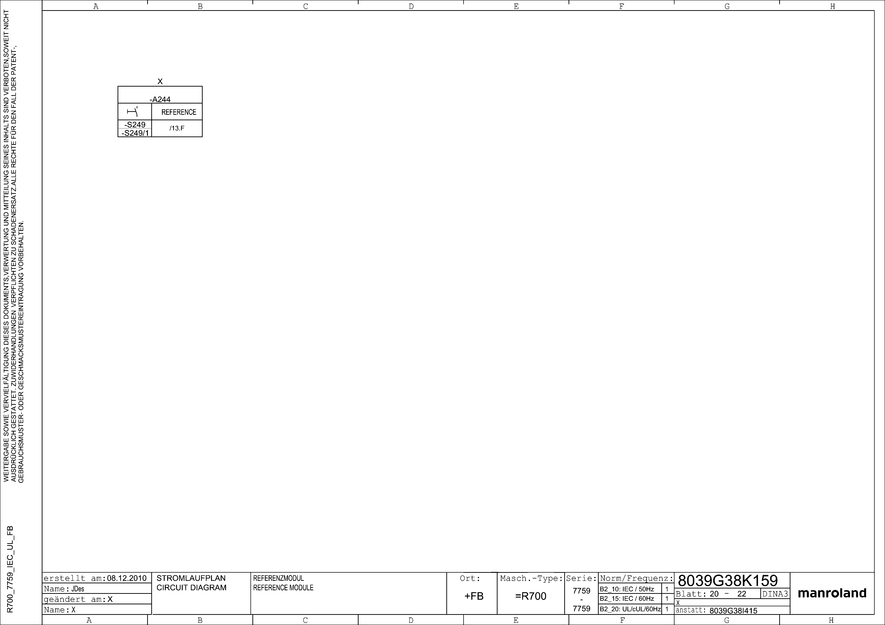

# +FB — Sheet 20 of 22 — REFERENZMODUL

**REFERENCE MODULE**

> Part of the manroland **R700** printing press IEC/UL circuit diagrams.
> Drawing class: **Stromlaufplan / Circuit diagram** (DIN A3).
> Document `+FB` covers the **Delivery / Coating module** machine section.

## At a glance

| Field | Value |
|---|---|
| Document | `+FB`  (8039G38K159) |
| Sheet | **20** of 22 |
| Section (DE) | REFERENZMODUL |
| Section (EN) | REFERENCE MODULE |
| Section type | REFERENCE_MODULE — Reference module |
| Machine type | `=R700` |
| Series | `7759` |
| Created | 08.12.2010 |
| Replaces | `8039G38I415` |
| Columns used | A, B |
| Path numbers | — |
| Labels on sheet | 6 |
| Cross-refs out | 1 |
| Cross-refs in | 2 |

**Previous:** [+FB sheet 19](SHEET_0019.md) · **Next:** [+FB sheet 21](SHEET_0021.md) · **Document TOC:** [_TOC.md](_TOC.md)  (+FB) · **Master TOC:** [all sheets](../_MASTER_TOC.md)

## Sheet image (300 DPI, exact vector render)



_Rendered directly from the PDF vector layer at 300 DPI (1-bit), no OCR and no resampling. Use it to confirm anything ambiguous in the text below._

## Cross-references on this sheet

Each entry is a wire leaving this sheet. The printed token is `/sheet.column`; the link resolves to that sheet inside the same document.

| Ref | Target sheet | Col | Path | Destination on target | Target section | From col |
|---|---|---|---|---|---|---|
| `/13.F` | [+FB sheet 13](SHEET_0013.md) | F | — | S249 S249/1 | OPTION: NEIGUNGSEINSTELLUNG | B |

### Incoming references (sheets that point here)

Every other sheet that sends a wire to this one. `Back-ref` is the token printed on *that* sheet; `Path` is its line number.

| From sheet | Cols | Back-ref | Path | Refs | What continues there |
|---|---|---|---|---|---|
| [+FB#4](SHEET_0004.md) | C | `/4.C` | — | 1 | — |
| [+FB#13](SHEET_0013.md) | F | `/13.F` | — | 1 | — |


## Devices on this sheet

| Tag | Class | Class meaning (IEC) | Col | Sub | Terminal | Sign |
|---|---|---|---|---|---|---|
| `A244` | A | Baugruppe / assembly, module, PC board | B | — | — | — |
| `S249` | S | Schalter / switch | A | — | — | — |
| `S249/1` | S | Schalter / switch | A | 1 | — | — |

## Potentials / nets

_No named potentials on this sheet._

## Wire-end annotations (grouped as printed)

A wire that continues elsewhere is annotated with a small cluster: the destination description, the path/line number `#NN`, and the `/sheet.column` cross reference. Each row below is one such cluster exactly as it is grouped on the drawing.

| Col | Y | Path | Cross-ref | Text on the wire |
|---|---|---|---|---|
| B | 105.2 | — | — | `X` |
| B | 129.3 | — | — | `A244` |
| B | 147.6 | — | — | `REFERENCE` |
| B | 163.3 | — | `/13.F` | `S249/1 S249` |


## Notes and free text on this sheet

| Text | Col | Y (pt) |
|---|---|---|
| `REFERENCE` | B | 147.55 |

## Complete label inventory (exact text from the drawing)

Every text object inside the drawing area of this sheet, in DIN reading order (column A→H, then top→bottom). This is the authoritative list: if a string is not here it is not printed on this sheet.

| Col | Y | X | Dir | Type | Text |
|---|---|---|---|---|---|
| A | 163.3 | 167.4 | → | device tag | `S249` |
| A | 174.6 | 163.7 | → | device tag | `S249/1` |
| B | 105.2 | 211.9 | → | not fitted | `X` |
| B | 129.3 | 201.4 | → | device tag | `A244` |
| B | 147.5 | 217.4 | → | text | `REFERENCE` |
| B | 168.9 | 228.2 | → | cross-reference | `/13.F` |

## Reading-order text block

The same content as a plain block, grouped by DIN column — convenient to paste or to match against a visual description.

```text
=== Column A ===
 163.3  167.4  devtag       S249
 174.6  163.7  devtag       S249/1
=== Column B ===
 105.2  211.9  placeholder  X
 129.3  201.4  devtag       A244
 147.5  217.4  text         REFERENCE
 168.9  228.2  xref         /13.F
```

---
_Generated from the PDF vector text layer; no OCR. Source: `R700_7759_IEC_UL_FB`, sheet 20._
