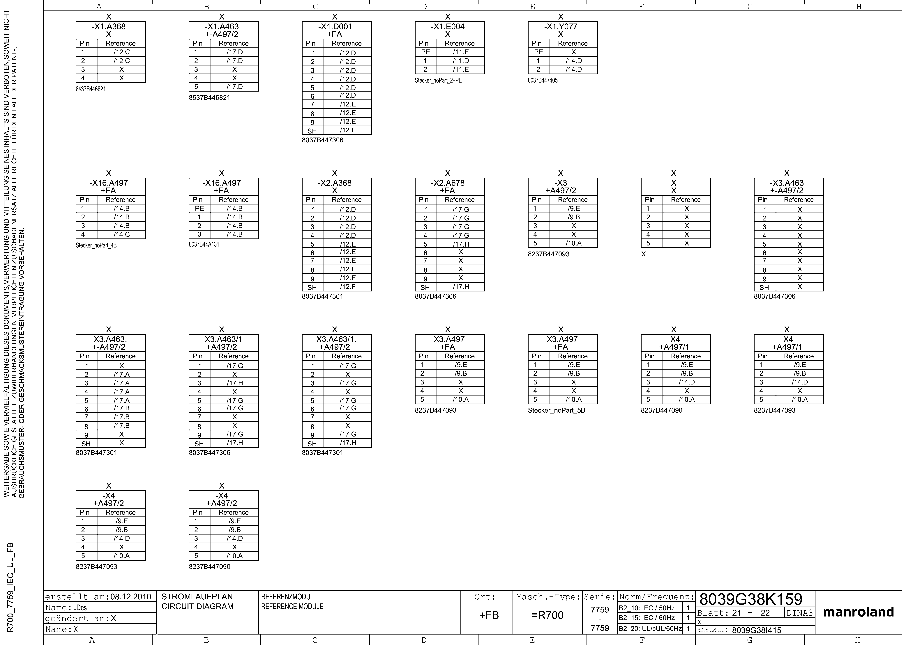

# +FB — Sheet 21 of 22 — REFERENZMODUL

**REFERENCE MODULE**

> Part of the manroland **R700** printing press IEC/UL circuit diagrams.
> Drawing class: **Stromlaufplan / Circuit diagram** (DIN A3).
> Document `+FB` covers the **Delivery / Coating module** machine section.

## At a glance

| Field | Value |
|---|---|
| Document | `+FB`  (8039G38K159) |
| Sheet | **21** of 22 |
| Section (DE) | REFERENZMODUL |
| Section (EN) | REFERENCE MODULE |
| Section type | REFERENCE_MODULE — Reference module |
| Machine type | `=R700` |
| Series | `7759` |
| Created | 08.12.2010 |
| Replaces | `8039G38I415` |
| Columns used | A, B, C, D, E, F, G |
| Path numbers | — |
| Labels on sheet | 392 |
| Cross-refs out | 88 |
| Cross-refs in | 0 |

**Previous:** [+FB sheet 20](SHEET_0020.md) · **Next:** [+FB sheet 22](SHEET_0022.md) · **Document TOC:** [_TOC.md](_TOC.md)  (+FB) · **Master TOC:** [all sheets](../_MASTER_TOC.md)

## Sheet image (300 DPI, exact vector render)



_Rendered directly from the PDF vector layer at 300 DPI (1-bit), no OCR and no resampling. Use it to confirm anything ambiguous in the text below._

## Cross-references on this sheet

Each entry is a wire leaving this sheet. The printed token is `/sheet.column`; the link resolves to that sheet inside the same document.

| Ref | Target sheet | Col | Path | Destination on target | Target section | From col |
|---|---|---|---|---|---|---|
| `/11.E` | [+FB sheet 11](SHEET_0011.md) | E | — | — | FARBABSTIMMLEUCHTE | D |
| `/12.C` | [+FB sheet 12](SHEET_0012.md) | C | — | — | BEDIENUNGSEINHEIT | A |
| `/12.C` | [+FB sheet 12](SHEET_0012.md) | C | — | — | BEDIENUNGSEINHEIT | A |
| `/17.D` | [+FB sheet 17](SHEET_0017.md) | D | — | — | OPTION: COLORPILOT | B |
| `/17.D` | [+FB sheet 17](SHEET_0017.md) | D | — | — | OPTION: COLORPILOT | B |
| `/12.D` | [+FB sheet 12](SHEET_0012.md) | D | — | — | BEDIENUNGSEINHEIT | C |
| `/12.D` | [+FB sheet 12](SHEET_0012.md) | D | — | — | BEDIENUNGSEINHEIT | C |
| `/12.D` | [+FB sheet 12](SHEET_0012.md) | D | — | — | BEDIENUNGSEINHEIT | C |
| `/12.D` | [+FB sheet 12](SHEET_0012.md) | D | — | — | BEDIENUNGSEINHEIT | C |
| `/12.D` | [+FB sheet 12](SHEET_0012.md) | D | — | — | BEDIENUNGSEINHEIT | C |
| `/12.D` | [+FB sheet 12](SHEET_0012.md) | D | — | — | BEDIENUNGSEINHEIT | C |
| `/12.E` | [+FB sheet 12](SHEET_0012.md) | E | — | — | BEDIENUNGSEINHEIT | C |
| `/12.E` | [+FB sheet 12](SHEET_0012.md) | E | — | — | BEDIENUNGSEINHEIT | C |
| `/12.E` | [+FB sheet 12](SHEET_0012.md) | E | — | — | BEDIENUNGSEINHEIT | C |
| `/12.E` | [+FB sheet 12](SHEET_0012.md) | E | — | — | BEDIENUNGSEINHEIT | C |
| `/11.D` | [+FB sheet 11](SHEET_0011.md) | D | — | — | FARBABSTIMMLEUCHTE | D |
| `/11.E` | [+FB sheet 11](SHEET_0011.md) | E | — | — | FARBABSTIMMLEUCHTE | D |
| `/14.D` | [+FB sheet 14](SHEET_0014.md) | D | — | — | OPTION: COLORPILOT | E |
| `/14.D` | [+FB sheet 14](SHEET_0014.md) | D | — | — | OPTION: COLORPILOT | E |
| `/17.D` | [+FB sheet 17](SHEET_0017.md) | D | — | X X | OPTION: COLORPILOT | B |
| `/9.E` | [+FB sheet 9](SHEET_0009.md) | E | — | — | SPANNUNGSVERSORGUNG | E |
| `/9.B` | [+FB sheet 9](SHEET_0009.md) | B | — | — | SPANNUNGSVERSORGUNG | E |
| `/14.B` | [+FB sheet 14](SHEET_0014.md) | B | — | — | OPTION: COLORPILOT | A |
| `/14.B` | [+FB sheet 14](SHEET_0014.md) | B | — | — | OPTION: COLORPILOT | A |
| `/14.B` | [+FB sheet 14](SHEET_0014.md) | B | — | — | OPTION: COLORPILOT | A |
| `/14.C` | [+FB sheet 14](SHEET_0014.md) | C | — | — | OPTION: COLORPILOT | A |
| `/14.B` | [+FB sheet 14](SHEET_0014.md) | B | — | — | OPTION: COLORPILOT | B |
| `/14.B` | [+FB sheet 14](SHEET_0014.md) | B | — | — | OPTION: COLORPILOT | B |
| `/14.B` | [+FB sheet 14](SHEET_0014.md) | B | — | — | OPTION: COLORPILOT | B |
| `/14.B` | [+FB sheet 14](SHEET_0014.md) | B | — | — | OPTION: COLORPILOT | B |
| `/17.G` | [+FB sheet 17](SHEET_0017.md) | G | — | — | OPTION: COLORPILOT | D |
| `/17.G` | [+FB sheet 17](SHEET_0017.md) | G | — | — | OPTION: COLORPILOT | D |
| `/17.G` | [+FB sheet 17](SHEET_0017.md) | G | — | — | OPTION: COLORPILOT | D |
| `/17.G` | [+FB sheet 17](SHEET_0017.md) | G | — | — | OPTION: COLORPILOT | D |
| `/17.H` | [+FB sheet 17](SHEET_0017.md) | H | — | — | OPTION: COLORPILOT | D |
| `/12.D` | [+FB sheet 12](SHEET_0012.md) | D | — | — | BEDIENUNGSEINHEIT | C |
| `/12.D` | [+FB sheet 12](SHEET_0012.md) | D | — | — | BEDIENUNGSEINHEIT | C |
| `/12.D` | [+FB sheet 12](SHEET_0012.md) | D | — | — | BEDIENUNGSEINHEIT | C |
| `/12.D` | [+FB sheet 12](SHEET_0012.md) | D | — | — | BEDIENUNGSEINHEIT | C |
| `/12.E` | [+FB sheet 12](SHEET_0012.md) | E | — | — | BEDIENUNGSEINHEIT | C |
| `/12.E` | [+FB sheet 12](SHEET_0012.md) | E | — | — | BEDIENUNGSEINHEIT | C |
| `/12.E` | [+FB sheet 12](SHEET_0012.md) | E | — | — | BEDIENUNGSEINHEIT | C |
| `/12.E` | [+FB sheet 12](SHEET_0012.md) | E | — | — | BEDIENUNGSEINHEIT | C |
| `/12.E` | [+FB sheet 12](SHEET_0012.md) | E | — | — | BEDIENUNGSEINHEIT | C |
| `/12.F` | [+FB sheet 12](SHEET_0012.md) | F | — | — | BEDIENUNGSEINHEIT | C |
| `/10.A` | [+FB sheet 10](SHEET_0010.md) | A | — | X X | ERDUNG UND POTENTIALAUSGLEICH | E |
| `/17.H` | [+FB sheet 17](SHEET_0017.md) | H | — | X X X X | OPTION: COLORPILOT | D |
| `/9.E` | [+FB sheet 9](SHEET_0009.md) | E | — | — | SPANNUNGSVERSORGUNG | D |
| `/9.B` | [+FB sheet 9](SHEET_0009.md) | B | — | — | SPANNUNGSVERSORGUNG | D |
| `/9.E` | [+FB sheet 9](SHEET_0009.md) | E | — | — | SPANNUNGSVERSORGUNG | E |
| `/9.B` | [+FB sheet 9](SHEET_0009.md) | B | — | — | SPANNUNGSVERSORGUNG | E |
| `/9.E` | [+FB sheet 9](SHEET_0009.md) | E | — | — | SPANNUNGSVERSORGUNG | F |
| `/9.B` | [+FB sheet 9](SHEET_0009.md) | B | — | — | SPANNUNGSVERSORGUNG | F |
| `/14.D` | [+FB sheet 14](SHEET_0014.md) | D | — | — | OPTION: COLORPILOT | F |
| `/9.E` | [+FB sheet 9](SHEET_0009.md) | E | — | — | SPANNUNGSVERSORGUNG | G |
| `/9.B` | [+FB sheet 9](SHEET_0009.md) | B | — | — | SPANNUNGSVERSORGUNG | G |
| `/14.D` | [+FB sheet 14](SHEET_0014.md) | D | — | — | OPTION: COLORPILOT | G |
| `/17.A` | [+FB sheet 17](SHEET_0017.md) | A | — | X | OPTION: COLORPILOT | A |
| `/17.A` | [+FB sheet 17](SHEET_0017.md) | A | — | X | OPTION: COLORPILOT | A |
| `/17.A` | [+FB sheet 17](SHEET_0017.md) | A | — | X | OPTION: COLORPILOT | A |
| `/17.A` | [+FB sheet 17](SHEET_0017.md) | A | — | X | OPTION: COLORPILOT | A |
| `/17.B` | [+FB sheet 17](SHEET_0017.md) | B | — | X | OPTION: COLORPILOT | A |
| `/17.B` | [+FB sheet 17](SHEET_0017.md) | B | — | X | OPTION: COLORPILOT | A |
| `/17.B` | [+FB sheet 17](SHEET_0017.md) | B | — | X | OPTION: COLORPILOT | A |
| `/17.G` | [+FB sheet 17](SHEET_0017.md) | G | — | — | OPTION: COLORPILOT | B |
| `/17.G` | [+FB sheet 17](SHEET_0017.md) | G | — | — | OPTION: COLORPILOT | C |
| `/17.H` | [+FB sheet 17](SHEET_0017.md) | H | — | X | OPTION: COLORPILOT | B |
| `/17.G` | [+FB sheet 17](SHEET_0017.md) | G | — | X | OPTION: COLORPILOT | C |
| `/10.A` | [+FB sheet 10](SHEET_0010.md) | A | — | X X | ERDUNG UND POTENTIALAUSGLEICH | D |
| `/10.A` | [+FB sheet 10](SHEET_0010.md) | A | — | X X | ERDUNG UND POTENTIALAUSGLEICH | E |
| `/10.A` | [+FB sheet 10](SHEET_0010.md) | A | — | X | ERDUNG UND POTENTIALAUSGLEICH | F |
| `/10.A` | [+FB sheet 10](SHEET_0010.md) | A | — | X | ERDUNG UND POTENTIALAUSGLEICH | G |
| `/17.G` | [+FB sheet 17](SHEET_0017.md) | G | — | X | OPTION: COLORPILOT | B |
| `/17.G` | [+FB sheet 17](SHEET_0017.md) | G | — | X | OPTION: COLORPILOT | B |
| `/17.G` | [+FB sheet 17](SHEET_0017.md) | G | — | X | OPTION: COLORPILOT | C |
| `/17.G` | [+FB sheet 17](SHEET_0017.md) | G | — | X | OPTION: COLORPILOT | C |
| `/17.G` | [+FB sheet 17](SHEET_0017.md) | G | — | X X | OPTION: COLORPILOT | B |
| `/17.H` | [+FB sheet 17](SHEET_0017.md) | H | — | X X | OPTION: COLORPILOT | B |
| `/17.G` | [+FB sheet 17](SHEET_0017.md) | G | — | X X | OPTION: COLORPILOT | C |
| `/17.H` | [+FB sheet 17](SHEET_0017.md) | H | — | X X | OPTION: COLORPILOT | C |
| `/9.E` | [+FB sheet 9](SHEET_0009.md) | E | — | — | SPANNUNGSVERSORGUNG | A |
| `/9.B` | [+FB sheet 9](SHEET_0009.md) | B | — | — | SPANNUNGSVERSORGUNG | A |
| `/14.D` | [+FB sheet 14](SHEET_0014.md) | D | — | — | OPTION: COLORPILOT | A |
| `/9.E` | [+FB sheet 9](SHEET_0009.md) | E | — | — | SPANNUNGSVERSORGUNG | B |
| `/9.B` | [+FB sheet 9](SHEET_0009.md) | B | — | — | SPANNUNGSVERSORGUNG | B |
| `/14.D` | [+FB sheet 14](SHEET_0014.md) | D | — | — | OPTION: COLORPILOT | B |
| `/10.A` | [+FB sheet 10](SHEET_0010.md) | A | — | X | ERDUNG UND POTENTIALAUSGLEICH | A |
| `/10.A` | [+FB sheet 10](SHEET_0010.md) | A | — | X | ERDUNG UND POTENTIALAUSGLEICH | B |

## Devices on this sheet

| Tag | Class | Class meaning (IEC) | Col | Sub | Terminal | Sign |
|---|---|---|---|---|---|---|
| `X3` | X | Klemme / terminal, plug connector | E | — | — | — |
| `+A497/2` | A | Baugruppe / assembly, module, PC board | E | 2 | — | + |
| `+A497/2` | A | Baugruppe / assembly, module, PC board | B | 2 | — | + |
| `+A497/2` | A | Baugruppe / assembly, module, PC board | C | 2 | — | + |
| `X4` | X | Klemme / terminal, plug connector | F | — | — | — |
| `+A497/1` | A | Baugruppe / assembly, module, PC board | F | 1 | — | + |
| `X4` | X | Klemme / terminal, plug connector | G | — | — | — |
| `+A497/1` | A | Baugruppe / assembly, module, PC board | G | 1 | — | + |
| `X4` | X | Klemme / terminal, plug connector | A | — | — | — |
| `+A497/2` | A | Baugruppe / assembly, module, PC board | A | 2 | — | + |
| `X4` | X | Klemme / terminal, plug connector | B | — | — | — |
| `+A497/2` | A | Baugruppe / assembly, module, PC board | B | 2 | — | + |
| `X1.A368` | — | cross-device reference | A | — | — | — |
| `X1.A463` | — | cross-device reference | B | — | — | — |
| `X1.D001` | — | cross-device reference | C | — | — | — |
| `X1.E004` | — | cross-device reference | D | — | — | — |
| `X1.Y077` | — | cross-device reference | E | — | — | — |
| `X16.A497` | — | cross-device reference | A | — | — | — |
| `X16.A497` | — | cross-device reference | B | — | — | — |
| `X2.A368` | — | cross-device reference | C | — | — | — |
| `X2.A678` | — | cross-device reference | D | — | — | — |
| `X3.A463` | — | cross-device reference | G | — | — | — |
| `X3.A463.` | — | cross-device reference | A | — | — | — |
| `X3.A497` | — | cross-device reference | D | — | — | — |
| `X3.A497` | — | cross-device reference | E | — | — | — |

## Potentials / nets

| Potential | Count | Columns | Attached devices | Terminals |
|---|---|---|---|---|
| `PE` | 3 | B, D, E | — | — |


A potential such as `L24+/4` or `M24+` is a named supply/return rail; every place it appears on this sheet is electrically common.

## Wire-end annotations (grouped as printed)

A wire that continues elsewhere is annotated with a small cluster: the destination description, the path/line number `#NN`, and the `/sheet.column` cross reference. Each row below is one such cluster exactly as it is grouped on the drawing.

| Col | Y | Path | Cross-ref | Text on the wire |
|---|---|---|---|---|
| A | 17.3 | — | — | `X` |
| B | 17.3 | — | — | `X` |
| C | 17.3 | — | — | `X` |
| D | 17.3 | — | — | `X` |
| E | 17.3 | — | — | `X` |
| A | 30.1 | — | — | `X1.A368` |
| B | 30.1 | — | — | `X1.A463` |
| C | 30.1 | — | — | `X1.D001` |
| D | 30.1 | — | — | `X1.E004 X` |
| E | 30.1 | — | — | `X1.Y077 X` |
| A | 40.0 | — | — | `X` |
| B | 40.0 | — | — | `+ A497/2` |
| C | 40.0 | — | — | `+FA` |
| A | 52.7 | — | — | `Pin 1 2 3 4 Reference` |
| B | 52.7 | — | — | `Pin 1 2 3 4 5 Reference` |
| C | 52.7 | — | — | `8037B447306 Pin SH 3 4 5 6 7 8 9 2 1 Reference` |
| D | 52.7 | — | — | `Pin Reference` |
| E | 52.7 | — | — | `Pin Reference` |
| D | 64.0 | — | — | `PE` |
| D | 64.0 | — | `/11.E` | — |
| E | 64.0 | — | — | `PE` |
| E | 64.0 | — | — | `X` |
| A | 64.1 | — | `/12.C`, `/12.C` | — |
| B | 64.1 | — | `/17.D`, `/17.D` | — |
| C | 65.5 | — | `/12.D`, `/12.D`, `/12.D`, `/12.D`, `/12.D`, `/12.D`, `/12.E`, `/12.E`, `/12.E`, `/12.E` | — |
| D | 75.4 | — | — | `1 2` |
| D | 75.4 | — | `/11.D`, `/11.E` | — |
| E | 75.4 | — | — | `1 2` |
| E | 75.4 | — | `/14.D`, `/14.D` | — |
| A | 86.7 | — | — | `X X` |
| B | 86.7 | — | `/17.D` | `X X` |
| D | 102.0 | — | — | `Stecker_noPart_2+PE` |
| E | 102.0 | — | — | `8037B447405` |
| A | 113.3 | — | — | `8437B446821` |
| B | 123.6 | — | — | `8537B446821` |
| A | 221.4 | — | — | `X` |
| B | 221.4 | — | — | `X` |
| C | 221.4 | — | — | `X` |
| D | 221.4 | — | — | `X` |
| E | 221.4 | — | — | `X` |
| F | 221.4 | — | — | `X X` |
| G | 221.4 | — | — | `X` |
| A | 234.2 | — | — | `X16.A497` |
| B | 234.2 | — | — | `X16.A497` |
| C | 234.2 | — | — | `X2.A368` |
| D | 234.2 | — | — | `X2.A678` |
| E | 234.2 | — | — | `X3` |
| G | 234.2 | — | — | `X3.A463` |
| A | 244.1 | — | — | `+FA` |
| B | 244.1 | — | — | `+FA` |
| C | 244.1 | — | — | `X` |
| D | 244.1 | — | — | `+FA` |
| E | 244.1 | — | — | `+A497/2` |
| F | 244.1 | — | — | `X` |
| G | 244.1 | — | — | `+ A497/2` |
| A | 256.8 | — | — | `Pin 1 2 3 4 Reference` |
| B | 256.8 | — | — | `Pin Reference` |
| C | 256.8 | — | — | `8037B447301 Pin SH 3 4 5 6 7 8 9 2 1 Reference` |
| D | 256.8 | — | — | `8037B447306 Pin SH 3 4 5 6 7 8 9 2 1 Reference` |
| E | 256.8 | — | — | `Pin 1 2 3 4 5 Reference` |
| F | 256.8 | — | — | `Pin 1 2 3 4 5 Reference` |
| G | 256.8 | — | — | `8037B447306 Pin SH 3 4 5 6 7 8 9 2 1 Reference` |
| A | 268.1 | — | `/14.B`, `/14.B`, `/14.B`, `/14.C` | — |
| B | 268.1 | — | — | `PE` |
| B | 268.1 | — | `/14.B`, `/14.B`, `/14.B`, `/14.B` | — |
| E | 268.1 | — | `/9.E`, `/9.B` | — |
| F | 268.1 | — | — | `X X X X X` |
| G | 269.5 | — | — | `X X X X X X X X X X` |
| C | 269.6 | — | `/12.D`, `/12.D`, `/12.D`, `/12.D`, `/12.E`, `/12.E`, `/12.E`, `/12.E`, `/12.E`, `/12.F` | — |
| D | 269.6 | — | `/17.G`, `/17.G`, `/17.G`, `/17.G`, `/17.H` | — |
| B | 279.5 | — | — | `1 2` |
| E | 290.8 | — | `/10.A` | `X X` |
| B | 302.2 | — | — | `3` |
| B | 316.0 | — | — | `8037B44A131` |
| A | 317.4 | — | — | `Stecker_noPart_4B` |
| D | 324.8 | — | `/17.H` | `X X X X` |
| F | 327.6 | — | — | `X` |
| E | 327.7 | — | — | `8237B447093` |
| A | 425.5 | — | — | `X` |
| B | 425.5 | — | — | `X` |
| C | 425.5 | — | — | `X` |
| D | 425.5 | — | — | `X` |
| E | 425.5 | — | — | `X` |
| F | 425.5 | — | — | `X` |
| G | 425.5 | — | — | `X` |
| A | 438.3 | — | — | `X3.A463.` |
| B | 438.3 | — | — | `X3.A463/1` |
| C | 438.3 | — | — | `X3.A463/1.` |
| D | 438.3 | — | — | `X3.A497` |
| E | 438.3 | — | — | `X3.A497` |
| F | 438.3 | — | — | `X4` |
| G | 438.3 | — | — | `X4` |
| A | 448.2 | — | — | `+ A497/2` |
| B | 448.2 | — | — | `+A497/2` |
| C | 448.2 | — | — | `+A497/2` |
| D | 448.2 | — | — | `+FA` |
| E | 448.2 | — | — | `+FA` |
| F | 448.2 | — | — | `+A497/1` |
| G | 448.2 | — | — | `+A497/1` |
| A | 460.9 | — | — | `8037B447301 Pin SH 3 4 5 6 7 8 9 2 1 Reference` |
| B | 460.9 | — | — | `8037B447306 Pin SH 3 4 5 6 7 8 9 2 1 Reference` |
| C | 460.9 | — | — | `8037B447301 Pin SH 3 4 5 6 7 8 9 2 1 Reference` |
| D | 460.9 | — | — | `Pin 1 2 3 4 5 Reference` |
| E | 460.9 | — | — | `Pin 1 2 3 4 5 Reference` |
| F | 460.9 | — | — | `Pin 1 2 3 4 5 Reference` |
| G | 460.9 | — | — | `Pin 1 2 3 4 5 Reference` |
| D | 472.2 | — | `/9.E`, `/9.B` | — |
| E | 472.2 | — | `/9.E`, `/9.B` | — |
| F | 472.2 | — | `/9.E`, `/9.B`, `/14.D` | — |
| G | 472.2 | — | `/9.E`, `/9.B`, `/14.D` | — |
| A | 473.6 | — | `/17.A`, `/17.A`, `/17.A`, `/17.A`, `/17.B`, `/17.B`, `/17.B` | `X` |
| B | 473.7 | — | `/17.G` | — |
| C | 473.7 | — | `/17.G` | — |
| B | 484.9 | — | `/17.H` | `X` |
| C | 484.9 | — | `/17.G` | `X` |
| D | 494.9 | — | `/10.A` | `X X` |
| E | 494.9 | — | `/10.A` | `X X` |
| F | 506.2 | — | `/10.A` | `X` |
| G | 506.2 | — | `/10.A` | `X` |
| B | 507.6 | — | `/17.G`, `/17.G` | `X` |
| C | 507.6 | — | `/17.G`, `/17.G` | `X` |
| D | 531.8 | — | — | `8237B447093` |
| E | 531.8 | — | — | `Stecker_noPart_5B` |
| F | 531.8 | — | — | `8237B447090` |
| G | 531.8 | — | — | `8237B447093` |
| B | 540.2 | — | `/17.G`, `/17.H` | `X X` |
| C | 540.2 | — | `/17.G`, `/17.H` | `X X` |
| A | 562.9 | — | — | `X X` |
| A | 629.6 | — | — | `X` |
| B | 629.6 | — | — | `X` |
| A | 642.4 | — | — | `X4` |
| B | 642.4 | — | — | `X4` |
| A | 652.3 | — | — | `+A497/2` |
| B | 652.3 | — | — | `+A497/2` |
| A | 665.0 | — | — | `Pin 1 2 3 4 5 Reference` |
| B | 665.0 | — | — | `Pin 1 2 3 4 5 Reference` |
| A | 676.3 | — | `/9.E`, `/9.B`, `/14.D` | — |
| B | 676.3 | — | `/9.E`, `/9.B`, `/14.D` | — |
| A | 710.3 | — | `/10.A` | `X` |
| B | 710.3 | — | `/10.A` | `X` |
| A | 735.9 | — | — | `8237B447093` |
| B | 735.9 | — | — | `8237B447090` |


## Device order codes printed on this sheet

> **These are NOT device part numbers and must not be attributed to a single device.** They are order/manufacturing codes that sit inside the same annotation cluster as a device, with no printed label and no leader line binding them to one item. Measured across the whole set: such codes appear on **8 of 1,351 sheets** (see `01_SYSTEM/A_HOW_TO_READ.md` §8.1).

| Token | Col | Y (pt) | What it is |
|---|---|---|---|
| `8437B446821` | A | 113.3 | order code |
| `8537B446821` | B | 123.6 | order code |
| `8037B447306` | C | 178.9 | order code |
| `8037B447405` | E | 102.0 | order code |
| `8037B44A131` | B | 316.0 | order code |
| `8037B447301` | C | 383.0 | order code |
| `8037B447306` | D | 383.0 | order code |
| `8237B447093` | E | 327.7 | order code |
| `8037B447306` | G | 383.0 | order code |
| `8037B447301` | A | 587.1 | order code |
| `8037B447306` | B | 587.1 | order code |
| `8037B447301` | C | 587.1 | order code |
| `8237B447093` | D | 531.8 | order code |
| `8237B447090` | F | 531.8 | order code |
| `8237B447093` | G | 531.8 | order code |
| `8237B447093` | A | 735.9 | order code |
| `8237B447090` | B | 735.9 | order code |
| `Stecker_noPart_2+PE` | D | 102.0 | no orderable part (marker) |
| `Stecker_noPart_4B` | A | 317.4 | no orderable part (marker) |
| `Stecker_noPart_5B` | E | 531.8 | no orderable part (marker) |


## Notes and free text on this sheet

| Text | Col | Y (pt) |
|---|---|---|
| `Pin` | A | 52.7 |
| `Reference` | A | 52.86 |
| `Pin` | B | 52.7 |
| `Reference` | B | 52.86 |
| `+ A497/2` | B | 39.99 |
| `Pin` | C | 52.7 |
| `Reference` | C | 52.86 |
| `SH` | C | 167.53 |
| `+FA` | C | 39.97 |
| `Pin` | D | 52.7 |
| `Reference` | D | 52.86 |
| `Pin` | E | 52.7 |
| `Reference` | E | 52.86 |
| `+FA` | A | 244.07 |
| `+FA` | B | 244.07 |
| `SH` | D | 371.62 |
| `+FA` | D | 244.07 |
| `Pin` | F | 256.8 |
| `Reference` | F | 256.96 |
| `Pin` | G | 256.8 |
| `Reference` | G | 256.96 |
| `SH` | G | 371.62 |
| `+ A497/2` | G | 244.09 |
| `SH` | A | 575.72 |
| `+ A497/2` | A | 448.18 |
| `SH` | B | 575.72 |
| `X3.A463/1` | B | 438.27 |
| `X3.A463/1.` | C | 438.27 |
| `+FA` | E | 448.16 |

## Complete label inventory (exact text from the drawing)

Every text object inside the drawing area of this sheet, in DIN reading order (column A→H, then top→bottom). This is the authoritative list: if a string is not here it is not printed on this sheet.

| Col | Y | X | Dir | Type | Text |
|---|---|---|---|---|---|
| A | 17.3 | 138.2 | → | not fitted | `X` |
| A | 30.1 | 119.8 | → | device ref | `X1.A368` |
| A | 40.0 | 138.2 | → | not fitted | `X` |
| A | 52.7 | 104.0 | → | text | `Pin` |
| A | 52.9 | 138.0 | → | text | `Reference` |
| A | 64.1 | 105.4 | → | number | `1` |
| A | 64.1 | 148.4 | → | cross-reference | `/12.C` |
| A | 75.4 | 106.0 | → | number | `2` |
| A | 75.4 | 148.4 | → | cross-reference | `/12.C` |
| A | 86.7 | 155.8 | → | not fitted | `X` |
| A | 86.8 | 106.0 | → | number | `3` |
| A | 98.0 | 155.8 | → | not fitted | `X` |
| A | 98.1 | 106.0 | → | number | `4` |
| A | 113.3 | 98.9 | → | ordercode | `8437B446821` |
| A | 221.4 | 138.2 | → | not fitted | `X` |
| A | 234.2 | 116.8 | → | device ref | `X16.A497` |
| A | 244.1 | 131.4 | → | text | `+FA` |
| A | 256.8 | 104.0 | → | text | `Pin` |
| A | 257.0 | 138.0 | → | text | `Reference` |
| A | 268.1 | 148.5 | → | cross-reference | `/14.B` |
| A | 268.2 | 105.4 | → | number | `1` |
| A | 279.5 | 106.0 | → | number | `2` |
| A | 279.5 | 148.5 | → | cross-reference | `/14.B` |
| A | 290.8 | 148.5 | → | cross-reference | `/14.B` |
| A | 290.9 | 106.0 | → | number | `3` |
| A | 302.2 | 106.0 | → | number | `4` |
| A | 302.2 | 148.4 | → | cross-reference | `/14.C` |
| A | 317.5 | 98.9 | → | nopart | `Stecker_noPart_4B` |
| A | 425.5 | 138.2 | → | not fitted | `X` |
| A | 438.3 | 118.6 | → | device ref | `X3.A463.` |
| A | 448.2 | 120.0 | → | text | `+ A497/2` |
| A | 460.9 | 104.0 | → | text | `Pin` |
| A | 461.1 | 138.0 | → | text | `Reference` |
| A | 473.6 | 155.8 | → | not fitted | `X` |
| A | 473.7 | 111.7 | → | number | `1` |
| A | 485.0 | 110.6 | → | number | `2` |
| A | 485.0 | 148.4 | → | cross-reference | `/17.A` |
| A | 496.3 | 148.4 | → | cross-reference | `/17.A` |
| A | 496.4 | 110.3 | → | number | `3` |
| A | 507.7 | 110.3 | → | number | `4` |
| A | 507.7 | 148.4 | → | cross-reference | `/17.A` |
| A | 519.0 | 148.4 | → | cross-reference | `/17.A` |
| A | 519.1 | 110.3 | → | number | `5` |
| A | 528.9 | 148.5 | → | cross-reference | `/17.B` |
| A | 530.4 | 110.3 | → | number | `6` |
| A | 540.2 | 148.5 | → | cross-reference | `/17.B` |
| A | 540.3 | 110.3 | → | number | `7` |
| A | 551.6 | 148.5 | → | cross-reference | `/17.B` |
| A | 553.1 | 110.3 | → | number | `8` |
| A | 562.9 | 155.8 | → | not fitted | `X` |
| A | 564.4 | 110.3 | → | number | `9` |
| A | 574.2 | 155.8 | → | not fitted | `X` |
| A | 575.7 | 106.2 | → | text | `SH` |
| A | 587.1 | 98.9 | → | ordercode | `8037B447301` |
| A | 629.6 | 138.2 | → | not fitted | `X` |
| A | 642.4 | 133.7 | → | device tag | `X4` |
| A | 652.3 | 121.7 | → | device tag | `+A497/2` |
| A | 665.0 | 104.0 | → | text | `Pin` |
| A | 665.1 | 138.0 | → | text | `Reference` |
| A | 676.3 | 151.1 | → | cross-reference | `/9.E` |
| A | 676.4 | 105.4 | → | number | `1` |
| A | 687.6 | 150.9 | → | cross-reference | `/9.B` |
| A | 687.7 | 106.0 | → | number | `2` |
| A | 699.0 | 148.4 | → | cross-reference | `/14.D` |
| A | 699.1 | 106.0 | → | number | `3` |
| A | 710.3 | 155.8 | → | not fitted | `X` |
| A | 710.4 | 106.0 | → | number | `4` |
| A | 721.7 | 106.0 | → | number | `5` |
| A | 721.7 | 148.4 | → | cross-reference | `/10.A` |
| A | 735.9 | 98.9 | → | ordercode | `8237B447093` |
| B | 17.3 | 285.6 | → | not fitted | `X` |
| B | 30.1 | 267.2 | → | device ref | `X1.A463` |
| B | 40.0 | 267.4 | → | text | `+ A497/2` |
| B | 52.7 | 251.4 | → | text | `Pin` |
| B | 52.9 | 285.4 | → | text | `Reference` |
| B | 64.1 | 252.9 | → | number | `1` |
| B | 64.1 | 295.8 | → | cross-reference | `/17.D` |
| B | 75.4 | 253.4 | → | number | `2` |
| B | 75.4 | 295.8 | → | cross-reference | `/17.D` |
| B | 86.7 | 303.2 | → | not fitted | `X` |
| B | 86.8 | 253.4 | → | number | `3` |
| B | 98.0 | 303.2 | → | not fitted | `X` |
| B | 98.1 | 253.4 | → | number | `4` |
| B | 109.4 | 295.8 | → | cross-reference | `/17.D` |
| B | 109.5 | 253.4 | → | number | `5` |
| B | 123.6 | 246.3 | → | ordercode | `8537B446821` |
| B | 221.4 | 285.6 | → | not fitted | `X` |
| B | 234.2 | 264.2 | → | device ref | `X16.A497` |
| B | 244.1 | 278.8 | → | text | `+FA` |
| B | 256.8 | 251.4 | → | text | `Pin` |
| B | 257.0 | 285.4 | → | text | `Reference` |
| B | 268.1 | 254.3 | → | potential | `PE` |
| B | 268.1 | 295.9 | → | cross-reference | `/14.B` |
| B | 279.5 | 257.1 | → | number | `1` |
| B | 279.5 | 295.9 | → | cross-reference | `/14.B` |
| B | 290.8 | 295.9 | → | cross-reference | `/14.B` |
| B | 290.9 | 257.7 | → | number | `2` |
| B | 302.1 | 295.9 | → | cross-reference | `/14.B` |
| B | 302.2 | 257.7 | → | number | `3` |
| B | 316.0 | 246.3 | → | ordercode | `8037B44A131` |
| B | 425.5 | 285.6 | → | not fitted | `X` |
| B | 438.3 | 263.5 | → | text | `X3.A463/1` |
| B | 448.2 | 269.1 | → | device tag | `+A497/2` |
| B | 460.9 | 251.4 | → | text | `Pin` |
| B | 461.1 | 285.4 | → | text | `Reference` |
| B | 473.7 | 259.1 | → | number | `1` |
| B | 473.7 | 295.7 | → | cross-reference | `/17.G` |
| B | 484.9 | 303.2 | → | not fitted | `X` |
| B | 485.0 | 258.0 | → | number | `2` |
| B | 496.3 | 296.1 | → | cross-reference | `/17.H` |
| B | 496.4 | 257.7 | → | number | `3` |
| B | 507.6 | 303.2 | → | not fitted | `X` |
| B | 507.7 | 257.7 | → | number | `4` |
| B | 519.0 | 295.7 | → | cross-reference | `/17.G` |
| B | 519.1 | 257.7 | → | number | `5` |
| B | 528.9 | 295.7 | → | cross-reference | `/17.G` |
| B | 530.4 | 257.7 | → | number | `6` |
| B | 540.2 | 303.2 | → | not fitted | `X` |
| B | 540.3 | 257.7 | → | number | `7` |
| B | 551.6 | 303.2 | → | not fitted | `X` |
| B | 553.1 | 257.7 | → | number | `8` |
| B | 562.9 | 295.7 | → | cross-reference | `/17.G` |
| B | 564.4 | 257.7 | → | number | `9` |
| B | 574.3 | 296.1 | → | cross-reference | `/17.H` |
| B | 575.7 | 253.6 | → | text | `SH` |
| B | 587.1 | 246.3 | → | ordercode | `8037B447306` |
| B | 629.6 | 285.6 | → | not fitted | `X` |
| B | 642.4 | 281.1 | → | device tag | `X4` |
| B | 652.3 | 269.1 | → | device tag | `+A497/2` |
| B | 665.0 | 251.4 | → | text | `Pin` |
| B | 665.1 | 285.4 | → | text | `Reference` |
| B | 676.3 | 298.5 | → | cross-reference | `/9.E` |
| B | 676.4 | 252.9 | → | number | `1` |
| B | 687.6 | 298.3 | → | cross-reference | `/9.B` |
| B | 687.7 | 253.4 | → | number | `2` |
| B | 699.0 | 295.8 | → | cross-reference | `/14.D` |
| B | 699.1 | 253.4 | → | number | `3` |
| B | 710.3 | 303.2 | → | not fitted | `X` |
| B | 710.4 | 253.4 | → | number | `4` |
| B | 721.7 | 253.4 | → | number | `5` |
| B | 721.7 | 295.8 | → | cross-reference | `/10.A` |
| B | 735.9 | 246.3 | → | ordercode | `8237B447090` |
| C | 17.3 | 433.0 | → | not fitted | `X` |
| C | 30.1 | 415.0 | → | device ref | `X1.D001` |
| C | 40.0 | 426.2 | → | text | `+FA` |
| C | 52.7 | 398.8 | → | text | `Pin` |
| C | 52.9 | 432.9 | → | text | `Reference` |
| C | 65.5 | 406.5 | → | number | `1` |
| C | 65.5 | 443.2 | → | cross-reference | `/12.D` |
| C | 76.8 | 443.2 | → | cross-reference | `/12.D` |
| C | 76.9 | 405.4 | → | number | `2` |
| C | 88.2 | 405.1 | → | number | `3` |
| C | 88.2 | 443.2 | → | cross-reference | `/12.D` |
| C | 99.5 | 405.1 | → | number | `4` |
| C | 99.5 | 443.2 | → | cross-reference | `/12.D` |
| C | 110.8 | 443.2 | → | cross-reference | `/12.D` |
| C | 110.9 | 405.1 | → | number | `5` |
| C | 120.8 | 443.2 | → | cross-reference | `/12.D` |
| C | 122.2 | 405.1 | → | number | `6` |
| C | 132.1 | 405.1 | → | number | `7` |
| C | 132.1 | 443.5 | → | cross-reference | `/12.E` |
| C | 143.4 | 443.5 | → | cross-reference | `/12.E` |
| C | 144.9 | 405.1 | → | number | `8` |
| C | 154.7 | 443.5 | → | cross-reference | `/12.E` |
| C | 156.2 | 405.1 | → | number | `9` |
| C | 166.1 | 443.5 | → | cross-reference | `/12.E` |
| C | 167.5 | 401.0 | → | text | `SH` |
| C | 178.9 | 393.7 | → | ordercode | `8037B447306` |
| C | 221.4 | 433.0 | → | not fitted | `X` |
| C | 234.2 | 414.6 | → | device ref | `X2.A368` |
| C | 244.1 | 433.0 | → | not fitted | `X` |
| C | 256.8 | 398.8 | → | text | `Pin` |
| C | 257.0 | 432.9 | → | text | `Reference` |
| C | 269.6 | 406.5 | → | number | `1` |
| C | 269.6 | 443.2 | → | cross-reference | `/12.D` |
| C | 280.9 | 443.2 | → | cross-reference | `/12.D` |
| C | 281.0 | 405.4 | → | number | `2` |
| C | 292.3 | 405.1 | → | number | `3` |
| C | 292.3 | 443.2 | → | cross-reference | `/12.D` |
| C | 303.6 | 405.1 | → | number | `4` |
| C | 303.6 | 443.2 | → | cross-reference | `/12.D` |
| C | 314.9 | 443.5 | → | cross-reference | `/12.E` |
| C | 315.0 | 405.1 | → | number | `5` |
| C | 324.8 | 443.5 | → | cross-reference | `/12.E` |
| C | 326.3 | 405.1 | → | number | `6` |
| C | 336.2 | 405.1 | → | number | `7` |
| C | 336.2 | 443.5 | → | cross-reference | `/12.E` |
| C | 347.5 | 443.5 | → | cross-reference | `/12.E` |
| C | 349.0 | 405.1 | → | number | `8` |
| C | 358.8 | 443.5 | → | cross-reference | `/12.E` |
| C | 360.3 | 405.1 | → | number | `9` |
| C | 370.2 | 443.6 | → | cross-reference | `/12.F` |
| C | 371.6 | 401.0 | → | text | `SH` |
| C | 383.0 | 393.7 | → | ordercode | `8037B447301` |
| C | 425.5 | 433.0 | → | not fitted | `X` |
| C | 438.3 | 409.0 | → | text | `X3.A463/1.` |
| C | 448.2 | 416.6 | → | device tag | `+A497/2` |
| C | 460.9 | 398.8 | → | text | `Pin` |
| C | 461.1 | 432.9 | → | text | `Reference` |
| C | 473.7 | 406.5 | → | number | `1` |
| C | 473.7 | 443.1 | → | cross-reference | `/17.G` |
| C | 484.9 | 450.6 | → | not fitted | `X` |
| C | 485.0 | 405.4 | → | number | `2` |
| C | 496.3 | 443.1 | → | cross-reference | `/17.G` |
| C | 496.4 | 405.1 | → | number | `3` |
| C | 507.6 | 450.6 | → | not fitted | `X` |
| C | 507.7 | 405.1 | → | number | `4` |
| C | 519.0 | 443.1 | → | cross-reference | `/17.G` |
| C | 519.1 | 405.1 | → | number | `5` |
| C | 528.9 | 443.1 | → | cross-reference | `/17.G` |
| C | 530.4 | 405.1 | → | number | `6` |
| C | 540.2 | 450.6 | → | not fitted | `X` |
| C | 540.3 | 405.1 | → | number | `7` |
| C | 551.6 | 450.6 | → | not fitted | `X` |
| C | 553.1 | 405.1 | → | number | `8` |
| C | 562.9 | 443.1 | → | cross-reference | `/17.G` |
| C | 564.4 | 405.1 | → | number | `9` |
| C | 574.3 | 443.5 | → | cross-reference | `/17.H` |
| C | 575.7 | 401.0 | → | text | `SH` |
| C | 587.1 | 393.7 | → | ordercode | `8037B447301` |
| D | 17.3 | 580.4 | → | not fitted | `X` |
| D | 30.1 | 562.0 | → | device ref | `X1.E004` |
| D | 40.0 | 580.4 | → | not fitted | `X` |
| D | 52.7 | 546.2 | → | text | `Pin` |
| D | 52.9 | 580.3 | → | text | `Reference` |
| D | 64.0 | 549.1 | → | potential | `PE` |
| D | 64.0 | 590.9 | → | cross-reference | `/11.E` |
| D | 75.4 | 551.9 | → | number | `1` |
| D | 75.4 | 590.6 | → | cross-reference | `/11.D` |
| D | 86.7 | 590.9 | → | cross-reference | `/11.E` |
| D | 86.8 | 552.5 | → | number | `2` |
| D | 102.0 | 541.1 | → | nopart | `Stecker_noPart_2+PE` |
| D | 221.4 | 580.4 | → | not fitted | `X` |
| D | 234.2 | 562.0 | → | device ref | `X2.A678` |
| D | 244.1 | 573.6 | → | text | `+FA` |
| D | 256.8 | 546.2 | → | text | `Pin` |
| D | 257.0 | 580.3 | → | text | `Reference` |
| D | 269.6 | 553.9 | → | number | `1` |
| D | 269.6 | 590.5 | → | cross-reference | `/17.G` |
| D | 280.9 | 590.5 | → | cross-reference | `/17.G` |
| D | 281.0 | 552.8 | → | number | `2` |
| D | 292.2 | 590.5 | → | cross-reference | `/17.G` |
| D | 292.3 | 552.5 | → | number | `3` |
| D | 303.6 | 552.5 | → | number | `4` |
| D | 303.6 | 590.5 | → | cross-reference | `/17.G` |
| D | 314.9 | 590.9 | → | cross-reference | `/17.H` |
| D | 315.0 | 552.5 | → | number | `5` |
| D | 324.8 | 598.0 | → | not fitted | `X` |
| D | 326.3 | 552.5 | → | number | `6` |
| D | 336.1 | 598.0 | → | not fitted | `X` |
| D | 336.2 | 552.5 | → | number | `7` |
| D | 347.5 | 598.0 | → | not fitted | `X` |
| D | 349.0 | 552.5 | → | number | `8` |
| D | 358.8 | 598.0 | → | not fitted | `X` |
| D | 360.3 | 552.5 | → | number | `9` |
| D | 370.2 | 590.9 | → | cross-reference | `/17.H` |
| D | 371.6 | 548.4 | → | text | `SH` |
| D | 383.0 | 541.1 | → | ordercode | `8037B447306` |
| D | 425.5 | 580.4 | → | not fitted | `X` |
| D | 438.3 | 562.0 | → | device ref | `X3.A497` |
| D | 448.2 | 573.6 | → | text | `+FA` |
| D | 460.9 | 546.2 | → | text | `Pin` |
| D | 461.1 | 580.3 | → | text | `Reference` |
| D | 472.2 | 593.3 | → | cross-reference | `/9.E` |
| D | 472.3 | 547.7 | → | number | `1` |
| D | 483.5 | 593.1 | → | cross-reference | `/9.B` |
| D | 483.6 | 548.2 | → | number | `2` |
| D | 494.9 | 598.0 | → | not fitted | `X` |
| D | 495.0 | 548.2 | → | number | `3` |
| D | 506.2 | 598.0 | → | not fitted | `X` |
| D | 506.3 | 548.2 | → | number | `4` |
| D | 517.6 | 548.2 | → | number | `5` |
| D | 517.6 | 590.6 | → | cross-reference | `/10.A` |
| D | 531.8 | 541.1 | → | ordercode | `8237B447093` |
| E | 17.3 | 727.8 | → | not fitted | `X` |
| E | 30.1 | 709.7 | → | device ref | `X1.Y077` |
| E | 40.0 | 727.8 | → | not fitted | `X` |
| E | 52.7 | 693.6 | → | text | `Pin` |
| E | 52.9 | 727.7 | → | text | `Reference` |
| E | 64.0 | 696.5 | → | potential | `PE` |
| E | 64.0 | 745.4 | → | not fitted | `X` |
| E | 75.4 | 699.3 | → | number | `1` |
| E | 75.4 | 738.0 | → | cross-reference | `/14.D` |
| E | 86.7 | 738.0 | → | cross-reference | `/14.D` |
| E | 86.8 | 699.9 | → | number | `2` |
| E | 102.0 | 688.5 | → | ordercode | `8037B447405` |
| E | 221.4 | 727.8 | → | not fitted | `X` |
| E | 234.2 | 723.3 | → | device tag | `X3` |
| E | 244.1 | 711.4 | → | device tag | `+A497/2` |
| E | 256.8 | 693.6 | → | text | `Pin` |
| E | 257.0 | 727.7 | → | text | `Reference` |
| E | 268.1 | 740.7 | → | cross-reference | `/9.E` |
| E | 268.2 | 695.1 | → | number | `1` |
| E | 279.4 | 740.6 | → | cross-reference | `/9.B` |
| E | 279.5 | 695.6 | → | number | `2` |
| E | 290.8 | 745.4 | → | not fitted | `X` |
| E | 290.9 | 695.6 | → | number | `3` |
| E | 302.1 | 745.4 | → | not fitted | `X` |
| E | 302.2 | 695.6 | → | number | `4` |
| E | 313.5 | 738.0 | → | cross-reference | `/10.A` |
| E | 313.6 | 695.6 | → | number | `5` |
| E | 327.7 | 688.5 | → | ordercode | `8237B447093` |
| E | 425.5 | 727.8 | → | not fitted | `X` |
| E | 438.3 | 709.4 | → | device ref | `X3.A497` |
| E | 448.2 | 721.0 | → | text | `+FA` |
| E | 460.9 | 693.6 | → | text | `Pin` |
| E | 461.1 | 727.7 | → | text | `Reference` |
| E | 472.2 | 740.7 | → | cross-reference | `/9.E` |
| E | 472.3 | 695.1 | → | number | `1` |
| E | 483.5 | 740.6 | → | cross-reference | `/9.B` |
| E | 483.6 | 695.6 | → | number | `2` |
| E | 494.9 | 745.4 | → | not fitted | `X` |
| E | 495.0 | 695.6 | → | number | `3` |
| E | 506.2 | 745.4 | → | not fitted | `X` |
| E | 506.3 | 695.6 | → | number | `4` |
| E | 517.6 | 695.6 | → | number | `5` |
| E | 517.6 | 738.0 | → | cross-reference | `/10.A` |
| E | 531.8 | 688.5 | → | nopart | `Stecker_noPart_5B` |
| F | 221.4 | 875.2 | → | not fitted | `X` |
| F | 234.2 | 875.2 | → | not fitted | `X` |
| F | 244.1 | 875.2 | → | not fitted | `X` |
| F | 256.8 | 841.0 | → | text | `Pin` |
| F | 257.0 | 875.1 | → | text | `Reference` |
| F | 268.1 | 892.8 | → | not fitted | `X` |
| F | 268.2 | 842.5 | → | number | `1` |
| F | 279.4 | 892.8 | → | not fitted | `X` |
| F | 279.5 | 843.0 | → | number | `2` |
| F | 290.8 | 892.8 | → | not fitted | `X` |
| F | 290.9 | 843.0 | → | number | `3` |
| F | 302.1 | 892.8 | → | not fitted | `X` |
| F | 302.2 | 843.0 | → | number | `4` |
| F | 313.5 | 892.8 | → | not fitted | `X` |
| F | 313.6 | 843.0 | → | number | `5` |
| F | 327.6 | 836.2 | → | not fitted | `X` |
| F | 425.5 | 875.2 | → | not fitted | `X` |
| F | 438.3 | 870.7 | → | device tag | `X4` |
| F | 448.2 | 859.5 | → | device tag | `+A497/1` |
| F | 460.9 | 841.0 | → | text | `Pin` |
| F | 461.1 | 875.1 | → | text | `Reference` |
| F | 472.2 | 888.1 | → | cross-reference | `/9.E` |
| F | 472.3 | 842.5 | → | number | `1` |
| F | 483.5 | 888.0 | → | cross-reference | `/9.B` |
| F | 483.6 | 843.0 | → | number | `2` |
| F | 494.9 | 885.4 | → | cross-reference | `/14.D` |
| F | 495.0 | 843.0 | → | number | `3` |
| F | 506.2 | 892.8 | → | not fitted | `X` |
| F | 506.3 | 843.0 | → | number | `4` |
| F | 517.6 | 843.0 | → | number | `5` |
| F | 517.6 | 885.4 | → | cross-reference | `/10.A` |
| F | 531.8 | 835.9 | → | ordercode | `8237B447090` |
| G | 221.4 | 1022.6 | → | not fitted | `X` |
| G | 234.2 | 1004.2 | → | device ref | `X3.A463` |
| G | 244.1 | 1004.5 | → | text | `+ A497/2` |
| G | 256.8 | 988.4 | → | text | `Pin` |
| G | 257.0 | 1022.5 | → | text | `Reference` |
| G | 269.5 | 1040.2 | → | not fitted | `X` |
| G | 269.6 | 996.1 | → | number | `1` |
| G | 280.9 | 1040.2 | → | not fitted | `X` |
| G | 281.0 | 995.0 | → | number | `2` |
| G | 292.2 | 1040.2 | → | not fitted | `X` |
| G | 292.3 | 994.7 | → | number | `3` |
| G | 303.5 | 1040.2 | → | not fitted | `X` |
| G | 303.6 | 994.7 | → | number | `4` |
| G | 314.9 | 1040.2 | → | not fitted | `X` |
| G | 315.0 | 994.7 | → | number | `5` |
| G | 324.8 | 1040.2 | → | not fitted | `X` |
| G | 326.3 | 994.7 | → | number | `6` |
| G | 336.1 | 1040.2 | → | not fitted | `X` |
| G | 336.2 | 994.7 | → | number | `7` |
| G | 347.5 | 1040.2 | → | not fitted | `X` |
| G | 349.0 | 994.7 | → | number | `8` |
| G | 358.8 | 1040.2 | → | not fitted | `X` |
| G | 360.3 | 994.7 | → | number | `9` |
| G | 370.1 | 1040.2 | → | not fitted | `X` |
| G | 371.6 | 990.6 | → | text | `SH` |
| G | 383.0 | 983.3 | → | ordercode | `8037B447306` |
| G | 425.5 | 1022.6 | → | not fitted | `X` |
| G | 438.3 | 1018.1 | → | device tag | `X4` |
| G | 448.2 | 1006.9 | → | device tag | `+A497/1` |
| G | 460.9 | 988.4 | → | text | `Pin` |
| G | 461.1 | 1022.5 | → | text | `Reference` |
| G | 472.2 | 1035.5 | → | cross-reference | `/9.E` |
| G | 472.3 | 989.9 | → | number | `1` |
| G | 483.5 | 1035.4 | → | cross-reference | `/9.B` |
| G | 483.6 | 990.4 | → | number | `2` |
| G | 494.9 | 1032.8 | → | cross-reference | `/14.D` |
| G | 495.0 | 990.4 | → | number | `3` |
| G | 506.2 | 1040.2 | → | not fitted | `X` |
| G | 506.3 | 990.4 | → | number | `4` |
| G | 517.6 | 990.4 | → | number | `5` |
| G | 517.6 | 1032.8 | → | cross-reference | `/10.A` |
| G | 531.8 | 983.3 | → | ordercode | `8237B447093` |

## Reading-order text block

The same content as a plain block, grouped by DIN column — convenient to paste or to match against a visual description.

```text
=== Column A ===
  17.3  138.2  placeholder  X
  30.1  119.8  devref       X1.A368
  40.0  138.2  placeholder  X
  52.7  104.0  text         Pin
  52.9  138.0  text         Reference
  64.1  105.4  numeric      1
  64.1  148.4  xref         /12.C
  75.4  106.0  numeric      2
  75.4  148.4  xref         /12.C
  86.7  155.8  placeholder  X
  86.8  106.0  numeric      3
  98.0  155.8  placeholder  X
  98.1  106.0  numeric      4
 113.3   98.9  ordercode    8437B446821
 221.4  138.2  placeholder  X
 234.2  116.8  devref       X16.A497
 244.1  131.4  text         +FA
 256.8  104.0  text         Pin
 257.0  138.0  text         Reference
 268.1  148.5  xref         /14.B
 268.2  105.4  numeric      1
 279.5  106.0  numeric      2
 279.5  148.5  xref         /14.B
 290.8  148.5  xref         /14.B
 290.9  106.0  numeric      3
 302.2  106.0  numeric      4
 302.2  148.4  xref         /14.C
 317.5   98.9  nopart       Stecker_noPart_4B
 425.5  138.2  placeholder  X
 438.3  118.6  devref       X3.A463.
 448.2  120.0  text         + A497/2
 460.9  104.0  text         Pin
 461.1  138.0  text         Reference
 473.6  155.8  placeholder  X
 473.7  111.7  numeric      1
 485.0  110.6  numeric      2
 485.0  148.4  xref         /17.A
 496.3  148.4  xref         /17.A
 496.4  110.3  numeric      3
 507.7  110.3  numeric      4
 507.7  148.4  xref         /17.A
 519.0  148.4  xref         /17.A
 519.1  110.3  numeric      5
 528.9  148.5  xref         /17.B
 530.4  110.3  numeric      6
 540.2  148.5  xref         /17.B
 540.3  110.3  numeric      7
 551.6  148.5  xref         /17.B
 553.1  110.3  numeric      8
 562.9  155.8  placeholder  X
 564.4  110.3  numeric      9
 574.2  155.8  placeholder  X
 575.7  106.2  text         SH
 587.1   98.9  ordercode    8037B447301
 629.6  138.2  placeholder  X
 642.4  133.7  devtag       X4
 652.3  121.7  devtag       +A497/2
 665.0  104.0  text         Pin
 665.1  138.0  text         Reference
 676.3  151.1  xref         /9.E
 676.4  105.4  numeric      1
 687.6  150.9  xref         /9.B
 687.7  106.0  numeric      2
 699.0  148.4  xref         /14.D
 699.1  106.0  numeric      3
 710.3  155.8  placeholder  X
 710.4  106.0  numeric      4
 721.7  106.0  numeric      5
 721.7  148.4  xref         /10.A
 735.9   98.9  ordercode    8237B447093
=== Column B ===
  17.3  285.6  placeholder  X
  30.1  267.2  devref       X1.A463
  40.0  267.4  text         + A497/2
  52.7  251.4  text         Pin
  52.9  285.4  text         Reference
  64.1  252.9  numeric      1
  64.1  295.8  xref         /17.D
  75.4  253.4  numeric      2
  75.4  295.8  xref         /17.D
  86.7  303.2  placeholder  X
  86.8  253.4  numeric      3
  98.0  303.2  placeholder  X
  98.1  253.4  numeric      4
 109.4  295.8  xref         /17.D
 109.5  253.4  numeric      5
 123.6  246.3  ordercode    8537B446821
 221.4  285.6  placeholder  X
 234.2  264.2  devref       X16.A497
 244.1  278.8  text         +FA
 256.8  251.4  text         Pin
 257.0  285.4  text         Reference
 268.1  254.3  net          PE
 268.1  295.9  xref         /14.B
 279.5  257.1  numeric      1
 279.5  295.9  xref         /14.B
 290.8  295.9  xref         /14.B
 290.9  257.7  numeric      2
 302.1  295.9  xref         /14.B
 302.2  257.7  numeric      3
 316.0  246.3  ordercode    8037B44A131
 425.5  285.6  placeholder  X
 438.3  263.5  text         X3.A463/1
 448.2  269.1  devtag       +A497/2
 460.9  251.4  text         Pin
 461.1  285.4  text         Reference
 473.7  259.1  numeric      1
 473.7  295.7  xref         /17.G
 484.9  303.2  placeholder  X
 485.0  258.0  numeric      2
 496.3  296.1  xref         /17.H
 496.4  257.7  numeric      3
 507.6  303.2  placeholder  X
 507.7  257.7  numeric      4
 519.0  295.7  xref         /17.G
 519.1  257.7  numeric      5
 528.9  295.7  xref         /17.G
 530.4  257.7  numeric      6
 540.2  303.2  placeholder  X
 540.3  257.7  numeric      7
 551.6  303.2  placeholder  X
 553.1  257.7  numeric      8
 562.9  295.7  xref         /17.G
 564.4  257.7  numeric      9
 574.3  296.1  xref         /17.H
 575.7  253.6  text         SH
 587.1  246.3  ordercode    8037B447306
 629.6  285.6  placeholder  X
 642.4  281.1  devtag       X4
 652.3  269.1  devtag       +A497/2
 665.0  251.4  text         Pin
 665.1  285.4  text         Reference
 676.3  298.5  xref         /9.E
 676.4  252.9  numeric      1
 687.6  298.3  xref         /9.B
 687.7  253.4  numeric      2
 699.0  295.8  xref         /14.D
 699.1  253.4  numeric      3
 710.3  303.2  placeholder  X
 710.4  253.4  numeric      4
 721.7  253.4  numeric      5
 721.7  295.8  xref         /10.A
 735.9  246.3  ordercode    8237B447090
=== Column C ===
  17.3  433.0  placeholder  X
  30.1  415.0  devref       X1.D001
  40.0  426.2  text         +FA
  52.7  398.8  text         Pin
  52.9  432.9  text         Reference
  65.5  406.5  numeric      1
  65.5  443.2  xref         /12.D
  76.8  443.2  xref         /12.D
  76.9  405.4  numeric      2
  88.2  405.1  numeric      3
  88.2  443.2  xref         /12.D
  99.5  405.1  numeric      4
  99.5  443.2  xref         /12.D
 110.8  443.2  xref         /12.D
 110.9  405.1  numeric      5
 120.8  443.2  xref         /12.D
 122.2  405.1  numeric      6
 132.1  405.1  numeric      7
 132.1  443.5  xref         /12.E
 143.4  443.5  xref         /12.E
 144.9  405.1  numeric      8
 154.7  443.5  xref         /12.E
 156.2  405.1  numeric      9
 166.1  443.5  xref         /12.E
 167.5  401.0  text         SH
 178.9  393.7  ordercode    8037B447306
 221.4  433.0  placeholder  X
 234.2  414.6  devref       X2.A368
 244.1  433.0  placeholder  X
 256.8  398.8  text         Pin
 257.0  432.9  text         Reference
 269.6  406.5  numeric      1
 269.6  443.2  xref         /12.D
 280.9  443.2  xref         /12.D
 281.0  405.4  numeric      2
 292.3  405.1  numeric      3
 292.3  443.2  xref         /12.D
 303.6  405.1  numeric      4
 303.6  443.2  xref         /12.D
 314.9  443.5  xref         /12.E
 315.0  405.1  numeric      5
 324.8  443.5  xref         /12.E
 326.3  405.1  numeric      6
 336.2  405.1  numeric      7
 336.2  443.5  xref         /12.E
 347.5  443.5  xref         /12.E
 349.0  405.1  numeric      8
 358.8  443.5  xref         /12.E
 360.3  405.1  numeric      9
 370.2  443.6  xref         /12.F
 371.6  401.0  text         SH
 383.0  393.7  ordercode    8037B447301
 425.5  433.0  placeholder  X
 438.3  409.0  text         X3.A463/1.
 448.2  416.6  devtag       +A497/2
 460.9  398.8  text         Pin
 461.1  432.9  text         Reference
 473.7  406.5  numeric      1
 473.7  443.1  xref         /17.G
 484.9  450.6  placeholder  X
 485.0  405.4  numeric      2
 496.3  443.1  xref         /17.G
 496.4  405.1  numeric      3
 507.6  450.6  placeholder  X
 507.7  405.1  numeric      4
 519.0  443.1  xref         /17.G
 519.1  405.1  numeric      5
 528.9  443.1  xref         /17.G
 530.4  405.1  numeric      6
 540.2  450.6  placeholder  X
 540.3  405.1  numeric      7
 551.6  450.6  placeholder  X
 553.1  405.1  numeric      8
 562.9  443.1  xref         /17.G
 564.4  405.1  numeric      9
 574.3  443.5  xref         /17.H
 575.7  401.0  text         SH
 587.1  393.7  ordercode    8037B447301
=== Column D ===
  17.3  580.4  placeholder  X
  30.1  562.0  devref       X1.E004
  40.0  580.4  placeholder  X
  52.7  546.2  text         Pin
  52.9  580.3  text         Reference
  64.0  549.1  net          PE
  64.0  590.9  xref         /11.E
  75.4  551.9  numeric      1
  75.4  590.6  xref         /11.D
  86.7  590.9  xref         /11.E
  86.8  552.5  numeric      2
 102.0  541.1  nopart       Stecker_noPart_2+PE
 221.4  580.4  placeholder  X
 234.2  562.0  devref       X2.A678
 244.1  573.6  text         +FA
 256.8  546.2  text         Pin
 257.0  580.3  text         Reference
 269.6  553.9  numeric      1
 269.6  590.5  xref         /17.G
 280.9  590.5  xref         /17.G
 281.0  552.8  numeric      2
 292.2  590.5  xref         /17.G
 292.3  552.5  numeric      3
 303.6  552.5  numeric      4
 303.6  590.5  xref         /17.G
 314.9  590.9  xref         /17.H
 315.0  552.5  numeric      5
 324.8  598.0  placeholder  X
 326.3  552.5  numeric      6
 336.1  598.0  placeholder  X
 336.2  552.5  numeric      7
 347.5  598.0  placeholder  X
 349.0  552.5  numeric      8
 358.8  598.0  placeholder  X
 360.3  552.5  numeric      9
 370.2  590.9  xref         /17.H
 371.6  548.4  text         SH
 383.0  541.1  ordercode    8037B447306
 425.5  580.4  placeholder  X
 438.3  562.0  devref       X3.A497
 448.2  573.6  text         +FA
 460.9  546.2  text         Pin
 461.1  580.3  text         Reference
 472.2  593.3  xref         /9.E
 472.3  547.7  numeric      1
 483.5  593.1  xref         /9.B
 483.6  548.2  numeric      2
 494.9  598.0  placeholder  X
 495.0  548.2  numeric      3
 506.2  598.0  placeholder  X
 506.3  548.2  numeric      4
 517.6  548.2  numeric      5
 517.6  590.6  xref         /10.A
 531.8  541.1  ordercode    8237B447093
=== Column E ===
  17.3  727.8  placeholder  X
  30.1  709.7  devref       X1.Y077
  40.0  727.8  placeholder  X
  52.7  693.6  text         Pin
  52.9  727.7  text         Reference
  64.0  696.5  net          PE
  64.0  745.4  placeholder  X
  75.4  699.3  numeric      1
  75.4  738.0  xref         /14.D
  86.7  738.0  xref         /14.D
  86.8  699.9  numeric      2
 102.0  688.5  ordercode    8037B447405
 221.4  727.8  placeholder  X
 234.2  723.3  devtag       X3
 244.1  711.4  devtag       +A497/2
 256.8  693.6  text         Pin
 257.0  727.7  text         Reference
 268.1  740.7  xref         /9.E
 268.2  695.1  numeric      1
 279.4  740.6  xref         /9.B
 279.5  695.6  numeric      2
 290.8  745.4  placeholder  X
 290.9  695.6  numeric      3
 302.1  745.4  placeholder  X
 302.2  695.6  numeric      4
 313.5  738.0  xref         /10.A
 313.6  695.6  numeric      5
 327.7  688.5  ordercode    8237B447093
 425.5  727.8  placeholder  X
 438.3  709.4  devref       X3.A497
 448.2  721.0  text         +FA
 460.9  693.6  text         Pin
 461.1  727.7  text         Reference
 472.2  740.7  xref         /9.E
 472.3  695.1  numeric      1
 483.5  740.6  xref         /9.B
 483.6  695.6  numeric      2
 494.9  745.4  placeholder  X
 495.0  695.6  numeric      3
 506.2  745.4  placeholder  X
 506.3  695.6  numeric      4
 517.6  695.6  numeric      5
 517.6  738.0  xref         /10.A
 531.8  688.5  nopart       Stecker_noPart_5B
=== Column F ===
 221.4  875.2  placeholder  X
 234.2  875.2  placeholder  X
 244.1  875.2  placeholder  X
 256.8  841.0  text         Pin
 257.0  875.1  text         Reference
 268.1  892.8  placeholder  X
 268.2  842.5  numeric      1
 279.4  892.8  placeholder  X
 279.5  843.0  numeric      2
 290.8  892.8  placeholder  X
 290.9  843.0  numeric      3
 302.1  892.8  placeholder  X
 302.2  843.0  numeric      4
 313.5  892.8  placeholder  X
 313.6  843.0  numeric      5
 327.6  836.2  placeholder  X
 425.5  875.2  placeholder  X
 438.3  870.7  devtag       X4
 448.2  859.5  devtag       +A497/1
 460.9  841.0  text         Pin
 461.1  875.1  text         Reference
 472.2  888.1  xref         /9.E
 472.3  842.5  numeric      1
 483.5  888.0  xref         /9.B
 483.6  843.0  numeric      2
 494.9  885.4  xref         /14.D
 495.0  843.0  numeric      3
 506.2  892.8  placeholder  X
 506.3  843.0  numeric      4
 517.6  843.0  numeric      5
 517.6  885.4  xref         /10.A
 531.8  835.9  ordercode    8237B447090
=== Column G ===
 221.4 1022.6  placeholder  X
 234.2 1004.2  devref       X3.A463
 244.1 1004.5  text         + A497/2
 256.8  988.4  text         Pin
 257.0 1022.5  text         Reference
 269.5 1040.2  placeholder  X
 269.6  996.1  numeric      1
 280.9 1040.2  placeholder  X
 281.0  995.0  numeric      2
 292.2 1040.2  placeholder  X
 292.3  994.7  numeric      3
 303.5 1040.2  placeholder  X
 303.6  994.7  numeric      4
 314.9 1040.2  placeholder  X
 315.0  994.7  numeric      5
 324.8 1040.2  placeholder  X
 326.3  994.7  numeric      6
 336.1 1040.2  placeholder  X
 336.2  994.7  numeric      7
 347.5 1040.2  placeholder  X
 349.0  994.7  numeric      8
 358.8 1040.2  placeholder  X
 360.3  994.7  numeric      9
 370.1 1040.2  placeholder  X
 371.6  990.6  text         SH
 383.0  983.3  ordercode    8037B447306
 425.5 1022.6  placeholder  X
 438.3 1018.1  devtag       X4
 448.2 1006.9  devtag       +A497/1
 460.9  988.4  text         Pin
 461.1 1022.5  text         Reference
 472.2 1035.5  xref         /9.E
 472.3  989.9  numeric      1
 483.5 1035.4  xref         /9.B
 483.6  990.4  numeric      2
 494.9 1032.8  xref         /14.D
 495.0  990.4  numeric      3
 506.2 1040.2  placeholder  X
 506.3  990.4  numeric      4
 517.6  990.4  numeric      5
 517.6 1032.8  xref         /10.A
 531.8  983.3  ordercode    8237B447093
```

---
_Generated from the PDF vector text layer; no OCR. Source: `R700_7759_IEC_UL_FB`, sheet 21._
