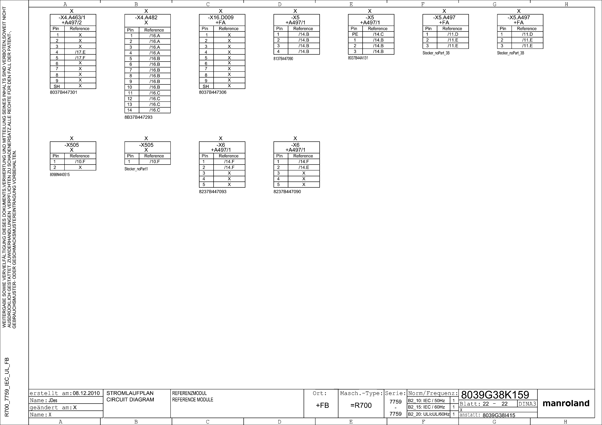

# +FB — Sheet 22 of 22 — REFERENZMODUL

**REFERENCE MODULE**

> Part of the manroland **R700** printing press IEC/UL circuit diagrams.
> Drawing class: **Stromlaufplan / Circuit diagram** (DIN A3).
> Document `+FB` covers the **Delivery / Coating module** machine section.

## At a glance

| Field | Value |
|---|---|
| Document | `+FB`  (8039G38K159) |
| Sheet | **22** of 22 |
| Section (DE) | REFERENZMODUL |
| Section (EN) | REFERENCE MODULE |
| Section type | REFERENCE_MODULE — Reference module |
| Machine type | `=R700` |
| Series | `7759` |
| Created | 08.12.2010 |
| Replaces | `8039G38I415` |
| Columns used | A, B, C, D, E, F, G |
| Path numbers | — |
| Labels on sheet | 188 |
| Cross-refs out | 36 |
| Cross-refs in | 0 |

**Previous:** [+FB sheet 21](SHEET_0021.md) · **Next:** [+Ax sheet 1](../Ax/SHEET_0001.md) · **Document TOC:** [_TOC.md](_TOC.md)  (+FB) · **Master TOC:** [all sheets](../_MASTER_TOC.md)

## Sheet image (300 DPI, exact vector render)



_Rendered directly from the PDF vector layer at 300 DPI (1-bit), no OCR and no resampling. Use it to confirm anything ambiguous in the text below._

## Cross-references on this sheet

Each entry is a wire leaving this sheet. The printed token is `/sheet.column`; the link resolves to that sheet inside the same document.

| Ref | Target sheet | Col | Path | Destination on target | Target section | From col |
|---|---|---|---|---|---|---|
| `/14.B` | [+FB sheet 14](SHEET_0014.md) | B | — | — | OPTION: COLORPILOT | D |
| `/14.B` | [+FB sheet 14](SHEET_0014.md) | B | — | — | OPTION: COLORPILOT | D |
| `/14.B` | [+FB sheet 14](SHEET_0014.md) | B | — | — | OPTION: COLORPILOT | D |
| `/14.B` | [+FB sheet 14](SHEET_0014.md) | B | — | — | OPTION: COLORPILOT | D |
| `/14.C` | [+FB sheet 14](SHEET_0014.md) | C | — | — | OPTION: COLORPILOT | E |
| `/14.B` | [+FB sheet 14](SHEET_0014.md) | B | — | — | OPTION: COLORPILOT | E |
| `/14.B` | [+FB sheet 14](SHEET_0014.md) | B | — | — | OPTION: COLORPILOT | E |
| `/14.B` | [+FB sheet 14](SHEET_0014.md) | B | — | — | OPTION: COLORPILOT | E |
| `/11.D` | [+FB sheet 11](SHEET_0011.md) | D | — | — | FARBABSTIMMLEUCHTE | F |
| `/11.E` | [+FB sheet 11](SHEET_0011.md) | E | — | — | FARBABSTIMMLEUCHTE | F |
| `/11.E` | [+FB sheet 11](SHEET_0011.md) | E | — | — | FARBABSTIMMLEUCHTE | F |
| `/11.D` | [+FB sheet 11](SHEET_0011.md) | D | — | — | FARBABSTIMMLEUCHTE | G |
| `/11.E` | [+FB sheet 11](SHEET_0011.md) | E | — | — | FARBABSTIMMLEUCHTE | G |
| `/11.E` | [+FB sheet 11](SHEET_0011.md) | E | — | — | FARBABSTIMMLEUCHTE | G |
| `/17.E` | [+FB sheet 17](SHEET_0017.md) | E | — | X X X | OPTION: COLORPILOT | A |
| `/17.F` | [+FB sheet 17](SHEET_0017.md) | F | — | X X X | OPTION: COLORPILOT | A |
| `/16.A` | [+FB sheet 16](SHEET_0016.md) | A | — | — | OPTION: COLORPILOT | B |
| `/16.A` | [+FB sheet 16](SHEET_0016.md) | A | — | — | OPTION: COLORPILOT | B |
| `/16.A` | [+FB sheet 16](SHEET_0016.md) | A | — | — | OPTION: COLORPILOT | B |
| `/16.A` | [+FB sheet 16](SHEET_0016.md) | A | — | — | OPTION: COLORPILOT | B |
| `/16.B` | [+FB sheet 16](SHEET_0016.md) | B | — | — | OPTION: COLORPILOT | B |
| `/16.B` | [+FB sheet 16](SHEET_0016.md) | B | — | — | OPTION: COLORPILOT | B |
| `/16.B` | [+FB sheet 16](SHEET_0016.md) | B | — | — | OPTION: COLORPILOT | B |
| `/16.B` | [+FB sheet 16](SHEET_0016.md) | B | — | — | OPTION: COLORPILOT | B |
| `/16.B` | [+FB sheet 16](SHEET_0016.md) | B | — | — | OPTION: COLORPILOT | B |
| `/16.B` | [+FB sheet 16](SHEET_0016.md) | B | — | — | OPTION: COLORPILOT | B |
| `/16.C` | [+FB sheet 16](SHEET_0016.md) | C | — | — | OPTION: COLORPILOT | B |
| `/16.C` | [+FB sheet 16](SHEET_0016.md) | C | — | — | OPTION: COLORPILOT | B |
| `/16.C` | [+FB sheet 16](SHEET_0016.md) | C | — | — | OPTION: COLORPILOT | B |
| `/16.C` | [+FB sheet 16](SHEET_0016.md) | C | — | — | OPTION: COLORPILOT | B |
| `/10.F` | [+FB sheet 10](SHEET_0010.md) | F | — | — | ERDUNG UND POTENTIALAUSGLEICH | A |
| `/10.F` | [+FB sheet 10](SHEET_0010.md) | F | — | — | ERDUNG UND POTENTIALAUSGLEICH | B |
| `/14.F` | [+FB sheet 14](SHEET_0014.md) | F | — | — | OPTION: COLORPILOT | C |
| `/14.F` | [+FB sheet 14](SHEET_0014.md) | F | — | — | OPTION: COLORPILOT | C |
| `/14.F` | [+FB sheet 14](SHEET_0014.md) | F | — | — | OPTION: COLORPILOT | D |
| `/14.E` | [+FB sheet 14](SHEET_0014.md) | E | — | — | OPTION: COLORPILOT | D |

## Devices on this sheet

| Tag | Class | Class meaning (IEC) | Col | Sub | Terminal | Sign |
|---|---|---|---|---|---|---|
| `+A497/2` | A | Baugruppe / assembly, module, PC board | A | 2 | — | + |
| `X5` | X | Klemme / terminal, plug connector | D | — | — | — |
| `+A497/1` | A | Baugruppe / assembly, module, PC board | D | 1 | — | + |
| `X5` | X | Klemme / terminal, plug connector | E | — | — | — |
| `+A497/1` | A | Baugruppe / assembly, module, PC board | E | 1 | — | + |
| `X505` | X | Klemme / terminal, plug connector | A | — | — | — |
| `X505` | X | Klemme / terminal, plug connector | B | — | — | — |
| `X6` | X | Klemme / terminal, plug connector | C | — | — | — |
| `+A497/1` | A | Baugruppe / assembly, module, PC board | C | 1 | — | + |
| `X6` | X | Klemme / terminal, plug connector | D | — | — | — |
| `+A497/1` | A | Baugruppe / assembly, module, PC board | D | 1 | — | + |
| `X4.A482` | — | cross-device reference | B | — | — | — |
| `X16.D009` | — | cross-device reference | C | — | — | — |
| `X5.A497` | — | cross-device reference | F | — | — | — |
| `X5.A497` | — | cross-device reference | G | — | — | — |

## Potentials / nets

| Potential | Count | Columns | Attached devices | Terminals |
|---|---|---|---|---|
| `PE` | 1 | E | — | — |


A potential such as `L24+/4` or `M24+` is a named supply/return rail; every place it appears on this sheet is electrically common.

## Wire-end annotations (grouped as printed)

A wire that continues elsewhere is annotated with a small cluster: the destination description, the path/line number `#NN`, and the `/sheet.column` cross reference. Each row below is one such cluster exactly as it is grouped on the drawing.

| Col | Y | Path | Cross-ref | Text on the wire |
|---|---|---|---|---|
| A | 17.3 | — | — | `X` |
| B | 17.3 | — | — | `X` |
| C | 17.3 | — | — | `X` |
| D | 17.3 | — | — | `X` |
| E | 17.3 | — | — | `X` |
| F | 17.3 | — | — | `X` |
| G | 17.3 | — | — | `X` |
| A | 30.1 | — | — | `X4.A463/1` |
| B | 30.1 | — | — | `X4.A482` |
| C | 30.1 | — | — | `X16.D009` |
| D | 30.1 | — | — | `X5` |
| E | 30.1 | — | — | `X5` |
| F | 30.1 | — | — | `X5.A497` |
| G | 30.1 | — | — | `X5.A497` |
| A | 40.0 | — | — | `+A497/2` |
| B | 40.0 | — | — | `X` |
| C | 40.0 | — | — | `+FA` |
| D | 40.0 | — | — | `+A497/1` |
| E | 40.0 | — | — | `+A497/1` |
| F | 40.0 | — | — | `+FA` |
| G | 40.0 | — | — | `+FA` |
| A | 52.7 | — | — | `8037B447301 Pin SH 3 4 5 6 7 8 9 2 1 Reference` |
| C | 52.7 | — | — | `8037B447306 Pin SH 3 4 5 6 7 8 9 2 1 Reference` |
| D | 52.7 | — | — | `Pin 1 2 3 4 Reference` |
| E | 52.7 | — | — | `Pin Reference` |
| F | 52.7 | — | — | `Pin 1 2 3 Reference` |
| G | 52.7 | — | — | `Pin 1 2 3 Reference` |
| B | 55.5 | — | — | `Pin 10 13 14 12 11 3 4 5 6 7 8 9 2 1 Reference` |
| D | 64.0 | — | `/14.B`, `/14.B`, `/14.B`, `/14.B` | — |
| E | 64.0 | — | — | `PE` |
| E | 64.1 | — | `/14.C`, `/14.B`, `/14.B`, `/14.B` | — |
| F | 64.1 | — | `/11.D`, `/11.E`, `/11.E` | — |
| G | 64.1 | — | `/11.D`, `/11.E`, `/11.E` | — |
| A | 65.4 | — | `/17.E`, `/17.F` | `X X X` |
| C | 65.4 | — | — | `X X X X X X X X X X` |
| B | 66.9 | — | `/16.A`, `/16.A`, `/16.A`, `/16.A`, `/16.B`, `/16.B`, `/16.B`, `/16.B`, `/16.B`, `/16.B`, `/16.C`, `/16.C`, `/16.C`, `/16.C` | — |
| E | 75.4 | — | — | `1 2` |
| E | 98.1 | — | — | `3` |
| F | 102.0 | — | — | `Stecker_noPart_3B` |
| G | 102.0 | — | — | `Stecker_noPart_3B` |
| E | 111.9 | — | — | `8037B44A131` |
| D | 113.3 | — | — | `8137B447090` |
| A | 120.7 | — | — | `X X X X X` |
| B | 228.5 | — | — | `8B37B447293` |
| A | 269.6 | — | — | `X` |
| B | 269.6 | — | — | `X` |
| C | 269.6 | — | — | `X` |
| D | 269.6 | — | — | `X` |
| A | 282.4 | — | — | `X505` |
| B | 282.4 | — | — | `X505` |
| C | 282.4 | — | — | `X6` |
| D | 282.4 | — | — | `X6` |
| A | 292.3 | — | — | `X` |
| B | 292.3 | — | — | `X` |
| C | 292.3 | — | — | `+A497/1` |
| D | 292.3 | — | — | `+A497/1` |
| A | 305.0 | — | — | `Pin 1 2 Reference` |
| B | 305.0 | — | — | `Pin 1 Reference` |
| C | 305.0 | — | — | `Pin 1 2 3 4 5 Reference` |
| D | 305.0 | — | — | `Pin 1 2 3 4 5 Reference` |
| A | 316.3 | — | `/10.F` | — |
| B | 316.3 | — | `/10.F` | — |
| C | 316.3 | — | `/14.F`, `/14.F` | — |
| D | 316.3 | — | `/14.F`, `/14.E` | — |
| A | 327.6 | — | — | `X` |
| B | 331.6 | — | — | `Stecker_noPart1` |
| C | 339.0 | — | — | `X X X` |
| D | 339.0 | — | — | `X X X` |
| A | 342.9 | — | — | `8098N440515` |
| C | 375.9 | — | — | `8237B447093` |
| D | 375.9 | — | — | `8237B447090` |


## Device order codes printed on this sheet

> **These are NOT device part numbers and must not be attributed to a single device.** They are order/manufacturing codes that sit inside the same annotation cluster as a device, with no printed label and no leader line binding them to one item. Measured across the whole set: such codes appear on **8 of 1,351 sheets** (see `01_SYSTEM/A_HOW_TO_READ.md` §8.1).

| Token | Col | Y (pt) | What it is |
|---|---|---|---|
| `8037B447301` | A | 178.9 | order code |
| `8037B447306` | C | 178.9 | order code |
| `8137B447090` | D | 113.3 | order code |
| `8037B44A131` | E | 111.9 | order code |
| `8098N440515` | A | 342.9 | order code |
| `8237B447093` | C | 375.9 | order code |
| `8237B447090` | D | 375.9 | order code |
| `Stecker_noPart_3B` | F | 102.0 | no orderable part (marker) |
| `Stecker_noPart_3B` | G | 102.0 | no orderable part (marker) |
| `Stecker_noPart1` | B | 331.6 | no orderable part (marker) |


## Notes and free text on this sheet

| Text | Col | Y (pt) |
|---|---|---|
| `Pin` | A | 52.7 |
| `Reference` | A | 52.86 |
| `SH` | A | 167.53 |
| `X4.A463/1` | A | 30.08 |
| `Pin` | B | 55.54 |
| `Reference` | B | 55.7 |
| `8B37B447293` | B | 228.49 |
| `Pin` | C | 52.7 |
| `Reference` | C | 52.86 |
| `SH` | C | 167.53 |
| `+FA` | C | 39.97 |
| `Pin` | D | 52.7 |
| `Reference` | D | 52.86 |
| `Pin` | E | 52.7 |
| `Reference` | E | 52.86 |
| `Pin` | F | 52.7 |
| `Reference` | F | 52.86 |
| `+FA` | F | 39.97 |
| `Pin` | G | 52.7 |
| `Reference` | G | 52.86 |
| `+FA` | G | 39.97 |

## Complete label inventory (exact text from the drawing)

Every text object inside the drawing area of this sheet, in DIN reading order (column A→H, then top→bottom). This is the authoritative list: if a string is not here it is not printed on this sheet.

| Col | Y | X | Dir | Type | Text |
|---|---|---|---|---|---|
| A | 17.3 | 138.2 | → | not fitted | `X` |
| A | 30.1 | 116.1 | → | text | `X4.A463/1` |
| A | 40.0 | 121.7 | → | device tag | `+A497/2` |
| A | 52.7 | 104.0 | → | text | `Pin` |
| A | 52.9 | 138.0 | → | text | `Reference` |
| A | 65.4 | 155.8 | → | not fitted | `X` |
| A | 65.5 | 111.7 | → | number | `1` |
| A | 76.8 | 155.8 | → | not fitted | `X` |
| A | 76.9 | 110.6 | → | number | `2` |
| A | 88.1 | 155.8 | → | not fitted | `X` |
| A | 88.2 | 110.3 | → | number | `3` |
| A | 99.5 | 110.3 | → | number | `4` |
| A | 99.5 | 148.7 | → | cross-reference | `/17.E` |
| A | 110.8 | 148.8 | → | cross-reference | `/17.F` |
| A | 110.9 | 110.3 | → | number | `5` |
| A | 120.7 | 155.8 | → | not fitted | `X` |
| A | 122.2 | 110.3 | → | number | `6` |
| A | 132.0 | 155.8 | → | not fitted | `X` |
| A | 132.1 | 110.3 | → | number | `7` |
| A | 143.4 | 155.8 | → | not fitted | `X` |
| A | 144.9 | 110.3 | → | number | `8` |
| A | 154.7 | 155.8 | → | not fitted | `X` |
| A | 156.2 | 110.3 | → | number | `9` |
| A | 166.1 | 155.8 | → | not fitted | `X` |
| A | 167.5 | 106.2 | → | text | `SH` |
| A | 178.9 | 98.9 | → | ordercode | `8037B447301` |
| A | 269.6 | 138.2 | → | not fitted | `X` |
| A | 282.3 | 127.7 | → | device tag | `X505` |
| A | 292.3 | 138.2 | → | not fitted | `X` |
| A | 305.0 | 104.0 | → | text | `Pin` |
| A | 305.1 | 138.0 | → | text | `Reference` |
| A | 316.3 | 148.8 | → | cross-reference | `/10.F` |
| A | 316.4 | 105.4 | → | number | `1` |
| A | 327.6 | 155.8 | → | not fitted | `X` |
| A | 327.7 | 106.0 | → | number | `2` |
| A | 343.0 | 98.9 | → | ordercode | `8098N440515` |
| B | 17.3 | 285.6 | → | not fitted | `X` |
| B | 30.1 | 267.2 | → | device ref | `X4.A482` |
| B | 40.0 | 285.6 | → | not fitted | `X` |
| B | 55.5 | 251.4 | → | text | `Pin` |
| B | 55.7 | 285.4 | → | text | `Reference` |
| B | 66.9 | 257.7 | → | number | `1` |
| B | 66.9 | 295.8 | → | cross-reference | `/16.A` |
| B | 78.2 | 295.8 | → | cross-reference | `/16.A` |
| B | 78.3 | 256.5 | → | number | `2` |
| B | 89.5 | 295.8 | → | cross-reference | `/16.A` |
| B | 89.6 | 256.3 | → | number | `3` |
| B | 100.9 | 295.8 | → | cross-reference | `/16.A` |
| B | 101.0 | 256.3 | → | number | `4` |
| B | 112.2 | 295.9 | → | cross-reference | `/16.B` |
| B | 112.3 | 256.3 | → | number | `5` |
| B | 123.6 | 256.3 | → | number | `6` |
| B | 123.6 | 295.9 | → | cross-reference | `/16.B` |
| B | 134.9 | 295.9 | → | cross-reference | `/16.B` |
| B | 135.0 | 256.3 | → | number | `7` |
| B | 146.2 | 295.9 | → | cross-reference | `/16.B` |
| B | 146.3 | 256.3 | → | number | `8` |
| B | 157.6 | 256.3 | → | number | `9` |
| B | 157.6 | 295.9 | → | cross-reference | `/16.B` |
| B | 168.9 | 295.9 | → | cross-reference | `/16.B` |
| B | 169.0 | 251.4 | → | number | `10` |
| B | 180.3 | 252.9 | → | number | `11` |
| B | 180.3 | 295.8 | → | cross-reference | `/16.C` |
| B | 191.6 | 295.8 | → | cross-reference | `/16.C` |
| B | 191.7 | 251.7 | → | number | `12` |
| B | 203.0 | 251.4 | → | number | `13` |
| B | 203.0 | 295.8 | → | cross-reference | `/16.C` |
| B | 214.3 | 251.4 | → | number | `14` |
| B | 214.3 | 295.8 | → | cross-reference | `/16.C` |
| B | 228.5 | 246.3 | → | text | `8B37B447293` |
| B | 269.6 | 285.6 | → | not fitted | `X` |
| B | 282.3 | 275.1 | → | device tag | `X505` |
| B | 292.3 | 285.6 | → | not fitted | `X` |
| B | 305.0 | 251.4 | → | text | `Pin` |
| B | 305.1 | 285.4 | → | text | `Reference` |
| B | 316.3 | 296.2 | → | cross-reference | `/10.F` |
| B | 316.4 | 252.9 | → | number | `1` |
| B | 331.6 | 246.3 | → | nopart | `Stecker_noPart1` |
| C | 17.3 | 433.0 | → | not fitted | `X` |
| C | 30.1 | 411.3 | → | device ref | `X16.D009` |
| C | 40.0 | 426.2 | → | text | `+FA` |
| C | 52.7 | 398.8 | → | text | `Pin` |
| C | 52.9 | 432.9 | → | text | `Reference` |
| C | 65.4 | 450.6 | → | not fitted | `X` |
| C | 65.5 | 406.5 | → | number | `1` |
| C | 76.8 | 450.6 | → | not fitted | `X` |
| C | 76.9 | 405.4 | → | number | `2` |
| C | 88.1 | 450.6 | → | not fitted | `X` |
| C | 88.2 | 405.1 | → | number | `3` |
| C | 99.4 | 450.6 | → | not fitted | `X` |
| C | 99.5 | 405.1 | → | number | `4` |
| C | 110.8 | 450.6 | → | not fitted | `X` |
| C | 110.9 | 405.1 | → | number | `5` |
| C | 120.7 | 450.6 | → | not fitted | `X` |
| C | 122.2 | 405.1 | → | number | `6` |
| C | 132.0 | 450.6 | → | not fitted | `X` |
| C | 132.1 | 405.1 | → | number | `7` |
| C | 143.4 | 450.6 | → | not fitted | `X` |
| C | 144.9 | 405.1 | → | number | `8` |
| C | 154.7 | 450.6 | → | not fitted | `X` |
| C | 156.2 | 405.1 | → | number | `9` |
| C | 166.1 | 450.6 | → | not fitted | `X` |
| C | 167.5 | 401.0 | → | text | `SH` |
| C | 178.9 | 393.7 | → | ordercode | `8037B447306` |
| C | 269.6 | 433.0 | → | not fitted | `X` |
| C | 282.4 | 428.5 | → | device tag | `X6` |
| C | 292.3 | 417.3 | → | device tag | `+A497/1` |
| C | 305.0 | 398.8 | → | text | `Pin` |
| C | 305.1 | 432.9 | → | text | `Reference` |
| C | 316.3 | 443.6 | → | cross-reference | `/14.F` |
| C | 316.4 | 400.3 | → | number | `1` |
| C | 327.7 | 400.8 | → | number | `2` |
| C | 327.7 | 443.6 | → | cross-reference | `/14.F` |
| C | 339.0 | 450.6 | → | not fitted | `X` |
| C | 339.1 | 400.8 | → | number | `3` |
| C | 350.3 | 450.6 | → | not fitted | `X` |
| C | 350.4 | 400.8 | → | number | `4` |
| C | 361.6 | 450.6 | → | not fitted | `X` |
| C | 361.7 | 400.8 | → | number | `5` |
| C | 375.9 | 393.7 | → | ordercode | `8237B447093` |
| D | 17.3 | 580.4 | → | not fitted | `X` |
| D | 30.1 | 575.9 | → | device tag | `X5` |
| D | 40.0 | 564.7 | → | device tag | `+A497/1` |
| D | 52.7 | 546.2 | → | text | `Pin` |
| D | 52.9 | 580.3 | → | text | `Reference` |
| D | 64.0 | 590.7 | → | cross-reference | `/14.B` |
| D | 64.1 | 547.7 | → | number | `1` |
| D | 75.4 | 548.2 | → | number | `2` |
| D | 75.4 | 590.7 | → | cross-reference | `/14.B` |
| D | 86.7 | 590.7 | → | cross-reference | `/14.B` |
| D | 86.8 | 548.2 | → | number | `3` |
| D | 98.0 | 590.7 | → | cross-reference | `/14.B` |
| D | 98.1 | 548.2 | → | number | `4` |
| D | 113.3 | 541.1 | → | ordercode | `8137B447090` |
| D | 269.6 | 580.4 | → | not fitted | `X` |
| D | 282.4 | 575.9 | → | device tag | `X6` |
| D | 292.3 | 564.7 | → | device tag | `+A497/1` |
| D | 305.0 | 546.2 | → | text | `Pin` |
| D | 305.1 | 580.3 | → | text | `Reference` |
| D | 316.3 | 591.0 | → | cross-reference | `/14.F` |
| D | 316.4 | 547.7 | → | number | `1` |
| D | 327.7 | 548.2 | → | number | `2` |
| D | 327.7 | 590.9 | → | cross-reference | `/14.E` |
| D | 339.0 | 598.0 | → | not fitted | `X` |
| D | 339.1 | 548.2 | → | number | `3` |
| D | 350.3 | 598.0 | → | not fitted | `X` |
| D | 350.4 | 548.2 | → | number | `4` |
| D | 361.6 | 598.0 | → | not fitted | `X` |
| D | 361.7 | 548.2 | → | number | `5` |
| D | 375.9 | 541.1 | → | ordercode | `8237B447090` |
| E | 17.3 | 727.8 | → | not fitted | `X` |
| E | 30.1 | 723.3 | → | device tag | `X5` |
| E | 40.0 | 712.1 | → | device tag | `+A497/1` |
| E | 52.7 | 693.6 | → | text | `Pin` |
| E | 52.9 | 727.7 | → | text | `Reference` |
| E | 64.0 | 696.5 | → | potential | `PE` |
| E | 64.1 | 738.0 | → | cross-reference | `/14.C` |
| E | 75.4 | 699.3 | → | number | `1` |
| E | 75.4 | 738.1 | → | cross-reference | `/14.B` |
| E | 86.7 | 738.1 | → | cross-reference | `/14.B` |
| E | 86.8 | 699.9 | → | number | `2` |
| E | 98.0 | 738.1 | → | cross-reference | `/14.B` |
| E | 98.1 | 699.9 | → | number | `3` |
| E | 111.9 | 688.5 | → | ordercode | `8037B44A131` |
| F | 17.3 | 875.2 | → | not fitted | `X` |
| F | 30.1 | 856.8 | → | device ref | `X5.A497` |
| F | 40.0 | 868.4 | → | text | `+FA` |
| F | 52.7 | 841.0 | → | text | `Pin` |
| F | 52.9 | 875.1 | → | text | `Reference` |
| F | 64.1 | 842.5 | → | number | `1` |
| F | 64.1 | 885.4 | → | cross-reference | `/11.D` |
| F | 75.4 | 843.0 | → | number | `2` |
| F | 75.4 | 885.7 | → | cross-reference | `/11.E` |
| F | 86.7 | 885.7 | → | cross-reference | `/11.E` |
| F | 86.8 | 843.0 | → | number | `3` |
| F | 102.0 | 835.9 | → | nopart | `Stecker_noPart_3B` |
| G | 17.3 | 1022.6 | → | not fitted | `X` |
| G | 30.1 | 1004.2 | → | device ref | `X5.A497` |
| G | 40.0 | 1015.8 | → | text | `+FA` |
| G | 52.7 | 988.4 | → | text | `Pin` |
| G | 52.9 | 1022.5 | → | text | `Reference` |
| G | 64.1 | 989.9 | → | number | `1` |
| G | 64.1 | 1032.8 | → | cross-reference | `/11.D` |
| G | 75.4 | 990.4 | → | number | `2` |
| G | 75.4 | 1033.1 | → | cross-reference | `/11.E` |
| G | 86.7 | 1033.1 | → | cross-reference | `/11.E` |
| G | 86.8 | 990.4 | → | number | `3` |
| G | 102.0 | 983.3 | → | nopart | `Stecker_noPart_3B` |

## Reading-order text block

The same content as a plain block, grouped by DIN column — convenient to paste or to match against a visual description.

```text
=== Column A ===
  17.3  138.2  placeholder  X
  30.1  116.1  text         X4.A463/1
  40.0  121.7  devtag       +A497/2
  52.7  104.0  text         Pin
  52.9  138.0  text         Reference
  65.4  155.8  placeholder  X
  65.5  111.7  numeric      1
  76.8  155.8  placeholder  X
  76.9  110.6  numeric      2
  88.1  155.8  placeholder  X
  88.2  110.3  numeric      3
  99.5  110.3  numeric      4
  99.5  148.7  xref         /17.E
 110.8  148.8  xref         /17.F
 110.9  110.3  numeric      5
 120.7  155.8  placeholder  X
 122.2  110.3  numeric      6
 132.0  155.8  placeholder  X
 132.1  110.3  numeric      7
 143.4  155.8  placeholder  X
 144.9  110.3  numeric      8
 154.7  155.8  placeholder  X
 156.2  110.3  numeric      9
 166.1  155.8  placeholder  X
 167.5  106.2  text         SH
 178.9   98.9  ordercode    8037B447301
 269.6  138.2  placeholder  X
 282.3  127.7  devtag       X505
 292.3  138.2  placeholder  X
 305.0  104.0  text         Pin
 305.1  138.0  text         Reference
 316.3  148.8  xref         /10.F
 316.4  105.4  numeric      1
 327.6  155.8  placeholder  X
 327.7  106.0  numeric      2
 343.0   98.9  ordercode    8098N440515
=== Column B ===
  17.3  285.6  placeholder  X
  30.1  267.2  devref       X4.A482
  40.0  285.6  placeholder  X
  55.5  251.4  text         Pin
  55.7  285.4  text         Reference
  66.9  257.7  numeric      1
  66.9  295.8  xref         /16.A
  78.2  295.8  xref         /16.A
  78.3  256.5  numeric      2
  89.5  295.8  xref         /16.A
  89.6  256.3  numeric      3
 100.9  295.8  xref         /16.A
 101.0  256.3  numeric      4
 112.2  295.9  xref         /16.B
 112.3  256.3  numeric      5
 123.6  256.3  numeric      6
 123.6  295.9  xref         /16.B
 134.9  295.9  xref         /16.B
 135.0  256.3  numeric      7
 146.2  295.9  xref         /16.B
 146.3  256.3  numeric      8
 157.6  256.3  numeric      9
 157.6  295.9  xref         /16.B
 168.9  295.9  xref         /16.B
 169.0  251.4  numeric      10
 180.3  252.9  numeric      11
 180.3  295.8  xref         /16.C
 191.6  295.8  xref         /16.C
 191.7  251.7  numeric      12
 203.0  251.4  numeric      13
 203.0  295.8  xref         /16.C
 214.3  251.4  numeric      14
 214.3  295.8  xref         /16.C
 228.5  246.3  text         8B37B447293
 269.6  285.6  placeholder  X
 282.3  275.1  devtag       X505
 292.3  285.6  placeholder  X
 305.0  251.4  text         Pin
 305.1  285.4  text         Reference
 316.3  296.2  xref         /10.F
 316.4  252.9  numeric      1
 331.6  246.3  nopart       Stecker_noPart1
=== Column C ===
  17.3  433.0  placeholder  X
  30.1  411.3  devref       X16.D009
  40.0  426.2  text         +FA
  52.7  398.8  text         Pin
  52.9  432.9  text         Reference
  65.4  450.6  placeholder  X
  65.5  406.5  numeric      1
  76.8  450.6  placeholder  X
  76.9  405.4  numeric      2
  88.1  450.6  placeholder  X
  88.2  405.1  numeric      3
  99.4  450.6  placeholder  X
  99.5  405.1  numeric      4
 110.8  450.6  placeholder  X
 110.9  405.1  numeric      5
 120.7  450.6  placeholder  X
 122.2  405.1  numeric      6
 132.0  450.6  placeholder  X
 132.1  405.1  numeric      7
 143.4  450.6  placeholder  X
 144.9  405.1  numeric      8
 154.7  450.6  placeholder  X
 156.2  405.1  numeric      9
 166.1  450.6  placeholder  X
 167.5  401.0  text         SH
 178.9  393.7  ordercode    8037B447306
 269.6  433.0  placeholder  X
 282.4  428.5  devtag       X6
 292.3  417.3  devtag       +A497/1
 305.0  398.8  text         Pin
 305.1  432.9  text         Reference
 316.3  443.6  xref         /14.F
 316.4  400.3  numeric      1
 327.7  400.8  numeric      2
 327.7  443.6  xref         /14.F
 339.0  450.6  placeholder  X
 339.1  400.8  numeric      3
 350.3  450.6  placeholder  X
 350.4  400.8  numeric      4
 361.6  450.6  placeholder  X
 361.7  400.8  numeric      5
 375.9  393.7  ordercode    8237B447093
=== Column D ===
  17.3  580.4  placeholder  X
  30.1  575.9  devtag       X5
  40.0  564.7  devtag       +A497/1
  52.7  546.2  text         Pin
  52.9  580.3  text         Reference
  64.0  590.7  xref         /14.B
  64.1  547.7  numeric      1
  75.4  548.2  numeric      2
  75.4  590.7  xref         /14.B
  86.7  590.7  xref         /14.B
  86.8  548.2  numeric      3
  98.0  590.7  xref         /14.B
  98.1  548.2  numeric      4
 113.3  541.1  ordercode    8137B447090
 269.6  580.4  placeholder  X
 282.4  575.9  devtag       X6
 292.3  564.7  devtag       +A497/1
 305.0  546.2  text         Pin
 305.1  580.3  text         Reference
 316.3  591.0  xref         /14.F
 316.4  547.7  numeric      1
 327.7  548.2  numeric      2
 327.7  590.9  xref         /14.E
 339.0  598.0  placeholder  X
 339.1  548.2  numeric      3
 350.3  598.0  placeholder  X
 350.4  548.2  numeric      4
 361.6  598.0  placeholder  X
 361.7  548.2  numeric      5
 375.9  541.1  ordercode    8237B447090
=== Column E ===
  17.3  727.8  placeholder  X
  30.1  723.3  devtag       X5
  40.0  712.1  devtag       +A497/1
  52.7  693.6  text         Pin
  52.9  727.7  text         Reference
  64.0  696.5  net          PE
  64.1  738.0  xref         /14.C
  75.4  699.3  numeric      1
  75.4  738.1  xref         /14.B
  86.7  738.1  xref         /14.B
  86.8  699.9  numeric      2
  98.0  738.1  xref         /14.B
  98.1  699.9  numeric      3
 111.9  688.5  ordercode    8037B44A131
=== Column F ===
  17.3  875.2  placeholder  X
  30.1  856.8  devref       X5.A497
  40.0  868.4  text         +FA
  52.7  841.0  text         Pin
  52.9  875.1  text         Reference
  64.1  842.5  numeric      1
  64.1  885.4  xref         /11.D
  75.4  843.0  numeric      2
  75.4  885.7  xref         /11.E
  86.7  885.7  xref         /11.E
  86.8  843.0  numeric      3
 102.0  835.9  nopart       Stecker_noPart_3B
=== Column G ===
  17.3 1022.6  placeholder  X
  30.1 1004.2  devref       X5.A497
  40.0 1015.8  text         +FA
  52.7  988.4  text         Pin
  52.9 1022.5  text         Reference
  64.1  989.9  numeric      1
  64.1 1032.8  xref         /11.D
  75.4  990.4  numeric      2
  75.4 1033.1  xref         /11.E
  86.7 1033.1  xref         /11.E
  86.8  990.4  numeric      3
 102.0  983.3  nopart       Stecker_noPart_3B
```

---
_Generated from the PDF vector text layer; no OCR. Source: `R700_7759_IEC_UL_FB`, sheet 22._
