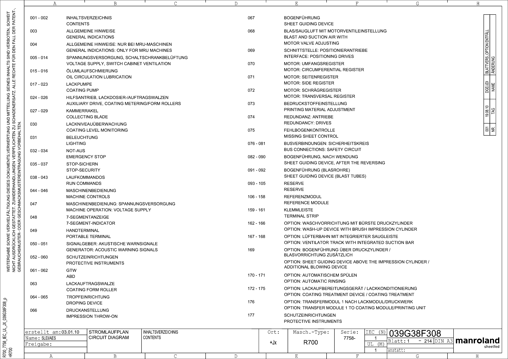

# +Jx — Sheet 1 of 214 — INHALTSVERZEICHNIS

**CONTENTS**

> Part of the manroland **R700** printing press IEC/UL circuit diagrams.
> Drawing class: **Stromlaufplan / Circuit diagram** (DIN A3).
> Document `+Jx` covers the **1st printing module + feed register** machine section.

## At a glance

| Field | Value |
|---|---|
| Document | `+Jx`  (039G38F308) |
| Sheet | **1** of 214 |
| Section (DE) | INHALTSVERZEICHNIS |
| Section (EN) | CONTENTS |
| Section type | TOC — Contents |
| Machine type | `R700` |
| Series | `7758` |
| Created | 03.01.10 |
| Replaces | — |
| Columns used | A, B, D, E, F, H |
| Path numbers | — |
| Labels on sheet | 146 |
| Cross-refs out | 0 |
| Cross-refs in | 0 |

**Previous:** [+FA sheet 58](../FA/SHEET_0058.md) · **Next:** [+Jx sheet 2](SHEET_0002.md) · **Document TOC:** [_TOC.md](_TOC.md)  (+Jx) · **Master TOC:** [all sheets](../_MASTER_TOC.md)

## Sheet image (300 DPI, exact vector render)



_Rendered directly from the PDF vector layer at 300 DPI (1-bit), no OCR and no resampling. Use it to confirm anything ambiguous in the text below._

## Cross-references on this sheet

Each entry is a wire leaving this sheet. The printed token is `/sheet.column`; the link resolves to that sheet inside the same document.

_No outgoing cross-references on this sheet._

## Devices on this sheet

| Tag | Class | Class meaning (IEC) | Col | Sub | Terminal | Sign |
|---|---|---|---|---|---|---|
| `NR.` | — | cross-device reference | H | — | — | — |
| `19.08.10` | — | cross-device reference | H | — | — | — |

## Potentials / nets

_No named potentials on this sheet._

## Wire-end annotations (grouped as printed)

A wire that continues elsewhere is annotated with a small cluster: the destination description, the path/line number `#NN`, and the `/sheet.column` cross reference. Each row below is one such cluster exactly as it is grouped on the drawing.

| Col | Y | Path | Cross-ref | Text on the wire |
|---|---|---|---|---|
| A | 37.4 | — | — | `001 002 INHALTSVERZEICHNIS CONTENTS` |
| E | 37.4 | — | — | `067 BOGENFÜHRUNG SHEET GUIDING DEVICE` |
| A | 68.6 | — | — | `003 GENERAL INDICATIONS ALLGEMEINE HINWEISE` |
| E | 68.6 | — | — | `068 BLAS/SAUGLUFT MIT MOTORVENTILEINSTELLUNG BLAST AND SUCTION AIR WITH MOTOR VALVE ADJUSTING` |
| H | 69.1 | — | — | `001 DGE/JDI 19.08.10 BLATTVERS.,OPTION ENTFÄLL` |
| B | 99.8 | — | — | `004 GENERAL INDICATIONS: ONLY FOR MRU MACHINES ALLGEMEINE HINWEISE: NUR BEI MRU MASCHINEN` |
| E | 114.0 | — | — | `069 INTERFACE: POSITIONING DRIVES SCHNITTSTELLE: POSITIONIERANTRIEBE` |
| B | 130.9 | — | — | `005 014 SPANNUNGSVERSORGUNG, SCHALTSCHRANKBELÜFTUNG VOLTAGE SUPPLY, SWITCH CABINET VENTILATION` |
| H | 132.2 | — | — | `NR. NAME TAG ÄNDERUNG` |
| E | 145.1 | — | — | `070 MOTOR: UMFANGSREGISTER MOTOR: CIRCUMFERENTIAL REGISTER` |
| A | 162.1 | — | — | `015 016 ÖLUMLAUFSCHMIERUNG OIL CIRCULATION LUBRICATION` |
| E | 176.3 | — | — | `071 MOTOR: SEITENREGISTER MOTOR: SIDE REGISTER` |
| A | 193.3 | — | — | `017 023 LACKPUMPE COATING PUMP` |
| E | 207.5 | — | — | `072 MOTOR: SCHRÄGREGISTER MOTOR: TRANSVERSAL REGISTER` |
| B | 224.5 | — | — | `024 026 HILFSANTRIEB, LACKDOSIER /AUFTRAGSWALZEN` |
| B | 238.7 | — | — | `AUXILIARY DRIVE, COATING METERING/FORM ROLLERS` |
| E | 238.7 | — | — | `073 BEDRUCKSTOFFEINSTELLUNG PRINTING MATERIAL ADJUSTMENT` |
| A | 255.7 | — | — | `027 029 KAMMERRAKEL COLLECTING BLADE` |
| E | 269.8 | — | — | `074 REDUNDANZ: ANTRIEBE REDUNDANCY: DRIVES` |
| A | 286.8 | — | — | `030 LACKNIVEAUÜBERWACHUNG COATING LEVEL MONITORING` |
| E | 301.0 | — | — | `075 FEHLBOGENKONTROLLE MISSING SHEET CONTROL` |
| A | 318.0 | — | — | `031 BELEUCHTUNG LIGHTING` |
| E | 332.2 | — | — | `076 081 BUSVERBINDUNGEN: SICHERHEITSKREIS BUS CONNECTIONS: SAFETY CIRCUIT` |
| A | 349.2 | — | — | `032 034 NOT AUS EMERGENCY STOP` |
| E | 363.4 | — | — | `082 090 BOGENFÜHRUNG, NACH WENDUNG SHEET GUIDING DEVICE, AFTER THE REVERSING` |
| A | 380.4 | — | — | `035 037 STOP SICHERN STOP SECURITY` |
| E | 394.6 | — | — | `091 092 BOGENFÜHRUNG (BLASROHRE) SHEET GUIDING DEVICE (BLAST TUBES)` |
| A | 411.6 | — | — | `038 043 LAUFKOMMANDOS RUN COMMANDS` |
| E | 425.7 | — | — | `093 105 RESERVE RESERVE` |
| A | 442.8 | — | — | `044 046 MASCHINENBEDIENUNG MACHINE CONTROLS` |
| E | 456.9 | — | — | `106 158 REFERENZMODUL REFERENCE MODULE` |
| B | 473.9 | — | — | `047 MASCHINENBEDIENUNG: SPANNUNGSVERSORGUNG MACHINE OPERATION: VOLTAGE SUPPLY` |
| E | 488.1 | — | — | `159 161 KLEMMLEISTE` |
| E | 502.3 | — | — | `TERMINAL STRIP` |
| A | 505.1 | — | — | `048 7 SEGMENTANZEIGE 7 SEGMENT INDICATOR` |
| F | 519.3 | — | — | `162 166 OPTION: WASCHVORRICHTUNG MIT BÜRSTE DRUCKZYLINDER OPTION: WASH UP DEVICE WITH BRUSH IMPRESSION CYLINDER` |
| A | 536.3 | — | — | `049 HANDTERMINAL PORTABLE TERMINAL` |
| F | 550.5 | — | — | `167 168 OPTION: LÜFTERBAHN MIT INTEGRIERTER SAUGLEISTE OPTION: VENTILATOR TRACK WITH INTEGRATED SUCTION BAR` |
| B | 567.5 | — | — | `050 051 GENERATOR: ACOUSTIC WARNING SIGNALS SIGNALGEBER: AKUSTISCHE WARNSIGNALE` |
| E | 581.6 | — | — | `169 BLASVORRICHTUNG ZUSÄTZLICH OPTION: BOGENFÜHRUNG ÜBER DRUCKZYLINDER /` |
| A | 598.7 | — | — | `052 060 PROTECTIVE INSTRUMENTS SCHUTZEINRICHTUNGEN` |
| F | 610.0 | — | — | `OPTION: SHEET GUIDING DEVICE ABOVE THE IMPRESSION CYLINDER / ADDITIONAL BLOWING DEVICE` |
| A | 629.7 | — | — | `061 062 GTW` |
| E | 641.2 | — | — | `170 171 OPTION: AUTOMATISCHEM SPÜLEN OPTION: AUTOMATIC RINSING` |
| A | 644.0 | — | — | `ABD` |
| A | 661.0 | — | — | `063 LACKAUFTRAGSWALZE COATING FORM ROLLER` |
| F | 672.4 | — | — | `172 175 OPTION: LACKAUFBEREITUNGSGERÄT / LACKKONDITIONIERUNG OPTION: COATING TREATMENT DEVICE / COATING TREATMENT` |
| A | 692.2 | — | — | `064 065 DROPING DEVICE TROPFEINRICHTUNG` |
| F | 703.5 | — | — | `176 OPTION: TRANSFERMODUL 1 NACH LACKMODUL/DRUCKWERK OPTION: TRANSFER MODULE 1 TO COATING MODULE/PRINTING UNIT` |
| A | 723.4 | — | — | `066 DRUCKANSTELLUNG IMPRESSION THROW ON` |
| E | 734.8 | — | — | `177 PROTECTIVE INSTRUMENTS SCHUTZEINRICHTUNGEN` |


## Notes and free text on this sheet

| Text | Col | Y (pt) |
|---|---|---|
| `TAG` | H | 253.28 |
| `NAME` | H | 194.05 |
| `ÄNDERUNG` | H | 132.19 |
| `DGE/JDI` | H | 189.96 |
| `BLATTVERS.,OPTION ENTFÄLL` | H | 69.08 |
| `INHALTSVERZEICHNIS` | B | 37.42 |
| `CONTENTS` | A | 51.57 |
| `ALLGEMEINE HINWEISE` | B | 68.56 |
| `GENERAL INDICATIONS` | B | 82.77 |
| `ALLGEMEINE HINWEISE: NUR BEI MRU MASCHINEN` | B | 99.75 |
| `GENERAL INDICATIONS: ONLY FOR MRU MACHINES` | B | 113.93 |
| `SPANNUNGSVERSORGUNG, SCHALTSCHRANKBELÜFTUNG` | B | 130.94 |
| `VOLTAGE SUPPLY, SWITCH CABINET VENTILATION` | B | 145.11 |
| `ÖLUMLAUFSCHMIERUNG` | B | 162.12 |
| `OIL CIRCULATION LUBRICATION` | B | 176.31 |
| `LACKPUMPE` | A | 193.3 |
| `COATING PUMP` | A | 207.47 |
| `HILFSANTRIEB, LACKDOSIER /AUFTRAGSWALZEN` | B | 224.47 |
| `AUXILIARY DRIVE, COATING METERING/FORM ROLLERS` | B | 238.66 |
| `KAMMERRAKEL` | A | 255.66 |
| `COLLECTING BLADE` | B | 269.85 |
| `LACKNIVEAUÜBERWACHUNG` | B | 286.82 |
| `COATING LEVEL MONITORING` | B | 301.03 |
| `BELEUCHTUNG` | A | 318.03 |
| `LIGHTING` | A | 332.23 |
| `NOT AUS` | A | 349.2 |
| `EMERGENCY STOP` | B | 363.37 |
| `STOP SICHERN` | A | 380.39 |
| `STOP SECURITY` | A | 394.57 |
| `LAUFKOMMANDOS` | B | 411.57 |
| `RUN COMMANDS` | A | 425.73 |
| `MASCHINENBEDIENUNG` | B | 442.76 |
| `MACHINE CONTROLS` | B | 456.92 |
| `MASCHINENBEDIENUNG: SPANNUNGSVERSORGUNG` | B | 473.93 |
| `MACHINE OPERATION: VOLTAGE SUPPLY` | B | 488.11 |
| `7 SEGMENTANZEIGE` | B | 505.12 |
| `7 SEGMENT INDICATOR` | B | 519.29 |
| `HANDTERMINAL` | A | 536.3 |
| `PORTABLE TERMINAL` | B | 550.47 |
| `SIGNALGEBER: AKUSTISCHE WARNSIGNALE` | B | 567.46 |
| `GENERATOR: ACOUSTIC WARNING SIGNALS` | B | 581.63 |
| `SCHUTZEINRICHTUNGEN` | B | 598.67 |
| `PROTECTIVE INSTRUMENTS` | B | 612.84 |
| `GTW` | A | 629.68 |
| `ABD` | A | 644.01 |
| `LACKAUFTRAGSWALZE` | B | 660.99 |
| `COATING FORM ROLLER` | B | 675.19 |
| `TROPFEINRICHTUNG` | B | 692.21 |
| `DROPING DEVICE` | A | 706.38 |
| `DRUCKANSTELLUNG` | B | 723.38 |
| `IMPRESSION THROW ON` | B | 737.52 |
| `BOGENFÜHRUNG` | E | 37.39 |
| `SHEET GUIDING DEVICE` | E | 51.58 |
| `BLAS/SAUGLUFT MIT MOTORVENTILEINSTELLUNG` | F | 68.59 |
| `BLAST AND SUCTION AIR WITH` | E | 82.73 |
| `MOTOR VALVE ADJUSTING` | E | 96.92 |
| `SCHNITTSTELLE: POSITIONIERANTRIEBE` | E | 113.95 |
| `INTERFACE: POSITIONING DRIVES` | E | 128.12 |
| `MOTOR: UMFANGSREGISTER` | E | 145.11 |
| `MOTOR: CIRCUMFERENTIAL REGISTER` | E | 159.29 |
| `MOTOR: SEITENREGISTER` | E | 176.3 |
| `MOTOR: SIDE REGISTER` | E | 190.47 |
| `MOTOR: SCHRÄGREGISTER` | E | 207.47 |
| `MOTOR: TRANSVERSAL REGISTER` | E | 221.65 |
| `BEDRUCKSTOFFEINSTELLUNG` | E | 238.67 |
| `PRINTING MATERIAL ADJUSTMENT` | E | 252.83 |
| `REDUNDANZ: ANTRIEBE` | E | 269.84 |
| `REDUNDANCY: DRIVES` | E | 284.01 |
| `FEHLBOGENKONTROLLE` | E | 301.02 |
| `MISSING SHEET CONTROL` | E | 315.19 |
| `BUSVERBINDUNGEN: SICHERHEITSKREIS` | E | 332.21 |
| `BUS CONNECTIONS: SAFETY CIRCUIT` | E | 346.38 |
| `BOGENFÜHRUNG, NACH WENDUNG` | E | 363.35 |
| `SHEET GUIDING DEVICE, AFTER THE REVERSING` | F | 377.56 |
| `BOGENFÜHRUNG (BLASROHRE)` | E | 394.55 |
| `SHEET GUIDING DEVICE (BLAST TUBES)` | E | 408.73 |
| `RESERVE` | E | 425.75 |
| `REFERENZMODUL` | E | 456.92 |
| `REFERENCE MODULE` | E | 471.09 |
| `KLEMMLEISTE` | E | 488.12 |
| `TERMINAL STRIP` | E | 502.29 |
| `OPTION: WASCHVORRICHTUNG MIT BÜRSTE DRUCKZYLINDER` | F | 519.28 |
| `OPTION: WASH UP DEVICE WITH BRUSH IMPRESSION CYLINDER` | F | 533.44 |
| `OPTION: LÜFTERBAHN MIT INTEGRIERTER SAUGLEISTE` | F | 550.47 |
| `OPTION: VENTILATOR TRACK WITH INTEGRATED SUCTION BAR` | F | 564.63 |
| `OPTION: BOGENFÜHRUNG ÜBER DRUCKZYLINDER /` | F | 581.64 |
| `BLASVORRICHTUNG ZUSÄTZLICH` | E | 593.66 |
| `OPTION: SHEET GUIDING DEVICE ABOVE THE IMPRESSION CYLINDER /` | F | 610 |
| `ADDITIONAL BLOWING DEVICE` | E | 621.99 |
| `OPTION: AUTOMATISCHEM SPÜLEN` | E | 641.18 |
| `OPTION: AUTOMATIC RINSING` | E | 655.36 |
| `OPTION: LACKAUFBEREITUNGSGERÄT / LACKKONDITIONIERUNG` | F | 672.36 |
| `OPTION: COATING TREATMENT DEVICE / COATING TREATMENT` | F | 686.53 |
| `OPTION: TRANSFERMODUL 1 NACH LACKMODUL/DRUCKWERK` | F | 703.52 |
| `OPTION: TRANSFER MODULE 1 TO COATING MODULE/PRINTING UNIT` | F | 717.71 |
| `SCHUTZEINRICHTUNGEN` | E | 735.08 |
| `PROTECTIVE INSTRUMENTS` | E | 749.26 |

## Complete label inventory (exact text from the drawing)

Every text object inside the drawing area of this sheet, in DIN reading order (column A→H, then top→bottom). This is the authoritative list: if a string is not here it is not printed on this sheet.

| Col | Y | X | Dir | Type | Text |
|---|---|---|---|---|---|
| A | 37.4 | 70.6 | → | number | `001 002` |
| A | 51.6 | 155.6 | → | text | `CONTENTS` |
| A | 68.6 | 70.6 | → | number | `003` |
| A | 99.8 | 70.6 | → | number | `004` |
| A | 130.9 | 70.6 | → | number | `005 014` |
| A | 162.1 | 70.6 | → | number | `015 016` |
| A | 193.3 | 70.6 | → | number | `017 023` |
| A | 193.3 | 155.3 | → | text | `LACKPUMPE` |
| A | 207.5 | 155.6 | → | text | `COATING PUMP` |
| A | 224.5 | 70.6 | → | number | `024 026` |
| A | 255.7 | 70.6 | → | number | `027 029` |
| A | 255.7 | 155.3 | → | text | `KAMMERRAKEL` |
| A | 286.9 | 70.6 | → | number | `030` |
| A | 318.0 | 155.3 | → | text | `BELEUCHTUNG` |
| A | 318.1 | 70.6 | → | number | `031` |
| A | 332.2 | 155.3 | → | text | `LIGHTING` |
| A | 349.2 | 70.6 | → | number | `032 034` |
| A | 349.2 | 155.3 | → | text | `NOT AUS` |
| A | 380.4 | 70.6 | → | number | `035 037` |
| A | 380.4 | 155.6 | → | text | `STOP SICHERN` |
| A | 394.6 | 155.6 | → | text | `STOP SECURITY` |
| A | 411.6 | 70.6 | → | number | `038 043` |
| A | 425.7 | 155.3 | → | text | `RUN COMMANDS` |
| A | 442.8 | 70.6 | → | number | `044 046` |
| A | 474.0 | 70.6 | → | number | `047` |
| A | 505.2 | 70.6 | → | number | `048` |
| A | 536.3 | 70.6 | → | number | `049` |
| A | 536.3 | 155.3 | → | text | `HANDTERMINAL` |
| A | 567.5 | 70.6 | → | number | `050 051` |
| A | 598.7 | 70.6 | → | number | `052 060` |
| A | 629.7 | 155.3 | → | text | `GTW` |
| A | 629.8 | 70.6 | → | number | `061 062` |
| A | 644.0 | 155.9 | → | text | `ABD` |
| A | 661.1 | 70.6 | → | number | `063` |
| A | 692.2 | 70.6 | → | number | `064 065` |
| A | 706.4 | 155.3 | → | text | `DROPING DEVICE` |
| A | 723.4 | 70.6 | → | number | `066` |
| B | 37.4 | 155.3 | → | text | `INHALTSVERZEICHNIS` |
| B | 68.6 | 155.9 | → | text | `ALLGEMEINE HINWEISE` |
| B | 82.8 | 155.3 | → | text | `GENERAL INDICATIONS` |
| B | 99.7 | 155.9 | → | text | `ALLGEMEINE HINWEISE: NUR BEI MRU MASCHINEN` |
| B | 113.9 | 155.3 | → | text | `GENERAL INDICATIONS: ONLY FOR MRU MACHINES` |
| B | 130.9 | 155.6 | → | text | `SPANNUNGSVERSORGUNG, SCHALTSCHRANKBELÜFTUNG` |
| B | 145.1 | 155.9 | → | text | `VOLTAGE SUPPLY, SWITCH CABINET VENTILATION` |
| B | 162.1 | 155.6 | → | text | `ÖLUMLAUFSCHMIERUNG` |
| B | 176.3 | 155.6 | → | text | `OIL CIRCULATION LUBRICATION` |
| B | 224.5 | 155.3 | → | text | `HILFSANTRIEB, LACKDOSIER /AUFTRAGSWALZEN` |
| B | 238.7 | 155.9 | → | text | `AUXILIARY DRIVE, COATING METERING/FORM ROLLERS` |
| B | 269.8 | 155.6 | → | text | `COLLECTING BLADE` |
| B | 286.8 | 155.3 | → | text | `LACKNIVEAUÜBERWACHUNG` |
| B | 301.0 | 155.6 | → | text | `COATING LEVEL MONITORING` |
| B | 363.4 | 155.3 | → | text | `EMERGENCY STOP` |
| B | 411.6 | 155.3 | → | text | `LAUFKOMMANDOS` |
| B | 442.8 | 155.3 | → | text | `MASCHINENBEDIENUNG` |
| B | 456.9 | 155.3 | → | text | `MACHINE CONTROLS` |
| B | 473.9 | 155.3 | → | text | `MASCHINENBEDIENUNG: SPANNUNGSVERSORGUNG` |
| B | 488.1 | 155.3 | → | text | `MACHINE OPERATION: VOLTAGE SUPPLY` |
| B | 505.1 | 155.6 | → | text | `7 SEGMENTANZEIGE` |
| B | 519.3 | 155.6 | → | text | `7 SEGMENT INDICATOR` |
| B | 550.5 | 155.3 | → | text | `PORTABLE TERMINAL` |
| B | 567.5 | 155.6 | → | text | `SIGNALGEBER: AKUSTISCHE WARNSIGNALE` |
| B | 581.6 | 155.3 | → | text | `GENERATOR: ACOUSTIC WARNING SIGNALS` |
| B | 598.7 | 155.6 | → | text | `SCHUTZEINRICHTUNGEN` |
| B | 612.8 | 155.3 | → | text | `PROTECTIVE INSTRUMENTS` |
| B | 661.0 | 155.3 | → | text | `LACKAUFTRAGSWALZE` |
| B | 675.2 | 155.6 | → | text | `COATING FORM ROLLER` |
| B | 692.2 | 155.9 | → | text | `TROPFEINRICHTUNG` |
| B | 723.4 | 155.3 | → | text | `DRUCKANSTELLUNG` |
| B | 737.5 | 155.3 | → | text | `IMPRESSION THROW ON` |
| D | 37.4 | 580.8 | → | number | `067` |
| D | 68.6 | 580.8 | → | number | `068` |
| D | 114.0 | 580.8 | → | number | `069` |
| D | 145.2 | 580.8 | → | number | `070` |
| D | 176.3 | 580.8 | → | number | `071` |
| D | 207.5 | 580.8 | → | number | `072` |
| D | 238.7 | 580.8 | → | number | `073` |
| D | 269.9 | 580.8 | → | number | `074` |
| D | 301.1 | 580.8 | → | number | `075` |
| D | 332.2 | 580.8 | → | number | `076 081` |
| D | 363.4 | 580.8 | → | number | `082 090` |
| D | 394.6 | 580.8 | → | number | `091 092` |
| D | 425.7 | 580.8 | → | number | `093 105` |
| D | 456.9 | 580.3 | → | number | `106 158` |
| D | 488.1 | 580.3 | → | number | `159 161` |
| D | 519.3 | 580.3 | → | number | `162 166` |
| D | 550.5 | 580.3 | → | number | `167 168` |
| D | 581.7 | 580.3 | → | number | `169` |
| D | 641.2 | 580.3 | → | number | `170 171` |
| D | 672.4 | 580.3 | → | number | `172 175` |
| D | 703.6 | 580.3 | → | number | `176` |
| D | 734.8 | 580.3 | → | number | `177` |
| E | 37.4 | 665.6 | → | text | `BOGENFÜHRUNG` |
| E | 51.6 | 665.9 | → | text | `SHEET GUIDING DEVICE` |
| E | 82.7 | 665.6 | → | text | `BLAST AND SUCTION AIR WITH` |
| E | 96.9 | 665.6 | → | text | `MOTOR VALVE ADJUSTING` |
| E | 114.0 | 665.9 | → | text | `SCHNITTSTELLE: POSITIONIERANTRIEBE` |
| E | 128.1 | 665.6 | → | text | `INTERFACE: POSITIONING DRIVES` |
| E | 145.1 | 665.6 | → | text | `MOTOR: UMFANGSREGISTER` |
| E | 159.3 | 665.6 | → | text | `MOTOR: CIRCUMFERENTIAL REGISTER` |
| E | 176.3 | 665.6 | → | text | `MOTOR: SEITENREGISTER` |
| E | 190.5 | 665.6 | → | text | `MOTOR: SIDE REGISTER` |
| E | 207.5 | 665.6 | → | text | `MOTOR: SCHRÄGREGISTER` |
| E | 221.6 | 665.6 | → | text | `MOTOR: TRANSVERSAL REGISTER` |
| E | 238.7 | 665.6 | → | text | `BEDRUCKSTOFFEINSTELLUNG` |
| E | 252.8 | 665.6 | → | text | `PRINTING MATERIAL ADJUSTMENT` |
| E | 269.8 | 665.6 | → | text | `REDUNDANZ: ANTRIEBE` |
| E | 284.0 | 665.6 | → | text | `REDUNDANCY: DRIVES` |
| E | 301.0 | 665.6 | → | text | `FEHLBOGENKONTROLLE` |
| E | 315.2 | 665.6 | → | text | `MISSING SHEET CONTROL` |
| E | 332.2 | 665.6 | → | text | `BUSVERBINDUNGEN: SICHERHEITSKREIS` |
| E | 346.4 | 665.6 | → | text | `BUS CONNECTIONS: SAFETY CIRCUIT` |
| E | 363.3 | 665.6 | → | text | `BOGENFÜHRUNG, NACH WENDUNG` |
| E | 394.6 | 665.6 | → | text | `BOGENFÜHRUNG (BLASROHRE)` |
| E | 408.7 | 665.9 | → | text | `SHEET GUIDING DEVICE (BLAST TUBES)` |
| E | 425.7 | 665.6 | → | text | `RESERVE` |
| E | 439.9 | 665.6 | → | text | `RESERVE` |
| E | 456.9 | 665.6 | → | text | `REFERENZMODUL` |
| E | 471.1 | 665.6 | → | text | `REFERENCE MODULE` |
| E | 488.1 | 665.6 | → | text | `KLEMMLEISTE` |
| E | 502.3 | 666.1 | → | text | `TERMINAL STRIP` |
| E | 593.7 | 665.6 | → | text | `BLASVORRICHTUNG ZUSÄTZLICH` |
| E | 622.0 | 666.1 | → | text | `ADDITIONAL BLOWING DEVICE` |
| E | 641.2 | 665.9 | → | text | `OPTION: AUTOMATISCHEM SPÜLEN` |
| E | 655.4 | 665.9 | → | text | `OPTION: AUTOMATIC RINSING` |
| E | 735.1 | 665.9 | → | text | `SCHUTZEINRICHTUNGEN` |
| E | 749.3 | 665.6 | → | text | `PROTECTIVE INSTRUMENTS` |
| F | 68.6 | 665.6 | → | text | `BLAS/SAUGLUFT MIT MOTORVENTILEINSTELLUNG` |
| F | 377.6 | 665.9 | → | text | `SHEET GUIDING DEVICE, AFTER THE REVERSING` |
| F | 519.3 | 665.9 | → | text | `OPTION: WASCHVORRICHTUNG MIT BÜRSTE DRUCKZYLINDER` |
| F | 533.4 | 665.9 | → | text | `OPTION: WASH UP DEVICE WITH BRUSH IMPRESSION CYLINDER` |
| F | 550.5 | 665.9 | → | text | `OPTION: LÜFTERBAHN MIT INTEGRIERTER SAUGLEISTE` |
| F | 564.6 | 665.9 | → | text | `OPTION: VENTILATOR TRACK WITH INTEGRATED SUCTION BAR` |
| F | 581.6 | 665.9 | → | text | `OPTION: BOGENFÜHRUNG ÜBER DRUCKZYLINDER /` |
| F | 610.0 | 665.9 | → | text | `OPTION: SHEET GUIDING DEVICE ABOVE THE IMPRESSION CYLINDER /` |
| F | 672.4 | 665.9 | → | text | `OPTION: LACKAUFBEREITUNGSGERÄT / LACKKONDITIONIERUNG` |
| F | 686.5 | 665.9 | → | text | `OPTION: COATING TREATMENT DEVICE / COATING TREATMENT` |
| F | 703.5 | 665.9 | → | text | `OPTION: TRANSFERMODUL 1 NACH LACKMODUL/DRUCKWERK` |
| F | 717.7 | 665.9 | → | text | `OPTION: TRANSFER MODULE 1 TO COATING MODULE/PRINTING UNIT` |
| H | 69.1 | 1138.4 | ↕ | text | `BLATTVERS.,OPTION ENTFÄLL` |
| H | 132.2 | 1152.6 | ↕ | text | `ÄNDERUNG` |
| H | 190.0 | 1138.4 | ↕ | text | `DGE/JDI` |
| H | 194.0 | 1152.6 | ↕ | text | `NAME` |
| H | 247.4 | 1138.4 | ↕ | device ref | `19.08.10` |
| H | 253.3 | 1152.6 | ↕ | text | `TAG` |
| H | 296.6 | 1138.3 | ↕ | number | `001` |
| H | 296.9 | 1152.5 | ↕ | device ref | `NR.` |

## Reading-order text block

The same content as a plain block, grouped by DIN column — convenient to paste or to match against a visual description.

```text
=== Column A ===
  37.4   70.6  numeric      001 002
  51.6  155.6  text         CONTENTS
  68.6   70.6  numeric      003
  99.8   70.6  numeric      004
 130.9   70.6  numeric      005 014
 162.1   70.6  numeric      015 016
 193.3   70.6  numeric      017 023
 193.3  155.3  text         LACKPUMPE
 207.5  155.6  text         COATING PUMP
 224.5   70.6  numeric      024 026
 255.7   70.6  numeric      027 029
 255.7  155.3  text         KAMMERRAKEL
 286.9   70.6  numeric      030
 318.0  155.3  text         BELEUCHTUNG
 318.1   70.6  numeric      031
 332.2  155.3  text         LIGHTING
 349.2   70.6  numeric      032 034
 349.2  155.3  text         NOT AUS
 380.4   70.6  numeric      035 037
 380.4  155.6  text         STOP SICHERN
 394.6  155.6  text         STOP SECURITY
 411.6   70.6  numeric      038 043
 425.7  155.3  text         RUN COMMANDS
 442.8   70.6  numeric      044 046
 474.0   70.6  numeric      047
 505.2   70.6  numeric      048
 536.3   70.6  numeric      049
 536.3  155.3  text         HANDTERMINAL
 567.5   70.6  numeric      050 051
 598.7   70.6  numeric      052 060
 629.7  155.3  text         GTW
 629.8   70.6  numeric      061 062
 644.0  155.9  text         ABD
 661.1   70.6  numeric      063
 692.2   70.6  numeric      064 065
 706.4  155.3  text         DROPING DEVICE
 723.4   70.6  numeric      066
=== Column B ===
  37.4  155.3  text         INHALTSVERZEICHNIS
  68.6  155.9  text         ALLGEMEINE HINWEISE
  82.8  155.3  text         GENERAL INDICATIONS
  99.7  155.9  text         ALLGEMEINE HINWEISE: NUR BEI MRU MASCHINEN
 113.9  155.3  text         GENERAL INDICATIONS: ONLY FOR MRU MACHINES
 130.9  155.6  text         SPANNUNGSVERSORGUNG, SCHALTSCHRANKBELÜFTUNG
 145.1  155.9  text         VOLTAGE SUPPLY, SWITCH CABINET VENTILATION
 162.1  155.6  text         ÖLUMLAUFSCHMIERUNG
 176.3  155.6  text         OIL CIRCULATION LUBRICATION
 224.5  155.3  text         HILFSANTRIEB, LACKDOSIER /AUFTRAGSWALZEN
 238.7  155.9  text         AUXILIARY DRIVE, COATING METERING/FORM ROLLERS
 269.8  155.6  text         COLLECTING BLADE
 286.8  155.3  text         LACKNIVEAUÜBERWACHUNG
 301.0  155.6  text         COATING LEVEL MONITORING
 363.4  155.3  text         EMERGENCY STOP
 411.6  155.3  text         LAUFKOMMANDOS
 442.8  155.3  text         MASCHINENBEDIENUNG
 456.9  155.3  text         MACHINE CONTROLS
 473.9  155.3  text         MASCHINENBEDIENUNG: SPANNUNGSVERSORGUNG
 488.1  155.3  text         MACHINE OPERATION: VOLTAGE SUPPLY
 505.1  155.6  text         7 SEGMENTANZEIGE
 519.3  155.6  text         7 SEGMENT INDICATOR
 550.5  155.3  text         PORTABLE TERMINAL
 567.5  155.6  text         SIGNALGEBER: AKUSTISCHE WARNSIGNALE
 581.6  155.3  text         GENERATOR: ACOUSTIC WARNING SIGNALS
 598.7  155.6  text         SCHUTZEINRICHTUNGEN
 612.8  155.3  text         PROTECTIVE INSTRUMENTS
 661.0  155.3  text         LACKAUFTRAGSWALZE
 675.2  155.6  text         COATING FORM ROLLER
 692.2  155.9  text         TROPFEINRICHTUNG
 723.4  155.3  text         DRUCKANSTELLUNG
 737.5  155.3  text         IMPRESSION THROW ON
=== Column D ===
  37.4  580.8  numeric      067
  68.6  580.8  numeric      068
 114.0  580.8  numeric      069
 145.2  580.8  numeric      070
 176.3  580.8  numeric      071
 207.5  580.8  numeric      072
 238.7  580.8  numeric      073
 269.9  580.8  numeric      074
 301.1  580.8  numeric      075
 332.2  580.8  numeric      076 081
 363.4  580.8  numeric      082 090
 394.6  580.8  numeric      091 092
 425.7  580.8  numeric      093 105
 456.9  580.3  numeric      106 158
 488.1  580.3  numeric      159 161
 519.3  580.3  numeric      162 166
 550.5  580.3  numeric      167 168
 581.7  580.3  numeric      169
 641.2  580.3  numeric      170 171
 672.4  580.3  numeric      172 175
 703.6  580.3  numeric      176
 734.8  580.3  numeric      177
=== Column E ===
  37.4  665.6  text         BOGENFÜHRUNG
  51.6  665.9  text         SHEET GUIDING DEVICE
  82.7  665.6  text         BLAST AND SUCTION AIR WITH
  96.9  665.6  text         MOTOR VALVE ADJUSTING
 114.0  665.9  text         SCHNITTSTELLE: POSITIONIERANTRIEBE
 128.1  665.6  text         INTERFACE: POSITIONING DRIVES
 145.1  665.6  text         MOTOR: UMFANGSREGISTER
 159.3  665.6  text         MOTOR: CIRCUMFERENTIAL REGISTER
 176.3  665.6  text         MOTOR: SEITENREGISTER
 190.5  665.6  text         MOTOR: SIDE REGISTER
 207.5  665.6  text         MOTOR: SCHRÄGREGISTER
 221.6  665.6  text         MOTOR: TRANSVERSAL REGISTER
 238.7  665.6  text         BEDRUCKSTOFFEINSTELLUNG
 252.8  665.6  text         PRINTING MATERIAL ADJUSTMENT
 269.8  665.6  text         REDUNDANZ: ANTRIEBE
 284.0  665.6  text         REDUNDANCY: DRIVES
 301.0  665.6  text         FEHLBOGENKONTROLLE
 315.2  665.6  text         MISSING SHEET CONTROL
 332.2  665.6  text         BUSVERBINDUNGEN: SICHERHEITSKREIS
 346.4  665.6  text         BUS CONNECTIONS: SAFETY CIRCUIT
 363.3  665.6  text         BOGENFÜHRUNG, NACH WENDUNG
 394.6  665.6  text         BOGENFÜHRUNG (BLASROHRE)
 408.7  665.9  text         SHEET GUIDING DEVICE (BLAST TUBES)
 425.7  665.6  text         RESERVE
 439.9  665.6  text         RESERVE
 456.9  665.6  text         REFERENZMODUL
 471.1  665.6  text         REFERENCE MODULE
 488.1  665.6  text         KLEMMLEISTE
 502.3  666.1  text         TERMINAL STRIP
 593.7  665.6  text         BLASVORRICHTUNG ZUSÄTZLICH
 622.0  666.1  text         ADDITIONAL BLOWING DEVICE
 641.2  665.9  text         OPTION: AUTOMATISCHEM SPÜLEN
 655.4  665.9  text         OPTION: AUTOMATIC RINSING
 735.1  665.9  text         SCHUTZEINRICHTUNGEN
 749.3  665.6  text         PROTECTIVE INSTRUMENTS
=== Column F ===
  68.6  665.6  text         BLAS/SAUGLUFT MIT MOTORVENTILEINSTELLUNG
 377.6  665.9  text         SHEET GUIDING DEVICE, AFTER THE REVERSING
 519.3  665.9  text         OPTION: WASCHVORRICHTUNG MIT BÜRSTE DRUCKZYLINDER
 533.4  665.9  text         OPTION: WASH UP DEVICE WITH BRUSH IMPRESSION CYLINDER
 550.5  665.9  text         OPTION: LÜFTERBAHN MIT INTEGRIERTER SAUGLEISTE
 564.6  665.9  text         OPTION: VENTILATOR TRACK WITH INTEGRATED SUCTION BAR
 581.6  665.9  text         OPTION: BOGENFÜHRUNG ÜBER DRUCKZYLINDER /
 610.0  665.9  text         OPTION: SHEET GUIDING DEVICE ABOVE THE IMPRESSION CYLINDER /
 672.4  665.9  text         OPTION: LACKAUFBEREITUNGSGERÄT / LACKKONDITIONIERUNG
 686.5  665.9  text         OPTION: COATING TREATMENT DEVICE / COATING TREATMENT
 703.5  665.9  text         OPTION: TRANSFERMODUL 1 NACH LACKMODUL/DRUCKWERK
 717.7  665.9  text         OPTION: TRANSFER MODULE 1 TO COATING MODULE/PRINTING UNIT
=== Column H ===
  69.1 1138.4  text         BLATTVERS.,OPTION ENTFÄLL
 132.2 1152.6  text         ÄNDERUNG
 190.0 1138.4  text         DGE/JDI
 194.0 1152.6  text         NAME
 247.4 1138.4  devref       19.08.10
 253.3 1152.6  text         TAG
 296.6 1138.3  numeric      001
 296.9 1152.5  devref       NR.
```

---
_Generated from the PDF vector text layer; no OCR. Source: `R700_7758_IEC_UL_JX_039G38F308_p`, sheet 1._
