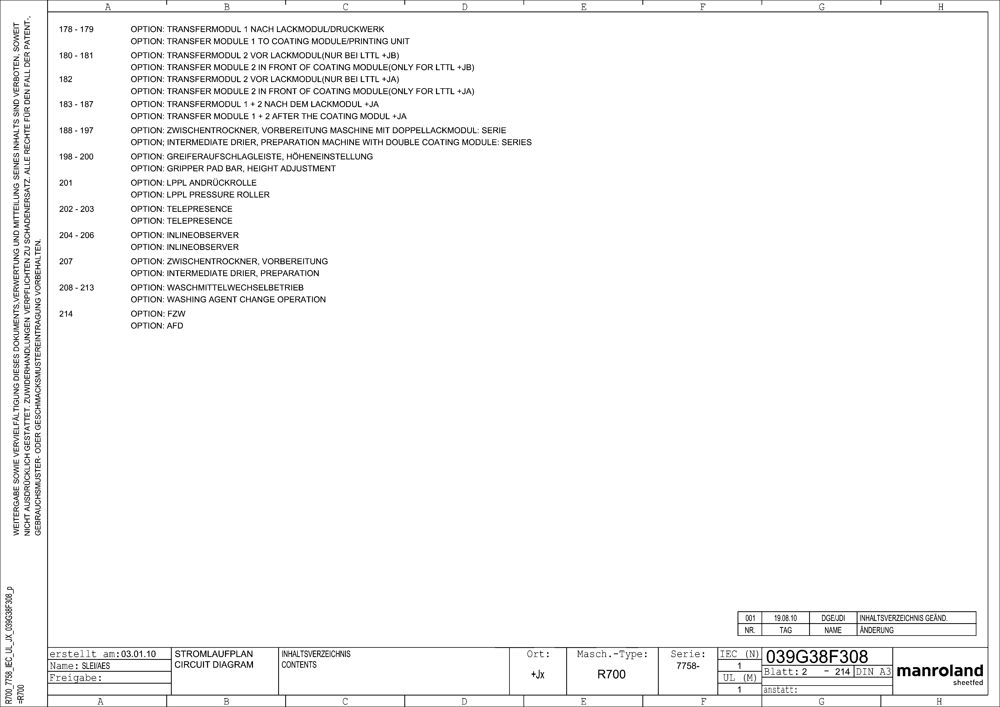

# +Jx — Sheet 2 of 214 — INHALTSVERZEICHNIS

**CONTENTS**

> Part of the manroland **R700** printing press IEC/UL circuit diagrams.
> Drawing class: **Stromlaufplan / Circuit diagram** (DIN A3).
> Document `+Jx` covers the **1st printing module + feed register** machine section.

## At a glance

| Field | Value |
|---|---|
| Document | `+Jx`  (039G38F308) |
| Sheet | **2** of 214 |
| Section (DE) | INHALTSVERZEICHNIS |
| Section (EN) | CONTENTS |
| Section type | TOC — Contents |
| Machine type | `R700` |
| Series | `7758` |
| Created | 03.01.10 |
| Replaces | — |
| Columns used | A, B, C, F, G, H |
| Path numbers | — |
| Labels on sheet | 44 |
| Cross-refs out | 0 |
| Cross-refs in | 0 |

**Previous:** [+Jx sheet 1](SHEET_0001.md) · **Next:** [+Jx sheet 3](SHEET_0003.md) · **Document TOC:** [_TOC.md](_TOC.md)  (+Jx) · **Master TOC:** [all sheets](../_MASTER_TOC.md)

## Sheet image (300 DPI, exact vector render)



_Rendered directly from the PDF vector layer at 300 DPI (1-bit), no OCR and no resampling. Use it to confirm anything ambiguous in the text below._

## Cross-references on this sheet

Each entry is a wire leaving this sheet. The printed token is `/sheet.column`; the link resolves to that sheet inside the same document.

_No outgoing cross-references on this sheet._

## Devices on this sheet

| Tag | Class | Class meaning (IEC) | Col | Sub | Terminal | Sign |
|---|---|---|---|---|---|---|
| `NR.` | — | cross-device reference | F | — | — | — |
| `19.08.10` | — | cross-device reference | G | — | — | — |

## Potentials / nets

_No named potentials on this sheet._

## Wire-end annotations (grouped as printed)

A wire that continues elsewhere is annotated with a small cluster: the destination description, the path/line number `#NN`, and the `/sheet.column` cross reference. Each row below is one such cluster exactly as it is grouped on the drawing.

| Col | Y | Path | Cross-ref | Text on the wire |
|---|---|---|---|---|
| B | 30.6 | — | — | `178 179 OPTION: TRANSFERMODUL 1 NACH LACKMODUL/DRUCKWERK OPTION: TRANSFER MODULE 1 TO COATING MODULE/PRINTING UNIT` |
| B | 61.8 | — | — | `180 181 OPTION: TRANSFERMODUL 2 VOR LACKMODUL(NUR BEI LTTL +JB) OPTION: TRANSFER MODULE 2 IN FRONT OF COATING MODULE(ONLY FOR LTTL +JB)` |
| B | 90.2 | — | — | `182 OPTION: TRANSFERMODUL 2 VOR LACKMODUL(NUR BEI LTTL +JA) OPTION: TRANSFER MODULE 2 IN FRONT OF COATING MODULE(ONLY FOR LTTL +JA)` |
| B | 119.9 | — | — | `183 187 OPTION: TRANSFERMODUL 1 + 2 NACH DEM LACKMODUL +JA OPTION: TRANSFER MODULE 1 + 2 AFTER THE COATING MODUL +JA` |
| C | 151.1 | — | — | `188 197 OPTION: ZWISCHENTROCKNER, VORBEREITUNG MASCHINE MIT DOPPELLACKMODUL: SERIE OPTION; INTERMEDIATE DRIER, PREPARATION MACHINE WITH DOUBLE COATING MODULE: SERIES` |
| B | 182.3 | — | — | `198 200 OPTION: GREIFERAUFSCHLAGLEISTE, HÖHENEINSTELLUNG OPTION: GRIPPER PAD BAR, HEIGHT ADJUSTMENT` |
| A | 213.5 | — | — | `201 OPTION: LPPL ANDRÜCKROLLE OPTION: LPPL PRESSURE ROLLER` |
| A | 244.7 | — | — | `202 203 OPTION: TELEPRESENCE OPTION: TELEPRESENCE` |
| A | 275.9 | — | — | `204 206 OPTION: INLINEOBSERVER OPTION: INLINEOBSERVER` |
| B | 307.0 | — | — | `207 OPTION: ZWISCHENTROCKNER, VORBEREITUNG OPTION: INTERMEDIATE DRIER, PREPARATION` |
| B | 338.2 | — | — | `208 213 OPTION: WASCHMITTELWECHSELBETRIEB OPTION: WASHING AGENT CHANGE OPERATION` |
| A | 369.4 | — | — | `214 OPTION: FZW OPTION: AFD` |
| G | 733.0 | — | — | `001 19.08.10 DGE/JDI INHALTSVERZEICHNIS GEÄND.` |
| G | 747.1 | — | — | `NR. TAG NAME ÄNDERUNG` |


## Notes and free text on this sheet

| Text | Col | Y (pt) |
|---|---|---|
| `TAG` | G | 747.23 |
| `NAME` | G | 747.22 |
| `ÄNDERUNG` | G | 747.25 |
| `DGE/JDI` | G | 733.03 |
| `INHALTSVERZEICHNIS GEÄND.` | H | 733.09 |
| `OPTION: TRANSFERMODUL 1 + 2 NACH DEM LACKMODUL +JA` | B | 119.94 |
| `OPTION: TRANSFER MODULE 1 + 2 AFTER THE COATING MODUL +JA` | B | 134.12 |
| `OPTION: ZWISCHENTROCKNER, VORBEREITUNG MASCHINE MIT DOPPELLACKMODUL: SERIE` | C | 151.13 |
| `OPTION; INTERMEDIATE DRIER, PREPARATION MACHINE WITH DOUBLE COATING MODULE: SERIES` | C | 165.3 |
| `OPTION: GREIFERAUFSCHLAGLEISTE, HÖHENEINSTELLUNG` | B | 182.32 |
| `OPTION: GRIPPER PAD BAR, HEIGHT ADJUSTMENT` | B | 196.48 |
| `OPTION: LPPL ANDRÜCKROLLE` | B | 213.5 |
| `OPTION: LPPL PRESSURE ROLLER` | B | 227.67 |
| `OPTION: TELEPRESENCE` | B | 244.68 |
| `OPTION: INLINEOBSERVER` | B | 275.87 |
| `OPTION: ZWISCHENTROCKNER, VORBEREITUNG` | B | 307.03 |
| `OPTION: INTERMEDIATE DRIER, PREPARATION` | B | 321.22 |
| `OPTION: WASCHMITTELWECHSELBETRIEB` | B | 338.2 |
| `OPTION: WASHING AGENT CHANGE OPERATION` | B | 352.38 |
| `OPTION: FZW` | A | 369.35 |
| `OPTION: AFD` | A | 383.58 |
| `OPTION: TRANSFERMODUL 2 VOR LACKMODUL(NUR BEI LTTL +JA)` | B | 90.18 |
| `OPTION: TRANSFER MODULE 2 IN FRONT OF COATING MODULE(ONLY FOR LTTL +JA)` | C | 104.36 |
| `OPTION: TRANSFERMODUL 1 NACH LACKMODUL/DRUCKWERK` | B | 30.65 |
| `OPTION: TRANSFER MODULE 1 TO COATING MODULE/PRINTING UNIT` | B | 44.84 |
| `OPTION: TRANSFERMODUL 2 VOR LACKMODUL(NUR BEI LTTL +JB)` | B | 61.84 |
| `OPTION: TRANSFER MODULE 2 IN FRONT OF COATING MODULE(ONLY FOR LTTL +JB)` | C | 76.01 |

## Complete label inventory (exact text from the drawing)

Every text object inside the drawing area of this sheet, in DIN reading order (column A→H, then top→bottom). This is the authoritative list: if a string is not here it is not printed on this sheet.

| Col | Y | X | Dir | Type | Text |
|---|---|---|---|---|---|
| A | 30.7 | 70.0 | → | number | `178 179` |
| A | 61.8 | 70.0 | → | number | `180 181` |
| A | 90.2 | 70.0 | → | number | `182` |
| A | 120.0 | 70.0 | → | number | `183 187` |
| A | 151.1 | 70.0 | → | number | `188 197` |
| A | 182.3 | 70.0 | → | number | `198 200` |
| A | 213.5 | 70.6 | → | number | `201` |
| A | 244.7 | 70.6 | → | number | `202 203` |
| A | 275.9 | 70.6 | → | number | `204 206` |
| A | 307.1 | 70.6 | → | number | `207` |
| A | 338.2 | 70.6 | → | number | `208 213` |
| A | 369.3 | 155.6 | → | text | `OPTION: FZW` |
| A | 369.4 | 70.6 | → | number | `214` |
| A | 383.6 | 155.6 | → | text | `OPTION: AFD` |
| B | 30.6 | 155.6 | → | text | `OPTION: TRANSFERMODUL 1 NACH LACKMODUL/DRUCKWERK` |
| B | 44.8 | 155.6 | → | text | `OPTION: TRANSFER MODULE 1 TO COATING MODULE/PRINTING UNIT` |
| B | 61.8 | 155.6 | → | text | `OPTION: TRANSFERMODUL 2 VOR LACKMODUL(NUR BEI LTTL +JB)` |
| B | 90.2 | 155.6 | → | text | `OPTION: TRANSFERMODUL 2 VOR LACKMODUL(NUR BEI LTTL +JA)` |
| B | 119.9 | 155.6 | → | text | `OPTION: TRANSFERMODUL 1 + 2 NACH DEM LACKMODUL +JA` |
| B | 134.1 | 155.6 | → | text | `OPTION: TRANSFER MODULE 1 + 2 AFTER THE COATING MODUL +JA` |
| B | 182.3 | 155.6 | → | text | `OPTION: GREIFERAUFSCHLAGLEISTE, HÖHENEINSTELLUNG` |
| B | 196.5 | 155.6 | → | text | `OPTION: GRIPPER PAD BAR, HEIGHT ADJUSTMENT` |
| B | 213.5 | 155.6 | → | text | `OPTION: LPPL ANDRÜCKROLLE` |
| B | 227.7 | 155.6 | → | text | `OPTION: LPPL PRESSURE ROLLER` |
| B | 244.7 | 155.6 | → | text | `OPTION: TELEPRESENCE` |
| B | 258.9 | 155.6 | → | text | `OPTION: TELEPRESENCE` |
| B | 275.9 | 155.6 | → | text | `OPTION: INLINEOBSERVER` |
| B | 290.0 | 155.6 | → | text | `OPTION: INLINEOBSERVER` |
| B | 307.0 | 155.6 | → | text | `OPTION: ZWISCHENTROCKNER, VORBEREITUNG` |
| B | 321.2 | 155.6 | → | text | `OPTION: INTERMEDIATE DRIER, PREPARATION` |
| B | 338.2 | 155.6 | → | text | `OPTION: WASCHMITTELWECHSELBETRIEB` |
| B | 352.4 | 155.6 | → | text | `OPTION: WASHING AGENT CHANGE OPERATION` |
| C | 76.0 | 155.6 | → | text | `OPTION: TRANSFER MODULE 2 IN FRONT OF COATING MODULE(ONLY FOR LTTL +JB)` |
| C | 104.4 | 155.6 | → | text | `OPTION: TRANSFER MODULE 2 IN FRONT OF COATING MODULE(ONLY FOR LTTL +JA)` |
| C | 151.1 | 155.6 | → | text | `OPTION: ZWISCHENTROCKNER, VORBEREITUNG MASCHINE MIT DOPPELLACKMODUL: SERIE` |
| C | 165.3 | 155.6 | → | text | `OPTION; INTERMEDIATE DRIER, PREPARATION MACHINE WITH DOUBLE COATING MODULE: SERIES` |
| F | 733.0 | 887.6 | → | number | `001` |
| F | 747.1 | 886.8 | → | device ref | `NR.` |
| G | 733.0 | 978.3 | → | text | `DGE/JDI` |
| G | 733.1 | 921.5 | → | device ref | `19.08.10` |
| G | 747.2 | 928.5 | → | text | `TAG` |
| G | 747.2 | 981.8 | → | text | `NAME` |
| G | 747.3 | 1024.0 | → | text | `ÄNDERUNG` |
| H | 733.1 | 1023.4 | → | text | `INHALTSVERZEICHNIS GEÄND.` |

## Reading-order text block

The same content as a plain block, grouped by DIN column — convenient to paste or to match against a visual description.

```text
=== Column A ===
  30.7   70.0  numeric      178 179
  61.8   70.0  numeric      180 181
  90.2   70.0  numeric      182
 120.0   70.0  numeric      183 187
 151.1   70.0  numeric      188 197
 182.3   70.0  numeric      198 200
 213.5   70.6  numeric      201
 244.7   70.6  numeric      202 203
 275.9   70.6  numeric      204 206
 307.1   70.6  numeric      207
 338.2   70.6  numeric      208 213
 369.3  155.6  text         OPTION: FZW
 369.4   70.6  numeric      214
 383.6  155.6  text         OPTION: AFD
=== Column B ===
  30.6  155.6  text         OPTION: TRANSFERMODUL 1 NACH LACKMODUL/DRUCKWERK
  44.8  155.6  text         OPTION: TRANSFER MODULE 1 TO COATING MODULE/PRINTING UNIT
  61.8  155.6  text         OPTION: TRANSFERMODUL 2 VOR LACKMODUL(NUR BEI LTTL +JB)
  90.2  155.6  text         OPTION: TRANSFERMODUL 2 VOR LACKMODUL(NUR BEI LTTL +JA)
 119.9  155.6  text         OPTION: TRANSFERMODUL 1 + 2 NACH DEM LACKMODUL +JA
 134.1  155.6  text         OPTION: TRANSFER MODULE 1 + 2 AFTER THE COATING MODUL +JA
 182.3  155.6  text         OPTION: GREIFERAUFSCHLAGLEISTE, HÖHENEINSTELLUNG
 196.5  155.6  text         OPTION: GRIPPER PAD BAR, HEIGHT ADJUSTMENT
 213.5  155.6  text         OPTION: LPPL ANDRÜCKROLLE
 227.7  155.6  text         OPTION: LPPL PRESSURE ROLLER
 244.7  155.6  text         OPTION: TELEPRESENCE
 258.9  155.6  text         OPTION: TELEPRESENCE
 275.9  155.6  text         OPTION: INLINEOBSERVER
 290.0  155.6  text         OPTION: INLINEOBSERVER
 307.0  155.6  text         OPTION: ZWISCHENTROCKNER, VORBEREITUNG
 321.2  155.6  text         OPTION: INTERMEDIATE DRIER, PREPARATION
 338.2  155.6  text         OPTION: WASCHMITTELWECHSELBETRIEB
 352.4  155.6  text         OPTION: WASHING AGENT CHANGE OPERATION
=== Column C ===
  76.0  155.6  text         OPTION: TRANSFER MODULE 2 IN FRONT OF COATING MODULE(ONLY FOR LTTL +JB)
 104.4  155.6  text         OPTION: TRANSFER MODULE 2 IN FRONT OF COATING MODULE(ONLY FOR LTTL +JA)
 151.1  155.6  text         OPTION: ZWISCHENTROCKNER, VORBEREITUNG MASCHINE MIT DOPPELLACKMODUL: SERIE
 165.3  155.6  text         OPTION; INTERMEDIATE DRIER, PREPARATION MACHINE WITH DOUBLE COATING MODULE: SERIES
=== Column F ===
 733.0  887.6  numeric      001
 747.1  886.8  devref       NR.
=== Column G ===
 733.0  978.3  text         DGE/JDI
 733.1  921.5  devref       19.08.10
 747.2  928.5  text         TAG
 747.2  981.8  text         NAME
 747.3 1024.0  text         ÄNDERUNG
=== Column H ===
 733.1 1023.4  text         INHALTSVERZEICHNIS GEÄND.
```

---
_Generated from the PDF vector text layer; no OCR. Source: `R700_7758_IEC_UL_JX_039G38F308_p`, sheet 2._
