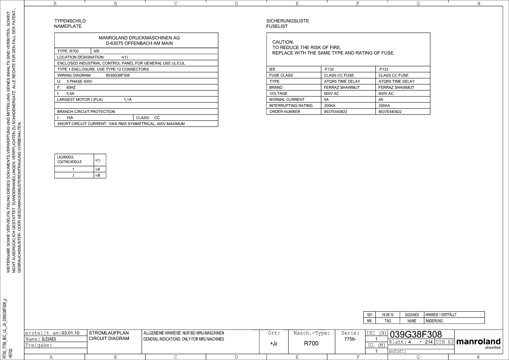

# +Jx — Sheet 4 of 214 — ALLGEMEINE HINWEISE: NUR BEI MRU MASCHINEN

**GENERAL INDICATIONS: ONLY FOR MRU MACHINES**

> Part of the manroland **R700** printing press IEC/UL circuit diagrams.
> Drawing class: **Stromlaufplan / Circuit diagram** (DIN A3).
> Document `+Jx` covers the **1st printing module + feed register** machine section.

## At a glance

| Field | Value |
|---|---|
| Document | `+Jx`  (039G38F308) |
| Sheet | **4** of 214 |
| Section (DE) | ALLGEMEINE HINWEISE: NUR BEI MRU MASCHINEN |
| Section (EN) | GENERAL INDICATIONS: ONLY FOR MRU MACHINES |
| Section type | LEGEND — General indications |
| Machine type | `R700` |
| Series | `7758` |
| Created | 03.01.10 |
| Replaces | — |
| Columns used | A, B, C, E, F, G |
| Path numbers | — |
| Labels on sheet | 70 |
| Cross-refs out | 0 |
| Cross-refs in | 0 |

**Previous:** [+Jx sheet 3](SHEET_0003.md) · **Next:** [+Jx sheet 5](SHEET_0005.md) · **Document TOC:** [_TOC.md](_TOC.md)  (+Jx) · **Master TOC:** [all sheets](../_MASTER_TOC.md)

## Sheet image (300 DPI, exact vector render)



_Rendered directly from the PDF vector layer at 300 DPI (1-bit), no OCR and no resampling. Use it to confirm anything ambiguous in the text below._

## Cross-references on this sheet

Each entry is a wire leaving this sheet. The printed token is `/sheet.column`; the link resolves to that sheet inside the same document.

_No outgoing cross-references on this sheet._

## Devices on this sheet

| Tag | Class | Class meaning (IEC) | Col | Sub | Terminal | Sign |
|---|---|---|---|---|---|---|
| `F132` | F | Schutz / protection device (fuse, circuit breaker) | F | — | — | — |
| `F133` | F | Schutz / protection device (fuse, circuit breaker) | F | — | — | — |
| `NR.` | — | cross-device reference | F | — | — | — |
| `14.09.10` | — | cross-device reference | F | — | — | — |

## Potentials / nets

| Potential | Count | Columns | Attached devices | Terminals |
|---|---|---|---|---|
| `600V` | 2 | F | — | — |


A potential such as `L24+/4` or `M24+` is a named supply/return rail; every place it appears on this sheet is electrically common.

## Wire-end annotations (grouped as printed)

A wire that continues elsewhere is annotated with a small cluster: the destination description, the path/line number `#NN`, and the `/sheet.column` cross reference. Each row below is one such cluster exactly as it is grouped on the drawing.

| Col | Y | Path | Cross-ref | Text on the wire |
|---|---|---|---|---|
| A | 44.2 | — | — | `NAMEPLATE TYPENSCHILD` |
| E | 44.2 | — | — | `FUSELIST SICHERUNGSLISTE` |
| B | 83.9 | — | — | `MANROLAND DRUCKMASCHINEN AG` |
| F | 93.8 | — | — | `REPLACE WITH THE SAME TYPE AND RATING OF FUSE. CAUTION: TO REDUCE THE RISK OF FIRE,` |
| B | 96.6 | — | — | `D 63075 OFFENBACH AM MAIN` |
| A | 115.7 | — | — | `TYPE: R700` |
| B | 115.8 | — | — | `NR:` |
| A | 129.9 | — | — | `LOCATION DESIGNATION:` |
| B | 130.0 | — | — | `+(1)` |
| B | 144.1 | — | — | `ENCLOSED INDUSTRIAL CONTROL PANEL FOR GENERAL USE UL/CUL` |
| B | 158.2 | — | — | `TYPE 1 ENCLOSURE. USE TYPE 12 CONNECTORS` |
| E | 158.2 | — | — | `IEE` |
| F | 158.3 | — | — | `F132` |
| F | 158.3 | — | — | `F133` |
| A | 172.4 | — | — | `WIRING DIAGRAM:` |
| E | 172.4 | — | — | `FUSE CLASS` |
| F | 172.4 | — | — | `CLASS CC FUSE` |
| G | 172.4 | — | — | `CLASS CC FUSE` |
| B | 172.5 | — | — | `8039G38F308` |
| A | 186.6 | — | — | `U:` |
| A | 186.6 | — | — | `3 PHASE 400V` |
| E | 186.6 | — | — | `TYPE` |
| F | 186.6 | — | — | `ATQR5 TIME DELAY` |
| G | 186.6 | — | — | `ATQR5 TIME DELAY` |
| A | 200.7 | — | — | `F:` |
| A | 200.8 | — | — | `60HZ` |
| E | 200.8 | — | — | `BRAND` |
| F | 200.8 | — | — | `FERRAZ SHAWMUT` |
| G | 200.8 | — | — | `FERRAZ SHAWMUT` |
| A | 214.8 | — | — | `I:` |
| A | 214.9 | — | — | `5,5A` |
| E | 214.9 | — | — | `VOLTAGE` |
| F | 214.9 | — | — | `600V AC` |
| F | 214.9 | — | — | `600V AC` |
| A | 229.1 | — | — | `LARGEST MOTOR I (FLA):` |
| B | 229.1 | — | — | `1,1A` |
| E | 229.1 | — | — | `5A` |
| F | 229.1 | — | — | `5A` |
| E | 229.2 | — | — | `NORMAL CURRENT` |
| E | 243.3 | — | — | `INTERRUPTING RATING` |
| F | 243.3 | — | — | `200KA` |
| F | 243.3 | — | — | `200KA` |
| B | 257.5 | — | — | `BRANCH CIRCUIT PROTECTION` |
| E | 257.5 | — | — | `ORDER NUMBER` |
| F | 257.5 | — | — | `8537E440822` |
| G | 257.5 | — | — | `8537E440822` |
| A | 271.5 | — | — | `I:` |
| B | 271.6 | — | — | `15A CC` |
| B | 271.6 | — | — | `CLASS:` |
| B | 285.8 | — | — | `SHORT CIRCUIT CURRENT: 10KA RMS SYMMETRICAL, 400V MAXIMUM` |
| A | 364.9 | — | — | `LACKMODUL COATING MODULE +(1)` |
| B | 392.7 | — | — | `1 +JA` |
| B | 407.3 | — | — | `2 +JB` |
| G | 733.0 | — | — | `001 14.09.10 GGO/AES HINWEIS 1 ENTFÄLLT` |
| G | 747.1 | — | — | `NR. TAG NAME ÄNDERUNG` |


## Device order codes printed on this sheet

> **These are NOT device part numbers and must not be attributed to a single device.** They are order/manufacturing codes that sit inside the same annotation cluster as a device, with no printed label and no leader line binding them to one item. Measured across the whole set: such codes appear on **8 of 1,351 sheets** (see `01_SYSTEM/A_HOW_TO_READ.md` §8.1).

| Token | Col | Y (pt) | What it is |
|---|---|---|---|
| `8039G38F308` | B | 172.5 | order code |
| `8537E440822` | F | 257.5 | order code |
| `8537E440822` | G | 257.5 | order code |


## Notes and free text on this sheet

| Text | Col | Y (pt) |
|---|---|---|
| `TAG` | G | 747.23 |
| `NAME` | G | 747.22 |
| `ÄNDERUNG` | G | 747.25 |
| `GGO/AES` | G | 733.06 |
| `HINWEIS 1 ENTFÄLLT` | G | 733.07 |
| `TYPE: R700` | A | 115.72 |
| `LOCATION DESIGNATION:` | A | 129.9 |
| `MANROLAND DRUCKMASCHINEN AG` | B | 83.88 |
| `D 63075 OFFENBACH AM MAIN` | B | 96.57 |
| `TYPE 1 ENCLOSURE. USE TYPE 12 CONNECTORS` | B | 158.24 |
| `WIRING DIAGRAM:` | A | 172.39 |
| `U:` | A | 186.6 |
| `F:` | A | 200.72 |
| `I:` | A | 214.8 |
| `LARGEST MOTOR I (FLA):` | A | 229.12 |
| `BRANCH CIRCUIT PROTECTION` | B | 257.47 |
| `SHORT CIRCUIT CURRENT: 10KA RMS SYMMETRICAL, 400V MAXIMUM` | B | 285.82 |
| `ENCLOSED INDUSTRIAL CONTROL PANEL FOR GENERAL USE UL/CUL` | B | 144.08 |
| `NR:` | B | 115.76 |
| `CLASS:` | B | 271.62 |
| `3 PHASE 400V` | A | 186.58 |
| `60HZ` | A | 200.81 |
| `5,5A` | A | 214.93 |
| `15A` | A | 271.65 |
| `CC` | C | 271.7 |
| `1,1A` | B | 229.11 |
| `IEE` | E | 158.18 |
| `FUSE CLASS` | E | 172.41 |
| `TYPE` | E | 186.56 |
| `BRAND` | E | 200.79 |
| `VOLTAGE` | E | 214.93 |
| `NORMAL CURRENT` | E | 229.15 |
| `INTERRUPTING RATING` | E | 243.29 |
| `ORDER NUMBER` | E | 257.49 |
| `CAUTION:` | E | 93.82 |
| `TO REDUCE THE RISK OF FIRE,` | E | 106.51 |
| `REPLACE WITH THE SAME TYPE AND RATING OF FUSE.` | F | 119.18 |
| `CLASS CC FUSE` | F | 172.42 |
| `ATQR5 TIME DELAY` | F | 186.59 |
| `FERRAZ SHAWMUT` | F | 200.75 |
| `5A` | E | 229.11 |
| `200KA` | F | 243.29 |
| `CLASS CC FUSE` | G | 172.42 |
| `ATQR5 TIME DELAY` | G | 186.59 |
| `FERRAZ SHAWMUT` | G | 200.75 |
| `5A` | F | 229.11 |
| `LACKMODUL` | A | 364.86 |
| `COATING MODULE` | A | 375.48 |
| `+JA` | B | 393.13 |
| `+JB` | B | 407.28 |
| `TYPENSCHILD` | A | 44.22 |
| `NAMEPLATE` | A | 56.86 |
| `SICHERUNGSLISTE` | E | 44.21 |
| `FUSELIST` | E | 56.89 |

## Complete label inventory (exact text from the drawing)

Every text object inside the drawing area of this sheet, in DIN reading order (column A→H, then top→bottom). This is the authoritative list: if a string is not here it is not printed on this sheet.

| Col | Y | X | Dir | Type | Text |
|---|---|---|---|---|---|
| A | 44.2 | 127.3 | → | text | `TYPENSCHILD` |
| A | 56.9 | 126.7 | → | text | `NAMEPLATE` |
| A | 115.7 | 134.6 | → | text | `TYPE: R700` |
| A | 129.9 | 134.1 | → | text | `LOCATION DESIGNATION:` |
| A | 172.4 | 134.6 | → | text | `WIRING DIAGRAM:` |
| A | 186.6 | 134.1 | → | text | `U:` |
| A | 186.6 | 155.6 | → | text | `3 PHASE 400V` |
| A | 200.7 | 134.1 | → | text | `F:` |
| A | 200.8 | 155.6 | → | text | `60HZ` |
| A | 214.8 | 133.8 | → | text | `I:` |
| A | 214.9 | 155.6 | → | text | `5,5A` |
| A | 229.1 | 134.1 | → | text | `LARGEST MOTOR I (FLA):` |
| A | 271.5 | 133.8 | → | text | `I:` |
| A | 271.6 | 155.1 | → | text | `15A` |
| A | 364.9 | 134.1 | → | text | `LACKMODUL` |
| A | 375.5 | 134.4 | → | text | `COATING MODULE` |
| A | 392.7 | 169.2 | → | number | `1` |
| A | 407.3 | 170.1 | → | number | `2` |
| B | 83.9 | 231.2 | → | text | `MANROLAND DRUCKMASCHINEN AG` |
| B | 96.6 | 247.6 | → | text | `D 63075 OFFENBACH AM MAIN` |
| B | 115.8 | 219.1 | → | text | `NR:` |
| B | 130.0 | 283.2 | → | other | `+(1)` |
| B | 144.1 | 134.1 | → | text | `ENCLOSED INDUSTRIAL CONTROL PANEL FOR GENERAL USE UL/CUL` |
| B | 158.2 | 134.6 | → | text | `TYPE 1 ENCLOSURE. USE TYPE 12 CONNECTORS` |
| B | 172.5 | 247.7 | → | ordercode | `8039G38F308` |
| B | 229.1 | 289.7 | → | text | `1,1A` |
| B | 257.5 | 134.1 | → | text | `BRANCH CIRCUIT PROTECTION` |
| B | 271.6 | 318.6 | → | text | `CLASS:` |
| B | 285.8 | 134.4 | → | text | `SHORT CIRCUIT CURRENT: 10KA RMS SYMMETRICAL, 400V MAXIMUM` |
| B | 371.9 | 222.9 | → | other | `+(1)` |
| B | 393.1 | 222.9 | → | text | `+JA` |
| B | 407.3 | 222.9 | → | text | `+JB` |
| C | 271.7 | 361.1 | → | text | `CC` |
| E | 44.2 | 623.3 | → | text | `SICHERUNGSLISTE` |
| E | 56.9 | 622.8 | → | text | `FUSELIST` |
| E | 93.8 | 637.2 | → | text | `CAUTION:` |
| E | 106.5 | 637.5 | → | text | `TO REDUCE THE RISK OF FIRE,` |
| E | 158.2 | 629.9 | → | text | `IEE` |
| E | 172.4 | 630.1 | → | text | `FUSE CLASS` |
| E | 186.6 | 630.7 | → | text | `TYPE` |
| E | 200.8 | 630.1 | → | text | `BRAND` |
| E | 214.9 | 630.7 | → | text | `VOLTAGE` |
| E | 229.1 | 758.0 | → | text | `5A` |
| E | 229.2 | 630.1 | → | text | `NORMAL CURRENT` |
| E | 243.3 | 629.9 | → | text | `INTERRUPTING RATING` |
| E | 257.5 | 630.4 | → | text | `ORDER NUMBER` |
| F | 119.2 | 636.9 | → | text | `REPLACE WITH THE SAME TYPE AND RATING OF FUSE.` |
| F | 158.3 | 758.0 | → | device tag | `F132` |
| F | 158.3 | 885.5 | → | device tag | `F133` |
| F | 172.4 | 758.0 | → | text | `CLASS CC FUSE` |
| F | 186.6 | 758.3 | → | text | `ATQR5 TIME DELAY` |
| F | 200.7 | 757.7 | → | text | `FERRAZ SHAWMUT` |
| F | 214.9 | 758.0 | → | potential | `600V AC` |
| F | 214.9 | 885.5 | → | potential | `600V AC` |
| F | 229.1 | 885.5 | → | text | `5A` |
| F | 243.3 | 758.3 | → | text | `200KA` |
| F | 243.3 | 885.8 | → | text | `200KA` |
| F | 257.5 | 758.0 | → | ordercode | `8537E440822` |
| F | 733.0 | 859.3 | → | number | `001` |
| F | 733.1 | 893.2 | → | device ref | `14.09.10` |
| F | 747.1 | 858.5 | → | device ref | `NR.` |
| G | 172.4 | 885.5 | → | text | `CLASS CC FUSE` |
| G | 186.6 | 885.8 | → | text | `ATQR5 TIME DELAY` |
| G | 200.7 | 885.3 | → | text | `FERRAZ SHAWMUT` |
| G | 257.5 | 885.5 | → | ordercode | `8537E440822` |
| G | 733.1 | 947.4 | → | text | `GGO/AES` |
| G | 733.1 | 995.1 | → | text | `HINWEIS 1 ENTFÄLLT` |
| G | 747.2 | 900.1 | → | text | `TAG` |
| G | 747.2 | 953.5 | → | text | `NAME` |
| G | 747.3 | 995.7 | → | text | `ÄNDERUNG` |

## Reading-order text block

The same content as a plain block, grouped by DIN column — convenient to paste or to match against a visual description.

```text
=== Column A ===
  44.2  127.3  text         TYPENSCHILD
  56.9  126.7  text         NAMEPLATE
 115.7  134.6  text         TYPE: R700
 129.9  134.1  text         LOCATION DESIGNATION:
 172.4  134.6  text         WIRING DIAGRAM:
 186.6  134.1  text         U:
 186.6  155.6  text         3 PHASE 400V
 200.7  134.1  text         F:
 200.8  155.6  text         60HZ
 214.8  133.8  text         I:
 214.9  155.6  text         5,5A
 229.1  134.1  text         LARGEST MOTOR I (FLA):
 271.5  133.8  text         I:
 271.6  155.1  text         15A
 364.9  134.1  text         LACKMODUL
 375.5  134.4  text         COATING MODULE
 392.7  169.2  numeric      1
 407.3  170.1  numeric      2
=== Column B ===
  83.9  231.2  text         MANROLAND DRUCKMASCHINEN AG
  96.6  247.6  text         D 63075 OFFENBACH AM MAIN
 115.8  219.1  text         NR:
 130.0  283.2  other        +(1)
 144.1  134.1  text         ENCLOSED INDUSTRIAL CONTROL PANEL FOR GENERAL USE UL/CUL
 158.2  134.6  text         TYPE 1 ENCLOSURE. USE TYPE 12 CONNECTORS
 172.5  247.7  ordercode    8039G38F308
 229.1  289.7  text         1,1A
 257.5  134.1  text         BRANCH CIRCUIT PROTECTION
 271.6  318.6  text         CLASS:
 285.8  134.4  text         SHORT CIRCUIT CURRENT: 10KA RMS SYMMETRICAL, 400V MAXIMUM
 371.9  222.9  other        +(1)
 393.1  222.9  text         +JA
 407.3  222.9  text         +JB
=== Column C ===
 271.7  361.1  text         CC
=== Column E ===
  44.2  623.3  text         SICHERUNGSLISTE
  56.9  622.8  text         FUSELIST
  93.8  637.2  text         CAUTION:
 106.5  637.5  text         TO REDUCE THE RISK OF FIRE,
 158.2  629.9  text         IEE
 172.4  630.1  text         FUSE CLASS
 186.6  630.7  text         TYPE
 200.8  630.1  text         BRAND
 214.9  630.7  text         VOLTAGE
 229.1  758.0  text         5A
 229.2  630.1  text         NORMAL CURRENT
 243.3  629.9  text         INTERRUPTING RATING
 257.5  630.4  text         ORDER NUMBER
=== Column F ===
 119.2  636.9  text         REPLACE WITH THE SAME TYPE AND RATING OF FUSE.
 158.3  758.0  devtag       F132
 158.3  885.5  devtag       F133
 172.4  758.0  text         CLASS CC FUSE
 186.6  758.3  text         ATQR5 TIME DELAY
 200.7  757.7  text         FERRAZ SHAWMUT
 214.9  758.0  net          600V AC
 214.9  885.5  net          600V AC
 229.1  885.5  text         5A
 243.3  758.3  text         200KA
 243.3  885.8  text         200KA
 257.5  758.0  ordercode    8537E440822
 733.0  859.3  numeric      001
 733.1  893.2  devref       14.09.10
 747.1  858.5  devref       NR.
=== Column G ===
 172.4  885.5  text         CLASS CC FUSE
 186.6  885.8  text         ATQR5 TIME DELAY
 200.7  885.3  text         FERRAZ SHAWMUT
 257.5  885.5  ordercode    8537E440822
 733.1  947.4  text         GGO/AES
 733.1  995.1  text         HINWEIS 1 ENTFÄLLT
 747.2  900.1  text         TAG
 747.2  953.5  text         NAME
 747.3  995.7  text         ÄNDERUNG
```

---
_Generated from the PDF vector text layer; no OCR. Source: `R700_7758_IEC_UL_JX_039G38F308_p`, sheet 4._
