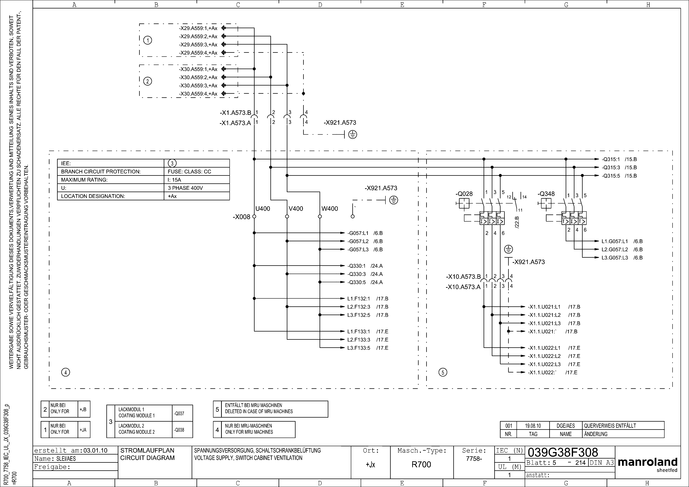

# +Jx — Sheet 5 of 214 — SPANNUNGSVERSORGUNG, SCHALTSCHRANKBELÜFTUNG

**VOLTAGE SUPPLY, SWITCH CABINET VENTILATION**

> Part of the manroland **R700** printing press IEC/UL circuit diagrams.
> Drawing class: **Stromlaufplan / Circuit diagram** (DIN A3).
> Document `+Jx` covers the **1st printing module + feed register** machine section.

## At a glance

| Field | Value |
|---|---|
| Document | `+Jx`  (039G38F308) |
| Sheet | **5** of 214 |
| Section (DE) | SPANNUNGSVERSORGUNG, SCHALTSCHRANKBELÜFTUNG |
| Section (EN) | VOLTAGE SUPPLY, SWITCH CABINET VENTILATION |
| Section type | POWER_SUPPLY — Voltage supply |
| Machine type | `R700` |
| Series | `7758` |
| Created | 03.01.10 |
| Replaces | — |
| Columns used | A, B, C, D, E, F, G, H |
| Path numbers | — |
| Labels on sheet | 149 |
| Cross-refs out | 27 |
| Cross-refs in | 43 |

**Previous:** [+Jx sheet 4](SHEET_0004.md) · **Next:** [+Jx sheet 6](SHEET_0006.md) · **Document TOC:** [_TOC.md](_TOC.md)  (+Jx) · **Master TOC:** [all sheets](../_MASTER_TOC.md)

## Sheet image (300 DPI, exact vector render)



_Rendered directly from the PDF vector layer at 300 DPI (1-bit), no OCR and no resampling. Use it to confirm anything ambiguous in the text below._

## Cross-references on this sheet

Each entry is a wire leaving this sheet. The printed token is `/sheet.column`; the link resolves to that sheet inside the same document.

| Ref | Target sheet | Col | Path | Destination on target | Target section | From col |
|---|---|---|---|---|---|---|
| `/15.B` | [+Jx sheet 15](SHEET_0015.md) | B | — | Q315:1 | ÖLUMLAUFSCHMIERUNG | H |
| `/15.B` | [+Jx sheet 15](SHEET_0015.md) | B | — | Q315:3 | ÖLUMLAUFSCHMIERUNG | H |
| `/15.B` | [+Jx sheet 15](SHEET_0015.md) | B | — | Q315:5 | ÖLUMLAUFSCHMIERUNG | H |
| `/22.B` | [+Jx sheet 22](SHEET_0022.md) | B | — | — | LACKPUMPE | F |
| `/6.B` | [+Jx sheet 6](SHEET_0006.md) | B | — | G057:L1 | SPANNUNGSVERSORGUNG, SCHALTSCHRANKBELÜFTUNG | E |
| `/6.B` | [+Jx sheet 6](SHEET_0006.md) | B | — | G057:L2 | SPANNUNGSVERSORGUNG, SCHALTSCHRANKBELÜFTUNG | E |
| `/6.B` | [+Jx sheet 6](SHEET_0006.md) | B | — | L1.G057:L1 | SPANNUNGSVERSORGUNG, SCHALTSCHRANKBELÜFTUNG | H |
| `/6.B` | [+Jx sheet 6](SHEET_0006.md) | B | — | G057:L3 | SPANNUNGSVERSORGUNG, SCHALTSCHRANKBELÜFTUNG | E |
| `/6.B` | [+Jx sheet 6](SHEET_0006.md) | B | — | L2.G057:L2 | SPANNUNGSVERSORGUNG, SCHALTSCHRANKBELÜFTUNG | H |
| `/6.B` | [+Jx sheet 6](SHEET_0006.md) | B | — | L3.G057:L3 | SPANNUNGSVERSORGUNG, SCHALTSCHRANKBELÜFTUNG | H |
| `/24.A` | [+Jx sheet 24](SHEET_0024.md) | A | — | Q330:1 | HILFSANTRIEB, LACKDOSIER /AUFTRAGSWALZEN | E |
| `/24.A` | [+Jx sheet 24](SHEET_0024.md) | A | — | Q330:3 | HILFSANTRIEB, LACKDOSIER /AUFTRAGSWALZEN | E |
| `/24.A` | [+Jx sheet 24](SHEET_0024.md) | A | — | Q330:5 | HILFSANTRIEB, LACKDOSIER /AUFTRAGSWALZEN | E |
| `/17.B` | [+Jx sheet 17](SHEET_0017.md) | B | — | L1.F132:1 | LACKPUMPE | E |
| `/17.B` | [+Jx sheet 17](SHEET_0017.md) | B | — | L2.F132:3 | LACKPUMPE | E |
| `/17.B` | [+Jx sheet 17](SHEET_0017.md) | B | — | X1.1.U021:L1 | LACKPUMPE | G |
| `/17.B` | [+Jx sheet 17](SHEET_0017.md) | B | — | L3.F132:5 | LACKPUMPE | E |
| `/17.B` | [+Jx sheet 17](SHEET_0017.md) | B | — | X1.1.U021:L2 | LACKPUMPE | G |
| `/17.B` | [+Jx sheet 17](SHEET_0017.md) | B | — | X1.1.U021:L3 | LACKPUMPE | G |
| `/17.E` | [+Jx sheet 17](SHEET_0017.md) | E | — | L1.F133:1 | LACKPUMPE | E |
| `/17.B` | [+Jx sheet 17](SHEET_0017.md) | B | — | X1.1.U021:` | LACKPUMPE | G |
| `/17.E` | [+Jx sheet 17](SHEET_0017.md) | E | — | L2.F133:3 | LACKPUMPE | E |
| `/17.E` | [+Jx sheet 17](SHEET_0017.md) | E | — | L3.F133:5 | LACKPUMPE | E |
| `/17.E` | [+Jx sheet 17](SHEET_0017.md) | E | — | X1.1.U022:L1 | LACKPUMPE | G |
| `/17.E` | [+Jx sheet 17](SHEET_0017.md) | E | — | X1.1.U022:L2 | LACKPUMPE | G |
| `/17.E` | [+Jx sheet 17](SHEET_0017.md) | E | — | X1.1.U022:L3 | LACKPUMPE | G |
| `/17.E` | [+Jx sheet 17](SHEET_0017.md) | E | — | X1.1.U022:` | LACKPUMPE | G |

### Incoming references (sheets that point here)

Every other sheet that sends a wire to this one. `Back-ref` is the token printed on *that* sheet; `Path` is its line number.

| From sheet | Cols | Back-ref | Path | Refs | What continues there |
|---|---|---|---|---|---|
| [+Jx#6](SHEET_0006.md) | A, B | `/6.A`, `/6.B` | — | 6 | G057:L1; G057:L2; G057:L3; L1.G057:L1 L1.G059; L2.G057:L2 L2.G059; L3.G057:L3 L3.G059 |
| [+Jx#15](SHEET_0015.md) | A, B | `/15.A`, `/15.B` | — | 3 | Q315:1; Q315:3; Q315:5 Q330:5 |
| [+Jx#17](SHEET_0017.md) | B, C, E | `/17.B`, `/17.C`, `/17.E` | — | 14 | L1.F132:1 L1.F133:1; L2.F132:3; L2.F133:3; L3.F132:5; L3.F133:5; X1.1.U021:L1 X1.1.U022:L1; X1.1.U021:L2; X1.1.U021:L3; X1.1.U021:`; X1.1.U022:L2; X1.1.U022:L3; |
| [+Jx#22](SHEET_0022.md) | B | `/22.B` | — | 1 | — |
| [+Jx#24](SHEET_0024.md) | A | `/24.A` | — | 3 | — |
| [+Jx#114](SHEET_0114.md) | G | `/114.G` | — | 8 | — |
| [+Jx#135](SHEET_0135.md) | F | `/135.F` | — | 8 | — |


## Devices on this sheet

| Tag | Class | Class meaning (IEC) | Col | Sub | Terminal | Sign |
|---|---|---|---|---|---|---|
| `U400` | U | Umrichter / frequency converter | C | — | — | — |
| `X008` | X | Klemme / terminal, plug connector | C | — | — | — |
| `V400` | V | Diode / semiconductor valve | D | — | — | — |
| `W400` | W | Kabel / cable, line, bus | D | — | — | — |
| `Q348` | Q | Leistungsschalter / power switching device | G | — | — | — |
| `Q028` | Q | Leistungsschalter / power switching device | F | — | — | — |
| `G057:L2` | G | Stromversorgung / power supply | D | — | L2 | — |
| `G057:L3` | G | Stromversorgung / power supply | D | — | L3 | — |
| `G057:L1` | G | Stromversorgung / power supply | D | — | L1 | — |
| `Q315:1` | Q | Leistungsschalter / power switching device | H | — | 1 | — |
| `Q315:3` | Q | Leistungsschalter / power switching device | H | — | 3 | — |
| `Q330:5` | Q | Leistungsschalter / power switching device | D | — | 5 | — |
| `Q330:3` | Q | Leistungsschalter / power switching device | D | — | 3 | — |
| `Q315:5` | Q | Leistungsschalter / power switching device | H | — | 5 | — |
| `Q330:1` | Q | Leistungsschalter / power switching device | D | — | 1 | — |
| `Q037` | Q | Leistungsschalter / power switching device | B | — | — | — |
| `Q038` | Q | Leistungsschalter / power switching device | B | — | — | — |
| `X1.A573.B` | — | cross-device reference | C | — | — | — |
| `X1.A573.A` | — | cross-device reference | C | — | — | — |
| `X10.A573.B` | — | cross-device reference | F | — | — | — |
| `X10.A573.A` | — | cross-device reference | F | — | — | — |
| `NR.` | — | cross-device reference | F | — | — | — |
| `19.08.10` | — | cross-device reference | G | — | — | — |
| `X1.1.U021:L2` | — | cross-device reference | G | — | L2 | — |
| `X1.1.U021:L3` | — | cross-device reference | G | — | L3 | — |
| `X1.1.U021:L1` | — | cross-device reference | G | — | L1 | — |
| `X1.1.U022:L1` | — | cross-device reference | G | — | L1 | — |
| `X1.1.U022:L3` | — | cross-device reference | G | — | L3 | — |
| `X1.1.U022:L2` | — | cross-device reference | G | — | L2 | — |
| `X921.A573` | — | cross-device reference | D | — | — | — |
| `X921.A573` | — | cross-device reference | G | — | — | — |
| `X921.A573` | — | cross-device reference | E | — | — | — |

## Potentials / nets

| Potential | Count | Columns | Attached devices | Terminals |
|---|---|---|---|---|
| `L1` | 3 | D, H | `F132`, `F133`, `G057` | `1`, `L1` |
| `L2` | 3 | D, H | `F132`, `F133`, `G057` | `3`, `L2` |
| `L3` | 3 | D, H | `F132`, `F133`, `G057` | `5`, `L3` |


A potential such as `L24+/4` or `M24+` is a named supply/return rail; every place it appears on this sheet is electrically common.

## Wire-end annotations (grouped as printed)

A wire that continues elsewhere is annotated with a small cluster: the destination description, the path/line number `#NN`, and the `/sheet.column` cross reference. Each row below is one such cluster exactly as it is grouped on the drawing.

| Col | Y | Path | Cross-ref | Text on the wire |
|---|---|---|---|---|
| C | 44.9 | — | — | `X29.A559:1,+Ax` |
| C | 59.1 | — | — | `X29.A559:2,+Ax` |
| B | 66.4 | — | — | `1` |
| C | 73.2 | — | — | `X29.A559:3,+Ax` |
| C | 87.4 | — | — | `X29.A559:4,+Ax` |
| C | 115.8 | — | — | `X30.A559:1,+Ax` |
| C | 129.9 | — | — | `X30.A559:2,+Ax` |
| B | 137.7 | — | — | `2` |
| C | 144.1 | — | — | `X30.A559:3,+Ax` |
| C | 158.3 | — | — | `X30.A559:4,+Ax` |
| C | 190.2 | — | — | `X1.A573.B 1 2 3 4` |
| C | 207.2 | — | — | `X1.A573.A 1 2 3 4` |
| D | 207.2 | — | — | `X921.A573` |
| H | 271.6 | — | `/15.B` | `Q315:1` |
| A | 278.6 | — | — | `IEE:` |
| B | 279.4 | — | — | `3` |
| H | 285.8 | — | `/15.B` | `Q315:3` |
| A | 292.9 | — | — | `BRANCH CIRCUIT PROTECTION:` |
| B | 292.9 | — | — | `FUSE: CLASS: CC` |
| H | 300.0 | — | `/15.B` | `Q315:5` |
| B | 307.0 | — | — | `I: 15A` |
| A | 307.1 | — | — | `MAXIMUM RATING:` |
| E | 320.6 | — | — | `X921.A573` |
| A | 321.2 | — | — | `U:` |
| B | 321.2 | — | — | `3 PHASE 400V` |
| F | 328.4 | — | — | `1` |
| F | 328.4 | — | — | `3` |
| F | 328.4 | — | — | `5` |
| F | 330.5 | — | — | `Q028` |
| G | 330.5 | — | — | `Q348` |
| G | 334.1 | — | — | `1 3 5` |
| A | 335.4 | — | — | `LOCATION DESIGNATION:` |
| B | 335.5 | — | — | `+Ax` |
| F | 337.5 | — | — | `12 14` |
| D | 355.9 | — | — | `V400 W400` |
| C | 356.0 | — | — | `X008 U400` |
| D | 356.1 | — | — | `'` |
| F | 360.1 | — | — | `11` |
| F | 373.9 | — | `/22.B` | — |
| G | 393.6 | — | — | `2 4 6` |
| E | 399.1 | — | `/6.B` | `G057:L1` |
| F | 399.2 | — | — | `2` |
| F | 399.2 | — | — | `4` |
| F | 399.2 | — | — | `6` |
| E | 413.3 | — | `/6.B` | `G057:L2` |
| H | 413.3 | — | `/6.B` | `L1.G057:L1` |
| E | 427.5 | — | `/6.B` | `G057:L3` |
| H | 427.5 | — | `/6.B` | `L2.G057:L2` |
| H | 441.7 | — | `/6.B` | `L3.G057:L3` |
| G | 448.1 | — | — | `X921.A573` |
| E | 455.9 | — | `/24.A` | `Q330:1` |
| E | 470.0 | — | `/24.A` | `Q330:3` |
| F | 473.6 | — | — | `X10.A573.B 1` |
| F | 473.6 | — | — | `2` |
| F | 473.6 | — | — | `3` |
| F | 473.6 | — | — | `4` |
| E | 484.2 | — | `/24.A` | `Q330:5` |
| F | 490.7 | — | — | `X10.A573.A 1` |
| F | 490.7 | — | — | `2` |
| F | 490.7 | — | — | `3` |
| F | 490.7 | — | — | `4` |
| E | 512.5 | — | `/17.B` | `L1.F132:1` |
| E | 526.7 | — | `/17.B` | `L2.F132:3` |
| G | 526.7 | — | `/17.B` | `X1.1.U021:L1` |
| E | 540.9 | — | `/17.B` | `L3.F132:5` |
| G | 540.9 | — | `/17.B` | `X1.1.U021:L2` |
| G | 555.1 | — | `/17.B` | `X1.1.U021:L3` |
| E | 569.2 | — | `/17.E` | `L1.F133:1` |
| G | 569.2 | — | `/17.B` | `X1.1.U021:'` |
| E | 583.4 | — | `/17.E` | `L2.F133:3` |
| E | 597.6 | — | `/17.E` | `L3.F133:5` |
| G | 597.6 | — | `/17.E` | `X1.1.U022:L1` |
| G | 611.8 | — | `/17.E` | `X1.1.U022:L2` |
| G | 625.9 | — | `/17.E` | `X1.1.U022:L3` |
| G | 640.1 | — | `/17.E` | `X1.1.U022:'` |
| C | 640.9 | — | — | `4 5` |
| A | 697.9 | — | — | `2 NUR BEI ONLY FOR` |
| C | 697.9 | — | — | `5 ENTFÄLLT BEI MRU MASCHINEN DELETED IN CASE OF MRU MACHINES` |
| B | 704.9 | — | — | `+JB LACKMODUL 1 COATING MODULE 1 Q037` |
| B | 724.5 | — | — | `3 LACKMODUL 2 COATING MODULE 2 Q038 4 NUR BEI MRU MASCHINEN ONLY FOR MRU MACHINES` |
| G | 733.0 | — | — | `001 19.08.10 DGE/AES QUERVERWEIS ENTFÄLLT` |
| A | 733.3 | — | — | `1 NUR BEI ONLY FOR` |
| A | 740.4 | — | — | `+JA` |
| G | 747.1 | — | — | `NR. TAG NAME ÄNDERUNG` |


## Reconstructed tables

This sheet carries tabular content (pin map / terminal assignment / index). The grid below was rebuilt from the drawing's own rule lines, so each row is exactly one physical row of the table.

### Table 1 — 1 data rows × 4 columns (at x=439.4, y=48.2)

| 1 1 | 2 2 | 3 3 | 4 4 |
|---|---|---|---|
| `U400` |  | `V400` |  |


### Table 2 — 2 data rows × 2 columns (at x=793.7, y=275.0)

| C1 | C2 |
|---|---|
|  | `Q028` |
| `X10.A573.B X10.A573.A` |  |


### Table 3 — 3 data rows × 1 columns (at x=836.2, y=275.0)

| C1 |
|---|
| `1` |
| `2` |
| `1 1` |


### Table 4 — 3 data rows × 1 columns (at x=850.4, y=275.0)

| C1 |
|---|
| `3` |
| `4` |
| `2 2` |


### Table 5 — 3 data rows × 1 columns (at x=864.6, y=275.0)

| C1 |
|---|
| `5` |
| `6` |
| `3 3` |


### Table 6 — 6 data rows × 3 columns (at x=878.7, y=275.0)

| 12 14 |  | Q348 |
|---|---|---|
| `11` |  |  |
| `/22.B` |  |  |
| `X921.A573 4 4` |  |  |
|  | `X1.1.U021:L1` |  |
|  | `X1.1.U021:L2 X1.1.U021:L3 X1.1.U021:'` |  |
|  | `X1.1.U022:L1` |  |


### Table 7 — 4 data rows × 3 columns (at x=978.0, y=275.0)

| 1 |  | 3 |
|---|---|---|
| `2` |  | `4` |
|  |  | `/17.B` |
|  | `/17.B` | `/17.B /17.B` |
|  |  | `/17.E` |


### Table 8 — 2 data rows × 1 columns (at x=1006.3, y=275.0)

| C1 |
|---|
| `5` |
| `6` |


## Notes and free text on this sheet

| Text | Col | Y (pt) |
|---|---|---|
| `X30.A559:1,+Ax` | C | 115.75 |
| `X30.A559:2,+Ax` | C | 129.92 |
| `X30.A559:3,+Ax` | C | 144.1 |
| `X30.A559:4,+Ax` | C | 158.27 |
| `X29.A559:1,+Ax` | C | 44.88 |
| `X29.A559:2,+Ax` | C | 59.06 |
| `X29.A559:3,+Ax` | C | 73.23 |
| `X29.A559:4,+Ax` | C | 87.4 |
| `TAG` | G | 747.23 |
| `NAME` | G | 747.22 |
| `ÄNDERUNG` | G | 747.25 |
| `DGE/AES` | G | 733.06 |
| `QUERVERWEIS ENTFÄLLT` | H | 733.07 |
| `X1.1.U021:'` | G | 569.29 |
| `X1.1.U022:'` | G | 640.16 |
| `NUR BEI` | A | 733.3 |
| `ONLY FOR` | A | 743.98 |
| `+JA` | A | 740.38 |
| `+JB` | A | 704.92 |
| `LACKMODUL 1` | B | 704.99 |
| `COATING MODULE 1` | B | 715.62 |
| `LACKMODUL 2` | B | 733.36 |
| `COATING MODULE 2` | B | 743.99 |
| `NUR BEI MRU MASCHINEN` | C | 733.35 |
| `ONLY FOR MRU MACHINES` | C | 743.99 |
| `ENTFÄLLT BEI MRU MASCHINEN` | C | 697.91 |
| `DELETED IN CASE OF MRU MACHINES` | C | 708.54 |
| `IEE:` | A | 278.64 |
| `BRANCH CIRCUIT PROTECTION:` | A | 292.9 |
| `MAXIMUM RATING:` | A | 307.09 |
| `U:` | A | 321.24 |
| `LOCATION DESIGNATION:` | A | 335.41 |
| `FUSE: CLASS: CC` | B | 292.88 |
| `I: 15A` | B | 307.03 |
| `3 PHASE 400V` | B | 321.23 |
| `+Ax` | B | 335.5 |

## Complete label inventory (exact text from the drawing)

Every text object inside the drawing area of this sheet, in DIN reading order (column A→H, then top→bottom). This is the authoritative list: if a string is not here it is not printed on this sheet.

| Col | Y | X | Dir | Type | Text |
|---|---|---|---|---|---|
| A | 278.6 | 105.4 | → | text | `IEE:` |
| A | 292.9 | 105.7 | → | text | `BRANCH CIRCUIT PROTECTION:` |
| A | 307.1 | 105.7 | → | text | `MAXIMUM RATING:` |
| A | 321.2 | 105.7 | → | text | `U:` |
| A | 335.4 | 105.7 | → | text | `LOCATION DESIGNATION:` |
| A | 640.9 | 111.6 | → | number | `4` |
| A | 697.9 | 87.3 | → | text | `NUR BEI` |
| A | 703.2 | 75.1 | → | number | `2` |
| A | 704.9 | 137.9 | → | text | `+JB` |
| A | 708.5 | 87.6 | → | text | `ONLY FOR` |
| A | 724.5 | 188.4 | → | number | `3` |
| A | 733.3 | 87.3 | → | text | `NUR BEI` |
| A | 738.6 | 75.4 | → | number | `1` |
| A | 740.4 | 137.9 | → | text | `+JA` |
| A | 744.0 | 87.6 | → | text | `ONLY FOR` |
| B | 66.4 | 253.3 | → | number | `1` |
| B | 137.7 | 253.1 | → | number | `2` |
| B | 279.5 | 295.6 | → | number | `3` |
| B | 292.9 | 290.0 | → | text | `FUSE: CLASS: CC` |
| B | 307.0 | 289.7 | → | text | `I: 15A` |
| B | 321.2 | 290.3 | → | text | `3 PHASE 400V` |
| B | 335.5 | 290.3 | → | text | `+Ax` |
| B | 705.0 | 204.9 | → | text | `LACKMODUL 1` |
| B | 712.1 | 300.9 | → | device tag | `Q037` |
| B | 715.6 | 205.2 | → | text | `COATING MODULE 1` |
| B | 733.4 | 204.9 | → | text | `LACKMODUL 2` |
| B | 740.4 | 300.9 | → | device tag | `Q038` |
| B | 744.0 | 205.2 | → | text | `COATING MODULE 2` |
| C | 44.9 | 309.3 | → | text | `X29.A559:1,+Ax` |
| C | 59.1 | 309.3 | → | text | `X29.A559:2,+Ax` |
| C | 73.2 | 309.3 | → | text | `X29.A559:3,+Ax` |
| C | 87.4 | 309.3 | → | text | `X29.A559:4,+Ax` |
| C | 115.8 | 309.3 | → | text | `X30.A559:1,+Ax` |
| C | 129.9 | 309.3 | → | text | `X30.A559:2,+Ax` |
| C | 144.1 | 309.3 | → | text | `X30.A559:3,+Ax` |
| C | 158.3 | 309.3 | → | text | `X30.A559:4,+Ax` |
| C | 190.2 | 380.1 | → | device ref | `X1.A573.B` |
| C | 190.2 | 441.4 | → | number | `1` |
| C | 190.2 | 470.6 | → | number | `2` |
| C | 207.2 | 441.4 | → | number | `1` |
| C | 207.2 | 470.6 | → | number | `2` |
| C | 207.9 | 379.6 | → | device ref | `X1.A573.A` |
| C | 356.0 | 441.4 | → | device tag | `U400` |
| C | 369.9 | 402.5 | → | device tag | `X008` |
| C | 697.9 | 389.2 | → | text | `ENTFÄLLT BEI MRU MASCHINEN` |
| C | 703.2 | 372.6 | → | number | `5` |
| C | 708.5 | 389.2 | → | text | `DELETED IN CASE OF MRU MACHINES` |
| C | 733.4 | 389.2 | → | text | `NUR BEI MRU MASCHINEN` |
| C | 738.6 | 372.8 | → | number | `4` |
| C | 744.0 | 389.5 | → | text | `ONLY FOR MRU MACHINES` |
| D | 190.2 | 498.6 | → | number | `3` |
| D | 190.2 | 527.2 | → | number | `4` |
| D | 207.2 | 498.6 | → | number | `3` |
| D | 207.2 | 527.2 | → | number | `4` |
| D | 207.2 | 559.6 | → | device ref | `X921.A573` |
| D | 355.9 | 555.6 | → | device tag | `W400` |
| D | 356.0 | 498.9 | → | device tag | `V400` |
| D | 356.1 | 612.0 | → | other | `'` |
| D | 399.2 | 600.7 | → | device tag | `G057:L1` |
| D | 413.4 | 600.7 | → | device tag | `G057:L2` |
| D | 427.6 | 600.7 | → | device tag | `G057:L3` |
| D | 455.9 | 600.7 | → | device tag | `Q330:1` |
| D | 470.1 | 600.7 | → | device tag | `Q330:3` |
| D | 484.3 | 600.7 | → | device tag | `Q330:5` |
| D | 512.6 | 600.4 | → | potential | `L1.F132:1` |
| D | 526.8 | 600.4 | → | potential | `L2.F132:3` |
| D | 540.9 | 600.4 | → | potential | `L3.F132:5` |
| D | 569.3 | 600.4 | → | potential | `L1.F133:1` |
| D | 583.5 | 600.4 | → | potential | `L2.F133:3` |
| D | 597.6 | 600.4 | → | potential | `L3.F133:5` |
| E | 320.5 | 630.4 | → | device ref | `X921.A573` |
| E | 399.1 | 645.6 | → | cross-reference | `/6.B` |
| E | 413.3 | 645.6 | → | cross-reference | `/6.B` |
| E | 427.5 | 645.6 | → | cross-reference | `/6.B` |
| E | 455.9 | 640.6 | → | cross-reference | `/24.A` |
| E | 470.0 | 640.6 | → | cross-reference | `/24.A` |
| E | 484.2 | 640.6 | → | cross-reference | `/24.A` |
| E | 512.6 | 650.6 | → | cross-reference | `/17.B` |
| E | 526.7 | 650.6 | → | cross-reference | `/17.B` |
| E | 540.9 | 650.6 | → | cross-reference | `/17.B` |
| E | 569.2 | 650.6 | → | cross-reference | `/17.E` |
| E | 583.4 | 650.6 | → | cross-reference | `/17.E` |
| E | 597.6 | 650.6 | → | cross-reference | `/17.E` |
| F | 328.4 | 838.2 | → | number | `1` |
| F | 328.4 | 852.9 | → | number | `3` |
| F | 328.4 | 867.1 | → | number | `5` |
| F | 330.5 | 787.5 | → | device tag | `Q028` |
| F | 337.5 | 875.3 | → | number | `12` |
| F | 337.5 | 902.3 | → | number | `14` |
| F | 360.1 | 895.2 | → | number | `11` |
| F | 373.9 | 889.6 | ↕ | cross-reference | `/22.B` |
| F | 399.2 | 839.1 | → | number | `2` |
| F | 399.2 | 853.2 | → | number | `4` |
| F | 399.2 | 867.1 | → | number | `6` |
| F | 473.6 | 771.0 | → | device ref | `X10.A573.B` |
| F | 473.7 | 838.2 | → | number | `1` |
| F | 473.7 | 853.2 | → | number | `2` |
| F | 473.7 | 867.1 | → | number | `3` |
| F | 473.7 | 881.6 | → | number | `4` |
| F | 490.7 | 838.2 | → | number | `1` |
| F | 490.7 | 853.2 | → | number | `2` |
| F | 490.7 | 867.1 | → | number | `3` |
| F | 490.7 | 881.6 | → | number | `4` |
| F | 491.3 | 770.5 | → | device ref | `X10.A573.A` |
| F | 640.9 | 763.4 | → | number | `5` |
| F | 733.0 | 873.4 | → | number | `001` |
| F | 747.1 | 872.6 | → | device ref | `NR.` |
| G | 330.5 | 929.2 | → | device tag | `Q348` |
| G | 334.0 | 979.9 | → | number | `1` |
| G | 334.0 | 994.7 | → | number | `3` |
| G | 334.0 | 1008.9 | → | number | `5` |
| G | 393.6 | 980.8 | → | number | `2` |
| G | 393.6 | 995.0 | → | number | `4` |
| G | 393.6 | 1008.9 | → | number | `6` |
| G | 448.1 | 885.5 | → | device ref | `X921.A573` |
| G | 526.7 | 982.2 | → | cross-reference | `/17.B` |
| G | 526.8 | 912.5 | → | device ref | `X1.1.U021:L1` |
| G | 540.9 | 912.5 | → | device ref | `X1.1.U021:L2` |
| G | 540.9 | 982.2 | → | cross-reference | `/17.B` |
| G | 555.1 | 912.5 | → | device ref | `X1.1.U021:L3` |
| G | 555.1 | 982.2 | → | cross-reference | `/17.B` |
| G | 569.2 | 977.2 | → | cross-reference | `/17.B` |
| G | 569.3 | 912.5 | → | text | `X1.1.U021:'` |
| G | 597.6 | 912.5 | → | device ref | `X1.1.U022:L1` |
| G | 597.6 | 982.2 | → | cross-reference | `/17.E` |
| G | 611.8 | 912.5 | → | device ref | `X1.1.U022:L2` |
| G | 611.8 | 982.2 | → | cross-reference | `/17.E` |
| G | 625.9 | 982.2 | → | cross-reference | `/17.E` |
| G | 626.0 | 912.5 | → | device ref | `X1.1.U022:L3` |
| G | 640.1 | 977.2 | → | cross-reference | `/17.E` |
| G | 640.2 | 912.5 | → | text | `X1.1.U022:'` |
| G | 733.1 | 907.3 | → | device ref | `19.08.10` |
| G | 733.1 | 962.2 | → | text | `DGE/AES` |
| G | 747.2 | 914.3 | → | text | `TAG` |
| G | 747.2 | 967.6 | → | text | `NAME` |
| G | 747.3 | 1009.8 | → | text | `ÄNDERUNG` |
| H | 271.6 | 1080.0 | → | cross-reference | `/15.B` |
| H | 271.7 | 1040.0 | → | device tag | `Q315:1` |
| H | 285.8 | 1040.0 | → | device tag | `Q315:3` |
| H | 285.8 | 1080.0 | → | cross-reference | `/15.B` |
| H | 300.0 | 1040.0 | → | device tag | `Q315:5` |
| H | 300.0 | 1080.0 | → | cross-reference | `/15.B` |
| H | 413.3 | 1094.9 | → | cross-reference | `/6.B` |
| H | 413.4 | 1039.7 | → | potential | `L1.G057:L1` |
| H | 427.5 | 1094.9 | → | cross-reference | `/6.B` |
| H | 427.6 | 1039.7 | → | potential | `L2.G057:L2` |
| H | 441.7 | 1039.7 | → | potential | `L3.G057:L3` |
| H | 441.7 | 1094.9 | → | cross-reference | `/6.B` |
| H | 733.1 | 1009.6 | → | text | `QUERVERWEIS ENTFÄLLT` |

## Reading-order text block

The same content as a plain block, grouped by DIN column — convenient to paste or to match against a visual description.

```text
=== Column A ===
 278.6  105.4  text         IEE:
 292.9  105.7  text         BRANCH CIRCUIT PROTECTION:
 307.1  105.7  text         MAXIMUM RATING:
 321.2  105.7  text         U:
 335.4  105.7  text         LOCATION DESIGNATION:
 640.9  111.6  numeric      4
 697.9   87.3  text         NUR BEI
 703.2   75.1  numeric      2
 704.9  137.9  text         +JB
 708.5   87.6  text         ONLY FOR
 724.5  188.4  numeric      3
 733.3   87.3  text         NUR BEI
 738.6   75.4  numeric      1
 740.4  137.9  text         +JA
 744.0   87.6  text         ONLY FOR
=== Column B ===
  66.4  253.3  numeric      1
 137.7  253.1  numeric      2
 279.5  295.6  numeric      3
 292.9  290.0  text         FUSE: CLASS: CC
 307.0  289.7  text         I: 15A
 321.2  290.3  text         3 PHASE 400V
 335.5  290.3  text         +Ax
 705.0  204.9  text         LACKMODUL 1
 712.1  300.9  devtag       Q037
 715.6  205.2  text         COATING MODULE 1
 733.4  204.9  text         LACKMODUL 2
 740.4  300.9  devtag       Q038
 744.0  205.2  text         COATING MODULE 2
=== Column C ===
  44.9  309.3  text         X29.A559:1,+Ax
  59.1  309.3  text         X29.A559:2,+Ax
  73.2  309.3  text         X29.A559:3,+Ax
  87.4  309.3  text         X29.A559:4,+Ax
 115.8  309.3  text         X30.A559:1,+Ax
 129.9  309.3  text         X30.A559:2,+Ax
 144.1  309.3  text         X30.A559:3,+Ax
 158.3  309.3  text         X30.A559:4,+Ax
 190.2  380.1  devref       X1.A573.B
 190.2  441.4  numeric      1
 190.2  470.6  numeric      2
 207.2  441.4  numeric      1
 207.2  470.6  numeric      2
 207.9  379.6  devref       X1.A573.A
 356.0  441.4  devtag       U400
 369.9  402.5  devtag       X008
 697.9  389.2  text         ENTFÄLLT BEI MRU MASCHINEN
 703.2  372.6  numeric      5
 708.5  389.2  text         DELETED IN CASE OF MRU MACHINES
 733.4  389.2  text         NUR BEI MRU MASCHINEN
 738.6  372.8  numeric      4
 744.0  389.5  text         ONLY FOR MRU MACHINES
=== Column D ===
 190.2  498.6  numeric      3
 190.2  527.2  numeric      4
 207.2  498.6  numeric      3
 207.2  527.2  numeric      4
 207.2  559.6  devref       X921.A573
 355.9  555.6  devtag       W400
 356.0  498.9  devtag       V400
 356.1  612.0  other        `
 399.2  600.7  devtag       G057:L1
 413.4  600.7  devtag       G057:L2
 427.6  600.7  devtag       G057:L3
 455.9  600.7  devtag       Q330:1
 470.1  600.7  devtag       Q330:3
 484.3  600.7  devtag       Q330:5
 512.6  600.4  net          L1.F132:1
 526.8  600.4  net          L2.F132:3
 540.9  600.4  net          L3.F132:5
 569.3  600.4  net          L1.F133:1
 583.5  600.4  net          L2.F133:3
 597.6  600.4  net          L3.F133:5
=== Column E ===
 320.5  630.4  devref       X921.A573
 399.1  645.6  xref         /6.B
 413.3  645.6  xref         /6.B
 427.5  645.6  xref         /6.B
 455.9  640.6  xref         /24.A
 470.0  640.6  xref         /24.A
 484.2  640.6  xref         /24.A
 512.6  650.6  xref         /17.B
 526.7  650.6  xref         /17.B
 540.9  650.6  xref         /17.B
 569.2  650.6  xref         /17.E
 583.4  650.6  xref         /17.E
 597.6  650.6  xref         /17.E
=== Column F ===
 328.4  838.2  numeric      1
 328.4  852.9  numeric      3
 328.4  867.1  numeric      5
 330.5  787.5  devtag       Q028
 337.5  875.3  numeric      12
 337.5  902.3  numeric      14
 360.1  895.2  numeric      11
 373.9  889.6  xref         /22.B
 399.2  839.1  numeric      2
 399.2  853.2  numeric      4
 399.2  867.1  numeric      6
 473.6  771.0  devref       X10.A573.B
 473.7  838.2  numeric      1
 473.7  853.2  numeric      2
 473.7  867.1  numeric      3
 473.7  881.6  numeric      4
 490.7  838.2  numeric      1
 490.7  853.2  numeric      2
 490.7  867.1  numeric      3
 490.7  881.6  numeric      4
 491.3  770.5  devref       X10.A573.A
 640.9  763.4  numeric      5
 733.0  873.4  numeric      001
 747.1  872.6  devref       NR.
=== Column G ===
 330.5  929.2  devtag       Q348
 334.0  979.9  numeric      1
 334.0  994.7  numeric      3
 334.0 1008.9  numeric      5
 393.6  980.8  numeric      2
 393.6  995.0  numeric      4
 393.6 1008.9  numeric      6
 448.1  885.5  devref       X921.A573
 526.7  982.2  xref         /17.B
 526.8  912.5  devref       X1.1.U021:L1
 540.9  912.5  devref       X1.1.U021:L2
 540.9  982.2  xref         /17.B
 555.1  912.5  devref       X1.1.U021:L3
 555.1  982.2  xref         /17.B
 569.2  977.2  xref         /17.B
 569.3  912.5  text         X1.1.U021:`
 597.6  912.5  devref       X1.1.U022:L1
 597.6  982.2  xref         /17.E
 611.8  912.5  devref       X1.1.U022:L2
 611.8  982.2  xref         /17.E
 625.9  982.2  xref         /17.E
 626.0  912.5  devref       X1.1.U022:L3
 640.1  977.2  xref         /17.E
 640.2  912.5  text         X1.1.U022:`
 733.1  907.3  devref       19.08.10
 733.1  962.2  text         DGE/AES
 747.2  914.3  text         TAG
 747.2  967.6  text         NAME
 747.3 1009.8  text         ÄNDERUNG
=== Column H ===
 271.6 1080.0  xref         /15.B
 271.7 1040.0  devtag       Q315:1
 285.8 1040.0  devtag       Q315:3
 285.8 1080.0  xref         /15.B
 300.0 1040.0  devtag       Q315:5
 300.0 1080.0  xref         /15.B
 413.3 1094.9  xref         /6.B
 413.4 1039.7  net          L1.G057:L1
 427.5 1094.9  xref         /6.B
 427.6 1039.7  net          L2.G057:L2
 441.7 1039.7  net          L3.G057:L3
 441.7 1094.9  xref         /6.B
 733.1 1009.6  text         QUERVERWEIS ENTFÄLLT
```

---
_Generated from the PDF vector text layer; no OCR. Source: `R700_7758_IEC_UL_JX_039G38F308_p`, sheet 5._
