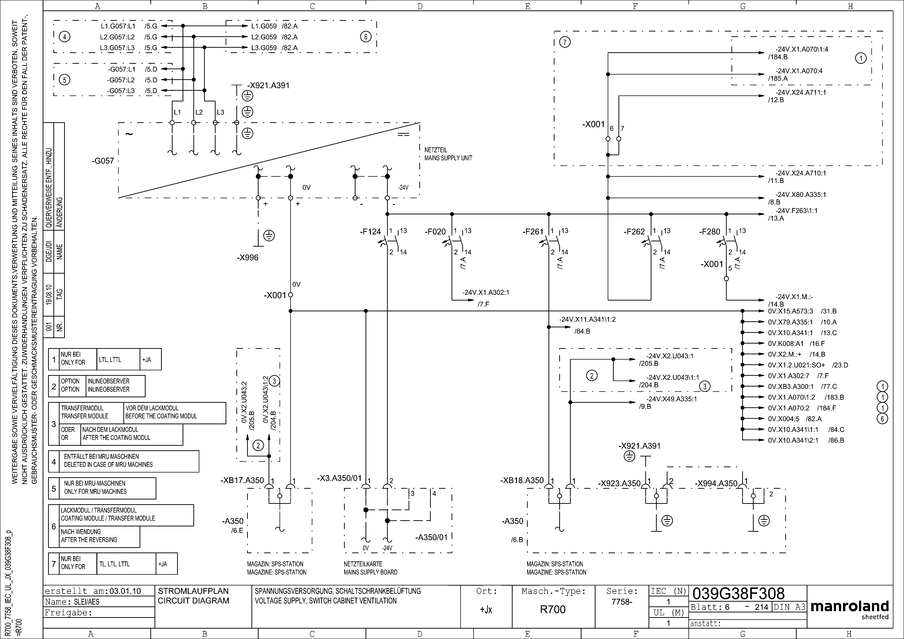

# +Jx — Sheet 6 of 214 — SPANNUNGSVERSORGUNG, SCHALTSCHRANKBELÜFTUNG

**VOLTAGE SUPPLY, SWITCH CABINET VENTILATION**

> Part of the manroland **R700** printing press IEC/UL circuit diagrams.
> Drawing class: **Stromlaufplan / Circuit diagram** (DIN A3).
> Document `+Jx` covers the **1st printing module + feed register** machine section.

## At a glance

| Field | Value |
|---|---|
| Document | `+Jx`  (039G38F308) |
| Sheet | **6** of 214 |
| Section (DE) | SPANNUNGSVERSORGUNG, SCHALTSCHRANKBELÜFTUNG |
| Section (EN) | VOLTAGE SUPPLY, SWITCH CABINET VENTILATION |
| Section type | POWER_SUPPLY — Voltage supply |
| Machine type | `R700` |
| Series | `7758` |
| Created | 03.01.10 |
| Replaces | — |
| Columns used | A, B, C, D, E, F, G, H |
| Path numbers | — |
| Labels on sheet | 208 |
| Cross-refs out | 42 |
| Cross-refs in | 44 |

**Previous:** [+Jx sheet 5](SHEET_0005.md) · **Next:** [+Jx sheet 7](SHEET_0007.md) · **Document TOC:** [_TOC.md](_TOC.md)  (+Jx) · **Master TOC:** [all sheets](../_MASTER_TOC.md)

## Sheet image (300 DPI, exact vector render)



_Rendered directly from the PDF vector layer at 300 DPI (1-bit), no OCR and no resampling. Use it to confirm anything ambiguous in the text below._

## Cross-references on this sheet

Each entry is a wire leaving this sheet. The printed token is `/sheet.column`; the link resolves to that sheet inside the same document.

| Ref | Target sheet | Col | Path | Destination on target | Target section | From col |
|---|---|---|---|---|---|---|
| `/82.A` | [+Jx sheet 82](SHEET_0082.md) | A | — | L1.G057:L1 L1.G059 | BOGENFÜHRUNG, NACH WENDUNG | B |
| `/5.G` | [+Jx sheet 5](SHEET_0005.md) | G | — | L1.G057:L1 L1.G059 | SPANNUNGSVERSORGUNG, SCHALTSCHRANKBELÜFTUNG | B |
| `/82.A` | [+Jx sheet 82](SHEET_0082.md) | A | — | L2.G057:L2 L2.G059 | BOGENFÜHRUNG, NACH WENDUNG | B |
| `/5.G` | [+Jx sheet 5](SHEET_0005.md) | G | — | L2.G057:L2 L2.G059 | SPANNUNGSVERSORGUNG, SCHALTSCHRANKBELÜFTUNG | B |
| `/82.A` | [+Jx sheet 82](SHEET_0082.md) | A | — | L3.G057:L3 L3.G059 | BOGENFÜHRUNG, NACH WENDUNG | B |
| `/5.G` | [+Jx sheet 5](SHEET_0005.md) | G | — | L3.G057:L3 L3.G059 | SPANNUNGSVERSORGUNG, SCHALTSCHRANKBELÜFTUNG | B |
| `/184.B` | [+Jx sheet 184](SHEET_0184.md) | B | — | — | OPTION: TRANSFERMODUL 1 + 2 | G |
| `/5.D` | [+Jx sheet 5](SHEET_0005.md) | D | — | G057:L1 | SPANNUNGSVERSORGUNG, SCHALTSCHRANKBELÜFTUNG | A |
| `/185.A` | [+Jx sheet 185](SHEET_0185.md) | A | — | — | OPTION: TRANSFERMODUL 1 + 2 | G |
| `/5.D` | [+Jx sheet 5](SHEET_0005.md) | D | — | G057:L2 | SPANNUNGSVERSORGUNG, SCHALTSCHRANKBELÜFTUNG | A |
| `/5.D` | [+Jx sheet 5](SHEET_0005.md) | D | — | G057:L3 | SPANNUNGSVERSORGUNG, SCHALTSCHRANKBELÜFTUNG | A |
| `/12.B` | [+Jx sheet 12](SHEET_0012.md) | B | — | — | SPANNUNGSVERSORGUNG, SCHALTSCHRANKBELÜFTUNG | G |
| `/11.B` | [+Jx sheet 11](SHEET_0011.md) | B | — | — | SPANNUNGSVERSORGUNG, SCHALTSCHRANKBELÜFTUNG | G |
| `/8.B` | [+Jx sheet 8](SHEET_0008.md) | B | — | — | SPANNUNGSVERSORGUNG, SCHALTSCHRANKBELÜFTUNG | G |
| `/13.A` | [+Jx sheet 13](SHEET_0013.md) | A | — | — | SPANNUNGSVERSORGUNG, SCHALTSCHRANKBELÜFTUNG | G |
| `/7.A` | [+Jx sheet 7](SHEET_0007.md) | A | — | — | SPANNUNGSVERSORGUNG, SCHALTSCHRANKBELÜFTUNG | D |
| `/7.A` | [+Jx sheet 7](SHEET_0007.md) | A | — | — | SPANNUNGSVERSORGUNG, SCHALTSCHRANKBELÜFTUNG | E |
| `/7.A` | [+Jx sheet 7](SHEET_0007.md) | A | — | — | SPANNUNGSVERSORGUNG, SCHALTSCHRANKBELÜFTUNG | F |
| `/7.A` | [+Jx sheet 7](SHEET_0007.md) | A | — | — | SPANNUNGSVERSORGUNG, SCHALTSCHRANKBELÜFTUNG | G |
| `/7.F` | [+Jx sheet 7](SHEET_0007.md) | F | — | — | SPANNUNGSVERSORGUNG, SCHALTSCHRANKBELÜFTUNG | E |
| `/14.B` | [+Jx sheet 14](SHEET_0014.md) | B | — | — | SPANNUNGSVERSORGUNG, SCHALTSCHRANKBELÜFTUNG | G |
| `/31.B` | [+Jx sheet 31](SHEET_0031.md) | B | — | 0V.X15.A573:3 | BELEUCHTUNG | H |
| `/10.A` | [+Jx sheet 10](SHEET_0010.md) | A | — | 0V.X79.A335:1 | SPANNUNGSVERSORGUNG, SCHALTSCHRANKBELÜFTUNG | H |
| `/84.B` | [+Jx sheet 84](SHEET_0084.md) | B | — | — | BOGENFÜHRUNG | F |
| `/13.C` | [+Jx sheet 13](SHEET_0013.md) | C | — | 0V.X10.A341:1 | SPANNUNGSVERSORGUNG, SCHALTSCHRANKBELÜFTUNG | H |
| `/16.F` | [+Jx sheet 16](SHEET_0016.md) | F | — | 0V.K008:A1 | ÖLUMLAUFSCHMIERUNG | H |
| `/14.B` | [+Jx sheet 14](SHEET_0014.md) | B | — | 0V.X2.M.:+ | SPANNUNGSVERSORGUNG, SCHALTSCHRANKBELÜFTUNG | H |
| `/205.B` | [+Jx sheet 205](SHEET_0205.md) | B | — | — | OPTION: INLINEOBSERVER | F |
| `/23.D` | [+Jx sheet 23](SHEET_0023.md) | D | — | 0V.X1.2.U021:SO+ | LACKPUMPE | H |
| `/7.F` | [+Jx sheet 7](SHEET_0007.md) | F | — | 0V.X1.A302:7 | SPANNUNGSVERSORGUNG, SCHALTSCHRANKBELÜFTUNG | H |
| `/204.B` | [+Jx sheet 204](SHEET_0204.md) | B | — | 0V.X2.U043\1:2 | OPTION: INLINEOBSERVER | C |
| `/205.B` | [+Jx sheet 205](SHEET_0205.md) | B | — | 0V.X2.U043:2 | OPTION: INLINEOBSERVER | B |
| `/204.B` | [+Jx sheet 204](SHEET_0204.md) | B | — | — | OPTION: INLINEOBSERVER | F |
| `/77.C` | [+Jx sheet 77](SHEET_0077.md) | C | — | 0V.XB3.A300:1 | BUSVERBINDUNGEN: SICHERHEITSKREIS | H |
| `/183.B` | [+Jx sheet 183](SHEET_0183.md) | B | — | 0V.X1.A070\1:2 | OPTION: TRANSFERMODUL 1 + 2 | H |
| `/9.B` | [+Jx sheet 9](SHEET_0009.md) | B | — | — | SPANNUNGSVERSORGUNG, SCHALTSCHRANKBELÜFTUNG | F |
| `/184.F` | [+Jx sheet 184](SHEET_0184.md) | F | — | 0V.X1.A070:2 | OPTION: TRANSFERMODUL 1 + 2 | H |
| `/82.A` | [+Jx sheet 82](SHEET_0082.md) | A | — | 0V.X004:5 | BOGENFÜHRUNG, NACH WENDUNG | G |
| `/84.C` | [+Jx sheet 84](SHEET_0084.md) | C | — | 0V.X10.A341\1:1 | BOGENFÜHRUNG | H |
| `/86.B` | [+Jx sheet 86](SHEET_0086.md) | B | — | 0V.X10.A341\2:1 | BOGENFÜHRUNG | H |
| `/6.E` | [+Jx sheet 6](SHEET_0006.md) | E | — | — | SPANNUNGSVERSORGUNG, SCHALTSCHRANKBELÜFTUNG | B |
| `/6.B` | [+Jx sheet 6](SHEET_0006.md) | B | — | — | SPANNUNGSVERSORGUNG, SCHALTSCHRANKBELÜFTUNG | E |

### Incoming references (sheets that point here)

Every other sheet that sends a wire to this one. `Back-ref` is the token printed on *that* sheet; `Path` is its line number.

| From sheet | Cols | Back-ref | Path | Refs | What continues there |
|---|---|---|---|---|---|
| [+Jx#5](SHEET_0005.md) | E, H | `/5.E`, `/5.H` | — | 6 | G057:L1; G057:L2; G057:L3; L1.G057:L1; L2.G057:L2; L3.G057:L3 |
| [+Jx#6](SHEET_0006.md) | B, E | `/6.B`, `/6.E` | — | 2 | — |
| [+Jx#7](SHEET_0007.md) | A, E | `/7.A`, `/7.E` | — | 6 | 0V.X1.A302:7; 24V.X1.A302:1 |
| [+Jx#8](SHEET_0008.md) | B | `/8.B` | — | 1 | — |
| [+Jx#9](SHEET_0009.md) | A | `/9.A` | — | 1 | 24V.X49.A335:1 |
| [+Jx#10](SHEET_0010.md) | A | `/10.A` | — | 1 | 0V.X79.A335:1 |
| [+Jx#11](SHEET_0011.md) | A | `/11.A` | — | 1 | 24V.X24.A710:1 |
| [+Jx#12](SHEET_0012.md) | A | `/12.A` | — | 1 | 24V.X24.A711:1 |
| [+Jx#13](SHEET_0013.md) | A, C | `/13.A`, `/13.C` | — | 2 | 0V.X10.A341:1; 24V.F263\1:1 |
| [+Jx#14](SHEET_0014.md) | A | `/14.A` | — | 2 | 0V.X2.M.:+; 24V.X1.M.: |
| [+Jx#16](SHEET_0016.md) | F | `/16.F` | — | 1 | 0V.K008:A1 |
| [+Jx#23](SHEET_0023.md) | C | `/23.C` | — | 1 | 0V.X1.2.U021:SO+ |
| [+Jx#31](SHEET_0031.md) | A | `/31.A` | — | 1 | 0V.X15.A573:3 |
| [+Jx#77](SHEET_0077.md) | C | `/77.C` | — | 1 | 0V.XB3.A300:1 |
| [+Jx#82](SHEET_0082.md) | A | `/82.A` | — | 4 | 0V.X004:5; L1.G059; L2.G059; L3.G059 |
| [+Jx#84](SHEET_0084.md) | B, C | `/84.B`, `/84.C` | — | 2 | 0V.X10.A341\1:1; 24V.X11.A341\1:2 |
| [+Jx#86](SHEET_0086.md) | B | `/86.B` | — | 1 | 0V.X10.A341\2:1 |
| [+Jx#128](SHEET_0128.md) | G | `/128.G` | — | 2 | — |
| [+Jx#183](SHEET_0183.md) | B | `/183.B` | — | 1 | 0V.X1.A070\1:2 |
| [+Jx#184](SHEET_0184.md) | A, F | `/184.A`, `/184.F` | — | 2 | 0V.X1.A070:2; 24V.X1.A070\1:4 |
| [+Jx#185](SHEET_0185.md) | A | `/185.A` | — | 1 | 24V.X1.A070:4 |
| [+Jx#204](SHEET_0204.md) | A | `/204.A` | — | 2 | 0V.X2.U043\1:2; 24V.X2.U043\1:1 |
| [+Jx#205](SHEET_0205.md) | A | `/205.A` | — | 2 | 0V.X2.U043:2; 24V.X2.U043:1 |


## Devices on this sheet

| Tag | Class | Class meaning (IEC) | Col | Sub | Terminal | Sign |
|---|---|---|---|---|---|---|
| `X001` | X | Klemme / terminal, plug connector | C | — | — | — |
| `G057` | G | Stromversorgung / power supply | A | — | — | — |
| `A350/01` | A | Baugruppe / assembly, module, PC board | D | 01 | — | — |
| `A350` | A | Baugruppe / assembly, module, PC board | B | — | — | — |
| `A350` | A | Baugruppe / assembly, module, PC board | E | — | — | — |
| `F261` | F | Schutz / protection device (fuse, circuit breaker) | E | — | — | — |
| `F124` | F | Schutz / protection device (fuse, circuit breaker) | D | — | — | — |
| `F020` | F | Schutz / protection device (fuse, circuit breaker) | D | — | — | — |
| `F262` | F | Schutz / protection device (fuse, circuit breaker) | F | — | — | — |
| `F280` | F | Schutz / protection device (fuse, circuit breaker) | G | — | — | — |
| `X001` | X | Klemme / terminal, plug connector | G | — | — | — |
| `X001` | X | Klemme / terminal, plug connector | F | — | — | — |
| `G057:L2` | G | Stromversorgung / power supply | A | — | L2 | — |
| `G057:L3` | G | Stromversorgung / power supply | A | — | L3 | — |
| `G057:L1` | G | Stromversorgung / power supply | A | — | L1 | — |
| `X996` | X | Klemme / terminal, plug connector | B | — | — | — |
| `XB17.A350` | — | cross-device reference | B | — | — | — |
| `XB18.A350` | — | cross-device reference | E | — | — | — |
| `X923.A350` | — | cross-device reference | F | — | — | — |
| `X994.A350` | — | cross-device reference | G | — | — | — |
| `NR.` | — | cross-device reference | A | — | — | — |
| `19.08.10` | — | cross-device reference | A | — | — | — |
| `X921.A391` | — | cross-device reference | C | — | — | — |
| `X921.A391` | — | cross-device reference | F | — | — | — |

## Potentials / nets

| Potential | Count | Columns | Attached devices | Terminals |
|---|---|---|---|---|
| `0V` | 17 | B, C, G | `A070`, `A070\1`, `A300`, `A302`, `A335`, `A341`, `A341\1`, `A341\2`, `A573`, `K008`, `M`, `U043`, `U043\1`, `X004`, `X1`, `X10`, `X15`, `X2`, `X79`, `XB3` | `1`, `2`, `3`, `5`, `7`, `A1` |
| `24V` | 14 | D, E, F, G, H | `A070`, `A070\1`, `A302`, `A335`, `A341\1`, `A710`, `A711`, `F263\1`, `M`, `U043`, `U043\1`, `X1`, `X11`, `X2`, `X24`, `X49`, `X80` | `1`, `2`, `4` |
| `L1` | 3 | A, B, C | `G057`, `G059` | `L1` |
| `L2` | 3 | A, B, C | `G057`, `G059` | `L2` |
| `L3` | 3 | A, B, C | `G057`, `G059` | `L3` |


A potential such as `L24+/4` or `M24+` is a named supply/return rail; every place it appears on this sheet is electrically common.

## Wire-end annotations (grouped as printed)

A wire that continues elsewhere is annotated with a small cluster: the destination description, the path/line number `#NN`, and the `/sheet.column` cross reference. Each row below is one such cluster exactly as it is grouped on the drawing.

| Col | Y | Path | Cross-ref | Text on the wire |
|---|---|---|---|---|
| B | 30.7 | — | `/82.A`, `/5.G` | `L1.G057:L1 L1.G059` |
| B | 44.8 | — | `/82.A`, `/5.G` | `L2.G057:L2 L2.G059` |
| D | 45.6 | — | — | `6 7` |
| A | 45.7 | — | — | `4` |
| B | 59.0 | — | `/82.A`, `/5.G` | `L3.G057:L3 L3.G059` |
| H | 61.2 | — | — | `24V.X1.A070\1:4` |
| G | 71.1 | — | `/184.B` | — |
| H | 73.5 | — | — | `1` |
| A | 87.4 | — | `/5.D` | `G057:L1` |
| H | 89.5 | — | — | `24V.X1.A070:4` |
| G | 99.4 | — | `/185.A` | — |
| A | 101.5 | — | `/5.D` | `G057:L2` |
| B | 102.3 | — | — | `5 X921.A391` |
| A | 115.7 | — | `/5.D` | `G057:L3` |
| H | 117.9 | — | — | `24V.X24.A711:1` |
| G | 127.8 | — | `/12.B` | — |
| B | 144.1 | — | — | `L1 L2 L3` |
| F | 158.7 | — | — | `X001 6 7` |
| A | 169.1 | — | — | `~` |
| D | 194.7 | — | — | `NETZTEIL MAINS SUPPLY UNIT` |
| A | 195.1 | — | — | `001 DGE/JDI QUERVERWEISE ENTF., HINZU 19.08.10` |
| A | 207.2 | — | — | `G057` |
| H | 224.2 | — | — | `24V.X24.A710:1` |
| G | 234.1 | — | `/11.B` | — |
| C | 243.3 | — | — | `0V 24V` |
| H | 252.5 | — | — | `24V.X80.A335:1` |
| A | 259.8 | — | — | `NR. NAME TAG ÄNDERUNG` |
| G | 262.4 | — | `/8.B` | — |
| C | 263.8 | — | — | `+ +` |
| H | 273.8 | — | — | `24V.F263\1:1` |
| G | 283.7 | — | `/13.A` | — |
| D | 300.0 | — | — | `1 F261` |
| D | 300.0 | — | — | `13` |
| D | 300.0 | — | — | `1` |
| D | 300.0 | — | — | `13` |
| E | 300.0 | — | — | `1` |
| E | 300.0 | — | — | `13` |
| F | 300.0 | — | — | `1` |
| F | 300.0 | — | — | `13` |
| G | 300.0 | — | — | `1` |
| G | 300.0 | — | — | `13` |
| D | 300.7 | — | — | `F124` |
| D | 300.7 | — | — | `F020` |
| F | 300.7 | — | — | `F262` |
| G | 300.7 | — | — | `F280` |
| D | 328.4 | — | — | `2` |
| D | 328.4 | — | — | `14` |
| D | 328.4 | — | — | `2` |
| D | 328.4 | — | — | `14` |
| E | 328.4 | — | — | `2` |
| E | 328.4 | — | — | `14` |
| F | 328.4 | — | — | `2` |
| F | 328.4 | — | — | `14` |
| G | 328.4 | — | — | `2` |
| G | 328.4 | — | — | `14` |
| B | 334.7 | — | — | `X996` |
| D | 338.7 | — | `/7.A` | — |
| E | 338.7 | — | `/7.A` | — |
| F | 338.7 | — | `/7.A` | — |
| G | 338.7 | — | `/7.A` | — |
| G | 343.0 | — | — | `X001 5` |
| C | 370.8 | — | — | `X001 0V` |
| E | 381.5 | — | — | `24V.X1.A302:1` |
| G | 387.1 | — | — | `24V.X1.M.:` |
| E | 397.0 | — | `/7.F` | — |
| G | 397.0 | — | `/14.B` | — |
| H | 406.2 | — | `/31.B` | `0V.X15.A573:3` |
| F | 416.9 | — | — | `24V.X11.A341\1:2` |
| H | 420.4 | — | `/10.A` | `0V.X79.A335:1` |
| F | 432.5 | — | `/84.B` | — |
| H | 434.6 | — | `/13.C` | `0V.X10.A341:1` |
| H | 448.8 | — | `/16.F` | `0V.K008:A1` |
| H | 462.9 | — | `/14.B` | `0V.X2.M.:+` |
| A | 464.0 | — | — | `1 NUR BEI ONLY FOR` |
| F | 465.1 | — | — | `24V.X2.U043:1` |
| A | 471.1 | — | — | `LTL, LTTL +JA` |
| F | 475.0 | — | `/205.B` | — |
| H | 477.1 | — | `/23.D` | `0V.X1.2.U021:SO+` |
| H | 491.3 | — | `/7.F` | `0V.X1.A302:7` |
| F | 492.1 | — | — | `2` |
| F | 493.5 | — | — | `24V.X2.U043\1:1` |
| C | 495.2 | — | `/204.B` | `0V.X2.U043\1:2` |
| C | 499.1 | — | — | `3` |
| A | 499.5 | — | — | `2 INLINEOBSERVER INLINEOBSERVER` |
| A | 499.5 | — | — | `OPTION OPTION` |
| B | 502.6 | — | `/205.B` | `0V.X2.U043:2` |
| F | 503.4 | — | `/204.B` | — |
| H | 505.5 | — | `/77.C` | `0V.XB3.A300:1` |
| H | 505.8 | — | — | `1` |
| G | 506.2 | — | — | `3` |
| H | 519.7 | — | `/183.B` | `0V.X1.A070\1:2` |
| H | 519.9 | — | — | `1` |
| F | 521.8 | — | — | `24V.X49.A335:1` |
| F | 531.7 | — | `/9.B` | — |
| H | 533.8 | — | `/184.F` | `0V.X1.A070:2` |
| H | 534.1 | — | — | `1` |
| A | 534.9 | — | — | `TRANSFERMODUL TRANSFER MODULE` |
| B | 534.9 | — | — | `BEFORE THE COATING MODUL VOR DEM LACKMODUL` |
| G | 548.0 | — | `/82.A` | `0V.X004:5` |
| H | 548.7 | — | — | `6` |
| A | 554.4 | — | — | `3` |
| H | 562.2 | — | `/84.C` | `0V.X10.A341\1:1` |
| A | 563.3 | — | — | `ODER OR` |
| A | 563.3 | — | — | `NACH DEM LACKMODUL` |
| A | 573.9 | — | — | `AFTER THE COATING MODUL` |
| H | 576.3 | — | `/86.B` | `0V.X10.A341\2:1` |
| F | 582.8 | — | — | `X921.A391` |
| B | 584.2 | — | — | `2` |
| A | 598.7 | — | — | `4 ENTFÄLLT BEI MRU MASCHINEN DELETED IN CASE OF MRU MACHINES` |
| C | 625.3 | — | — | `X3.A350/01 1 2` |
| C | 628.1 | — | — | `XB17.A350 1 1` |
| F | 628.1 | — | — | `XB18.A350 1 1 X923.A350 1 2 X994.A350 1` |
| A | 634.1 | — | — | `5 NUR BEI MRU MASCHINEN ONLY FOR MRU MACHINES` |
| D | 646.6 | — | — | `3 4` |
| G | 647.3 | — | — | `2` |
| A | 669.6 | — | — | `6 LACKMODUL / TRANSFERMODUL NACH WENDUNG COATING MODULE / TRANSFER MODULE` |
| B | 682.0 | — | — | `A350` |
| E | 682.0 | — | — | `A350` |
| B | 695.0 | — | `/6.E` | — |
| D | 703.2 | — | — | `A350/01` |
| E | 707.4 | — | `/6.B` | — |
| A | 708.5 | — | — | `AFTER THE REVERSING` |
| D | 719.1 | — | — | `0V 24V` |
| A | 733.3 | — | — | `7 NUR BEI ONLY FOR TL, LTL, LTTL +JA` |
| C | 740.4 | — | — | `MAGAZIN: SPS STATION MAGAZINE: SPS STATION` |
| D | 740.4 | — | — | `NETZTEILKARTE MAINS SUPPLY BOARD` |
| E | 740.4 | — | — | `MAGAZIN: SPS STATION MAGAZINE: SPS STATION` |


## Reconstructed tables

This sheet carries tabular content (pin map / terminal assignment / index). The grid below was rebuilt from the drawing's own rule lines, so each row is exactly one physical row of the table.

### Table 1 — 6 data rows × 11 columns (at x=240.9, y=34.0)

|  |  |  |  | L1.G059 |  | /82.A |  |  |  |  |
|---|---|---|---|---|---|---|---|---|---|---|
|  |  |  |  | `L2.G059` |  | `/82.A` | `6` |  |  |  |
|  |  |  |  | `L3.G059 X921.A391` |  | `/82.A` |  |  |  |  |
|  | `L2` | `L3` |  |  |  |  |  |  |  | `NETZTEIL MAINS SUPPLY` |
|  |  |  |  | `+` |  |  | `0V +` |  | `24V` |  |
|  |  |  | `X996` |  | `X001` |  | `0V` | `F124` | `1 13 2 14` | `F020` |
| `MODUL` |  |  | `0V.X2.U043:2 /205.B 2 XB17.A350` | `0V.X2.U043\1:2` | `3 /204.B 1` |  | `X3.A350/01 1` | `1` | `2 3` | `4` |


### Table 2 — 3 data rows × 4 columns (at x=722.8, y=69.4)

|  |  | X001 | 6 |
|---|---|---|---|
| `1 2` | `13 14 /7.A` |  |  |
|  |  | `24V.X11.A341\1:2 /84.B` |  |
|  |  | `2` |  |


### Table 3 — 3 data rows × 4 columns (at x=815.0, y=69.4) — **7**

| F262 | 1 2 | 13 F280 14 /7.A X001 | 1 13 2 14 /7.A 5 |
|---|---|---|---|
|  |  | `24V.X2.U043:1` |  |
| `/205.B /204.B` |  | `24V.X2.U043\1:1 3 24V.X49.A335:1` |  |
| `/9.B X921.A391` |  |  |  |


## Notes and free text on this sheet

| Text | Col | Y (pt) |
|---|---|---|
| `NETZTEIL` | D | 194.73 |
| `MAINS SUPPLY UNIT` | D | 205.38 |
| `NETZTEILKARTE` | C | 740.41 |
| `MAINS SUPPLY BOARD` | D | 751.05 |
| `X3.A350/01` | C | 625.28 |
| `MAGAZIN: SPS STATION` | C | 740.41 |
| `MAGAZINE: SPS STATION` | C | 751.04 |
| `MAGAZIN: SPS STATION` | E | 740.41 |
| `MAGAZINE: SPS STATION` | E | 751.04 |
| `TAG` | A | 380.84 |
| `NAME` | A | 321.61 |
| `ÄNDERUNG` | A | 259.75 |
| `DGE/JDI` | A | 317.52 |
| `QUERVERWEISE ENTF., HINZU` | A | 195.14 |
| `0V.X1.2.U021:SO+` | H | 477.14 |
| `OPTION` | A | 499.46 |
| `INLINEOBSERVER` | A | 499.47 |
| `TRANSFERMODUL` | A | 534.94 |
| `TRANSFER MODULE` | A | 545.56 |
| `VOR DEM LACKMODUL` | B | 534.94 |
| `BEFORE THE COATING MODUL` | B | 545.55 |
| `ODER` | A | 563.27 |
| `OR` | A | 573.91 |
| `NACH DEM LACKMODUL` | A | 563.28 |
| `AFTER THE COATING MODUL` | A | 573.9 |
| `NUR BEI` | A | 464 |
| `ONLY FOR` | A | 474.69 |
| `ENTFÄLLT BEI MRU MASCHINEN` | A | 598.7 |
| `DELETED IN CASE OF MRU MACHINES` | A | 609.33 |
| `NUR BEI MRU MASCHINEN` | A | 634.14 |
| `ONLY FOR MRU MACHINES` | A | 644.78 |
| `LTL, LTTL` | A | 471.12 |
| `+JA` | A | 471.08 |
| `LACKMODUL / TRANSFERMODUL` | A | 669.58 |
| `COATING MODULE / TRANSFER MODULE` | A | 680.21 |
| `NACH WENDUNG` | A | 697.89 |
| `AFTER THE REVERSING` | A | 708.53 |
| `TL, LTL, LTTL` | A | 740.42 |
| `+JA` | B | 740.38 |

## Complete label inventory (exact text from the drawing)

Every text object inside the drawing area of this sheet, in DIN reading order (column A→H, then top→bottom). This is the authoritative list: if a string is not here it is not printed on this sheet.

| Col | Y | X | Dir | Type | Text |
|---|---|---|---|---|---|
| A | 30.7 | 132.9 | → | potential | `L1.G057:L1` |
| A | 30.7 | 190.5 | → | cross-reference | `/5.G` |
| A | 44.8 | 190.5 | → | cross-reference | `/5.G` |
| A | 44.9 | 131.8 | → | potential | `L2.G057:L2` |
| A | 45.7 | 83.2 | → | number | `4` |
| A | 59.0 | 190.5 | → | cross-reference | `/5.G` |
| A | 59.1 | 131.8 | → | potential | `L3.G057:L3` |
| A | 87.4 | 142.3 | → | device tag | `G057:L1` |
| A | 87.4 | 191.1 | → | cross-reference | `/5.D` |
| A | 101.6 | 141.2 | → | device tag | `G057:L2` |
| A | 101.6 | 191.1 | → | cross-reference | `/5.D` |
| A | 102.3 | 83.0 | → | number | `5` |
| A | 115.7 | 191.1 | → | cross-reference | `/5.D` |
| A | 115.8 | 141.2 | → | device tag | `G057:L3` |
| A | 169.1 | 165.0 | → | other | `~` |
| A | 195.1 | 61.3 | ↕ | text | `QUERVERWEISE ENTF., HINZU` |
| A | 207.2 | 121.0 | → | device tag | `G057` |
| A | 259.8 | 75.4 | ↕ | text | `ÄNDERUNG` |
| A | 317.5 | 61.2 | ↕ | text | `DGE/JDI` |
| A | 321.6 | 75.4 | ↕ | text | `NAME` |
| A | 375.0 | 61.3 | ↕ | device ref | `19.08.10` |
| A | 380.8 | 75.4 | ↕ | text | `TAG` |
| A | 424.1 | 61.2 | ↕ | number | `001` |
| A | 424.5 | 75.3 | ↕ | device ref | `NR.` |
| A | 464.0 | 80.2 | → | text | `NUR BEI` |
| A | 469.3 | 68.3 | → | number | `1` |
| A | 471.1 | 130.5 | → | text | `LTL, LTTL` |
| A | 471.1 | 187.5 | → | text | `+JA` |
| A | 474.7 | 80.5 | → | text | `ONLY FOR` |
| A | 499.5 | 80.5 | → | text | `OPTION` |
| A | 499.5 | 115.4 | → | text | `INLINEOBSERVER` |
| A | 504.8 | 68.0 | → | number | `2` |
| A | 510.1 | 80.5 | → | text | `OPTION` |
| A | 510.1 | 115.4 | → | text | `INLINEOBSERVER` |
| A | 534.9 | 80.8 | → | text | `TRANSFERMODUL` |
| A | 545.6 | 80.8 | → | text | `TRANSFER MODULE` |
| A | 554.4 | 67.9 | → | number | `3` |
| A | 563.3 | 80.5 | → | text | `ODER` |
| A | 563.3 | 108.6 | → | text | `NACH DEM LACKMODUL` |
| A | 573.9 | 80.5 | → | text | `OR` |
| A | 573.9 | 109.1 | → | text | `AFTER THE COATING MODUL` |
| A | 598.7 | 84.5 | → | text | `ENTFÄLLT BEI MRU MASCHINEN` |
| A | 604.0 | 68.0 | → | number | `4` |
| A | 609.3 | 84.5 | → | text | `DELETED IN CASE OF MRU MACHINES` |
| A | 634.1 | 84.5 | → | text | `NUR BEI MRU MASCHINEN` |
| A | 639.4 | 67.9 | → | number | `5` |
| A | 644.8 | 84.8 | → | text | `ONLY FOR MRU MACHINES` |
| A | 669.6 | 80.2 | → | text | `LACKMODUL / TRANSFERMODUL` |
| A | 680.2 | 80.5 | → | text | `COATING MODULE / TRANSFER MODULE` |
| A | 689.0 | 67.9 | → | number | `6` |
| A | 697.9 | 80.2 | → | text | `NACH WENDUNG` |
| A | 708.5 | 80.8 | → | text | `AFTER THE REVERSING` |
| A | 733.3 | 80.2 | → | text | `NUR BEI` |
| A | 738.6 | 67.9 | → | number | `7` |
| A | 740.4 | 131.1 | → | text | `TL, LTL, LTTL` |
| A | 744.0 | 80.5 | → | text | `ONLY FOR` |
| B | 144.1 | 229.0 | → | potential | `L1` |
| B | 144.1 | 257.4 | → | potential | `L2` |
| B | 144.1 | 285.7 | → | potential | `L3` |
| B | 334.7 | 312.1 | → | device tag | `X996` |
| B | 502.6 | 317.7 | ↕ | potential | `0V.X2.U043:2` |
| B | 534.9 | 165.8 | → | text | `VOR DEM LACKMODUL` |
| B | 541.4 | 327.6 | ↕ | cross-reference | `/205.B` |
| B | 545.6 | 165.3 | → | text | `BEFORE THE COATING MODUL` |
| B | 584.2 | 338.2 | → | number | `2` |
| B | 628.1 | 290.6 | → | device ref | `XB17.A350` |
| B | 682.0 | 292.5 | → | device tag | `A350` |
| B | 695.0 | 304.7 | → | cross-reference | `/6.E` |
| B | 740.4 | 208.8 | → | text | `+JA` |
| C | 30.7 | 331.1 | → | potential | `L1.G059` |
| C | 30.7 | 371.3 | → | cross-reference | `/82.A` |
| C | 44.8 | 371.3 | → | cross-reference | `/82.A` |
| C | 44.9 | 331.1 | → | potential | `L2.G059` |
| C | 45.6 | 479.9 | → | number | `6` |
| C | 59.0 | 371.3 | → | cross-reference | `/82.A` |
| C | 59.1 | 331.1 | → | potential | `L3.G059` |
| C | 107.9 | 325.7 | → | device ref | `X921.A391` |
| C | 243.3 | 398.4 | → | potential | `0V` |
| C | 263.8 | 346.7 | → | number | `+` |
| C | 263.8 | 389.2 | → | number | `+` |
| C | 370.8 | 385.2 | → | potential | `0V` |
| C | 384.1 | 347.5 | → | device tag | `X001` |
| C | 495.2 | 346.0 | ↕ | potential | `0V.X2.U043\1:2` |
| C | 499.1 | 359.4 | → | number | `3` |
| C | 541.4 | 356.0 | ↕ | cross-reference | `/204.B` |
| C | 625.3 | 417.8 | → | text | `X3.A350/01` |
| C | 629.5 | 356.0 | → | number | `1` |
| C | 629.5 | 384.4 | → | number | `1` |
| C | 719.1 | 477.9 | → | potential | `0V` |
| C | 740.4 | 325.4 | → | text | `MAGAZIN: SPS STATION` |
| C | 740.4 | 453.0 | → | text | `NETZTEILKARTE` |
| C | 751.0 | 325.4 | → | text | `MAGAZINE: SPS STATION` |
| D | 194.7 | 559.3 | → | text | `NETZTEIL` |
| D | 205.4 | 559.3 | → | text | `MAINS SUPPLY UNIT` |
| D | 244.4 | 524.8 | → | potential | `24V` |
| D | 300.0 | 512.2 | → | number | `1` |
| D | 300.0 | 526.4 | → | number | `13` |
| D | 300.0 | 597.3 | → | number | `1` |
| D | 300.0 | 611.4 | → | number | `13` |
| D | 300.7 | 474.2 | → | device tag | `F124` |
| D | 300.7 | 559.6 | → | device tag | `F020` |
| D | 328.4 | 513.1 | → | number | `2` |
| D | 328.4 | 526.4 | → | number | `14` |
| D | 328.4 | 598.1 | → | number | `2` |
| D | 328.4 | 611.4 | → | number | `14` |
| D | 338.7 | 606.1 | ↕ | cross-reference | `/7.A` |
| D | 629.6 | 483.9 | → | number | `1` |
| D | 629.6 | 513.1 | → | number | `2` |
| D | 646.6 | 541.1 | → | number | `3` |
| D | 646.6 | 569.8 | → | number | `4` |
| D | 703.2 | 547.1 | → | device tag | `A350/01` |
| D | 719.2 | 503.5 | → | potential | `24V` |
| D | 751.0 | 453.0 | → | text | `MAINS SUPPLY BOARD` |
| E | 52.7 | 742.1 | → | number | `7` |
| E | 300.0 | 724.8 | → | number | `1` |
| E | 300.0 | 739.0 | → | number | `13` |
| E | 300.7 | 688.5 | → | device tag | `F261` |
| E | 328.4 | 725.7 | → | number | `2` |
| E | 328.4 | 739.0 | → | number | `14` |
| E | 338.7 | 733.6 | ↕ | cross-reference | `/7.A` |
| E | 381.5 | 609.2 | → | potential | `24V.X1.A302:1` |
| E | 397.0 | 629.3 | → | cross-reference | `/7.F` |
| E | 628.1 | 659.1 | → | device ref | `XB18.A350` |
| E | 629.5 | 724.5 | → | number | `1` |
| E | 629.5 | 752.9 | → | number | `1` |
| E | 682.0 | 661.0 | → | device tag | `A350` |
| E | 707.4 | 673.2 | → | cross-reference | `/6.B` |
| E | 740.4 | 693.9 | → | text | `MAGAZIN: SPS STATION` |
| E | 751.0 | 693.9 | → | text | `MAGAZINE: SPS STATION` |
| F | 158.7 | 767.1 | → | device tag | `X001` |
| F | 165.4 | 803.3 | → | number | `6` |
| F | 165.4 | 817.5 | → | number | `7` |
| F | 300.0 | 859.5 | → | number | `1` |
| F | 300.0 | 873.6 | → | number | `13` |
| F | 300.7 | 821.8 | → | device tag | `F262` |
| F | 328.4 | 860.3 | → | number | `2` |
| F | 328.4 | 873.6 | → | number | `14` |
| F | 338.7 | 868.3 | ↕ | cross-reference | `/7.A` |
| F | 416.9 | 736.7 | → | potential | `24V.X11.A341\1:2` |
| F | 432.5 | 756.9 | → | cross-reference | `/84.B` |
| F | 465.1 | 851.5 | → | potential | `24V.X2.U043:1` |
| F | 475.0 | 841.9 | → | cross-reference | `/205.B` |
| F | 492.0 | 777.5 | → | number | `2` |
| F | 493.5 | 851.5 | → | potential | `24V.X2.U043\1:1` |
| F | 503.4 | 841.9 | → | cross-reference | `/204.B` |
| F | 521.8 | 851.5 | → | potential | `24V.X49.A335:1` |
| F | 531.7 | 841.9 | → | cross-reference | `/9.B` |
| F | 582.8 | 814.7 | → | device ref | `X921.A391` |
| F | 629.5 | 852.1 | → | number | `1` |
| F | 629.5 | 881.3 | → | number | `2` |
| F | 632.4 | 787.7 | → | device ref | `X923.A350` |
| G | 71.1 | 1012.0 | → | cross-reference | `/184.B` |
| G | 99.4 | 1012.0 | → | cross-reference | `/185.A` |
| G | 127.8 | 1012.0 | → | cross-reference | `/12.B` |
| G | 234.1 | 1012.0 | → | cross-reference | `/11.B` |
| G | 262.4 | 1012.0 | → | cross-reference | `/8.B` |
| G | 283.7 | 1012.0 | → | cross-reference | `/13.A` |
| G | 300.0 | 958.7 | → | number | `1` |
| G | 300.0 | 972.9 | → | number | `13` |
| G | 300.7 | 921.0 | → | device tag | `F280` |
| G | 328.4 | 959.5 | → | number | `2` |
| G | 328.4 | 972.9 | → | number | `14` |
| G | 338.7 | 967.5 | ↕ | cross-reference | `/7.A` |
| G | 343.0 | 923.0 | → | device tag | `X001` |
| G | 349.6 | 959.2 | → | number | `5` |
| G | 387.2 | 1021.6 | → | potential | `24V.X1.M.:` |
| G | 397.0 | 1012.0 | → | cross-reference | `/14.B` |
| G | 406.3 | 1011.7 | → | potential | `0V.X15.A573:3` |
| G | 420.4 | 1011.7 | → | potential | `0V.X79.A335:1` |
| G | 434.6 | 1011.7 | → | potential | `0V.X10.A341:1` |
| G | 448.8 | 1011.7 | → | potential | `0V.K008:A1` |
| G | 463.0 | 1011.7 | → | potential | `0V.X2.M.:+` |
| G | 491.3 | 1011.7 | → | potential | `0V.X1.A302:7` |
| G | 505.5 | 1011.7 | → | potential | `0V.XB3.A300:1` |
| G | 506.2 | 926.4 | → | number | `3` |
| G | 519.7 | 1011.7 | → | potential | `0V.X1.A070\1:2` |
| G | 533.8 | 1011.7 | → | potential | `0V.X1.A070:2` |
| G | 548.0 | 1011.7 | → | potential | `0V.X004:5` |
| G | 562.2 | 1011.7 | → | potential | `0V.X10.A341\1:1` |
| G | 576.4 | 1011.7 | → | potential | `0V.X10.A341\2:1` |
| G | 629.5 | 979.7 | → | number | `1` |
| G | 632.4 | 915.3 | → | device ref | `X994.A350` |
| G | 647.3 | 1013.4 | → | number | `2` |
| H | 61.2 | 1021.6 | → | potential | `24V.X1.A070\1:4` |
| H | 73.5 | 1132.0 | → | number | `1` |
| H | 89.5 | 1021.6 | → | potential | `24V.X1.A070:4` |
| H | 117.9 | 1021.6 | → | potential | `24V.X24.A711:1` |
| H | 224.2 | 1021.6 | → | potential | `24V.X24.A710:1` |
| H | 252.5 | 1021.6 | → | potential | `24V.X80.A335:1` |
| H | 273.8 | 1021.6 | → | potential | `24V.F263\1:1` |
| H | 406.3 | 1081.4 | → | cross-reference | `/31.B` |
| H | 420.4 | 1081.4 | → | cross-reference | `/10.A` |
| H | 434.6 | 1081.4 | → | cross-reference | `/13.C` |
| H | 448.8 | 1066.5 | → | cross-reference | `/16.F` |
| H | 462.9 | 1066.5 | → | cross-reference | `/14.B` |
| H | 477.1 | 1011.7 | → | text | `0V.X1.2.U021:SO+` |
| H | 477.2 | 1096.3 | → | cross-reference | `/23.D` |
| H | 491.3 | 1076.5 | → | cross-reference | `/7.F` |
| H | 505.5 | 1081.4 | → | cross-reference | `/77.C` |
| H | 505.8 | 1160.3 | → | number | `1` |
| H | 519.7 | 1086.4 | → | cross-reference | `/183.B` |
| H | 519.9 | 1160.3 | → | number | `1` |
| H | 533.8 | 1076.5 | → | cross-reference | `/184.F` |
| H | 534.1 | 1160.3 | → | number | `1` |
| H | 548.0 | 1061.6 | → | cross-reference | `/82.A` |
| H | 548.7 | 1160.2 | → | number | `6` |
| H | 562.2 | 1091.3 | → | cross-reference | `/84.C` |
| H | 576.3 | 1091.3 | → | cross-reference | `/86.B` |

## Reading-order text block

The same content as a plain block, grouped by DIN column — convenient to paste or to match against a visual description.

```text
=== Column A ===
  30.7  132.9  net          L1.G057:L1
  30.7  190.5  xref         /5.G
  44.8  190.5  xref         /5.G
  44.9  131.8  net          L2.G057:L2
  45.7   83.2  numeric      4
  59.0  190.5  xref         /5.G
  59.1  131.8  net          L3.G057:L3
  87.4  142.3  devtag       G057:L1
  87.4  191.1  xref         /5.D
 101.6  141.2  devtag       G057:L2
 101.6  191.1  xref         /5.D
 102.3   83.0  numeric      5
 115.7  191.1  xref         /5.D
 115.8  141.2  devtag       G057:L3
 169.1  165.0  other        ~
 195.1   61.3  text         QUERVERWEISE ENTF., HINZU
 207.2  121.0  devtag       G057
 259.8   75.4  text         ÄNDERUNG
 317.5   61.2  text         DGE/JDI
 321.6   75.4  text         NAME
 375.0   61.3  devref       19.08.10
 380.8   75.4  text         TAG
 424.1   61.2  numeric      001
 424.5   75.3  devref       NR.
 464.0   80.2  text         NUR BEI
 469.3   68.3  numeric      1
 471.1  130.5  text         LTL, LTTL
 471.1  187.5  text         +JA
 474.7   80.5  text         ONLY FOR
 499.5   80.5  text         OPTION
 499.5  115.4  text         INLINEOBSERVER
 504.8   68.0  numeric      2
 510.1   80.5  text         OPTION
 510.1  115.4  text         INLINEOBSERVER
 534.9   80.8  text         TRANSFERMODUL
 545.6   80.8  text         TRANSFER MODULE
 554.4   67.9  numeric      3
 563.3   80.5  text         ODER
 563.3  108.6  text         NACH DEM LACKMODUL
 573.9   80.5  text         OR
 573.9  109.1  text         AFTER THE COATING MODUL
 598.7   84.5  text         ENTFÄLLT BEI MRU MASCHINEN
 604.0   68.0  numeric      4
 609.3   84.5  text         DELETED IN CASE OF MRU MACHINES
 634.1   84.5  text         NUR BEI MRU MASCHINEN
 639.4   67.9  numeric      5
 644.8   84.8  text         ONLY FOR MRU MACHINES
 669.6   80.2  text         LACKMODUL / TRANSFERMODUL
 680.2   80.5  text         COATING MODULE / TRANSFER MODULE
 689.0   67.9  numeric      6
 697.9   80.2  text         NACH WENDUNG
 708.5   80.8  text         AFTER THE REVERSING
 733.3   80.2  text         NUR BEI
 738.6   67.9  numeric      7
 740.4  131.1  text         TL, LTL, LTTL
 744.0   80.5  text         ONLY FOR
=== Column B ===
 144.1  229.0  net          L1
 144.1  257.4  net          L2
 144.1  285.7  net          L3
 334.7  312.1  devtag       X996
 502.6  317.7  net          0V.X2.U043:2
 534.9  165.8  text         VOR DEM LACKMODUL
 541.4  327.6  xref         /205.B
 545.6  165.3  text         BEFORE THE COATING MODUL
 584.2  338.2  numeric      2
 628.1  290.6  devref       XB17.A350
 682.0  292.5  devtag       A350
 695.0  304.7  xref         /6.E
 740.4  208.8  text         +JA
=== Column C ===
  30.7  331.1  net          L1.G059
  30.7  371.3  xref         /82.A
  44.8  371.3  xref         /82.A
  44.9  331.1  net          L2.G059
  45.6  479.9  numeric      6
  59.0  371.3  xref         /82.A
  59.1  331.1  net          L3.G059
 107.9  325.7  devref       X921.A391
 243.3  398.4  net          0V
 263.8  346.7  numeric      +
 263.8  389.2  numeric      +
 370.8  385.2  net          0V
 384.1  347.5  devtag       X001
 495.2  346.0  net          0V.X2.U043\1:2
 499.1  359.4  numeric      3
 541.4  356.0  xref         /204.B
 625.3  417.8  text         X3.A350/01
 629.5  356.0  numeric      1
 629.5  384.4  numeric      1
 719.1  477.9  net          0V
 740.4  325.4  text         MAGAZIN: SPS STATION
 740.4  453.0  text         NETZTEILKARTE
 751.0  325.4  text         MAGAZINE: SPS STATION
=== Column D ===
 194.7  559.3  text         NETZTEIL
 205.4  559.3  text         MAINS SUPPLY UNIT
 244.4  524.8  net          24V
 300.0  512.2  numeric      1
 300.0  526.4  numeric      13
 300.0  597.3  numeric      1
 300.0  611.4  numeric      13
 300.7  474.2  devtag       F124
 300.7  559.6  devtag       F020
 328.4  513.1  numeric      2
 328.4  526.4  numeric      14
 328.4  598.1  numeric      2
 328.4  611.4  numeric      14
 338.7  606.1  xref         /7.A
 629.6  483.9  numeric      1
 629.6  513.1  numeric      2
 646.6  541.1  numeric      3
 646.6  569.8  numeric      4
 703.2  547.1  devtag       A350/01
 719.2  503.5  net          24V
 751.0  453.0  text         MAINS SUPPLY BOARD
=== Column E ===
  52.7  742.1  numeric      7
 300.0  724.8  numeric      1
 300.0  739.0  numeric      13
 300.7  688.5  devtag       F261
 328.4  725.7  numeric      2
 328.4  739.0  numeric      14
 338.7  733.6  xref         /7.A
 381.5  609.2  net          24V.X1.A302:1
 397.0  629.3  xref         /7.F
 628.1  659.1  devref       XB18.A350
 629.5  724.5  numeric      1
 629.5  752.9  numeric      1
 682.0  661.0  devtag       A350
 707.4  673.2  xref         /6.B
 740.4  693.9  text         MAGAZIN: SPS STATION
 751.0  693.9  text         MAGAZINE: SPS STATION
=== Column F ===
 158.7  767.1  devtag       X001
 165.4  803.3  numeric      6
 165.4  817.5  numeric      7
 300.0  859.5  numeric      1
 300.0  873.6  numeric      13
 300.7  821.8  devtag       F262
 328.4  860.3  numeric      2
 328.4  873.6  numeric      14
 338.7  868.3  xref         /7.A
 416.9  736.7  net          24V.X11.A341\1:2
 432.5  756.9  xref         /84.B
 465.1  851.5  net          24V.X2.U043:1
 475.0  841.9  xref         /205.B
 492.0  777.5  numeric      2
 493.5  851.5  net          24V.X2.U043\1:1
 503.4  841.9  xref         /204.B
 521.8  851.5  net          24V.X49.A335:1
 531.7  841.9  xref         /9.B
 582.8  814.7  devref       X921.A391
 629.5  852.1  numeric      1
 629.5  881.3  numeric      2
 632.4  787.7  devref       X923.A350
=== Column G ===
  71.1 1012.0  xref         /184.B
  99.4 1012.0  xref         /185.A
 127.8 1012.0  xref         /12.B
 234.1 1012.0  xref         /11.B
 262.4 1012.0  xref         /8.B
 283.7 1012.0  xref         /13.A
 300.0  958.7  numeric      1
 300.0  972.9  numeric      13
 300.7  921.0  devtag       F280
 328.4  959.5  numeric      2
 328.4  972.9  numeric      14
 338.7  967.5  xref         /7.A
 343.0  923.0  devtag       X001
 349.6  959.2  numeric      5
 387.2 1021.6  net          24V.X1.M.:
 397.0 1012.0  xref         /14.B
 406.3 1011.7  net          0V.X15.A573:3
 420.4 1011.7  net          0V.X79.A335:1
 434.6 1011.7  net          0V.X10.A341:1
 448.8 1011.7  net          0V.K008:A1
 463.0 1011.7  net          0V.X2.M.:+
 491.3 1011.7  net          0V.X1.A302:7
 505.5 1011.7  net          0V.XB3.A300:1
 506.2  926.4  numeric      3
 519.7 1011.7  net          0V.X1.A070\1:2
 533.8 1011.7  net          0V.X1.A070:2
 548.0 1011.7  net          0V.X004:5
 562.2 1011.7  net          0V.X10.A341\1:1
 576.4 1011.7  net          0V.X10.A341\2:1
 629.5  979.7  numeric      1
 632.4  915.3  devref       X994.A350
 647.3 1013.4  numeric      2
=== Column H ===
  61.2 1021.6  net          24V.X1.A070\1:4
  73.5 1132.0  numeric      1
  89.5 1021.6  net          24V.X1.A070:4
 117.9 1021.6  net          24V.X24.A711:1
 224.2 1021.6  net          24V.X24.A710:1
 252.5 1021.6  net          24V.X80.A335:1
 273.8 1021.6  net          24V.F263\1:1
 406.3 1081.4  xref         /31.B
 420.4 1081.4  xref         /10.A
 434.6 1081.4  xref         /13.C
 448.8 1066.5  xref         /16.F
 462.9 1066.5  xref         /14.B
 477.1 1011.7  text         0V.X1.2.U021:SO+
 477.2 1096.3  xref         /23.D
 491.3 1076.5  xref         /7.F
 505.5 1081.4  xref         /77.C
 505.8 1160.3  numeric      1
 519.7 1086.4  xref         /183.B
 519.9 1160.3  numeric      1
 533.8 1076.5  xref         /184.F
 534.1 1160.3  numeric      1
 548.0 1061.6  xref         /82.A
 548.7 1160.2  numeric      6
 562.2 1091.3  xref         /84.C
 576.3 1091.3  xref         /86.B
```

---
_Generated from the PDF vector text layer; no OCR. Source: `R700_7758_IEC_UL_JX_039G38F308_p`, sheet 6._
