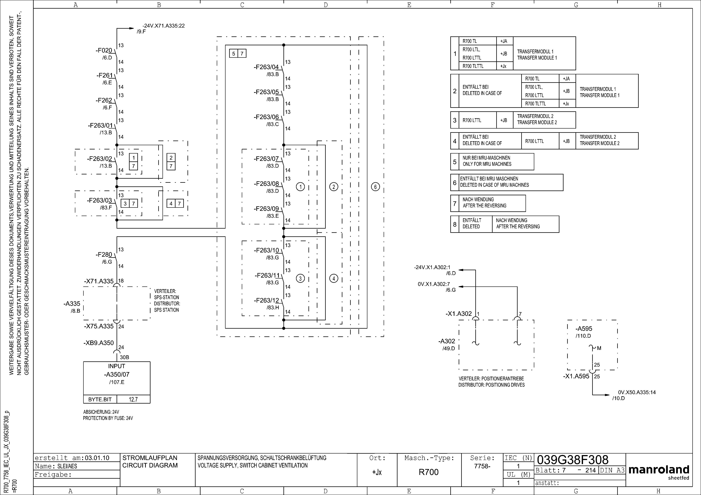

# +Jx — Sheet 7 of 214 — SPANNUNGSVERSORGUNG, SCHALTSCHRANKBELÜFTUNG

**VOLTAGE SUPPLY, SWITCH CABINET VENTILATION**

> Part of the manroland **R700** printing press IEC/UL circuit diagrams.
> Drawing class: **Stromlaufplan / Circuit diagram** (DIN A3).
> Document `+Jx` covers the **1st printing module + feed register** machine section.

## At a glance

| Field | Value |
|---|---|
| Document | `+Jx`  (039G38F308) |
| Sheet | **7** of 214 |
| Section (DE) | SPANNUNGSVERSORGUNG, SCHALTSCHRANKBELÜFTUNG |
| Section (EN) | VOLTAGE SUPPLY, SWITCH CABINET VENTILATION |
| Section type | POWER_SUPPLY — Voltage supply |
| Machine type | `R700` |
| Series | `7758` |
| Created | 03.01.10 |
| Replaces | — |
| Columns used | A, B, C, D, E, F, G, H |
| Path numbers | — |
| Labels on sheet | 168 |
| Cross-refs out | 24 |
| Cross-refs in | 30 |

**Previous:** [+Jx sheet 6](SHEET_0006.md) · **Next:** [+Jx sheet 8](SHEET_0008.md) · **Document TOC:** [_TOC.md](_TOC.md)  (+Jx) · **Master TOC:** [all sheets](../_MASTER_TOC.md)

## Sheet image (300 DPI, exact vector render)



_Rendered directly from the PDF vector layer at 300 DPI (1-bit), no OCR and no resampling. Use it to confirm anything ambiguous in the text below._

## Cross-references on this sheet

Each entry is a wire leaving this sheet. The printed token is `/sheet.column`; the link resolves to that sheet inside the same document.

| Ref | Target sheet | Col | Path | Destination on target | Target section | From col |
|---|---|---|---|---|---|---|
| `/9.F` | [+Jx sheet 9](SHEET_0009.md) | F | — | — | SPANNUNGSVERSORGUNG, SCHALTSCHRANKBELÜFTUNG | B |
| `/6.D` | [+Jx sheet 6](SHEET_0006.md) | D | — | — | SPANNUNGSVERSORGUNG, SCHALTSCHRANKBELÜFTUNG | A |
| `/83.B` | [+Jx sheet 83](SHEET_0083.md) | B | — | — | BOGENFÜHRUNG, NACH WENDUNG | C |
| `/6.E` | [+Jx sheet 6](SHEET_0006.md) | E | — | — | SPANNUNGSVERSORGUNG, SCHALTSCHRANKBELÜFTUNG | A |
| `/83.B` | [+Jx sheet 83](SHEET_0083.md) | B | — | — | BOGENFÜHRUNG, NACH WENDUNG | C |
| `/6.F` | [+Jx sheet 6](SHEET_0006.md) | F | — | — | SPANNUNGSVERSORGUNG, SCHALTSCHRANKBELÜFTUNG | A |
| `/83.C` | [+Jx sheet 83](SHEET_0083.md) | C | — | — | BOGENFÜHRUNG, NACH WENDUNG | C |
| `/13.B` | [+Jx sheet 13](SHEET_0013.md) | B | — | — | SPANNUNGSVERSORGUNG, SCHALTSCHRANKBELÜFTUNG | A |
| `/13.B` | [+Jx sheet 13](SHEET_0013.md) | B | — | — | SPANNUNGSVERSORGUNG, SCHALTSCHRANKBELÜFTUNG | A |
| `/83.D` | [+Jx sheet 83](SHEET_0083.md) | D | — | — | BOGENFÜHRUNG, NACH WENDUNG | C |
| `/83.D` | [+Jx sheet 83](SHEET_0083.md) | D | — | — | BOGENFÜHRUNG, NACH WENDUNG | C |
| `/83.F` | [+Jx sheet 83](SHEET_0083.md) | F | — | — | BOGENFÜHRUNG, NACH WENDUNG | A |
| `/83.E` | [+Jx sheet 83](SHEET_0083.md) | E | — | — | BOGENFÜHRUNG, NACH WENDUNG | C |
| `/83.G` | [+Jx sheet 83](SHEET_0083.md) | G | — | — | BOGENFÜHRUNG, NACH WENDUNG | C |
| `/6.G` | [+Jx sheet 6](SHEET_0006.md) | G | — | — | SPANNUNGSVERSORGUNG, SCHALTSCHRANKBELÜFTUNG | A |
| `/6.D` | [+Jx sheet 6](SHEET_0006.md) | D | — | 24V.X1.A302:1 | SPANNUNGSVERSORGUNG, SCHALTSCHRANKBELÜFTUNG | E |
| `/83.G` | [+Jx sheet 83](SHEET_0083.md) | G | — | — | BOGENFÜHRUNG, NACH WENDUNG | C |
| `/6.G` | [+Jx sheet 6](SHEET_0006.md) | G | — | 0V.X1.A302:7 | SPANNUNGSVERSORGUNG, SCHALTSCHRANKBELÜFTUNG | E |
| `/83.H` | [+Jx sheet 83](SHEET_0083.md) | H | — | — | BOGENFÜHRUNG, NACH WENDUNG | C |
| `/8.B` | [+Jx sheet 8](SHEET_0008.md) | B | — | — | SPANNUNGSVERSORGUNG, SCHALTSCHRANKBELÜFTUNG | A |
| `/110.D` | [+Jx sheet 110](SHEET_0110.md) | D | — | A595 | REFERENZMODUL | G |
| `/49.D` | [+Jx sheet 49](SHEET_0049.md) | D | — | — | HANDTERMINAL | E |
| `/107.E` | [+Jx sheet 107](SHEET_0107.md) | E | — | — | REFERENZMODUL | A |
| `/10.D` | [+Jx sheet 10](SHEET_0010.md) | D | — | — | SPANNUNGSVERSORGUNG, SCHALTSCHRANKBELÜFTUNG | H |

### Incoming references (sheets that point here)

Every other sheet that sends a wire to this one. `Back-ref` is the token printed on *that* sheet; `Path` is its line number.

| From sheet | Cols | Back-ref | Path | Refs | What continues there |
|---|---|---|---|---|---|
| [+Jx#6](SHEET_0006.md) | D, E, F, G, H | `/6.D`, `/6.E`, `/6.F`, `/6.G`, `/6.H` | — | 6 | 0V.X1.A302:7 |
| [+Jx#8](SHEET_0008.md) | B | `/8.B` | — | 1 | — |
| [+Jx#9](SHEET_0009.md) | F | `/9.F` | — | 1 | 24V.X71.A335:22 |
| [+Jx#10](SHEET_0010.md) | D | `/10.D` | — | 1 | — |
| [+Jx#13](SHEET_0013.md) | B | `/13.B` | — | 2 | — |
| [+Jx#49](SHEET_0049.md) | D | `/49.D` | — | 1 | — |
| [+Jx#83](SHEET_0083.md) | B, C, D, E, F, G, H | `/83.B`, `/83.C`, `/83.D`, `/83.E`, `/83.F`, `/83.G`, `/83.H` | — | 10 | — |
| [+Jx#107](SHEET_0107.md) | E | `/107.E` | — | 1 | — |
| [+Jx#110](SHEET_0110.md) | D | `/110.D` | — | 1 | — |
| [+Jx#113](SHEET_0113.md) | G | `/113.G` | — | 2 | — |
| [+Jx#115](SHEET_0115.md) | C | `/115.C` | — | 1 | — |
| [+Jx#134](SHEET_0134.md) | G | `/134.G` | — | 1 | — |
| [+Jx#153](SHEET_0153.md) | B | `/153.B` | — | 1 | — |
| [+Jx#155](SHEET_0155.md) | A | `/155.A` | — | 1 | — |


## Devices on this sheet

| Tag | Class | Class meaning (IEC) | Col | Sub | Terminal | Sign |
|---|---|---|---|---|---|---|
| `A302` | A | Baugruppe / assembly, module, PC board | E | — | — | — |
| `A595` | A | Baugruppe / assembly, module, PC board | G | — | — | — |
| `A350/07` | A | Baugruppe / assembly, module, PC board | A | 07 | — | — |
| `F280` | F | Schutz / protection device (fuse, circuit breaker) | A | — | — | — |
| `A335` | A | Baugruppe / assembly, module, PC board | A | — | — | — |
| `F020` | F | Schutz / protection device (fuse, circuit breaker) | A | — | — | — |
| `F261` | F | Schutz / protection device (fuse, circuit breaker) | A | — | — | — |
| `F262` | F | Schutz / protection device (fuse, circuit breaker) | A | — | — | — |
| `F263/01` | F | Schutz / protection device (fuse, circuit breaker) | A | 01 | — | — |
| `F263/02` | F | Schutz / protection device (fuse, circuit breaker) | A | 02 | — | — |
| `F263/03` | F | Schutz / protection device (fuse, circuit breaker) | A | 03 | — | — |
| `F263/04` | F | Schutz / protection device (fuse, circuit breaker) | C | 04 | — | — |
| `F263/05` | F | Schutz / protection device (fuse, circuit breaker) | C | 05 | — | — |
| `F263/06` | F | Schutz / protection device (fuse, circuit breaker) | C | 06 | — | — |
| `F263/07` | F | Schutz / protection device (fuse, circuit breaker) | C | 07 | — | — |
| `F263/08` | F | Schutz / protection device (fuse, circuit breaker) | C | 08 | — | — |
| `F263/09` | F | Schutz / protection device (fuse, circuit breaker) | C | 09 | — | — |
| `F263/10` | F | Schutz / protection device (fuse, circuit breaker) | C | 10 | — | — |
| `F263/11` | F | Schutz / protection device (fuse, circuit breaker) | C | 11 | — | — |
| `F263/12` | F | Schutz / protection device (fuse, circuit breaker) | C | 12 | — | — |
| `X1.A302` | — | cross-device reference | F | — | — | — |
| `X1.A595` | — | cross-device reference | G | — | — | — |
| `12.7` | — | cross-device reference | B | — | — | — |
| `XB9.A350` | — | cross-device reference | A | — | — | — |
| `X75.A335` | — | cross-device reference | A | — | — | — |
| `X71.A335` | — | cross-device reference | A | — | — | — |

## Potentials / nets

| Potential | Count | Columns | Attached devices | Terminals |
|---|---|---|---|---|
| `0V` | 2 | E, H | `A302`, `A335`, `X1`, `X50` | `14`, `7` |
| `24V` | 2 | B, E | `A302`, `A335`, `X1`, `X71` | `1`, `22` |


A potential such as `L24+/4` or `M24+` is a named supply/return rail; every place it appears on this sheet is electrically common.

## Wire-end annotations (grouped as printed)

A wire that continues elsewhere is annotated with a small cluster: the destination description, the path/line number `#NN`, and the `/sheet.column` cross reference. Each row below is one such cluster exactly as it is grouped on the drawing.

| Col | Y | Path | Cross-ref | Text on the wire |
|---|---|---|---|---|
| B | 39.9 | — | — | `24V.X71.A335:22` |
| B | 49.8 | — | `/9.F` | — |
| F | 67.2 | — | — | `R700 TL` |
| F | 67.2 | — | — | `+JA` |
| B | 73.3 | — | — | `13` |
| A | 81.0 | — | — | `F020` |
| F | 81.3 | — | — | `R700 LTL,` |
| F | 84.9 | — | — | `1 +JB TRANSFERMODUL 1 TRANSFER MODULE 1` |
| C | 87.4 | — | — | `5 7` |
| A | 94.1 | — | `/6.D` | — |
| F | 95.5 | — | — | `R700 LTTL` |
| B | 101.6 | — | — | `14` |
| D | 101.6 | — | — | `13` |
| C | 109.4 | — | — | `F263/04` |
| F | 109.7 | — | — | `R700 TLTTL +Jx` |
| B | 115.8 | — | — | `13` |
| C | 122.4 | — | `/83.B` | — |
| A | 123.5 | — | — | `F261` |
| D | 129.9 | — | — | `14` |
| G | 130.9 | — | — | `+JA` |
| F | 131.0 | — | — | `R700 TL` |
| A | 136.6 | — | `/6.E` | — |
| B | 144.1 | — | — | `14` |
| D | 144.1 | — | — | `13` |
| G | 145.1 | — | — | `2 ENTFÄLLT BEI DELETED IN CASE OF +JB TRANSFERMODUL 1 TRANSFER MODULE 1` |
| F | 145.1 | — | — | `R700 LTL,` |
| C | 151.9 | — | — | `F263/05` |
| B | 158.3 | — | — | `13` |
| G | 159.3 | — | — | `R700 LTTL` |
| C | 165.0 | — | `/83.B` | — |
| A | 166.1 | — | — | `F262` |
| D | 172.5 | — | — | `14` |
| G | 173.5 | — | — | `R700 TLTTL +Jx` |
| A | 179.1 | — | `/6.F` | — |
| B | 186.7 | — | — | `14` |
| D | 186.7 | — | — | `13` |
| C | 194.4 | — | — | `F263/06` |
| F | 194.8 | — | — | `3 R700 LTTL +JB TRANSFERMODUL 2 TRANSFER MODULE 2` |
| B | 200.8 | — | — | `13` |
| C | 207.5 | — | `/83.C` | — |
| A | 208.6 | — | — | `F263/01` |
| D | 215.0 | — | — | `14` |
| A | 221.7 | — | `/13.B` | — |
| B | 229.2 | — | — | `14` |
| G | 230.2 | — | — | `4 ENTFÄLLT BEI DELETED IN CASE OF R700 LTTL +JB TRANSFERMODUL 2 TRANSFER MODULE 2` |
| B | 257.5 | — | — | `13` |
| D | 257.5 | — | — | `13` |
| B | 264.6 | — | — | `1` |
| B | 264.6 | — | — | `2` |
| A | 265.3 | — | — | `F263/02` |
| C | 265.3 | — | — | `F263/07` |
| F | 265.6 | — | — | `5 NUR BEI MRU MASCHINEN ONLY FOR MRU MACHINES` |
| A | 278.3 | — | `/13.B` | — |
| C | 278.4 | — | `/83.D` | — |
| B | 278.8 | — | — | `7` |
| B | 278.8 | — | — | `7` |
| B | 285.9 | — | — | `14` |
| D | 285.9 | — | — | `14` |
| D | 300.0 | — | — | `13` |
| F | 301.1 | — | — | `6 ENTFÄLLT BEI MRU MASCHINEN DELETED IN CASE OF MRU MACHINES` |
| C | 307.8 | — | — | `F263/08` |
| D | 314.4 | — | — | `1` |
| D | 314.9 | — | — | `2 6` |
| C | 320.9 | — | `/83.D` | — |
| B | 328.4 | — | — | `13` |
| D | 328.4 | — | — | `14` |
| A | 336.1 | — | — | `F263/03` |
| F | 336.5 | — | — | `7 NACH WENDUNG` |
| B | 342.6 | — | — | `3 7` |
| B | 342.6 | — | — | `4 7` |
| D | 342.6 | — | — | `13` |
| F | 347.1 | — | — | `AFTER THE REVERSING` |
| A | 349.2 | — | `/83.F` | — |
| C | 350.3 | — | — | `F263/09` |
| B | 356.7 | — | — | `14` |
| C | 363.4 | — | `/83.E` | — |
| D | 370.9 | — | — | `14` |
| F | 371.9 | — | — | `8 ENTFÄLLT DELETED NACH WENDUNG` |
| F | 382.6 | — | — | `AFTER THE REVERSING` |
| D | 413.4 | — | — | `13` |
| B | 420.5 | — | — | `13` |
| C | 421.2 | — | — | `F263/10` |
| A | 428.3 | — | — | `F280` |
| C | 434.3 | — | `/83.G` | — |
| A | 441.3 | — | `/6.G` | — |
| D | 441.8 | — | — | `14` |
| B | 448.9 | — | — | `14` |
| E | 450.9 | — | `/6.D` | `24V.X1.A302:1` |
| D | 455.9 | — | — | `13` |
| C | 463.7 | — | — | `F263/11` |
| D | 470.8 | — | — | `3 4` |
| A | 473.6 | — | — | `X71.A335 18` |
| C | 476.8 | — | `/83.G` | — |
| E | 479.3 | — | `/6.G` | `0V.X1.A302:7` |
| D | 484.3 | — | — | `14` |
| B | 492.4 | — | — | `DISTRIBUTOR: SPS STATION SPS STATION VERTEILER:` |
| D | 498.5 | — | — | `13` |
| C | 506.2 | — | — | `F263/12` |
| A | 511.9 | — | — | `A335` |
| C | 519.3 | — | `/83.H` | — |
| A | 524.9 | — | `/8.B` | — |
| D | 526.8 | — | — | `14` |
| F | 528.9 | — | — | `X1.A302 1 7` |
| A | 550.2 | — | — | `X75.A335 24` |
| G | 554.4 | — | `/110.D` | `A595` |
| E | 575.7 | — | — | `A302` |
| A | 578.5 | — | — | `XB9.A350 24` |
| G | 588.5 | — | — | `M` |
| E | 588.8 | — | `/49.D` | — |
| B | 604.0 | — | — | `30B` |
| G | 616.8 | — | — | `25` |
| A | 618.5 | — | — | `INPUT` |
| A | 632.4 | — | — | `A350/07` |
| G | 635.2 | — | — | `X1.A595 25` |
| F | 641.2 | — | — | `DISTRIBUTOR: POSITIONING DRIVES VERTEILER: POSITIONIERANTRIEBE` |
| A | 646.1 | — | `/107.E` | — |
| H | 663.5 | — | — | `0V.X50.A335:14` |
| H | 673.5 | — | `/10.D` | — |
| A | 675.5 | — | — | `BYTE.BIT 12.7` |
| A | 697.9 | — | — | `PROTECTION BY FUSE: 24V ABSICHERUNG: 24V` |


## Reconstructed tables

This sheet carries tabular content (pin map / terminal assignment / index). The grid below was rebuilt from the drawing's own rule lines, so each row is exactly one physical row of the table.

### Table 1 — 9 data rows × 7 columns (at x=141.7, y=76.5)

| F020 /6.D F261 /6.E F262 /6.F F263/01 /13.B | 13 14 13 14 13 14 13 14 |  |  | 5 7 F263/04 /83.B F263/05 /83.B F263/06 /83.C | 13 14 13 14 13 14 |  |
|---|---|---|---|---|---|---|
| `F263/02 /13.B` | `13 1 7 14` |  | `2 7` | `F263/07 /83.D` | `13 14` |  |
|  |  |  |  | `F263/08` | `13` |  |
| `F263/03 /83.F` | `13 3 7 14` |  | `4 7` | `/83.D F263/09 /83.E` | `1 14 13` | `2` |
|  |  |  |  |  | `14` |  |
| `F280 /6.G X71.A335` | `13 14 18` | `SPS` | `VERTEILER: SPS STATION DISTRIBUTOR: STATION` | `F263/10 /83.G F263/11 /83.G F263/12 /83.H` | `13 14 13 3 14 13 14` | `4` |
| `X75.A335` | `24` |  |  |  |  |  |
| `XB9.A350` | `24 30B` |  |  |  |  |  |
| `INPUT` | `A350/07 /107.E` |  |  |  |  |  |
| `BYTE.BIT` | `12.7` |  |  |  |  |  |


## Notes and free text on this sheet

| Text | Col | Y (pt) |
|---|---|---|
| `VERTEILER: POSITIONIERANTRIEBE` | F | 641.2 |
| `DISTRIBUTOR: POSITIONING DRIVES` | F | 651.84 |
| `M` | G | 588.52 |
| `30B` | B | 604.01 |
| `INPUT` | A | 618.53 |
| `BYTE.BIT` | A | 675.52 |
| `ABSICHERUNG: 24V` | A | 697.91 |
| `PROTECTION BY FUSE: 24V` | A | 708.53 |
| `VERTEILER:` | B | 492.37 |
| `SPS STATION` | B | 503 |
| `DISTRIBUTOR:` | B | 513.64 |
| `R700 TL` | F | 67.2 |
| `R700 LTL,` | F | 81.35 |
| `+JA` | F | 67.15 |
| `R700 TLTTL` | F | 109.72 |
| `+Jx` | F | 109.77 |
| `R700 LTTL` | F | 95.55 |
| `+JB` | F | 88.39 |
| `TRANSFERMODUL 1` | G | 84.92 |
| `TRANSFER MODULE 1` | G | 95.55 |
| `+JA` | G | 130.93 |
| `R700 TLTTL` | G | 173.5 |
| `+Jx` | G | 173.55 |
| `R700 LTTL` | G | 159.33 |
| `+JB` | G | 152.16 |
| `ENTFÄLLT BEI` | F | 145.11 |
| `DELETED IN CASE OF` | F | 155.77 |
| `TRANSFERMODUL 2` | G | 194.78 |
| `TRANSFER MODULE 2` | G | 205.4 |
| `NUR BEI MRU MASCHINEN` | F | 265.64 |
| `ONLY FOR MRU MACHINES` | F | 276.27 |
| `ENTFÄLLT BEI MRU MASCHINEN` | F | 301.06 |
| `DELETED IN CASE OF MRU MACHINES` | F | 311.69 |
| `NACH WENDUNG` | F | 336.47 |
| `AFTER THE REVERSING` | F | 347.12 |
| `ENTFÄLLT` | F | 371.92 |
| `DELETED` | F | 382.54 |

## Complete label inventory (exact text from the drawing)

Every text object inside the drawing area of this sheet, in DIN reading order (column A→H, then top→bottom). This is the authoritative list: if a string is not here it is not printed on this sheet.

| Col | Y | X | Dir | Type | Text |
|---|---|---|---|---|---|
| A | 81.0 | 162.7 | → | device tag | `F020` |
| A | 94.1 | 174.0 | → | cross-reference | `/6.D` |
| A | 123.5 | 164.1 | → | device tag | `F261` |
| A | 136.6 | 174.3 | → | cross-reference | `/6.E` |
| A | 166.1 | 162.7 | → | device tag | `F262` |
| A | 179.1 | 174.9 | → | cross-reference | `/6.F` |
| A | 208.6 | 149.4 | → | device tag | `F263/01` |
| A | 221.6 | 169.5 | → | cross-reference | `/13.B` |
| A | 265.3 | 148.0 | → | device tag | `F263/02` |
| A | 278.3 | 169.5 | → | cross-reference | `/13.B` |
| A | 336.1 | 147.7 | → | device tag | `F263/03` |
| A | 349.2 | 170.1 | → | cross-reference | `/83.F` |
| A | 428.3 | 162.7 | → | device tag | `F280` |
| A | 441.3 | 173.5 | → | cross-reference | `/6.G` |
| A | 473.6 | 142.9 | → | device ref | `X71.A335` |
| A | 511.9 | 108.0 | → | device tag | `A335` |
| A | 524.9 | 120.5 | → | cross-reference | `/8.B` |
| A | 550.2 | 142.9 | → | device ref | `X75.A335` |
| A | 578.5 | 142.0 | → | device ref | `XB9.A350` |
| A | 618.5 | 183.5 | → | text | `INPUT` |
| A | 632.4 | 176.9 | → | device tag | `A350/07` |
| A | 646.2 | 185.8 | → | cross-reference | `/107.E` |
| A | 675.5 | 150.0 | → | text | `BYTE.BIT` |
| A | 697.9 | 141.7 | → | text | `ABSICHERUNG: 24V` |
| A | 708.5 | 141.2 | → | text | `PROTECTION BY FUSE: 24V` |
| B | 39.9 | 242.1 | → | potential | `24V.X71.A335:22` |
| B | 49.8 | 232.4 | → | cross-reference | `/9.F` |
| B | 73.3 | 200.4 | → | number | `13` |
| B | 101.6 | 200.4 | → | number | `14` |
| B | 115.8 | 200.4 | → | number | `13` |
| B | 144.1 | 200.4 | → | number | `14` |
| B | 158.3 | 200.4 | → | number | `13` |
| B | 186.6 | 200.4 | → | number | `14` |
| B | 200.8 | 200.4 | → | number | `13` |
| B | 229.2 | 200.4 | → | number | `14` |
| B | 257.5 | 200.4 | → | number | `13` |
| B | 264.6 | 224.6 | → | number | `1` |
| B | 264.6 | 288.3 | → | number | `2` |
| B | 278.8 | 224.4 | → | number | `7` |
| B | 278.8 | 288.1 | → | number | `7` |
| B | 285.9 | 200.4 | → | number | `14` |
| B | 328.4 | 200.4 | → | number | `13` |
| B | 342.6 | 210.2 | → | number | `3` |
| B | 342.6 | 224.4 | → | number | `7` |
| B | 342.6 | 288.3 | → | number | `4` |
| B | 342.6 | 302.3 | → | number | `7` |
| B | 356.7 | 200.4 | → | number | `14` |
| B | 420.5 | 200.4 | → | number | `13` |
| B | 448.9 | 200.4 | → | number | `14` |
| B | 473.7 | 200.4 | → | number | `18` |
| B | 492.4 | 262.2 | → | text | `VERTEILER:` |
| B | 503.0 | 261.9 | → | text | `SPS STATION` |
| B | 513.6 | 261.6 | → | text | `DISTRIBUTOR:` |
| B | 524.3 | 261.9 | → | text | `SPS STATION` |
| B | 551.6 | 201.3 | → | number | `24` |
| B | 587.0 | 201.3 | → | number | `24` |
| B | 604.0 | 203.8 | → | text | `30B` |
| B | 676.1 | 218.8 | → | device ref | `12.7` |
| C | 87.4 | 394.4 | → | number | `5` |
| C | 87.4 | 408.6 | → | number | `7` |
| C | 109.4 | 431.1 | → | device tag | `F263/04` |
| C | 122.4 | 453.0 | → | cross-reference | `/83.B` |
| C | 151.9 | 431.1 | → | device tag | `F263/05` |
| C | 165.0 | 453.0 | → | cross-reference | `/83.B` |
| C | 194.4 | 431.1 | → | device tag | `F263/06` |
| C | 207.5 | 452.7 | → | cross-reference | `/83.C` |
| C | 265.3 | 431.1 | → | device tag | `F263/07` |
| C | 278.4 | 452.7 | → | cross-reference | `/83.D` |
| C | 307.8 | 431.4 | → | device tag | `F263/08` |
| C | 320.9 | 452.7 | → | cross-reference | `/83.D` |
| C | 350.3 | 431.1 | → | device tag | `F263/09` |
| C | 363.4 | 453.0 | → | cross-reference | `/83.E` |
| C | 421.2 | 431.4 | → | device tag | `F263/10` |
| C | 434.3 | 452.1 | → | cross-reference | `/83.G` |
| C | 463.7 | 432.9 | → | device tag | `F263/11` |
| C | 476.8 | 452.1 | → | cross-reference | `/83.G` |
| C | 506.2 | 431.4 | → | device tag | `F263/12` |
| C | 519.3 | 453.0 | → | cross-reference | `/83.H` |
| D | 101.6 | 483.9 | → | number | `13` |
| D | 130.0 | 483.9 | → | number | `14` |
| D | 144.1 | 483.9 | → | number | `13` |
| D | 172.5 | 483.9 | → | number | `14` |
| D | 186.6 | 483.9 | → | number | `13` |
| D | 215.0 | 483.9 | → | number | `14` |
| D | 257.5 | 483.9 | → | number | `13` |
| D | 285.9 | 483.9 | → | number | `14` |
| D | 300.0 | 483.9 | → | number | `13` |
| D | 314.4 | 508.4 | → | number | `1` |
| D | 314.9 | 564.9 | → | number | `2` |
| D | 328.4 | 483.9 | → | number | `14` |
| D | 342.6 | 483.9 | → | number | `13` |
| D | 370.9 | 483.9 | → | number | `14` |
| D | 413.4 | 483.9 | → | number | `13` |
| D | 441.8 | 483.9 | → | number | `14` |
| D | 455.9 | 483.9 | → | number | `13` |
| D | 470.8 | 508.2 | → | number | `3` |
| D | 470.9 | 565.1 | → | number | `4` |
| D | 484.3 | 483.9 | → | number | `14` |
| D | 498.5 | 483.9 | → | number | `13` |
| D | 526.8 | 483.9 | → | number | `14` |
| E | 314.9 | 635.8 | → | number | `6` |
| E | 450.9 | 703.3 | → | potential | `24V.X1.A302:1` |
| E | 479.3 | 709.8 | → | potential | `0V.X1.A302:7` |
| E | 575.7 | 744.7 | → | device tag | `A302` |
| E | 588.8 | 751.7 | → | cross-reference | `/49.D` |
| F | 67.1 | 850.1 | → | text | `+JA` |
| F | 67.2 | 786.0 | → | text | `R700 TL` |
| F | 81.4 | 786.0 | → | text | `R700 LTL,` |
| F | 86.7 | 769.9 | → | number | `1` |
| F | 88.4 | 850.1 | → | text | `+JB` |
| F | 95.6 | 786.0 | → | text | `R700 LTTL` |
| F | 109.7 | 786.0 | → | text | `R700 TLTTL` |
| F | 109.8 | 850.1 | → | text | `+Jx` |
| F | 131.0 | 892.3 | → | text | `R700 TL` |
| F | 145.1 | 786.0 | → | text | `ENTFÄLLT BEI` |
| F | 145.1 | 892.3 | → | text | `R700 LTL,` |
| F | 150.4 | 769.6 | → | number | `2` |
| F | 155.8 | 786.0 | → | text | `DELETED IN CASE OF` |
| F | 200.0 | 769.5 | → | number | `3` |
| F | 201.8 | 786.0 | → | text | `R700 LTTL` |
| F | 201.8 | 850.1 | → | text | `+JB` |
| F | 230.2 | 786.0 | → | text | `ENTFÄLLT BEI` |
| F | 235.5 | 769.6 | → | number | `4` |
| F | 240.8 | 786.0 | → | text | `DELETED IN CASE OF` |
| F | 265.6 | 786.0 | → | text | `NUR BEI MRU MASCHINEN` |
| F | 270.9 | 769.5 | → | number | `5` |
| F | 276.3 | 786.3 | → | text | `ONLY FOR MRU MACHINES` |
| F | 301.1 | 781.8 | → | text | `ENTFÄLLT BEI MRU MASCHINEN` |
| F | 306.3 | 769.5 | → | number | `6` |
| F | 311.7 | 781.8 | → | text | `DELETED IN CASE OF MRU MACHINES` |
| F | 336.5 | 786.0 | → | text | `NACH WENDUNG` |
| F | 341.8 | 769.5 | → | number | `7` |
| F | 347.1 | 786.6 | → | text | `AFTER THE REVERSING` |
| F | 371.9 | 786.0 | → | text | `ENTFÄLLT` |
| F | 371.9 | 842.7 | → | text | `NACH WENDUNG` |
| F | 377.2 | 769.6 | → | number | `8` |
| F | 382.5 | 786.0 | → | text | `DELETED` |
| F | 382.5 | 843.3 | → | text | `AFTER THE REVERSING` |
| F | 460.8 | 758.0 | → | cross-reference | `/6.D` |
| F | 489.2 | 757.4 | → | cross-reference | `/6.G` |
| F | 528.9 | 757.1 | → | device ref | `X1.A302` |
| F | 530.3 | 809.9 | → | number | `1` |
| F | 530.3 | 881.3 | → | number | `7` |
| F | 641.2 | 779.5 | → | text | `VERTEILER: POSITIONIERANTRIEBE` |
| F | 651.8 | 779.0 | → | text | `DISTRIBUTOR: POSITIONING DRIVES` |
| G | 84.9 | 878.7 | → | text | `TRANSFERMODUL 1` |
| G | 95.5 | 878.7 | → | text | `TRANSFER MODULE 1` |
| G | 130.9 | 956.4 | → | text | `+JA` |
| G | 148.7 | 985.0 | → | text | `TRANSFERMODUL 1` |
| G | 152.2 | 956.4 | → | text | `+JB` |
| G | 159.3 | 892.3 | → | text | `R700 LTTL` |
| G | 159.3 | 985.0 | → | text | `TRANSFER MODULE 1` |
| G | 173.5 | 892.3 | → | text | `R700 TLTTL` |
| G | 173.5 | 956.4 | → | text | `+Jx` |
| G | 194.8 | 878.7 | → | text | `TRANSFERMODUL 2` |
| G | 205.4 | 878.7 | → | text | `TRANSFER MODULE 2` |
| G | 230.2 | 985.0 | → | text | `TRANSFERMODUL 2` |
| G | 237.2 | 956.4 | → | text | `+JB` |
| G | 237.3 | 892.3 | → | text | `R700 LTTL` |
| G | 240.8 | 985.0 | → | text | `TRANSFER MODULE 2` |
| G | 554.4 | 977.7 | → | device tag | `A595` |
| G | 567.5 | 978.0 | → | cross-reference | `/110.D` |
| G | 588.5 | 1014.2 | → | text | `M` |
| G | 616.8 | 1009.1 | → | number | `25` |
| G | 635.2 | 956.7 | → | device ref | `X1.A595` |
| G | 636.6 | 1009.1 | → | number | `25` |
| H | 663.5 | 1050.0 | → | potential | `0V.X50.A335:14` |
| H | 673.5 | 1040.3 | → | cross-reference | `/10.D` |

## Reading-order text block

The same content as a plain block, grouped by DIN column — convenient to paste or to match against a visual description.

```text
=== Column A ===
  81.0  162.7  devtag       F020
  94.1  174.0  xref         /6.D
 123.5  164.1  devtag       F261
 136.6  174.3  xref         /6.E
 166.1  162.7  devtag       F262
 179.1  174.9  xref         /6.F
 208.6  149.4  devtag       F263/01
 221.6  169.5  xref         /13.B
 265.3  148.0  devtag       F263/02
 278.3  169.5  xref         /13.B
 336.1  147.7  devtag       F263/03
 349.2  170.1  xref         /83.F
 428.3  162.7  devtag       F280
 441.3  173.5  xref         /6.G
 473.6  142.9  devref       X71.A335
 511.9  108.0  devtag       A335
 524.9  120.5  xref         /8.B
 550.2  142.9  devref       X75.A335
 578.5  142.0  devref       XB9.A350
 618.5  183.5  text         INPUT
 632.4  176.9  devtag       A350/07
 646.2  185.8  xref         /107.E
 675.5  150.0  text         BYTE.BIT
 697.9  141.7  text         ABSICHERUNG: 24V
 708.5  141.2  text         PROTECTION BY FUSE: 24V
=== Column B ===
  39.9  242.1  net          24V.X71.A335:22
  49.8  232.4  xref         /9.F
  73.3  200.4  numeric      13
 101.6  200.4  numeric      14
 115.8  200.4  numeric      13
 144.1  200.4  numeric      14
 158.3  200.4  numeric      13
 186.6  200.4  numeric      14
 200.8  200.4  numeric      13
 229.2  200.4  numeric      14
 257.5  200.4  numeric      13
 264.6  224.6  numeric      1
 264.6  288.3  numeric      2
 278.8  224.4  numeric      7
 278.8  288.1  numeric      7
 285.9  200.4  numeric      14
 328.4  200.4  numeric      13
 342.6  210.2  numeric      3
 342.6  224.4  numeric      7
 342.6  288.3  numeric      4
 342.6  302.3  numeric      7
 356.7  200.4  numeric      14
 420.5  200.4  numeric      13
 448.9  200.4  numeric      14
 473.7  200.4  numeric      18
 492.4  262.2  text         VERTEILER:
 503.0  261.9  text         SPS STATION
 513.6  261.6  text         DISTRIBUTOR:
 524.3  261.9  text         SPS STATION
 551.6  201.3  numeric      24
 587.0  201.3  numeric      24
 604.0  203.8  text         30B
 676.1  218.8  devref       12.7
=== Column C ===
  87.4  394.4  numeric      5
  87.4  408.6  numeric      7
 109.4  431.1  devtag       F263/04
 122.4  453.0  xref         /83.B
 151.9  431.1  devtag       F263/05
 165.0  453.0  xref         /83.B
 194.4  431.1  devtag       F263/06
 207.5  452.7  xref         /83.C
 265.3  431.1  devtag       F263/07
 278.4  452.7  xref         /83.D
 307.8  431.4  devtag       F263/08
 320.9  452.7  xref         /83.D
 350.3  431.1  devtag       F263/09
 363.4  453.0  xref         /83.E
 421.2  431.4  devtag       F263/10
 434.3  452.1  xref         /83.G
 463.7  432.9  devtag       F263/11
 476.8  452.1  xref         /83.G
 506.2  431.4  devtag       F263/12
 519.3  453.0  xref         /83.H
=== Column D ===
 101.6  483.9  numeric      13
 130.0  483.9  numeric      14
 144.1  483.9  numeric      13
 172.5  483.9  numeric      14
 186.6  483.9  numeric      13
 215.0  483.9  numeric      14
 257.5  483.9  numeric      13
 285.9  483.9  numeric      14
 300.0  483.9  numeric      13
 314.4  508.4  numeric      1
 314.9  564.9  numeric      2
 328.4  483.9  numeric      14
 342.6  483.9  numeric      13
 370.9  483.9  numeric      14
 413.4  483.9  numeric      13
 441.8  483.9  numeric      14
 455.9  483.9  numeric      13
 470.8  508.2  numeric      3
 470.9  565.1  numeric      4
 484.3  483.9  numeric      14
 498.5  483.9  numeric      13
 526.8  483.9  numeric      14
=== Column E ===
 314.9  635.8  numeric      6
 450.9  703.3  net          24V.X1.A302:1
 479.3  709.8  net          0V.X1.A302:7
 575.7  744.7  devtag       A302
 588.8  751.7  xref         /49.D
=== Column F ===
  67.1  850.1  text         +JA
  67.2  786.0  text         R700 TL
  81.4  786.0  text         R700 LTL,
  86.7  769.9  numeric      1
  88.4  850.1  text         +JB
  95.6  786.0  text         R700 LTTL
 109.7  786.0  text         R700 TLTTL
 109.8  850.1  text         +Jx
 131.0  892.3  text         R700 TL
 145.1  786.0  text         ENTFÄLLT BEI
 145.1  892.3  text         R700 LTL,
 150.4  769.6  numeric      2
 155.8  786.0  text         DELETED IN CASE OF
 200.0  769.5  numeric      3
 201.8  786.0  text         R700 LTTL
 201.8  850.1  text         +JB
 230.2  786.0  text         ENTFÄLLT BEI
 235.5  769.6  numeric      4
 240.8  786.0  text         DELETED IN CASE OF
 265.6  786.0  text         NUR BEI MRU MASCHINEN
 270.9  769.5  numeric      5
 276.3  786.3  text         ONLY FOR MRU MACHINES
 301.1  781.8  text         ENTFÄLLT BEI MRU MASCHINEN
 306.3  769.5  numeric      6
 311.7  781.8  text         DELETED IN CASE OF MRU MACHINES
 336.5  786.0  text         NACH WENDUNG
 341.8  769.5  numeric      7
 347.1  786.6  text         AFTER THE REVERSING
 371.9  786.0  text         ENTFÄLLT
 371.9  842.7  text         NACH WENDUNG
 377.2  769.6  numeric      8
 382.5  786.0  text         DELETED
 382.5  843.3  text         AFTER THE REVERSING
 460.8  758.0  xref         /6.D
 489.2  757.4  xref         /6.G
 528.9  757.1  devref       X1.A302
 530.3  809.9  numeric      1
 530.3  881.3  numeric      7
 641.2  779.5  text         VERTEILER: POSITIONIERANTRIEBE
 651.8  779.0  text         DISTRIBUTOR: POSITIONING DRIVES
=== Column G ===
  84.9  878.7  text         TRANSFERMODUL 1
  95.5  878.7  text         TRANSFER MODULE 1
 130.9  956.4  text         +JA
 148.7  985.0  text         TRANSFERMODUL 1
 152.2  956.4  text         +JB
 159.3  892.3  text         R700 LTTL
 159.3  985.0  text         TRANSFER MODULE 1
 173.5  892.3  text         R700 TLTTL
 173.5  956.4  text         +Jx
 194.8  878.7  text         TRANSFERMODUL 2
 205.4  878.7  text         TRANSFER MODULE 2
 230.2  985.0  text         TRANSFERMODUL 2
 237.2  956.4  text         +JB
 237.3  892.3  text         R700 LTTL
 240.8  985.0  text         TRANSFER MODULE 2
 554.4  977.7  devtag       A595
 567.5  978.0  xref         /110.D
 588.5 1014.2  text         M
 616.8 1009.1  numeric      25
 635.2  956.7  devref       X1.A595
 636.6 1009.1  numeric      25
=== Column H ===
 663.5 1050.0  net          0V.X50.A335:14
 673.5 1040.3  xref         /10.D
```

---
_Generated from the PDF vector text layer; no OCR. Source: `R700_7758_IEC_UL_JX_039G38F308_p`, sheet 7._
