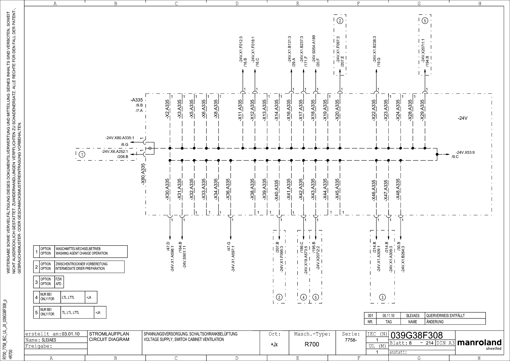

# +Jx — Sheet 8 of 214 — SPANNUNGSVERSORGUNG, SCHALTSCHRANKBELÜFTUNG

**VOLTAGE SUPPLY, SWITCH CABINET VENTILATION**

> Part of the manroland **R700** printing press IEC/UL circuit diagrams.
> Drawing class: **Stromlaufplan / Circuit diagram** (DIN A3).
> Document `+Jx` covers the **1st printing module + feed register** machine section.

## At a glance

| Field | Value |
|---|---|
| Document | `+Jx`  (039G38F308) |
| Sheet | **8** of 214 |
| Section (DE) | SPANNUNGSVERSORGUNG, SCHALTSCHRANKBELÜFTUNG |
| Section (EN) | VOLTAGE SUPPLY, SWITCH CABINET VENTILATION |
| Section type | POWER_SUPPLY — Voltage supply |
| Machine type | `R700` |
| Series | `7758` |
| Created | 03.01.10 |
| Replaces | — |
| Columns used | A, B, C, D, E, F, G, H |
| Path numbers | — |
| Labels on sheet | 159 |
| Cross-refs out | 22 |
| Cross-refs in | 58 |

**Previous:** [+Jx sheet 7](SHEET_0007.md) · **Next:** [+Jx sheet 9](SHEET_0009.md) · **Document TOC:** [_TOC.md](_TOC.md)  (+Jx) · **Master TOC:** [all sheets](../_MASTER_TOC.md)

## Sheet image (300 DPI, exact vector render)



_Rendered directly from the PDF vector layer at 300 DPI (1-bit), no OCR and no resampling. Use it to confirm anything ambiguous in the text below._

## Cross-references on this sheet

Each entry is a wire leaving this sheet. The printed token is `/sheet.column`; the link resolves to that sheet inside the same document.

| Ref | Target sheet | Col | Path | Destination on target | Target section | From col |
|---|---|---|---|---|---|---|
| `/20.F` | [+Jx sheet 20](SHEET_0020.md) | F | — | 24V.S054.A189 24V.X207\2:2 | LACKPUMPE | E |
| `/29.A` | [+Jx sheet 29](SHEET_0029.md) | A | — | 24V.X1.B131:3 | KAMMERRAKEL | E |
| `/171.F` | [+Jx sheet 171](SHEET_0171.md) | F | — | 24V.X1.B237:3 | OPTION: AUTOMATISCHEM SPÜLEN | E |
| `/19.G` | [+Jx sheet 19](SHEET_0019.md) | G | — | 24V.X1.B238:3 | LACKPUMPE | F |
| `/16.B` | [+Jx sheet 16](SHEET_0016.md) | B | — | 24V.X1.F012:3 | ÖLUMLAUFSCHMIERUNG | D |
| `/16.C` | [+Jx sheet 16](SHEET_0016.md) | C | — | 24V.X1.F018:1 | ÖLUMLAUFSCHMIERUNG | D |
| `/207.E` | [+Jx sheet 207](SHEET_0207.md) | E | — | 24V.X1.F097:3 | OPTION: ZWISCHENTROCKNER, VORBEREITUNG | F |
| `/194.B` | [+Jx sheet 194](SHEET_0194.md) | B | — | 24V.X207\1:1 | OPTION: ZWISCHENTROCKNER, VORBEREITUNG | G |
| `/9.B` | [+Jx sheet 9](SHEET_0009.md) | B | — | — | SPANNUNGSVERSORGUNG, SCHALTSCHRANKBELÜFTUNG | B |
| `/7.A` | [+Jx sheet 7](SHEET_0007.md) | A | — | — | SPANNUNGSVERSORGUNG, SCHALTSCHRANKBELÜFTUNG | B |
| `/6.G` | [+Jx sheet 6](SHEET_0006.md) | G | — | — | SPANNUNGSVERSORGUNG, SCHALTSCHRANKBELÜFTUNG | B |
| `/208.B` | [+Jx sheet 208](SHEET_0208.md) | B | — | 24V.X6.A252:1 | OPTION: WASCHMITTELWECHSELBETRIEB | B |
| `/9.C` | [+Jx sheet 9](SHEET_0009.md) | C | — | — | SPANNUNGSVERSORGUNG, SCHALTSCHRANKBELÜFTUNG | H |
| `/47.D` | [+Jx sheet 47](SHEET_0047.md) | D | — | — | MASCHINENBEDIENUNG: SPANNUNGSVERSORGUNG | C |
| `/164.B` | [+Jx sheet 164](SHEET_0164.md) | B | — | — | OPTION: | C |
| `/47.G` | [+Jx sheet 47](SHEET_0047.md) | G | — | — | MASCHINENBEDIENUNG: SPANNUNGSVERSORGUNG | D |
| `/207.B` | [+Jx sheet 207](SHEET_0207.md) | B | — | — | OPTION: ZWISCHENTROCKNER, VORBEREITUNG | E |
| `/186.C` | [+Jx sheet 186](SHEET_0186.md) | C | — | — | OPTION: TRANSFERMODUL 1 + 2 | E |
| `/195.B` | [+Jx sheet 195](SHEET_0195.md) | B | — | — | OPTION: ZWISCHENTROCKNER, VORBEREITUNG | E |
| `/214.B` | [+Jx sheet 214](SHEET_0214.md) | B | — | — | OPTION: FZW | F |
| `/214.B` | [+Jx sheet 214](SHEET_0214.md) | B | — | — | OPTION: FZW | F |
| `/30.B` | [+Jx sheet 30](SHEET_0030.md) | B | — | — | LACKNIVEAUÜBERWACHUNG | G |

### Incoming references (sheets that point here)

Every other sheet that sends a wire to this one. `Back-ref` is the token printed on *that* sheet; `Path` is its line number.

| From sheet | Cols | Back-ref | Path | Refs | What continues there |
|---|---|---|---|---|---|
| [+Jx#6](SHEET_0006.md) | G | `/6.G` | — | 1 | — |
| [+Jx#7](SHEET_0007.md) | A | `/7.A` | — | 1 | — |
| [+Jx#9](SHEET_0009.md) | B | `/9.B` | — | 2 | 24V.X53:9 |
| [+Jx#16](SHEET_0016.md) | B | `/16.B` | — | 2 | 24V.X1.F012:3 24V.X1.F018:1 |
| [+Jx#19](SHEET_0019.md) | G | `/19.G` | — | 1 | 24V.X1.B238:3 |
| [+Jx#20](SHEET_0020.md) | F | `/20.F` | — | 1 | — |
| [+Jx#29](SHEET_0029.md) | A | `/29.A` | — | 1 | 24V.X1.B131:3 |
| [+Jx#30](SHEET_0030.md) | B | `/30.B` | — | 1 | 24V.X1.B264:3 |
| [+Jx#47](SHEET_0047.md) | D, G | `/47.D`, `/47.G` | — | 2 | 24V.X1.A597:1; 24V.X1.A598:1 |
| [+Jx#126](SHEET_0126.md) | A | `/126.A` | — | 1 | — |
| [+Jx#127](SHEET_0127.md) | F | `/127.F` | — | 1 | — |
| [+Jx#131](SHEET_0131.md) | E | `/131.E` | — | 1 | — |
| [+Jx#132](SHEET_0132.md) | G | `/132.G` | — | 1 | — |
| [+Jx#133](SHEET_0133.md) | G | `/133.G` | — | 1 | — |
| [+Jx#136](SHEET_0136.md) | E | `/136.E` | — | 1 | — |
| [+Jx#137](SHEET_0137.md) | G | `/137.G` | — | 1 | — |
| [+Jx#138](SHEET_0138.md) | B, C | `/138.B`, `/138.C` | — | 2 | — |
| [+Jx#139](SHEET_0139.md) | C | `/139.C` | — | 1 | — |
| [+Jx#140](SHEET_0140.md) | A, E | `/140.A`, `/140.E` | — | 2 | — |
| [+Jx#141](SHEET_0141.md) | A, E | `/141.A`, `/141.E` | — | 2 | — |
| [+Jx#142](SHEET_0142.md) | A, C, F | `/142.A`, `/142.C`, `/142.F` | — | 3 | — |
| [+Jx#145](SHEET_0145.md) | A | `/145.A` | — | 1 | — |
| [+Jx#147](SHEET_0147.md) | A | `/147.A` | — | 1 | — |
| [+Jx#148](SHEET_0148.md) | A, C | `/148.A`, `/148.C` | — | 2 | — |
| [+Jx#149](SHEET_0149.md) | A, B, C, F | `/149.A`, `/149.B`, `/149.C`, `/149.F` | — | 4 | — |
| [+Jx#150](SHEET_0150.md) | A, B, C, F, G | `/150.A`, `/150.B`, `/150.C`, `/150.F`, `/150.G` | — | 11 | — |
| [+Jx#164](SHEET_0164.md) | A | `/164.A` | — | 1 | 24V.S901:11 |
| [+Jx#171](SHEET_0171.md) | F | `/171.F` | — | 1 | 24V.X1.B237:3 |
| [+Jx#186](SHEET_0186.md) | C | `/186.C` | — | 1 | 24V.X19.A573:5 |
| [+Jx#194](SHEET_0194.md) | A | `/194.A` | — | 1 | 24V.X207\1:1 |
| [+Jx#195](SHEET_0195.md) | A | `/195.A` | — | 1 | 24V.X207\2:2 |
| [+Jx#207](SHEET_0207.md) | A, D | `/207.A`, `/207.D` | — | 2 | 24V.X1.F095:3; 24V.X1.F097:3 |
| [+Jx#208](SHEET_0208.md) | A | `/208.A` | — | 1 | 24V.X6.A252:1 |
| [+Jx#214](SHEET_0214.md) | A, B | `/214.A`, `/214.B` | — | 2 | 24V.X1.A309:1; 24V.X1.A309:3 |


## Devices on this sheet

| Tag | Class | Class meaning (IEC) | Col | Sub | Terminal | Sign |
|---|---|---|---|---|---|---|
| `A335` | A | Baugruppe / assembly, module, PC board | B | — | — | — |
| `X22.A335` | — | cross-device reference | F | — | — | — |
| `X29.A335` | — | cross-device reference | G | — | — | — |
| `X11.A335` | — | cross-device reference | D | — | — | — |
| `X12.A335` | — | cross-device reference | D | — | — | — |
| `X16.A335` | — | cross-device reference | E | — | — | — |
| `X17.A335` | — | cross-device reference | E | — | — | — |
| `X20.A335` | — | cross-device reference | F | — | — | — |
| `X18.A335` | — | cross-device reference | E | — | — | — |
| `X80.A335` | — | cross-device reference | B | — | — | — |
| `X46.A335` | — | cross-device reference | F | — | — | — |
| `X47.A335` | — | cross-device reference | F | — | — | — |
| `X48.A335` | — | cross-device reference | G | — | — | — |
| `X30.A335` | — | cross-device reference | C | — | — | — |
| `X31.A335` | — | cross-device reference | C | — | — | — |
| `X36.A335` | — | cross-device reference | D | — | — | — |
| `X40.A335` | — | cross-device reference | E | — | — | — |
| `X42.A335` | — | cross-device reference | E | — | — | — |
| `X43.A335` | — | cross-device reference | E | — | — | — |
| `NR.` | — | cross-device reference | F | — | — | — |
| `05.11.10` | — | cross-device reference | F | — | — | — |
| `X24.A335` | — | cross-device reference | G | — | — | — |
| `X41.A335` | — | cross-device reference | E | — | — | — |
| `X5.A335` | — | cross-device reference | C | — | — | — |
| `X6.A335` | — | cross-device reference | C | — | — | — |
| `X13.A335` | — | cross-device reference | D | — | — | — |
| `X14.A335` | — | cross-device reference | E | — | — | — |
| `X19.A335` | — | cross-device reference | E | — | — | — |
| `X23.A335` | — | cross-device reference | F | — | — | — |
| `X32.A335` | — | cross-device reference | C | — | — | — |
| `X34.A335` | — | cross-device reference | D | — | — | — |
| `X8.A335` | — | cross-device reference | D | — | — | — |
| `X33.A335` | — | cross-device reference | C | — | — | — |
| `X38.A335` | — | cross-device reference | D | — | — | — |
| `X39.A335` | — | cross-device reference | D | — | — | — |
| `X44.A335` | — | cross-device reference | E | — | — | — |
| `X45.A335` | — | cross-device reference | F | — | — | — |
| `X3.A335` | — | cross-device reference | C | — | — | — |
| `X2.A335` | — | cross-device reference | C | — | — | — |
| `X28.A335` | — | cross-device reference | G | — | — | — |

## Potentials / nets

| Potential | Count | Columns | Attached devices | Terminals |
|---|---|---|---|---|
| `24V` | 21 | B, C, D, E, F, G, H | `A189`, `A252`, `A309`, `A335`, `A573`, `A597`, `A598`, `B131`, `B237`, `B238`, `B264`, `F012`, `F018`, `F095`, `F097`, `S054`, `S901`, `X1`, `X19`, `X207\1`, `X207\2`, `X53`, `X6`, `X80` | `1`, `11`, `2`, `3`, `5`, `9` |


A potential such as `L24+/4` or `M24+` is a named supply/return rail; every place it appears on this sheet is electrically common.

## Wire-end annotations (grouped as printed)

A wire that continues elsewhere is annotated with a small cluster: the destination description, the path/line number `#NN`, and the `/sheet.column` cross reference. Each row below is one such cluster exactly as it is grouped on the drawing.

| Col | Y | Path | Cross-ref | Text on the wire |
|---|---|---|---|---|
| F | 45.6 | — | — | `2` |
| G | 45.6 | — | — | `5` |
| E | 81.9 | — | `/20.F` | `24V.S054.A189 24V.X207\2:2` |
| E | 84.2 | — | `/29.A` | `24V.X1.B131:3` |
| E | 84.2 | — | `/171.F` | `24V.X1.B237:3` |
| F | 84.2 | — | `/19.G` | `24V.X1.B238:3` |
| D | 84.8 | — | `/16.B` | `24V.X1.F012:3` |
| D | 84.8 | — | `/16.C` | `24V.X1.F018:1` |
| F | 84.8 | — | `/207.E` | `24V.X1.F097:3` |
| G | 90.1 | — | `/194.B` | `24V.X207\1:1` |
| D | 204.4 | — | — | `1` |
| D | 204.4 | — | — | `1` |
| E | 204.4 | — | — | `1` |
| E | 204.4 | — | — | `1` |
| E | 204.4 | — | — | `1` |
| F | 204.4 | — | — | `1` |
| F | 204.4 | — | — | `1` |
| G | 204.4 | — | — | `1` |
| D | 221.4 | — | — | `A335 1` |
| E | 221.4 | — | — | `1 1 1` |
| D | 221.4 | — | — | `1 1 1` |
| F | 221.4 | — | — | `1 1 1 1` |
| C | 232.2 | — | — | `X2.A335` |
| C | 232.2 | — | — | `X3.A335` |
| C | 232.2 | — | — | `X5.A335` |
| C | 232.2 | — | — | `X6.A335` |
| D | 232.2 | — | — | `X8.A335` |
| D | 232.2 | — | — | `X11.A335` |
| D | 232.2 | — | — | `X12.A335` |
| D | 232.2 | — | — | `X13.A335` |
| E | 232.2 | — | — | `X14.A335` |
| E | 232.2 | — | — | `X16.A335` |
| E | 232.2 | — | — | `X17.A335` |
| E | 232.2 | — | — | `X18.A335` |
| E | 232.2 | — | — | `X19.A335` |
| F | 232.2 | — | — | `X20.A335` |
| F | 232.2 | — | — | `X22.A335` |
| F | 232.2 | — | — | `X23.A335` |
| G | 232.2 | — | — | `X24.A335` |
| G | 232.2 | — | — | `X28.A335` |
| G | 232.2 | — | — | `X29.A335` |
| B | 241.5 | — | `/9.B`, `/7.A` | — |
| H | 270.9 | — | — | `24V` |
| B | 317.7 | — | — | `24V.X80.A335:1` |
| B | 319.8 | — | — | `1 1 X80.A335` |
| B | 333.3 | — | `/6.G` | — |
| B | 349.6 | — | `/208.B` | `24V.X6.A252:1` |
| H | 351.7 | — | — | `24V.X53:9` |
| A | 356.9 | — | — | `1` |
| H | 361.6 | — | `/9.C` | — |
| C | 416.4 | — | — | `X30.A335` |
| C | 416.4 | — | — | `X31.A335` |
| C | 416.4 | — | — | `X32.A335` |
| C | 416.4 | — | — | `X33.A335` |
| D | 416.4 | — | — | `X34.A335` |
| D | 416.4 | — | — | `X36.A335` |
| D | 416.4 | — | — | `X38.A335` |
| D | 416.4 | — | — | `X39.A335` |
| E | 416.4 | — | — | `X41.A335` |
| E | 416.4 | — | — | `X42.A335` |
| E | 416.4 | — | — | `X43.A335` |
| E | 416.4 | — | — | `X44.A335` |
| F | 416.4 | — | — | `X45.A335` |
| G | 416.4 | — | — | `X48.A335` |
| E | 419.2 | — | — | `X40.A335` |
| F | 419.2 | — | — | `X46.A335` |
| F | 419.2 | — | — | `X47.A335` |
| D | 491.4 | — | — | `1` |
| D | 491.4 | — | — | `1 1` |
| F | 491.4 | — | — | `1 1` |
| D | 492.1 | — | — | `1 1` |
| E | 492.1 | — | — | `1` |
| C | 509.1 | — | — | `1` |
| C | 509.1 | — | — | `1` |
| D | 509.1 | — | — | `1` |
| E | 509.1 | — | — | `1` |
| E | 509.1 | — | — | `1` |
| E | 509.1 | — | — | `1` |
| F | 509.1 | — | — | `1` |
| G | 509.1 | — | — | `1` |
| G | 509.1 | — | — | `1` |
| C | 563.8 | — | `/47.D` | — |
| C | 563.8 | — | `/164.B` | — |
| D | 563.8 | — | `/47.G` | — |
| E | 563.8 | — | `/207.B` | — |
| E | 563.8 | — | `/186.C` | — |
| E | 563.8 | — | `/195.B` | — |
| F | 563.8 | — | `/214.B` | — |
| F | 563.8 | — | `/214.B` | — |
| G | 563.8 | — | `/30.B` | — |
| C | 572.6 | — | — | `24V.X1.A598:1` |
| C | 572.6 | — | — | `24V.S901:11` |
| D | 572.6 | — | — | `24V.X1.A597:1` |
| F | 572.6 | — | — | `24V.X1.A309:1` |
| E | 573.7 | — | — | `24V.X1.F095:3` |
| E | 573.7 | — | — | `24V.X19.A573:5` |
| G | 573.7 | — | — | `24V.X1.A309:3` |
| G | 573.7 | — | — | `24V.X1.B264:3` |
| A | 577.4 | — | — | `1 OPTION OPTION` |
| A | 577.4 | — | — | `WASCHMITTELWECHSELBETRIEB WASHING AGENT CHANGE OPERATION` |
| A | 612.8 | — | — | `2 OPTION OPTION` |
| A | 612.9 | — | — | `INTERMEDIATE DRIER PREPARATION ZWISCHENTROCKNER VORBEREITUNG` |
| A | 648.1 | — | — | `FZW` |
| A | 648.3 | — | — | `3 OPTION OPTION` |
| A | 658.9 | — | — | `AFD` |
| A | 683.7 | — | — | `4 NUR BEI ONLY FOR LTL, LTTL +JA` |
| E | 690.5 | — | — | `2` |
| E | 690.5 | — | — | `4 5` |
| F | 690.5 | — | — | `3` |
| A | 719.1 | — | — | `5 NUR BEI ONLY FOR TL, LTL, LTTL` |
| B | 726.2 | — | — | `+JA` |
| G | 733.0 | — | — | `001 05.11.10 SLEI/AES QUERVERWEIS ENTFÄLLT` |
| G | 747.1 | — | — | `NR. TAG NAME ÄNDERUNG` |


## Notes and free text on this sheet

| Text | Col | Y (pt) |
|---|---|---|
| `TAG` | G | 747.23 |
| `NAME` | G | 747.22 |
| `ÄNDERUNG` | G | 747.25 |
| `SLEI/AES` | G | 733.09 |
| `QUERVERWEIS ENTFÄLLT` | G | 733.07 |
| `OPTION` | A | 577.41 |
| `WASCHMITTELWECHSELBETRIEB` | A | 577.4 |
| `WASHING AGENT CHANGE OPERATION` | A | 588.05 |
| `ZWISCHENTROCKNER VORBEREITUNG` | A | 612.86 |
| `INTERMEDIATE DRIER PREPARATION` | A | 623.49 |
| `FZW` | A | 648.15 |
| `AFD` | A | 658.92 |
| `NUR BEI` | A | 683.69 |
| `ONLY FOR` | A | 694.38 |
| `LTL, LTTL` | A | 690.8 |
| `+JA` | B | 690.77 |
| `TL, LTL, LTTL` | A | 726.25 |

## Complete label inventory (exact text from the drawing)

Every text object inside the drawing area of this sheet, in DIN reading order (column A→H, then top→bottom). This is the authoritative list: if a string is not here it is not printed on this sheet.

| Col | Y | X | Dir | Type | Text |
|---|---|---|---|---|---|
| A | 356.9 | 189.5 | → | number | `1` |
| A | 577.4 | 94.7 | → | text | `OPTION` |
| A | 577.4 | 130.4 | → | text | `WASCHMITTELWECHSELBETRIEB` |
| A | 582.7 | 82.5 | → | number | `1` |
| A | 588.0 | 94.7 | → | text | `OPTION` |
| A | 588.1 | 130.4 | → | text | `WASHING AGENT CHANGE OPERATION` |
| A | 612.8 | 94.7 | → | text | `OPTION` |
| A | 612.9 | 130.4 | → | text | `ZWISCHENTROCKNER VORBEREITUNG` |
| A | 618.2 | 82.2 | → | number | `2` |
| A | 623.5 | 94.7 | → | text | `OPTION` |
| A | 623.5 | 129.5 | → | text | `INTERMEDIATE DRIER PREPARATION` |
| A | 648.2 | 129.8 | → | text | `FZW` |
| A | 648.3 | 94.7 | → | text | `OPTION` |
| A | 653.6 | 82.1 | → | number | `3` |
| A | 658.9 | 94.7 | → | text | `OPTION` |
| A | 658.9 | 130.4 | → | text | `AFD` |
| A | 683.7 | 94.4 | → | text | `NUR BEI` |
| A | 689.0 | 82.2 | → | number | `4` |
| A | 690.8 | 144.7 | → | text | `LTL, LTTL` |
| A | 694.4 | 94.7 | → | text | `ONLY FOR` |
| A | 719.1 | 94.4 | → | text | `NUR BEI` |
| A | 724.5 | 82.1 | → | number | `5` |
| A | 726.2 | 145.3 | → | text | `TL, LTL, LTTL` |
| A | 729.8 | 94.7 | → | text | `ONLY FOR` |
| B | 228.4 | 305.0 | → | device tag | `A335` |
| B | 241.5 | 317.5 | → | cross-reference | `/9.B` |
| B | 253.9 | 317.2 | → | cross-reference | `/7.A` |
| B | 317.7 | 246.3 | → | potential | `24V.X80.A335:1` |
| B | 319.7 | 326.2 | ↕ | number | `1` |
| B | 333.3 | 282.6 | → | cross-reference | `/6.G` |
| B | 348.1 | 326.2 | ↕ | number | `1` |
| B | 349.6 | 237.0 | → | potential | `24V.X6.A252:1` |
| B | 361.6 | 273.8 | → | cross-reference | `/208.B` |
| B | 381.0 | 329.1 | ↕ | device ref | `X80.A335` |
| B | 690.8 | 201.7 | → | text | `+JA` |
| B | 726.2 | 222.9 | → | text | `+JA` |
| C | 221.4 | 398.8 | → | number | `1` |
| C | 221.4 | 427.2 | → | number | `1` |
| C | 221.4 | 455.5 | → | number | `1` |
| C | 232.2 | 385.8 | ↕ | device ref | `X2.A335` |
| C | 232.2 | 414.1 | ↕ | device ref | `X3.A335` |
| C | 232.2 | 442.4 | ↕ | device ref | `X5.A335` |
| C | 232.2 | 470.8 | ↕ | device ref | `X6.A335` |
| C | 416.4 | 385.7 | ↕ | device ref | `X30.A335` |
| C | 416.4 | 414.1 | ↕ | device ref | `X31.A335` |
| C | 416.4 | 442.4 | ↕ | device ref | `X32.A335` |
| C | 416.4 | 470.8 | ↕ | device ref | `X33.A335` |
| C | 492.1 | 455.5 | → | number | `1` |
| C | 509.1 | 398.8 | → | number | `1` |
| C | 509.1 | 427.2 | → | number | `1` |
| C | 563.8 | 388.6 | ↕ | cross-reference | `/47.D` |
| C | 563.8 | 416.9 | ↕ | cross-reference | `/164.B` |
| C | 572.6 | 398.5 | ↕ | potential | `24V.X1.A598:1` |
| C | 572.6 | 426.8 | ↕ | potential | `24V.S901:11` |
| D | 84.8 | 558.6 | ↕ | potential | `24V.X1.F012:3` |
| D | 84.8 | 587.0 | ↕ | potential | `24V.X1.F018:1` |
| D | 134.9 | 596.9 | ↕ | cross-reference | `/16.C` |
| D | 135.2 | 568.5 | ↕ | cross-reference | `/16.B` |
| D | 204.4 | 568.9 | → | number | `1` |
| D | 204.4 | 597.3 | → | number | `1` |
| D | 221.4 | 483.9 | → | number | `1` |
| D | 221.4 | 512.2 | → | number | `1` |
| D | 232.2 | 499.1 | ↕ | device ref | `X8.A335` |
| D | 232.2 | 555.8 | ↕ | device ref | `X11.A335` |
| D | 232.2 | 584.2 | ↕ | device ref | `X12.A335` |
| D | 232.2 | 612.5 | ↕ | device ref | `X13.A335` |
| D | 416.4 | 499.1 | ↕ | device ref | `X34.A335` |
| D | 416.4 | 527.5 | ↕ | device ref | `X36.A335` |
| D | 416.4 | 584.2 | ↕ | device ref | `X38.A335` |
| D | 416.4 | 612.5 | ↕ | device ref | `X39.A335` |
| D | 491.4 | 486.9 | → | number | `1` |
| D | 491.4 | 600.2 | → | number | `1` |
| D | 492.1 | 512.2 | → | number | `1` |
| D | 509.1 | 540.6 | → | number | `1` |
| D | 563.8 | 530.3 | ↕ | cross-reference | `/47.G` |
| D | 572.6 | 540.2 | ↕ | potential | `24V.X1.A597:1` |
| E | 81.9 | 728.7 | ↕ | potential | `24V.S054.A189` |
| E | 84.2 | 672.0 | ↕ | potential | `24V.X1.B131:3` |
| E | 84.2 | 700.4 | ↕ | potential | `24V.X1.B237:3` |
| E | 131.0 | 710.3 | ↕ | cross-reference | `/171.F` |
| E | 135.2 | 681.9 | ↕ | cross-reference | `/29.A` |
| E | 135.8 | 738.6 | ↕ | cross-reference | `/20.F` |
| E | 204.4 | 682.3 | → | number | `1` |
| E | 204.4 | 710.6 | → | number | `1` |
| E | 204.4 | 739.0 | → | number | `1` |
| E | 221.4 | 625.6 | → | number | `1` |
| E | 221.4 | 654.0 | → | number | `1` |
| E | 232.2 | 640.9 | ↕ | device ref | `X14.A335` |
| E | 232.2 | 669.2 | ↕ | device ref | `X16.A335` |
| E | 232.2 | 697.6 | ↕ | device ref | `X17.A335` |
| E | 232.2 | 725.9 | ↕ | device ref | `X18.A335` |
| E | 232.2 | 754.3 | ↕ | device ref | `X19.A335` |
| E | 416.4 | 669.2 | ↕ | device ref | `X41.A335` |
| E | 416.4 | 697.6 | ↕ | device ref | `X42.A335` |
| E | 416.4 | 725.9 | ↕ | device ref | `X43.A335` |
| E | 416.4 | 754.3 | ↕ | device ref | `X44.A335` |
| E | 419.2 | 640.9 | ↕ | device ref | `X40.A335` |
| E | 491.4 | 628.6 | → | number | `1` |
| E | 492.1 | 682.3 | → | number | `1` |
| E | 509.1 | 654.0 | → | number | `1` |
| E | 509.1 | 710.6 | → | number | `1` |
| E | 509.1 | 739.0 | → | number | `1` |
| E | 563.8 | 643.7 | ↕ | cross-reference | `/207.B` |
| E | 563.8 | 700.4 | ↕ | cross-reference | `/186.C` |
| E | 563.8 | 728.7 | ↕ | cross-reference | `/195.B` |
| E | 573.7 | 653.6 | ↕ | potential | `24V.X1.F095:3` |
| E | 573.7 | 710.3 | ↕ | potential | `24V.X19.A573:5` |
| E | 573.7 | 738.6 | ↕ | potential | `24V.X207\2:2` |
| E | 690.5 | 650.0 | → | number | `2` |
| E | 690.5 | 706.9 | → | number | `4` |
| E | 690.5 | 735.0 | → | number | `5` |
| F | 45.6 | 791.7 | → | number | `2` |
| F | 84.2 | 870.5 | ↕ | potential | `24V.X1.B238:3` |
| F | 84.8 | 785.4 | ↕ | potential | `24V.X1.F097:3` |
| F | 130.4 | 795.3 | ↕ | cross-reference | `/207.E` |
| F | 134.4 | 880.4 | ↕ | cross-reference | `/19.G` |
| F | 204.4 | 795.7 | → | number | `1` |
| F | 204.4 | 880.7 | → | number | `1` |
| F | 221.4 | 767.3 | → | number | `1` |
| F | 232.2 | 782.6 | ↕ | device ref | `X20.A335` |
| F | 232.2 | 867.6 | ↕ | device ref | `X22.A335` |
| F | 232.2 | 896.0 | ↕ | device ref | `X23.A335` |
| F | 416.4 | 782.6 | ↕ | device ref | `X45.A335` |
| F | 419.2 | 867.6 | ↕ | device ref | `X46.A335` |
| F | 419.2 | 896.0 | ↕ | device ref | `X47.A335` |
| F | 491.4 | 770.3 | → | number | `1` |
| F | 491.4 | 798.7 | → | number | `1` |
| F | 509.1 | 880.7 | → | number | `1` |
| F | 563.8 | 870.4 | ↕ | cross-reference | `/214.B` |
| F | 563.8 | 898.8 | ↕ | cross-reference | `/214.B` |
| F | 572.6 | 880.4 | ↕ | potential | `24V.X1.A309:1` |
| F | 690.5 | 890.9 | → | number | `3` |
| F | 733.0 | 859.3 | → | number | `001` |
| F | 733.1 | 893.5 | → | device ref | `05.11.10` |
| F | 747.1 | 858.5 | → | device ref | `NR.` |
| G | 45.6 | 990.1 | → | number | `5` |
| G | 90.1 | 983.8 | ↕ | potential | `24V.X207\1:1` |
| G | 130.4 | 993.7 | ↕ | cross-reference | `/194.B` |
| G | 204.4 | 994.1 | → | number | `1` |
| G | 221.4 | 909.1 | → | number | `1` |
| G | 221.4 | 937.4 | → | number | `1` |
| G | 221.4 | 965.8 | → | number | `1` |
| G | 232.2 | 924.3 | ↕ | device ref | `X24.A335` |
| G | 232.2 | 952.7 | ↕ | device ref | `X28.A335` |
| G | 232.2 | 981.0 | ↕ | device ref | `X29.A335` |
| G | 416.4 | 924.3 | ↕ | device ref | `X48.A335` |
| G | 509.1 | 909.1 | → | number | `1` |
| G | 509.1 | 937.4 | → | number | `1` |
| G | 563.8 | 927.1 | ↕ | cross-reference | `/30.B` |
| G | 573.7 | 908.7 | ↕ | potential | `24V.X1.A309:3` |
| G | 573.7 | 937.1 | ↕ | potential | `24V.X1.B264:3` |
| G | 733.1 | 948.3 | → | text | `SLEI/AES` |
| G | 733.1 | 995.4 | → | text | `QUERVERWEIS ENTFÄLLT` |
| G | 747.2 | 900.1 | → | text | `TAG` |
| G | 747.2 | 953.5 | → | text | `NAME` |
| G | 747.3 | 995.7 | → | text | `ÄNDERUNG` |
| H | 271.0 | 1068.9 | → | potential | `24V` |
| H | 351.7 | 1064.1 | → | potential | `24V.X53:9` |
| H | 361.6 | 1054.5 | → | cross-reference | `/9.C` |

## Reading-order text block

The same content as a plain block, grouped by DIN column — convenient to paste or to match against a visual description.

```text
=== Column A ===
 356.9  189.5  numeric      1
 577.4   94.7  text         OPTION
 577.4  130.4  text         WASCHMITTELWECHSELBETRIEB
 582.7   82.5  numeric      1
 588.0   94.7  text         OPTION
 588.1  130.4  text         WASHING AGENT CHANGE OPERATION
 612.8   94.7  text         OPTION
 612.9  130.4  text         ZWISCHENTROCKNER VORBEREITUNG
 618.2   82.2  numeric      2
 623.5   94.7  text         OPTION
 623.5  129.5  text         INTERMEDIATE DRIER PREPARATION
 648.2  129.8  text         FZW
 648.3   94.7  text         OPTION
 653.6   82.1  numeric      3
 658.9   94.7  text         OPTION
 658.9  130.4  text         AFD
 683.7   94.4  text         NUR BEI
 689.0   82.2  numeric      4
 690.8  144.7  text         LTL, LTTL
 694.4   94.7  text         ONLY FOR
 719.1   94.4  text         NUR BEI
 724.5   82.1  numeric      5
 726.2  145.3  text         TL, LTL, LTTL
 729.8   94.7  text         ONLY FOR
=== Column B ===
 228.4  305.0  devtag       A335
 241.5  317.5  xref         /9.B
 253.9  317.2  xref         /7.A
 317.7  246.3  net          24V.X80.A335:1
 319.7  326.2  numeric      1
 333.3  282.6  xref         /6.G
 348.1  326.2  numeric      1
 349.6  237.0  net          24V.X6.A252:1
 361.6  273.8  xref         /208.B
 381.0  329.1  devref       X80.A335
 690.8  201.7  text         +JA
 726.2  222.9  text         +JA
=== Column C ===
 221.4  398.8  numeric      1
 221.4  427.2  numeric      1
 221.4  455.5  numeric      1
 232.2  385.8  devref       X2.A335
 232.2  414.1  devref       X3.A335
 232.2  442.4  devref       X5.A335
 232.2  470.8  devref       X6.A335
 416.4  385.7  devref       X30.A335
 416.4  414.1  devref       X31.A335
 416.4  442.4  devref       X32.A335
 416.4  470.8  devref       X33.A335
 492.1  455.5  numeric      1
 509.1  398.8  numeric      1
 509.1  427.2  numeric      1
 563.8  388.6  xref         /47.D
 563.8  416.9  xref         /164.B
 572.6  398.5  net          24V.X1.A598:1
 572.6  426.8  net          24V.S901:11
=== Column D ===
  84.8  558.6  net          24V.X1.F012:3
  84.8  587.0  net          24V.X1.F018:1
 134.9  596.9  xref         /16.C
 135.2  568.5  xref         /16.B
 204.4  568.9  numeric      1
 204.4  597.3  numeric      1
 221.4  483.9  numeric      1
 221.4  512.2  numeric      1
 232.2  499.1  devref       X8.A335
 232.2  555.8  devref       X11.A335
 232.2  584.2  devref       X12.A335
 232.2  612.5  devref       X13.A335
 416.4  499.1  devref       X34.A335
 416.4  527.5  devref       X36.A335
 416.4  584.2  devref       X38.A335
 416.4  612.5  devref       X39.A335
 491.4  486.9  numeric      1
 491.4  600.2  numeric      1
 492.1  512.2  numeric      1
 509.1  540.6  numeric      1
 563.8  530.3  xref         /47.G
 572.6  540.2  net          24V.X1.A597:1
=== Column E ===
  81.9  728.7  net          24V.S054.A189
  84.2  672.0  net          24V.X1.B131:3
  84.2  700.4  net          24V.X1.B237:3
 131.0  710.3  xref         /171.F
 135.2  681.9  xref         /29.A
 135.8  738.6  xref         /20.F
 204.4  682.3  numeric      1
 204.4  710.6  numeric      1
 204.4  739.0  numeric      1
 221.4  625.6  numeric      1
 221.4  654.0  numeric      1
 232.2  640.9  devref       X14.A335
 232.2  669.2  devref       X16.A335
 232.2  697.6  devref       X17.A335
 232.2  725.9  devref       X18.A335
 232.2  754.3  devref       X19.A335
 416.4  669.2  devref       X41.A335
 416.4  697.6  devref       X42.A335
 416.4  725.9  devref       X43.A335
 416.4  754.3  devref       X44.A335
 419.2  640.9  devref       X40.A335
 491.4  628.6  numeric      1
 492.1  682.3  numeric      1
 509.1  654.0  numeric      1
 509.1  710.6  numeric      1
 509.1  739.0  numeric      1
 563.8  643.7  xref         /207.B
 563.8  700.4  xref         /186.C
 563.8  728.7  xref         /195.B
 573.7  653.6  net          24V.X1.F095:3
 573.7  710.3  net          24V.X19.A573:5
 573.7  738.6  net          24V.X207\2:2
 690.5  650.0  numeric      2
 690.5  706.9  numeric      4
 690.5  735.0  numeric      5
=== Column F ===
  45.6  791.7  numeric      2
  84.2  870.5  net          24V.X1.B238:3
  84.8  785.4  net          24V.X1.F097:3
 130.4  795.3  xref         /207.E
 134.4  880.4  xref         /19.G
 204.4  795.7  numeric      1
 204.4  880.7  numeric      1
 221.4  767.3  numeric      1
 232.2  782.6  devref       X20.A335
 232.2  867.6  devref       X22.A335
 232.2  896.0  devref       X23.A335
 416.4  782.6  devref       X45.A335
 419.2  867.6  devref       X46.A335
 419.2  896.0  devref       X47.A335
 491.4  770.3  numeric      1
 491.4  798.7  numeric      1
 509.1  880.7  numeric      1
 563.8  870.4  xref         /214.B
 563.8  898.8  xref         /214.B
 572.6  880.4  net          24V.X1.A309:1
 690.5  890.9  numeric      3
 733.0  859.3  numeric      001
 733.1  893.5  devref       05.11.10
 747.1  858.5  devref       NR.
=== Column G ===
  45.6  990.1  numeric      5
  90.1  983.8  net          24V.X207\1:1
 130.4  993.7  xref         /194.B
 204.4  994.1  numeric      1
 221.4  909.1  numeric      1
 221.4  937.4  numeric      1
 221.4  965.8  numeric      1
 232.2  924.3  devref       X24.A335
 232.2  952.7  devref       X28.A335
 232.2  981.0  devref       X29.A335
 416.4  924.3  devref       X48.A335
 509.1  909.1  numeric      1
 509.1  937.4  numeric      1
 563.8  927.1  xref         /30.B
 573.7  908.7  net          24V.X1.A309:3
 573.7  937.1  net          24V.X1.B264:3
 733.1  948.3  text         SLEI/AES
 733.1  995.4  text         QUERVERWEIS ENTFÄLLT
 747.2  900.1  text         TAG
 747.2  953.5  text         NAME
 747.3  995.7  text         ÄNDERUNG
=== Column H ===
 271.0 1068.9  net          24V
 351.7 1064.1  net          24V.X53:9
 361.6 1054.5  xref         /9.C
```

---
_Generated from the PDF vector text layer; no OCR. Source: `R700_7758_IEC_UL_JX_039G38F308_p`, sheet 8._
