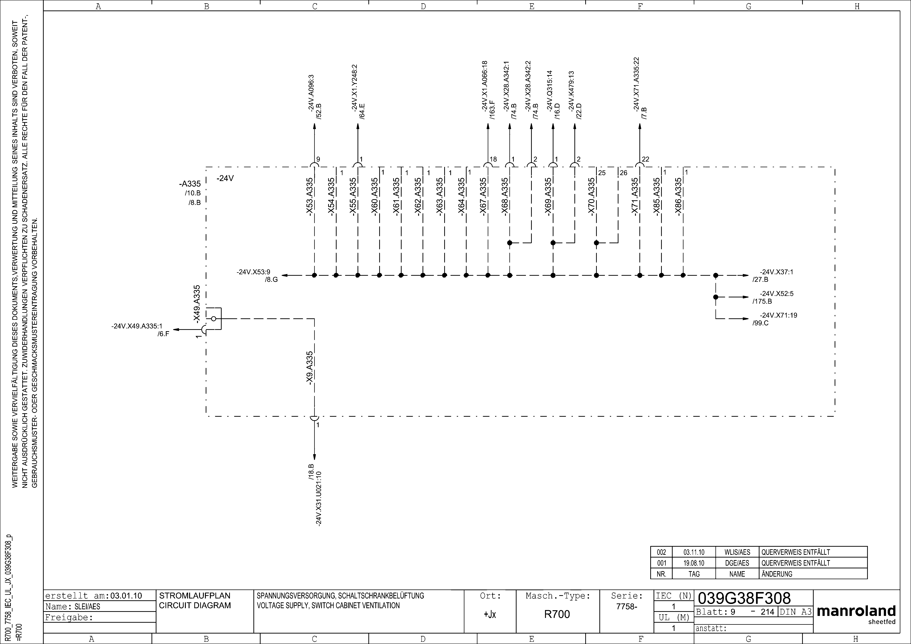

# +Jx — Sheet 9 of 214 — SPANNUNGSVERSORGUNG, SCHALTSCHRANKBELÜFTUNG

**VOLTAGE SUPPLY, SWITCH CABINET VENTILATION**

> Part of the manroland **R700** printing press IEC/UL circuit diagrams.
> Drawing class: **Stromlaufplan / Circuit diagram** (DIN A3).
> Document `+Jx` covers the **1st printing module + feed register** machine section.

## At a glance

| Field | Value |
|---|---|
| Document | `+Jx`  (039G38F308) |
| Sheet | **9** of 214 |
| Section (DE) | SPANNUNGSVERSORGUNG, SCHALTSCHRANKBELÜFTUNG |
| Section (EN) | VOLTAGE SUPPLY, SWITCH CABINET VENTILATION |
| Section type | POWER_SUPPLY — Voltage supply |
| Machine type | `R700` |
| Series | `7758` |
| Created | 03.01.10 |
| Replaces | — |
| Columns used | A, B, C, D, E, F, G |
| Path numbers | — |
| Labels on sheet | 81 |
| Cross-refs out | 16 |
| Cross-refs in | 35 |

**Previous:** [+Jx sheet 8](SHEET_0008.md) · **Next:** [+Jx sheet 10](SHEET_0010.md) · **Document TOC:** [_TOC.md](_TOC.md)  (+Jx) · **Master TOC:** [all sheets](../_MASTER_TOC.md)

## Sheet image (300 DPI, exact vector render)



_Rendered directly from the PDF vector layer at 300 DPI (1-bit), no OCR and no resampling. Use it to confirm anything ambiguous in the text below._

## Cross-references on this sheet

Each entry is a wire leaving this sheet. The printed token is `/sheet.column`; the link resolves to that sheet inside the same document.

| Ref | Target sheet | Col | Path | Destination on target | Target section | From col |
|---|---|---|---|---|---|---|
| `/7.B` | [+Jx sheet 7](SHEET_0007.md) | B | — | 24V.X71.A335:22 | SPANNUNGSVERSORGUNG, SCHALTSCHRANKBELÜFTUNG | F |
| `/163.F` | [+Jx sheet 163](SHEET_0163.md) | F | — | 24V.X1.A066:18 | OPTION: | E |
| `/74.B` | [+Jx sheet 74](SHEET_0074.md) | B | — | 24V.X28.A342:1 | REDUNDANZ: ANTRIEBE | E |
| `/74.B` | [+Jx sheet 74](SHEET_0074.md) | B | — | 24V.X28.A342:2 | REDUNDANZ: ANTRIEBE | E |
| `/64.E` | [+Jx sheet 64](SHEET_0064.md) | E | — | 24V.X1.Y248:2 | TROPFEINRICHTUNG | C |
| `/16.D` | [+Jx sheet 16](SHEET_0016.md) | D | — | 24V.Q315:14 | ÖLUMLAUFSCHMIERUNG | E |
| `/22.D` | [+Jx sheet 22](SHEET_0022.md) | D | — | 24V.K479:13 | LACKPUMPE | E |
| `/52.B` | [+Jx sheet 52](SHEET_0052.md) | B | — | 24V.A096:3 | SCHUTZEINRICHTUNGEN | C |
| `/10.B` | [+Jx sheet 10](SHEET_0010.md) | B | — | — | SPANNUNGSVERSORGUNG, SCHALTSCHRANKBELÜFTUNG | B |
| `/8.B` | [+Jx sheet 8](SHEET_0008.md) | B | — | — | SPANNUNGSVERSORGUNG, SCHALTSCHRANKBELÜFTUNG | B |
| `/8.G` | [+Jx sheet 8](SHEET_0008.md) | G | — | 24V.X53:9 | SPANNUNGSVERSORGUNG, SCHALTSCHRANKBELÜFTUNG | B |
| `/27.B` | [+Jx sheet 27](SHEET_0027.md) | B | — | — | KAMMERRAKEL | G |
| `/175.B` | [+Jx sheet 175](SHEET_0175.md) | B | — | — | OPTION: | G |
| `/99.C` | [+Jx sheet 99](SHEET_0099.md) | C | — | — | RESERVE | G |
| `/6.F` | [+Jx sheet 6](SHEET_0006.md) | F | — | 24V.X49.A335:1 | SPANNUNGSVERSORGUNG, SCHALTSCHRANKBELÜFTUNG | A |
| `/18.B` | [+Jx sheet 18](SHEET_0018.md) | B | — | — | LACKPUMPE | C |

### Incoming references (sheets that point here)

Every other sheet that sends a wire to this one. `Back-ref` is the token printed on *that* sheet; `Path` is its line number.

| From sheet | Cols | Back-ref | Path | Refs | What continues there |
|---|---|---|---|---|---|
| [+Jx#6](SHEET_0006.md) | F | `/6.F` | — | 1 | — |
| [+Jx#7](SHEET_0007.md) | B | `/7.B` | — | 1 | — |
| [+Jx#8](SHEET_0008.md) | B, H | `/8.B`, `/8.H` | — | 2 | — |
| [+Jx#10](SHEET_0010.md) | B | `/10.B` | — | 1 | — |
| [+Jx#16](SHEET_0016.md) | D | `/16.D` | — | 1 | 24V.Q315:14 |
| [+Jx#18](SHEET_0018.md) | A | `/18.A` | — | 1 | 24V.X31.U021:10 |
| [+Jx#22](SHEET_0022.md) | D | `/22.D` | — | 1 | 24V.K479:A2 24V.K479:13 |
| [+Jx#27](SHEET_0027.md) | A | `/27.A` | — | 1 | 24V.X37:1 |
| [+Jx#52](SHEET_0052.md) | C | `/52.C` | — | 1 | 24V.A096:3 24V.A178:23 |
| [+Jx#64](SHEET_0064.md) | D | `/64.D` | — | 1 | 24V.X1.Y248:2 |
| [+Jx#74](SHEET_0074.md) | B | `/74.B` | — | 2 | 24V.X28.A342:1; 24V.X28.A342:2 |
| [+Jx#99](SHEET_0099.md) | C | `/99.C` | — | 1 | — |
| [+Jx#134](SHEET_0134.md) | E | `/134.E` | — | 1 | — |
| [+Jx#151](SHEET_0151.md) | C, E, G, H | `/151.C`, `/151.E`, `/151.G`, `/151.H` | — | 8 | — |
| [+Jx#152](SHEET_0152.md) | D, E, G | `/152.D`, `/152.E`, `/152.G` | — | 5 | — |
| [+Jx#153](SHEET_0153.md) | A, B | `/153.A`, `/153.B` | — | 3 | — |
| [+Jx#156](SHEET_0156.md) | G, H | `/156.G`, `/156.H` | — | 2 | — |
| [+Jx#163](SHEET_0163.md) | E | `/163.E` | — | 1 | 24V.X1.A066:18 |
| [+Jx#175](SHEET_0175.md) | A | `/175.A` | — | 1 | — |


## Devices on this sheet

| Tag | Class | Class meaning (IEC) | Col | Sub | Terminal | Sign |
|---|---|---|---|---|---|---|
| `A335` | A | Baugruppe / assembly, module, PC board | B | — | — | — |
| `X53.A335` | — | cross-device reference | C | — | — | — |
| `X55.A335` | — | cross-device reference | C | — | — | — |
| `X49.A335` | — | cross-device reference | B | — | — | — |
| `X9.A335` | — | cross-device reference | C | — | — | — |
| `X68.A335` | — | cross-device reference | E | — | — | — |
| `X69.A335` | — | cross-device reference | E | — | — | — |
| `X67.A335` | — | cross-device reference | E | — | — | — |
| `X71.A335` | — | cross-device reference | F | — | — | — |
| `NR.` | — | cross-device reference | F | — | — | — |
| `19.08.10` | — | cross-device reference | F | — | — | — |
| `03.11.10` | — | cross-device reference | F | — | — | — |
| `X85.A335` | — | cross-device reference | F | — | — | — |
| `X86.A335` | — | cross-device reference | F | — | — | — |
| `X60.A335` | — | cross-device reference | D | — | — | — |
| `X64.A335` | — | cross-device reference | D | — | — | — |
| `X63.A335` | — | cross-device reference | D | — | — | — |
| `X70.A335` | — | cross-device reference | F | — | — | — |
| `X61.A335` | — | cross-device reference | D | — | — | — |
| `X54.A335` | — | cross-device reference | C | — | — | — |
| `X62.A335` | — | cross-device reference | D | — | — | — |

## Potentials / nets

| Potential | Count | Columns | Attached devices | Terminals |
|---|---|---|---|---|
| `24V` | 15 | A, B, C, E, F, G | `A066`, `A096`, `A335`, `A342`, `K479`, `Q315`, `U021`, `X1`, `X28`, `X31`, `X37`, `X49`, `X52`, `X53`, `X71`, `Y248` | `1`, `10`, `13`, `14`, `18`, `19`, `2`, `22`, `3`, `5`, `9` |


A potential such as `L24+/4` or `M24+` is a named supply/return rail; every place it appears on this sheet is electrically common.

## Wire-end annotations (grouped as printed)

A wire that continues elsewhere is annotated with a small cluster: the destination description, the path/line number `#NN`, and the `/sheet.column` cross reference. Each row below is one such cluster exactly as it is grouped on the drawing.

| Col | Y | Path | Cross-ref | Text on the wire |
|---|---|---|---|---|
| F | 74.5 | — | `/7.B` | `24V.X71.A335:22` |
| E | 79.4 | — | `/163.F` | `24V.X1.A066:18` |
| E | 79.4 | — | `/74.B` | `24V.X28.A342:1` |
| E | 79.4 | — | `/74.B` | `24V.X28.A342:2` |
| C | 84.2 | — | `/64.E` | `24V.X1.Y248:2` |
| E | 91.8 | — | `/16.D` | `24V.Q315:14` |
| E | 92.7 | — | `/22.D` | `24V.K479:13` |
| C | 97.5 | — | `/52.B` | `24V.A096:3` |
| C | 204.4 | — | — | `9` |
| C | 204.4 | — | — | `1` |
| E | 204.4 | — | — | `18 2` |
| E | 204.4 | — | — | `1` |
| E | 204.4 | — | — | `2 1` |
| F | 204.4 | — | — | `22` |
| E | 221.4 | — | — | `1 1 1 1` |
| C | 222.1 | — | — | `1` |
| E | 222.1 | — | — | `1 25 26` |
| D | 222.1 | — | — | `1` |
| D | 222.1 | — | — | `1` |
| B | 228.4 | — | — | `24V` |
| C | 232.2 | — | — | `X53.A335` |
| C | 232.2 | — | — | `X54.A335` |
| C | 232.2 | — | — | `X55.A335` |
| D | 232.2 | — | — | `X60.A335` |
| D | 232.2 | — | — | `X61.A335` |
| D | 232.2 | — | — | `X62.A335` |
| D | 232.2 | — | — | `X63.A335` |
| D | 232.2 | — | — | `X64.A335` |
| E | 232.2 | — | — | `X67.A335` |
| E | 232.2 | — | — | `X68.A335` |
| E | 232.2 | — | — | `X69.A335` |
| F | 232.2 | — | — | `X70.A335` |
| F | 232.2 | — | — | `X71.A335` |
| F | 232.2 | — | — | `X85.A335` |
| F | 232.2 | — | — | `X86.A335` |
| B | 235.5 | — | — | `A335` |
| B | 248.6 | — | `/10.B` | — |
| B | 261.0 | — | `/8.B` | — |
| B | 351.7 | — | `/8.G` | `24V.X53:9` |
| G | 351.7 | — | — | `24V.X37:1` |
| G | 361.6 | — | `/27.B` | — |
| B | 372.5 | — | — | `X49.A335 1` |
| G | 380.1 | — | — | `24V.X52:5` |
| G | 390.0 | — | `/175.B` | — |
| G | 408.4 | — | — | `24V.X71:19` |
| G | 418.3 | — | `/99.C` | — |
| A | 422.6 | — | `/6.F` | `24V.X49.A335:1` |
| C | 458.9 | — | — | `X9.A335` |
| C | 551.6 | — | — | `1` |
| C | 606.3 | — | `/18.B` | — |
| C | 616.2 | — | — | `24V.X31.U021:10` |
| G | 718.9 | — | — | `002 03.11.10 WLIS/AES QUERVERWEIS ENTFÄLLT` |
| G | 733.0 | — | — | `001 19.08.10 DGE/AES QUERVERWEIS ENTFÄLLT` |
| G | 747.1 | — | — | `NR. TAG NAME ÄNDERUNG` |


## Notes and free text on this sheet

| Text | Col | Y (pt) |
|---|---|---|
| `TAG` | G | 747.23 |
| `NAME` | G | 747.22 |
| `ÄNDERUNG` | G | 747.25 |
| `DGE/AES` | G | 733.06 |
| `QUERVERWEIS ENTFÄLLT` | G | 733.07 |
| `WLIS/AES` | G | 718.86 |

## Complete label inventory (exact text from the drawing)

Every text object inside the drawing area of this sheet, in DIN reading order (column A→H, then top→bottom). This is the authoritative list: if a string is not here it is not printed on this sheet.

| Col | Y | X | Dir | Type | Text |
|---|---|---|---|---|---|
| A | 422.6 | 145.7 | → | potential | `24V.X49.A335:1` |
| B | 228.4 | 283.2 | → | potential | `24V` |
| B | 235.5 | 234.1 | → | device tag | `A335` |
| B | 248.6 | 241.8 | → | cross-reference | `/10.B` |
| B | 261.0 | 246.6 | → | cross-reference | `/8.B` |
| B | 351.7 | 309.3 | → | potential | `24V.X53:9` |
| B | 372.5 | 252.5 | ↕ | device ref | `X49.A335` |
| B | 432.5 | 206.1 | → | cross-reference | `/6.F` |
| B | 437.4 | 255.3 | ↕ | number | `1` |
| C | 84.2 | 459.4 | ↕ | potential | `24V.X1.Y248:2` |
| C | 97.5 | 402.7 | ↕ | potential | `24V.A096:3` |
| C | 135.2 | 412.6 | ↕ | cross-reference | `/52.B` |
| C | 135.2 | 469.3 | ↕ | cross-reference | `/64.E` |
| C | 204.4 | 413.6 | → | number | `9` |
| C | 204.4 | 469.7 | → | number | `1` |
| C | 222.1 | 444.3 | → | number | `1` |
| C | 232.2 | 399.9 | ↕ | device ref | `X53.A335` |
| C | 232.2 | 428.3 | ↕ | device ref | `X54.A335` |
| C | 232.2 | 456.6 | ↕ | device ref | `X55.A335` |
| C | 361.6 | 346.4 | → | cross-reference | `/8.G` |
| C | 458.9 | 399.9 | ↕ | device ref | `X9.A335` |
| C | 551.6 | 413.0 | → | number | `1` |
| C | 606.3 | 402.7 | ↕ | cross-reference | `/18.B` |
| C | 616.3 | 412.7 | ↕ | potential | `24V.X31.U021:10` |
| D | 221.4 | 498.0 | → | number | `1` |
| D | 221.4 | 611.4 | → | number | `1` |
| D | 222.1 | 529.4 | → | number | `1` |
| D | 222.1 | 557.7 | → | number | `1` |
| D | 222.1 | 586.1 | → | number | `1` |
| D | 232.2 | 485.0 | ↕ | device ref | `X60.A335` |
| D | 232.2 | 513.3 | ↕ | device ref | `X61.A335` |
| D | 232.2 | 541.7 | ↕ | device ref | `X62.A335` |
| D | 232.2 | 570.0 | ↕ | device ref | `X63.A335` |
| D | 232.2 | 598.3 | ↕ | device ref | `X64.A335` |
| E | 79.4 | 629.5 | ↕ | potential | `24V.X1.A066:18` |
| E | 79.4 | 657.9 | ↕ | potential | `24V.X28.A342:1` |
| E | 79.4 | 686.2 | ↕ | potential | `24V.X28.A342:2` |
| E | 91.8 | 714.6 | ↕ | potential | `24V.Q315:14` |
| E | 92.7 | 742.9 | ↕ | potential | `24V.K479:13` |
| E | 131.0 | 639.4 | ↕ | cross-reference | `/163.F` |
| E | 134.9 | 724.5 | ↕ | cross-reference | `/16.D` |
| E | 134.9 | 752.8 | ↕ | cross-reference | `/22.D` |
| E | 135.2 | 667.8 | ↕ | cross-reference | `/74.B` |
| E | 135.2 | 696.1 | ↕ | cross-reference | `/74.B` |
| E | 204.4 | 639.8 | → | number | `18` |
| E | 204.4 | 668.1 | → | number | `1` |
| E | 204.4 | 697.3 | → | number | `2` |
| E | 204.4 | 724.8 | → | number | `1` |
| E | 204.4 | 754.0 | → | number | `2` |
| E | 232.2 | 626.7 | ↕ | device ref | `X67.A335` |
| E | 232.2 | 655.0 | ↕ | device ref | `X68.A335` |
| E | 232.2 | 711.7 | ↕ | device ref | `X69.A335` |
| F | 74.6 | 827.9 | ↕ | potential | `24V.X71.A335:22` |
| F | 140.0 | 837.8 | ↕ | cross-reference | `/7.B` |
| F | 204.4 | 839.1 | → | number | `22` |
| F | 221.4 | 866.6 | → | number | `1` |
| F | 221.4 | 894.9 | → | number | `1` |
| F | 222.1 | 781.9 | → | number | `25` |
| F | 222.1 | 810.3 | → | number | `26` |
| F | 232.2 | 768.4 | ↕ | device ref | `X70.A335` |
| F | 232.2 | 825.1 | ↕ | device ref | `X71.A335` |
| F | 232.2 | 853.5 | ↕ | device ref | `X85.A335` |
| F | 232.2 | 881.8 | ↕ | device ref | `X86.A335` |
| F | 718.9 | 858.7 | → | number | `002` |
| F | 718.9 | 893.5 | → | device ref | `03.11.10` |
| F | 733.0 | 859.3 | → | number | `001` |
| F | 733.1 | 893.2 | → | device ref | `19.08.10` |
| F | 747.1 | 858.5 | → | device ref | `NR.` |
| G | 351.7 | 993.3 | → | potential | `24V.X37:1` |
| G | 361.6 | 983.6 | → | cross-reference | `/27.B` |
| G | 380.1 | 993.3 | → | potential | `24V.X52:5` |
| G | 390.0 | 983.6 | → | cross-reference | `/175.B` |
| G | 408.4 | 993.3 | → | potential | `24V.X71:19` |
| G | 418.3 | 983.6 | → | cross-reference | `/99.C` |
| G | 718.9 | 947.2 | → | text | `WLIS/AES` |
| G | 718.9 | 995.4 | → | text | `QUERVERWEIS ENTFÄLLT` |
| G | 733.1 | 948.0 | → | text | `DGE/AES` |
| G | 733.1 | 995.4 | → | text | `QUERVERWEIS ENTFÄLLT` |
| G | 747.2 | 900.1 | → | text | `TAG` |
| G | 747.2 | 953.5 | → | text | `NAME` |
| G | 747.3 | 995.7 | → | text | `ÄNDERUNG` |

## Reading-order text block

The same content as a plain block, grouped by DIN column — convenient to paste or to match against a visual description.

```text
=== Column A ===
 422.6  145.7  net          24V.X49.A335:1
=== Column B ===
 228.4  283.2  net          24V
 235.5  234.1  devtag       A335
 248.6  241.8  xref         /10.B
 261.0  246.6  xref         /8.B
 351.7  309.3  net          24V.X53:9
 372.5  252.5  devref       X49.A335
 432.5  206.1  xref         /6.F
 437.4  255.3  numeric      1
=== Column C ===
  84.2  459.4  net          24V.X1.Y248:2
  97.5  402.7  net          24V.A096:3
 135.2  412.6  xref         /52.B
 135.2  469.3  xref         /64.E
 204.4  413.6  numeric      9
 204.4  469.7  numeric      1
 222.1  444.3  numeric      1
 232.2  399.9  devref       X53.A335
 232.2  428.3  devref       X54.A335
 232.2  456.6  devref       X55.A335
 361.6  346.4  xref         /8.G
 458.9  399.9  devref       X9.A335
 551.6  413.0  numeric      1
 606.3  402.7  xref         /18.B
 616.3  412.7  net          24V.X31.U021:10
=== Column D ===
 221.4  498.0  numeric      1
 221.4  611.4  numeric      1
 222.1  529.4  numeric      1
 222.1  557.7  numeric      1
 222.1  586.1  numeric      1
 232.2  485.0  devref       X60.A335
 232.2  513.3  devref       X61.A335
 232.2  541.7  devref       X62.A335
 232.2  570.0  devref       X63.A335
 232.2  598.3  devref       X64.A335
=== Column E ===
  79.4  629.5  net          24V.X1.A066:18
  79.4  657.9  net          24V.X28.A342:1
  79.4  686.2  net          24V.X28.A342:2
  91.8  714.6  net          24V.Q315:14
  92.7  742.9  net          24V.K479:13
 131.0  639.4  xref         /163.F
 134.9  724.5  xref         /16.D
 134.9  752.8  xref         /22.D
 135.2  667.8  xref         /74.B
 135.2  696.1  xref         /74.B
 204.4  639.8  numeric      18
 204.4  668.1  numeric      1
 204.4  697.3  numeric      2
 204.4  724.8  numeric      1
 204.4  754.0  numeric      2
 232.2  626.7  devref       X67.A335
 232.2  655.0  devref       X68.A335
 232.2  711.7  devref       X69.A335
=== Column F ===
  74.6  827.9  net          24V.X71.A335:22
 140.0  837.8  xref         /7.B
 204.4  839.1  numeric      22
 221.4  866.6  numeric      1
 221.4  894.9  numeric      1
 222.1  781.9  numeric      25
 222.1  810.3  numeric      26
 232.2  768.4  devref       X70.A335
 232.2  825.1  devref       X71.A335
 232.2  853.5  devref       X85.A335
 232.2  881.8  devref       X86.A335
 718.9  858.7  numeric      002
 718.9  893.5  devref       03.11.10
 733.0  859.3  numeric      001
 733.1  893.2  devref       19.08.10
 747.1  858.5  devref       NR.
=== Column G ===
 351.7  993.3  net          24V.X37:1
 361.6  983.6  xref         /27.B
 380.1  993.3  net          24V.X52:5
 390.0  983.6  xref         /175.B
 408.4  993.3  net          24V.X71:19
 418.3  983.6  xref         /99.C
 718.9  947.2  text         WLIS/AES
 718.9  995.4  text         QUERVERWEIS ENTFÄLLT
 733.1  948.0  text         DGE/AES
 733.1  995.4  text         QUERVERWEIS ENTFÄLLT
 747.2  900.1  text         TAG
 747.2  953.5  text         NAME
 747.3  995.7  text         ÄNDERUNG
```

---
_Generated from the PDF vector text layer; no OCR. Source: `R700_7758_IEC_UL_JX_039G38F308_p`, sheet 9._
