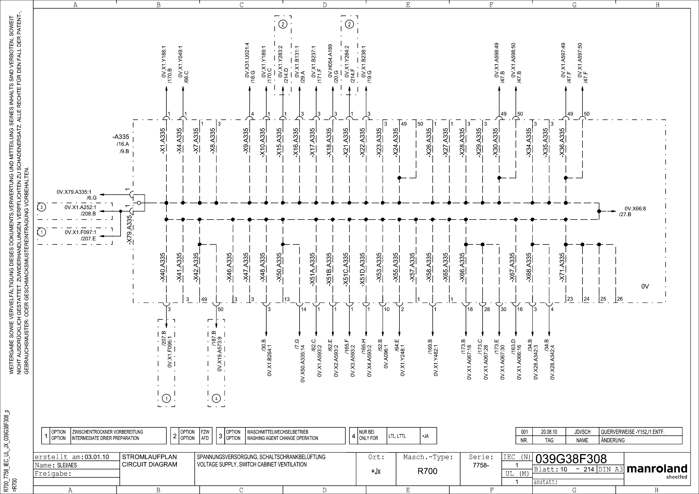

# +Jx — Sheet 10 of 214 — SPANNUNGSVERSORGUNG, SCHALTSCHRANKBELÜFTUNG

**VOLTAGE SUPPLY, SWITCH CABINET VENTILATION**

> Part of the manroland **R700** printing press IEC/UL circuit diagrams.
> Drawing class: **Stromlaufplan / Circuit diagram** (DIN A3).
> Document `+Jx` covers the **1st printing module + feed register** machine section.

## At a glance

| Field | Value |
|---|---|
| Document | `+Jx`  (039G38F308) |
| Sheet | **10** of 214 |
| Section (DE) | SPANNUNGSVERSORGUNG, SCHALTSCHRANKBELÜFTUNG |
| Section (EN) | VOLTAGE SUPPLY, SWITCH CABINET VENTILATION |
| Section type | POWER_SUPPLY — Voltage supply |
| Machine type | `R700` |
| Series | `7758` |
| Created | 03.01.10 |
| Replaces | — |
| Columns used | A, B, C, D, E, F, G, H |
| Path numbers | — |
| Labels on sheet | 206 |
| Cross-refs out | 37 |
| Cross-refs in | 90 |

**Previous:** [+Jx sheet 9](SHEET_0009.md) · **Next:** [+Jx sheet 11](SHEET_0011.md) · **Document TOC:** [_TOC.md](_TOC.md)  (+Jx) · **Master TOC:** [all sheets](../_MASTER_TOC.md)

## Sheet image (300 DPI, exact vector render)



_Rendered directly from the PDF vector layer at 300 DPI (1-bit), no OCR and no resampling. Use it to confirm anything ambiguous in the text below._

## Cross-references on this sheet

Each entry is a wire leaving this sheet. The printed token is `/sheet.column`; the link resolves to that sheet inside the same document.

| Ref | Target sheet | Col | Path | Destination on target | Target section | From col |
|---|---|---|---|---|---|---|
| `/18.G` | [+Jx sheet 18](SHEET_0018.md) | G | — | 0V.X31.U021:4 | LACKPUMPE | C |
| `/47.B` | [+Jx sheet 47](SHEET_0047.md) | B | — | 0V.X1.A598:49 | MASCHINENBEDIENUNG: SPANNUNGSVERSORGUNG | F |
| `/47.B` | [+Jx sheet 47](SHEET_0047.md) | B | — | 0V.X1.A598:50 | MASCHINENBEDIENUNG: SPANNUNGSVERSORGUNG | F |
| `/47.F` | [+Jx sheet 47](SHEET_0047.md) | F | — | 0V.X1.A597:49 | MASCHINENBEDIENUNG: SPANNUNGSVERSORGUNG | G |
| `/47.F` | [+Jx sheet 47](SHEET_0047.md) | F | — | 0V.X1.A597:50 | MASCHINENBEDIENUNG: SPANNUNGSVERSORGUNG | G |
| `/20.G` | [+Jx sheet 20](SHEET_0020.md) | G | — | 0V.H054.A189 | LACKPUMPE | D |
| `/170.B` | [+Jx sheet 170](SHEET_0170.md) | B | — | 0V.X1.Y188:1 | OPTION: AUTOMATISCHEM SPÜLEN | B |
| `/66.C` | [+Jx sheet 66](SHEET_0066.md) | C | — | 0V.X1.Y049:1 | DRUCKANSTELLUNG | B |
| `/170.C` | [+Jx sheet 170](SHEET_0170.md) | C | — | 0V.X1.Y189:1 | OPTION: AUTOMATISCHEM SPÜLEN | C |
| `/214.D` | [+Jx sheet 214](SHEET_0214.md) | D | — | 0V.X1.Y283:2 | OPTION: FZW | D |
| `/29.A` | [+Jx sheet 29](SHEET_0029.md) | A | — | 0V.X1.B131:1 | KAMMERRAKEL | D |
| `/171.F` | [+Jx sheet 171](SHEET_0171.md) | F | — | 0V.X1.B237:1 | OPTION: AUTOMATISCHEM SPÜLEN | D |
| `/214.F` | [+Jx sheet 214](SHEET_0214.md) | F | — | 0V.X1.Y284:2 | OPTION: FZW | D |
| `/19.G` | [+Jx sheet 19](SHEET_0019.md) | G | — | 0V.X1.B238:1 | LACKPUMPE | E |
| `/16.A` | [+Jx sheet 16](SHEET_0016.md) | A | — | — | ÖLUMLAUFSCHMIERUNG | B |
| `/9.B` | [+Jx sheet 9](SHEET_0009.md) | B | — | — | SPANNUNGSVERSORGUNG, SCHALTSCHRANKBELÜFTUNG | B |
| `/6.G` | [+Jx sheet 6](SHEET_0006.md) | G | — | 0V.X79.A335:1 | SPANNUNGSVERSORGUNG, SCHALTSCHRANKBELÜFTUNG | A |
| `/208.B` | [+Jx sheet 208](SHEET_0208.md) | B | — | 0V.X1.A252:1 | OPTION: WASCHMITTELWECHSELBETRIEB | A |
| `/27.B` | [+Jx sheet 27](SHEET_0027.md) | B | — | — | KAMMERRAKEL | H |
| `/207.E` | [+Jx sheet 207](SHEET_0207.md) | E | — | 0V.X1.F097:1 | OPTION: ZWISCHENTROCKNER, VORBEREITUNG | A |
| `/207.B` | [+Jx sheet 207](SHEET_0207.md) | B | — | — | OPTION: ZWISCHENTROCKNER, VORBEREITUNG | B |
| `/187.B` | [+Jx sheet 187](SHEET_0187.md) | B | — | — | OPTION: TRANSFERMODUL 1 + 2 | C |
| `/165.H` | [+Jx sheet 165](SHEET_0165.md) | H | — | — | OPTION: | D |
| `/30.B` | [+Jx sheet 30](SHEET_0030.md) | B | — | — | LACKNIVEAUÜBERWACHUNG | C |
| `/62.E` | [+Jx sheet 62](SHEET_0062.md) | E | — | — | GTW | D |
| `/52.B` | [+Jx sheet 52](SHEET_0052.md) | B | — | — | SCHUTZEINRICHTUNGEN | E |
| `/64.E` | [+Jx sheet 64](SHEET_0064.md) | E | — | — | TROPFEINRICHTUNG | E |
| `/34.B` | [+Jx sheet 34](SHEET_0034.md) | B | — | — | NOT AUS | F |
| `/34.B` | [+Jx sheet 34](SHEET_0034.md) | B | — | — | NOT AUS | G |
| `/7.G` | [+Jx sheet 7](SHEET_0007.md) | G | — | — | SPANNUNGSVERSORGUNG, SCHALTSCHRANKBELÜFTUNG | D |
| `/62.C` | [+Jx sheet 62](SHEET_0062.md) | C | — | — | GTW | D |
| `/165.F` | [+Jx sheet 165](SHEET_0165.md) | F | — | — | OPTION: | D |
| `/169.B` | [+Jx sheet 169](SHEET_0169.md) | B | — | — | OPTION: BOGENFÜHRUNG ÜBER DRUCKZYLINDER / | E |
| `/173.B` | [+Jx sheet 173](SHEET_0173.md) | B | — | — | OPTION: | F |
| `/173.C` | [+Jx sheet 173](SHEET_0173.md) | C | — | — | OPTION: | F |
| `/173.E` | [+Jx sheet 173](SHEET_0173.md) | E | — | — | OPTION: | F |
| `/163.D` | [+Jx sheet 163](SHEET_0163.md) | D | — | — | OPTION: | F |

### Incoming references (sheets that point here)

Every other sheet that sends a wire to this one. `Back-ref` is the token printed on *that* sheet; `Path` is its line number.

| From sheet | Cols | Back-ref | Path | Refs | What continues there |
|---|---|---|---|---|---|
| [+Jx#6](SHEET_0006.md) | H | `/6.H` | — | 1 | 0V.X79.A335:1 |
| [+Jx#7](SHEET_0007.md) | H | `/7.H` | — | 1 | — |
| [+Jx#9](SHEET_0009.md) | B | `/9.B` | — | 1 | — |
| [+Jx#16](SHEET_0016.md) | A | `/16.A` | — | 1 | — |
| [+Jx#18](SHEET_0018.md) | G | `/18.G` | — | 1 | 0V.X31.U021:4 |
| [+Jx#19](SHEET_0019.md) | F | `/19.F` | — | 1 | 0V.X1.B238:1 |
| [+Jx#20](SHEET_0020.md) | F | `/20.F` | — | 1 | — |
| [+Jx#27](SHEET_0027.md) | A | `/27.A` | — | 1 | 0V.X66:8 |
| [+Jx#29](SHEET_0029.md) | A | `/29.A` | — | 1 | 0V.X1.B131:1 |
| [+Jx#30](SHEET_0030.md) | B | `/30.B` | — | 1 | 0V.X1.B264:1 |
| [+Jx#34](SHEET_0034.md) | B | `/34.B` | — | 2 | 0V.X28.A342:3; 0V.X28.A342:4 |
| [+Jx#47](SHEET_0047.md) | A, E, F | `/47.A`, `/47.E`, `/47.F` | — | 4 | 0V.X1.A597:49; 0V.X1.A597:50; 0V.X1.A598:49; 0V.X1.A598:50 |
| [+Jx#52](SHEET_0052.md) | A | `/52.A` | — | 1 | 0V.A096:1 |
| [+Jx#62](SHEET_0062.md) | D | `/62.D` | — | 2 | 0V.X1.A593:2; 0V.X2.A593:2 |
| [+Jx#64](SHEET_0064.md) | E | `/64.E` | — | 1 | 0V.X1.Y248:1 |
| [+Jx#66](SHEET_0066.md) | C | `/66.C` | — | 1 | 0V.X1.Y049:1 |
| [+Jx#113](SHEET_0113.md) | G | `/113.G` | — | 1 | — |
| [+Jx#129](SHEET_0129.md) | E | `/129.E` | — | 1 | — |
| [+Jx#133](SHEET_0133.md) | B, G | `/133.B`, `/133.G` | — | 2 | — |
| [+Jx#134](SHEET_0134.md) | E | `/134.E` | — | 1 | — |
| [+Jx#135](SHEET_0135.md) | C | `/135.C` | — | 1 | — |
| [+Jx#138](SHEET_0138.md) | G | `/138.G` | — | 1 | — |
| [+Jx#139](SHEET_0139.md) | C | `/139.C` | — | 1 | — |
| [+Jx#140](SHEET_0140.md) | A, E | `/140.A`, `/140.E` | — | 2 | — |
| [+Jx#141](SHEET_0141.md) | G | `/141.G` | — | 1 | — |
| [+Jx#142](SHEET_0142.md) | A, C, G | `/142.A`, `/142.C`, `/142.G` | — | 4 | — |
| [+Jx#143](SHEET_0143.md) | C | `/143.C` | — | 1 | STROMPFAD PIN 1 2 |
| [+Jx#144](SHEET_0144.md) | A | `/144.A` | — | 1 | STROMPFAD PIN 1 2 |
| [+Jx#145](SHEET_0145.md) | A | `/145.A` | — | 1 | — |
| [+Jx#147](SHEET_0147.md) | A | `/147.A` | — | 1 | — |
| [+Jx#148](SHEET_0148.md) | B | `/148.B` | — | 2 | — |
| [+Jx#149](SHEET_0149.md) | C, E, G | `/149.C`, `/149.E`, `/149.G` | — | 4 | — |
| [+Jx#150](SHEET_0150.md) | B, D, G, H | `/150.B`, `/150.D`, `/150.G`, `/150.H` | — | 9 | — |
| [+Jx#151](SHEET_0151.md) | A, C, E, F, H | `/151.A`, `/151.C`, `/151.E`, `/151.F`, `/151.H` | — | 9 | — |
| [+Jx#152](SHEET_0152.md) | B, C, E | `/152.B`, `/152.C`, `/152.E` | — | 6 | — |
| [+Jx#153](SHEET_0153.md) | B | `/153.B` | — | 4 | — |
| [+Jx#163](SHEET_0163.md) | D | `/163.D` | — | 1 | 0V.X1.A066:16 |
| [+Jx#165](SHEET_0165.md) | F | `/165.F` | — | 2 | 0V.X3.A593:2 0V.X4.A593:2 |
| [+Jx#169](SHEET_0169.md) | B | `/169.B` | — | 1 | 0V.X1.Y482:1 |
| [+Jx#170](SHEET_0170.md) | B | `/170.B` | — | 2 | 0V.X1.Y188:1 0V.X1.Y189:1 |
| [+Jx#171](SHEET_0171.md) | F | `/171.F` | — | 1 | 0V.X1.B237:1 |
| [+Jx#173](SHEET_0173.md) | B, E | `/173.B`, `/173.E` | — | 3 | 0V.X1.A067:18 0V.X1.A067:28; 0V.X1.A067:30 |
| [+Jx#187](SHEET_0187.md) | B | `/187.B` | — | 1 | 0V.X19.A573:9 |
| [+Jx#207](SHEET_0207.md) | C | `/207.C` | — | 2 | 0V.X1.F095:1 0V.X1.F097:1 |
| [+Jx#208](SHEET_0208.md) | A | `/208.A` | — | 1 | 0V.X1.A252:1 |
| [+Jx#214](SHEET_0214.md) | E | `/214.E` | — | 2 | 0V.X1.Y283:2 0V.X1.Y284:2 |


## Devices on this sheet

| Tag | Class | Class meaning (IEC) | Col | Sub | Terminal | Sign |
|---|---|---|---|---|---|---|
| `A335` | A | Baugruppe / assembly, module, PC board | B | — | — | — |
| `X15.A335` | — | cross-device reference | C | — | — | — |
| `X16.A335` | — | cross-device reference | D | — | — | — |
| `X17.A335` | — | cross-device reference | D | — | — | — |
| `X18.A335` | — | cross-device reference | D | — | — | — |
| `X21.A335` | — | cross-device reference | D | — | — | — |
| `X22.A335` | — | cross-device reference | D | — | — | — |
| `X1.A335` | — | cross-device reference | B | — | — | — |
| `X4.A335` | — | cross-device reference | B | — | — | — |
| `X9.A335` | — | cross-device reference | C | — | — | — |
| `X10.A335` | — | cross-device reference | C | — | — | — |
| `X30.A335` | — | cross-device reference | F | — | — | — |
| `X36.A335` | — | cross-device reference | G | — | — | — |
| `X40.A335` | — | cross-device reference | B | — | — | — |
| `X48.A335` | — | cross-device reference | C | — | — | — |
| `X51A.A335` | — | cross-device reference | D | — | — | — |
| `X53.A335` | — | cross-device reference | E | — | — | — |
| `X51B.A335` | — | cross-device reference | D | — | — | — |
| `X51C.A335` | — | cross-device reference | D | — | — | — |
| `X51D.A335` | — | cross-device reference | D | — | — | — |
| `X55.A335` | — | cross-device reference | E | — | — | — |
| `X58.A335` | — | cross-device reference | E | — | — | — |
| `X66.A335` | — | cross-device reference | F | — | — | — |
| `X67.A335` | — | cross-device reference | F | — | — | — |
| `X68.A335` | — | cross-device reference | F | — | — | — |
| `X79.A335` | — | cross-device reference | B | — | — | — |
| `NR.` | — | cross-device reference | F | — | — | — |
| `20.08.10` | — | cross-device reference | G | — | — | — |
| `X24.A335` | — | cross-device reference | E | — | — | — |
| `X41.A335` | — | cross-device reference | B | — | — | — |
| `X46.A335` | — | cross-device reference | C | — | — | — |
| `X47.A335` | — | cross-device reference | C | — | — | — |
| `X71.A335` | — | cross-device reference | G | — | — | — |
| `X42.A335` | — | cross-device reference | B | — | — | — |
| `X28.A335` | — | cross-device reference | F | — | — | — |
| `X29.A335` | — | cross-device reference | F | — | — | — |
| `X65.A335` | — | cross-device reference | E | — | — | — |
| `X50.A335` | — | cross-device reference | C | — | — | — |
| `X57.A335` | — | cross-device reference | E | — | — | — |
| `X7.A335` | — | cross-device reference | B | — | — | — |
| `X23.A335` | — | cross-device reference | E | — | — | — |
| `X34.A335` | — | cross-device reference | F | — | — | — |
| `X35.A335` | — | cross-device reference | G | — | — | — |
| `X8.A335` | — | cross-device reference | C | — | — | — |
| `X26.A335` | — | cross-device reference | E | — | — | — |
| `X27.A335` | — | cross-device reference | E | — | — | — |

## Potentials / nets

| Potential | Count | Columns | Attached devices | Terminals |
|---|---|---|---|---|
| `0V` | 36 | A, B, C, D, E, F, G, H | `A066`, `A067`, `A096`, `A189`, `A252`, `A335`, `A342`, `A573`, `A593`, `A597`, `A598`, `B131`, `B237`, `B238`, `B264`, `F095`, `F097`, `H054`, `U021`, `X1`, `X19`, `X2`, `X28`, `X3`, `X31`, `X4`, `X50`, `X66`, `X79`, `Y049`, `Y188`, `Y189`, `Y248`, `Y283`, `Y284`, `Y482` | `1`, `14`, `16`, `18`, `2`, `28`, `3`, `30`, `4`, `49`, `50`, `8`, `9` |


A potential such as `L24+/4` or `M24+` is a named supply/return rail; every place it appears on this sheet is electrically common.

## Wire-end annotations (grouped as printed)

A wire that continues elsewhere is annotated with a small cluster: the destination description, the path/line number `#NN`, and the `/sheet.column` cross reference. Each row below is one such cluster exactly as it is grouped on the drawing.

| Col | Y | Path | Cross-ref | Text on the wire |
|---|---|---|---|---|
| D | 38.5 | — | — | `2 2` |
| C | 72.6 | — | `/18.G` | `0V.X31.U021:4` |
| F | 72.8 | — | `/47.B` | `0V.X1.A598:49` |
| F | 72.8 | — | `/47.B` | `0V.X1.A598:50` |
| G | 72.8 | — | `/47.F` | `0V.X1.A597:49` |
| G | 72.8 | — | `/47.F` | `0V.X1.A597:50` |
| D | 75.1 | — | `/20.G` | `0V.H054.A189` |
| B | 77.7 | — | `/170.B` | `0V.X1.Y188:1` |
| B | 77.7 | — | `/66.C` | `0V.X1.Y049:1` |
| C | 77.7 | — | `/170.C` | `0V.X1.Y189:1` |
| D | 77.7 | — | `/214.D` | `0V.X1.Y283:2` |
| D | 77.7 | — | `/29.A` | `0V.X1.B131:1` |
| D | 77.7 | — | `/171.F` | `0V.X1.B237:1` |
| D | 77.7 | — | `/214.F` | `0V.X1.Y284:2` |
| E | 77.7 | — | `/19.G` | `0V.X1.B238:1` |
| B | 190.2 | — | — | `1` |
| B | 190.2 | — | — | `1` |
| C | 190.2 | — | — | `4` |
| C | 190.2 | — | — | `1` |
| D | 190.2 | — | — | `1` |
| D | 190.2 | — | — | `3` |
| D | 190.2 | — | — | `3` |
| D | 190.2 | — | — | `3` |
| D | 190.2 | — | — | `1` |
| E | 190.2 | — | — | `3` |
| F | 190.2 | — | — | `49` |
| G | 190.2 | — | — | `50 49` |
| G | 190.2 | — | — | `50` |
| C | 207.2 | — | — | `1 3` |
| F | 207.2 | — | — | `3 1 1 3 3` |
| E | 207.2 | — | — | `49` |
| E | 207.2 | — | — | `50` |
| F | 207.2 | — | — | `3 3` |
| B | 218.0 | — | — | `X1.A335` |
| B | 218.0 | — | — | `X4.A335` |
| B | 218.0 | — | — | `X7.A335` |
| C | 218.0 | — | — | `X8.A335` |
| C | 218.0 | — | — | `X9.A335` |
| C | 218.0 | — | — | `X10.A335` |
| C | 218.0 | — | — | `X15.A335` |
| D | 218.0 | — | — | `X16.A335` |
| D | 218.0 | — | — | `X17.A335` |
| D | 218.0 | — | — | `X18.A335` |
| D | 218.0 | — | — | `X21.A335` |
| D | 218.0 | — | — | `X22.A335` |
| E | 218.0 | — | — | `X23.A335` |
| E | 218.0 | — | — | `X24.A335` |
| E | 218.0 | — | — | `X26.A335` |
| E | 218.0 | — | — | `X27.A335` |
| F | 218.0 | — | — | `X28.A335` |
| F | 218.0 | — | — | `X29.A335` |
| F | 218.0 | — | — | `X30.A335` |
| F | 218.0 | — | — | `X34.A335` |
| G | 218.0 | — | — | `X35.A335` |
| G | 218.0 | — | — | `X36.A335` |
| B | 228.4 | — | — | `A335` |
| B | 241.5 | — | `/16.A` | — |
| B | 253.9 | — | `/9.B` | — |
| B | 319.8 | — | — | `1` |
| A | 323.4 | — | `/6.G` | `0V.X79.A335:1` |
| B | 348.1 | — | — | `1 X79.A335` |
| A | 349.6 | — | `/208.B` | `0V.X1.A252:1` |
| A | 350.7 | — | — | `3` |
| H | 351.7 | — | — | `0V.X66:8` |
| H | 361.6 | — | `/27.B` | — |
| A | 392.1 | — | `/207.E` | `0V.X1.F097:1` |
| A | 392.8 | — | — | `1` |
| B | 430.6 | — | — | `X40.A335` |
| B | 430.6 | — | — | `X41.A335` |
| B | 430.6 | — | — | `X42.A335` |
| C | 430.6 | — | — | `X46.A335` |
| C | 430.6 | — | — | `X47.A335` |
| C | 430.6 | — | — | `X48.A335` |
| C | 430.6 | — | — | `X50.A335` |
| D | 430.6 | — | — | `X51A.A335` |
| D | 430.6 | — | — | `X51B.A335` |
| D | 430.6 | — | — | `X51C.A335` |
| D | 430.6 | — | — | `X51D.A335` |
| E | 430.6 | — | — | `X53.A335` |
| E | 430.6 | — | — | `X55.A335` |
| E | 430.6 | — | — | `X57.A335` |
| E | 430.6 | — | — | `X58.A335` |
| E | 430.6 | — | — | `X65.A335` |
| F | 430.6 | — | — | `X66.A335` |
| F | 430.6 | — | — | `X67.A335` |
| F | 430.6 | — | — | `X68.A335` |
| G | 430.6 | — | — | `X71.A335` |
| H | 483.5 | — | — | `0V` |
| G | 505.5 | — | — | `23 24 25 26` |
| B | 506.2 | — | — | `3` |
| D | 506.2 | — | — | `49 13 1` |
| C | 506.2 | — | — | `3 3` |
| F | 506.2 | — | — | `1` |
| B | 523.3 | — | — | `3` |
| C | 523.3 | — | — | `50` |
| C | 523.3 | — | — | `3` |
| D | 523.3 | — | — | `14 1` |
| D | 523.3 | — | — | `1` |
| D | 523.3 | — | — | `1` |
| E | 523.3 | — | — | `1` |
| E | 523.3 | — | — | `10` |
| E | 523.3 | — | — | `2` |
| E | 523.3 | — | — | `1` |
| F | 523.3 | — | — | `18` |
| F | 523.3 | — | — | `28 30 16` |
| G | 523.3 | — | — | `3` |
| G | 523.3 | — | — | `4` |
| B | 563.8 | — | `/207.B` | — |
| C | 563.8 | — | `/187.B` | — |
| B | 572.6 | — | — | `0V.X1.F095:1` |
| C | 573.7 | — | — | `0V.X19.A573:9` |
| D | 577.7 | — | `/165.H` | — |
| C | 578.0 | — | `/30.B` | — |
| D | 578.0 | — | `/7.G` | — |
| D | 578.0 | — | `/62.C` | — |
| D | 578.0 | — | `/62.E` | — |
| D | 578.0 | — | `/165.F` | — |
| E | 578.0 | — | `/52.B` | — |
| E | 578.0 | — | `/64.E` | — |
| E | 578.0 | — | `/169.B` | — |
| F | 578.0 | — | `/173.B` | — |
| F | 578.0 | — | `/173.C` | — |
| F | 578.0 | — | `/173.E` | — |
| F | 578.0 | — | `/163.D` | — |
| F | 578.0 | — | `/34.B` | — |
| G | 578.0 | — | `/34.B` | — |
| C | 586.8 | — | — | `0V.X1.B264:1` |
| E | 586.8 | — | — | `0V.A096:1` |
| E | 586.8 | — | — | `0V.X1.Y248:1` |
| E | 586.8 | — | — | `0V.X1.Y482:1` |
| D | 587.9 | — | — | `0V.X50.A335:14` |
| D | 587.9 | — | — | `0V.X1.A593:2` |
| D | 587.9 | — | — | `0V.X2.A593:2` |
| D | 587.9 | — | — | `0V.X3.A593:2` |
| E | 587.9 | — | — | `0V.X4.A593:2` |
| F | 587.9 | — | — | `0V.X1.A067:18` |
| F | 587.9 | — | — | `0V.X1.A067:28` |
| F | 587.9 | — | — | `0V.X1.A067:30` |
| F | 587.9 | — | — | `0V.X1.A066:16` |
| G | 587.9 | — | — | `0V.X28.A342:3` |
| G | 587.9 | — | — | `0V.X28.A342:4` |
| B | 676.3 | — | — | `1` |
| C | 676.8 | — | — | `4` |
| G | 733.0 | — | — | `001 20.08.10 JDI/SCH QUERVERWEISE Y152,/1 ENTF.` |
| C | 733.2 | — | — | `FZW` |
| A | 733.3 | — | — | `1 OPTION OPTION` |
| B | 733.3 | — | — | `INTERMEDIATE DRIER PREPARATION ZWISCHENTROCKNER VORBEREITUNG 2 OPTION OPTION` |
| C | 733.3 | — | — | `AFD 3 OPTION OPTION` |
| D | 733.3 | — | — | `WASCHMITTELWECHSELBETRIEB WASHING AGENT CHANGE OPERATION 4 NUR BEI ONLY FOR LTL, LTTL +JA` |
| G | 747.1 | — | — | `NR. TAG NAME ÄNDERUNG` |


## Reconstructed tables

This sheet carries tabular content (pin map / terminal assignment / index). The grid below was rebuilt from the drawing's own rule lines, so each row is exactly one physical row of the table.

### Table 1 — 2 data rows × 1 columns (at x=205.5, y=345.8)

| C1 |
|---|
| `1` |
| `X79.A335` |


## Notes and free text on this sheet

| Text | Col | Y (pt) |
|---|---|---|
| `TAG` | G | 747.23 |
| `NAME` | G | 747.22 |
| `ÄNDERUNG` | G | 747.25 |
| `JDI/SCH` | G | 733.05 |
| `QUERVERWEISE Y152,/1 ENTF.` | H | 733.06 |
| `OPTION` | A | 733.32 |
| `ZWISCHENTROCKNER VORBEREITUNG` | A | 733.34 |
| `INTERMEDIATE DRIER PREPARATION` | A | 743.96 |
| `OPTION` | B | 733.32 |
| `FZW` | C | 733.19 |
| `AFD` | C | 743.96 |
| `OPTION` | C | 733.32 |
| `WASCHMITTELWECHSELBETRIEB` | C | 733.31 |
| `WASHING AGENT CHANGE OPERATION` | C | 743.96 |
| `NUR BEI` | E | 733.3 |
| `ONLY FOR` | E | 743.98 |
| `LTL, LTTL` | E | 740.41 |
| `+JA` | E | 740.38 |

## Complete label inventory (exact text from the drawing)

Every text object inside the drawing area of this sheet, in DIN reading order (column A→H, then top→bottom). This is the authoritative list: if a string is not here it is not printed on this sheet.

| Col | Y | X | Dir | Type | Text |
|---|---|---|---|---|---|
| A | 323.4 | 96.7 | → | potential | `0V.X79.A335:1` |
| A | 333.3 | 148.0 | → | cross-reference | `/6.G` |
| A | 349.6 | 110.0 | → | potential | `0V.X1.A252:1` |
| A | 350.7 | 69.2 | → | number | `3` |
| A | 360.2 | 137.8 | → | cross-reference | `/208.B` |
| A | 392.1 | 110.6 | → | potential | `0V.X1.F097:1` |
| A | 392.8 | 69.2 | → | number | `1` |
| A | 402.7 | 137.8 | → | cross-reference | `/207.E` |
| A | 733.3 | 87.6 | → | text | `OPTION` |
| A | 733.3 | 123.3 | → | text | `ZWISCHENTROCKNER VORBEREITUNG` |
| A | 738.6 | 75.4 | → | number | `1` |
| A | 743.9 | 87.6 | → | text | `OPTION` |
| A | 744.0 | 122.5 | → | text | `INTERMEDIATE DRIER PREPARATION` |
| B | 77.7 | 275.2 | ↕ | potential | `0V.X1.Y188:1` |
| B | 77.7 | 303.5 | ↕ | potential | `0V.X1.Y049:1` |
| B | 116.2 | 285.1 | ↕ | cross-reference | `/170.B` |
| B | 120.8 | 313.5 | ↕ | cross-reference | `/66.C` |
| B | 190.2 | 285.4 | → | number | `1` |
| B | 190.2 | 313.8 | → | number | `1` |
| B | 218.0 | 272.4 | ↕ | device ref | `X1.A335` |
| B | 218.0 | 300.7 | ↕ | device ref | `X4.A335` |
| B | 218.0 | 329.1 | ↕ | device ref | `X7.A335` |
| B | 228.4 | 191.6 | → | device tag | `A335` |
| B | 241.5 | 199.0 | → | cross-reference | `/16.A` |
| B | 253.9 | 204.1 | → | cross-reference | `/9.B` |
| B | 319.7 | 212.8 | ↕ | number | `1` |
| B | 348.1 | 212.8 | ↕ | number | `1` |
| B | 366.8 | 215.7 | ↕ | device ref | `X79.A335` |
| B | 430.6 | 272.4 | ↕ | device ref | `X40.A335` |
| B | 430.6 | 300.7 | ↕ | device ref | `X41.A335` |
| B | 430.6 | 329.1 | ↕ | device ref | `X42.A335` |
| B | 506.3 | 317.2 | → | number | `3` |
| B | 523.3 | 286.0 | → | number | `3` |
| B | 563.8 | 275.2 | ↕ | cross-reference | `/207.B` |
| B | 572.6 | 285.1 | ↕ | potential | `0V.X1.F095:1` |
| B | 676.3 | 281.8 | → | number | `1` |
| B | 733.3 | 307.3 | → | text | `OPTION` |
| B | 738.6 | 294.8 | → | number | `2` |
| B | 743.9 | 307.3 | → | text | `OPTION` |
| C | 38.5 | 479.9 | → | number | `2` |
| C | 72.6 | 416.9 | ↕ | potential | `0V.X31.U021:4` |
| C | 77.7 | 445.2 | ↕ | potential | `0V.X1.Y189:1` |
| C | 77.7 | 473.6 | ↕ | potential | `0V.X1.Y283:2` |
| C | 115.9 | 455.2 | ↕ | cross-reference | `/170.C` |
| C | 120.2 | 426.8 | ↕ | cross-reference | `/18.G` |
| C | 190.2 | 428.0 | → | number | `4` |
| C | 190.2 | 455.5 | → | number | `1` |
| C | 207.2 | 342.1 | → | number | `1` |
| C | 207.2 | 371.1 | → | number | `3` |
| C | 218.0 | 357.4 | ↕ | device ref | `X8.A335` |
| C | 218.0 | 414.1 | ↕ | device ref | `X9.A335` |
| C | 218.0 | 442.4 | ↕ | device ref | `X10.A335` |
| C | 218.0 | 470.8 | ↕ | device ref | `X15.A335` |
| C | 430.6 | 385.7 | ↕ | device ref | `X46.A335` |
| C | 430.6 | 414.1 | ↕ | device ref | `X47.A335` |
| C | 430.6 | 442.4 | ↕ | device ref | `X48.A335` |
| C | 430.6 | 470.8 | ↕ | device ref | `X50.A335` |
| C | 506.3 | 343.0 | → | number | `49` |
| C | 506.3 | 399.4 | → | number | `3` |
| C | 506.3 | 427.7 | → | number | `3` |
| C | 523.3 | 371.1 | → | number | `50` |
| C | 523.3 | 456.1 | → | number | `3` |
| C | 563.8 | 360.2 | ↕ | cross-reference | `/187.B` |
| C | 573.7 | 370.1 | ↕ | potential | `0V.X19.A573:9` |
| C | 578.0 | 445.2 | ↕ | cross-reference | `/30.B` |
| C | 586.8 | 455.2 | ↕ | potential | `0V.X1.B264:1` |
| C | 676.8 | 367.0 | → | number | `4` |
| C | 733.2 | 342.4 | → | text | `FZW` |
| C | 733.3 | 385.2 | → | text | `OPTION` |
| C | 733.3 | 420.9 | → | text | `WASCHMITTELWECHSELBETRIEB` |
| C | 738.6 | 372.6 | → | number | `3` |
| C | 743.9 | 385.2 | → | text | `OPTION` |
| C | 744.0 | 343.0 | → | text | `AFD` |
| C | 744.0 | 420.9 | → | text | `WASHING AGENT CHANGE OPERATION` |
| D | 38.5 | 593.3 | → | number | `2` |
| D | 75.1 | 558.7 | ↕ | potential | `0V.H054.A189` |
| D | 77.7 | 501.9 | ↕ | potential | `0V.X1.B131:1` |
| D | 77.7 | 530.3 | ↕ | potential | `0V.X1.B237:1` |
| D | 77.7 | 587.0 | ↕ | potential | `0V.X1.Y284:2` |
| D | 77.7 | 615.3 | ↕ | potential | `0V.X1.B238:1` |
| D | 115.9 | 483.5 | ↕ | cross-reference | `/214.D` |
| D | 116.8 | 540.2 | ↕ | cross-reference | `/171.F` |
| D | 116.8 | 596.9 | ↕ | cross-reference | `/214.F` |
| D | 120.2 | 568.6 | ↕ | cross-reference | `/20.G` |
| D | 121.0 | 511.8 | ↕ | cross-reference | `/29.A` |
| D | 190.2 | 483.9 | → | number | `1` |
| D | 190.2 | 512.8 | → | number | `3` |
| D | 190.2 | 541.1 | → | number | `3` |
| D | 190.2 | 569.5 | → | number | `3` |
| D | 190.2 | 597.3 | → | number | `1` |
| D | 218.0 | 499.1 | ↕ | device ref | `X16.A335` |
| D | 218.0 | 527.5 | ↕ | device ref | `X17.A335` |
| D | 218.0 | 555.8 | ↕ | device ref | `X18.A335` |
| D | 218.0 | 584.2 | ↕ | device ref | `X21.A335` |
| D | 218.0 | 612.5 | ↕ | device ref | `X22.A335` |
| D | 430.6 | 527.5 | ↕ | device ref | `X51A.A335` |
| D | 430.6 | 555.8 | ↕ | device ref | `X51B.A335` |
| D | 430.6 | 584.2 | ↕ | device ref | `X51C.A335` |
| D | 430.6 | 612.5 | ↕ | device ref | `X51D.A335` |
| D | 506.3 | 483.9 | → | number | `13` |
| D | 523.3 | 512.2 | → | number | `14` |
| D | 523.3 | 540.6 | → | number | `1` |
| D | 523.3 | 568.9 | → | number | `1` |
| D | 523.3 | 597.3 | → | number | `1` |
| D | 577.7 | 615.4 | ↕ | cross-reference | `/165.H` |
| D | 578.0 | 501.9 | ↕ | cross-reference | `/7.G` |
| D | 578.0 | 530.3 | ↕ | cross-reference | `/62.C` |
| D | 578.0 | 558.6 | ↕ | cross-reference | `/62.E` |
| D | 578.0 | 587.0 | ↕ | cross-reference | `/165.F` |
| D | 587.9 | 511.9 | ↕ | potential | `0V.X50.A335:14` |
| D | 587.9 | 540.2 | ↕ | potential | `0V.X1.A593:2` |
| D | 587.9 | 568.6 | ↕ | potential | `0V.X2.A593:2` |
| D | 587.9 | 596.9 | ↕ | potential | `0V.X3.A593:2` |
| D | 738.6 | 599.5 | → | number | `4` |
| E | 120.2 | 625.3 | ↕ | cross-reference | `/19.G` |
| E | 190.2 | 626.2 | → | number | `3` |
| E | 207.2 | 654.5 | → | number | `3` |
| E | 207.2 | 683.1 | → | number | `49` |
| E | 207.2 | 711.2 | → | number | `50` |
| E | 207.2 | 739.0 | → | number | `1` |
| E | 218.0 | 640.9 | ↕ | device ref | `X23.A335` |
| E | 218.0 | 669.2 | ↕ | device ref | `X24.A335` |
| E | 218.0 | 725.9 | ↕ | device ref | `X26.A335` |
| E | 218.0 | 754.3 | ↕ | device ref | `X27.A335` |
| E | 430.6 | 640.9 | ↕ | device ref | `X53.A335` |
| E | 430.6 | 669.2 | ↕ | device ref | `X55.A335` |
| E | 430.6 | 697.6 | ↕ | device ref | `X57.A335` |
| E | 430.6 | 725.9 | ↕ | device ref | `X58.A335` |
| E | 430.6 | 754.3 | ↕ | device ref | `X65.A335` |
| E | 506.3 | 710.6 | → | number | `1` |
| E | 523.3 | 625.6 | → | number | `1` |
| E | 523.3 | 654.0 | → | number | `10` |
| E | 523.3 | 683.1 | → | number | `2` |
| E | 523.3 | 739.0 | → | number | `1` |
| E | 578.0 | 643.7 | ↕ | cross-reference | `/52.B` |
| E | 578.0 | 672.0 | ↕ | cross-reference | `/64.E` |
| E | 578.0 | 728.7 | ↕ | cross-reference | `/169.B` |
| E | 586.8 | 653.6 | ↕ | potential | `0V.A096:1` |
| E | 586.8 | 681.9 | ↕ | potential | `0V.X1.Y248:1` |
| E | 586.8 | 738.6 | ↕ | potential | `0V.X1.Y482:1` |
| E | 587.9 | 625.2 | ↕ | potential | `0V.X4.A593:2` |
| E | 733.3 | 611.7 | → | text | `NUR BEI` |
| E | 740.4 | 662.0 | → | text | `LTL, LTTL` |
| E | 740.4 | 719.0 | → | text | `+JA` |
| E | 744.0 | 612.0 | → | text | `ONLY FOR` |
| F | 72.9 | 842.1 | ↕ | potential | `0V.X1.A598:49` |
| F | 72.9 | 870.4 | ↕ | potential | `0V.X1.A598:50` |
| F | 121.0 | 852.0 | ↕ | cross-reference | `/47.B` |
| F | 121.0 | 880.3 | ↕ | cross-reference | `/47.B` |
| F | 190.2 | 853.2 | → | number | `49` |
| F | 190.2 | 881.3 | → | number | `50` |
| F | 207.2 | 767.3 | → | number | `1` |
| F | 207.2 | 796.3 | → | number | `3` |
| F | 207.2 | 824.6 | → | number | `3` |
| F | 218.0 | 782.6 | ↕ | device ref | `X28.A335` |
| F | 218.0 | 810.9 | ↕ | device ref | `X29.A335` |
| F | 218.0 | 839.3 | ↕ | device ref | `X30.A335` |
| F | 218.0 | 896.0 | ↕ | device ref | `X34.A335` |
| F | 430.6 | 782.6 | ↕ | device ref | `X66.A335` |
| F | 430.6 | 867.6 | ↕ | device ref | `X67.A335` |
| F | 430.6 | 896.0 | ↕ | device ref | `X68.A335` |
| F | 506.3 | 767.3 | → | number | `1` |
| F | 523.3 | 795.7 | → | number | `18` |
| F | 523.3 | 824.9 | → | number | `28` |
| F | 523.3 | 852.9 | → | number | `30` |
| F | 523.3 | 880.7 | → | number | `16` |
| F | 578.0 | 785.4 | ↕ | cross-reference | `/173.B` |
| F | 578.0 | 813.8 | ↕ | cross-reference | `/173.C` |
| F | 578.0 | 842.1 | ↕ | cross-reference | `/173.E` |
| F | 578.0 | 870.5 | ↕ | cross-reference | `/163.D` |
| F | 578.0 | 898.8 | ↕ | cross-reference | `/34.B` |
| F | 587.9 | 795.3 | ↕ | potential | `0V.X1.A067:18` |
| F | 587.9 | 823.7 | ↕ | potential | `0V.X1.A067:28` |
| F | 587.9 | 852.0 | ↕ | potential | `0V.X1.A067:30` |
| F | 587.9 | 880.4 | ↕ | potential | `0V.X1.A066:16` |
| F | 733.0 | 887.6 | → | number | `001` |
| F | 747.1 | 886.8 | → | device ref | `NR.` |
| G | 72.9 | 955.5 | ↕ | potential | `0V.X1.A597:49` |
| G | 72.9 | 983.8 | ↕ | potential | `0V.X1.A597:50` |
| G | 121.6 | 965.4 | ↕ | cross-reference | `/47.F` |
| G | 121.6 | 993.7 | ↕ | cross-reference | `/47.F` |
| G | 190.2 | 966.6 | → | number | `49` |
| G | 190.2 | 994.7 | → | number | `50` |
| G | 207.2 | 909.6 | → | number | `3` |
| G | 207.2 | 938.0 | → | number | `3` |
| G | 218.0 | 924.3 | ↕ | device ref | `X35.A335` |
| G | 218.0 | 952.7 | ↕ | device ref | `X36.A335` |
| G | 430.6 | 952.7 | ↕ | device ref | `X71.A335` |
| G | 505.5 | 966.2 | → | number | `23` |
| G | 505.5 | 994.5 | → | number | `24` |
| G | 505.5 | 1022.9 | → | number | `25` |
| G | 523.3 | 909.6 | → | number | `3` |
| G | 523.3 | 938.3 | → | number | `4` |
| G | 578.0 | 927.1 | ↕ | cross-reference | `/34.B` |
| G | 587.9 | 908.7 | ↕ | potential | `0V.X28.A342:3` |
| G | 587.9 | 937.1 | ↕ | potential | `0V.X28.A342:4` |
| G | 733.1 | 921.9 | → | device ref | `20.08.10` |
| G | 733.1 | 978.6 | → | text | `JDI/SCH` |
| G | 747.2 | 928.5 | → | text | `TAG` |
| G | 747.2 | 981.8 | → | text | `NAME` |
| G | 747.3 | 1024.0 | → | text | `ÄNDERUNG` |
| H | 351.7 | 1064.1 | → | potential | `0V.X66:8` |
| H | 361.6 | 1054.5 | → | cross-reference | `/27.B` |
| H | 483.5 | 1092.5 | → | potential | `0V` |
| H | 505.5 | 1051.2 | → | number | `26` |
| H | 733.1 | 1023.7 | → | text | `QUERVERWEISE Y152,/1 ENTF.` |

## Reading-order text block

The same content as a plain block, grouped by DIN column — convenient to paste or to match against a visual description.

```text
=== Column A ===
 323.4   96.7  net          0V.X79.A335:1
 333.3  148.0  xref         /6.G
 349.6  110.0  net          0V.X1.A252:1
 350.7   69.2  numeric      3
 360.2  137.8  xref         /208.B
 392.1  110.6  net          0V.X1.F097:1
 392.8   69.2  numeric      1
 402.7  137.8  xref         /207.E
 733.3   87.6  text         OPTION
 733.3  123.3  text         ZWISCHENTROCKNER VORBEREITUNG
 738.6   75.4  numeric      1
 743.9   87.6  text         OPTION
 744.0  122.5  text         INTERMEDIATE DRIER PREPARATION
=== Column B ===
  77.7  275.2  net          0V.X1.Y188:1
  77.7  303.5  net          0V.X1.Y049:1
 116.2  285.1  xref         /170.B
 120.8  313.5  xref         /66.C
 190.2  285.4  numeric      1
 190.2  313.8  numeric      1
 218.0  272.4  devref       X1.A335
 218.0  300.7  devref       X4.A335
 218.0  329.1  devref       X7.A335
 228.4  191.6  devtag       A335
 241.5  199.0  xref         /16.A
 253.9  204.1  xref         /9.B
 319.7  212.8  numeric      1
 348.1  212.8  numeric      1
 366.8  215.7  devref       X79.A335
 430.6  272.4  devref       X40.A335
 430.6  300.7  devref       X41.A335
 430.6  329.1  devref       X42.A335
 506.3  317.2  numeric      3
 523.3  286.0  numeric      3
 563.8  275.2  xref         /207.B
 572.6  285.1  net          0V.X1.F095:1
 676.3  281.8  numeric      1
 733.3  307.3  text         OPTION
 738.6  294.8  numeric      2
 743.9  307.3  text         OPTION
=== Column C ===
  38.5  479.9  numeric      2
  72.6  416.9  net          0V.X31.U021:4
  77.7  445.2  net          0V.X1.Y189:1
  77.7  473.6  net          0V.X1.Y283:2
 115.9  455.2  xref         /170.C
 120.2  426.8  xref         /18.G
 190.2  428.0  numeric      4
 190.2  455.5  numeric      1
 207.2  342.1  numeric      1
 207.2  371.1  numeric      3
 218.0  357.4  devref       X8.A335
 218.0  414.1  devref       X9.A335
 218.0  442.4  devref       X10.A335
 218.0  470.8  devref       X15.A335
 430.6  385.7  devref       X46.A335
 430.6  414.1  devref       X47.A335
 430.6  442.4  devref       X48.A335
 430.6  470.8  devref       X50.A335
 506.3  343.0  numeric      49
 506.3  399.4  numeric      3
 506.3  427.7  numeric      3
 523.3  371.1  numeric      50
 523.3  456.1  numeric      3
 563.8  360.2  xref         /187.B
 573.7  370.1  net          0V.X19.A573:9
 578.0  445.2  xref         /30.B
 586.8  455.2  net          0V.X1.B264:1
 676.8  367.0  numeric      4
 733.2  342.4  text         FZW
 733.3  385.2  text         OPTION
 733.3  420.9  text         WASCHMITTELWECHSELBETRIEB
 738.6  372.6  numeric      3
 743.9  385.2  text         OPTION
 744.0  343.0  text         AFD
 744.0  420.9  text         WASHING AGENT CHANGE OPERATION
=== Column D ===
  38.5  593.3  numeric      2
  75.1  558.7  net          0V.H054.A189
  77.7  501.9  net          0V.X1.B131:1
  77.7  530.3  net          0V.X1.B237:1
  77.7  587.0  net          0V.X1.Y284:2
  77.7  615.3  net          0V.X1.B238:1
 115.9  483.5  xref         /214.D
 116.8  540.2  xref         /171.F
 116.8  596.9  xref         /214.F
 120.2  568.6  xref         /20.G
 121.0  511.8  xref         /29.A
 190.2  483.9  numeric      1
 190.2  512.8  numeric      3
 190.2  541.1  numeric      3
 190.2  569.5  numeric      3
 190.2  597.3  numeric      1
 218.0  499.1  devref       X16.A335
 218.0  527.5  devref       X17.A335
 218.0  555.8  devref       X18.A335
 218.0  584.2  devref       X21.A335
 218.0  612.5  devref       X22.A335
 430.6  527.5  devref       X51A.A335
 430.6  555.8  devref       X51B.A335
 430.6  584.2  devref       X51C.A335
 430.6  612.5  devref       X51D.A335
 506.3  483.9  numeric      13
 523.3  512.2  numeric      14
 523.3  540.6  numeric      1
 523.3  568.9  numeric      1
 523.3  597.3  numeric      1
 577.7  615.4  xref         /165.H
 578.0  501.9  xref         /7.G
 578.0  530.3  xref         /62.C
 578.0  558.6  xref         /62.E
 578.0  587.0  xref         /165.F
 587.9  511.9  net          0V.X50.A335:14
 587.9  540.2  net          0V.X1.A593:2
 587.9  568.6  net          0V.X2.A593:2
 587.9  596.9  net          0V.X3.A593:2
 738.6  599.5  numeric      4
=== Column E ===
 120.2  625.3  xref         /19.G
 190.2  626.2  numeric      3
 207.2  654.5  numeric      3
 207.2  683.1  numeric      49
 207.2  711.2  numeric      50
 207.2  739.0  numeric      1
 218.0  640.9  devref       X23.A335
 218.0  669.2  devref       X24.A335
 218.0  725.9  devref       X26.A335
 218.0  754.3  devref       X27.A335
 430.6  640.9  devref       X53.A335
 430.6  669.2  devref       X55.A335
 430.6  697.6  devref       X57.A335
 430.6  725.9  devref       X58.A335
 430.6  754.3  devref       X65.A335
 506.3  710.6  numeric      1
 523.3  625.6  numeric      1
 523.3  654.0  numeric      10
 523.3  683.1  numeric      2
 523.3  739.0  numeric      1
 578.0  643.7  xref         /52.B
 578.0  672.0  xref         /64.E
 578.0  728.7  xref         /169.B
 586.8  653.6  net          0V.A096:1
 586.8  681.9  net          0V.X1.Y248:1
 586.8  738.6  net          0V.X1.Y482:1
 587.9  625.2  net          0V.X4.A593:2
 733.3  611.7  text         NUR BEI
 740.4  662.0  text         LTL, LTTL
 740.4  719.0  text         +JA
 744.0  612.0  text         ONLY FOR
=== Column F ===
  72.9  842.1  net          0V.X1.A598:49
  72.9  870.4  net          0V.X1.A598:50
 121.0  852.0  xref         /47.B
 121.0  880.3  xref         /47.B
 190.2  853.2  numeric      49
 190.2  881.3  numeric      50
 207.2  767.3  numeric      1
 207.2  796.3  numeric      3
 207.2  824.6  numeric      3
 218.0  782.6  devref       X28.A335
 218.0  810.9  devref       X29.A335
 218.0  839.3  devref       X30.A335
 218.0  896.0  devref       X34.A335
 430.6  782.6  devref       X66.A335
 430.6  867.6  devref       X67.A335
 430.6  896.0  devref       X68.A335
 506.3  767.3  numeric      1
 523.3  795.7  numeric      18
 523.3  824.9  numeric      28
 523.3  852.9  numeric      30
 523.3  880.7  numeric      16
 578.0  785.4  xref         /173.B
 578.0  813.8  xref         /173.C
 578.0  842.1  xref         /173.E
 578.0  870.5  xref         /163.D
 578.0  898.8  xref         /34.B
 587.9  795.3  net          0V.X1.A067:18
 587.9  823.7  net          0V.X1.A067:28
 587.9  852.0  net          0V.X1.A067:30
 587.9  880.4  net          0V.X1.A066:16
 733.0  887.6  numeric      001
 747.1  886.8  devref       NR.
=== Column G ===
  72.9  955.5  net          0V.X1.A597:49
  72.9  983.8  net          0V.X1.A597:50
 121.6  965.4  xref         /47.F
 121.6  993.7  xref         /47.F
 190.2  966.6  numeric      49
 190.2  994.7  numeric      50
 207.2  909.6  numeric      3
 207.2  938.0  numeric      3
 218.0  924.3  devref       X35.A335
 218.0  952.7  devref       X36.A335
 430.6  952.7  devref       X71.A335
 505.5  966.2  numeric      23
 505.5  994.5  numeric      24
 505.5 1022.9  numeric      25
 523.3  909.6  numeric      3
 523.3  938.3  numeric      4
 578.0  927.1  xref         /34.B
 587.9  908.7  net          0V.X28.A342:3
 587.9  937.1  net          0V.X28.A342:4
 733.1  921.9  devref       20.08.10
 733.1  978.6  text         JDI/SCH
 747.2  928.5  text         TAG
 747.2  981.8  text         NAME
 747.3 1024.0  text         ÄNDERUNG
=== Column H ===
 351.7 1064.1  net          0V.X66:8
 361.6 1054.5  xref         /27.B
 483.5 1092.5  net          0V
 505.5 1051.2  numeric      26
 733.1 1023.7  text         QUERVERWEISE Y152,/1 ENTF.
```

---
_Generated from the PDF vector text layer; no OCR. Source: `R700_7758_IEC_UL_JX_039G38F308_p`, sheet 10._
