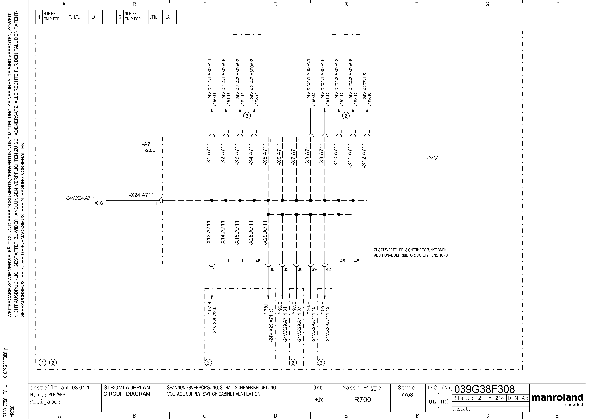

# +Jx — Sheet 12 of 214 — SPANNUNGSVERSORGUNG, SCHALTSCHRANKBELÜFTUNG

**VOLTAGE SUPPLY, SWITCH CABINET VENTILATION**

> Part of the manroland **R700** printing press IEC/UL circuit diagrams.
> Drawing class: **Stromlaufplan / Circuit diagram** (DIN A3).
> Document `+Jx` covers the **1st printing module + feed register** machine section.

## At a glance

| Field | Value |
|---|---|
| Document | `+Jx`  (039G38F308) |
| Sheet | **12** of 214 |
| Section (DE) | SPANNUNGSVERSORGUNG, SCHALTSCHRANKBELÜFTUNG |
| Section (EN) | VOLTAGE SUPPLY, SWITCH CABINET VENTILATION |
| Section type | POWER_SUPPLY — Voltage supply |
| Machine type | `R700` |
| Series | `7758` |
| Created | 03.01.10 |
| Replaces | — |
| Columns used | A, B, C, D, E, F |
| Path numbers | — |
| Labels on sheet | 96 |
| Cross-refs out | 17 |
| Cross-refs in | 41 |

**Previous:** [+Jx sheet 11](SHEET_0011.md) · **Next:** [+Jx sheet 13](SHEET_0013.md) · **Document TOC:** [_TOC.md](_TOC.md)  (+Jx) · **Master TOC:** [all sheets](../_MASTER_TOC.md)

## Sheet image (300 DPI, exact vector render)



_Rendered directly from the PDF vector layer at 300 DPI (1-bit), no OCR and no resampling. Use it to confirm anything ambiguous in the text below._

## Cross-references on this sheet

Each entry is a wire leaving this sheet. The printed token is `/sheet.column`; the link resolves to that sheet inside the same document.

| Ref | Target sheet | Col | Path | Destination on target | Target section | From col |
|---|---|---|---|---|---|---|
| `/190.G` | [+Jx sheet 190](SHEET_0190.md) | G | — | 24V.X214\1.A300A:1 | OPTION: ZWISCHENTROCKNER, VORBEREITUNG | C |
| `/197.B` | [+Jx sheet 197](SHEET_0197.md) | B | — | 24V.X214\1.A300A:1 | OPTION: ZWISCHENTROCKNER, VORBEREITUNG | C |
| `/191.G` | [+Jx sheet 191](SHEET_0191.md) | G | — | 24V.X214\1.A300A:5 | OPTION: ZWISCHENTROCKNER, VORBEREITUNG | C |
| `/192.G` | [+Jx sheet 192](SHEET_0192.md) | G | — | 24V.X214\2.A300A:2 | OPTION: ZWISCHENTROCKNER, VORBEREITUNG | D |
| `/193.G` | [+Jx sheet 193](SHEET_0193.md) | G | — | 24V.X214\2.A300A:6 | OPTION: ZWISCHENTROCKNER, VORBEREITUNG | D |
| `/190.C` | [+Jx sheet 190](SHEET_0190.md) | C | — | 24V.X204\1.A300A:1 | OPTION: ZWISCHENTROCKNER, VORBEREITUNG | E |
| `/191.C` | [+Jx sheet 191](SHEET_0191.md) | C | — | 24V.X204\1.A300A:5 | OPTION: ZWISCHENTROCKNER, VORBEREITUNG | E |
| `/192.C` | [+Jx sheet 192](SHEET_0192.md) | C | — | 24V.X204\2.A300A:2 | OPTION: ZWISCHENTROCKNER, VORBEREITUNG | E |
| `/193.C` | [+Jx sheet 193](SHEET_0193.md) | C | — | 24V.X204\2.A300A:6 | OPTION: ZWISCHENTROCKNER, VORBEREITUNG | E |
| `/196.B` | [+Jx sheet 196](SHEET_0196.md) | B | — | 24V.X207\1:5 | OPTION: ZWISCHENTROCKNER, VORBEREITUNG | E |
| `/20.D` | [+Jx sheet 20](SHEET_0020.md) | D | — | — | LACKPUMPE | B |
| `/6.G` | [+Jx sheet 6](SHEET_0006.md) | G | — | 24V.X24.A711:1 | SPANNUNGSVERSORGUNG, SCHALTSCHRANKBELÜFTUNG | A |
| `/178.H` | [+Jx sheet 178](SHEET_0178.md) | H | — | — | OPTION: TRANSFERMODUL 1 NACH | D |
| `/196.E` | [+Jx sheet 196](SHEET_0196.md) | E | — | — | OPTION: ZWISCHENTROCKNER, VORBEREITUNG | D |
| `/197.E` | [+Jx sheet 197](SHEET_0197.md) | E | — | — | OPTION: ZWISCHENTROCKNER, VORBEREITUNG | D |
| `/194.E` | [+Jx sheet 194](SHEET_0194.md) | E | — | — | OPTION: ZWISCHENTROCKNER, VORBEREITUNG | D |
| `/195.E` | [+Jx sheet 195](SHEET_0195.md) | E | — | — | OPTION: ZWISCHENTROCKNER, VORBEREITUNG | E |

### Incoming references (sheets that point here)

Every other sheet that sends a wire to this one. `Back-ref` is the token printed on *that* sheet; `Path` is its line number.

| From sheet | Cols | Back-ref | Path | Refs | What continues there |
|---|---|---|---|---|---|
| [+Jx#6](SHEET_0006.md) | G | `/6.G` | — | 1 | — |
| [+Jx#20](SHEET_0020.md) | C | `/20.C` | — | 1 | — |
| [+Jx#116](SHEET_0116.md) | B | `/116.B` | — | 1 | — |
| [+Jx#127](SHEET_0127.md) | B | `/127.B` | — | 1 | — |
| [+Jx#128](SHEET_0128.md) | H | `/128.H` | — | 1 | — |
| [+Jx#130](SHEET_0130.md) | F | `/130.F` | — | 1 | — |
| [+Jx#132](SHEET_0132.md) | D, H | `/132.D`, `/132.H` | — | 2 | STROMPFAD PIN 1 2 |
| [+Jx#133](SHEET_0133.md) | D | `/133.D` | — | 1 | STROMPFAD PIN 1 2 |
| [+Jx#134](SHEET_0134.md) | B, H | `/134.B`, `/134.H` | — | 2 | STROMPFAD PIN 1 2 |
| [+Jx#135](SHEET_0135.md) | E | `/135.E` | — | 1 | STROMPFAD PIN 1 2 |
| [+Jx#136](SHEET_0136.md) | G | `/136.G` | — | 1 | STROMPFAD PIN 1 2 |
| [+Jx#138](SHEET_0138.md) | A, B, E | `/138.A`, `/138.B`, `/138.E` | — | 3 | STROMPFAD PIN 1 2 |
| [+Jx#139](SHEET_0139.md) | B | `/139.B` | — | 1 | STROMPFAD PIN 1 2 |
| [+Jx#142](SHEET_0142.md) | D | `/142.D` | — | 1 | STROMPFAD PIN 1 2 |
| [+Jx#146](SHEET_0146.md) | D | `/146.D` | — | 1 | — |
| [+Jx#147](SHEET_0147.md) | E | `/147.E` | — | 7 | — |
| [+Jx#178](SHEET_0178.md) | G | `/178.G` | — | 1 | 24V.X29.A711:31 |
| [+Jx#190](SHEET_0190.md) | E | `/190.E` | — | 2 | 24V.X204\1.A300A:1 24V.X214\1.A300A:1 |
| [+Jx#191](SHEET_0191.md) | E | `/191.E` | — | 2 | 24V.X204\1.A300A:5 24V.X214\1.A300A:5 |
| [+Jx#192](SHEET_0192.md) | E | `/192.E` | — | 2 | 24V.X204\2.A300A:2 24V.X214\2.A300A:2 |
| [+Jx#193](SHEET_0193.md) | E | `/193.E` | — | 2 | 24V.X204\2.A300A:6 24V.X214\2.A300A:6 |
| [+Jx#194](SHEET_0194.md) | D | `/194.D` | — | 1 | 24V.X29.A711:40 |
| [+Jx#195](SHEET_0195.md) | D | `/195.D` | — | 1 | 24V.X29.A711:43 |
| [+Jx#196](SHEET_0196.md) | A, C | `/196.A`, `/196.C` | — | 2 | 2 24V.X29.A711:34; 24V.X207\1:5 |
| [+Jx#197](SHEET_0197.md) | A, D | `/197.A`, `/197.D` | — | 2 | 24V.X207\2:6; 24V.X29.A711:37 |


## Devices on this sheet

| Tag | Class | Class meaning (IEC) | Col | Sub | Terminal | Sign |
|---|---|---|---|---|---|---|
| `A711` | A | Baugruppe / assembly, module, PC board | B | — | — | — |
| `X1.A711` | — | cross-device reference | C | — | — | — |
| `X4.A711` | — | cross-device reference | D | — | — | — |
| `X2.A711` | — | cross-device reference | C | — | — | — |
| `X3.A711` | — | cross-device reference | C | — | — | — |
| `X12.A711` | — | cross-device reference | E | — | — | — |
| `X13.A711` | — | cross-device reference | C | — | — | — |
| `X29.A711` | — | cross-device reference | D | — | — | — |
| `X24.A711` | — | cross-device reference | B | — | — | — |
| `X8.A711` | — | cross-device reference | D | — | — | — |
| `X9.A711` | — | cross-device reference | E | — | — | — |
| `X10.A711` | — | cross-device reference | E | — | — | — |
| `X11.A711` | — | cross-device reference | E | — | — | — |
| `X6.A711` | — | cross-device reference | D | — | — | — |
| `X7.A711` | — | cross-device reference | D | — | — | — |
| `X14.A711` | — | cross-device reference | C | — | — | — |
| `X15.A711` | — | cross-device reference | C | — | — | — |
| `X28.A711` | — | cross-device reference | D | — | — | — |
| `X5.A711` | — | cross-device reference | D | — | — | — |

## Potentials / nets

| Potential | Count | Columns | Attached devices | Terminals |
|---|---|---|---|---|
| `24V` | 17 | A, C, D, E, F | `A300A`, `A711`, `X204\1`, `X204\2`, `X207\1`, `X207\2`, `X214\1`, `X214\2`, `X24`, `X29` | `1`, `2`, `31`, `34`, `37`, `40`, `43`, `5`, `6` |


A potential such as `L24+/4` or `M24+` is a named supply/return rail; every place it appears on this sheet is electrically common.

## Wire-end annotations (grouped as printed)

A wire that continues elsewhere is annotated with a small cluster: the destination description, the path/line number `#NN`, and the `/sheet.column` cross reference. Each row below is one such cluster exactly as it is grouped on the drawing.

| Col | Y | Path | Cross-ref | Text on the wire |
|---|---|---|---|---|
| A | 24.6 | — | — | `1 NUR BEI ONLY FOR TL, LTL` |
| B | 24.6 | — | — | `+JA 2 NUR BEI ONLY FOR LTTL +JA` |
| C | 117.9 | — | `/190.G`, `/197.B` | `24V.X214\1.A300A:1` |
| C | 117.9 | — | `/191.G` | `24V.X214\1.A300A:5` |
| D | 117.9 | — | `/192.G` | `24V.X214\2.A300A:2` |
| D | 117.9 | — | `/193.G` | `24V.X214\2.A300A:6` |
| E | 117.9 | — | `/190.C` | `24V.X204\1.A300A:1` |
| E | 117.9 | — | `/191.C` | `24V.X204\1.A300A:5` |
| E | 117.9 | — | `/192.C` | `24V.X204\2.A300A:2` |
| E | 117.9 | — | `/193.C` | `24V.X204\2.A300A:6` |
| E | 146.8 | — | `/196.B` | `24V.X207\1:5` |
| D | 229.8 | — | — | `2` |
| E | 229.8 | — | — | `2` |
| C | 261.1 | — | — | `1` |
| C | 261.1 | — | — | `1` |
| D | 261.1 | — | — | `1` |
| D | 261.1 | — | — | `1` |
| E | 261.1 | — | — | `1` |
| E | 261.1 | — | — | `1` |
| E | 261.1 | — | — | `1` |
| E | 261.1 | — | — | `1` |
| E | 261.1 | — | — | `1` |
| D | 278.1 | — | — | `1 1 1` |
| B | 285.1 | — | — | `A711` |
| C | 287.1 | — | — | `X1.A711` |
| C | 287.1 | — | — | `X2.A711` |
| C | 287.1 | — | — | `X3.A711` |
| D | 287.1 | — | — | `X4.A711` |
| D | 287.1 | — | — | `X5.A711` |
| D | 287.1 | — | — | `X6.A711` |
| D | 287.1 | — | — | `X7.A711` |
| D | 287.1 | — | — | `X8.A711` |
| E | 287.1 | — | — | `X9.A711` |
| E | 287.1 | — | — | `X10.A711` |
| E | 287.1 | — | — | `X11.A711` |
| E | 287.1 | — | — | `X12.A711` |
| B | 298.2 | — | `/20.D` | — |
| F | 313.5 | — | — | `24V` |
| B | 387.2 | — | — | `X24.A711` |
| A | 394.2 | — | `/6.G` | `24V.X24.A711:1` |
| B | 405.6 | — | — | `1` |
| C | 443.1 | — | — | `X13.A711` |
| C | 443.1 | — | — | `X14.A711` |
| C | 443.1 | — | — | `X15.A711` |
| D | 443.1 | — | — | `X28.A711` |
| D | 443.1 | — | — | `X29.A711` |
| F | 499.5 | — | — | `ZUSATZVERTEILER: SICHERHEITSFUNKTIONEN ADDITIONAL DISTRIBUTOR: SAFETY FUNCTIONS` |
| D | 520.4 | — | — | `1 1 48` |
| E | 520.4 | — | — | `45 48` |
| C | 537.4 | — | — | `1` |
| D | 537.4 | — | — | `30` |
| D | 537.4 | — | — | `33 36 39` |
| E | 537.4 | — | — | `42` |
| D | 606.0 | — | `/178.H` | — |
| D | 606.3 | — | `/196.E` | — |
| D | 606.3 | — | `/197.E` | — |
| D | 606.3 | — | `/194.E` | — |
| E | 606.3 | — | `/195.E` | — |
| D | 615.1 | — | — | `24V.X29.A711:31` |
| C | 616.2 | — | — | `24V.X207\2:6` |
| D | 616.2 | — | — | `24V.X29.A711:34` |
| D | 616.2 | — | — | `24V.X29.A711:37` |
| E | 616.2 | — | — | `24V.X29.A711:40` |
| E | 616.2 | — | — | `24V.X29.A711:43` |
| A | 725.5 | — | — | `1` |
| C | 725.9 | — | — | `2 2 2 2` |


## Notes and free text on this sheet

| Text | Col | Y (pt) |
|---|---|---|
| `ZUSATZVERTEILER: SICHERHEITSFUNKTIONEN` | F | 499.48 |
| `ADDITIONAL DISTRIBUTOR: SAFETY FUNCTIONS` | F | 510.11 |
| `NUR BEI` | A | 24.63 |
| `ONLY FOR` | A | 35.32 |
| `TL, LTL` | A | 31.76 |
| `NUR BEI` | B | 24.63 |
| `ONLY FOR` | B | 35.32 |
| `LTTL` | B | 31.74 |
| `+JA` | A | 31.71 |
| `+JA` | B | 31.71 |

## Complete label inventory (exact text from the drawing)

Every text object inside the drawing area of this sheet, in DIN reading order (column A→H, then top→bottom). This is the authoritative list: if a string is not here it is not printed on this sheet.

| Col | Y | X | Dir | Type | Text |
|---|---|---|---|---|---|
| A | 24.6 | 87.3 | → | text | `NUR BEI` |
| A | 30.0 | 75.4 | → | number | `1` |
| A | 31.7 | 180.4 | → | text | `+JA` |
| A | 31.8 | 138.2 | → | text | `TL, LTL` |
| A | 35.3 | 87.6 | → | text | `ONLY FOR` |
| A | 394.2 | 131.5 | → | potential | `24V.X24.A711:1` |
| A | 404.1 | 190.5 | → | cross-reference | `/6.G` |
| A | 725.4 | 83.2 | → | number | `1` |
| A | 725.9 | 104.3 | → | number | `2` |
| B | 24.6 | 250.3 | → | text | `NUR BEI` |
| B | 30.0 | 238.1 | → | number | `2` |
| B | 31.7 | 300.6 | → | text | `LTTL` |
| B | 31.7 | 329.2 | → | text | `+JA` |
| B | 35.3 | 250.6 | → | text | `ONLY FOR` |
| B | 285.1 | 285.4 | → | device tag | `A711` |
| B | 298.2 | 291.1 | → | cross-reference | `/20.D` |
| B | 387.2 | 259.2 | → | device ref | `X24.A711` |
| B | 405.6 | 311.0 | → | number | `1` |
| C | 117.9 | 416.9 | ↕ | potential | `24V.X214\1.A300A:1` |
| C | 117.9 | 445.3 | ↕ | potential | `24V.X214\1.A300A:5` |
| C | 117.9 | 473.6 | ↕ | potential | `24V.X214\2.A300A:2` |
| C | 186.2 | 426.8 | ↕ | cross-reference | `/190.G` |
| C | 186.2 | 455.2 | ↕ | cross-reference | `/191.G` |
| C | 261.1 | 427.2 | → | number | `1` |
| C | 261.1 | 455.5 | → | number | `1` |
| C | 287.2 | 414.1 | ↕ | device ref | `X1.A711` |
| C | 287.2 | 442.4 | ↕ | device ref | `X2.A711` |
| C | 287.2 | 470.8 | ↕ | device ref | `X3.A711` |
| C | 443.1 | 414.1 | ↕ | device ref | `X13.A711` |
| C | 443.1 | 442.4 | ↕ | device ref | `X14.A711` |
| C | 443.1 | 470.8 | ↕ | device ref | `X15.A711` |
| C | 520.4 | 455.5 | → | number | `1` |
| C | 537.4 | 427.2 | → | number | `1` |
| C | 606.3 | 416.9 | ↕ | cross-reference | `/197.B` |
| C | 616.3 | 426.8 | ↕ | potential | `24V.X207\2:6` |
| C | 725.9 | 416.1 | → | number | `2` |
| D | 117.9 | 502.0 | ↕ | potential | `24V.X214\2.A300A:6` |
| D | 117.9 | 615.3 | ↕ | potential | `24V.X204\1.A300A:1` |
| D | 186.2 | 483.5 | ↕ | cross-reference | `/192.G` |
| D | 186.2 | 511.9 | ↕ | cross-reference | `/193.G` |
| D | 229.8 | 494.1 | → | number | `2` |
| D | 261.1 | 483.9 | → | number | `1` |
| D | 261.1 | 512.2 | → | number | `1` |
| D | 278.1 | 540.6 | → | number | `1` |
| D | 278.1 | 568.9 | → | number | `1` |
| D | 278.1 | 597.3 | → | number | `1` |
| D | 287.2 | 499.1 | ↕ | device ref | `X4.A711` |
| D | 287.2 | 527.5 | ↕ | device ref | `X5.A711` |
| D | 287.2 | 555.8 | ↕ | device ref | `X6.A711` |
| D | 287.2 | 584.2 | ↕ | device ref | `X7.A711` |
| D | 287.2 | 612.5 | ↕ | device ref | `X8.A711` |
| D | 443.1 | 499.1 | ↕ | device ref | `X28.A711` |
| D | 443.1 | 527.5 | ↕ | device ref | `X29.A711` |
| D | 520.4 | 483.9 | → | number | `1` |
| D | 520.4 | 513.1 | → | number | `48` |
| D | 537.4 | 541.1 | → | number | `30` |
| D | 537.4 | 569.5 | → | number | `33` |
| D | 537.4 | 597.8 | → | number | `36` |
| D | 606.0 | 530.3 | ↕ | cross-reference | `/178.H` |
| D | 606.3 | 558.6 | ↕ | cross-reference | `/196.E` |
| D | 606.3 | 587.0 | ↕ | cross-reference | `/197.E` |
| D | 606.3 | 615.3 | ↕ | cross-reference | `/194.E` |
| D | 615.1 | 540.2 | ↕ | potential | `24V.X29.A711:31` |
| D | 616.3 | 568.6 | ↕ | potential | `24V.X29.A711:34` |
| D | 616.3 | 596.9 | ↕ | potential | `24V.X29.A711:37` |
| D | 725.9 | 586.2 | → | number | `2` |
| E | 117.9 | 643.7 | ↕ | potential | `24V.X204\1.A300A:5` |
| E | 117.9 | 672.0 | ↕ | potential | `24V.X204\2.A300A:2` |
| E | 117.9 | 700.4 | ↕ | potential | `24V.X204\2.A300A:6` |
| E | 146.8 | 728.7 | ↕ | potential | `24V.X207\1:5` |
| E | 186.8 | 625.3 | ↕ | cross-reference | `/190.C` |
| E | 186.8 | 653.6 | ↕ | cross-reference | `/191.C` |
| E | 186.8 | 682.0 | ↕ | cross-reference | `/192.C` |
| E | 186.8 | 710.3 | ↕ | cross-reference | `/193.C` |
| E | 187.1 | 738.6 | ↕ | cross-reference | `/196.B` |
| E | 229.8 | 692.5 | → | number | `2` |
| E | 261.1 | 625.6 | → | number | `1` |
| E | 261.1 | 654.0 | → | number | `1` |
| E | 261.1 | 682.3 | → | number | `1` |
| E | 261.1 | 710.6 | → | number | `1` |
| E | 261.1 | 739.0 | → | number | `1` |
| E | 287.2 | 640.9 | ↕ | device ref | `X9.A711` |
| E | 287.2 | 669.2 | ↕ | device ref | `X10.A711` |
| E | 287.2 | 697.6 | ↕ | device ref | `X11.A711` |
| E | 287.2 | 725.9 | ↕ | device ref | `X12.A711` |
| E | 520.4 | 683.1 | → | number | `45` |
| E | 520.4 | 711.5 | → | number | `48` |
| E | 537.4 | 626.2 | → | number | `39` |
| E | 537.4 | 654.8 | → | number | `42` |
| E | 606.3 | 643.7 | ↕ | cross-reference | `/195.E` |
| E | 616.3 | 625.3 | ↕ | potential | `24V.X29.A711:40` |
| E | 616.3 | 653.6 | ↕ | potential | `24V.X29.A711:43` |
| E | 725.9 | 642.9 | → | number | `2` |
| F | 313.5 | 856.3 | → | potential | `24V` |
| F | 499.5 | 751.2 | → | text | `ZUSATZVERTEILER: SICHERHEITSFUNKTIONEN` |
| F | 510.1 | 751.2 | → | text | `ADDITIONAL DISTRIBUTOR: SAFETY FUNCTIONS` |

## Reading-order text block

The same content as a plain block, grouped by DIN column — convenient to paste or to match against a visual description.

```text
=== Column A ===
  24.6   87.3  text         NUR BEI
  30.0   75.4  numeric      1
  31.7  180.4  text         +JA
  31.8  138.2  text         TL, LTL
  35.3   87.6  text         ONLY FOR
 394.2  131.5  net          24V.X24.A711:1
 404.1  190.5  xref         /6.G
 725.4   83.2  numeric      1
 725.9  104.3  numeric      2
=== Column B ===
  24.6  250.3  text         NUR BEI
  30.0  238.1  numeric      2
  31.7  300.6  text         LTTL
  31.7  329.2  text         +JA
  35.3  250.6  text         ONLY FOR
 285.1  285.4  devtag       A711
 298.2  291.1  xref         /20.D
 387.2  259.2  devref       X24.A711
 405.6  311.0  numeric      1
=== Column C ===
 117.9  416.9  net          24V.X214\1.A300A:1
 117.9  445.3  net          24V.X214\1.A300A:5
 117.9  473.6  net          24V.X214\2.A300A:2
 186.2  426.8  xref         /190.G
 186.2  455.2  xref         /191.G
 261.1  427.2  numeric      1
 261.1  455.5  numeric      1
 287.2  414.1  devref       X1.A711
 287.2  442.4  devref       X2.A711
 287.2  470.8  devref       X3.A711
 443.1  414.1  devref       X13.A711
 443.1  442.4  devref       X14.A711
 443.1  470.8  devref       X15.A711
 520.4  455.5  numeric      1
 537.4  427.2  numeric      1
 606.3  416.9  xref         /197.B
 616.3  426.8  net          24V.X207\2:6
 725.9  416.1  numeric      2
=== Column D ===
 117.9  502.0  net          24V.X214\2.A300A:6
 117.9  615.3  net          24V.X204\1.A300A:1
 186.2  483.5  xref         /192.G
 186.2  511.9  xref         /193.G
 229.8  494.1  numeric      2
 261.1  483.9  numeric      1
 261.1  512.2  numeric      1
 278.1  540.6  numeric      1
 278.1  568.9  numeric      1
 278.1  597.3  numeric      1
 287.2  499.1  devref       X4.A711
 287.2  527.5  devref       X5.A711
 287.2  555.8  devref       X6.A711
 287.2  584.2  devref       X7.A711
 287.2  612.5  devref       X8.A711
 443.1  499.1  devref       X28.A711
 443.1  527.5  devref       X29.A711
 520.4  483.9  numeric      1
 520.4  513.1  numeric      48
 537.4  541.1  numeric      30
 537.4  569.5  numeric      33
 537.4  597.8  numeric      36
 606.0  530.3  xref         /178.H
 606.3  558.6  xref         /196.E
 606.3  587.0  xref         /197.E
 606.3  615.3  xref         /194.E
 615.1  540.2  net          24V.X29.A711:31
 616.3  568.6  net          24V.X29.A711:34
 616.3  596.9  net          24V.X29.A711:37
 725.9  586.2  numeric      2
=== Column E ===
 117.9  643.7  net          24V.X204\1.A300A:5
 117.9  672.0  net          24V.X204\2.A300A:2
 117.9  700.4  net          24V.X204\2.A300A:6
 146.8  728.7  net          24V.X207\1:5
 186.8  625.3  xref         /190.C
 186.8  653.6  xref         /191.C
 186.8  682.0  xref         /192.C
 186.8  710.3  xref         /193.C
 187.1  738.6  xref         /196.B
 229.8  692.5  numeric      2
 261.1  625.6  numeric      1
 261.1  654.0  numeric      1
 261.1  682.3  numeric      1
 261.1  710.6  numeric      1
 261.1  739.0  numeric      1
 287.2  640.9  devref       X9.A711
 287.2  669.2  devref       X10.A711
 287.2  697.6  devref       X11.A711
 287.2  725.9  devref       X12.A711
 520.4  683.1  numeric      45
 520.4  711.5  numeric      48
 537.4  626.2  numeric      39
 537.4  654.8  numeric      42
 606.3  643.7  xref         /195.E
 616.3  625.3  net          24V.X29.A711:40
 616.3  653.6  net          24V.X29.A711:43
 725.9  642.9  numeric      2
=== Column F ===
 313.5  856.3  net          24V
 499.5  751.2  text         ZUSATZVERTEILER: SICHERHEITSFUNKTIONEN
 510.1  751.2  text         ADDITIONAL DISTRIBUTOR: SAFETY FUNCTIONS
```

---
_Generated from the PDF vector text layer; no OCR. Source: `R700_7758_IEC_UL_JX_039G38F308_p`, sheet 12._
