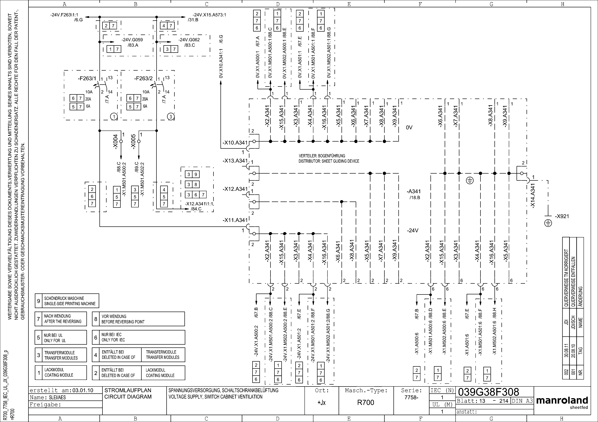

# +Jx — Sheet 13 of 214 — SPANNUNGSVERSORGUNG, SCHALTSCHRANKBELÜFTUNG

**VOLTAGE SUPPLY, SWITCH CABINET VENTILATION**

> Part of the manroland **R700** printing press IEC/UL circuit diagrams.
> Drawing class: **Stromlaufplan / Circuit diagram** (DIN A3).
> Document `+Jx` covers the **1st printing module + feed register** machine section.

## At a glance

| Field | Value |
|---|---|
| Document | `+Jx`  (039G38F308) |
| Sheet | **13** of 214 |
| Section (DE) | SPANNUNGSVERSORGUNG, SCHALTSCHRANKBELÜFTUNG |
| Section (EN) | VOLTAGE SUPPLY, SWITCH CABINET VENTILATION |
| Section type | POWER_SUPPLY — Voltage supply |
| Machine type | `R700` |
| Series | `7758` |
| Created | 03.01.10 |
| Replaces | — |
| Columns used | A, B, C, D, E, F, G, H |
| Path numbers | — |
| Labels on sheet | 270 |
| Cross-refs out | 29 |
| Cross-refs in | 47 |

**Previous:** [+Jx sheet 12](SHEET_0012.md) · **Next:** [+Jx sheet 14](SHEET_0014.md) · **Document TOC:** [_TOC.md](_TOC.md)  (+Jx) · **Master TOC:** [all sheets](../_MASTER_TOC.md)

## Sheet image (300 DPI, exact vector render)



_Rendered directly from the PDF vector layer at 300 DPI (1-bit), no OCR and no resampling. Use it to confirm anything ambiguous in the text below._

## Cross-references on this sheet

Each entry is a wire leaving this sheet. The printed token is `/sheet.column`; the link resolves to that sheet inside the same document.

| Ref | Target sheet | Col | Path | Destination on target | Target section | From col |
|---|---|---|---|---|---|---|
| `/6.G` | [+Jx sheet 6](SHEET_0006.md) | G | — | 24V.F263\1:1 | SPANNUNGSVERSORGUNG, SCHALTSCHRANKBELÜFTUNG | A |
| `/31.B` | [+Jx sheet 31](SHEET_0031.md) | B | — | — | BELEUCHTUNG | C |
| `/88.G` | [+Jx sheet 88](SHEET_0088.md) | G | — | 0V.X1.M502.A501:1 | BOGENFÜHRUNG, NACH WENDUNG | E |
| `/88.C` | [+Jx sheet 88](SHEET_0088.md) | C | — | 0V.X1.M501.A500:1 | BOGENFÜHRUNG, NACH WENDUNG | D |
| `/88.E` | [+Jx sheet 88](SHEET_0088.md) | E | — | 0V.X1.M502.A500:1 | BOGENFÜHRUNG, NACH WENDUNG | D |
| `/88.F` | [+Jx sheet 88](SHEET_0088.md) | F | — | 0V.X1.M501.A501:1 | BOGENFÜHRUNG, NACH WENDUNG | E |
| `/6.G` | [+Jx sheet 6](SHEET_0006.md) | G | — | 0V.X10.A341:1 | SPANNUNGSVERSORGUNG, SCHALTSCHRANKBELÜFTUNG | C |
| `/67.A` | [+Jx sheet 67](SHEET_0067.md) | A | — | 0V.X1.A500:1 | BOGENFÜHRUNG | D |
| `/67.E` | [+Jx sheet 67](SHEET_0067.md) | E | — | 0V.X1.A501:1 | BOGENFÜHRUNG | D |
| `/83.A` | [+Jx sheet 83](SHEET_0083.md) | A | — | 24V.G059 | BOGENFÜHRUNG, NACH WENDUNG | B |
| `/83.C` | [+Jx sheet 83](SHEET_0083.md) | C | — | 24V.G062 | BOGENFÜHRUNG, NACH WENDUNG | C |
| `/7.A` | [+Jx sheet 7](SHEET_0007.md) | A | — | — | SPANNUNGSVERSORGUNG, SCHALTSCHRANKBELÜFTUNG | B |
| `/7.A` | [+Jx sheet 7](SHEET_0007.md) | A | — | — | SPANNUNGSVERSORGUNG, SCHALTSCHRANKBELÜFTUNG | B |
| `/88.C` | [+Jx sheet 88](SHEET_0088.md) | C | — | — | BOGENFÜHRUNG, NACH WENDUNG | B |
| `/89.C` | [+Jx sheet 89](SHEET_0089.md) | C | — | — | BOGENFÜHRUNG, NACH WENDUNG | B |
| `/18.B` | [+Jx sheet 18](SHEET_0018.md) | B | — | — | LACKPUMPE | F |
| `/84.C` | [+Jx sheet 84](SHEET_0084.md) | C | — | X12.A341\1:1 | BOGENFÜHRUNG | C |
| `/67.B` | [+Jx sheet 67](SHEET_0067.md) | B | — | 24V.X1.A500:2 | BOGENFÜHRUNG | D |
| `/88.C` | [+Jx sheet 88](SHEET_0088.md) | C | — | 24V.X1.M501.A500:2 | BOGENFÜHRUNG, NACH WENDUNG | D |
| `/88.E` | [+Jx sheet 88](SHEET_0088.md) | E | — | 24V.X1.M502.A500:2 | BOGENFÜHRUNG, NACH WENDUNG | D |
| `/88.H` | [+Jx sheet 88](SHEET_0088.md) | H | — | X1.M502.A501:6 | BOGENFÜHRUNG, NACH WENDUNG | G |
| `/88.F` | [+Jx sheet 88](SHEET_0088.md) | F | — | 24V.X1.M501.A501:2 | BOGENFÜHRUNG, NACH WENDUNG | D |
| `/88.D` | [+Jx sheet 88](SHEET_0088.md) | D | — | X1.M501.A500:6 | BOGENFÜHRUNG, NACH WENDUNG | F |
| `/88.E` | [+Jx sheet 88](SHEET_0088.md) | E | — | X1.M502.A500:6 | BOGENFÜHRUNG, NACH WENDUNG | F |
| `/88.F` | [+Jx sheet 88](SHEET_0088.md) | F | — | X1.M501.A501:6 | BOGENFÜHRUNG, NACH WENDUNG | G |
| `/67.E` | [+Jx sheet 67](SHEET_0067.md) | E | — | X1.A501:6 | BOGENFÜHRUNG | G |
| `/67.E` | [+Jx sheet 67](SHEET_0067.md) | E | — | 24V.X1.A501:2 | BOGENFÜHRUNG | D |
| `/88.G` | [+Jx sheet 88](SHEET_0088.md) | G | — | 24V.X1.M502.A501:2 | BOGENFÜHRUNG, NACH WENDUNG | E |
| `/67.B` | [+Jx sheet 67](SHEET_0067.md) | B | — | X1.A500:6 | BOGENFÜHRUNG | F |

### Incoming references (sheets that point here)

Every other sheet that sends a wire to this one. `Back-ref` is the token printed on *that* sheet; `Path` is its line number.

| From sheet | Cols | Back-ref | Path | Refs | What continues there |
|---|---|---|---|---|---|
| [+Jx#6](SHEET_0006.md) | G, H | `/6.G`, `/6.H` | — | 2 | 0V.X10.A341:1 |
| [+Jx#7](SHEET_0007.md) | A | `/7.A` | — | 2 | — |
| [+Jx#18](SHEET_0018.md) | B | `/18.B` | — | 1 | — |
| [+Jx#31](SHEET_0031.md) | A | `/31.A` | — | 1 | 24V.X15.A573:1 |
| [+Jx#67](SHEET_0067.md) | A, B, E | `/67.A`, `/67.B`, `/67.E` | — | 6 | 0V.X1.A500:1; 0V.X1.A501:1; 24V.X1.A500:2; 24V.X1.A501:2; X1.A500:6; X1.A501:6 |
| [+Jx#83](SHEET_0083.md) | A, C | `/83.A`, `/83.C` | — | 2 | — |
| [+Jx#84](SHEET_0084.md) | C | `/84.C` | — | 1 | X12.A341\1:1 |
| [+Jx#88](SHEET_0088.md) | C, D, E, F, G, H | `/88.C`, `/88.D`, `/88.E`, `/88.F`, `/88.G`, `/88.H` | — | 13 | 0V.X1.M501.A500:1; 0V.X1.M501.A501:1; 0V.X1.M502.A500:1; 0V.X1.M502.A501:1; 24V.X1.M501.A500:2; 24V.X1.M501.A501:2; 24V.X1.M502.A500:2; 24V.X1.M502.A501:2; X1.M |
| [+Jx#89](SHEET_0089.md) | B | `/89.B` | — | 1 | X1.M501.A502:2 |
| [+Jx#126](SHEET_0126.md) | A | `/126.A` | — | 3 | — |
| [+Jx#127](SHEET_0127.md) | F | `/127.F` | — | 3 | — |
| [+Jx#129](SHEET_0129.md) | F | `/129.F` | — | 3 | — |
| [+Jx#131](SHEET_0131.md) | F | `/131.F` | — | 3 | — |
| [+Jx#138](SHEET_0138.md) | G | `/138.G` | — | 3 | — |
| [+Jx#139](SHEET_0139.md) | E | `/139.E` | — | 3 | — |


## Devices on this sheet

| Tag | Class | Class meaning (IEC) | Col | Sub | Terminal | Sign |
|---|---|---|---|---|---|---|
| `A341` | A | Baugruppe / assembly, module, PC board | F | — | — | — |
| `F263/2` | F | Schutz / protection device (fuse, circuit breaker) | B | 2 | — | — |
| `F263/1` | F | Schutz / protection device (fuse, circuit breaker) | A | 1 | — | — |
| `X005` | X | Klemme / terminal, plug connector | B | — | — | — |
| `X004` | X | Klemme / terminal, plug connector | B | — | — | — |
| `X921` | X | Klemme / terminal, plug connector | H | — | — | — |
| `X4.A341` | — | cross-device reference | D | — | — | — |
| `X10.A341` | — | cross-device reference | C | — | — | — |
| `X13.A341` | — | cross-device reference | C | — | — | — |
| `X12.A341` | — | cross-device reference | C | — | — | — |
| `X11.A341` | — | cross-device reference | C | — | — | — |
| `X2.A341` | — | cross-device reference | D | — | — | — |
| `X15.A341` | — | cross-device reference | D | — | — | — |
| `X2.A341` | — | cross-device reference | D | — | — | — |
| `X15.A341` | — | cross-device reference | D | — | — | — |
| `X8.A341` | — | cross-device reference | E | — | — | — |
| `X6.A341` | — | cross-device reference | E | — | — | — |
| `X7.A341` | — | cross-device reference | E | — | — | — |
| `X9.A341` | — | cross-device reference | F | — | — | — |
| `X16.A341` | — | cross-device reference | E | — | — | — |
| `X6.A341` | — | cross-device reference | E | — | — | — |
| `X7.A341` | — | cross-device reference | E | — | — | — |
| `X9.A341` | — | cross-device reference | F | — | — | — |
| `X8.A341` | — | cross-device reference | E | — | — | — |
| `X4.A341` | — | cross-device reference | D | — | — | — |
| `X16.A341` | — | cross-device reference | E | — | — | — |
| `X14.A341` | — | cross-device reference | H | — | — | — |
| `X6.A341` | — | cross-device reference | F | — | — | — |
| `X7.A341` | — | cross-device reference | G | — | — | — |
| `X9.A341` | — | cross-device reference | G | — | — | — |
| `X8.A341` | — | cross-device reference | G | — | — | — |
| `X15.A341` | — | cross-device reference | F | — | — | — |
| `X4.A341` | — | cross-device reference | G | — | — | — |
| `X16.A341` | — | cross-device reference | G | — | — | — |
| `X2.A341` | — | cross-device reference | F | — | — | — |
| `NR.` | — | cross-device reference | H | — | — | — |
| `20.08.10` | — | cross-device reference | H | — | — | — |
| `X1.M501.A500:6` | — | cross-device reference | F | — | 6 | — |
| `X1.M501.A501:6` | — | cross-device reference | G | — | 6 | — |
| `X1.M502.A500:6` | — | cross-device reference | F | — | 6 | — |
| `X1.M502.A501:6` | — | cross-device reference | G | — | 6 | — |
| `X1.A501:6` | — | cross-device reference | G | — | 6 | — |
| `X1.M501.A502:2` | — | cross-device reference | B | — | 2 | — |
| `X1.M501.A500:2` | — | cross-device reference | B | — | 2 | — |
| `X1.A500:6` | — | cross-device reference | F | — | 6 | — |
| `X12.A341\1:1` | — | cross-device reference | C | — | 1 | — |
| `30.08.11` | — | cross-device reference | H | — | — | — |
| `X3.A341` | — | cross-device reference | D | — | — | — |
| `X3.A341` | — | cross-device reference | D | — | — | — |
| `X5.A341` | — | cross-device reference | E | — | — | — |
| `X5.A341` | — | cross-device reference | E | — | — | — |
| `X3.A341` | — | cross-device reference | G | — | — | — |
| `X5.A341` | — | cross-device reference | G | — | — | — |

## Potentials / nets

| Potential | Count | Columns | Attached devices | Terminals |
|---|---|---|---|---|
| `0V` | 8 | C, D, E, F | `A341`, `A500`, `A501`, `M501`, `M502`, `X1`, `X10` | `1` |
| `24V` | 11 | A, B, C, D, E, F | `A500`, `A501`, `A573`, `F263\1`, `G059`, `G062`, `M501`, `M502`, `X1`, `X15` | `1`, `2` |


A potential such as `L24+/4` or `M24+` is a named supply/return rail; every place it appears on this sheet is electrically common.

## Wire-end annotations (grouped as printed)

A wire that continues elsewhere is annotated with a small cluster: the destination description, the path/line number `#NN`, and the `/sheet.column` cross reference. Each row below is one such cluster exactly as it is grouped on the drawing.

| Col | Y | Path | Cross-ref | Text on the wire |
|---|---|---|---|---|
| D | 23.7 | — | — | `2` |
| D | 23.7 | — | — | `1` |
| D | 24.0 | — | — | `2` |
| E | 24.0 | — | — | `1` |
| A | 25.7 | — | `/6.G` | `24V.F263\1:1` |
| C | 25.7 | — | — | `24V.X15.A573:1` |
| C | 35.6 | — | `/31.B` | — |
| D | 37.9 | — | — | `7` |
| D | 37.9 | — | — | `7` |
| D | 38.1 | — | — | `7` |
| E | 38.1 | — | — | `7` |
| B | 47.8 | — | — | `2 7 4 7` |
| D | 52.0 | — | — | `6` |
| D | 52.0 | — | — | `6` |
| D | 52.3 | — | — | `6` |
| E | 52.3 | — | — | `6` |
| E | 54.1 | — | `/88.G` | `0V.X1.M502.A501:1` |
| D | 54.7 | — | `/88.C` | `0V.X1.M501.A500:1` |
| D | 55.0 | — | `/88.E` | `0V.X1.M502.A500:1` |
| E | 55.6 | — | `/88.F` | `0V.X1.M501.A501:1` |
| C | 69.4 | — | `/6.G` | `0V.X10.A341:1` |
| D | 72.3 | — | `/67.A` | `0V.X1.A500:1` |
| D | 72.3 | — | `/67.E` | `0V.X1.A501:1` |
| B | 75.4 | — | `/83.A` | `24V.G059` |
| C | 75.4 | — | `/83.C` | `24V.G062` |
| B | 94.5 | — | — | `1 7 3 7` |
| B | 151.2 | — | — | `13` |
| B | 151.2 | — | — | `13` |
| A | 151.9 | — | — | `F263/1` |
| B | 151.9 | — | — | `F263/2` |
| B | 154.1 | — | — | `1` |
| B | 154.1 | — | — | `1` |
| A | 179.6 | — | — | `10A 2` |
| B | 179.6 | — | — | `14` |
| B | 179.6 | — | — | `10A 2` |
| B | 179.6 | — | — | `14` |
| D | 183.1 | — | — | `1` |
| D | 183.1 | — | — | `1` |
| E | 183.1 | — | — | `1` |
| E | 183.1 | — | — | `1` |
| B | 189.9 | — | `/7.A` | — |
| B | 189.9 | — | `/7.A` | — |
| A | 192.3 | — | — | `6 7` |
| B | 192.3 | — | — | `6 7` |
| B | 194.8 | — | — | `20A 20A` |
| B | 194.8 | — | — | `20A` |
| D | 200.1 | — | — | `1` |
| E | 200.1 | — | — | `1 1` |
| E | 201.9 | — | — | `1` |
| F | 201.9 | — | — | `1` |
| F | 203.3 | — | — | `1` |
| F | 203.3 | — | — | `1` |
| G | 203.3 | — | — | `1` |
| G | 203.3 | — | — | `1` |
| G | 203.3 | — | — | `1` |
| G | 208.2 | — | — | `X8.A341` |
| B | 208.9 | — | — | `6A 6A` |
| B | 208.9 | — | — | `6A` |
| D | 209.2 | — | — | `X2.A341` |
| D | 209.2 | — | — | `X15.A341` |
| D | 209.2 | — | — | `X3.A341 X3.A341` |
| D | 209.2 | — | — | `X4.A341` |
| E | 209.2 | — | — | `X16.A341` |
| E | 209.2 | — | — | `X5.A341` |
| A | 209.3 | — | — | `5 7` |
| B | 209.3 | — | — | `5 7` |
| E | 209.6 | — | — | `X6.A341` |
| E | 209.6 | — | — | `X7.A341` |
| E | 209.6 | — | — | `X8.A341` |
| F | 209.6 | — | — | `X9.A341` |
| F | 209.6 | — | — | `X6.A341` |
| G | 209.6 | — | — | `X7.A341` |
| G | 209.6 | — | — | `X9.A341` |
| B | 229.4 | — | — | `1 3` |
| F | 249.7 | — | — | `0V` |
| D | 257.5 | — | — | `2` |
| B | 263.8 | — | — | `1` |
| B | 263.8 | — | — | `1` |
| B | 267.6 | — | — | `X004` |
| B | 267.6 | — | — | `X005` |
| C | 279.9 | — | — | `X10.A341` |
| D | 299.3 | — | — | `1` |
| E | 308.1 | — | — | `DISTRIBUTOR: SHEET GUIDING DEVICE VERTEILER: BOGENFÜHRUNG` |
| C | 316.1 | — | — | `X13.A341 1` |
| G | 321.3 | — | — | `2` |
| B | 322.9 | — | `/88.C` | — |
| B | 322.9 | — | `/89.C` | — |
| B | 324.1 | — | — | `X1.M501.A500:2` |
| B | 324.1 | — | — | `X1.M501.A502:2` |
| C | 344.3 | — | — | `3 9` |
| H | 348.9 | — | — | `1` |
| D | 363.8 | — | — | `2` |
| C | 364.6 | — | — | `3 8` |
| H | 365.1 | — | — | `X14.A341` |
| C | 372.4 | — | — | `X12.A341 1` |
| A | 374.0 | — | — | `2` |
| B | 374.7 | — | — | `3` |
| B | 374.7 | — | — | `4` |
| B | 375.3 | — | — | `1` |
| F | 377.2 | — | — | `A341` |
| C | 384.8 | — | — | `3 6 7` |
| A | 388.1 | — | — | `6` |
| B | 388.9 | — | — | `5` |
| B | 388.9 | — | — | `5` |
| B | 389.4 | — | — | `5` |
| F | 390.3 | — | `/18.B` | — |
| A | 402.3 | — | — | `7` |
| C | 402.9 | — | `/84.C` | `X12.A341\1:1` |
| B | 403.0 | — | — | `7` |
| B | 403.0 | — | — | `7` |
| B | 403.6 | — | — | `7` |
| D | 421.6 | — | — | `2` |
| H | 426.9 | — | — | `X921` |
| C | 434.6 | — | — | `X11.A341` |
| D | 455.2 | — | — | `1` |
| F | 455.2 | — | — | `24V` |
| E | 477.0 | — | — | `X8.A341` |
| F | 477.0 | — | — | `X9.A341` |
| D | 478.5 | — | — | `X2.A341` |
| D | 478.5 | — | — | `X15.A341` |
| D | 478.5 | — | — | `X4.A341` |
| E | 478.5 | — | — | `X16.A341` |
| E | 478.5 | — | — | `X5.A341` |
| E | 478.5 | — | — | `X7.A341` |
| F | 478.5 | — | — | `X2.A341` |
| F | 478.5 | — | — | `X15.A341` |
| G | 478.5 | — | — | `X3.A341` |
| G | 478.5 | — | — | `X4.A341` |
| G | 478.5 | — | — | `X16.A341` |
| G | 478.5 | — | — | `X5.A341` |
| E | 479.9 | — | — | `X6.A341` |
| D | 484.3 | — | — | `2` |
| H | 497.0 | — | — | `JDI 30.08.11 QUERVERWEISE TM KORRIGIERT 002` |
| H | 512.2 | — | — | `001 JDI/SCH QUERVERWEISE ENTFALLEN 20.08.10` |
| D | 555.9 | — | — | `2` |
| E | 555.9 | — | — | `2 2` |
| E | 555.9 | — | — | `2` |
| F | 555.9 | — | — | `2` |
| F | 555.9 | — | — | `2` |
| G | 555.9 | — | — | `6` |
| G | 555.9 | — | — | `6` |
| H | 571.6 | — | — | `NR. NAME TAG ÄNDERUNG` |
| D | 572.9 | — | — | `2` |
| D | 572.9 | — | — | `2` |
| E | 572.9 | — | — | `2` |
| E | 572.9 | — | — | `2` |
| F | 572.9 | — | — | `6` |
| F | 572.9 | — | — | `6` |
| G | 572.9 | — | — | `6` |
| G | 572.9 | — | — | `6` |
| A | 592.5 | — | — | `9 SCHÖNDRUCK MASCHINE SINGLE SIDE PRINTING MACHINE` |
| D | 613.2 | — | `/67.B` | `24V.X1.A500:2` |
| D | 613.2 | — | `/88.C` | `24V.X1.M501.A500:2` |
| D | 613.2 | — | `/88.E` | `24V.X1.M502.A500:2` |
| G | 614.0 | — | `/88.H` | `X1.M502.A501:6` |
| D | 614.6 | — | `/88.F` | `24V.X1.M501.A501:2` |
| F | 614.6 | — | `/88.D` | `X1.M501.A500:6` |
| F | 615.2 | — | `/88.E` | `X1.M502.A500:6` |
| G | 615.7 | — | `/67.E` | `X1.A501:6` |
| G | 615.7 | — | `/88.F` | `X1.M501.A501:6` |
| D | 616.1 | — | `/67.E` | `24V.X1.A501:2` |
| E | 616.1 | — | `/88.G` | `24V.X1.M502.A501:2` |
| F | 616.1 | — | `/67.B` | `X1.A500:6` |
| A | 627.9 | — | — | `7 NACH WENDUNG` |
| B | 628.6 | — | — | `8 BEFORE REVERSING POINT VOR WENDUNG` |
| A | 638.5 | — | — | `AFTER THE REVERSING` |
| A | 664.8 | — | — | `5 NUR BEI UL ONLY FOR UL 6 NUR BEI IEC ONLY FOR IEC` |
| A | 699.4 | — | — | `3 4 ENTFÄLLT BEI DELETED IN CASE OF` |
| B | 699.5 | — | — | `TRANSFERMODULE TRANSFER MODULES` |
| A | 701.0 | — | — | `TRANSFERMODULE TRANSFER MODULES` |
| D | 724.8 | — | — | `2` |
| D | 725.1 | — | — | `1` |
| D | 725.8 | — | — | `2` |
| E | 726.3 | — | — | `1` |
| A | 734.9 | — | — | `1 LACKMODUL COATING MODULE 2 ENTFÄLLT BEI DELETED IN CASE OF` |
| F | 735.0 | — | — | `2` |
| F | 735.0 | — | — | `1` |
| B | 735.6 | — | — | `LACKMODUL COATING MODULE` |
| G | 736.1 | — | — | `7 1` |
| G | 736.1 | — | — | `2` |
| D | 739.0 | — | — | `7` |
| D | 739.3 | — | — | `7` |
| D | 739.9 | — | — | `7` |
| E | 740.5 | — | — | `7` |
| F | 749.1 | — | — | `7` |
| G | 750.3 | — | — | `7` |
| G | 750.3 | — | — | `7` |
| D | 753.1 | — | — | `6 6 6 6` |


## Reconstructed tables

This sheet carries tabular content (pin map / terminal assignment / index). The grid below was rebuilt from the drawing's own rule lines, so each row is exactly one physical row of the table.

### Table 1 — 5 data rows × 1 columns (at x=439.5, y=282.0)

| C1 |
|---|
| `X10.A341` |
| `1 X13.A341 1` |
| `2 X12.A341 1` |
| `2 X11.A341` |
| `1` |


### Table 2 — 2 data rows × 1 columns (at x=793.7, y=282.0)

| C1 |
|---|
| `A341 /18.B` |
| `24V` |


### Table 3 — 2 data rows × 1 columns (at x=1029.0, y=282.0)

| C1 |
|---|
| `2` |
| `1 X14.A341` |


## Notes and free text on this sheet

| Text | Col | Y (pt) |
|---|---|---|
| `VERTEILER: BOGENFÜHRUNG` | E | 308.15 |
| `DISTRIBUTOR: SHEET GUIDING DEVICE` | E | 318.77 |
| `10A` | B | 179.76 |
| `10A` | A | 179.76 |
| `TAG` | H | 692.65 |
| `NAME` | H | 633.42 |
| `ÄNDERUNG` | H | 571.56 |
| `JDI/SCH` | H | 629.62 |
| `QUERVERWEISE ENTFALLEN` | H | 512.19 |
| `JDI` | H | 637.54 |
| `QUERVERWEISE TM KORRIGIERT` | H | 497.02 |
| `20A` | A | 194.77 |
| `20A` | B | 194.77 |
| `6A` | B | 208.91 |
| `6A` | A | 208.91 |
| `LACKMODUL` | A | 734.92 |
| `COATING MODULE` | A | 745.55 |
| `ENTFÄLLT BEI` | B | 735.58 |
| `DELETED IN CASE OF` | B | 746.24 |
| `LACKMODUL` | B | 735.64 |
| `COATING MODULE` | B | 746.27 |
| `NUR BEI UL` | A | 666.21 |
| `ONLY FOR UL` | A | 676.86 |
| `NUR BEI IEC` | B | 664.75 |
| `ONLY FOR IEC` | B | 675.41 |
| `NACH WENDUNG` | A | 627.9 |
| `AFTER THE REVERSING` | A | 638.55 |
| `TRANSFERMODULE` | A | 700.95 |
| `TRANSFER MODULES` | A | 711.57 |
| `TRANSFERMODULE` | B | 699.5 |
| `TRANSFER MODULES` | B | 710.13 |
| `VOR WENDUNG` | B | 628.63 |
| `BEFORE REVERSING POINT` | B | 639.26 |
| `SCHÖNDRUCK MASCHINE` | A | 592.52 |
| `SINGLE SIDE PRINTING MACHINE` | A | 603.14 |

## Complete label inventory (exact text from the drawing)

Every text object inside the drawing area of this sheet, in DIN reading order (column A→H, then top→bottom). This is the authoritative list: if a string is not here it is not printed on this sheet.

| Col | Y | X | Dir | Type | Text |
|---|---|---|---|---|---|
| A | 25.7 | 100.3 | → | potential | `24V.F263\1:1` |
| A | 35.6 | 148.0 | → | cross-reference | `/6.G` |
| A | 151.9 | 155.3 | → | device tag | `F263/1` |
| A | 179.8 | 169.8 | → | text | `10A` |
| A | 192.3 | 143.6 | → | number | `6` |
| A | 192.3 | 157.7 | → | number | `7` |
| A | 194.8 | 170.1 | → | text | `20A` |
| A | 208.9 | 170.1 | → | text | `6A` |
| A | 209.3 | 143.6 | → | number | `5` |
| A | 209.3 | 157.7 | → | number | `7` |
| A | 374.0 | 181.0 | → | number | `2` |
| A | 388.1 | 180.9 | → | number | `6` |
| A | 402.3 | 180.9 | → | number | `7` |
| A | 592.5 | 88.3 | → | text | `SCHÖNDRUCK MASCHINE` |
| A | 596.0 | 73.9 | → | number | `9` |
| A | 603.1 | 88.3 | → | text | `SINGLE SIDE PRINTING MACHINE` |
| A | 627.9 | 88.1 | → | text | `NACH WENDUNG` |
| A | 632.1 | 73.5 | → | number | `7` |
| A | 632.1 | 187.9 | → | number | `8` |
| A | 638.5 | 88.6 | → | text | `AFTER THE REVERSING` |
| A | 666.2 | 87.3 | → | text | `NUR BEI UL` |
| A | 669.0 | 73.5 | → | number | `5` |
| A | 669.0 | 187.7 | → | number | `6` |
| A | 676.9 | 87.6 | → | text | `ONLY FOR UL` |
| A | 700.9 | 88.6 | → | text | `TRANSFERMODULE` |
| A | 703.7 | 187.6 | → | number | `4` |
| A | 703.9 | 74.0 | → | number | `3` |
| A | 711.6 | 88.6 | → | text | `TRANSFER MODULES` |
| A | 734.9 | 88.8 | → | text | `LACKMODUL` |
| A | 739.3 | 74.4 | → | number | `1` |
| A | 739.8 | 187.9 | → | number | `2` |
| A | 745.5 | 89.1 | → | text | `COATING MODULE` |
| B | 47.7 | 208.9 | → | number | `2` |
| B | 47.7 | 222.9 | → | number | `7` |
| B | 47.7 | 323.7 | → | number | `4` |
| B | 47.7 | 337.7 | → | number | `7` |
| B | 75.4 | 242.1 | → | potential | `24V.G059` |
| B | 86.1 | 254.4 | → | cross-reference | `/83.A` |
| B | 94.5 | 217.6 | → | number | `1` |
| B | 94.5 | 231.4 | → | number | `7` |
| B | 94.5 | 330.7 | → | number | `3` |
| B | 151.2 | 214.6 | → | number | `13` |
| B | 151.2 | 328.0 | → | number | `13` |
| B | 151.9 | 267.3 | → | device tag | `F263/2` |
| B | 154.0 | 200.4 | → | number | `1` |
| B | 154.0 | 313.8 | → | number | `1` |
| B | 179.6 | 201.3 | → | number | `2` |
| B | 179.6 | 214.6 | → | number | `14` |
| B | 179.6 | 314.6 | → | number | `2` |
| B | 179.6 | 328.0 | → | number | `14` |
| B | 179.8 | 283.2 | → | text | `10A` |
| B | 189.9 | 209.2 | ↕ | cross-reference | `/7.A` |
| B | 189.9 | 322.6 | ↕ | cross-reference | `/7.A` |
| B | 192.3 | 257.0 | → | number | `6` |
| B | 192.3 | 271.1 | → | number | `7` |
| B | 194.8 | 283.5 | → | text | `20A` |
| B | 194.8 | 283.5 | → | text | `20A` |
| B | 208.9 | 283.5 | → | text | `6A` |
| B | 208.9 | 283.5 | → | text | `6A` |
| B | 209.3 | 257.0 | → | number | `5` |
| B | 209.3 | 271.1 | → | number | `7` |
| B | 229.4 | 224.9 | → | number | `1` |
| B | 229.8 | 338.2 | → | number | `3` |
| B | 263.8 | 242.6 | → | number | `1` |
| B | 263.8 | 278.1 | → | number | `1` |
| B | 267.6 | 225.0 | ↕ | device tag | `X004` |
| B | 267.6 | 260.5 | ↕ | device tag | `X005` |
| B | 322.9 | 232.7 | ↕ | cross-reference | `/88.C` |
| B | 322.9 | 268.1 | ↕ | cross-reference | `/89.C` |
| B | 324.1 | 243.3 | ↕ | device ref | `X1.M501.A500:2` |
| B | 324.1 | 279.4 | ↕ | device ref | `X1.M501.A502:2` |
| B | 374.7 | 266.3 | → | number | `3` |
| B | 374.7 | 324.3 | → | number | `4` |
| B | 375.3 | 230.5 | → | number | `1` |
| B | 388.9 | 266.3 | → | number | `5` |
| B | 388.9 | 324.2 | → | number | `5` |
| B | 389.4 | 230.2 | → | number | `5` |
| B | 403.0 | 266.3 | → | number | `7` |
| B | 403.0 | 324.2 | → | number | `7` |
| B | 403.6 | 230.2 | → | number | `7` |
| B | 628.6 | 202.8 | → | text | `VOR WENDUNG` |
| B | 639.3 | 202.3 | → | text | `BEFORE REVERSING POINT` |
| B | 664.8 | 202.3 | → | text | `NUR BEI IEC` |
| B | 675.4 | 202.5 | → | text | `ONLY FOR IEC` |
| B | 699.4 | 203.0 | → | text | `ENTFÄLLT BEI` |
| B | 699.5 | 291.0 | → | text | `TRANSFERMODULE` |
| B | 710.1 | 203.0 | → | text | `DELETED IN CASE OF` |
| B | 710.1 | 291.0 | → | text | `TRANSFER MODULES` |
| B | 735.6 | 202.3 | → | text | `ENTFÄLLT BEI` |
| B | 735.6 | 290.5 | → | text | `LACKMODUL` |
| B | 746.2 | 202.3 | → | text | `DELETED IN CASE OF` |
| B | 746.3 | 290.7 | → | text | `COATING MODULE` |
| C | 25.7 | 383.8 | → | potential | `24V.X15.A573:1` |
| C | 35.6 | 374.2 | → | cross-reference | `/31.B` |
| C | 69.4 | 436.1 | ↕ | cross-reference | `/6.G` |
| C | 75.4 | 355.5 | → | potential | `24V.G062` |
| C | 86.2 | 367.2 | → | cross-reference | `/83.C` |
| C | 94.5 | 344.8 | → | number | `7` |
| C | 96.6 | 436.2 | ↕ | potential | `0V.X10.A341:1` |
| C | 279.9 | 443.3 | → | device ref | `X10.A341` |
| C | 316.1 | 443.5 | → | device ref | `X13.A341` |
| C | 344.3 | 373.3 | → | number | `3` |
| C | 344.3 | 387.5 | → | number | `9` |
| C | 364.6 | 373.3 | → | number | `3` |
| C | 364.6 | 387.5 | → | number | `8` |
| C | 372.5 | 443.5 | → | device ref | `X12.A341` |
| C | 384.8 | 373.3 | → | number | `3` |
| C | 384.8 | 387.5 | → | number | `6` |
| C | 384.8 | 402.2 | → | number | `7` |
| C | 402.9 | 368.2 | → | device ref | `X12.A341\1:1` |
| C | 412.9 | 380.2 | → | cross-reference | `/84.C` |
| C | 434.6 | 443.5 | → | device ref | `X11.A341` |
| D | 23.7 | 509.4 | → | number | `2` |
| D | 23.7 | 550.0 | → | number | `1` |
| D | 24.0 | 594.7 | → | number | `2` |
| D | 37.9 | 509.2 | → | number | `7` |
| D | 37.9 | 549.7 | → | number | `7` |
| D | 38.1 | 594.5 | → | number | `7` |
| D | 52.0 | 509.2 | → | number | `6` |
| D | 52.0 | 549.7 | → | number | `6` |
| D | 52.3 | 594.5 | → | number | `6` |
| D | 54.7 | 533.8 | ↕ | cross-reference | `/88.C` |
| D | 55.0 | 562.7 | ↕ | cross-reference | `/88.E` |
| D | 72.3 | 509.2 | ↕ | cross-reference | `/67.A` |
| D | 72.3 | 593.1 | ↕ | cross-reference | `/67.E` |
| D | 77.0 | 533.8 | ↕ | potential | `0V.X1.M501.A500:1` |
| D | 78.4 | 562.7 | ↕ | potential | `0V.X1.M502.A500:1` |
| D | 101.1 | 509.2 | ↕ | potential | `0V.X1.A500:1` |
| D | 101.1 | 593.1 | ↕ | potential | `0V.X1.A501:1` |
| D | 183.1 | 540.6 | → | number | `1` |
| D | 183.1 | 568.9 | → | number | `1` |
| D | 200.1 | 597.3 | → | number | `1` |
| D | 209.2 | 527.5 | ↕ | device ref | `X2.A341` |
| D | 209.2 | 555.8 | ↕ | device ref | `X15.A341` |
| D | 209.2 | 584.2 | ↕ | device ref | `X3.A341` |
| D | 209.2 | 612.5 | ↕ | device ref | `X4.A341` |
| D | 257.5 | 500.9 | → | number | `2` |
| D | 299.3 | 480.8 | → | number | `1` |
| D | 318.9 | 499.1 | → | number | `1` |
| D | 363.8 | 500.9 | → | number | `2` |
| D | 376.8 | 499.1 | → | number | `1` |
| D | 421.6 | 500.8 | → | number | `2` |
| D | 455.2 | 480.8 | → | number | `1` |
| D | 478.5 | 527.5 | ↕ | device ref | `X2.A341` |
| D | 478.5 | 555.8 | ↕ | device ref | `X15.A341` |
| D | 478.5 | 584.2 | ↕ | device ref | `X3.A341` |
| D | 478.5 | 612.5 | ↕ | device ref | `X4.A341` |
| D | 484.3 | 500.9 | → | number | `2` |
| D | 555.9 | 598.1 | → | number | `2` |
| D | 572.9 | 541.4 | → | number | `2` |
| D | 572.9 | 569.8 | → | number | `2` |
| D | 613.2 | 506.3 | ↕ | cross-reference | `/67.B` |
| D | 613.2 | 535.3 | ↕ | cross-reference | `/88.C` |
| D | 613.2 | 564.1 | ↕ | cross-reference | `/88.E` |
| D | 614.6 | 619.1 | ↕ | cross-reference | `/88.F` |
| D | 616.1 | 591.6 | ↕ | cross-reference | `/67.E` |
| D | 636.3 | 535.3 | ↕ | potential | `24V.X1.M501.A500:2` |
| D | 636.3 | 564.2 | ↕ | potential | `24V.X1.M502.A500:2` |
| D | 637.8 | 619.1 | ↕ | potential | `24V.X1.M501.A501:2` |
| D | 649.3 | 506.3 | ↕ | potential | `24V.X1.A500:2` |
| D | 655.1 | 591.6 | ↕ | potential | `24V.X1.A501:2` |
| D | 724.8 | 507.5 | → | number | `2` |
| D | 725.1 | 551.4 | → | number | `1` |
| D | 725.8 | 593.3 | → | number | `2` |
| D | 738.9 | 507.4 | → | number | `7` |
| D | 739.3 | 551.1 | → | number | `7` |
| D | 739.9 | 593.2 | → | number | `7` |
| D | 753.1 | 507.4 | → | number | `6` |
| D | 753.5 | 551.1 | → | number | `6` |
| D | 754.1 | 593.2 | → | number | `6` |
| E | 24.0 | 636.7 | → | number | `1` |
| E | 38.1 | 636.4 | → | number | `7` |
| E | 52.3 | 636.4 | → | number | `6` |
| E | 54.1 | 650.9 | ↕ | cross-reference | `/88.G` |
| E | 55.6 | 619.8 | ↕ | cross-reference | `/88.F` |
| E | 77.0 | 650.9 | ↕ | potential | `0V.X1.M502.A501:1` |
| E | 78.4 | 619.8 | ↕ | potential | `0V.X1.M501.A501:1` |
| E | 183.1 | 625.6 | → | number | `1` |
| E | 183.1 | 654.0 | → | number | `1` |
| E | 200.1 | 682.3 | → | number | `1` |
| E | 201.9 | 710.4 | → | number | `1` |
| E | 201.9 | 740.8 | → | number | `1` |
| E | 209.2 | 640.9 | ↕ | device ref | `X16.A341` |
| E | 209.2 | 669.2 | ↕ | device ref | `X5.A341` |
| E | 209.6 | 698.7 | ↕ | device ref | `X6.A341` |
| E | 209.6 | 724.7 | ↕ | device ref | `X7.A341` |
| E | 209.6 | 755.0 | ↕ | device ref | `X8.A341` |
| E | 308.2 | 595.3 | → | text | `VERTEILER: BOGENFÜHRUNG` |
| E | 318.8 | 594.7 | → | text | `DISTRIBUTOR: SHEET GUIDING DEVICE` |
| E | 477.0 | 695.8 | ↕ | device ref | `X8.A341` |
| E | 478.5 | 640.9 | ↕ | device ref | `X16.A341` |
| E | 478.5 | 725.9 | ↕ | device ref | `X5.A341` |
| E | 478.5 | 753.6 | ↕ | device ref | `X7.A341` |
| E | 479.9 | 668.3 | ↕ | device ref | `X6.A341` |
| E | 555.9 | 683.1 | → | number | `2` |
| E | 555.9 | 711.5 | → | number | `2` |
| E | 555.9 | 739.8 | → | number | `2` |
| E | 572.9 | 626.5 | → | number | `2` |
| E | 572.9 | 654.8 | → | number | `2` |
| E | 616.1 | 649.5 | ↕ | cross-reference | `/88.G` |
| E | 637.8 | 649.5 | ↕ | potential | `24V.X1.M502.A501:2` |
| E | 726.3 | 636.7 | → | number | `1` |
| E | 740.5 | 636.4 | → | number | `7` |
| E | 754.6 | 636.4 | → | number | `6` |
| F | 201.9 | 797.2 | → | number | `1` |
| F | 203.3 | 768.2 | → | number | `1` |
| F | 203.3 | 889.7 | → | number | `1` |
| F | 209.6 | 781.1 | ↕ | device ref | `X9.A341` |
| F | 209.6 | 872.1 | ↕ | device ref | `X6.A341` |
| F | 249.7 | 808.3 | → | potential | `0V` |
| F | 377.2 | 809.9 | → | device tag | `A341` |
| F | 390.3 | 815.8 | → | cross-reference | `/18.B` |
| F | 455.2 | 810.7 | → | potential | `24V` |
| F | 477.0 | 781.1 | ↕ | device ref | `X9.A341` |
| F | 478.5 | 846.4 | ↕ | device ref | `X2.A341` |
| F | 478.5 | 874.7 | ↕ | device ref | `X15.A341` |
| F | 555.9 | 768.2 | → | number | `2` |
| F | 555.9 | 796.5 | → | number | `2` |
| F | 572.9 | 860.0 | → | number | `6` |
| F | 572.9 | 888.4 | → | number | `6` |
| F | 614.6 | 853.3 | ↕ | cross-reference | `/88.D` |
| F | 615.2 | 880.8 | ↕ | cross-reference | `/88.E` |
| F | 616.1 | 825.8 | ↕ | cross-reference | `/67.B` |
| F | 639.2 | 853.3 | ↕ | device ref | `X1.M501.A500:6` |
| F | 639.8 | 880.8 | ↕ | device ref | `X1.M502.A500:6` |
| F | 663.8 | 825.8 | ↕ | device ref | `X1.A500:6` |
| F | 735.0 | 827.4 | → | number | `2` |
| F | 735.0 | 869.5 | → | number | `1` |
| F | 749.1 | 827.3 | → | number | `7` |
| F | 749.1 | 869.2 | → | number | `7` |
| G | 203.3 | 917.1 | → | number | `1` |
| G | 203.3 | 988.0 | → | number | `1` |
| G | 203.3 | 1016.9 | → | number | `1` |
| G | 208.2 | 971.9 | ↕ | device ref | `X8.A341` |
| G | 209.6 | 902.5 | ↕ | device ref | `X7.A341` |
| G | 209.6 | 1000.8 | ↕ | device ref | `X9.A341` |
| G | 321.3 | 1039.5 | → | number | `2` |
| G | 478.5 | 903.1 | ↕ | device ref | `X3.A341` |
| G | 478.5 | 945.6 | ↕ | device ref | `X4.A341` |
| G | 478.5 | 973.9 | ↕ | device ref | `X16.A341` |
| G | 478.5 | 1002.3 | ↕ | device ref | `X5.A341` |
| G | 555.9 | 916.7 | → | number | `6` |
| G | 555.9 | 1015.9 | → | number | `6` |
| G | 572.9 | 959.2 | → | number | `6` |
| G | 572.9 | 987.6 | → | number | `6` |
| G | 614.0 | 980.7 | ↕ | cross-reference | `/88.H` |
| G | 615.7 | 925.9 | ↕ | cross-reference | `/67.E` |
| G | 615.7 | 952.4 | ↕ | cross-reference | `/88.F` |
| G | 640.3 | 980.7 | ↕ | device ref | `X1.M502.A501:6` |
| G | 641.7 | 952.5 | ↕ | device ref | `X1.M501.A501:6` |
| G | 666.3 | 925.9 | ↕ | device ref | `X1.A501:6` |
| G | 736.1 | 928.6 | → | number | `2` |
| G | 736.1 | 967.8 | → | number | `1` |
| G | 750.3 | 928.5 | → | number | `7` |
| G | 750.3 | 967.5 | → | number | `7` |
| H | 348.9 | 1059.0 | → | number | `1` |
| H | 365.1 | 1056.1 | ↕ | device ref | `X14.A341` |
| H | 426.8 | 1105.2 | → | device tag | `X921` |
| H | 497.0 | 1124.5 | ↕ | text | `QUERVERWEISE TM KORRIGIERT` |
| H | 512.2 | 1138.4 | ↕ | text | `QUERVERWEISE ENTFALLEN` |
| H | 571.6 | 1152.6 | ↕ | text | `ÄNDERUNG` |
| H | 629.6 | 1138.4 | ↕ | text | `JDI/SCH` |
| H | 633.4 | 1152.6 | ↕ | text | `NAME` |
| H | 637.5 | 1124.4 | ↕ | text | `JDI` |
| H | 685.4 | 1124.4 | ↕ | device ref | `30.08.11` |
| H | 686.6 | 1138.4 | ↕ | device ref | `20.08.10` |
| H | 692.6 | 1152.6 | ↕ | text | `TAG` |
| H | 735.9 | 1138.3 | ↕ | number | `001` |
| H | 736.3 | 1152.5 | ↕ | device ref | `NR.` |
| H | 736.6 | 1124.5 | ↕ | number | `002` |

## Reading-order text block

The same content as a plain block, grouped by DIN column — convenient to paste or to match against a visual description.

```text
=== Column A ===
  25.7  100.3  net          24V.F263\1:1
  35.6  148.0  xref         /6.G
 151.9  155.3  devtag       F263/1
 179.8  169.8  text         10A
 192.3  143.6  numeric      6
 192.3  157.7  numeric      7
 194.8  170.1  text         20A
 208.9  170.1  text         6A
 209.3  143.6  numeric      5
 209.3  157.7  numeric      7
 374.0  181.0  numeric      2
 388.1  180.9  numeric      6
 402.3  180.9  numeric      7
 592.5   88.3  text         SCHÖNDRUCK MASCHINE
 596.0   73.9  numeric      9
 603.1   88.3  text         SINGLE SIDE PRINTING MACHINE
 627.9   88.1  text         NACH WENDUNG
 632.1   73.5  numeric      7
 632.1  187.9  numeric      8
 638.5   88.6  text         AFTER THE REVERSING
 666.2   87.3  text         NUR BEI UL
 669.0   73.5  numeric      5
 669.0  187.7  numeric      6
 676.9   87.6  text         ONLY FOR UL
 700.9   88.6  text         TRANSFERMODULE
 703.7  187.6  numeric      4
 703.9   74.0  numeric      3
 711.6   88.6  text         TRANSFER MODULES
 734.9   88.8  text         LACKMODUL
 739.3   74.4  numeric      1
 739.8  187.9  numeric      2
 745.5   89.1  text         COATING MODULE
=== Column B ===
  47.7  208.9  numeric      2
  47.7  222.9  numeric      7
  47.7  323.7  numeric      4
  47.7  337.7  numeric      7
  75.4  242.1  net          24V.G059
  86.1  254.4  xref         /83.A
  94.5  217.6  numeric      1
  94.5  231.4  numeric      7
  94.5  330.7  numeric      3
 151.2  214.6  numeric      13
 151.2  328.0  numeric      13
 151.9  267.3  devtag       F263/2
 154.0  200.4  numeric      1
 154.0  313.8  numeric      1
 179.6  201.3  numeric      2
 179.6  214.6  numeric      14
 179.6  314.6  numeric      2
 179.6  328.0  numeric      14
 179.8  283.2  text         10A
 189.9  209.2  xref         /7.A
 189.9  322.6  xref         /7.A
 192.3  257.0  numeric      6
 192.3  271.1  numeric      7
 194.8  283.5  text         20A
 194.8  283.5  text         20A
 208.9  283.5  text         6A
 208.9  283.5  text         6A
 209.3  257.0  numeric      5
 209.3  271.1  numeric      7
 229.4  224.9  numeric      1
 229.8  338.2  numeric      3
 263.8  242.6  numeric      1
 263.8  278.1  numeric      1
 267.6  225.0  devtag       X004
 267.6  260.5  devtag       X005
 322.9  232.7  xref         /88.C
 322.9  268.1  xref         /89.C
 324.1  243.3  devref       X1.M501.A500:2
 324.1  279.4  devref       X1.M501.A502:2
 374.7  266.3  numeric      3
 374.7  324.3  numeric      4
 375.3  230.5  numeric      1
 388.9  266.3  numeric      5
 388.9  324.2  numeric      5
 389.4  230.2  numeric      5
 403.0  266.3  numeric      7
 403.0  324.2  numeric      7
 403.6  230.2  numeric      7
 628.6  202.8  text         VOR WENDUNG
 639.3  202.3  text         BEFORE REVERSING POINT
 664.8  202.3  text         NUR BEI IEC
 675.4  202.5  text         ONLY FOR IEC
 699.4  203.0  text         ENTFÄLLT BEI
 699.5  291.0  text         TRANSFERMODULE
 710.1  203.0  text         DELETED IN CASE OF
 710.1  291.0  text         TRANSFER MODULES
 735.6  202.3  text         ENTFÄLLT BEI
 735.6  290.5  text         LACKMODUL
 746.2  202.3  text         DELETED IN CASE OF
 746.3  290.7  text         COATING MODULE
=== Column C ===
  25.7  383.8  net          24V.X15.A573:1
  35.6  374.2  xref         /31.B
  69.4  436.1  xref         /6.G
  75.4  355.5  net          24V.G062
  86.2  367.2  xref         /83.C
  94.5  344.8  numeric      7
  96.6  436.2  net          0V.X10.A341:1
 279.9  443.3  devref       X10.A341
 316.1  443.5  devref       X13.A341
 344.3  373.3  numeric      3
 344.3  387.5  numeric      9
 364.6  373.3  numeric      3
 364.6  387.5  numeric      8
 372.5  443.5  devref       X12.A341
 384.8  373.3  numeric      3
 384.8  387.5  numeric      6
 384.8  402.2  numeric      7
 402.9  368.2  devref       X12.A341\1:1
 412.9  380.2  xref         /84.C
 434.6  443.5  devref       X11.A341
=== Column D ===
  23.7  509.4  numeric      2
  23.7  550.0  numeric      1
  24.0  594.7  numeric      2
  37.9  509.2  numeric      7
  37.9  549.7  numeric      7
  38.1  594.5  numeric      7
  52.0  509.2  numeric      6
  52.0  549.7  numeric      6
  52.3  594.5  numeric      6
  54.7  533.8  xref         /88.C
  55.0  562.7  xref         /88.E
  72.3  509.2  xref         /67.A
  72.3  593.1  xref         /67.E
  77.0  533.8  net          0V.X1.M501.A500:1
  78.4  562.7  net          0V.X1.M502.A500:1
 101.1  509.2  net          0V.X1.A500:1
 101.1  593.1  net          0V.X1.A501:1
 183.1  540.6  numeric      1
 183.1  568.9  numeric      1
 200.1  597.3  numeric      1
 209.2  527.5  devref       X2.A341
 209.2  555.8  devref       X15.A341
 209.2  584.2  devref       X3.A341
 209.2  612.5  devref       X4.A341
 257.5  500.9  numeric      2
 299.3  480.8  numeric      1
 318.9  499.1  numeric      1
 363.8  500.9  numeric      2
 376.8  499.1  numeric      1
 421.6  500.8  numeric      2
 455.2  480.8  numeric      1
 478.5  527.5  devref       X2.A341
 478.5  555.8  devref       X15.A341
 478.5  584.2  devref       X3.A341
 478.5  612.5  devref       X4.A341
 484.3  500.9  numeric      2
 555.9  598.1  numeric      2
 572.9  541.4  numeric      2
 572.9  569.8  numeric      2
 613.2  506.3  xref         /67.B
 613.2  535.3  xref         /88.C
 613.2  564.1  xref         /88.E
 614.6  619.1  xref         /88.F
 616.1  591.6  xref         /67.E
 636.3  535.3  net          24V.X1.M501.A500:2
 636.3  564.2  net          24V.X1.M502.A500:2
 637.8  619.1  net          24V.X1.M501.A501:2
 649.3  506.3  net          24V.X1.A500:2
 655.1  591.6  net          24V.X1.A501:2
 724.8  507.5  numeric      2
 725.1  551.4  numeric      1
 725.8  593.3  numeric      2
 738.9  507.4  numeric      7
 739.3  551.1  numeric      7
 739.9  593.2  numeric      7
 753.1  507.4  numeric      6
 753.5  551.1  numeric      6
 754.1  593.2  numeric      6
=== Column E ===
  24.0  636.7  numeric      1
  38.1  636.4  numeric      7
  52.3  636.4  numeric      6
  54.1  650.9  xref         /88.G
  55.6  619.8  xref         /88.F
  77.0  650.9  net          0V.X1.M502.A501:1
  78.4  619.8  net          0V.X1.M501.A501:1
 183.1  625.6  numeric      1
 183.1  654.0  numeric      1
 200.1  682.3  numeric      1
 201.9  710.4  numeric      1
 201.9  740.8  numeric      1
 209.2  640.9  devref       X16.A341
 209.2  669.2  devref       X5.A341
 209.6  698.7  devref       X6.A341
 209.6  724.7  devref       X7.A341
 209.6  755.0  devref       X8.A341
 308.2  595.3  text         VERTEILER: BOGENFÜHRUNG
 318.8  594.7  text         DISTRIBUTOR: SHEET GUIDING DEVICE
 477.0  695.8  devref       X8.A341
 478.5  640.9  devref       X16.A341
 478.5  725.9  devref       X5.A341
 478.5  753.6  devref       X7.A341
 479.9  668.3  devref       X6.A341
 555.9  683.1  numeric      2
 555.9  711.5  numeric      2
 555.9  739.8  numeric      2
 572.9  626.5  numeric      2
 572.9  654.8  numeric      2
 616.1  649.5  xref         /88.G
 637.8  649.5  net          24V.X1.M502.A501:2
 726.3  636.7  numeric      1
 740.5  636.4  numeric      7
 754.6  636.4  numeric      6
=== Column F ===
 201.9  797.2  numeric      1
 203.3  768.2  numeric      1
 203.3  889.7  numeric      1
 209.6  781.1  devref       X9.A341
 209.6  872.1  devref       X6.A341
 249.7  808.3  net          0V
 377.2  809.9  devtag       A341
 390.3  815.8  xref         /18.B
 455.2  810.7  net          24V
 477.0  781.1  devref       X9.A341
 478.5  846.4  devref       X2.A341
 478.5  874.7  devref       X15.A341
 555.9  768.2  numeric      2
 555.9  796.5  numeric      2
 572.9  860.0  numeric      6
 572.9  888.4  numeric      6
 614.6  853.3  xref         /88.D
 615.2  880.8  xref         /88.E
 616.1  825.8  xref         /67.B
 639.2  853.3  devref       X1.M501.A500:6
 639.8  880.8  devref       X1.M502.A500:6
 663.8  825.8  devref       X1.A500:6
 735.0  827.4  numeric      2
 735.0  869.5  numeric      1
 749.1  827.3  numeric      7
 749.1  869.2  numeric      7
=== Column G ===
 203.3  917.1  numeric      1
 203.3  988.0  numeric      1
 203.3 1016.9  numeric      1
 208.2  971.9  devref       X8.A341
 209.6  902.5  devref       X7.A341
 209.6 1000.8  devref       X9.A341
 321.3 1039.5  numeric      2
 478.5  903.1  devref       X3.A341
 478.5  945.6  devref       X4.A341
 478.5  973.9  devref       X16.A341
 478.5 1002.3  devref       X5.A341
 555.9  916.7  numeric      6
 555.9 1015.9  numeric      6
 572.9  959.2  numeric      6
 572.9  987.6  numeric      6
 614.0  980.7  xref         /88.H
 615.7  925.9  xref         /67.E
 615.7  952.4  xref         /88.F
 640.3  980.7  devref       X1.M502.A501:6
 641.7  952.5  devref       X1.M501.A501:6
 666.3  925.9  devref       X1.A501:6
 736.1  928.6  numeric      2
 736.1  967.8  numeric      1
 750.3  928.5  numeric      7
 750.3  967.5  numeric      7
=== Column H ===
 348.9 1059.0  numeric      1
 365.1 1056.1  devref       X14.A341
 426.8 1105.2  devtag       X921
 497.0 1124.5  text         QUERVERWEISE TM KORRIGIERT
 512.2 1138.4  text         QUERVERWEISE ENTFALLEN
 571.6 1152.6  text         ÄNDERUNG
 629.6 1138.4  text         JDI/SCH
 633.4 1152.6  text         NAME
 637.5 1124.4  text         JDI
 685.4 1124.4  devref       30.08.11
 686.6 1138.4  devref       20.08.10
 692.6 1152.6  text         TAG
 735.9 1138.3  numeric      001
 736.3 1152.5  devref       NR.
 736.6 1124.5  numeric      002
```

---
_Generated from the PDF vector text layer; no OCR. Source: `R700_7758_IEC_UL_JX_039G38F308_p`, sheet 13._
