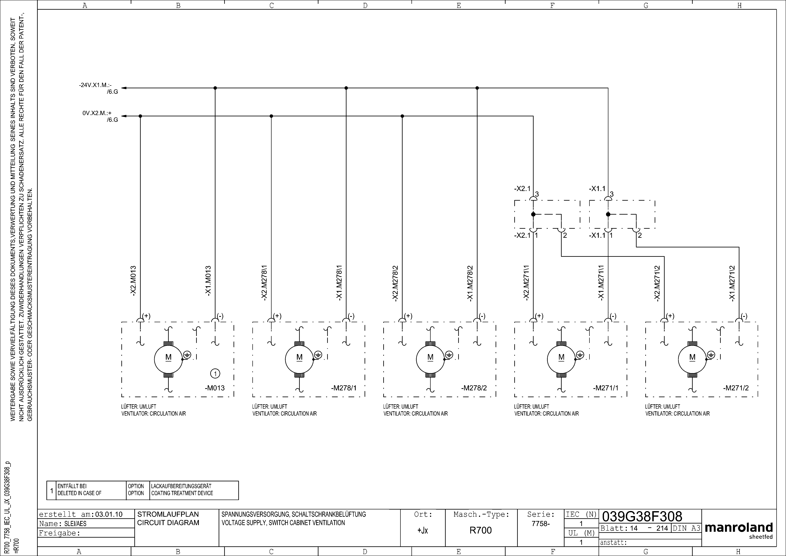

# +Jx — Sheet 14 of 214 — SPANNUNGSVERSORGUNG, SCHALTSCHRANKBELÜFTUNG

**VOLTAGE SUPPLY, SWITCH CABINET VENTILATION**

> Part of the manroland **R700** printing press IEC/UL circuit diagrams.
> Drawing class: **Stromlaufplan / Circuit diagram** (DIN A3).
> Document `+Jx` covers the **1st printing module + feed register** machine section.

## At a glance

| Field | Value |
|---|---|
| Document | `+Jx`  (039G38F308) |
| Sheet | **14** of 214 |
| Section (DE) | SPANNUNGSVERSORGUNG, SCHALTSCHRANKBELÜFTUNG |
| Section (EN) | VOLTAGE SUPPLY, SWITCH CABINET VENTILATION |
| Section type | POWER_SUPPLY — Voltage supply |
| Machine type | `R700` |
| Series | `7758` |
| Created | 03.01.10 |
| Replaces | — |
| Columns used | A, B, C, D, E, F, G, H |
| Path numbers | — |
| Labels on sheet | 62 |
| Cross-refs out | 2 |
| Cross-refs in | 2 |

**Previous:** [+Jx sheet 13](SHEET_0013.md) · **Next:** [+Jx sheet 15](SHEET_0015.md) · **Document TOC:** [_TOC.md](_TOC.md)  (+Jx) · **Master TOC:** [all sheets](../_MASTER_TOC.md)

## Sheet image (300 DPI, exact vector render)



_Rendered directly from the PDF vector layer at 300 DPI (1-bit), no OCR and no resampling. Use it to confirm anything ambiguous in the text below._

## Cross-references on this sheet

Each entry is a wire leaving this sheet. The printed token is `/sheet.column`; the link resolves to that sheet inside the same document.

| Ref | Target sheet | Col | Path | Destination on target | Target section | From col |
|---|---|---|---|---|---|---|
| `/6.G` | [+Jx sheet 6](SHEET_0006.md) | G | — | 24V.X1.M.: | SPANNUNGSVERSORGUNG, SCHALTSCHRANKBELÜFTUNG | A |
| `/6.G` | [+Jx sheet 6](SHEET_0006.md) | G | — | 0V.X2.M.:+ | SPANNUNGSVERSORGUNG, SCHALTSCHRANKBELÜFTUNG | A |

### Incoming references (sheets that point here)

Every other sheet that sends a wire to this one. `Back-ref` is the token printed on *that* sheet; `Path` is its line number.

| From sheet | Cols | Back-ref | Path | Refs | What continues there |
|---|---|---|---|---|---|
| [+Jx#6](SHEET_0006.md) | G, H | `/6.G`, `/6.H` | — | 2 | 0V.X2.M.:+ |


## Devices on this sheet

| Tag | Class | Class meaning (IEC) | Col | Sub | Terminal | Sign |
|---|---|---|---|---|---|---|
| `M271/1` | M | Motor | G | 1 | — | — |
| `M278/2` | M | Motor | E | 2 | — | — |
| `M278/1` | M | Motor | D | 1 | — | — |
| `M271/2` | M | Motor | H | 2 | — | — |
| `X2.M271\1` | — | cross-device reference | F | — | — | — |
| `X1.M271\1` | — | cross-device reference | G | — | — | — |
| `X2.1` | — | cross-device reference | F | — | — | — |
| `X2.1` | — | cross-device reference | F | — | — | — |
| `X1.1` | — | cross-device reference | F | — | — | — |
| `X1.1` | — | cross-device reference | F | — | — | — |
| `X2.M278\2` | — | cross-device reference | D | — | — | — |
| `X1.M278\2` | — | cross-device reference | E | — | — | — |
| `X2.M278\1` | — | cross-device reference | C | — | — | — |
| `X1.M278\1` | — | cross-device reference | D | — | — | — |
| `X2.M013` | — | cross-device reference | B | — | — | — |
| `X1.M013` | — | cross-device reference | B | — | — | — |
| `X2.M271\2` | — | cross-device reference | G | — | — | — |
| `X1.M271\2` | — | cross-device reference | H | — | — | — |

## Potentials / nets

| Potential | Count | Columns | Attached devices | Terminals |
|---|---|---|---|---|
| `0V` | 1 | A | `M`, `X2` | — |
| `24V` | 1 | A | `M`, `X1` | — |
| `M013` | 1 | B | — | — |


A potential such as `L24+/4` or `M24+` is a named supply/return rail; every place it appears on this sheet is electrically common.

## Wire-end annotations (grouped as printed)

A wire that continues elsewhere is annotated with a small cluster: the destination description, the path/line number `#NN`, and the `/sheet.column` cross reference. Each row below is one such cluster exactly as it is grouped on the drawing.

| Col | Y | Path | Cross-ref | Text on the wire |
|---|---|---|---|---|
| A | 125.0 | — | `/6.G` | `24V.X1.M.:` |
| A | 167.4 | — | `/6.G` | `0V.X2.M.:+` |
| F | 280.9 | — | — | `X2.1 3` |
| G | 280.9 | — | — | `X1.1 3` |
| F | 351.7 | — | — | `X2.1 1 2` |
| G | 351.7 | — | — | `X1.1 1 2` |
| C | 400.5 | — | — | `X2.M278\1` |
| D | 400.5 | — | — | `X1.M278\1` |
| F | 400.5 | — | — | `X2.M271\1` |
| G | 400.5 | — | — | `X1.M271\1` |
| D | 402.0 | — | — | `X2.M278\2` |
| E | 402.0 | — | — | `X1.M278\2` |
| G | 402.0 | — | — | `X2.M271\2` |
| H | 402.0 | — | — | `X1.M271\2` |
| B | 402.2 | — | — | `X2.M013` |
| B | 402.2 | — | — | `X1.M013` |
| B | 473.7 | — | — | `(+)` |
| C | 473.7 | — | — | `(+)` |
| D | 473.7 | — | — | `(+)` |
| F | 473.7 | — | — | `(+)` |
| G | 473.7 | — | — | `(+)` |
| B | 473.8 | — | — | `( )` |
| D | 473.8 | — | — | `( )` |
| E | 473.8 | — | — | `( )` |
| G | 473.8 | — | — | `( )` |
| H | 473.8 | — | — | `( )` |
| B | 535.8 | — | — | `M` |
| C | 535.8 | — | — | `M` |
| E | 535.8 | — | — | `M` |
| F | 535.8 | — | — | `M` |
| G | 535.8 | — | — | `M` |
| B | 562.5 | — | — | `1` |
| B | 582.8 | — | — | `M013` |
| D | 582.8 | — | — | `M278/1` |
| E | 582.8 | — | — | `M278/2` |
| G | 582.8 | — | — | `M271/1` |
| H | 582.8 | — | — | `M271/2` |
| B | 612.9 | — | — | `LÜFTER: UMLUFT` |
| C | 612.9 | — | — | `LÜFTER: UMLUFT` |
| D | 612.9 | — | — | `LÜFTER: UMLUFT` |
| F | 612.9 | — | — | `LÜFTER: UMLUFT` |
| G | 612.9 | — | — | `LÜFTER: UMLUFT` |
| B | 623.5 | — | — | `VENTILATOR: CIRCULATION AIR` |
| C | 623.5 | — | — | `VENTILATOR: CIRCULATION AIR` |
| E | 623.5 | — | — | `VENTILATOR: CIRCULATION AIR` |
| F | 623.5 | — | — | `VENTILATOR: CIRCULATION AIR` |
| G | 623.5 | — | — | `VENTILATOR: CIRCULATION AIR` |
| A | 733.3 | — | — | `1 ENTFÄLLT BEI DELETED IN CASE OF` |
| B | 733.3 | — | — | `OPTION OPTION` |
| B | 733.3 | — | — | `LACKAUFBEREITUNGSGERÄT COATING TREATMENT DEVICE` |


## Reconstructed tables

This sheet carries tabular content (pin map / terminal assignment / index). The grid below was rebuilt from the drawing's own rule lines, so each row is exactly one physical row of the table.

### Table 1 — 1 data rows × 5 columns (at x=722.8, y=133.2)

| X2.1 | 3 |  | X1.1 | 3 |
|---|---|---|---|---|
| `X2.1` | `1` | `2` | `X1.1` | `1 2` |


## Notes and free text on this sheet

| Text | Col | Y (pt) |
|---|---|---|
| `M` | F | 535.76 |
| `LÜFTER: UMLUFT` | F | 612.88 |
| `VENTILATOR: CIRCULATION AIR` | F | 623.5 |
| `M` | E | 535.76 |
| `LÜFTER: UMLUFT` | D | 612.88 |
| `VENTILATOR: CIRCULATION AIR` | E | 623.5 |
| `M` | C | 535.76 |
| `LÜFTER: UMLUFT` | C | 612.88 |
| `VENTILATOR: CIRCULATION AIR` | C | 623.5 |
| `M` | B | 535.76 |
| `LÜFTER: UMLUFT` | B | 612.88 |
| `VENTILATOR: CIRCULATION AIR` | B | 623.5 |
| `M` | G | 535.76 |
| `LÜFTER: UMLUFT` | G | 612.88 |
| `VENTILATOR: CIRCULATION AIR` | G | 623.5 |
| `ENTFÄLLT BEI` | A | 733.3 |
| `DELETED IN CASE OF` | A | 743.96 |
| `OPTION` | B | 733.32 |
| `LACKAUFBEREITUNGSGERÄT` | B | 733.34 |
| `COATING TREATMENT DEVICE` | B | 743.97 |

## Complete label inventory (exact text from the drawing)

Every text object inside the drawing area of this sheet, in DIN reading order (column A→H, then top→bottom). This is the authoritative list: if a string is not here it is not printed on this sheet.

| Col | Y | X | Dir | Type | Text |
|---|---|---|---|---|---|
| A | 124.9 | 119.6 | → | potential | `24V.X1.M.:` |
| A | 134.8 | 162.1 | → | cross-reference | `/6.G` |
| A | 167.4 | 125.0 | → | potential | `0V.X2.M.:+` |
| A | 177.4 | 162.1 | → | cross-reference | `/6.G` |
| A | 733.3 | 87.3 | → | text | `ENTFÄLLT BEI` |
| A | 738.6 | 75.4 | → | number | `1` |
| A | 744.0 | 87.3 | → | text | `DELETED IN CASE OF` |
| B | 402.2 | 197.3 | ↕ | device ref | `X2.M013` |
| B | 402.2 | 310.6 | ↕ | device ref | `X1.M013` |
| B | 473.7 | 214.9 | → | other | `(+)` |
| B | 473.8 | 328.3 | → | other | `( )` |
| B | 535.8 | 250.6 | → | text | `M` |
| B | 562.5 | 324.1 | → | number | `1` |
| B | 582.8 | 310.4 | → | potential | `M013` |
| B | 612.9 | 183.7 | → | text | `LÜFTER: UMLUFT` |
| B | 623.5 | 184.3 | → | text | `VENTILATOR: CIRCULATION AIR` |
| B | 733.3 | 193.9 | → | text | `OPTION` |
| B | 733.3 | 229.0 | → | text | `LACKAUFBEREITUNGSGERÄT` |
| B | 743.9 | 193.9 | → | text | `OPTION` |
| B | 744.0 | 229.3 | → | text | `COATING TREATMENT DEVICE` |
| C | 400.5 | 395.7 | ↕ | device ref | `X2.M278\1` |
| C | 473.7 | 413.3 | → | other | `(+)` |
| C | 535.8 | 449.0 | → | text | `M` |
| C | 612.9 | 382.1 | → | text | `LÜFTER: UMLUFT` |
| C | 623.5 | 382.7 | → | text | `VENTILATOR: CIRCULATION AIR` |
| D | 400.5 | 509.1 | ↕ | device ref | `X1.M278\1` |
| D | 402.0 | 594.1 | ↕ | device ref | `X2.M278\2` |
| D | 473.7 | 611.7 | → | other | `(+)` |
| D | 473.8 | 526.7 | → | other | `( )` |
| D | 582.8 | 501.7 | → | device tag | `M278/1` |
| D | 612.9 | 580.5 | → | text | `LÜFTER: UMLUFT` |
| E | 402.0 | 707.5 | ↕ | device ref | `X1.M278\2` |
| E | 473.8 | 725.1 | → | other | `( )` |
| E | 535.8 | 647.4 | → | text | `M` |
| E | 582.8 | 698.7 | → | device tag | `M278/2` |
| E | 623.5 | 581.1 | → | text | `VENTILATOR: CIRCULATION AIR` |
| F | 280.9 | 779.0 | → | device ref | `X2.1` |
| F | 280.9 | 892.3 | → | device ref | `X1.1` |
| F | 289.3 | 810.4 | → | number | `3` |
| F | 351.7 | 809.6 | → | number | `1` |
| F | 351.7 | 852.9 | → | number | `2` |
| F | 351.8 | 779.0 | → | device ref | `X2.1` |
| F | 351.8 | 892.3 | → | device ref | `X1.1` |
| F | 400.5 | 792.5 | ↕ | device ref | `X2.M271\1` |
| F | 473.7 | 810.1 | → | other | `(+)` |
| F | 535.8 | 845.9 | → | text | `M` |
| F | 612.9 | 779.0 | → | text | `LÜFTER: UMLUFT` |
| F | 623.5 | 779.5 | → | text | `VENTILATOR: CIRCULATION AIR` |
| G | 289.3 | 923.8 | → | number | `3` |
| G | 351.7 | 923.0 | → | number | `1` |
| G | 351.7 | 966.3 | → | number | `2` |
| G | 400.5 | 905.9 | ↕ | device ref | `X1.M271\1` |
| G | 402.0 | 991.0 | ↕ | device ref | `X2.M271\2` |
| G | 473.7 | 1008.6 | → | other | `(+)` |
| G | 473.8 | 923.5 | → | other | `( )` |
| G | 535.8 | 1044.3 | → | text | `M` |
| G | 582.8 | 898.6 | → | device tag | `M271/1` |
| G | 612.9 | 977.4 | → | text | `LÜFTER: UMLUFT` |
| G | 623.5 | 978.0 | → | text | `VENTILATOR: CIRCULATION AIR` |
| H | 402.0 | 1104.3 | ↕ | device ref | `X1.M271\2` |
| H | 473.8 | 1122.0 | → | other | `( )` |
| H | 582.8 | 1095.6 | → | device tag | `M271/2` |

## Reading-order text block

The same content as a plain block, grouped by DIN column — convenient to paste or to match against a visual description.

```text
=== Column A ===
 124.9  119.6  net          24V.X1.M.:
 134.8  162.1  xref         /6.G
 167.4  125.0  net          0V.X2.M.:+
 177.4  162.1  xref         /6.G
 733.3   87.3  text         ENTFÄLLT BEI
 738.6   75.4  numeric      1
 744.0   87.3  text         DELETED IN CASE OF
=== Column B ===
 402.2  197.3  devref       X2.M013
 402.2  310.6  devref       X1.M013
 473.7  214.9  other        (+)
 473.8  328.3  other        ( )
 535.8  250.6  text         M
 562.5  324.1  numeric      1
 582.8  310.4  net          M013
 612.9  183.7  text         LÜFTER: UMLUFT
 623.5  184.3  text         VENTILATOR: CIRCULATION AIR
 733.3  193.9  text         OPTION
 733.3  229.0  text         LACKAUFBEREITUNGSGERÄT
 743.9  193.9  text         OPTION
 744.0  229.3  text         COATING TREATMENT DEVICE
=== Column C ===
 400.5  395.7  devref       X2.M278\1
 473.7  413.3  other        (+)
 535.8  449.0  text         M
 612.9  382.1  text         LÜFTER: UMLUFT
 623.5  382.7  text         VENTILATOR: CIRCULATION AIR
=== Column D ===
 400.5  509.1  devref       X1.M278\1
 402.0  594.1  devref       X2.M278\2
 473.7  611.7  other        (+)
 473.8  526.7  other        ( )
 582.8  501.7  devtag       M278/1
 612.9  580.5  text         LÜFTER: UMLUFT
=== Column E ===
 402.0  707.5  devref       X1.M278\2
 473.8  725.1  other        ( )
 535.8  647.4  text         M
 582.8  698.7  devtag       M278/2
 623.5  581.1  text         VENTILATOR: CIRCULATION AIR
=== Column F ===
 280.9  779.0  devref       X2.1
 280.9  892.3  devref       X1.1
 289.3  810.4  numeric      3
 351.7  809.6  numeric      1
 351.7  852.9  numeric      2
 351.8  779.0  devref       X2.1
 351.8  892.3  devref       X1.1
 400.5  792.5  devref       X2.M271\1
 473.7  810.1  other        (+)
 535.8  845.9  text         M
 612.9  779.0  text         LÜFTER: UMLUFT
 623.5  779.5  text         VENTILATOR: CIRCULATION AIR
=== Column G ===
 289.3  923.8  numeric      3
 351.7  923.0  numeric      1
 351.7  966.3  numeric      2
 400.5  905.9  devref       X1.M271\1
 402.0  991.0  devref       X2.M271\2
 473.7 1008.6  other        (+)
 473.8  923.5  other        ( )
 535.8 1044.3  text         M
 582.8  898.6  devtag       M271/1
 612.9  977.4  text         LÜFTER: UMLUFT
 623.5  978.0  text         VENTILATOR: CIRCULATION AIR
=== Column H ===
 402.0 1104.3  devref       X1.M271\2
 473.8 1122.0  other        ( )
 582.8 1095.6  devtag       M271/2
```

---
_Generated from the PDF vector text layer; no OCR. Source: `R700_7758_IEC_UL_JX_039G38F308_p`, sheet 14._
