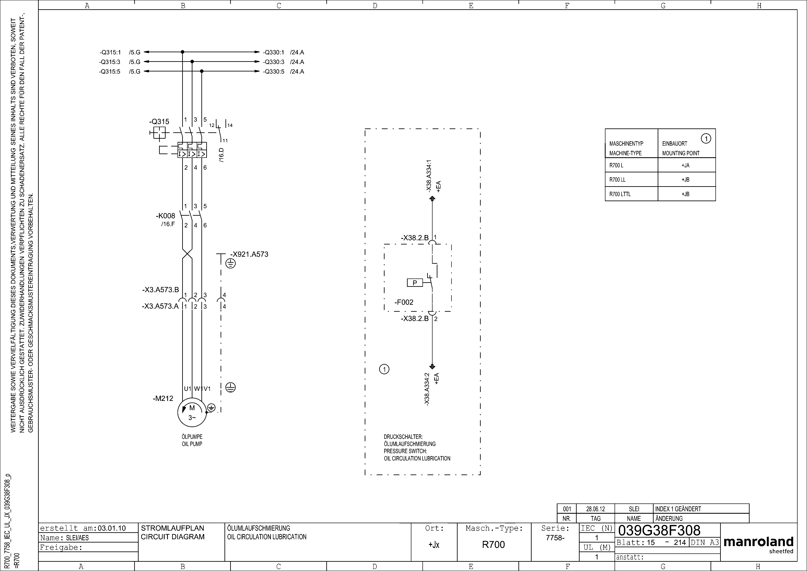

# +Jx — Sheet 15 of 214 — ÖLUMLAUFSCHMIERUNG

**OIL CIRCULATION LUBRICATION**

> Part of the manroland **R700** printing press IEC/UL circuit diagrams.
> Drawing class: **Stromlaufplan / Circuit diagram** (DIN A3).
> Document `+Jx` covers the **1st printing module + feed register** machine section.

## At a glance

| Field | Value |
|---|---|
| Document | `+Jx`  (039G38F308) |
| Sheet | **15** of 214 |
| Section (DE) | ÖLUMLAUFSCHMIERUNG |
| Section (EN) | OIL CIRCULATION LUBRICATION |
| Section type | CIRCUIT — Circuit diagram |
| Machine type | `R700` |
| Series | `7758` |
| Created | 03.01.10 |
| Replaces | — |
| Columns used | A, B, C, D, E, F, G |
| Path numbers | — |
| Labels on sheet | 82 |
| Cross-refs out | 8 |
| Cross-refs in | 18 |

**Previous:** [+Jx sheet 14](SHEET_0014.md) · **Next:** [+Jx sheet 16](SHEET_0016.md) · **Document TOC:** [_TOC.md](_TOC.md)  (+Jx) · **Master TOC:** [all sheets](../_MASTER_TOC.md)

## Sheet image (300 DPI, exact vector render)



_Rendered directly from the PDF vector layer at 300 DPI (1-bit), no OCR and no resampling. Use it to confirm anything ambiguous in the text below._

## Cross-references on this sheet

Each entry is a wire leaving this sheet. The printed token is `/sheet.column`; the link resolves to that sheet inside the same document.

| Ref | Target sheet | Col | Path | Destination on target | Target section | From col |
|---|---|---|---|---|---|---|
| `/24.A` | [+Jx sheet 24](SHEET_0024.md) | A | — | Q330:1 | HILFSANTRIEB, LACKDOSIER /AUFTRAGSWALZEN | C |
| `/5.G` | [+Jx sheet 5](SHEET_0005.md) | G | — | Q315:1 | SPANNUNGSVERSORGUNG, SCHALTSCHRANKBELÜFTUNG | A |
| `/5.G` | [+Jx sheet 5](SHEET_0005.md) | G | — | Q315:3 | SPANNUNGSVERSORGUNG, SCHALTSCHRANKBELÜFTUNG | A |
| `/24.A` | [+Jx sheet 24](SHEET_0024.md) | A | — | Q330:3 | HILFSANTRIEB, LACKDOSIER /AUFTRAGSWALZEN | C |
| `/24.A` | [+Jx sheet 24](SHEET_0024.md) | A | — | Q315:5 Q330:5 | HILFSANTRIEB, LACKDOSIER /AUFTRAGSWALZEN | B |
| `/5.G` | [+Jx sheet 5](SHEET_0005.md) | G | — | Q315:5 Q330:5 | SPANNUNGSVERSORGUNG, SCHALTSCHRANKBELÜFTUNG | B |
| `/16.D` | [+Jx sheet 16](SHEET_0016.md) | D | — | — | ÖLUMLAUFSCHMIERUNG | B |
| `/16.F` | [+Jx sheet 16](SHEET_0016.md) | F | — | — | ÖLUMLAUFSCHMIERUNG | B |

### Incoming references (sheets that point here)

Every other sheet that sends a wire to this one. `Back-ref` is the token printed on *that* sheet; `Path` is its line number.

| From sheet | Cols | Back-ref | Path | Refs | What continues there |
|---|---|---|---|---|---|
| [+Jx#5](SHEET_0005.md) | H | `/5.H` | — | 3 | Q315:1; Q315:3; Q315:5 |
| [+Jx#16](SHEET_0016.md) | D, F | `/16.D`, `/16.F` | — | 2 | — |
| [+Jx#24](SHEET_0024.md) | A | `/24.A` | — | 3 | — |
| [+Jx#128](SHEET_0128.md) | G | `/128.G` | — | 8 | — |
| [+Jx#150](SHEET_0150.md) | A | `/150.A` | — | 2 | — |


## Devices on this sheet

| Tag | Class | Class meaning (IEC) | Col | Sub | Terminal | Sign |
|---|---|---|---|---|---|---|
| `K008` | K | Relais / relay, contactor | B | — | — | — |
| `Q315` | Q | Leistungsschalter / power switching device | B | — | — | — |
| `F002` | F | Schutz / protection device (fuse, circuit breaker) | D | — | — | — |
| `Q315:1` | Q | Leistungsschalter / power switching device | A | — | 1 | — |
| `Q315:3` | Q | Leistungsschalter / power switching device | A | — | 3 | — |
| `Q315:5` | Q | Leistungsschalter / power switching device | A | — | 5 | — |
| `Q330:5` | Q | Leistungsschalter / power switching device | C | — | 5 | — |
| `Q330:3` | Q | Leistungsschalter / power switching device | C | — | 3 | — |
| `Q330:1` | Q | Leistungsschalter / power switching device | C | — | 1 | — |
| `X38.A334:2` | — | cross-device reference | E | — | 2 | — |
| `X3.A573.B` | — | cross-device reference | B | — | — | — |
| `X3.A573.A` | — | cross-device reference | B | — | — | — |
| `X38.2.B` | — | cross-device reference | D | — | — | — |
| `X38.2.B` | — | cross-device reference | D | — | — | — |
| `X38.A334:1` | — | cross-device reference | E | — | 1 | — |
| `NR.` | — | cross-device reference | F | — | — | — |
| `28.06.12` | — | cross-device reference | F | — | — | — |
| `X921.A573` | — | cross-device reference | C | — | — | — |

## Potentials / nets

| Potential | Count | Columns | Attached devices | Terminals |
|---|---|---|---|---|
| `M212` | 1 | B | — | — |


A potential such as `L24+/4` or `M24+` is a named supply/return rail; every place it appears on this sheet is electrically common.

## Wire-end annotations (grouped as printed)

A wire that continues elsewhere is annotated with a small cluster: the destination description, the path/line number `#NN`, and the `/sheet.column` cross reference. Each row below is one such cluster exactly as it is grouped on the drawing.

| Col | Y | Path | Cross-ref | Text on the wire |
|---|---|---|---|---|
| A | 73.2 | — | `/5.G` | `Q315:1` |
| C | 73.2 | — | `/24.A` | `Q330:1` |
| A | 87.4 | — | `/5.G` | `Q315:3` |
| C | 87.4 | — | `/24.A` | `Q330:3` |
| B | 101.5 | — | `/24.A`, `/5.G` | `Q315:5 Q330:5` |
| B | 172.5 | — | — | `1` |
| B | 172.5 | — | — | `3` |
| B | 172.5 | — | — | `5` |
| B | 174.6 | — | — | `Q315` |
| B | 181.6 | — | — | `12 14` |
| G | 200.4 | — | — | `EINBAUORT 1` |
| B | 204.2 | — | — | `11` |
| G | 208.9 | — | — | `MASCHINENTYP` |
| B | 218.0 | — | `/16.D` | — |
| G | 223.1 | — | — | `MACHINE TYPE MOUNTING POINT` |
| E | 235.0 | — | — | `X38.A334:1` |
| G | 240.8 | — | — | `R700 L` |
| G | 240.8 | — | — | `+JA` |
| B | 243.3 | — | — | `2` |
| B | 243.3 | — | — | `4` |
| B | 243.3 | — | — | `6` |
| G | 262.0 | — | — | `+JB` |
| G | 262.1 | — | — | `R700 LL` |
| E | 266.7 | — | — | `+EA` |
| G | 283.3 | — | — | `R700 LTTL +JB` |
| B | 300.0 | — | — | `1` |
| B | 300.0 | — | — | `3` |
| B | 300.0 | — | — | `5` |
| B | 313.5 | — | — | `K008 6` |
| B | 326.5 | — | `/16.F` | — |
| B | 328.4 | — | — | `2` |
| B | 328.4 | — | — | `4` |
| D | 346.1 | — | — | `X38.2.B 1` |
| C | 370.1 | — | — | `X921.A573` |
| D | 413.0 | — | — | `P` |
| B | 422.6 | — | — | `X3.A573.B 1` |
| B | 431.1 | — | — | `2 3` |
| B | 431.1 | — | — | `4` |
| C | 441.0 | — | — | `4 F002` |
| B | 446.7 | — | — | `X3.A573.A 1 2 3` |
| D | 465.1 | — | — | `X38.2.B 2` |
| D | 541.2 | — | — | `1` |
| E | 549.6 | — | — | `X38.A334:2` |
| E | 549.9 | — | — | `+EA` |
| B | 569.1 | — | — | `U1 W1V1` |
| B | 582.8 | — | — | `M212` |
| B | 597.2 | — | — | `3~ M` |
| B | 641.2 | — | — | `ÖLPUMPE OIL PUMP` |
| D | 641.2 | — | — | `DRUCKSCHALTER: PRESSURE SWITCH: ÖLUMLAUFSCHMIERUNG OIL CIRCULATION LUBRICATION` |
| G | 747.1 | — | — | `001 28.06.12 SLEI INDEX 1 GEÄNDERT` |
| G | 761.3 | — | — | `NR. TAG NAME ÄNDERUNG` |


## Reconstructed tables

This sheet carries tabular content (pin map / terminal assignment / index). The grid below was rebuilt from the drawing's own rule lines, so each row is exactly one physical row of the table.

### Table 1 — 2 data rows × 2 columns (at x=892.9, y=232.4)

| R700 L | +JA |
|---|---|
| `R700 LL` | `+JB` |
| `R700 LTTL` | `+JB` |


## Notes and free text on this sheet

| Text | Col | Y (pt) |
|---|---|---|
| `U1 W1V1` | B | 569.09 |
| `M` | B | 597.21 |
| `ÖLPUMPE` | B | 641.22 |
| `OIL PUMP` | B | 651.84 |
| `+EA` | E | 549.92 |
| `DRUCKSCHALTER:` | D | 641.21 |
| `ÖLUMLAUFSCHMIERUNG` | D | 651.88 |
| `PRESSURE SWITCH:` | D | 662.43 |
| `OIL CIRCULATION LUBRICATION` | D | 673.12 |
| `P` | D | 413 |
| `TAG` | F | 761.41 |
| `NAME` | G | 761.4 |
| `ÄNDERUNG` | G | 761.42 |
| `SLEI` | G | 747.24 |
| `INDEX 1 GEÄNDERT` | G | 747.26 |
| `R700 L` | G | 240.82 |
| `R700 LL` | G | 262.09 |
| `MASCHINENTYP` | G | 208.93 |
| `MACHINE TYPE` | G | 223.1 |
| `MOUNTING POINT` | G | 223.12 |
| `EINBAUORT` | G | 208.92 |
| `+JB` | G | 262.01 |
| `+JA` | G | 240.77 |
| `R700 LTTL` | G | 283.35 |

## Complete label inventory (exact text from the drawing)

Every text object inside the drawing area of this sheet, in DIN reading order (column A→H, then top→bottom). This is the authoritative list: if a string is not here it is not printed on this sheet.

| Col | Y | X | Dir | Type | Text |
|---|---|---|---|---|---|
| A | 73.2 | 147.1 | → | device tag | `Q315:1` |
| A | 73.2 | 190.5 | → | cross-reference | `/5.G` |
| A | 87.4 | 146.0 | → | device tag | `Q315:3` |
| A | 87.4 | 190.5 | → | cross-reference | `/5.G` |
| A | 101.5 | 190.5 | → | cross-reference | `/5.G` |
| A | 101.6 | 146.0 | → | device tag | `Q315:5` |
| B | 172.5 | 271.3 | → | number | `1` |
| B | 172.5 | 286.0 | → | number | `3` |
| B | 172.5 | 300.2 | → | number | `5` |
| B | 174.6 | 220.3 | → | device tag | `Q315` |
| B | 181.6 | 308.4 | → | number | `12` |
| B | 181.6 | 335.3 | → | number | `14` |
| B | 204.2 | 328.3 | → | number | `11` |
| B | 218.0 | 322.7 | ↕ | cross-reference | `/16.D` |
| B | 243.3 | 272.1 | → | number | `2` |
| B | 243.3 | 286.3 | → | number | `4` |
| B | 243.3 | 300.2 | → | number | `6` |
| B | 300.0 | 271.3 | → | number | `1` |
| B | 300.0 | 286.0 | → | number | `3` |
| B | 300.0 | 300.2 | → | number | `5` |
| B | 313.5 | 230.2 | → | device tag | `K008` |
| B | 326.5 | 238.1 | → | cross-reference | `/16.F` |
| B | 328.4 | 272.1 | → | number | `2` |
| B | 328.4 | 286.3 | → | number | `4` |
| B | 328.4 | 300.2 | → | number | `6` |
| B | 422.6 | 210.0 | → | device ref | `X3.A573.B` |
| B | 431.1 | 271.3 | → | number | `1` |
| B | 431.1 | 286.3 | → | number | `2` |
| B | 431.1 | 300.2 | → | number | `3` |
| B | 431.1 | 328.8 | → | number | `4` |
| B | 446.7 | 209.5 | → | device ref | `X3.A573.A` |
| B | 448.1 | 271.3 | → | number | `1` |
| B | 448.1 | 286.3 | → | number | `2` |
| B | 448.1 | 300.2 | → | number | `3` |
| B | 448.1 | 328.8 | → | number | `4` |
| B | 569.1 | 271.6 | → | text | `U1 W1V1` |
| B | 582.8 | 225.6 | → | potential | `M212` |
| B | 597.2 | 279.4 | → | text | `M` |
| B | 611.5 | 277.9 | → | other | `3~` |
| B | 641.2 | 268.2 | → | text | `ÖLPUMPE` |
| B | 651.8 | 268.5 | → | text | `OIL PUMP` |
| C | 73.2 | 388.1 | → | device tag | `Q330:1` |
| C | 73.2 | 428.0 | → | cross-reference | `/24.A` |
| C | 87.4 | 388.1 | → | device tag | `Q330:3` |
| C | 87.4 | 428.0 | → | cross-reference | `/24.A` |
| C | 101.5 | 428.0 | → | cross-reference | `/24.A` |
| C | 101.6 | 388.1 | → | device tag | `Q330:5` |
| C | 370.2 | 339.9 | → | device ref | `X921.A573` |
| D | 346.1 | 591.6 | → | device ref | `X38.2.B` |
| D | 413.0 | 608.9 | → | text | `P` |
| D | 441.0 | 582.2 | → | device tag | `F002` |
| D | 465.1 | 591.6 | → | device ref | `X38.2.B` |
| D | 541.2 | 565.1 | → | number | `1` |
| D | 641.2 | 566.4 | → | text | `DRUCKSCHALTER:` |
| D | 651.9 | 566.6 | → | text | `ÖLUMLAUFSCHMIERUNG` |
| D | 662.4 | 566.4 | → | text | `PRESSURE SWITCH:` |
| D | 673.1 | 566.6 | → | text | `OIL CIRCULATION LUBRICATION` |
| E | 235.0 | 628.8 | ↕ | device ref | `X38.A334:1` |
| E | 266.7 | 642.9 | ↕ | text | `+EA` |
| E | 346.1 | 639.8 | → | number | `1` |
| E | 466.6 | 640.6 | → | number | `2` |
| E | 549.6 | 626.0 | ↕ | device ref | `X38.A334:2` |
| E | 549.9 | 640.1 | ↕ | text | `+EA` |
| F | 747.1 | 830.9 | → | number | `001` |
| F | 747.3 | 865.2 | → | device ref | `28.06.12` |
| F | 761.3 | 830.1 | → | device ref | `NR.` |
| F | 761.4 | 871.8 | → | text | `TAG` |
| G | 200.4 | 1039.5 | → | number | `1` |
| G | 208.9 | 899.4 | → | text | `MASCHINENTYP` |
| G | 208.9 | 977.4 | → | text | `EINBAUORT` |
| G | 223.1 | 899.4 | → | text | `MACHINE TYPE` |
| G | 223.1 | 977.4 | → | text | `MOUNTING POINT` |
| G | 240.8 | 899.4 | → | text | `R700 L` |
| G | 240.8 | 1006.0 | → | text | `+JA` |
| G | 262.0 | 1006.0 | → | text | `+JB` |
| G | 262.1 | 899.4 | → | text | `R700 LL` |
| G | 283.3 | 899.4 | → | text | `R700 LTTL` |
| G | 283.3 | 1006.0 | → | text | `+JB` |
| G | 747.2 | 928.1 | → | text | `SLEI` |
| G | 747.3 | 966.8 | → | text | `INDEX 1 GEÄNDERT` |
| G | 761.4 | 925.1 | → | text | `NAME` |
| G | 761.4 | 967.3 | → | text | `ÄNDERUNG` |

## Reading-order text block

The same content as a plain block, grouped by DIN column — convenient to paste or to match against a visual description.

```text
=== Column A ===
  73.2  147.1  devtag       Q315:1
  73.2  190.5  xref         /5.G
  87.4  146.0  devtag       Q315:3
  87.4  190.5  xref         /5.G
 101.5  190.5  xref         /5.G
 101.6  146.0  devtag       Q315:5
=== Column B ===
 172.5  271.3  numeric      1
 172.5  286.0  numeric      3
 172.5  300.2  numeric      5
 174.6  220.3  devtag       Q315
 181.6  308.4  numeric      12
 181.6  335.3  numeric      14
 204.2  328.3  numeric      11
 218.0  322.7  xref         /16.D
 243.3  272.1  numeric      2
 243.3  286.3  numeric      4
 243.3  300.2  numeric      6
 300.0  271.3  numeric      1
 300.0  286.0  numeric      3
 300.0  300.2  numeric      5
 313.5  230.2  devtag       K008
 326.5  238.1  xref         /16.F
 328.4  272.1  numeric      2
 328.4  286.3  numeric      4
 328.4  300.2  numeric      6
 422.6  210.0  devref       X3.A573.B
 431.1  271.3  numeric      1
 431.1  286.3  numeric      2
 431.1  300.2  numeric      3
 431.1  328.8  numeric      4
 446.7  209.5  devref       X3.A573.A
 448.1  271.3  numeric      1
 448.1  286.3  numeric      2
 448.1  300.2  numeric      3
 448.1  328.8  numeric      4
 569.1  271.6  text         U1 W1V1
 582.8  225.6  net          M212
 597.2  279.4  text         M
 611.5  277.9  other        3~
 641.2  268.2  text         ÖLPUMPE
 651.8  268.5  text         OIL PUMP
=== Column C ===
  73.2  388.1  devtag       Q330:1
  73.2  428.0  xref         /24.A
  87.4  388.1  devtag       Q330:3
  87.4  428.0  xref         /24.A
 101.5  428.0  xref         /24.A
 101.6  388.1  devtag       Q330:5
 370.2  339.9  devref       X921.A573
=== Column D ===
 346.1  591.6  devref       X38.2.B
 413.0  608.9  text         P
 441.0  582.2  devtag       F002
 465.1  591.6  devref       X38.2.B
 541.2  565.1  numeric      1
 641.2  566.4  text         DRUCKSCHALTER:
 651.9  566.6  text         ÖLUMLAUFSCHMIERUNG
 662.4  566.4  text         PRESSURE SWITCH:
 673.1  566.6  text         OIL CIRCULATION LUBRICATION
=== Column E ===
 235.0  628.8  devref       X38.A334:1
 266.7  642.9  text         +EA
 346.1  639.8  numeric      1
 466.6  640.6  numeric      2
 549.6  626.0  devref       X38.A334:2
 549.9  640.1  text         +EA
=== Column F ===
 747.1  830.9  numeric      001
 747.3  865.2  devref       28.06.12
 761.3  830.1  devref       NR.
 761.4  871.8  text         TAG
=== Column G ===
 200.4 1039.5  numeric      1
 208.9  899.4  text         MASCHINENTYP
 208.9  977.4  text         EINBAUORT
 223.1  899.4  text         MACHINE TYPE
 223.1  977.4  text         MOUNTING POINT
 240.8  899.4  text         R700 L
 240.8 1006.0  text         +JA
 262.0 1006.0  text         +JB
 262.1  899.4  text         R700 LL
 283.3  899.4  text         R700 LTTL
 283.3 1006.0  text         +JB
 747.2  928.1  text         SLEI
 747.3  966.8  text         INDEX 1 GEÄNDERT
 761.4  925.1  text         NAME
 761.4  967.3  text         ÄNDERUNG
```

---
_Generated from the PDF vector text layer; no OCR. Source: `R700_7758_IEC_UL_JX_039G38F308_p`, sheet 15._
