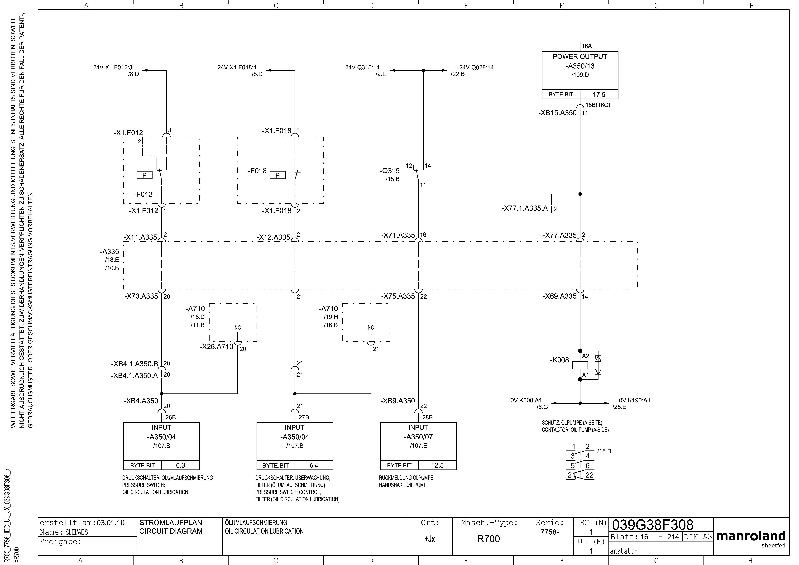

# +Jx — Sheet 16 of 214 — ÖLUMLAUFSCHMIERUNG

**OIL CIRCULATION LUBRICATION**

> Part of the manroland **R700** printing press IEC/UL circuit diagrams.
> Drawing class: **Stromlaufplan / Circuit diagram** (DIN A3).
> Document `+Jx` covers the **1st printing module + feed register** machine section.

## At a glance

| Field | Value |
|---|---|
| Document | `+Jx`  (039G38F308) |
| Sheet | **16** of 214 |
| Section (DE) | ÖLUMLAUFSCHMIERUNG |
| Section (EN) | OIL CIRCULATION LUBRICATION |
| Section type | CIRCUIT — Circuit diagram |
| Machine type | `R700` |
| Series | `7758` |
| Created | 03.01.10 |
| Replaces | — |
| Columns used | A, B, C, D, E, F, G |
| Path numbers | — |
| Labels on sheet | 122 |
| Cross-refs out | 18 |
| Cross-refs in | 41 |

**Previous:** [+Jx sheet 15](SHEET_0015.md) · **Next:** [+Jx sheet 17](SHEET_0017.md) · **Document TOC:** [_TOC.md](_TOC.md)  (+Jx) · **Master TOC:** [all sheets](../_MASTER_TOC.md)

## Sheet image (300 DPI, exact vector render)



_Rendered directly from the PDF vector layer at 300 DPI (1-bit), no OCR and no resampling. Use it to confirm anything ambiguous in the text below._

## Cross-references on this sheet

Each entry is a wire leaving this sheet. The printed token is `/sheet.column`; the link resolves to that sheet inside the same document.

| Ref | Target sheet | Col | Path | Destination on target | Target section | From col |
|---|---|---|---|---|---|---|
| `/8.D` | [+Jx sheet 8](SHEET_0008.md) | D | — | 24V.X1.F012:3 24V.X1.F018:1 | SPANNUNGSVERSORGUNG, SCHALTSCHRANKBELÜFTUNG | B |
| `/8.D` | [+Jx sheet 8](SHEET_0008.md) | D | — | 24V.X1.F012:3 24V.X1.F018:1 | SPANNUNGSVERSORGUNG, SCHALTSCHRANKBELÜFTUNG | B |
| `/9.E` | [+Jx sheet 9](SHEET_0009.md) | E | — | 24V.Q315:14 | SPANNUNGSVERSORGUNG, SCHALTSCHRANKBELÜFTUNG | D |
| `/22.B` | [+Jx sheet 22](SHEET_0022.md) | B | — | — | LACKPUMPE | E |
| `/109.D` | [+Jx sheet 109](SHEET_0109.md) | D | — | — | REFERENZMODUL | F |
| `/15.B` | [+Jx sheet 15](SHEET_0015.md) | B | — | — | ÖLUMLAUFSCHMIERUNG | D |
| `/18.E` | [+Jx sheet 18](SHEET_0018.md) | E | — | — | LACKPUMPE | A |
| `/10.B` | [+Jx sheet 10](SHEET_0010.md) | B | — | — | SPANNUNGSVERSORGUNG, SCHALTSCHRANKBELÜFTUNG | A |
| `/16.D` | [+Jx sheet 16](SHEET_0016.md) | D | — | — | ÖLUMLAUFSCHMIERUNG | B |
| `/11.B` | [+Jx sheet 11](SHEET_0011.md) | B | — | — | SPANNUNGSVERSORGUNG, SCHALTSCHRANKBELÜFTUNG | B |
| `/19.H` | [+Jx sheet 19](SHEET_0019.md) | H | — | — | LACKPUMPE | D |
| `/16.B` | [+Jx sheet 16](SHEET_0016.md) | B | — | — | ÖLUMLAUFSCHMIERUNG | D |
| `/6.G` | [+Jx sheet 6](SHEET_0006.md) | G | — | 0V.K008:A1 | SPANNUNGSVERSORGUNG, SCHALTSCHRANKBELÜFTUNG | F |
| `/26.E` | [+Jx sheet 26](SHEET_0026.md) | E | — | — | HILFSANTRIEB, LACKDOSIER /AUFTRAGSWALZEN | G |
| `/107.B` | [+Jx sheet 107](SHEET_0107.md) | B | — | — | REFERENZMODUL | B |
| `/107.B` | [+Jx sheet 107](SHEET_0107.md) | B | — | — | REFERENZMODUL | C |
| `/107.E` | [+Jx sheet 107](SHEET_0107.md) | E | — | — | REFERENZMODUL | E |
| `/15.B` | [+Jx sheet 15](SHEET_0015.md) | B | — | — | ÖLUMLAUFSCHMIERUNG | F |

### Incoming references (sheets that point here)

Every other sheet that sends a wire to this one. `Back-ref` is the token printed on *that* sheet; `Path` is its line number.

| From sheet | Cols | Back-ref | Path | Refs | What continues there |
|---|---|---|---|---|---|
| [+Jx#6](SHEET_0006.md) | H | `/6.H` | — | 1 | 0V.K008:A1 |
| [+Jx#8](SHEET_0008.md) | D | `/8.D` | — | 2 | 24V.X1.F012:3; 24V.X1.F018:1 |
| [+Jx#9](SHEET_0009.md) | E | `/9.E` | — | 1 | 24V.Q315:14 |
| [+Jx#10](SHEET_0010.md) | B | `/10.B` | — | 1 | — |
| [+Jx#11](SHEET_0011.md) | B | `/11.B` | — | 1 | — |
| [+Jx#15](SHEET_0015.md) | B | `/15.B` | — | 2 | — |
| [+Jx#16](SHEET_0016.md) | B, D | `/16.B`, `/16.D` | — | 2 | — |
| [+Jx#18](SHEET_0018.md) | E | `/18.E` | — | 1 | — |
| [+Jx#19](SHEET_0019.md) | H | `/19.H` | — | 1 | — |
| [+Jx#22](SHEET_0022.md) | B | `/22.B` | — | 1 | 24V.Q028:14 24V.Q330:14 |
| [+Jx#26](SHEET_0026.md) | E | `/26.E` | — | 1 | 0V.K190:A1 0V.K194:A1 |
| [+Jx#107](SHEET_0107.md) | B, E | `/107.B`, `/107.E` | — | 3 | — |
| [+Jx#109](SHEET_0109.md) | D | `/109.D` | — | 1 | — |
| [+Jx#118](SHEET_0118.md) | A | `/118.A` | — | 4 | — |
| [+Jx#130](SHEET_0130.md) | A, B, D | `/130.A`, `/130.B`, `/130.D` | — | 6 | — |
| [+Jx#134](SHEET_0134.md) | G | `/134.G` | — | 1 | — |
| [+Jx#136](SHEET_0136.md) | E | `/136.E` | — | 1 | — |
| [+Jx#137](SHEET_0137.md) | G | `/137.G` | — | 1 | — |
| [+Jx#139](SHEET_0139.md) | B | `/139.B` | — | 1 | — |
| [+Jx#143](SHEET_0143.md) | F | `/143.F` | — | 2 | — |
| [+Jx#152](SHEET_0152.md) | G | `/152.G` | — | 1 | — |
| [+Jx#153](SHEET_0153.md) | B, E | `/153.B`, `/153.E` | — | 3 | — |
| [+Jx#155](SHEET_0155.md) | A, D | `/155.A`, `/155.D` | — | 2 | — |
| [+Jx#156](SHEET_0156.md) | A | `/156.A` | — | 1 | — |


## Devices on this sheet

| Tag | Class | Class meaning (IEC) | Col | Sub | Terminal | Sign |
|---|---|---|---|---|---|---|
| `F012` | F | Schutz / protection device (fuse, circuit breaker) | B | — | — | — |
| `Q315` | Q | Leistungsschalter / power switching device | D | — | — | — |
| `F018` | F | Schutz / protection device (fuse, circuit breaker) | C | — | — | — |
| `A350/13` | A | Baugruppe / assembly, module, PC board | F | 13 | — | — |
| `A2` | A | Baugruppe / assembly, module, PC board | F | — | — | — |
| `A1` | A | Baugruppe / assembly, module, PC board | F | — | — | — |
| `K008` | K | Relais / relay, contactor | F | — | — | — |
| `A350/04` | A | Baugruppe / assembly, module, PC board | B | 04 | — | — |
| `A350/04` | A | Baugruppe / assembly, module, PC board | C | 04 | — | — |
| `A350/07` | A | Baugruppe / assembly, module, PC board | D | 07 | — | — |
| `A335` | A | Baugruppe / assembly, module, PC board | A | — | — | — |
| `A710` | A | Baugruppe / assembly, module, PC board | B | — | — | — |
| `A710` | A | Baugruppe / assembly, module, PC board | D | — | — | — |
| `X1.F012` | — | cross-device reference | B | — | — | — |
| `X1.F012` | — | cross-device reference | A | — | — | — |
| `X1.F018` | — | cross-device reference | C | — | — | — |
| `X1.F018` | — | cross-device reference | C | — | — | — |
| `XB15.A350` | — | cross-device reference | F | — | — | — |
| `17.5` | — | cross-device reference | F | — | — | — |
| `XB4.A350` | — | cross-device reference | B | — | — | — |
| `6.3` | — | cross-device reference | B | — | — | — |
| `6.4` | — | cross-device reference | C | — | — | — |
| `12.5` | — | cross-device reference | E | — | — | — |
| `XB9.A350` | — | cross-device reference | D | — | — | — |
| `X73.A335` | — | cross-device reference | B | — | — | — |
| `X11.A335` | — | cross-device reference | B | — | — | — |
| `X75.A335` | — | cross-device reference | D | — | — | — |
| `X12.A335` | — | cross-device reference | C | — | — | — |
| `X71.A335` | — | cross-device reference | D | — | — | — |
| `X77.A335` | — | cross-device reference | F | — | — | — |
| `X69.A335` | — | cross-device reference | F | — | — | — |
| `X77.1.A335.A` | — | cross-device reference | F | — | — | — |
| `XB4.1.A350.B` | — | cross-device reference | B | — | — | — |
| `XB4.1.A350.A` | — | cross-device reference | B | — | — | — |
| `X26.A710` | — | cross-device reference | B | — | — | — |

## Potentials / nets

| Potential | Count | Columns | Attached devices | Terminals |
|---|---|---|---|---|
| `0V` | 2 | F, G | `K008`, `K190` | `A1` |
| `24V` | 4 | A, C, D, E | `F012`, `F018`, `Q028`, `Q315`, `X1` | `1`, `14`, `3` |


A potential such as `L24+/4` or `M24+` is a named supply/return rail; every place it appears on this sheet is electrically common.

## Wire-end annotations (grouped as printed)

A wire that continues elsewhere is annotated with a small cluster: the destination description, the path/line number `#NN`, and the `/sheet.column` cross reference. Each row below is one such cluster exactly as it is grouped on the drawing.

| Col | Y | Path | Cross-ref | Text on the wire |
|---|---|---|---|---|
| F | 64.7 | — | — | `16A` |
| F | 79.9 | — | — | `POWER QUTPUT` |
| F | 93.8 | — | — | `A350/13` |
| B | 96.6 | — | `/8.D`, `/8.D` | `24V.X1.F012:3 24V.X1.F018:1` |
| D | 96.6 | — | `/9.E` | `24V.Q315:14` |
| E | 96.6 | — | — | `24V.Q028:14` |
| E | 106.5 | — | `/22.B` | — |
| F | 107.6 | — | `/109.D` | — |
| F | 136.6 | — | — | `BYTE.BIT 17.5` |
| F | 152.6 | — | — | `16B(16C)` |
| F | 163.2 | — | — | `XB15.A350 14` |
| B | 190.2 | — | — | `X1.F012 3` |
| C | 190.2 | — | — | `X1.F018 1` |
| B | 207.2 | — | — | `2` |
| D | 243.3 | — | — | `Q315 14` |
| D | 243.3 | — | — | `12` |
| C | 249.7 | — | — | `F018` |
| B | 257.1 | — | — | `P` |
| C | 257.1 | — | — | `P` |
| D | 262.8 | — | `/15.B` | — |
| E | 271.7 | — | — | `11` |
| B | 285.1 | — | — | `F012` |
| F | 305.7 | — | — | `X77.1.A335.A 2` |
| B | 309.2 | — | — | `X1.F012 1` |
| C | 309.2 | — | — | `X1.F018 2` |
| B | 346.1 | — | — | `X11.A335 2` |
| E | 346.1 | — | — | `X12.A335 2 X71.A335 16 X77.A335 2` |
| A | 370.1 | — | — | `A335` |
| A | 383.2 | — | `/18.E`, `/10.B` | — |
| B | 436.8 | — | — | `X73.A335 20` |
| D | 436.8 | — | — | `21 X75.A335 22` |
| F | 436.8 | — | — | `X69.A335 14` |
| B | 455.2 | — | — | `A710` |
| D | 455.2 | — | — | `A710` |
| B | 468.3 | — | `/16.D`, `/11.B` | — |
| D | 468.3 | — | `/19.H`, `/16.B` | — |
| C | 485.3 | — | — | `NC NC` |
| B | 511.9 | — | — | `X26.A710 20` |
| D | 516.2 | — | — | `21` |
| F | 526.8 | — | — | `A2` |
| F | 531.7 | — | — | `K008` |
| B | 537.4 | — | — | `XB4.1.A350.B 20` |
| C | 537.4 | — | — | `21` |
| B | 554.4 | — | — | `XB4.1.A350.A 20` |
| C | 554.4 | — | — | `21` |
| F | 555.1 | — | — | `A1` |
| F | 592.6 | — | `/6.G` | `0V.K008:A1` |
| G | 592.6 | — | — | `0V.K190:A1` |
| B | 592.7 | — | — | `XB4.A350 20` |
| D | 592.7 | — | — | `XB9.A350 22` |
| C | 601.2 | — | — | `21` |
| G | 602.5 | — | `/26.E` | — |
| B | 618.2 | — | — | `26B` |
| C | 618.2 | — | — | `27B` |
| E | 618.2 | — | — | `28B` |
| F | 627.0 | — | — | `SCHÜTZ: ÖLPUMPE (A SEITE) CONTACTOR: OIL PUMP (A SIDE)` |
| B | 632.7 | — | — | `INPUT` |
| C | 632.7 | — | — | `INPUT` |
| D | 632.7 | — | — | `INPUT` |
| B | 646.5 | — | — | `A350/04` |
| C | 646.5 | — | — | `A350/04` |
| D | 646.5 | — | — | `A350/07` |
| B | 660.3 | — | `/107.B` | — |
| C | 660.3 | — | `/107.B` | — |
| E | 660.3 | — | `/107.E` | — |
| F | 660.7 | — | — | `21 3 5 1` |
| F | 660.7 | — | — | `2 6 22 4` |
| F | 668.5 | — | `/15.B` | — |
| B | 689.4 | — | — | `BYTE.BIT 6.3` |
| D | 689.4 | — | — | `BYTE.BIT 12.5` |
| C | 689.7 | — | — | `BYTE.BIT 6.4` |
| C | 709.2 | — | — | `DRUCKSCHALTER: ÜBERWACHUNG, FILTER (ÖLUMLAUFSCHMIERUNG) PRESSURE SWITCH: CONTROL, FILTER (OIL CIRCULATION LUBRICATION)` |
| B | 709.3 | — | — | `DRUCKSCHALTER: ÖLUMLAUFSCHMIERUNG PRESSURE SWITCH: OIL CIRCULATION LUBRICATION` |
| D | 709.3 | — | — | `RÜCKMELDUNG ÖLPUMPE HANDSHAKE OIL PUMP` |


## Reconstructed tables

This sheet carries tabular content (pin map / terminal assignment / index). The grid below was rebuilt from the drawing's own rule lines, so each row is exactly one physical row of the table.

### Table 1 — 2 data rows × 3 columns (at x=184.3, y=586.8)

| XB4.A350 |  | 20 26B |
|---|---|---|
| `INPUT` | `A350/04 /107.B` |  |
| `BYTE.BIT` |  | `6.3` |


### Table 2 — 1 data rows × 2 columns (at x=382.7, y=586.8) — **21 27B**

| INPUT A350/04 | /107.B |
|---|---|
| `BYTE.BIT` | `6.4` |


### Table 3 — 2 data rows × 3 columns (at x=566.9, y=586.8)

| XB9.A350 |  | 22 28B |
|---|---|---|
| `INPUT` | `A350/07 /107.E` |  |
| `BYTE.BIT` |  | `12.5` |


### Table 4 — 2 data rows × 3 columns (at x=807.9, y=76.5)

| POWER A350/13 | QUTPUT /109.D |  |
|---|---|---|
| `BYTE.BIT` |  | `17.5` |
| `XB15.A350` | `16B(16C) 14` |  |


## Notes and free text on this sheet

| Text | Col | Y (pt) |
|---|---|---|
| `P` | B | 257.09 |
| `16A` | F | 64.72 |
| `16B(16C)` | F | 152.63 |
| `POWER QUTPUT` | F | 79.87 |
| `BYTE.BIT` | F | 137.21 |
| `SCHÜTZ: ÖLPUMPE (A SEITE)` | F | 627.04 |
| `CONTACTOR: OIL PUMP (A SIDE)` | F | 637.68 |
| `26B` | B | 618.18 |
| `INPUT` | B | 632.7 |
| `BYTE.BIT` | B | 689.96 |
| `DRUCKSCHALTER: ÖLUMLAUFSCHMIERUNG` | B | 709.27 |
| `PRESSURE SWITCH:` | B | 719.83 |
| `OIL CIRCULATION LUBRICATION` | B | 730.52 |
| `27B` | C | 618.18 |
| `INPUT` | C | 632.7 |
| `BYTE.BIT` | C | 689.69 |
| `DRUCKSCHALTER: ÜBERWACHUNG,` | C | 709.24 |
| `FILTER (ÖLUMLAUFSCHMIERUNG)` | C | 719.9 |
| `PRESSURE SWITCH: CONTROL,` | C | 730.49 |
| `FILTER (OIL CIRCULATION LUBRICATION)` | C | 741.15 |
| `28B` | E | 618.18 |
| `INPUT` | D | 632.7 |
| `BYTE.BIT` | D | 689.96 |
| `RÜCKMELDUNG ÖLPUMPE` | D | 709.27 |
| `HANDSHAKE OIL PUMP` | D | 719.87 |
| `P` | C | 257.09 |
| `NC` | C | 485.29 |
| `NC` | D | 485.29 |

## Complete label inventory (exact text from the drawing)

Every text object inside the drawing area of this sheet, in DIN reading order (column A→H, then top→bottom). This is the authoritative list: if a string is not here it is not printed on this sheet.

| Col | Y | X | Dir | Type | Text |
|---|---|---|---|---|---|
| A | 96.6 | 135.8 | → | potential | `24V.X1.F012:3` |
| A | 106.5 | 191.1 | → | cross-reference | `/8.D` |
| A | 193.0 | 169.5 | → | device ref | `X1.F012` |
| A | 370.2 | 149.1 | → | device tag | `A335` |
| A | 383.2 | 156.8 | → | cross-reference | `/18.E` |
| A | 395.6 | 156.8 | → | cross-reference | `/10.B` |
| B | 190.2 | 250.6 | → | number | `3` |
| B | 207.2 | 205.5 | → | number | `2` |
| B | 257.1 | 212.0 | → | text | `P` |
| B | 285.1 | 199.6 | → | device tag | `F012` |
| B | 309.2 | 192.2 | → | device ref | `X1.F012` |
| B | 310.7 | 242.9 | → | number | `1` |
| B | 346.1 | 243.8 | → | number | `2` |
| B | 348.9 | 184.0 | → | device ref | `X11.A335` |
| B | 436.8 | 185.4 | → | device ref | `X73.A335` |
| B | 438.2 | 243.8 | → | number | `20` |
| B | 455.2 | 276.9 | → | device tag | `A710` |
| B | 468.3 | 284.0 | → | cross-reference | `/16.D` |
| B | 480.7 | 284.3 | → | cross-reference | `/11.B` |
| B | 511.9 | 297.6 | → | device ref | `X26.A710` |
| B | 537.4 | 165.8 | → | device ref | `XB4.1.A350.B` |
| B | 537.4 | 243.8 | → | number | `20` |
| B | 554.4 | 243.8 | → | number | `20` |
| B | 555.1 | 165.3 | → | device ref | `XB4.1.A350.A` |
| B | 592.7 | 184.5 | → | device ref | `XB4.A350` |
| B | 601.2 | 243.8 | → | number | `20` |
| B | 618.2 | 246.6 | → | text | `26B` |
| B | 632.7 | 226.1 | → | text | `INPUT` |
| B | 646.5 | 219.4 | → | device tag | `A350/04` |
| B | 660.3 | 228.3 | → | cross-reference | `/107.B` |
| B | 689.4 | 262.5 | → | device ref | `6.3` |
| B | 690.0 | 194.2 | → | text | `BYTE.BIT` |
| B | 709.3 | 182.3 | → | text | `DRUCKSCHALTER: ÖLUMLAUFSCHMIERUNG` |
| B | 719.8 | 182.3 | → | text | `PRESSURE SWITCH:` |
| B | 730.5 | 182.6 | → | text | `OIL CIRCULATION LUBRICATION` |
| C | 96.6 | 321.2 | → | potential | `24V.X1.F018:1` |
| C | 106.5 | 375.3 | → | cross-reference | `/8.D` |
| C | 190.2 | 390.6 | → | device ref | `X1.F018` |
| C | 190.2 | 441.4 | → | number | `1` |
| C | 249.7 | 369.6 | → | device tag | `F018` |
| C | 257.1 | 410.5 | → | text | `P` |
| C | 309.2 | 390.6 | → | device ref | `X1.F018` |
| C | 310.7 | 442.2 | → | number | `2` |
| C | 346.1 | 442.2 | → | number | `2` |
| C | 348.9 | 382.4 | → | device ref | `X12.A335` |
| C | 438.2 | 442.2 | → | number | `21` |
| C | 485.3 | 349.6 | → | text | `NC` |
| C | 516.2 | 357.2 | → | number | `20` |
| C | 537.4 | 442.2 | → | number | `21` |
| C | 554.4 | 442.2 | → | number | `21` |
| C | 601.2 | 442.2 | → | number | `21` |
| C | 618.2 | 445.0 | → | text | `27B` |
| C | 632.7 | 424.5 | → | text | `INPUT` |
| C | 646.5 | 417.8 | → | device tag | `A350/04` |
| C | 660.3 | 426.8 | → | cross-reference | `/107.B` |
| C | 689.7 | 390.9 | → | text | `BYTE.BIT` |
| C | 689.8 | 461.6 | → | device ref | `6.4` |
| C | 709.2 | 380.7 | → | text | `DRUCKSCHALTER: ÜBERWACHUNG,` |
| C | 719.9 | 380.7 | → | text | `FILTER (ÖLUMLAUFSCHMIERUNG)` |
| C | 730.5 | 380.7 | → | text | `PRESSURE SWITCH: CONTROL,` |
| C | 741.2 | 380.7 | → | text | `FILTER (OIL CIRCULATION LUBRICATION)` |
| D | 96.6 | 511.4 | → | potential | `24V.Q315:14` |
| D | 106.5 | 559.8 | → | cross-reference | `/9.E` |
| D | 243.3 | 604.3 | → | number | `12` |
| D | 249.7 | 566.1 | → | device tag | `Q315` |
| D | 262.8 | 574.9 | → | cross-reference | `/15.B` |
| D | 346.1 | 568.1 | → | device ref | `X71.A335` |
| D | 436.8 | 568.1 | → | device ref | `X75.A335` |
| D | 455.2 | 475.4 | → | device tag | `A710` |
| D | 468.3 | 482.7 | → | cross-reference | `/19.H` |
| D | 480.7 | 482.7 | → | cross-reference | `/16.B` |
| D | 485.3 | 548.1 | → | text | `NC` |
| D | 516.2 | 555.6 | → | number | `21` |
| D | 592.7 | 567.2 | → | device ref | `XB9.A350` |
| D | 632.7 | 608.7 | → | text | `INPUT` |
| D | 646.5 | 602.1 | → | device tag | `A350/07` |
| D | 690.0 | 576.9 | → | text | `BYTE.BIT` |
| D | 709.3 | 564.9 | → | text | `RÜCKMELDUNG ÖLPUMPE` |
| D | 719.9 | 564.9 | → | text | `HANDSHAKE OIL PUMP` |
| E | 96.6 | 681.4 | → | potential | `24V.Q028:14` |
| E | 106.5 | 671.8 | → | cross-reference | `/22.B` |
| E | 243.3 | 632.7 | → | number | `14` |
| E | 271.7 | 625.6 | → | number | `11` |
| E | 346.1 | 625.6 | → | number | `16` |
| E | 438.2 | 626.5 | → | number | `22` |
| E | 601.2 | 626.5 | → | number | `22` |
| E | 618.2 | 629.3 | → | text | `28B` |
| E | 660.3 | 611.0 | → | cross-reference | `/107.E` |
| E | 689.4 | 642.2 | → | device ref | `12.5` |
| F | 64.7 | 866.6 | → | text | `16A` |
| F | 79.9 | 823.7 | → | text | `POWER QUTPUT` |
| F | 93.8 | 843.0 | → | device tag | `A350/13` |
| F | 107.6 | 851.8 | → | cross-reference | `/109.D` |
| F | 136.6 | 883.1 | → | device ref | `17.5` |
| F | 137.2 | 817.8 | → | text | `BYTE.BIT` |
| F | 152.6 | 872.2 | → | text | `16B(16C)` |
| F | 163.2 | 802.2 | → | device ref | `XB15.A350` |
| F | 164.7 | 866.6 | → | number | `14` |
| F | 305.7 | 747.5 | → | device ref | `X77.1.A335.A` |
| F | 307.8 | 824.9 | → | number | `2` |
| F | 346.1 | 809.0 | → | device ref | `X77.A335` |
| F | 346.1 | 867.4 | → | number | `2` |
| F | 436.8 | 809.0 | → | device ref | `X69.A335` |
| F | 438.2 | 866.6 | → | number | `14` |
| F | 526.7 | 867.4 | → | device tag | `A2` |
| F | 531.7 | 819.8 | → | device tag | `K008` |
| F | 555.1 | 867.4 | → | device tag | `A1` |
| F | 592.7 | 760.8 | → | potential | `0V.K008:A1` |
| F | 602.6 | 799.9 | → | cross-reference | `/6.G` |
| F | 627.0 | 807.6 | → | text | `SCHÜTZ: ÖLPUMPE (A SEITE)` |
| F | 637.7 | 807.6 | → | text | `CONTACTOR: OIL PUMP (A SIDE)` |
| F | 660.7 | 852.1 | → | number | `1` |
| F | 660.7 | 872.8 | → | number | `2` |
| F | 668.5 | 890.1 | → | cross-reference | `/15.B` |
| F | 674.8 | 850.4 | → | number | `3` |
| F | 674.8 | 873.1 | → | number | `4` |
| F | 689.0 | 850.4 | → | number | `5` |
| F | 689.0 | 872.8 | → | number | `6` |
| F | 703.2 | 846.1 | → | number | `21` |
| F | 703.2 | 872.8 | → | number | `22` |
| G | 592.7 | 922.4 | → | potential | `0V.K190:A1` |
| G | 602.6 | 912.8 | → | cross-reference | `/26.E` |

## Reading-order text block

The same content as a plain block, grouped by DIN column — convenient to paste or to match against a visual description.

```text
=== Column A ===
  96.6  135.8  net          24V.X1.F012:3
 106.5  191.1  xref         /8.D
 193.0  169.5  devref       X1.F012
 370.2  149.1  devtag       A335
 383.2  156.8  xref         /18.E
 395.6  156.8  xref         /10.B
=== Column B ===
 190.2  250.6  numeric      3
 207.2  205.5  numeric      2
 257.1  212.0  text         P
 285.1  199.6  devtag       F012
 309.2  192.2  devref       X1.F012
 310.7  242.9  numeric      1
 346.1  243.8  numeric      2
 348.9  184.0  devref       X11.A335
 436.8  185.4  devref       X73.A335
 438.2  243.8  numeric      20
 455.2  276.9  devtag       A710
 468.3  284.0  xref         /16.D
 480.7  284.3  xref         /11.B
 511.9  297.6  devref       X26.A710
 537.4  165.8  devref       XB4.1.A350.B
 537.4  243.8  numeric      20
 554.4  243.8  numeric      20
 555.1  165.3  devref       XB4.1.A350.A
 592.7  184.5  devref       XB4.A350
 601.2  243.8  numeric      20
 618.2  246.6  text         26B
 632.7  226.1  text         INPUT
 646.5  219.4  devtag       A350/04
 660.3  228.3  xref         /107.B
 689.4  262.5  devref       6.3
 690.0  194.2  text         BYTE.BIT
 709.3  182.3  text         DRUCKSCHALTER: ÖLUMLAUFSCHMIERUNG
 719.8  182.3  text         PRESSURE SWITCH:
 730.5  182.6  text         OIL CIRCULATION LUBRICATION
=== Column C ===
  96.6  321.2  net          24V.X1.F018:1
 106.5  375.3  xref         /8.D
 190.2  390.6  devref       X1.F018
 190.2  441.4  numeric      1
 249.7  369.6  devtag       F018
 257.1  410.5  text         P
 309.2  390.6  devref       X1.F018
 310.7  442.2  numeric      2
 346.1  442.2  numeric      2
 348.9  382.4  devref       X12.A335
 438.2  442.2  numeric      21
 485.3  349.6  text         NC
 516.2  357.2  numeric      20
 537.4  442.2  numeric      21
 554.4  442.2  numeric      21
 601.2  442.2  numeric      21
 618.2  445.0  text         27B
 632.7  424.5  text         INPUT
 646.5  417.8  devtag       A350/04
 660.3  426.8  xref         /107.B
 689.7  390.9  text         BYTE.BIT
 689.8  461.6  devref       6.4
 709.2  380.7  text         DRUCKSCHALTER: ÜBERWACHUNG,
 719.9  380.7  text         FILTER (ÖLUMLAUFSCHMIERUNG)
 730.5  380.7  text         PRESSURE SWITCH: CONTROL,
 741.2  380.7  text         FILTER (OIL CIRCULATION LUBRICATION)
=== Column D ===
  96.6  511.4  net          24V.Q315:14
 106.5  559.8  xref         /9.E
 243.3  604.3  numeric      12
 249.7  566.1  devtag       Q315
 262.8  574.9  xref         /15.B
 346.1  568.1  devref       X71.A335
 436.8  568.1  devref       X75.A335
 455.2  475.4  devtag       A710
 468.3  482.7  xref         /19.H
 480.7  482.7  xref         /16.B
 485.3  548.1  text         NC
 516.2  555.6  numeric      21
 592.7  567.2  devref       XB9.A350
 632.7  608.7  text         INPUT
 646.5  602.1  devtag       A350/07
 690.0  576.9  text         BYTE.BIT
 709.3  564.9  text         RÜCKMELDUNG ÖLPUMPE
 719.9  564.9  text         HANDSHAKE OIL PUMP
=== Column E ===
  96.6  681.4  net          24V.Q028:14
 106.5  671.8  xref         /22.B
 243.3  632.7  numeric      14
 271.7  625.6  numeric      11
 346.1  625.6  numeric      16
 438.2  626.5  numeric      22
 601.2  626.5  numeric      22
 618.2  629.3  text         28B
 660.3  611.0  xref         /107.E
 689.4  642.2  devref       12.5
=== Column F ===
  64.7  866.6  text         16A
  79.9  823.7  text         POWER QUTPUT
  93.8  843.0  devtag       A350/13
 107.6  851.8  xref         /109.D
 136.6  883.1  devref       17.5
 137.2  817.8  text         BYTE.BIT
 152.6  872.2  text         16B(16C)
 163.2  802.2  devref       XB15.A350
 164.7  866.6  numeric      14
 305.7  747.5  devref       X77.1.A335.A
 307.8  824.9  numeric      2
 346.1  809.0  devref       X77.A335
 346.1  867.4  numeric      2
 436.8  809.0  devref       X69.A335
 438.2  866.6  numeric      14
 526.7  867.4  devtag       A2
 531.7  819.8  devtag       K008
 555.1  867.4  devtag       A1
 592.7  760.8  net          0V.K008:A1
 602.6  799.9  xref         /6.G
 627.0  807.6  text         SCHÜTZ: ÖLPUMPE (A SEITE)
 637.7  807.6  text         CONTACTOR: OIL PUMP (A SIDE)
 660.7  852.1  numeric      1
 660.7  872.8  numeric      2
 668.5  890.1  xref         /15.B
 674.8  850.4  numeric      3
 674.8  873.1  numeric      4
 689.0  850.4  numeric      5
 689.0  872.8  numeric      6
 703.2  846.1  numeric      21
 703.2  872.8  numeric      22
=== Column G ===
 592.7  922.4  net          0V.K190:A1
 602.6  912.8  xref         /26.E
```

---
_Generated from the PDF vector text layer; no OCR. Source: `R700_7758_IEC_UL_JX_039G38F308_p`, sheet 16._
