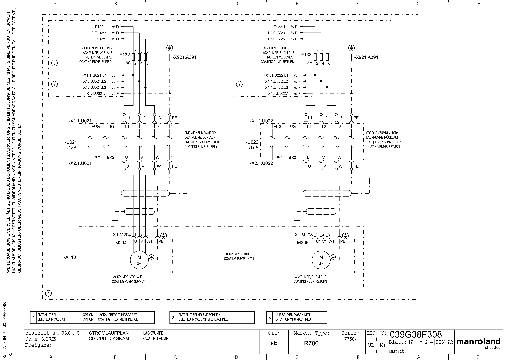

# +Jx — Sheet 17 of 214 — LACKPUMPE

**COATING PUMP**

> Part of the manroland **R700** printing press IEC/UL circuit diagrams.
> Drawing class: **Stromlaufplan / Circuit diagram** (DIN A3).
> Document `+Jx` covers the **1st printing module + feed register** machine section.

## At a glance

| Field | Value |
|---|---|
| Document | `+Jx`  (039G38F308) |
| Sheet | **17** of 214 |
| Section (DE) | LACKPUMPE |
| Section (EN) | COATING PUMP |
| Section type | CIRCUIT — Circuit diagram |
| Machine type | `R700` |
| Series | `7758` |
| Created | 03.01.10 |
| Replaces | — |
| Columns used | A, B, C, D, E, F |
| Path numbers | — |
| Labels on sheet | 152 |
| Cross-refs out | 16 |
| Cross-refs in | 40 |

**Previous:** [+Jx sheet 16](SHEET_0016.md) · **Next:** [+Jx sheet 18](SHEET_0018.md) · **Document TOC:** [_TOC.md](_TOC.md)  (+Jx) · **Master TOC:** [all sheets](../_MASTER_TOC.md)

## Sheet image (300 DPI, exact vector render)



_Rendered directly from the PDF vector layer at 300 DPI (1-bit), no OCR and no resampling. Use it to confirm anything ambiguous in the text below._

## Cross-references on this sheet

Each entry is a wire leaving this sheet. The printed token is `/sheet.column`; the link resolves to that sheet inside the same document.

| Ref | Target sheet | Col | Path | Destination on target | Target section | From col |
|---|---|---|---|---|---|---|
| `/5.D` | [+Jx sheet 5](SHEET_0005.md) | D | — | L1.F132:1 L1.F133:1 | SPANNUNGSVERSORGUNG, SCHALTSCHRANKBELÜFTUNG | C |
| `/5.D` | [+Jx sheet 5](SHEET_0005.md) | D | — | L1.F132:1 L1.F133:1 | SPANNUNGSVERSORGUNG, SCHALTSCHRANKBELÜFTUNG | C |
| `/5.D` | [+Jx sheet 5](SHEET_0005.md) | D | — | L2.F132:3 | SPANNUNGSVERSORGUNG, SCHALTSCHRANKBELÜFTUNG | B |
| `/5.D` | [+Jx sheet 5](SHEET_0005.md) | D | — | L2.F133:3 | SPANNUNGSVERSORGUNG, SCHALTSCHRANKBELÜFTUNG | E |
| `/5.D` | [+Jx sheet 5](SHEET_0005.md) | D | — | L3.F132:5 | SPANNUNGSVERSORGUNG, SCHALTSCHRANKBELÜFTUNG | B |
| `/5.D` | [+Jx sheet 5](SHEET_0005.md) | D | — | L3.F133:5 | SPANNUNGSVERSORGUNG, SCHALTSCHRANKBELÜFTUNG | E |
| `/5.F` | [+Jx sheet 5](SHEET_0005.md) | F | — | X1.1.U021:L1 X1.1.U022:L1 | SPANNUNGSVERSORGUNG, SCHALTSCHRANKBELÜFTUNG | C |
| `/5.F` | [+Jx sheet 5](SHEET_0005.md) | F | — | X1.1.U021:L1 X1.1.U022:L1 | SPANNUNGSVERSORGUNG, SCHALTSCHRANKBELÜFTUNG | C |
| `/5.F` | [+Jx sheet 5](SHEET_0005.md) | F | — | X1.1.U021:L2 | SPANNUNGSVERSORGUNG, SCHALTSCHRANKBELÜFTUNG | B |
| `/5.F` | [+Jx sheet 5](SHEET_0005.md) | F | — | X1.1.U022:L2 | SPANNUNGSVERSORGUNG, SCHALTSCHRANKBELÜFTUNG | E |
| `/5.F` | [+Jx sheet 5](SHEET_0005.md) | F | — | X1.1.U021:L3 | SPANNUNGSVERSORGUNG, SCHALTSCHRANKBELÜFTUNG | B |
| `/5.F` | [+Jx sheet 5](SHEET_0005.md) | F | — | X1.1.U022:L3 | SPANNUNGSVERSORGUNG, SCHALTSCHRANKBELÜFTUNG | E |
| `/5.F` | [+Jx sheet 5](SHEET_0005.md) | F | — | X1.1.U021:` | SPANNUNGSVERSORGUNG, SCHALTSCHRANKBELÜFTUNG | B |
| `/5.F` | [+Jx sheet 5](SHEET_0005.md) | F | — | X1.1.U022:` | SPANNUNGSVERSORGUNG, SCHALTSCHRANKBELÜFTUNG | E |
| `/18.A` | [+Jx sheet 18](SHEET_0018.md) | A | — | — | LACKPUMPE | A |
| `/19.A` | [+Jx sheet 19](SHEET_0019.md) | A | — | — | LACKPUMPE | D |

### Incoming references (sheets that point here)

Every other sheet that sends a wire to this one. `Back-ref` is the token printed on *that* sheet; `Path` is its line number.

| From sheet | Cols | Back-ref | Path | Refs | What continues there |
|---|---|---|---|---|---|
| [+Jx#5](SHEET_0005.md) | E, G | `/5.E`, `/5.G` | — | 14 | L1.F132:1; L1.F133:1; L2.F132:3; L2.F133:3; L3.F132:5; L3.F133:5; X1.1.U021:L1; X1.1.U021:L2; X1.1.U021:L3; X1.1.U021:`; X1.1.U022:L1; X1.1.U022:L2; X1.1.U022:L |
| [+Jx#18](SHEET_0018.md) | A | `/18.A` | — | 1 | — |
| [+Jx#19](SHEET_0019.md) | A | `/19.A` | — | 1 | — |
| [+Jx#118](SHEET_0118.md) | E | `/118.E` | — | 8 | — |
| [+Jx#120](SHEET_0120.md) | A | `/120.A` | — | 8 | — |
| [+Jx#127](SHEET_0127.md) | C | `/127.C` | — | 8 | — |


## Devices on this sheet

| Tag | Class | Class meaning (IEC) | Col | Sub | Terminal | Sign |
|---|---|---|---|---|---|---|
| `F132` | F | Schutz / protection device (fuse, circuit breaker) | B | — | — | — |
| `F133` | F | Schutz / protection device (fuse, circuit breaker) | E | — | — | — |
| `A110` | A | Baugruppe / assembly, module, PC board | A | — | — | — |
| `U021` | U | Umrichter / frequency converter | A | — | — | — |
| `BR2` | BR |  | B | — | — | — |
| `U022` | U | Umrichter / frequency converter | D | — | — | — |
| `BR2` | BR |  | E | — | — | — |
| `BR1` | BR |  | B | — | — | — |
| `BR1` | BR |  | E | — | — | — |
| `X1.M204` | — | cross-device reference | B | — | — | — |
| `X1.1.U021` | — | cross-device reference | A | — | — | — |
| `X2.1.U021` | — | cross-device reference | A | — | — | — |
| `X1.M205` | — | cross-device reference | E | — | — | — |
| `X1.1.U022` | — | cross-device reference | D | — | — | — |
| `X2.1.U022` | — | cross-device reference | D | — | — | — |
| `X1.1.U021:L2` | — | cross-device reference | B | — | L2 | — |
| `X1.1.U021:L3` | — | cross-device reference | B | — | L3 | — |
| `X1.1.U021:L1` | — | cross-device reference | B | — | L1 | — |
| `X1.1.U022:L1` | — | cross-device reference | E | — | L1 | — |
| `X1.1.U022:L3` | — | cross-device reference | E | — | L3 | — |
| `X1.1.U022:L2` | — | cross-device reference | E | — | L2 | — |
| `X921.A391` | — | cross-device reference | C | — | — | — |
| `X921.A391` | — | cross-device reference | F | — | — | — |

## Potentials / nets

| Potential | Count | Columns | Attached devices | Terminals |
|---|---|---|---|---|
| `L1` | 6 | B, E | `F132`, `F133` | `1` |
| `L2` | 6 | B, E | `F132`, `F133` | `3` |
| `L3` | 6 | B, C, E, F | `F132`, `F133` | `5` |
| `M204` | 1 | B | — | — |
| `M205` | 1 | E | — | — |
| `PE` | 6 | C, F | — | — |


A potential such as `L24+/4` or `M24+` is a named supply/return rail; every place it appears on this sheet is electrically common.

## Wire-end annotations (grouped as printed)

A wire that continues elsewhere is annotated with a small cluster: the destination description, the path/line number `#NN`, and the `/sheet.column` cross reference. Each row below is one such cluster exactly as it is grouped on the drawing.

| Col | Y | Path | Cross-ref | Text on the wire |
|---|---|---|---|---|
| C | 59.0 | — | `/5.D`, `/5.D` | `L1.F132:1 L1.F133:1` |
| B | 73.2 | — | `/5.D` | `L2.F132:3` |
| E | 73.2 | — | `/5.D` | `L2.F133:3` |
| B | 87.4 | — | `/5.D` | `L3.F132:5` |
| E | 87.4 | — | `/5.D` | `L3.F133:5` |
| B | 109.7 | — | — | `LACKPUMPE, VORLAUF SCHUTZEINRICHTUNG:` |
| E | 109.7 | — | — | `LACKPUMPE, RÜCKLAUF SCHUTZEINRICHTUNG:` |
| B | 115.8 | — | — | `1 3 5` |
| E | 115.8 | — | — | `1 3 5` |
| B | 123.5 | — | — | `F132` |
| E | 123.5 | — | — | `F133` |
| E | 129.2 | — | — | `X921.A391 X921.A391` |
| C | 130.9 | — | — | `COATING PUMP, SUPPLY PROTECTIVE DEVICE: 5A` |
| E | 130.9 | — | — | `COATING PUMP, RETURN PROTECTIVE DEVICE:` |
| B | 142.2 | — | — | `5A` |
| B | 144.1 | — | — | `2 4 6` |
| E | 144.1 | — | — | `2 4 6` |
| A | 144.8 | — | — | `3` |
| C | 172.4 | — | `/5.F`, `/5.F` | `X1.1.U021:L1 X1.1.U022:L1` |
| B | 186.6 | — | `/5.F` | `X1.1.U021:L2` |
| E | 186.6 | — | `/5.F` | `X1.1.U022:L2` |
| C | 194.4 | — | — | `2 2` |
| B | 200.7 | — | `/5.F` | `X1.1.U021:L3` |
| E | 200.7 | — | `/5.F` | `X1.1.U022:L3` |
| B | 214.9 | — | `/5.F` | `X1.1.U021:'` |
| E | 214.9 | — | `/5.F` | `X1.1.U022:'` |
| C | 271.6 | — | — | `PE` |
| F | 271.6 | — | — | `PE` |
| B | 271.7 | — | — | `X1.1.U021 L1` |
| B | 271.7 | — | — | `L2` |
| C | 271.7 | — | — | `L3` |
| E | 271.7 | — | — | `X1.1.U022 L1` |
| E | 271.7 | — | — | `L2` |
| F | 271.7 | — | — | `L3` |
| B | 292.2 | — | — | `+UG UG` |
| B | 292.2 | — | — | `L1` |
| B | 292.2 | — | — | `L2` |
| C | 292.2 | — | — | `L3` |
| E | 292.2 | — | — | `+UG UG` |
| E | 292.2 | — | — | `L1` |
| E | 292.2 | — | — | `L2` |
| F | 292.2 | — | — | `L3` |
| C | 292.3 | — | — | `'` |
| F | 292.3 | — | — | `'` |
| C | 308.1 | — | — | `FREQUENZUMRICHTER: LACKPUMPE, VORLAUF FREQUENCY CONVERTER: COATING PUMP, SUPPLY` |
| F | 308.1 | — | — | `FREQUENZUMRICHTER: LACKPUMPE, RÜCKLAUF FREQUENCY CONVERTER: COATING PUMP, RETURN` |
| A | 327.6 | — | — | `U021` |
| D | 327.6 | — | — | `U022` |
| A | 340.7 | — | `/18.A` | — |
| D | 340.7 | — | `/19.A` | — |
| C | 363.8 | — | — | `BR1 BR1` |
| C | 364.2 | — | — | `U V W '` |
| F | 364.2 | — | — | `U V W '` |
| B | 364.5 | — | — | `BR2` |
| E | 364.5 | — | — | `BR2` |
| B | 377.2 | — | — | `X2.1.U021 U W PE` |
| E | 377.2 | — | — | `X2.1.U022 U W PE` |
| B | 385.0 | — | — | `V` |
| E | 385.0 | — | — | `V` |
| B | 544.5 | — | — | `X1.M204 1 2 3` |
| E | 544.5 | — | — | `X1.M205 1 2 3` |
| C | 560.6 | — | — | `U1 V1 W1 PE` |
| F | 560.6 | — | — | `U1 V1 W1 PE` |
| B | 562.9 | — | — | `M204` |
| E | 562.9 | — | — | `M205` |
| D | 591.6 | — | — | `LACKPUMPENEINHEIT 1 COATING PUMP UNIT 1` |
| A | 596.9 | — | — | `A110` |
| B | 597.2 | — | — | `3~ M` |
| E | 597.2 | — | — | `3~ M` |
| B | 644.8 | — | — | `LACKPUMPE, VORLAUF COATING PUMP, SUPPLY` |
| E | 644.8 | — | — | `LACKPUMPE, RÜCKLAUF COATING PUMP, RETURN` |
| A | 682.9 | — | — | `1` |
| A | 733.3 | — | — | `1 ENTFÄLLT BEI DELETED IN CASE OF` |
| B | 733.3 | — | — | `OPTION OPTION` |
| B | 733.3 | — | — | `LACKAUFBEREITUNGSGERÄT COATING TREATMENT DEVICE` |
| D | 733.3 | — | — | `2 ENTFÄLLT BEI MRU MASCHINEN DELETED IN CASE OF MRU MACHINES 3 NUR BEI MRU MASCHINEN ONLY FOR MRU MACHINES` |


## Reconstructed tables

This sheet carries tabular content (pin map / terminal assignment / index). The grid below was rebuilt from the drawing's own rule lines, so each row is exactly one physical row of the table.

### Table 1 — 4 data rows × 7 columns (at x=262.2, y=90.7)

| /5.D F132 5A /5.F /5.F | 1 2 | 3 4 | 5 6 |  |  | X921.A391 |
|---|---|---|---|---|---|---|
| `/5.F` |  |  |  |  |  |  |
| `/5.F L1 L1 U U` |  | `L2 L2 V V` |  | `L3 L3 W W` | `' '` | `PE PE` |
| `X1.M204` | `1` | `2` | `3` |  |  |  |
| `M204` | `U1` | `V1` | `W1` | `PE` |  |  |


### Table 2 — 4 data rows × 7 columns (at x=687.4, y=90.7)

| /5.D F133 5A /5.F /5.F | 1 2 | 3 4 | 5 6 |  |  | X921.A391 |
|---|---|---|---|---|---|---|
| `/5.F` |  |  |  |  |  |  |
| `/5.F L1 L1 U U` |  | `L2 L2 V V` |  | `L3 L3 W W` | `' '` | `PE PE` |
| `X1.M205` | `1` | `2` | `3` |  |  |  |
| `M205` | `U1` | `V1` | `W1` | `PE` |  |  |


## Notes and free text on this sheet

| Text | Col | Y (pt) |
|---|---|---|
| `5A` | B | 142.25 |
| `SCHUTZEINRICHTUNG:` | B | 109.73 |
| `LACKPUMPE, VORLAUF` | B | 120.35 |
| `PROTECTIVE DEVICE:` | B | 130.95 |
| `COATING PUMP, SUPPLY` | B | 141.61 |
| `5A` | E | 142.25 |
| `SCHUTZEINRICHTUNG:` | E | 109.73 |
| `LACKPUMPE, RÜCKLAUF` | E | 120.35 |
| `PROTECTIVE DEVICE:` | E | 130.95 |
| `COATING PUMP, RETURN` | E | 141.62 |
| `LACKPUMPENEINHEIT 1` | D | 591.59 |
| `COATING PUMP UNIT 1` | D | 602.23 |
| `U1 V1 W1` | B | 560.59 |
| `M` | B | 597.21 |
| `UG` | B | 292.24 |
| `+UG` | B | 292.22 |
| `FREQUENZUMRICHTER:` | C | 308.15 |
| `LACKPUMPE, VORLAUF` | C | 318.77 |
| `FREQUENCY CONVERTER:` | C | 329.41 |
| `COATING PUMP, SUPPLY` | C | 340.04 |
| `V` | B | 384.97 |
| `W` | C | 364.16 |
| `U` | B | 364.53 |
| `U1 V1 W1` | E | 560.59 |
| `M` | E | 597.21 |
| `UG` | E | 292.24 |
| `+UG` | E | 292.22 |
| `FREQUENZUMRICHTER:` | F | 308.15 |
| `LACKPUMPE, RÜCKLAUF` | F | 318.78 |
| `FREQUENCY CONVERTER:` | F | 329.41 |
| `COATING PUMP, RETURN` | F | 340.05 |
| `V` | E | 384.97 |
| `W` | F | 364.16 |
| `U` | E | 364.53 |
| `X1.1.U021:'` | B | 214.96 |
| `X1.1.U022:'` | E | 214.96 |
| `ENTFÄLLT BEI` | A | 733.3 |
| `DELETED IN CASE OF` | A | 743.96 |
| `OPTION` | B | 733.32 |
| `LACKAUFBEREITUNGSGERÄT` | B | 733.34 |
| `COATING TREATMENT DEVICE` | B | 743.97 |
| `ENTFÄLLT BEI MRU MASCHINEN` | C | 733.34 |
| `DELETED IN CASE OF MRU MACHINES` | C | 743.97 |
| `NUR BEI MRU MASCHINEN` | E | 733.35 |
| `ONLY FOR MRU MACHINES` | E | 743.99 |

## Complete label inventory (exact text from the drawing)

Every text object inside the drawing area of this sheet, in DIN reading order (column A→H, then top→bottom). This is the authoritative list: if a string is not here it is not printed on this sheet.

| Col | Y | X | Dir | Type | Text |
|---|---|---|---|---|---|
| A | 144.8 | 125.6 | → | number | `3` |
| A | 194.4 | 125.6 | → | number | `2` |
| A | 278.0 | 161.0 | → | device ref | `X1.1.U021` |
| A | 327.6 | 151.7 | → | device tag | `U021` |
| A | 340.7 | 157.9 | → | cross-reference | `/18.A` |
| A | 377.3 | 161.0 | → | device ref | `X2.1.U021` |
| A | 596.9 | 149.4 | → | device tag | `A110` |
| A | 682.9 | 111.5 | → | number | `1` |
| A | 733.3 | 87.3 | → | text | `ENTFÄLLT BEI` |
| A | 738.6 | 75.4 | → | number | `1` |
| A | 744.0 | 87.3 | → | text | `DELETED IN CASE OF` |
| B | 59.0 | 261.9 | → | cross-reference | `/5.D` |
| B | 59.1 | 210.0 | → | potential | `L1.F132:1` |
| B | 73.2 | 208.9 | → | potential | `L2.F132:3` |
| B | 73.2 | 261.9 | → | cross-reference | `/5.D` |
| B | 87.4 | 208.9 | → | potential | `L3.F132:5` |
| B | 87.4 | 261.9 | → | cross-reference | `/5.D` |
| B | 109.7 | 192.7 | → | text | `SCHUTZEINRICHTUNG:` |
| B | 115.8 | 315.5 | → | number | `1` |
| B | 115.8 | 328.5 | → | number | `3` |
| B | 120.3 | 190.8 | → | text | `LACKPUMPE, VORLAUF` |
| B | 123.5 | 276.1 | → | device tag | `F132` |
| B | 131.0 | 195.6 | → | text | `PROTECTIVE DEVICE:` |
| B | 141.6 | 185.6 | → | text | `COATING PUMP, SUPPLY` |
| B | 142.2 | 293.7 | → | text | `5A` |
| B | 144.1 | 314.4 | → | number | `2` |
| B | 144.1 | 328.5 | → | number | `4` |
| B | 172.4 | 193.0 | → | device ref | `X1.1.U021:L1` |
| B | 172.4 | 262.8 | → | cross-reference | `/5.F` |
| B | 186.6 | 191.9 | → | device ref | `X1.1.U021:L2` |
| B | 186.6 | 262.8 | → | cross-reference | `/5.F` |
| B | 200.7 | 262.8 | → | cross-reference | `/5.F` |
| B | 200.8 | 191.9 | → | device ref | `X1.1.U021:L3` |
| B | 214.9 | 262.8 | → | cross-reference | `/5.F` |
| B | 215.0 | 199.3 | → | text | `X1.1.U021:'` |
| B | 271.7 | 295.7 | → | potential | `L1` |
| B | 271.7 | 331.1 | → | potential | `L2` |
| B | 292.2 | 215.1 | → | text | `+UG` |
| B | 292.2 | 250.6 | → | text | `UG` |
| B | 292.2 | 292.8 | → | potential | `L1` |
| B | 292.2 | 328.3 | → | potential | `L2` |
| B | 363.8 | 219.1 | → | device tag | `BR1` |
| B | 364.4 | 328.8 | → | text | `V` |
| B | 364.5 | 250.3 | → | device tag | `BR2` |
| B | 364.5 | 292.8 | → | text | `U` |
| B | 385.0 | 331.7 | → | text | `V` |
| B | 385.1 | 295.7 | → | text | `U` |
| B | 544.5 | 260.5 | → | device ref | `X1.M204` |
| B | 544.5 | 313.8 | → | number | `1` |
| B | 544.5 | 328.8 | → | number | `2` |
| B | 560.6 | 314.1 | → | text | `U1 V1 W1` |
| B | 562.9 | 266.2 | → | potential | `M204` |
| B | 597.2 | 321.9 | → | text | `M` |
| B | 611.5 | 320.5 | → | other | `3~` |
| B | 644.8 | 261.6 | → | text | `LACKPUMPE, VORLAUF` |
| B | 655.4 | 261.9 | → | text | `COATING PUMP, SUPPLY` |
| B | 733.3 | 193.9 | → | text | `OPTION` |
| B | 733.3 | 229.0 | → | text | `LACKAUFBEREITUNGSGERÄT` |
| B | 743.9 | 193.9 | → | text | `OPTION` |
| B | 744.0 | 229.3 | → | text | `COATING TREATMENT DEVICE` |
| C | 115.8 | 342.7 | → | number | `5` |
| C | 129.2 | 403.7 | → | device ref | `X921.A391` |
| C | 144.1 | 342.7 | → | number | `6` |
| C | 271.6 | 402.0 | → | potential | `PE` |
| C | 271.7 | 366.5 | → | potential | `L3` |
| C | 292.2 | 363.7 | → | potential | `L3` |
| C | 292.3 | 399.4 | → | other | `'` |
| C | 308.2 | 431.7 | → | text | `FREQUENZUMRICHTER:` |
| C | 318.8 | 431.7 | → | text | `LACKPUMPE, VORLAUF` |
| C | 329.4 | 431.7 | → | text | `FREQUENCY CONVERTER:` |
| C | 340.0 | 432.0 | → | text | `COATING PUMP, SUPPLY` |
| C | 364.2 | 364.3 | → | text | `W` |
| C | 364.6 | 399.4 | → | other | `'` |
| C | 384.7 | 367.1 | → | text | `W` |
| C | 385.0 | 402.0 | → | potential | `PE` |
| C | 544.5 | 342.7 | → | number | `3` |
| C | 560.7 | 370.8 | → | potential | `PE` |
| C | 733.3 | 417.5 | → | text | `ENTFÄLLT BEI MRU MASCHINEN` |
| C | 738.6 | 401.1 | → | number | `2` |
| C | 744.0 | 417.5 | → | text | `DELETED IN CASE OF MRU MACHINES` |
| D | 194.4 | 557.8 | → | number | `2` |
| D | 278.0 | 584.8 | → | device ref | `X1.1.U022` |
| D | 327.6 | 575.4 | → | device tag | `U022` |
| D | 340.7 | 583.1 | → | cross-reference | `/19.A` |
| D | 377.3 | 584.8 | → | device ref | `X2.1.U022` |
| D | 591.6 | 523.8 | → | text | `LACKPUMPENEINHEIT 1` |
| D | 602.2 | 524.1 | → | text | `COATING PUMP UNIT 1` |
| E | 59.0 | 680.0 | → | cross-reference | `/5.D` |
| E | 59.1 | 628.2 | → | potential | `L1.F133:1` |
| E | 73.2 | 627.0 | → | potential | `L2.F133:3` |
| E | 73.2 | 680.0 | → | cross-reference | `/5.D` |
| E | 87.4 | 627.0 | → | potential | `L3.F133:5` |
| E | 87.4 | 680.0 | → | cross-reference | `/5.D` |
| E | 109.7 | 617.9 | → | text | `SCHUTZEINRICHTUNG:` |
| E | 115.8 | 740.7 | → | number | `1` |
| E | 115.8 | 753.7 | → | number | `3` |
| E | 120.4 | 612.0 | → | text | `LACKPUMPE, RÜCKLAUF` |
| E | 123.5 | 701.0 | → | device tag | `F133` |
| E | 131.0 | 620.8 | → | text | `PROTECTIVE DEVICE:` |
| E | 141.6 | 610.2 | → | text | `COATING PUMP, RETURN` |
| E | 142.2 | 718.9 | → | text | `5A` |
| E | 144.1 | 739.6 | → | number | `2` |
| E | 144.1 | 753.7 | → | number | `4` |
| E | 172.4 | 618.2 | → | device ref | `X1.1.U022:L1` |
| E | 172.4 | 688.0 | → | cross-reference | `/5.F` |
| E | 186.6 | 617.1 | → | device ref | `X1.1.U022:L2` |
| E | 186.6 | 688.0 | → | cross-reference | `/5.F` |
| E | 200.7 | 688.0 | → | cross-reference | `/5.F` |
| E | 200.8 | 617.1 | → | device ref | `X1.1.U022:L3` |
| E | 214.9 | 688.0 | → | cross-reference | `/5.F` |
| E | 215.0 | 624.5 | → | text | `X1.1.U022:'` |
| E | 271.7 | 720.9 | → | potential | `L1` |
| E | 271.7 | 756.3 | → | potential | `L2` |
| E | 292.2 | 640.3 | → | text | `+UG` |
| E | 292.2 | 675.8 | → | text | `UG` |
| E | 292.2 | 718.0 | → | potential | `L1` |
| E | 292.2 | 753.4 | → | potential | `L2` |
| E | 363.8 | 644.3 | → | device tag | `BR1` |
| E | 364.4 | 754.0 | → | text | `V` |
| E | 364.5 | 675.5 | → | device tag | `BR2` |
| E | 364.5 | 718.0 | → | text | `U` |
| E | 385.0 | 756.9 | → | text | `V` |
| E | 385.1 | 720.9 | → | text | `U` |
| E | 544.5 | 685.7 | → | device ref | `X1.M205` |
| E | 544.5 | 739.0 | → | number | `1` |
| E | 544.5 | 754.0 | → | number | `2` |
| E | 560.6 | 739.3 | → | text | `U1 V1 W1` |
| E | 562.9 | 691.4 | → | potential | `M205` |
| E | 597.2 | 747.1 | → | text | `M` |
| E | 611.5 | 745.7 | → | other | `3~` |
| E | 644.8 | 686.8 | → | text | `LACKPUMPE, RÜCKLAUF` |
| E | 655.4 | 687.1 | → | text | `COATING PUMP, RETURN` |
| E | 733.4 | 644.3 | → | text | `NUR BEI MRU MASCHINEN` |
| E | 738.6 | 627.7 | → | number | `3` |
| E | 744.0 | 644.6 | → | text | `ONLY FOR MRU MACHINES` |
| F | 115.8 | 767.9 | → | number | `5` |
| F | 129.2 | 828.9 | → | device ref | `X921.A391` |
| F | 144.1 | 767.9 | → | number | `6` |
| F | 271.6 | 827.1 | → | potential | `PE` |
| F | 271.7 | 791.7 | → | potential | `L3` |
| F | 292.2 | 788.9 | → | potential | `L3` |
| F | 292.3 | 824.6 | → | other | `'` |
| F | 308.2 | 856.9 | → | text | `FREQUENZUMRICHTER:` |
| F | 318.8 | 856.9 | → | text | `LACKPUMPE, RÜCKLAUF` |
| F | 329.4 | 856.9 | → | text | `FREQUENCY CONVERTER:` |
| F | 340.0 | 857.2 | → | text | `COATING PUMP, RETURN` |
| F | 364.2 | 789.4 | → | text | `W` |
| F | 364.6 | 824.6 | → | other | `'` |
| F | 384.7 | 792.3 | → | text | `W` |
| F | 385.0 | 827.1 | → | potential | `PE` |
| F | 544.5 | 767.9 | → | number | `3` |
| F | 560.7 | 796.0 | → | potential | `PE` |

## Reading-order text block

The same content as a plain block, grouped by DIN column — convenient to paste or to match against a visual description.

```text
=== Column A ===
 144.8  125.6  numeric      3
 194.4  125.6  numeric      2
 278.0  161.0  devref       X1.1.U021
 327.6  151.7  devtag       U021
 340.7  157.9  xref         /18.A
 377.3  161.0  devref       X2.1.U021
 596.9  149.4  devtag       A110
 682.9  111.5  numeric      1
 733.3   87.3  text         ENTFÄLLT BEI
 738.6   75.4  numeric      1
 744.0   87.3  text         DELETED IN CASE OF
=== Column B ===
  59.0  261.9  xref         /5.D
  59.1  210.0  net          L1.F132:1
  73.2  208.9  net          L2.F132:3
  73.2  261.9  xref         /5.D
  87.4  208.9  net          L3.F132:5
  87.4  261.9  xref         /5.D
 109.7  192.7  text         SCHUTZEINRICHTUNG:
 115.8  315.5  numeric      1
 115.8  328.5  numeric      3
 120.3  190.8  text         LACKPUMPE, VORLAUF
 123.5  276.1  devtag       F132
 131.0  195.6  text         PROTECTIVE DEVICE:
 141.6  185.6  text         COATING PUMP, SUPPLY
 142.2  293.7  text         5A
 144.1  314.4  numeric      2
 144.1  328.5  numeric      4
 172.4  193.0  devref       X1.1.U021:L1
 172.4  262.8  xref         /5.F
 186.6  191.9  devref       X1.1.U021:L2
 186.6  262.8  xref         /5.F
 200.7  262.8  xref         /5.F
 200.8  191.9  devref       X1.1.U021:L3
 214.9  262.8  xref         /5.F
 215.0  199.3  text         X1.1.U021:`
 271.7  295.7  net          L1
 271.7  331.1  net          L2
 292.2  215.1  text         +UG
 292.2  250.6  text         UG
 292.2  292.8  net          L1
 292.2  328.3  net          L2
 363.8  219.1  devtag       BR1
 364.4  328.8  text         V
 364.5  250.3  devtag       BR2
 364.5  292.8  text         U
 385.0  331.7  text         V
 385.1  295.7  text         U
 544.5  260.5  devref       X1.M204
 544.5  313.8  numeric      1
 544.5  328.8  numeric      2
 560.6  314.1  text         U1 V1 W1
 562.9  266.2  net          M204
 597.2  321.9  text         M
 611.5  320.5  other        3~
 644.8  261.6  text         LACKPUMPE, VORLAUF
 655.4  261.9  text         COATING PUMP, SUPPLY
 733.3  193.9  text         OPTION
 733.3  229.0  text         LACKAUFBEREITUNGSGERÄT
 743.9  193.9  text         OPTION
 744.0  229.3  text         COATING TREATMENT DEVICE
=== Column C ===
 115.8  342.7  numeric      5
 129.2  403.7  devref       X921.A391
 144.1  342.7  numeric      6
 271.6  402.0  net          PE
 271.7  366.5  net          L3
 292.2  363.7  net          L3
 292.3  399.4  other        `
 308.2  431.7  text         FREQUENZUMRICHTER:
 318.8  431.7  text         LACKPUMPE, VORLAUF
 329.4  431.7  text         FREQUENCY CONVERTER:
 340.0  432.0  text         COATING PUMP, SUPPLY
 364.2  364.3  text         W
 364.6  399.4  other        `
 384.7  367.1  text         W
 385.0  402.0  net          PE
 544.5  342.7  numeric      3
 560.7  370.8  net          PE
 733.3  417.5  text         ENTFÄLLT BEI MRU MASCHINEN
 738.6  401.1  numeric      2
 744.0  417.5  text         DELETED IN CASE OF MRU MACHINES
=== Column D ===
 194.4  557.8  numeric      2
 278.0  584.8  devref       X1.1.U022
 327.6  575.4  devtag       U022
 340.7  583.1  xref         /19.A
 377.3  584.8  devref       X2.1.U022
 591.6  523.8  text         LACKPUMPENEINHEIT 1
 602.2  524.1  text         COATING PUMP UNIT 1
=== Column E ===
  59.0  680.0  xref         /5.D
  59.1  628.2  net          L1.F133:1
  73.2  627.0  net          L2.F133:3
  73.2  680.0  xref         /5.D
  87.4  627.0  net          L3.F133:5
  87.4  680.0  xref         /5.D
 109.7  617.9  text         SCHUTZEINRICHTUNG:
 115.8  740.7  numeric      1
 115.8  753.7  numeric      3
 120.4  612.0  text         LACKPUMPE, RÜCKLAUF
 123.5  701.0  devtag       F133
 131.0  620.8  text         PROTECTIVE DEVICE:
 141.6  610.2  text         COATING PUMP, RETURN
 142.2  718.9  text         5A
 144.1  739.6  numeric      2
 144.1  753.7  numeric      4
 172.4  618.2  devref       X1.1.U022:L1
 172.4  688.0  xref         /5.F
 186.6  617.1  devref       X1.1.U022:L2
 186.6  688.0  xref         /5.F
 200.7  688.0  xref         /5.F
 200.8  617.1  devref       X1.1.U022:L3
 214.9  688.0  xref         /5.F
 215.0  624.5  text         X1.1.U022:`
 271.7  720.9  net          L1
 271.7  756.3  net          L2
 292.2  640.3  text         +UG
 292.2  675.8  text         UG
 292.2  718.0  net          L1
 292.2  753.4  net          L2
 363.8  644.3  devtag       BR1
 364.4  754.0  text         V
 364.5  675.5  devtag       BR2
 364.5  718.0  text         U
 385.0  756.9  text         V
 385.1  720.9  text         U
 544.5  685.7  devref       X1.M205
 544.5  739.0  numeric      1
 544.5  754.0  numeric      2
 560.6  739.3  text         U1 V1 W1
 562.9  691.4  net          M205
 597.2  747.1  text         M
 611.5  745.7  other        3~
 644.8  686.8  text         LACKPUMPE, RÜCKLAUF
 655.4  687.1  text         COATING PUMP, RETURN
 733.4  644.3  text         NUR BEI MRU MASCHINEN
 738.6  627.7  numeric      3
 744.0  644.6  text         ONLY FOR MRU MACHINES
=== Column F ===
 115.8  767.9  numeric      5
 129.2  828.9  devref       X921.A391
 144.1  767.9  numeric      6
 271.6  827.1  net          PE
 271.7  791.7  net          L3
 292.2  788.9  net          L3
 292.3  824.6  other        `
 308.2  856.9  text         FREQUENZUMRICHTER:
 318.8  856.9  text         LACKPUMPE, RÜCKLAUF
 329.4  856.9  text         FREQUENCY CONVERTER:
 340.0  857.2  text         COATING PUMP, RETURN
 364.2  789.4  text         W
 364.6  824.6  other        `
 384.7  792.3  text         W
 385.0  827.1  net          PE
 544.5  767.9  numeric      3
 560.7  796.0  net          PE
```

---
_Generated from the PDF vector text layer; no OCR. Source: `R700_7758_IEC_UL_JX_039G38F308_p`, sheet 17._
