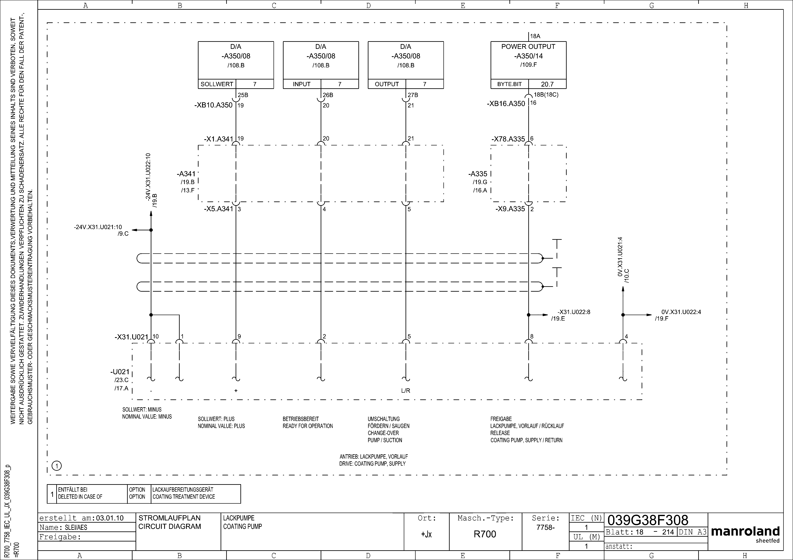

# +Jx — Sheet 18 of 214 — LACKPUMPE

**COATING PUMP**

> Part of the manroland **R700** printing press IEC/UL circuit diagrams.
> Drawing class: **Stromlaufplan / Circuit diagram** (DIN A3).
> Document `+Jx` covers the **1st printing module + feed register** machine section.

## At a glance

| Field | Value |
|---|---|
| Document | `+Jx`  (039G38F308) |
| Sheet | **18** of 214 |
| Section (DE) | LACKPUMPE |
| Section (EN) | COATING PUMP |
| Section type | CIRCUIT — Circuit diagram |
| Machine type | `R700` |
| Series | `7758` |
| Created | 03.01.10 |
| Replaces | — |
| Columns used | A, B, C, D, E, F, G |
| Path numbers | — |
| Labels on sheet | 96 |
| Cross-refs out | 15 |
| Cross-refs in | 34 |

**Previous:** [+Jx sheet 17](SHEET_0017.md) · **Next:** [+Jx sheet 19](SHEET_0019.md) · **Document TOC:** [_TOC.md](_TOC.md)  (+Jx) · **Master TOC:** [all sheets](../_MASTER_TOC.md)

## Sheet image (300 DPI, exact vector render)



_Rendered directly from the PDF vector layer at 300 DPI (1-bit), no OCR and no resampling. Use it to confirm anything ambiguous in the text below._

## Cross-references on this sheet

Each entry is a wire leaving this sheet. The printed token is `/sheet.column`; the link resolves to that sheet inside the same document.

| Ref | Target sheet | Col | Path | Destination on target | Target section | From col |
|---|---|---|---|---|---|---|
| `/109.F` | [+Jx sheet 109](SHEET_0109.md) | F | — | — | REFERENZMODUL | F |
| `/108.B` | [+Jx sheet 108](SHEET_0108.md) | B | — | — | REFERENZMODUL | C |
| `/108.B` | [+Jx sheet 108](SHEET_0108.md) | B | — | — | REFERENZMODUL | C |
| `/108.B` | [+Jx sheet 108](SHEET_0108.md) | B | — | — | REFERENZMODUL | D |
| `/19.B` | [+Jx sheet 19](SHEET_0019.md) | B | — | 24V.X31.U022:10 | LACKPUMPE | B |
| `/19.B` | [+Jx sheet 19](SHEET_0019.md) | B | — | — | LACKPUMPE | B |
| `/19.G` | [+Jx sheet 19](SHEET_0019.md) | G | — | — | LACKPUMPE | E |
| `/16.A` | [+Jx sheet 16](SHEET_0016.md) | A | — | — | ÖLUMLAUFSCHMIERUNG | E |
| `/13.F` | [+Jx sheet 13](SHEET_0013.md) | F | — | — | SPANNUNGSVERSORGUNG, SCHALTSCHRANKBELÜFTUNG | B |
| `/9.C` | [+Jx sheet 9](SHEET_0009.md) | C | — | 24V.X31.U021:10 | SPANNUNGSVERSORGUNG, SCHALTSCHRANKBELÜFTUNG | A |
| `/10.C` | [+Jx sheet 10](SHEET_0010.md) | C | — | 0V.X31.U021:4 | SPANNUNGSVERSORGUNG, SCHALTSCHRANKBELÜFTUNG | G |
| `/19.E` | [+Jx sheet 19](SHEET_0019.md) | E | — | — | LACKPUMPE | F |
| `/19.F` | [+Jx sheet 19](SHEET_0019.md) | F | — | — | LACKPUMPE | G |
| `/23.C` | [+Jx sheet 23](SHEET_0023.md) | C | — | — | LACKPUMPE | A |
| `/17.A` | [+Jx sheet 17](SHEET_0017.md) | A | — | — | LACKPUMPE | A |

### Incoming references (sheets that point here)

Every other sheet that sends a wire to this one. `Back-ref` is the token printed on *that* sheet; `Path` is its line number.

| From sheet | Cols | Back-ref | Path | Refs | What continues there |
|---|---|---|---|---|---|
| [+Jx#9](SHEET_0009.md) | C | `/9.C` | — | 1 | — |
| [+Jx#10](SHEET_0010.md) | C | `/10.C` | — | 1 | 0V.X31.U021:4 |
| [+Jx#13](SHEET_0013.md) | F | `/13.F` | — | 1 | — |
| [+Jx#16](SHEET_0016.md) | A | `/16.A` | — | 1 | — |
| [+Jx#17](SHEET_0017.md) | A | `/17.A` | — | 1 | — |
| [+Jx#19](SHEET_0019.md) | A, B, E, F | `/19.A`, `/19.B`, `/19.E`, `/19.F` | — | 5 | 0V.X31.U022:4; 24V.X31.U022:10; X31.U022:8 |
| [+Jx#23](SHEET_0023.md) | C | `/23.C` | — | 1 | — |
| [+Jx#108](SHEET_0108.md) | B | `/108.B` | — | 3 | — |
| [+Jx#109](SHEET_0109.md) | F | `/109.F` | — | 1 | — |
| [+Jx#113](SHEET_0113.md) | H | `/113.H` | — | 3 | — |
| [+Jx#131](SHEET_0131.md) | F | `/131.F` | — | 3 | — |
| [+Jx#134](SHEET_0134.md) | E | `/134.E` | — | 1 | — |
| [+Jx#135](SHEET_0135.md) | E | `/135.E` | — | 3 | — |
| [+Jx#139](SHEET_0139.md) | G | `/139.G` | — | 1 | — |
| [+Jx#148](SHEET_0148.md) | E | `/148.E` | — | 7 | — |
| [+Jx#156](SHEET_0156.md) | C | `/156.C` | — | 1 | — |


## Devices on this sheet

| Tag | Class | Class meaning (IEC) | Col | Sub | Terminal | Sign |
|---|---|---|---|---|---|---|
| `A350/08` | A | Baugruppe / assembly, module, PC board | D | 08 | — | — |
| `A350/08` | A | Baugruppe / assembly, module, PC board | C | 08 | — | — |
| `A350/08` | A | Baugruppe / assembly, module, PC board | C | 08 | — | — |
| `A350/14` | A | Baugruppe / assembly, module, PC board | F | 14 | — | — |
| `A341` | A | Baugruppe / assembly, module, PC board | B | — | — | — |
| `A335` | A | Baugruppe / assembly, module, PC board | E | — | — | — |
| `U021` | U | Umrichter / frequency converter | A | — | — | — |
| `XB10.A350` | — | cross-device reference | B | — | — | — |
| `20.7` | — | cross-device reference | F | — | — | — |
| `XB16.A350` | — | cross-device reference | E | — | — | — |
| `X1.A341` | — | cross-device reference | B | — | — | — |
| `X5.A341` | — | cross-device reference | B | — | — | — |
| `X9.A335` | — | cross-device reference | F | — | — | — |
| `X78.A335` | — | cross-device reference | E | — | — | — |
| `X31.U021` | — | cross-device reference | A | — | — | — |
| `X31.U022:8` | — | cross-device reference | F | — | 8 | — |

## Potentials / nets

| Potential | Count | Columns | Attached devices | Terminals |
|---|---|---|---|---|
| `0V` | 2 | G | `U021`, `U022`, `X31` | `4` |
| `24V` | 2 | A, B | `U021`, `U022`, `X31` | `10` |


A potential such as `L24+/4` or `M24+` is a named supply/return rail; every place it appears on this sheet is electrically common.

## Wire-end annotations (grouped as printed)

A wire that continues elsewhere is annotated with a small cluster: the destination description, the path/line number `#NN`, and the `/sheet.column` cross reference. Each row below is one such cluster exactly as it is grouped on the drawing.

| Col | Y | Path | Cross-ref | Text on the wire |
|---|---|---|---|---|
| F | 50.5 | — | — | `18A` |
| C | 65.7 | — | — | `D/A` |
| C | 65.7 | — | — | `D/A` |
| D | 65.7 | — | — | `D/A` |
| F | 65.7 | — | — | `POWER OUTPUT` |
| C | 79.6 | — | — | `A350/08` |
| C | 79.6 | — | — | `A350/08` |
| D | 79.6 | — | — | `A350/08` |
| F | 79.6 | — | — | `A350/14` |
| F | 93.4 | — | `/109.F` | — |
| C | 94.5 | — | `/108.B` | — |
| C | 94.5 | — | `/108.B` | — |
| D | 94.5 | — | `/108.B` | — |
| F | 122.5 | — | — | `BYTE.BIT 20.7` |
| C | 122.8 | — | — | `SOLLWERT 7` |
| C | 122.8 | — | — | `INPUT 7` |
| D | 122.8 | — | — | `OUTPUT 7` |
| F | 138.4 | — | — | `18B(18C)` |
| C | 139.1 | — | — | `25B` |
| D | 139.1 | — | — | `26B` |
| D | 139.1 | — | — | `27B` |
| F | 150.5 | — | — | `XB16.A350 16` |
| C | 153.3 | — | — | `XB10.A350 19 20 21` |
| C | 204.3 | — | — | `X1.A341 19 20 21` |
| F | 204.3 | — | — | `X78.A335 6` |
| B | 230.2 | — | `/19.B` | `24V.X31.U022:10` |
| B | 256.8 | — | — | `A341` |
| E | 256.8 | — | — | `A335` |
| B | 269.8 | — | `/19.B` | — |
| E | 269.9 | — | `/19.G` | — |
| B | 282.2 | — | `/13.F` | — |
| E | 282.2 | — | `/16.A` | — |
| C | 309.2 | — | — | `X5.A341 3 4 5` |
| F | 309.2 | — | — | `X9.A335 2` |
| A | 337.6 | — | `/9.C` | `24V.X31.U021:10` |
| G | 356.0 | — | `/10.C` | `0V.X31.U021:4` |
| F | 465.1 | — | — | `X31.U022:8` |
| G | 465.1 | — | — | `0V.X31.U022:4` |
| F | 475.0 | — | `/19.E` | — |
| G | 475.0 | — | `/19.F` | — |
| D | 502.0 | — | — | `X31.U021 10 1 9 2 5 8 4` |
| A | 554.4 | — | — | `U021` |
| A | 567.5 | — | `/23.C`, `/17.A` | — |
| D | 583.5 | — | — | `+ L/R` |
| B | 612.8 | — | — | `NOMINAL VALUE: MINUS SOLLWERT: MINUS` |
| B | 627.0 | — | — | `NOMINAL VALUE: PLUS SOLLWERT: PLUS` |
| C | 627.0 | — | — | `BETRIEBSBEREIT READY FOR OPERATION` |
| F | 627.0 | — | — | `FREIGABE LACKPUMPE, VORLAUF / RÜCKLAUF RELEASE COATING PUMP, SUPPLY / RETURN` |
| D | 627.1 | — | — | `UMSCHALTUNG FÖRDERN / SAUGEN PUMP / SUCTION CHANGE OVER` |
| C | 683.7 | — | — | `1 DRIVE: COATING PUMP, SUPPLY ANTRIEB: LACKPUMPE, VORLAUF` |
| A | 733.3 | — | — | `1 ENTFÄLLT BEI DELETED IN CASE OF` |
| B | 733.3 | — | — | `OPTION OPTION` |
| B | 733.3 | — | — | `LACKAUFBEREITUNGSGERÄT COATING TREATMENT DEVICE` |


## Reconstructed tables

This sheet carries tabular content (pin map / terminal assignment / index). The grid below was rebuilt from the drawing's own rule lines, so each row is exactly one physical row of the table.

### Table 1 — 2 data rows × 4 columns (at x=226.8, y=62.4)

|  |  | D/A | A350/08 /108.B |
|---|---|---|---|
|  |  | `SOLLWERT` | `7` |
| `/19.B` | `A341 /19.B /13.F` | `XB10.A350 X1.A341 X5.A341` | `25B 19 19 3` |


### Table 2 — 2 data rows × 2 columns (at x=425.2, y=62.4)

| D/A | A350/08 /108.B |
|---|---|
| `INPUT` | `7` |
|  | `26B 20 20 4` |


### Table 3 — 4 data rows × 6 columns (at x=552.8, y=62.4)

| D/A | A350/08 /108.B |  | POWER | OUTPUT A350/14 /109.F |  |
|---|---|---|---|---|---|
| `OUTPUT` | `7` |  | `BYTE.BIT` | `20.7` |  |
|  | `27B 21 21 5` | `A335 /19.G /16.A` | `XB16.A350 X78.A335 X9.A335` | `18B(18C) 16 6 2` |  |
|  |  |  |  |  | `0V.X31.U021:4` |
|  |  |  |  |  | `X31.U022:8` |


## Notes and free text on this sheet

| Text | Col | Y (pt) |
|---|---|---|
| `27B` | D | 139.13 |
| `D/A` | D | 65.72 |
| `OUTPUT` | D | 122.83 |
| `UMSCHALTUNG` | D | 627.06 |
| `FÖRDERN / SAUGEN` | D | 637.67 |
| `CHANGE OVER` | D | 648.32 |
| `PUMP / SUCTION` | D | 658.93 |
| `26B` | D | 139.13 |
| `D/A` | C | 65.72 |
| `INPUT` | C | 122.82 |
| `BETRIEBSBEREIT` | C | 627.01 |
| `READY FOR OPERATION` | C | 637.66 |
| `25B` | C | 139.13 |
| `SOLLWERT` | B | 122.77 |
| `SOLLWERT: PLUS` | B | 627.01 |
| `NOMINAL VALUE: PLUS` | B | 637.67 |
| `18A` | F | 50.54 |
| `18B(18C)` | F | 138.45 |
| `POWER OUTPUT` | F | 65.69 |
| `BYTE.BIT` | E | 123.03 |
| `FREIGABE` | E | 627 |
| `LACKPUMPE, VORLAUF / RÜCKLAUF` | F | 637.67 |
| `RELEASE` | E | 648.27 |
| `COATING PUMP, SUPPLY / RETURN` | F | 658.94 |
| `ENTFÄLLT BEI` | A | 733.3 |
| `DELETED IN CASE OF` | A | 743.96 |
| `OPTION` | B | 733.32 |
| `LACKAUFBEREITUNGSGERÄT` | B | 733.34 |
| `COATING TREATMENT DEVICE` | B | 743.97 |
| `L/R` | D | 583.47 |
| `SOLLWERT: MINUS` | B | 612.84 |
| `NOMINAL VALUE: MINUS` | B | 623.5 |
| `ANTRIEB: LACKPUMPE, VORLAUF` | D | 683.73 |
| `DRIVE: COATING PUMP, SUPPLY` | D | 694.36 |

## Complete label inventory (exact text from the drawing)

Every text object inside the drawing area of this sheet, in DIN reading order (column A→H, then top→bottom). This is the authoritative list: if a string is not here it is not printed on this sheet.

| Col | Y | X | Dir | Type | Text |
|---|---|---|---|---|---|
| A | 337.6 | 111.1 | → | potential | `24V.X31.U021:10` |
| A | 347.5 | 176.9 | → | cross-reference | `/9.C` |
| A | 502.0 | 172.3 | → | device ref | `X31.U021` |
| A | 554.4 | 165.8 | → | device tag | `U021` |
| A | 567.5 | 172.1 | → | cross-reference | `/23.C` |
| A | 579.9 | 172.1 | → | cross-reference | `/17.A` |
| A | 697.1 | 83.2 | → | number | `1` |
| A | 733.3 | 87.3 | → | text | `ENTFÄLLT BEI` |
| A | 738.6 | 75.4 | → | number | `1` |
| A | 744.0 | 87.3 | → | text | `DELETED IN CASE OF` |
| B | 122.8 | 301.3 | → | text | `SOLLWERT` |
| B | 153.3 | 292.0 | → | device ref | `XB10.A350` |
| B | 204.3 | 306.4 | → | device ref | `X1.A341` |
| B | 230.2 | 218.5 | ↕ | potential | `24V.X31.U022:10` |
| B | 256.8 | 265.6 | → | device tag | `A341` |
| B | 269.8 | 271.6 | → | cross-reference | `/19.B` |
| B | 282.3 | 272.1 | → | cross-reference | `/13.F` |
| B | 291.1 | 228.4 | ↕ | cross-reference | `/19.B` |
| B | 309.2 | 306.4 | → | device ref | `X5.A341` |
| B | 502.0 | 228.8 | → | number | `10` |
| B | 502.0 | 271.3 | → | number | `1` |
| B | 612.8 | 184.0 | → | text | `SOLLWERT: MINUS` |
| B | 623.5 | 183.7 | → | text | `NOMINAL VALUE: MINUS` |
| B | 627.0 | 297.4 | → | text | `SOLLWERT: PLUS` |
| B | 637.7 | 297.1 | → | text | `NOMINAL VALUE: PLUS` |
| B | 733.3 | 193.9 | → | text | `OPTION` |
| B | 733.3 | 229.0 | → | text | `LACKAUFBEREITUNGSGERÄT` |
| B | 743.9 | 193.9 | → | text | `OPTION` |
| B | 744.0 | 229.3 | → | text | `COATING TREATMENT DEVICE` |
| C | 65.7 | 345.8 | → | text | `D/A` |
| C | 65.7 | 473.4 | → | text | `D/A` |
| C | 79.6 | 332.9 | → | device tag | `A350/08` |
| C | 79.6 | 460.5 | → | device tag | `A350/08` |
| C | 94.5 | 341.7 | → | cross-reference | `/108.B` |
| C | 94.5 | 469.3 | → | cross-reference | `/108.B` |
| C | 122.8 | 439.9 | → | text | `INPUT` |
| C | 122.9 | 380.3 | → | number | `7` |
| C | 139.1 | 357.2 | → | text | `25B` |
| C | 154.8 | 356.3 | → | number | `19` |
| C | 204.4 | 356.3 | → | number | `19` |
| C | 310.7 | 356.9 | → | number | `3` |
| C | 502.0 | 356.9 | → | number | `9` |
| C | 583.5 | 351.8 | → | number | `+` |
| C | 627.0 | 424.6 | → | text | `BETRIEBSBEREIT` |
| C | 637.7 | 424.6 | → | text | `READY FOR OPERATION` |
| D | 65.7 | 600.9 | → | text | `D/A` |
| D | 79.6 | 588.0 | → | device tag | `A350/08` |
| D | 94.5 | 596.8 | → | cross-reference | `/108.B` |
| D | 122.8 | 563.0 | → | text | `OUTPUT` |
| D | 122.9 | 507.8 | → | number | `7` |
| D | 139.1 | 484.7 | → | text | `26B` |
| D | 139.1 | 612.3 | → | text | `27B` |
| D | 154.8 | 484.7 | → | number | `20` |
| D | 154.8 | 612.3 | → | number | `21` |
| D | 204.4 | 484.7 | → | number | `20` |
| D | 204.4 | 612.3 | → | number | `21` |
| D | 310.7 | 484.7 | → | number | `4` |
| D | 310.7 | 612.0 | → | number | `5` |
| D | 502.0 | 484.7 | → | number | `2` |
| D | 502.0 | 612.0 | → | number | `5` |
| D | 583.5 | 602.4 | → | text | `L/R` |
| D | 627.1 | 552.2 | → | text | `UMSCHALTUNG` |
| D | 637.7 | 552.2 | → | text | `FÖRDERN / SAUGEN` |
| D | 648.3 | 552.5 | → | text | `CHANGE OVER` |
| D | 658.9 | 552.2 | → | text | `PUMP / SUCTION` |
| D | 683.7 | 510.2 | → | text | `ANTRIEB: LACKPUMPE, VORLAUF` |
| D | 694.4 | 509.7 | → | text | `DRIVE: COATING PUMP, SUPPLY` |
| E | 122.9 | 635.4 | → | number | `7` |
| E | 123.0 | 746.9 | → | text | `BYTE.BIT` |
| E | 151.2 | 731.3 | → | device ref | `XB16.A350` |
| E | 204.3 | 738.1 | → | device ref | `X78.A335` |
| E | 256.8 | 703.3 | → | device tag | `A335` |
| E | 269.9 | 710.1 | → | cross-reference | `/19.G` |
| E | 282.2 | 710.6 | → | cross-reference | `/16.A` |
| E | 627.0 | 736.4 | → | text | `FREIGABE` |
| E | 648.3 | 736.4 | → | text | `RELEASE` |
| F | 50.5 | 795.7 | → | text | `18A` |
| F | 65.7 | 752.9 | → | text | `POWER OUTPUT` |
| F | 79.6 | 772.2 | → | device tag | `A350/14` |
| F | 93.4 | 781.4 | → | cross-reference | `/109.F` |
| F | 122.5 | 812.6 | → | device ref | `20.7` |
| F | 138.5 | 801.4 | → | text | `18B(18C)` |
| F | 150.5 | 795.7 | → | number | `16` |
| F | 204.4 | 796.3 | → | number | `6` |
| F | 309.2 | 744.1 | → | device ref | `X9.A335` |
| F | 310.7 | 796.5 | → | number | `2` |
| F | 465.1 | 837.4 | → | device ref | `X31.U022:8` |
| F | 475.0 | 827.7 | → | cross-reference | `/19.E` |
| F | 502.0 | 796.3 | → | number | `8` |
| F | 637.7 | 736.4 | → | text | `LACKPUMPE, VORLAUF / RÜCKLAUF` |
| F | 658.9 | 736.7 | → | text | `COATING PUMP, SUPPLY / RETURN` |
| G | 356.0 | 927.2 | ↕ | potential | `0V.X31.U021:4` |
| G | 404.2 | 937.1 | ↕ | cross-reference | `/10.C` |
| G | 465.1 | 993.3 | → | potential | `0V.X31.U022:4` |
| G | 475.0 | 983.6 | → | cross-reference | `/19.F` |
| G | 502.0 | 938.3 | → | number | `4` |

## Reading-order text block

The same content as a plain block, grouped by DIN column — convenient to paste or to match against a visual description.

```text
=== Column A ===
 337.6  111.1  net          24V.X31.U021:10
 347.5  176.9  xref         /9.C
 502.0  172.3  devref       X31.U021
 554.4  165.8  devtag       U021
 567.5  172.1  xref         /23.C
 579.9  172.1  xref         /17.A
 697.1   83.2  numeric      1
 733.3   87.3  text         ENTFÄLLT BEI
 738.6   75.4  numeric      1
 744.0   87.3  text         DELETED IN CASE OF
=== Column B ===
 122.8  301.3  text         SOLLWERT
 153.3  292.0  devref       XB10.A350
 204.3  306.4  devref       X1.A341
 230.2  218.5  net          24V.X31.U022:10
 256.8  265.6  devtag       A341
 269.8  271.6  xref         /19.B
 282.3  272.1  xref         /13.F
 291.1  228.4  xref         /19.B
 309.2  306.4  devref       X5.A341
 502.0  228.8  numeric      10
 502.0  271.3  numeric      1
 612.8  184.0  text         SOLLWERT: MINUS
 623.5  183.7  text         NOMINAL VALUE: MINUS
 627.0  297.4  text         SOLLWERT: PLUS
 637.7  297.1  text         NOMINAL VALUE: PLUS
 733.3  193.9  text         OPTION
 733.3  229.0  text         LACKAUFBEREITUNGSGERÄT
 743.9  193.9  text         OPTION
 744.0  229.3  text         COATING TREATMENT DEVICE
=== Column C ===
  65.7  345.8  text         D/A
  65.7  473.4  text         D/A
  79.6  332.9  devtag       A350/08
  79.6  460.5  devtag       A350/08
  94.5  341.7  xref         /108.B
  94.5  469.3  xref         /108.B
 122.8  439.9  text         INPUT
 122.9  380.3  numeric      7
 139.1  357.2  text         25B
 154.8  356.3  numeric      19
 204.4  356.3  numeric      19
 310.7  356.9  numeric      3
 502.0  356.9  numeric      9
 583.5  351.8  numeric      +
 627.0  424.6  text         BETRIEBSBEREIT
 637.7  424.6  text         READY FOR OPERATION
=== Column D ===
  65.7  600.9  text         D/A
  79.6  588.0  devtag       A350/08
  94.5  596.8  xref         /108.B
 122.8  563.0  text         OUTPUT
 122.9  507.8  numeric      7
 139.1  484.7  text         26B
 139.1  612.3  text         27B
 154.8  484.7  numeric      20
 154.8  612.3  numeric      21
 204.4  484.7  numeric      20
 204.4  612.3  numeric      21
 310.7  484.7  numeric      4
 310.7  612.0  numeric      5
 502.0  484.7  numeric      2
 502.0  612.0  numeric      5
 583.5  602.4  text         L/R
 627.1  552.2  text         UMSCHALTUNG
 637.7  552.2  text         FÖRDERN / SAUGEN
 648.3  552.5  text         CHANGE OVER
 658.9  552.2  text         PUMP / SUCTION
 683.7  510.2  text         ANTRIEB: LACKPUMPE, VORLAUF
 694.4  509.7  text         DRIVE: COATING PUMP, SUPPLY
=== Column E ===
 122.9  635.4  numeric      7
 123.0  746.9  text         BYTE.BIT
 151.2  731.3  devref       XB16.A350
 204.3  738.1  devref       X78.A335
 256.8  703.3  devtag       A335
 269.9  710.1  xref         /19.G
 282.2  710.6  xref         /16.A
 627.0  736.4  text         FREIGABE
 648.3  736.4  text         RELEASE
=== Column F ===
  50.5  795.7  text         18A
  65.7  752.9  text         POWER OUTPUT
  79.6  772.2  devtag       A350/14
  93.4  781.4  xref         /109.F
 122.5  812.6  devref       20.7
 138.5  801.4  text         18B(18C)
 150.5  795.7  numeric      16
 204.4  796.3  numeric      6
 309.2  744.1  devref       X9.A335
 310.7  796.5  numeric      2
 465.1  837.4  devref       X31.U022:8
 475.0  827.7  xref         /19.E
 502.0  796.3  numeric      8
 637.7  736.4  text         LACKPUMPE, VORLAUF / RÜCKLAUF
 658.9  736.7  text         COATING PUMP, SUPPLY / RETURN
=== Column G ===
 356.0  927.2  net          0V.X31.U021:4
 404.2  937.1  xref         /10.C
 465.1  993.3  net          0V.X31.U022:4
 475.0  983.6  xref         /19.F
 502.0  938.3  numeric      4
```

---
_Generated from the PDF vector text layer; no OCR. Source: `R700_7758_IEC_UL_JX_039G38F308_p`, sheet 18._
