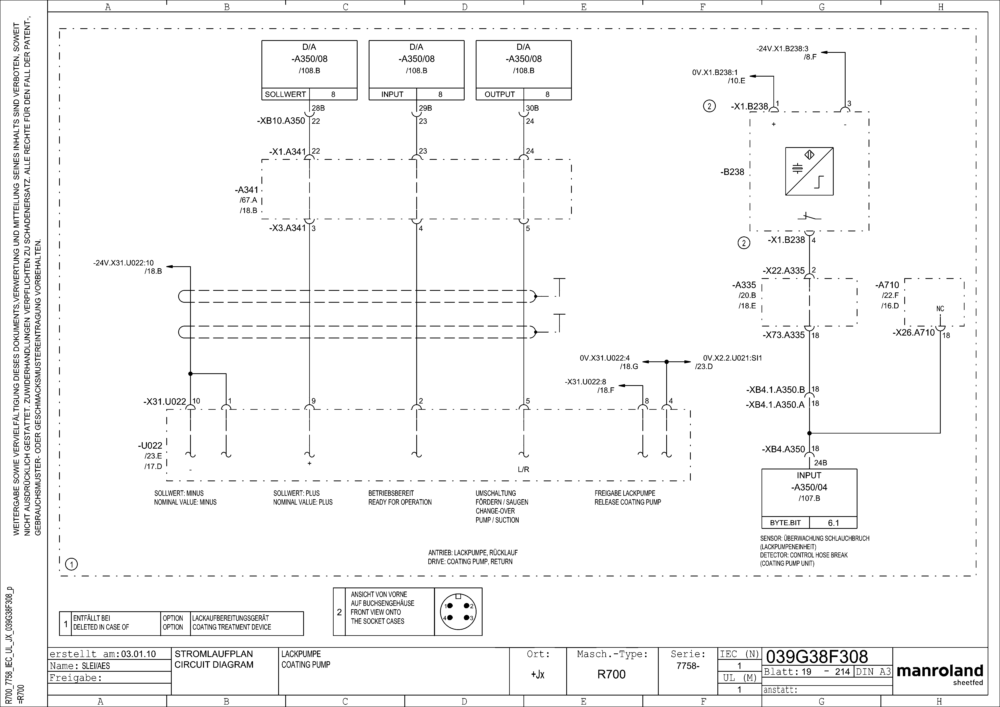

# +Jx — Sheet 19 of 214 — LACKPUMPE

**COATING PUMP**

> Part of the manroland **R700** printing press IEC/UL circuit diagrams.
> Drawing class: **Stromlaufplan / Circuit diagram** (DIN A3).
> Document `+Jx` covers the **1st printing module + feed register** machine section.

## At a glance

| Field | Value |
|---|---|
| Document | `+Jx`  (039G38F308) |
| Sheet | **19** of 214 |
| Section (DE) | LACKPUMPE |
| Section (EN) | COATING PUMP |
| Section type | CIRCUIT — Circuit diagram |
| Machine type | `R700` |
| Series | `7758` |
| Created | 03.01.10 |
| Replaces | — |
| Columns used | A, B, C, D, E, F, G, H |
| Path numbers | — |
| Labels on sheet | 127 |
| Cross-refs out | 18 |
| Cross-refs in | 43 |

**Previous:** [+Jx sheet 18](SHEET_0018.md) · **Next:** [+Jx sheet 20](SHEET_0020.md) · **Document TOC:** [_TOC.md](_TOC.md)  (+Jx) · **Master TOC:** [all sheets](../_MASTER_TOC.md)

## Sheet image (300 DPI, exact vector render)



_Rendered directly from the PDF vector layer at 300 DPI (1-bit), no OCR and no resampling. Use it to confirm anything ambiguous in the text below._

## Cross-references on this sheet

Each entry is a wire leaving this sheet. The printed token is `/sheet.column`; the link resolves to that sheet inside the same document.

| Ref | Target sheet | Col | Path | Destination on target | Target section | From col |
|---|---|---|---|---|---|---|
| `/8.F` | [+Jx sheet 8](SHEET_0008.md) | F | — | 24V.X1.B238:3 | SPANNUNGSVERSORGUNG, SCHALTSCHRANKBELÜFTUNG | G |
| `/108.B` | [+Jx sheet 108](SHEET_0108.md) | B | — | — | REFERENZMODUL | C |
| `/108.B` | [+Jx sheet 108](SHEET_0108.md) | B | — | — | REFERENZMODUL | D |
| `/108.B` | [+Jx sheet 108](SHEET_0108.md) | B | — | — | REFERENZMODUL | E |
| `/10.E` | [+Jx sheet 10](SHEET_0010.md) | E | — | 0V.X1.B238:1 | SPANNUNGSVERSORGUNG, SCHALTSCHRANKBELÜFTUNG | F |
| `/67.A` | [+Jx sheet 67](SHEET_0067.md) | A | — | — | BOGENFÜHRUNG | B |
| `/18.B` | [+Jx sheet 18](SHEET_0018.md) | B | — | — | LACKPUMPE | B |
| `/18.B` | [+Jx sheet 18](SHEET_0018.md) | B | — | 24V.X31.U022:10 | LACKPUMPE | A |
| `/20.B` | [+Jx sheet 20](SHEET_0020.md) | B | — | — | LACKPUMPE | F |
| `/18.E` | [+Jx sheet 18](SHEET_0018.md) | E | — | — | LACKPUMPE | F |
| `/22.F` | [+Jx sheet 22](SHEET_0022.md) | F | — | — | LACKPUMPE | H |
| `/16.D` | [+Jx sheet 16](SHEET_0016.md) | D | — | — | ÖLUMLAUFSCHMIERUNG | H |
| `/18.G` | [+Jx sheet 18](SHEET_0018.md) | G | — | 0V.X31.U022:4 | LACKPUMPE | F |
| `/23.D` | [+Jx sheet 23](SHEET_0023.md) | D | — | 0V.X31.U022:4 | LACKPUMPE | F |
| `/18.F` | [+Jx sheet 18](SHEET_0018.md) | F | — | X31.U022:8 | LACKPUMPE | E |
| `/23.E` | [+Jx sheet 23](SHEET_0023.md) | E | — | — | LACKPUMPE | A |
| `/17.D` | [+Jx sheet 17](SHEET_0017.md) | D | — | — | LACKPUMPE | A |
| `/107.B` | [+Jx sheet 107](SHEET_0107.md) | B | — | — | REFERENZMODUL | G |

### Incoming references (sheets that point here)

Every other sheet that sends a wire to this one. `Back-ref` is the token printed on *that* sheet; `Path` is its line number.

| From sheet | Cols | Back-ref | Path | Refs | What continues there |
|---|---|---|---|---|---|
| [+Jx#8](SHEET_0008.md) | F | `/8.F` | — | 1 | 24V.X1.B238:3 |
| [+Jx#10](SHEET_0010.md) | E | `/10.E` | — | 1 | 0V.X1.B238:1 |
| [+Jx#16](SHEET_0016.md) | D | `/16.D` | — | 1 | — |
| [+Jx#17](SHEET_0017.md) | D | `/17.D` | — | 1 | — |
| [+Jx#18](SHEET_0018.md) | B, E, F, G | `/18.B`, `/18.E`, `/18.F`, `/18.G` | — | 5 | 24V.X31.U022:10 |
| [+Jx#20](SHEET_0020.md) | B | `/20.B` | — | 1 | — |
| [+Jx#22](SHEET_0022.md) | E | `/22.E` | — | 1 | — |
| [+Jx#23](SHEET_0023.md) | C, E | `/23.C`, `/23.E` | — | 2 | 0V.X2.2.U021:SI1 |
| [+Jx#67](SHEET_0067.md) | A | `/67.A` | — | 1 | — |
| [+Jx#107](SHEET_0107.md) | B | `/107.B` | — | 1 | — |
| [+Jx#108](SHEET_0108.md) | B | `/108.B` | — | 3 | — |
| [+Jx#113](SHEET_0113.md) | H | `/113.H` | — | 3 | — |
| [+Jx#117](SHEET_0117.md) | B | `/117.B` | — | 3 | — |
| [+Jx#127](SHEET_0127.md) | F | `/127.F` | — | 3 | — |
| [+Jx#130](SHEET_0130.md) | A, B, D | `/130.A`, `/130.B`, `/130.D` | — | 3 | — |
| [+Jx#135](SHEET_0135.md) | E | `/135.E` | — | 3 | — |
| [+Jx#142](SHEET_0142.md) | A | `/142.A` | — | 1 | — |
| [+Jx#143](SHEET_0143.md) | F | `/143.F` | — | 1 | — |
| [+Jx#148](SHEET_0148.md) | F | `/148.F` | — | 7 | — |
| [+Jx#153](SHEET_0153.md) | E | `/153.E` | — | 1 | — |


## Devices on this sheet

| Tag | Class | Class meaning (IEC) | Col | Sub | Terminal | Sign |
|---|---|---|---|---|---|---|
| `U022` | U | Umrichter / frequency converter | A | — | — | — |
| `A350/08` | A | Baugruppe / assembly, module, PC board | C | 08 | — | — |
| `A350/08` | A | Baugruppe / assembly, module, PC board | D | 08 | — | — |
| `A350/08` | A | Baugruppe / assembly, module, PC board | E | 08 | — | — |
| `A341` | A | Baugruppe / assembly, module, PC board | B | — | — | — |
| `B238` | B | Umformer / transducer, sensor | F | — | — | — |
| `A335` | A | Baugruppe / assembly, module, PC board | F | — | — | — |
| `A350/04` | A | Baugruppe / assembly, module, PC board | G | 04 | — | — |
| `A710` | A | Baugruppe / assembly, module, PC board | H | — | — | — |
| `X31.U022` | — | cross-device reference | A | — | — | — |
| `XB10.A350` | — | cross-device reference | B | — | — | — |
| `X1.A341` | — | cross-device reference | C | — | — | — |
| `X3.A341` | — | cross-device reference | C | — | — | — |
| `X1.B238` | — | cross-device reference | G | — | — | — |
| `X1.B238` | — | cross-device reference | F | — | — | — |
| `X22.A335` | — | cross-device reference | G | — | — | — |
| `X73.A335` | — | cross-device reference | G | — | — | — |
| `6.1` | — | cross-device reference | G | — | — | — |
| `XB4.A350` | — | cross-device reference | G | — | — | — |
| `XB4.1.A350.B` | — | cross-device reference | G | — | — | — |
| `XB4.1.A350.A` | — | cross-device reference | G | — | — | — |
| `X26.A710` | — | cross-device reference | H | — | — | — |
| `X31.U022:8` | — | cross-device reference | E | — | 8 | — |

## Potentials / nets

| Potential | Count | Columns | Attached devices | Terminals |
|---|---|---|---|---|
| `0V` | 3 | E, F | `2`, `B238`, `U021`, `U022`, `X1`, `X2`, `X31` | `1`, `4`, `SI1` |
| `24V` | 2 | A, G | `B238`, `U022`, `X1`, `X31` | `10`, `3` |


A potential such as `L24+/4` or `M24+` is a named supply/return rail; every place it appears on this sheet is electrically common.

## Wire-end annotations (grouped as printed)

A wire that continues elsewhere is annotated with a small cluster: the destination description, the path/line number `#NN`, and the `/sheet.column` cross reference. Each row below is one such cluster exactly as it is grouped on the drawing.

| Col | Y | Path | Cross-ref | Text on the wire |
|---|---|---|---|---|
| C | 51.5 | — | — | `D/A` |
| D | 51.5 | — | — | `D/A` |
| D | 51.5 | — | — | `D/A` |
| G | 54.1 | — | `/8.F` | `24V.X1.B238:3` |
| C | 65.4 | — | — | `A350/08` |
| D | 65.4 | — | — | `A350/08` |
| E | 65.4 | — | — | `A350/08` |
| C | 80.3 | — | `/108.B` | — |
| D | 80.3 | — | `/108.B` | — |
| E | 80.3 | — | `/108.B` | — |
| F | 82.4 | — | `/10.E` | `0V.X1.B238:1` |
| C | 108.6 | — | — | `SOLLWERT 8` |
| D | 108.7 | — | — | `INPUT 8` |
| D | 108.7 | — | — | `OUTPUT 8` |
| G | 119.3 | — | — | `X1.B238 1 3` |
| F | 123.5 | — | — | `2` |
| C | 125.0 | — | — | `28B` |
| D | 125.0 | — | — | `29B` |
| E | 125.0 | — | — | `30B` |
| C | 139.1 | — | — | `XB10.A350 22` |
| D | 140.6 | — | — | `23` |
| E | 140.6 | — | — | `24` |
| G | 144.1 | — | — | `+` |
| C | 176.0 | — | — | `X1.A341 22 23 24` |
| F | 200.1 | — | — | `B238` |
| B | 221.3 | — | — | `A341` |
| B | 234.4 | — | `/67.A`, `/18.B` | — |
| C | 266.7 | — | — | `X3.A341 3 4 5` |
| G | 280.9 | — | — | `X1.B238 4` |
| F | 286.5 | — | — | `2` |
| A | 309.2 | — | `/18.B` | `24V.X31.U022:10` |
| G | 317.7 | — | — | `X22.A335 2` |
| F | 334.7 | — | — | `A335` |
| H | 334.7 | — | — | `A710` |
| F | 347.8 | — | `/20.B`, `/18.E` | — |
| H | 347.8 | — | `/22.F`, `/16.D` | — |
| H | 364.8 | — | — | `NC` |
| H | 391.4 | — | — | `X26.A710 18` |
| G | 394.2 | — | — | `X73.A335 18` |
| F | 422.6 | — | `/18.G`, `/23.D` | `0V.X31.U022:4` |
| F | 422.6 | — | — | `0V.X2.2.U021:SI1` |
| E | 450.9 | — | `/18.F` | `X31.U022:8` |
| G | 459.5 | — | — | `XB4.1.A350.B 18` |
| D | 473.6 | — | — | `X31.U022 10 1 8 4` |
| D | 473.6 | — | — | `9 2 5` |
| G | 476.5 | — | — | `XB4.1.A350.A 18` |
| A | 526.1 | — | — | `U022` |
| G | 530.3 | — | — | `XB4.A350 18` |
| A | 539.1 | — | `/23.E`, `/17.D` | — |
| G | 547.3 | — | — | `24B` |
| D | 548.0 | — | — | `+ L/R` |
| G | 561.8 | — | — | `INPUT` |
| G | 575.7 | — | — | `A350/04` |
| B | 584.5 | — | — | `NOMINAL VALUE: MINUS SOLLWERT: MINUS` |
| C | 584.5 | — | — | `NOMINAL VALUE: PLUS SOLLWERT: PLUS` |
| C | 584.5 | — | — | `BETRIEBSBEREIT READY FOR OPERATION` |
| D | 584.5 | — | — | `UMSCHALTUNG FÖRDERN / SAUGEN PUMP / SUCTION CHANGE OVER` |
| E | 584.5 | — | — | `FREIGABE LACKPUMPE RELEASE COATING PUMP` |
| G | 589.5 | — | `/107.B` | — |
| G | 618.5 | — | — | `BYTE.BIT 6.1` |
| G | 638.5 | — | — | `(LACKPUMPENEINHEIT) DETECTOR: CONTROL HOSE BREAK (COATING PUMP UNIT) SENSOR: ÜBERWACHUNG SCHLAUCHBRUCH` |
| D | 655.4 | — | — | `DRIVE: COATING PUMP, RETURN ANTRIEB: LACKPUMPE, RÜCKLAUF` |
| A | 668.8 | — | — | `1` |
| C | 705.0 | — | — | `FRONT VIEW ONTO ANSICHT VON VORNE AUF BUCHSENGEHÄUSE` |
| D | 718.7 | — | — | `1 2` |
| D | 724.5 | — | — | `2 THE SOCKET CASES 4 3` |
| A | 733.3 | — | — | `1 ENTFÄLLT BEI DELETED IN CASE OF` |
| B | 733.3 | — | — | `OPTION OPTION` |
| B | 733.3 | — | — | `LACKAUFBEREITUNGSGERÄT COATING TREATMENT DEVICE` |


## Reconstructed tables

This sheet carries tabular content (pin map / terminal assignment / index). The grid below was rebuilt from the drawing's own rule lines, so each row is exactly one physical row of the table.

### Table 1 — 2 data rows × 3 columns (at x=269.3, y=48.2)

|  | D/A | A350/08 /108.B |
|---|---|---|
|  | `SOLLWERT` | `8` |
| `A341 /67.A /18.B` | `XB10.A350 X1.A341 X3.A341` | `28B 22 22 3` |


### Table 2 — 2 data rows × 2 columns (at x=439.4, y=48.2)

| D/A | A350/08 /108.B |
|---|---|
| `INPUT` | `8` |
|  | `29B 23 23 4` |


### Table 3 — 3 data rows × 3 columns (at x=566.9, y=48.2)

| D/A | A350/08 /108.B |  |
|---|---|---|
| `OUTPUT` | `8` |  |
|  | `30B 24 24 5` |  |
|  |  | `0V.X31.U022:4 /18.G` |


### Table 4 — 3 data rows × 4 columns (at x=921.3, y=175.7)

| X22.A335 X73.A335 XB4.1.A350.B XB4.1.A350.A | X1.B238 | 4 2 18 18 18 |  |
|---|---|---|---|
| `XB4.A350` |  | `18 24B` |  |
|  | `INPUT A350/04` | `/107.B` |  |
| `BYTE.BIT` |  |  | `6.1` |


## Notes and free text on this sheet

| Text | Col | Y (pt) |
|---|---|---|
| `28B` | C | 124.95 |
| `D/A` | C | 51.55 |
| `SOLLWERT` | B | 108.6 |
| `SOLLWERT: PLUS` | C | 584.49 |
| `NOMINAL VALUE: PLUS` | C | 595.15 |
| `29B` | D | 124.95 |
| `D/A` | D | 51.55 |
| `INPUT` | C | 108.65 |
| `BETRIEBSBEREIT` | C | 584.49 |
| `READY FOR OPERATION` | C | 595.14 |
| `30B` | E | 124.95 |
| `OUTPUT` | D | 108.66 |
| `UMSCHALTUNG` | D | 584.54 |
| `FÖRDERN / SAUGEN` | D | 595.15 |
| `CHANGE OVER` | D | 605.8 |
| `PUMP / SUCTION` | D | 616.41 |
| `24B` | G | 547.32 |
| `INPUT` | G | 561.83 |
| `BYTE.BIT` | G | 619.09 |
| `SENSOR: ÜBERWACHUNG SCHLAUCHBRUCH` | G | 638.52 |
| `(LACKPUMPENEINHEIT)` | G | 648.5 |
| `DETECTOR: CONTROL HOSE BREAK` | G | 658.41 |
| `(COATING PUMP UNIT)` | G | 668.36 |
| `ENTFÄLLT BEI` | A | 733.3 |
| `DELETED IN CASE OF` | A | 743.96 |
| `OPTION` | B | 733.32 |
| `LACKAUFBEREITUNGSGERÄT` | B | 733.34 |
| `COATING TREATMENT DEVICE` | B | 743.97 |
| `ANSICHT VON VORNE` | C | 705 |
| `AUF BUCHSENGEHÄUSE` | C | 715.63 |
| `FRONT VIEW ONTO` | C | 726.22 |
| `THE SOCKET CASES` | C | 736.88 |
| `SOLLWERT: MINUS` | B | 584.5 |
| `NOMINAL VALUE: MINUS` | B | 595.16 |
| `FREIGABE LACKPUMPE` | E | 584.51 |
| `RELEASE COATING PUMP` | E | 595.15 |
| `L/R` | D | 555.12 |
| `ANTRIEB: LACKPUMPE, RÜCKLAUF` | D | 655.39 |
| `DRIVE: COATING PUMP, RETURN` | D | 666.02 |
| `NC` | H | 364.81 |

## Complete label inventory (exact text from the drawing)

Every text object inside the drawing area of this sheet, in DIN reading order (column A→H, then top→bottom). This is the authoritative list: if a string is not here it is not printed on this sheet.

| Col | Y | X | Dir | Type | Text |
|---|---|---|---|---|---|
| A | 309.2 | 111.1 | → | potential | `24V.X31.U022:10` |
| A | 319.1 | 172.3 | → | cross-reference | `/18.B` |
| A | 473.6 | 170.9 | → | device ref | `X31.U022` |
| A | 526.1 | 164.4 | → | device tag | `U022` |
| A | 539.1 | 172.3 | → | cross-reference | `/23.E` |
| A | 551.6 | 172.1 | → | cross-reference | `/17.D` |
| A | 668.8 | 83.2 | → | number | `1` |
| A | 733.3 | 87.3 | → | text | `ENTFÄLLT BEI` |
| A | 738.6 | 75.4 | → | number | `1` |
| A | 744.0 | 87.3 | → | text | `DELETED IN CASE OF` |
| B | 108.6 | 315.5 | → | text | `SOLLWERT` |
| B | 139.1 | 306.1 | → | device ref | `XB10.A350` |
| B | 221.3 | 279.8 | → | device tag | `A341` |
| B | 234.4 | 285.4 | → | cross-reference | `/67.A` |
| B | 246.8 | 285.7 | → | cross-reference | `/18.B` |
| B | 473.7 | 228.8 | → | number | `10` |
| B | 473.7 | 271.3 | → | number | `1` |
| B | 584.5 | 184.0 | → | text | `SOLLWERT: MINUS` |
| B | 595.2 | 183.7 | → | text | `NOMINAL VALUE: MINUS` |
| B | 733.3 | 193.9 | → | text | `OPTION` |
| B | 733.3 | 229.0 | → | text | `LACKAUFBEREITUNGSGERÄT` |
| B | 743.9 | 193.9 | → | text | `OPTION` |
| B | 744.0 | 229.3 | → | text | `COATING TREATMENT DEVICE` |
| C | 51.5 | 360.0 | → | text | `D/A` |
| C | 65.4 | 347.1 | → | device tag | `A350/08` |
| C | 80.3 | 355.9 | → | cross-reference | `/108.B` |
| C | 108.6 | 454.1 | → | text | `INPUT` |
| C | 108.7 | 394.4 | → | number | `8` |
| C | 125.0 | 371.3 | → | text | `28B` |
| C | 140.6 | 371.3 | → | number | `22` |
| C | 176.0 | 320.6 | → | device ref | `X1.A341` |
| C | 176.0 | 371.3 | → | number | `22` |
| C | 266.7 | 320.6 | → | device ref | `X3.A341` |
| C | 268.1 | 371.1 | → | number | `3` |
| C | 473.7 | 371.1 | → | number | `9` |
| C | 548.0 | 366.0 | → | number | `+` |
| C | 584.5 | 325.7 | → | text | `SOLLWERT: PLUS` |
| C | 584.5 | 438.8 | → | text | `BETRIEBSBEREIT` |
| C | 595.1 | 438.8 | → | text | `READY FOR OPERATION` |
| C | 595.2 | 325.4 | → | text | `NOMINAL VALUE: PLUS` |
| C | 705.0 | 418.1 | → | text | `ANSICHT VON VORNE` |
| C | 715.6 | 418.1 | → | text | `AUF BUCHSENGEHÄUSE` |
| C | 724.5 | 401.1 | → | number | `2` |
| C | 726.2 | 417.5 | → | text | `FRONT VIEW ONTO` |
| C | 736.9 | 418.1 | → | text | `THE SOCKET CASES` |
| D | 51.5 | 487.6 | → | text | `D/A` |
| D | 51.5 | 615.1 | → | text | `D/A` |
| D | 65.4 | 474.7 | → | device tag | `A350/08` |
| D | 80.3 | 483.4 | → | cross-reference | `/108.B` |
| D | 108.7 | 522.0 | → | number | `8` |
| D | 108.7 | 577.1 | → | text | `OUTPUT` |
| D | 125.0 | 498.9 | → | text | `29B` |
| D | 140.6 | 498.9 | → | number | `23` |
| D | 176.0 | 498.9 | → | number | `23` |
| D | 268.1 | 498.9 | → | number | `4` |
| D | 473.7 | 498.9 | → | number | `2` |
| D | 555.1 | 616.5 | → | text | `L/R` |
| D | 584.5 | 566.4 | → | text | `UMSCHALTUNG` |
| D | 595.1 | 566.4 | → | text | `FÖRDERN / SAUGEN` |
| D | 605.8 | 566.6 | → | text | `CHANGE OVER` |
| D | 616.4 | 566.4 | → | text | `PUMP / SUCTION` |
| D | 655.4 | 510.2 | → | text | `ANTRIEB: LACKPUMPE, RÜCKLAUF` |
| D | 666.0 | 509.7 | → | text | `DRIVE: COATING PUMP, RETURN` |
| D | 718.7 | 528.7 | → | number | `1` |
| D | 718.7 | 559.8 | → | number | `2` |
| D | 732.9 | 527.8 | → | number | `4` |
| D | 732.9 | 559.6 | → | number | `3` |
| E | 65.4 | 602.2 | → | device tag | `A350/08` |
| E | 80.3 | 611.0 | → | cross-reference | `/108.B` |
| E | 108.7 | 649.6 | → | number | `8` |
| E | 125.0 | 626.2 | → | text | `30B` |
| E | 140.6 | 626.5 | → | number | `24` |
| E | 176.0 | 626.5 | → | number | `24` |
| E | 268.1 | 626.2 | → | number | `5` |
| E | 422.6 | 690.5 | → | potential | `0V.X31.U022:4` |
| E | 432.5 | 738.4 | → | cross-reference | `/18.G` |
| E | 451.0 | 672.7 | → | device ref | `X31.U022:8` |
| E | 460.8 | 711.5 | → | cross-reference | `/18.F` |
| E | 473.7 | 626.2 | → | number | `5` |
| E | 584.5 | 708.1 | → | text | `FREIGABE LACKPUMPE` |
| E | 595.1 | 708.1 | → | text | `RELEASE COATING PUMP` |
| F | 82.4 | 824.3 | → | potential | `0V.X1.B238:1` |
| F | 92.3 | 866.8 | → | cross-reference | `/10.E` |
| F | 122.1 | 870.5 | → | device ref | `X1.B238` |
| F | 123.5 | 842.7 | → | number | `2` |
| F | 200.1 | 858.0 | → | device tag | `B238` |
| F | 286.5 | 883.8 | → | number | `2` |
| F | 334.7 | 871.9 | → | device tag | `A335` |
| F | 347.8 | 879.6 | → | cross-reference | `/20.B` |
| F | 360.2 | 879.6 | → | cross-reference | `/18.E` |
| F | 422.6 | 837.4 | → | potential | `0V.X2.2.U021:SI1` |
| F | 432.5 | 827.7 | → | cross-reference | `/23.D` |
| F | 473.7 | 767.9 | → | number | `8` |
| F | 473.7 | 796.5 | → | number | `4` |
| G | 54.1 | 900.6 | → | potential | `24V.X1.B238:3` |
| G | 64.0 | 957.3 | → | cross-reference | `/8.F` |
| G | 119.3 | 923.2 | → | number | `1` |
| G | 119.3 | 1008.9 | → | number | `3` |
| G | 144.1 | 918.7 | → | number | `+` |
| G | 280.9 | 914.5 | → | device ref | `X1.B238` |
| G | 282.3 | 966.6 | → | number | `4` |
| G | 317.7 | 908.2 | → | device ref | `X22.A335` |
| G | 317.7 | 966.6 | → | number | `2` |
| G | 394.3 | 908.2 | → | device ref | `X73.A335` |
| G | 395.7 | 965.8 | → | number | `18` |
| G | 459.5 | 888.7 | → | device ref | `XB4.1.A350.B` |
| G | 459.5 | 965.8 | → | number | `18` |
| G | 476.5 | 965.8 | → | number | `18` |
| G | 477.2 | 888.1 | → | device ref | `XB4.1.A350.A` |
| G | 530.3 | 907.4 | → | device ref | `XB4.A350` |
| G | 530.3 | 965.8 | → | number | `18` |
| G | 547.3 | 969.4 | → | text | `24B` |
| G | 561.8 | 948.9 | → | text | `INPUT` |
| G | 575.7 | 942.2 | → | device tag | `A350/04` |
| G | 589.5 | 951.2 | → | cross-reference | `/107.B` |
| G | 618.5 | 986.0 | → | device ref | `6.1` |
| G | 619.1 | 917.0 | → | text | `BYTE.BIT` |
| G | 638.5 | 905.4 | → | text | `SENSOR: ÜBERWACHUNG SCHLAUCHBRUCH` |
| G | 648.5 | 905.1 | → | text | `(LACKPUMPENEINHEIT)` |
| G | 658.4 | 905.1 | → | text | `DETECTOR: CONTROL HOSE BREAK` |
| G | 668.4 | 905.1 | → | text | `(COATING PUMP UNIT)` |
| H | 334.7 | 1042.3 | → | device tag | `A710` |
| H | 347.8 | 1050.2 | → | cross-reference | `/22.F` |
| H | 360.2 | 1049.4 | → | cross-reference | `/16.D` |
| H | 364.8 | 1115.0 | → | text | `NC` |
| H | 391.4 | 1063.0 | → | device ref | `X26.A710` |
| H | 395.7 | 1121.7 | → | number | `18` |

## Reading-order text block

The same content as a plain block, grouped by DIN column — convenient to paste or to match against a visual description.

```text
=== Column A ===
 309.2  111.1  net          24V.X31.U022:10
 319.1  172.3  xref         /18.B
 473.6  170.9  devref       X31.U022
 526.1  164.4  devtag       U022
 539.1  172.3  xref         /23.E
 551.6  172.1  xref         /17.D
 668.8   83.2  numeric      1
 733.3   87.3  text         ENTFÄLLT BEI
 738.6   75.4  numeric      1
 744.0   87.3  text         DELETED IN CASE OF
=== Column B ===
 108.6  315.5  text         SOLLWERT
 139.1  306.1  devref       XB10.A350
 221.3  279.8  devtag       A341
 234.4  285.4  xref         /67.A
 246.8  285.7  xref         /18.B
 473.7  228.8  numeric      10
 473.7  271.3  numeric      1
 584.5  184.0  text         SOLLWERT: MINUS
 595.2  183.7  text         NOMINAL VALUE: MINUS
 733.3  193.9  text         OPTION
 733.3  229.0  text         LACKAUFBEREITUNGSGERÄT
 743.9  193.9  text         OPTION
 744.0  229.3  text         COATING TREATMENT DEVICE
=== Column C ===
  51.5  360.0  text         D/A
  65.4  347.1  devtag       A350/08
  80.3  355.9  xref         /108.B
 108.6  454.1  text         INPUT
 108.7  394.4  numeric      8
 125.0  371.3  text         28B
 140.6  371.3  numeric      22
 176.0  320.6  devref       X1.A341
 176.0  371.3  numeric      22
 266.7  320.6  devref       X3.A341
 268.1  371.1  numeric      3
 473.7  371.1  numeric      9
 548.0  366.0  numeric      +
 584.5  325.7  text         SOLLWERT: PLUS
 584.5  438.8  text         BETRIEBSBEREIT
 595.1  438.8  text         READY FOR OPERATION
 595.2  325.4  text         NOMINAL VALUE: PLUS
 705.0  418.1  text         ANSICHT VON VORNE
 715.6  418.1  text         AUF BUCHSENGEHÄUSE
 724.5  401.1  numeric      2
 726.2  417.5  text         FRONT VIEW ONTO
 736.9  418.1  text         THE SOCKET CASES
=== Column D ===
  51.5  487.6  text         D/A
  51.5  615.1  text         D/A
  65.4  474.7  devtag       A350/08
  80.3  483.4  xref         /108.B
 108.7  522.0  numeric      8
 108.7  577.1  text         OUTPUT
 125.0  498.9  text         29B
 140.6  498.9  numeric      23
 176.0  498.9  numeric      23
 268.1  498.9  numeric      4
 473.7  498.9  numeric      2
 555.1  616.5  text         L/R
 584.5  566.4  text         UMSCHALTUNG
 595.1  566.4  text         FÖRDERN / SAUGEN
 605.8  566.6  text         CHANGE OVER
 616.4  566.4  text         PUMP / SUCTION
 655.4  510.2  text         ANTRIEB: LACKPUMPE, RÜCKLAUF
 666.0  509.7  text         DRIVE: COATING PUMP, RETURN
 718.7  528.7  numeric      1
 718.7  559.8  numeric      2
 732.9  527.8  numeric      4
 732.9  559.6  numeric      3
=== Column E ===
  65.4  602.2  devtag       A350/08
  80.3  611.0  xref         /108.B
 108.7  649.6  numeric      8
 125.0  626.2  text         30B
 140.6  626.5  numeric      24
 176.0  626.5  numeric      24
 268.1  626.2  numeric      5
 422.6  690.5  net          0V.X31.U022:4
 432.5  738.4  xref         /18.G
 451.0  672.7  devref       X31.U022:8
 460.8  711.5  xref         /18.F
 473.7  626.2  numeric      5
 584.5  708.1  text         FREIGABE LACKPUMPE
 595.1  708.1  text         RELEASE COATING PUMP
=== Column F ===
  82.4  824.3  net          0V.X1.B238:1
  92.3  866.8  xref         /10.E
 122.1  870.5  devref       X1.B238
 123.5  842.7  numeric      2
 200.1  858.0  devtag       B238
 286.5  883.8  numeric      2
 334.7  871.9  devtag       A335
 347.8  879.6  xref         /20.B
 360.2  879.6  xref         /18.E
 422.6  837.4  net          0V.X2.2.U021:SI1
 432.5  827.7  xref         /23.D
 473.7  767.9  numeric      8
 473.7  796.5  numeric      4
=== Column G ===
  54.1  900.6  net          24V.X1.B238:3
  64.0  957.3  xref         /8.F
 119.3  923.2  numeric      1
 119.3 1008.9  numeric      3
 144.1  918.7  numeric      +
 280.9  914.5  devref       X1.B238
 282.3  966.6  numeric      4
 317.7  908.2  devref       X22.A335
 317.7  966.6  numeric      2
 394.3  908.2  devref       X73.A335
 395.7  965.8  numeric      18
 459.5  888.7  devref       XB4.1.A350.B
 459.5  965.8  numeric      18
 476.5  965.8  numeric      18
 477.2  888.1  devref       XB4.1.A350.A
 530.3  907.4  devref       XB4.A350
 530.3  965.8  numeric      18
 547.3  969.4  text         24B
 561.8  948.9  text         INPUT
 575.7  942.2  devtag       A350/04
 589.5  951.2  xref         /107.B
 618.5  986.0  devref       6.1
 619.1  917.0  text         BYTE.BIT
 638.5  905.4  text         SENSOR: ÜBERWACHUNG SCHLAUCHBRUCH
 648.5  905.1  text         (LACKPUMPENEINHEIT)
 658.4  905.1  text         DETECTOR: CONTROL HOSE BREAK
 668.4  905.1  text         (COATING PUMP UNIT)
=== Column H ===
 334.7 1042.3  devtag       A710
 347.8 1050.2  xref         /22.F
 360.2 1049.4  xref         /16.D
 364.8 1115.0  text         NC
 391.4 1063.0  devref       X26.A710
 395.7 1121.7  numeric      18
```

---
_Generated from the PDF vector text layer; no OCR. Source: `R700_7758_IEC_UL_JX_039G38F308_p`, sheet 19._
