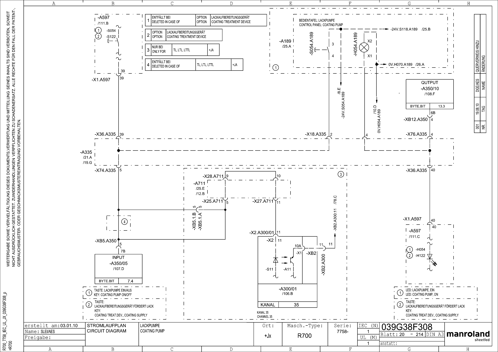

# +Jx — Sheet 20 of 214 — LACKPUMPE

**COATING PUMP**

> Part of the manroland **R700** printing press IEC/UL circuit diagrams.
> Drawing class: **Stromlaufplan / Circuit diagram** (DIN A3).
> Document `+Jx` covers the **1st printing module + feed register** machine section.

## At a glance

| Field | Value |
|---|---|
| Document | `+Jx`  (039G38F308) |
| Sheet | **20** of 214 |
| Section (DE) | LACKPUMPE |
| Section (EN) | COATING PUMP |
| Section type | CIRCUIT — Circuit diagram |
| Machine type | `R700` |
| Series | `7758` |
| Created | 03.01.10 |
| Replaces | — |
| Columns used | B, C, D, E, F, G, H |
| Path numbers | — |
| Labels on sheet | 149 |
| Cross-refs out | 15 |
| Cross-refs in | 33 |

**Previous:** [+Jx sheet 19](SHEET_0019.md) · **Next:** [+Jx sheet 21](SHEET_0021.md) · **Document TOC:** [_TOC.md](_TOC.md)  (+Jx) · **Master TOC:** [all sheets](../_MASTER_TOC.md)

## Sheet image (300 DPI, exact vector render)



_Rendered directly from the PDF vector layer at 300 DPI (1-bit), no OCR and no resampling. Use it to confirm anything ambiguous in the text below._

## Cross-references on this sheet

Each entry is a wire leaving this sheet. The printed token is `/sheet.column`; the link resolves to that sheet inside the same document.

| Ref | Target sheet | Col | Path | Destination on target | Target section | From col |
|---|---|---|---|---|---|---|
| `/111.B` | [+Jx sheet 111](SHEET_0111.md) | B | — | — | REFERENZMODUL | B |
| `/25.B` | [+Jx sheet 25](SHEET_0025.md) | B | — | 24V.S118.A189 | HILFSANTRIEB, LACKDOSIER /AUFTRAGSWALZEN | G |
| `/25.A` | [+Jx sheet 25](SHEET_0025.md) | A | — | — | HILFSANTRIEB, LACKDOSIER /AUFTRAGSWALZEN | E |
| `/26.A` | [+Jx sheet 26](SHEET_0026.md) | A | — | 0V.H070.A189 | HILFSANTRIEB, LACKDOSIER /AUFTRAGSWALZEN | G |
| `/8.E` | [+Jx sheet 8](SHEET_0008.md) | E | — | — | SPANNUNGSVERSORGUNG, SCHALTSCHRANKBELÜFTUNG | F |
| `/108.F` | [+Jx sheet 108](SHEET_0108.md) | F | — | — | REFERENZMODUL | G |
| `/10.D` | [+Jx sheet 10](SHEET_0010.md) | D | — | — | SPANNUNGSVERSORGUNG, SCHALTSCHRANKBELÜFTUNG | F |
| `/21.A` | [+Jx sheet 21](SHEET_0021.md) | A | — | — | LACKPUMPE | B |
| `/19.G` | [+Jx sheet 19](SHEET_0019.md) | G | — | — | LACKPUMPE | B |
| `/25.E` | [+Jx sheet 25](SHEET_0025.md) | E | — | — | HILFSANTRIEB, LACKDOSIER /AUFTRAGSWALZEN | C |
| `/12.B` | [+Jx sheet 12](SHEET_0012.md) | B | — | — | SPANNUNGSVERSORGUNG, SCHALTSCHRANKBELÜFTUNG | C |
| `/78.C` | [+Jx sheet 78](SHEET_0078.md) | C | — | XB2.A300:11 | BUSVERBINDUNGEN: SICHERHEITSKREIS | F |
| `/111.C` | [+Jx sheet 111](SHEET_0111.md) | C | — | — | REFERENZMODUL | G |
| `/107.D` | [+Jx sheet 107](SHEET_0107.md) | D | — | — | REFERENZMODUL | B |
| `/106.B` | [+Jx sheet 106](SHEET_0106.md) | B | — | — | REFERENZMODUL | E |

### Incoming references (sheets that point here)

Every other sheet that sends a wire to this one. `Back-ref` is the token printed on *that* sheet; `Path` is its line number.

| From sheet | Cols | Back-ref | Path | Refs | What continues there |
|---|---|---|---|---|---|
| [+Jx#8](SHEET_0008.md) | E | `/8.E` | — | 1 | 24V.S054.A189 24V.X207\2:2 |
| [+Jx#10](SHEET_0010.md) | D | `/10.D` | — | 1 | 0V.H054.A189 |
| [+Jx#12](SHEET_0012.md) | B | `/12.B` | — | 1 | — |
| [+Jx#19](SHEET_0019.md) | F | `/19.F` | — | 1 | — |
| [+Jx#21](SHEET_0021.md) | A | `/21.A` | — | 1 | — |
| [+Jx#25](SHEET_0025.md) | A, B, E | `/25.A`, `/25.B`, `/25.E` | — | 3 | 24V.S118.A189 |
| [+Jx#26](SHEET_0026.md) | A | `/26.A` | — | 1 | 0V.H070.A189 |
| [+Jx#78](SHEET_0078.md) | C | `/78.C` | — | 1 | XB2.A300:11 |
| [+Jx#106](SHEET_0106.md) | B | `/106.B` | — | 1 | — |
| [+Jx#107](SHEET_0107.md) | D | `/107.D` | — | 1 | — |
| [+Jx#108](SHEET_0108.md) | F | `/108.F` | — | 1 | — |
| [+Jx#111](SHEET_0111.md) | B, C | `/111.B`, `/111.C` | — | 2 | — |
| [+Jx#115](SHEET_0115.md) | F | `/115.F` | — | 2 | — |
| [+Jx#124](SHEET_0124.md) | E, G | `/124.E`, `/124.G` | — | 2 | — |
| [+Jx#131](SHEET_0131.md) | A, B | `/131.A`, `/131.B` | — | 2 | — |
| [+Jx#132](SHEET_0132.md) | C | `/132.C` | — | 1 | — |
| [+Jx#137](SHEET_0137.md) | H | `/137.H` | — | 1 | — |
| [+Jx#140](SHEET_0140.md) | E | `/140.E` | — | 2 | — |
| [+Jx#143](SHEET_0143.md) | B | `/143.B` | — | 1 | — |
| [+Jx#144](SHEET_0144.md) | F | `/144.F` | — | 1 | — |
| [+Jx#146](SHEET_0146.md) | C | `/146.C` | — | 2 | — |
| [+Jx#149](SHEET_0149.md) | G | `/149.G` | — | 2 | — |
| [+Jx#154](SHEET_0154.md) | A | `/154.A` | — | 1 | — |
| [+Jx#155](SHEET_0155.md) | B | `/155.B` | — | 1 | — |


## Devices on this sheet

| Tag | Class | Class meaning (IEC) | Col | Sub | Terminal | Sign |
|---|---|---|---|---|---|---|
| `A350/05` | A | Baugruppe / assembly, module, PC board | B | 05 | — | — |
| `S054` | S | Schalter / switch | B | — | — | — |
| `A597` | A | Baugruppe / assembly, module, PC board | B | — | — | — |
| `A335` | A | Baugruppe / assembly, module, PC board | B | — | — | — |
| `S11` | S | Schalter / switch | E | — | — | — |
| `A11` | A | Baugruppe / assembly, module, PC board | E | — | — | — |
| `X1` | X | Klemme / terminal, plug connector | E | — | — | — |
| `X2` | X | Klemme / terminal, plug connector | E | — | — | — |
| `XB2` | XB |  | E | — | — | — |
| `A300/01` | A | Baugruppe / assembly, module, PC board | E | 01 | — | — |
| `A711` | A | Baugruppe / assembly, module, PC board | C | — | — | — |
| `A597` | A | Baugruppe / assembly, module, PC board | G | — | — | — |
| `A189` | A | Baugruppe / assembly, module, PC board | E | — | — | — |
| `A350/10` | A | Baugruppe / assembly, module, PC board | G | 10 | — | — |
| `S122` | S | Schalter / switch | B | — | — | — |
| `X1` | X | Klemme / terminal, plug connector | F | — | — | — |
| `X2` | X | Klemme / terminal, plug connector | F | — | — | — |
| `7.4` | — | cross-device reference | B | — | — | — |
| `XB5.A350` | — | cross-device reference | B | — | — | — |
| `X1.A597` | — | cross-device reference | B | — | — | — |
| `X36.A335` | — | cross-device reference | B | — | — | — |
| `X74.A335` | — | cross-device reference | B | — | — | — |
| `XB2.A300` | — | cross-device reference | F | — | — | — |
| `X28.A711` | — | cross-device reference | D | — | — | — |
| `X25.A711` | — | cross-device reference | D | — | — | — |
| `X27.A711` | — | cross-device reference | E | — | — | — |
| `XB5.1.A` | — | cross-device reference | C | — | — | — |
| `XB5.1.B` | — | cross-device reference | C | — | — | — |
| `X1.A597` | — | cross-device reference | G | — | — | — |
| `X76.A335` | — | cross-device reference | G | — | — | — |
| `X36.A335` | — | cross-device reference | G | — | — | — |
| `S054.A189` | — | cross-device reference | E | — | — | — |
| `X18.A335` | — | cross-device reference | E | — | — | — |
| `XB12.A350` | — | cross-device reference | G | — | — | — |
| `13.3` | — | cross-device reference | H | — | — | — |
| `NR.` | — | cross-device reference | H | — | — | — |
| `19.08.10` | — | cross-device reference | H | — | — | — |
| `XB2.A300:11` | — | cross-device reference | F | — | 11 | — |

## Potentials / nets

| Potential | Count | Columns | Attached devices | Terminals |
|---|---|---|---|---|
| `0V` | 2 | F, G | `A189`, `H054`, `H070` | — |
| `24V` | 2 | F, G | `A189`, `S054`, `S118` | — |
| `H054` | 2 | F, G | `A189` | — |
| `H122` | 1 | G | — | — |


A potential such as `L24+/4` or `M24+` is a named supply/return rail; every place it appears on this sheet is electrically common.

## Wire-end annotations (grouped as printed)

A wire that continues elsewhere is annotated with a small cluster: the destination description, the path/line number `#NN`, and the `/sheet.column` cross reference. Each row below is one such cluster exactly as it is grouped on the drawing.

| Col | Y | Path | Cross-ref | Text on the wire |
|---|---|---|---|---|
| B | 37.1 | — | — | `A597` |
| C | 38.8 | — | — | `1 ENTFÄLLT BEI DELETED IN CASE OF` |
| D | 38.8 | — | — | `OPTION OPTION` |
| D | 38.9 | — | — | `LACKAUFBEREITUNGSGERÄT COATING TREATMENT DEVICE` |
| F | 45.9 | — | — | `BEDIENTAFEL: LACKPUMPE CONTROL PANEL: COATING PUMP` |
| B | 51.9 | — | `/111.B` | — |
| G | 66.1 | — | `/25.B` | `24V.S118.A189` |
| B | 69.2 | — | — | `1` |
| B | 69.7 | — | — | `S054` |
| C | 74.3 | — | — | `2 OPTION OPTION` |
| C | 74.3 | — | — | `LACKAUFBEREITUNGSGERÄT COATING TREATMENT DEVICE` |
| E | 76.3 | — | — | `S054.A189` |
| F | 77.8 | — | — | `H054.A189` |
| B | 83.9 | — | — | `2 S122` |
| E | 93.8 | — | — | `A189` |
| F | 94.5 | — | — | `X2` |
| H | 96.4 | — | — | `001 DGE/AES QUERVERWEIS HINZU 19.08.10` |
| F | 101.6 | — | — | `3` |
| E | 106.8 | — | `/25.A` | — |
| C | 109.7 | — | — | `3 NUR BEI ONLY FOR TL, LTL, LTTL` |
| D | 116.8 | — | — | `+JA` |
| F | 129.9 | — | — | `4 X1` |
| H | 132.2 | — | — | `NR. NAME TAG ÄNDERUNG` |
| C | 145.1 | — | — | `4 ENTFÄLLT BEI DELETED IN CASE OF TL, LTL, LTTL +JA` |
| G | 150.4 | — | `/26.A` | `0V.H070.A189` |
| E | 158.5 | — | — | `1` |
| B | 166.1 | — | — | `39` |
| B | 183.1 | — | — | `X1.A597 39` |
| G | 193.3 | — | — | `QUTPUT` |
| G | 207.2 | — | — | `A350/10` |
| F | 209.5 | — | `/8.E` | — |
| F | 219.4 | — | — | `24V.S054.A189` |
| G | 221.0 | — | `/108.F` | — |
| G | 250.6 | — | — | `BYTE.BIT 13.3` |
| F | 251.4 | — | `/10.D` | — |
| F | 261.3 | — | — | `0V.H054.A189` |
| G | 266.0 | — | — | `6B` |
| G | 280.9 | — | — | `XB12.A350 4` |
| B | 316.3 | — | — | `X36.A335 39` |
| F | 316.3 | — | — | `X18.A335 2 4` |
| G | 316.3 | — | — | `X76.A335 4` |
| B | 359.5 | — | — | `A335` |
| B | 372.6 | — | `/21.A`, `/19.G` | — |
| B | 402.8 | — | — | `X74.A335 5` |
| G | 402.8 | — | — | `X36.A335 40` |
| F | 414.1 | — | — | `3` |
| D | 416.9 | — | — | `X28.A711 9` |
| E | 417.0 | — | — | `10` |
| C | 433.9 | — | — | `A711` |
| C | 447.0 | — | `/25.E`, `/12.B` | — |
| F | 467.3 | — | `/78.C` | `XB2.A300:11` |
| D | 476.5 | — | — | `X25.A711 5` |
| E | 476.5 | — | — | `X27.A711 11` |
| C | 492.2 | — | — | `XB5.1.B 5` |
| C | 492.2 | — | — | `XB5.1.A 5` |
| G | 519.0 | — | — | `X1.A597 40` |
| B | 527.5 | — | — | `4` |
| G | 538.9 | — | — | `40` |
| G | 547.3 | — | — | `A597` |
| E | 551.6 | — | — | `X2.A300/01 11` |
| G | 562.2 | — | `/111.C` | — |
| E | 570.0 | — | — | `X2` |
| B | 571.4 | — | — | `XB5.A350 5` |
| E | 571.5 | — | — | `11 11` |
| F | 580.0 | — | — | `11` |
| E | 584.2 | — | — | `10A` |
| G | 593.1 | — | — | `H054` |
| G | 593.6 | — | — | `1` |
| B | 596.9 | — | — | `7B` |
| E | 601.2 | — | — | `X1` |
| E | 601.2 | — | — | `XB2` |
| F | 607.5 | — | — | `XB2.A300` |
| G | 607.6 | — | — | `2 H122` |
| B | 611.4 | — | — | `INPUT` |
| B | 625.3 | — | — | `A350/05` |
| B | 639.1 | — | `/107.D` | — |
| E | 640.2 | — | — | `S11 A11` |
| B | 668.1 | — | — | `BYTE.BIT 7.4` |
| E | 686.2 | — | — | `A300/01` |
| G | 690.8 | — | — | `LED: LACKPUMPE, EIN LED: COATING PUMP, ON` |
| B | 691.5 | — | — | `KEY: COATING PUMP ON/OFF TASTE: LACKPUMPE EIN/AUS` |
| B | 697.1 | — | — | `1` |
| G | 697.1 | — | — | `1` |
| E | 698.6 | — | `/106.B` | — |
| B | 719.1 | — | — | `LACKAUFBEREITUNGSGERÄT FÖRDERT LACK KEY: COATING TREAT.DEV., COATING SUPPLY TASTE:` |
| G | 719.1 | — | — | `LACKAUFBEREITUNGSGERÄT FÖRDERT LACK KEY: COATING TREAT.DEV., COATING SUPPLY TASTE:` |
| E | 724.5 | — | — | `KANAL 35` |
| B | 725.9 | — | — | `2` |
| G | 725.9 | — | — | `2` |
| E | 744.8 | — | — | `KANAL 35 CHANNEL 35` |


## Reconstructed tables

This sheet carries tabular content (pin map / terminal assignment / index). The grid below was rebuilt from the drawing's own rule lines, so each row is exactly one physical row of the table.

### Table 1 — 7 data rows × 2 columns (at x=226.8, y=34.0)

| A597 /111.B 1 S054 2 S122 | 39 |
|---|---|
| `X1.A597 X36.A335` | `39 39` |
| `X74.A335` | `5` |
|  | `4` |
| `XB5.A350` | `5 7B` |
| `INPUT A350/05` | `/107.D` |
| `BYTE.BIT` | `7.4` |
| `TASTE: LACKPUMPE KEY: COATING PUMP` | `EIN/AUS ON/OFF` |


### Table 2 — 11 data rows × 13 columns (at x=538.6, y=69.4)

| +JA |  | A189 /25.A 1 |  | S054.A189 |  | 3 4 |  | H054.A189 | X2 X1 | 24V.S118.A189 0V.H070.A189 | /25.B /26.A |  |
|---|---|---|---|---|---|---|---|---|---|---|---|---|
|  |  |  |  |  |  |  | `/8.E` |  |  |  | `QUTPUT` | `A350/10 /108.F` |
|  |  |  |  |  |  |  |  | `24V.S054.A189` |  |  | `BYTE.BIT` | `13.3` |
|  |  |  |  | `X18.A335` |  | `2` |  |  | `/10.D 4` | `0V.H054.A189` | `XB12.A350 X76.A335` | `6B 4 4` |
|  |  |  |  |  |  |  |  |  |  |  | `X36.A335` | `40` |
| `9 5` | `X27.A711` | `10 11` |  |  |  |  | `3 /78.C` |  |  |  |  |  |
|  |  |  |  |  |  |  | `XB2.A300:11` |  |  |  | `X1.A597` | `40` |
|  | `X2.A300/01` | `11` |  |  |  |  |  |  |  |  | `A597` | `40` |
|  |  |  |  |  |  |  |  |  |  |  | `/111.C` |  |
|  | `X2 S11` | `11 A11` | `10A X1` | `XB2` | `11 XB2.A300` | `11` |  |  |  |  | `H054 1 H122 2` |  |
|  |  | `A300/01 /106.B` |  |  |  |  |  |  |  | `1` | `LED: LACKPUMPE, LED: COATING PUMP,` | `EIN ON` |
|  | `KANAL` |  | `35` |  |  |  |  |  |  | `2` | `TASTE: LACKAUFBEREITUNGSGERÄT` | `FÖRDERT` |


## Notes and free text on this sheet

| Text | Col | Y (pt) |
|---|---|---|
| `7B` | B | 596.91 |
| `INPUT` | B | 611.44 |
| `BYTE.BIT` | B | 668.7 |
| `TASTE: LACKPUMPE EIN/AUS` | B | 691.52 |
| `KEY: COATING PUMP ON/OFF` | B | 702.15 |
| `KANAL 35` | E | 744.83 |
| `CHANNEL 35` | E | 754.78 |
| `10A` | E | 584.17 |
| `KANAL` | E | 724.48 |
| `X2.A300/01` | E | 551.58 |
| `LED: LACKPUMPE, EIN` | G | 690.8 |
| `LED: COATING PUMP, ON` | G | 701.45 |
| `BEDIENTAFEL: LACKPUMPE` | E | 45.93 |
| `CONTROL PANEL: COATING PUMP` | F | 56.58 |
| `6B` | G | 265.96 |
| `QUTPUT` | G | 193.31 |
| `BYTE.BIT` | G | 250.59 |
| `TAG` | H | 253.28 |
| `NAME` | H | 194.05 |
| `ÄNDERUNG` | H | 132.19 |
| `DGE/AES` | H | 188.62 |
| `QUERVERWEIS HINZU` | H | 96.37 |
| `TASTE:` | B | 719.1 |
| `LACKAUFBEREITUNGSGERÄT FÖRDERT LACK` | B | 729.8 |
| `KEY:` | B | 740.3 |
| `COATING TREAT.DEV., COATING SUPPLY` | B | 751.06 |
| `ENTFÄLLT BEI` | C | 38.81 |
| `DELETED IN CASE OF` | C | 49.47 |
| `OPTION` | D | 38.83 |
| `LACKAUFBEREITUNGSGERÄT` | D | 38.85 |
| `COATING TREATMENT DEVICE` | D | 49.48 |
| `OPTION` | C | 74.26 |
| `LACKAUFBEREITUNGSGERÄT` | C | 74.28 |
| `COATING TREATMENT DEVICE` | C | 84.92 |
| `NUR BEI` | C | 109.67 |
| `ONLY FOR` | C | 120.36 |
| `TL, LTL, LTTL` | C | 116.8 |
| `TASTE:` | G | 719.1 |
| `LACKAUFBEREITUNGSGERÄT FÖRDERT LACK` | G | 729.8 |
| `KEY:` | G | 740.3 |
| `COATING TREAT.DEV., COATING SUPPLY` | G | 751.06 |
| `+JA` | D | 116.75 |
| `TL, LTL, LTTL` | D | 152.23 |

## Complete label inventory (exact text from the drawing)

Every text object inside the drawing area of this sheet, in DIN reading order (column A→H, then top→bottom). This is the authoritative list: if a string is not here it is not printed on this sheet.

| Col | Y | X | Dir | Type | Text |
|---|---|---|---|---|---|
| B | 37.1 | 233.6 | → | device tag | `A597` |
| B | 51.9 | 233.9 | → | cross-reference | `/111.B` |
| B | 69.2 | 233.4 | → | number | `1` |
| B | 69.7 | 254.8 | → | device tag | `S054` |
| B | 83.9 | 233.3 | → | number | `2` |
| B | 83.9 | 253.4 | → | device tag | `S122` |
| B | 166.1 | 288.9 | → | number | `39` |
| B | 183.1 | 286.0 | → | number | `39` |
| B | 185.9 | 219.4 | → | device ref | `X1.A597` |
| B | 316.3 | 226.5 | → | device ref | `X36.A335` |
| B | 317.7 | 286.0 | → | number | `39` |
| B | 359.5 | 191.6 | → | device tag | `A335` |
| B | 372.6 | 199.0 | → | cross-reference | `/21.A` |
| B | 385.0 | 198.4 | → | cross-reference | `/19.G` |
| B | 402.8 | 226.5 | → | device ref | `X74.A335` |
| B | 402.8 | 286.0 | → | number | `5` |
| B | 527.6 | 295.8 | → | number | `4` |
| B | 571.4 | 227.1 | → | device ref | `XB5.A350` |
| B | 580.0 | 286.0 | → | number | `5` |
| B | 596.9 | 288.9 | → | text | `7B` |
| B | 611.4 | 268.6 | → | text | `INPUT` |
| B | 625.3 | 261.9 | → | device tag | `A350/05` |
| B | 639.1 | 270.7 | → | cross-reference | `/107.D` |
| B | 668.1 | 305.0 | → | device ref | `7.4` |
| B | 668.7 | 236.7 | → | text | `BYTE.BIT` |
| B | 691.5 | 225.4 | → | text | `TASTE: LACKPUMPE EIN/AUS` |
| B | 697.1 | 210.7 | → | number | `1` |
| B | 702.2 | 224.8 | → | text | `KEY: COATING PUMP ON/OFF` |
| B | 719.1 | 226.8 | → | text | `TASTE:` |
| B | 725.9 | 210.6 | → | number | `2` |
| B | 729.8 | 226.2 | → | text | `LACKAUFBEREITUNGSGERÄT FÖRDERT LACK` |
| B | 740.3 | 226.2 | → | text | `KEY:` |
| B | 751.1 | 226.5 | → | text | `COATING TREAT.DEV., COATING SUPPLY` |
| C | 38.8 | 363.7 | → | text | `ENTFÄLLT BEI` |
| C | 44.1 | 351.8 | → | number | `1` |
| C | 49.5 | 363.7 | → | text | `DELETED IN CASE OF` |
| C | 74.3 | 364.0 | → | text | `OPTION` |
| C | 74.3 | 399.1 | → | text | `LACKAUFBEREITUNGSGERÄT` |
| C | 79.6 | 351.5 | → | number | `2` |
| C | 84.9 | 364.0 | → | text | `OPTION` |
| C | 84.9 | 399.4 | → | text | `COATING TREATMENT DEVICE` |
| C | 109.7 | 363.7 | → | text | `NUR BEI` |
| C | 115.0 | 351.4 | → | number | `3` |
| C | 116.8 | 414.6 | → | text | `TL, LTL, LTTL` |
| C | 120.4 | 364.0 | → | text | `ONLY FOR` |
| C | 145.1 | 363.7 | → | text | `ENTFÄLLT BEI` |
| C | 150.4 | 351.5 | → | number | `4` |
| C | 155.8 | 363.7 | → | text | `DELETED IN CASE OF` |
| C | 433.9 | 462.6 | → | device tag | `A711` |
| C | 447.0 | 468.6 | → | cross-reference | `/25.E` |
| C | 459.4 | 468.6 | → | cross-reference | `/12.B` |
| C | 492.2 | 460.9 | ↕ | number | `5` |
| C | 492.2 | 475.1 | ↕ | number | `5` |
| C | 508.3 | 459.5 | ↕ | device ref | `XB5.1.B` |
| C | 508.8 | 473.6 | ↕ | device ref | `XB5.1.A` |
| D | 38.8 | 470.3 | → | text | `OPTION` |
| D | 38.9 | 505.4 | → | text | `LACKAUFBEREITUNGSGERÄT` |
| D | 49.5 | 470.3 | → | text | `OPTION` |
| D | 49.5 | 505.7 | → | text | `COATING TREATMENT DEVICE` |
| D | 116.8 | 499.3 | → | text | `+JA` |
| D | 152.2 | 471.3 | → | text | `TL, LTL, LTTL` |
| D | 152.2 | 556.0 | → | text | `+JA` |
| D | 416.9 | 484.7 | → | device ref | `X28.A711` |
| D | 417.0 | 541.1 | → | number | `9` |
| D | 476.5 | 483.3 | → | device ref | `X25.A711` |
| D | 480.7 | 541.1 | → | number | `5` |
| E | 45.9 | 715.2 | → | text | `BEDIENTAFEL: LACKPUMPE` |
| E | 76.3 | 740.1 | ↕ | device ref | `S054.A189` |
| E | 93.8 | 667.8 | → | device tag | `A189` |
| E | 106.8 | 675.2 | → | cross-reference | `/25.A` |
| E | 158.5 | 657.2 | → | number | `1` |
| E | 316.3 | 729.6 | → | device ref | `X18.A335` |
| E | 417.0 | 661.0 | → | number | `10` |
| E | 476.5 | 603.8 | → | device ref | `X27.A711` |
| E | 480.7 | 661.0 | → | number | `11` |
| E | 551.6 | 596.4 | → | text | `X2.A300/01` |
| E | 551.6 | 661.0 | → | number | `11` |
| E | 570.0 | 637.5 | → | device tag | `X2` |
| E | 571.4 | 663.9 | → | number | `11` |
| E | 584.2 | 704.4 | → | text | `10A` |
| E | 601.2 | 707.8 | → | device tag | `X1` |
| E | 601.2 | 732.5 | → | device tag | `XB2` |
| E | 640.2 | 635.0 | → | device tag | `S11` |
| E | 640.2 | 677.5 | → | device tag | `A11` |
| E | 686.2 | 666.7 | → | device tag | `A300/01` |
| E | 698.6 | 674.8 | → | cross-reference | `/106.B` |
| E | 724.5 | 623.1 | → | text | `KANAL` |
| E | 724.5 | 702.7 | → | number | `35` |
| E | 744.8 | 614.6 | → | text | `KANAL 35` |
| E | 754.8 | 614.8 | → | text | `CHANNEL 35` |
| F | 56.6 | 715.5 | → | text | `CONTROL PANEL: COATING PUMP` |
| F | 77.8 | 845.1 | ↕ | potential | `H054.A189` |
| F | 94.5 | 878.7 | → | device tag | `X2` |
| F | 101.6 | 793.4 | → | number | `3` |
| F | 129.9 | 878.7 | → | device tag | `X1` |
| F | 130.0 | 793.7 | → | number | `4` |
| F | 209.5 | 806.6 | ↕ | cross-reference | `/8.E` |
| F | 219.4 | 816.6 | ↕ | potential | `24V.S054.A189` |
| F | 251.4 | 892.4 | ↕ | cross-reference | `/10.D` |
| F | 261.3 | 902.3 | ↕ | potential | `0V.H054.A189` |
| F | 317.7 | 789.4 | → | number | `2` |
| F | 319.1 | 874.6 | → | number | `4` |
| F | 414.1 | 813.0 | → | number | `3` |
| F | 467.3 | 797.5 | ↕ | cross-reference | `/78.C` |
| F | 498.3 | 797.5 | ↕ | device ref | `XB2.A300:11` |
| F | 580.0 | 785.5 | → | number | `11` |
| F | 581.4 | 763.1 | → | number | `11` |
| F | 607.5 | 768.4 | ↕ | device ref | `XB2.A300` |
| G | 66.1 | 933.7 | → | potential | `24V.S118.A189` |
| G | 66.1 | 1008.4 | → | cross-reference | `/25.B` |
| G | 150.4 | 928.9 | → | potential | `0V.H070.A189` |
| G | 150.4 | 993.7 | → | cross-reference | `/26.A` |
| G | 193.3 | 1007.3 | → | text | `QUTPUT` |
| G | 207.2 | 1006.2 | → | device tag | `A350/10` |
| G | 221.0 | 1015.2 | → | cross-reference | `/108.F` |
| G | 250.6 | 980.8 | → | text | `BYTE.BIT` |
| G | 266.0 | 1030.1 | → | text | `6B` |
| G | 280.9 | 965.2 | → | device ref | `XB12.A350` |
| G | 282.3 | 1030.4 | → | number | `4` |
| G | 316.3 | 970.6 | → | device ref | `X76.A335` |
| G | 317.7 | 1030.4 | → | number | `4` |
| G | 402.8 | 970.6 | → | device ref | `X36.A335` |
| G | 402.8 | 1030.4 | → | number | `40` |
| G | 519.0 | 963.5 | → | device ref | `X1.A597` |
| G | 523.3 | 1030.4 | → | number | `40` |
| G | 538.9 | 1033.2 | → | number | `40` |
| G | 547.3 | 977.7 | → | device tag | `A597` |
| G | 562.2 | 978.0 | → | cross-reference | `/111.C` |
| G | 593.1 | 994.1 | → | potential | `H054` |
| G | 593.6 | 977.5 | → | number | `1` |
| G | 607.6 | 993.0 | → | potential | `H122` |
| G | 608.3 | 977.4 | → | number | `2` |
| G | 690.8 | 970.3 | → | text | `LED: LACKPUMPE, EIN` |
| G | 697.1 | 954.8 | → | number | `1` |
| G | 701.4 | 970.3 | → | text | `LED: COATING PUMP, ON` |
| G | 719.1 | 970.9 | → | text | `TASTE:` |
| G | 725.9 | 954.7 | → | number | `2` |
| G | 729.8 | 970.3 | → | text | `LACKAUFBEREITUNGSGERÄT FÖRDERT LACK` |
| G | 740.3 | 970.3 | → | text | `KEY:` |
| G | 751.1 | 970.6 | → | text | `COATING TREAT.DEV., COATING SUPPLY` |
| H | 96.4 | 1138.4 | ↕ | text | `QUERVERWEIS HINZU` |
| H | 132.2 | 1152.6 | ↕ | text | `ÄNDERUNG` |
| H | 188.6 | 1138.4 | ↕ | text | `DGE/AES` |
| H | 194.0 | 1152.6 | ↕ | text | `NAME` |
| H | 247.4 | 1138.4 | ↕ | device ref | `19.08.10` |
| H | 250.6 | 1047.7 | → | device ref | `13.3` |
| H | 253.3 | 1152.6 | ↕ | text | `TAG` |
| H | 296.6 | 1138.3 | ↕ | number | `001` |
| H | 296.9 | 1152.5 | ↕ | device ref | `NR.` |

## Reading-order text block

The same content as a plain block, grouped by DIN column — convenient to paste or to match against a visual description.

```text
=== Column B ===
  37.1  233.6  devtag       A597
  51.9  233.9  xref         /111.B
  69.2  233.4  numeric      1
  69.7  254.8  devtag       S054
  83.9  233.3  numeric      2
  83.9  253.4  devtag       S122
 166.1  288.9  numeric      39
 183.1  286.0  numeric      39
 185.9  219.4  devref       X1.A597
 316.3  226.5  devref       X36.A335
 317.7  286.0  numeric      39
 359.5  191.6  devtag       A335
 372.6  199.0  xref         /21.A
 385.0  198.4  xref         /19.G
 402.8  226.5  devref       X74.A335
 402.8  286.0  numeric      5
 527.6  295.8  numeric      4
 571.4  227.1  devref       XB5.A350
 580.0  286.0  numeric      5
 596.9  288.9  text         7B
 611.4  268.6  text         INPUT
 625.3  261.9  devtag       A350/05
 639.1  270.7  xref         /107.D
 668.1  305.0  devref       7.4
 668.7  236.7  text         BYTE.BIT
 691.5  225.4  text         TASTE: LACKPUMPE EIN/AUS
 697.1  210.7  numeric      1
 702.2  224.8  text         KEY: COATING PUMP ON/OFF
 719.1  226.8  text         TASTE:
 725.9  210.6  numeric      2
 729.8  226.2  text         LACKAUFBEREITUNGSGERÄT FÖRDERT LACK
 740.3  226.2  text         KEY:
 751.1  226.5  text         COATING TREAT.DEV., COATING SUPPLY
=== Column C ===
  38.8  363.7  text         ENTFÄLLT BEI
  44.1  351.8  numeric      1
  49.5  363.7  text         DELETED IN CASE OF
  74.3  364.0  text         OPTION
  74.3  399.1  text         LACKAUFBEREITUNGSGERÄT
  79.6  351.5  numeric      2
  84.9  364.0  text         OPTION
  84.9  399.4  text         COATING TREATMENT DEVICE
 109.7  363.7  text         NUR BEI
 115.0  351.4  numeric      3
 116.8  414.6  text         TL, LTL, LTTL
 120.4  364.0  text         ONLY FOR
 145.1  363.7  text         ENTFÄLLT BEI
 150.4  351.5  numeric      4
 155.8  363.7  text         DELETED IN CASE OF
 433.9  462.6  devtag       A711
 447.0  468.6  xref         /25.E
 459.4  468.6  xref         /12.B
 492.2  460.9  numeric      5
 492.2  475.1  numeric      5
 508.3  459.5  devref       XB5.1.B
 508.8  473.6  devref       XB5.1.A
=== Column D ===
  38.8  470.3  text         OPTION
  38.9  505.4  text         LACKAUFBEREITUNGSGERÄT
  49.5  470.3  text         OPTION
  49.5  505.7  text         COATING TREATMENT DEVICE
 116.8  499.3  text         +JA
 152.2  471.3  text         TL, LTL, LTTL
 152.2  556.0  text         +JA
 416.9  484.7  devref       X28.A711
 417.0  541.1  numeric      9
 476.5  483.3  devref       X25.A711
 480.7  541.1  numeric      5
=== Column E ===
  45.9  715.2  text         BEDIENTAFEL: LACKPUMPE
  76.3  740.1  devref       S054.A189
  93.8  667.8  devtag       A189
 106.8  675.2  xref         /25.A
 158.5  657.2  numeric      1
 316.3  729.6  devref       X18.A335
 417.0  661.0  numeric      10
 476.5  603.8  devref       X27.A711
 480.7  661.0  numeric      11
 551.6  596.4  text         X2.A300/01
 551.6  661.0  numeric      11
 570.0  637.5  devtag       X2
 571.4  663.9  numeric      11
 584.2  704.4  text         10A
 601.2  707.8  devtag       X1
 601.2  732.5  devtag       XB2
 640.2  635.0  devtag       S11
 640.2  677.5  devtag       A11
 686.2  666.7  devtag       A300/01
 698.6  674.8  xref         /106.B
 724.5  623.1  text         KANAL
 724.5  702.7  numeric      35
 744.8  614.6  text         KANAL 35
 754.8  614.8  text         CHANNEL 35
=== Column F ===
  56.6  715.5  text         CONTROL PANEL: COATING PUMP
  77.8  845.1  net          H054.A189
  94.5  878.7  devtag       X2
 101.6  793.4  numeric      3
 129.9  878.7  devtag       X1
 130.0  793.7  numeric      4
 209.5  806.6  xref         /8.E
 219.4  816.6  net          24V.S054.A189
 251.4  892.4  xref         /10.D
 261.3  902.3  net          0V.H054.A189
 317.7  789.4  numeric      2
 319.1  874.6  numeric      4
 414.1  813.0  numeric      3
 467.3  797.5  xref         /78.C
 498.3  797.5  devref       XB2.A300:11
 580.0  785.5  numeric      11
 581.4  763.1  numeric      11
 607.5  768.4  devref       XB2.A300
=== Column G ===
  66.1  933.7  net          24V.S118.A189
  66.1 1008.4  xref         /25.B
 150.4  928.9  net          0V.H070.A189
 150.4  993.7  xref         /26.A
 193.3 1007.3  text         QUTPUT
 207.2 1006.2  devtag       A350/10
 221.0 1015.2  xref         /108.F
 250.6  980.8  text         BYTE.BIT
 266.0 1030.1  text         6B
 280.9  965.2  devref       XB12.A350
 282.3 1030.4  numeric      4
 316.3  970.6  devref       X76.A335
 317.7 1030.4  numeric      4
 402.8  970.6  devref       X36.A335
 402.8 1030.4  numeric      40
 519.0  963.5  devref       X1.A597
 523.3 1030.4  numeric      40
 538.9 1033.2  numeric      40
 547.3  977.7  devtag       A597
 562.2  978.0  xref         /111.C
 593.1  994.1  net          H054
 593.6  977.5  numeric      1
 607.6  993.0  net          H122
 608.3  977.4  numeric      2
 690.8  970.3  text         LED: LACKPUMPE, EIN
 697.1  954.8  numeric      1
 701.4  970.3  text         LED: COATING PUMP, ON
 719.1  970.9  text         TASTE:
 725.9  954.7  numeric      2
 729.8  970.3  text         LACKAUFBEREITUNGSGERÄT FÖRDERT LACK
 740.3  970.3  text         KEY:
 751.1  970.6  text         COATING TREAT.DEV., COATING SUPPLY
=== Column H ===
  96.4 1138.4  text         QUERVERWEIS HINZU
 132.2 1152.6  text         ÄNDERUNG
 188.6 1138.4  text         DGE/AES
 194.0 1152.6  text         NAME
 247.4 1138.4  devref       19.08.10
 250.6 1047.7  devref       13.3
 253.3 1152.6  text         TAG
 296.6 1138.3  numeric      001
 296.9 1152.5  devref       NR.
```

---
_Generated from the PDF vector text layer; no OCR. Source: `R700_7758_IEC_UL_JX_039G38F308_p`, sheet 20._
