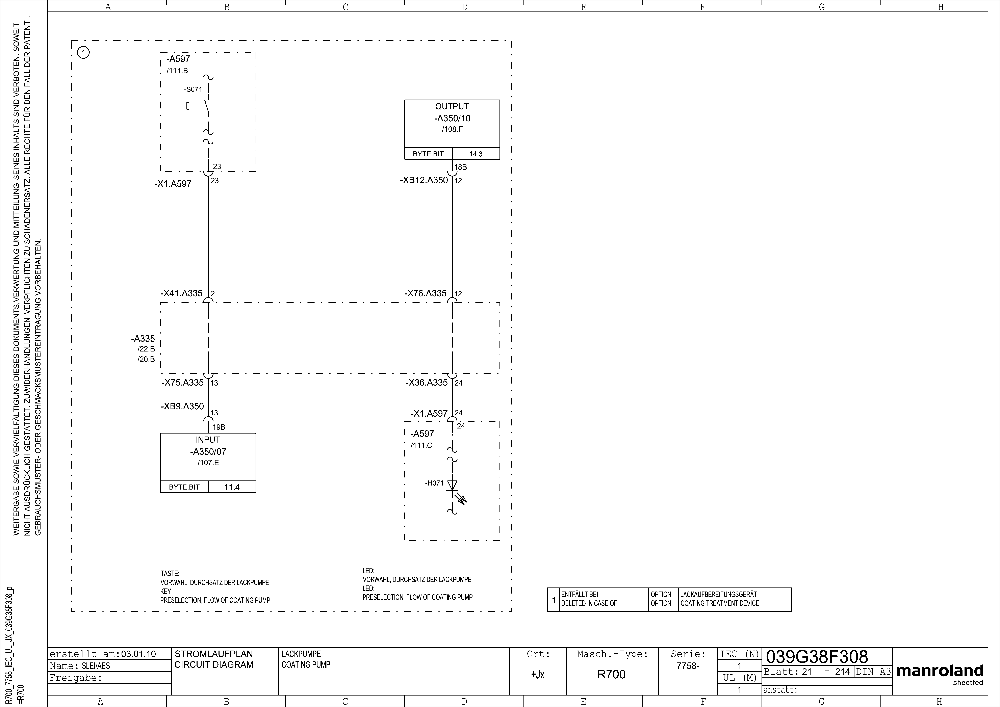

# +Jx — Sheet 21 of 214 — LACKPUMPE

**COATING PUMP**

> Part of the manroland **R700** printing press IEC/UL circuit diagrams.
> Drawing class: **Stromlaufplan / Circuit diagram** (DIN A3).
> Document `+Jx` covers the **1st printing module + feed register** machine section.

## At a glance

| Field | Value |
|---|---|
| Document | `+Jx`  (039G38F308) |
| Sheet | **21** of 214 |
| Section (DE) | LACKPUMPE |
| Section (EN) | COATING PUMP |
| Section type | CIRCUIT — Circuit diagram |
| Machine type | `R700` |
| Series | `7758` |
| Created | 03.01.10 |
| Replaces | — |
| Columns used | A, B, C, D, E, F |
| Path numbers | — |
| Labels on sheet | 55 |
| Cross-refs out | 6 |
| Cross-refs in | 14 |

**Previous:** [+Jx sheet 20](SHEET_0020.md) · **Next:** [+Jx sheet 22](SHEET_0022.md) · **Document TOC:** [_TOC.md](_TOC.md)  (+Jx) · **Master TOC:** [all sheets](../_MASTER_TOC.md)

## Sheet image (300 DPI, exact vector render)



_Rendered directly from the PDF vector layer at 300 DPI (1-bit), no OCR and no resampling. Use it to confirm anything ambiguous in the text below._

## Cross-references on this sheet

Each entry is a wire leaving this sheet. The printed token is `/sheet.column`; the link resolves to that sheet inside the same document.

| Ref | Target sheet | Col | Path | Destination on target | Target section | From col |
|---|---|---|---|---|---|---|
| `/111.B` | [+Jx sheet 111](SHEET_0111.md) | B | — | — | REFERENZMODUL | B |
| `/108.F` | [+Jx sheet 108](SHEET_0108.md) | F | — | — | REFERENZMODUL | D |
| `/22.B` | [+Jx sheet 22](SHEET_0022.md) | B | — | — | LACKPUMPE | A |
| `/20.B` | [+Jx sheet 20](SHEET_0020.md) | B | — | — | LACKPUMPE | A |
| `/111.C` | [+Jx sheet 111](SHEET_0111.md) | C | — | — | REFERENZMODUL | D |
| `/107.E` | [+Jx sheet 107](SHEET_0107.md) | E | — | — | REFERENZMODUL | B |

### Incoming references (sheets that point here)

Every other sheet that sends a wire to this one. `Back-ref` is the token printed on *that* sheet; `Path` is its line number.

| From sheet | Cols | Back-ref | Path | Refs | What continues there |
|---|---|---|---|---|---|
| [+Jx#20](SHEET_0020.md) | B | `/20.B` | — | 1 | — |
| [+Jx#22](SHEET_0022.md) | A | `/22.A` | — | 1 | — |
| [+Jx#107](SHEET_0107.md) | E | `/107.E` | — | 1 | — |
| [+Jx#108](SHEET_0108.md) | F | `/108.F` | — | 1 | — |
| [+Jx#111](SHEET_0111.md) | B, C | `/111.B`, `/111.C` | — | 2 | — |
| [+Jx#115](SHEET_0115.md) | E | `/115.E` | — | 2 | — |
| [+Jx#134](SHEET_0134.md) | G | `/134.G` | — | 1 | — |
| [+Jx#137](SHEET_0137.md) | H | `/137.H` | — | 1 | — |
| [+Jx#149](SHEET_0149.md) | F | `/149.F` | — | 1 | — |
| [+Jx#150](SHEET_0150.md) | B | `/150.B` | — | 1 | — |
| [+Jx#155](SHEET_0155.md) | A, B | `/155.A`, `/155.B` | — | 2 | — |


## Devices on this sheet

| Tag | Class | Class meaning (IEC) | Col | Sub | Terminal | Sign |
|---|---|---|---|---|---|---|
| `A350/10` | A | Baugruppe / assembly, module, PC board | D | 10 | — | — |
| `A597` | A | Baugruppe / assembly, module, PC board | D | — | — | — |
| `S071` | S | Schalter / switch | B | — | — | — |
| `A597` | A | Baugruppe / assembly, module, PC board | B | — | — | — |
| `A350/07` | A | Baugruppe / assembly, module, PC board | B | 07 | — | — |
| `A335` | A | Baugruppe / assembly, module, PC board | A | — | — | — |
| `XB12.A350` | — | cross-device reference | D | — | — | — |
| `14.3` | — | cross-device reference | D | — | — | — |
| `X36.A335` | — | cross-device reference | D | — | — | — |
| `X76.A335` | — | cross-device reference | D | — | — | — |
| `X1.A597` | — | cross-device reference | D | — | — | — |
| `X1.A597` | — | cross-device reference | B | — | — | — |
| `X75.A335` | — | cross-device reference | B | — | — | — |
| `X41.A335` | — | cross-device reference | B | — | — | — |
| `11.4` | — | cross-device reference | B | — | — | — |
| `XB9.A350` | — | cross-device reference | B | — | — | — |

## Potentials / nets

| Potential | Count | Columns | Attached devices | Terminals |
|---|---|---|---|---|
| `H071` | 1 | D | — | — |


A potential such as `L24+/4` or `M24+` is a named supply/return rail; every place it appears on this sheet is electrically common.

## Wire-end annotations (grouped as printed)

A wire that continues elsewhere is annotated with a small cluster: the destination description, the path/line number `#NN`, and the `/sheet.column` cross reference. Each row below is one such cluster exactly as it is grouped on the drawing.

| Col | Y | Path | Cross-ref | Text on the wire |
|---|---|---|---|---|
| A | 59.3 | — | — | `1` |
| B | 65.4 | — | — | `A597` |
| B | 80.3 | — | `/111.B` | — |
| B | 102.7 | — | — | `S071` |
| D | 122.4 | — | — | `QUTPUT` |
| D | 136.3 | — | — | `A350/10` |
| D | 150.1 | — | `/108.F` | — |
| D | 179.7 | — | — | `BYTE.BIT 14.3` |
| B | 194.4 | — | — | `23` |
| D | 195.1 | — | — | `18B` |
| D | 210.0 | — | — | `XB12.A350 12` |
| B | 211.4 | — | — | `X1.A597 23` |
| B | 344.6 | — | — | `X41.A335 2` |
| D | 344.6 | — | — | `X76.A335 12` |
| A | 398.5 | — | — | `A335` |
| A | 411.6 | — | `/22.B`, `/20.B` | — |
| B | 450.9 | — | — | `X75.A335 13` |
| D | 450.9 | — | — | `X36.A335 24` |
| B | 479.3 | — | — | `XB9.A350 13` |
| D | 487.8 | — | — | `X1.A597 24` |
| D | 503.4 | — | — | `24` |
| B | 504.8 | — | — | `19B` |
| D | 511.9 | — | — | `A597` |
| B | 519.3 | — | — | `INPUT` |
| D | 526.8 | — | `/111.C` | — |
| B | 533.1 | — | — | `A350/07` |
| B | 546.9 | — | `/107.E` | — |
| D | 571.9 | — | — | `H071` |
| B | 576.0 | — | — | `BYTE.BIT 11.4` |
| C | 676.6 | — | — | `LED:` |
| B | 680.1 | — | — | `KEY: PRESELECTION, FLOW OF COATING PUMP TASTE: VORWAHL, DURCHSATZ DER LACKPUMPE` |
| D | 687.3 | — | — | `LED: PRESELECTION, FLOW OF COATING PUMP VORWAHL, DURCHSATZ DER LACKPUMPE` |
| E | 705.0 | — | — | `1 ENTFÄLLT BEI DELETED IN CASE OF` |
| F | 705.0 | — | — | `OPTION OPTION` |
| F | 705.0 | — | — | `LACKAUFBEREITUNGSGERÄT COATING TREATMENT DEVICE` |


## Reconstructed tables

This sheet carries tabular content (pin map / terminal assignment / index). The grid below was rebuilt from the drawing's own rule lines, so each row is exactly one physical row of the table.

### Table 1 — 3 data rows × 2 columns (at x=191.3, y=62.4)

| A597 /111.B S071 | 23 |
|---|---|
| `X1.A597 X41.A335 X75.A335 XB9.A350` | `23 2 13 13 19B` |
| `INPUT` | `A350/07 /107.E` |
| `BYTE.BIT` | `11.4` |


### Table 2 — 3 data rows × 2 columns (at x=481.9, y=119.1)

| QUTPUT | A350/10 /108.F |
|---|---|
| `BYTE.BIT` | `14.3` |
| `XB12.A350 X76.A335 X36.A335 X1.A597` | `18B 12 12 24 24` |
| `A597 /111.C H071` | `24` |


## Notes and free text on this sheet

| Text | Col | Y (pt) |
|---|---|---|
| `18B` | D | 195.11 |
| `QUTPUT` | D | 122.44 |
| `BYTE.BIT` | D | 179.72 |
| `LED:` | C | 676.57 |
| `VORWAHL, DURCHSATZ DER LACKPUMPE` | D | 687.28 |
| `PRESELECTION, FLOW OF COATING PUMP` | D | 708.53 |
| `19B` | B | 504.8 |
| `INPUT` | B | 519.31 |
| `BYTE.BIT` | B | 576.58 |
| `TASTE:` | B | 680.13 |
| `VORWAHL, DURCHSATZ DER LACKPUMPE` | B | 690.82 |
| `KEY:` | A | 701.33 |
| `PRESELECTION, FLOW OF COATING PUMP` | B | 712.07 |
| `ENTFÄLLT BEI` | E | 704.96 |
| `DELETED IN CASE OF` | E | 715.61 |
| `OPTION` | F | 704.97 |
| `LACKAUFBEREITUNGSGERÄT` | F | 704.99 |
| `COATING TREATMENT DEVICE` | F | 715.63 |

## Complete label inventory (exact text from the drawing)

Every text object inside the drawing area of this sheet, in DIN reading order (column A→H, then top→bottom). This is the authoritative list: if a string is not here it is not printed on this sheet.

| Col | Y | X | Dir | Type | Text |
|---|---|---|---|---|---|
| A | 59.3 | 97.4 | → | number | `1` |
| A | 398.5 | 156.2 | → | device tag | `A335` |
| A | 411.6 | 163.8 | → | cross-reference | `/22.B` |
| A | 424.0 | 163.8 | → | cross-reference | `/20.B` |
| A | 701.3 | 190.8 | → | text | `KEY:` |
| B | 65.4 | 198.1 | → | device tag | `A597` |
| B | 80.3 | 198.4 | → | cross-reference | `/111.B` |
| B | 102.7 | 219.1 | → | device tag | `S071` |
| B | 194.4 | 253.7 | → | number | `23` |
| B | 211.4 | 250.9 | → | number | `23` |
| B | 214.3 | 184.0 | → | device ref | `X1.A597` |
| B | 344.6 | 191.1 | → | device ref | `X41.A335` |
| B | 346.1 | 250.9 | → | number | `2` |
| B | 450.9 | 192.5 | → | device ref | `X75.A335` |
| B | 452.4 | 250.0 | → | number | `13` |
| B | 479.3 | 191.6 | → | device ref | `XB9.A350` |
| B | 487.8 | 250.0 | → | number | `13` |
| B | 504.8 | 252.9 | → | text | `19B` |
| B | 519.3 | 233.1 | → | text | `INPUT` |
| B | 533.1 | 226.5 | → | device tag | `A350/07` |
| B | 546.9 | 235.4 | → | cross-reference | `/107.E` |
| B | 576.0 | 266.6 | → | device ref | `11.4` |
| B | 576.6 | 201.3 | → | text | `BYTE.BIT` |
| B | 680.1 | 191.3 | → | text | `TASTE:` |
| B | 690.8 | 191.3 | → | text | `VORWAHL, DURCHSATZ DER LACKPUMPE` |
| B | 712.1 | 190.8 | → | text | `PRESELECTION, FLOW OF COATING PUMP` |
| C | 676.6 | 431.7 | → | text | `LED:` |
| C | 697.8 | 431.7 | → | text | `LED:` |
| D | 122.4 | 518.3 | → | text | `QUTPUT` |
| D | 136.3 | 517.2 | → | device tag | `A350/10` |
| D | 150.1 | 526.3 | → | cross-reference | `/108.F` |
| D | 179.7 | 491.8 | → | text | `BYTE.BIT` |
| D | 179.8 | 558.7 | → | device ref | `14.3` |
| D | 195.1 | 540.6 | → | text | `18B` |
| D | 210.0 | 476.2 | → | device ref | `XB12.A350` |
| D | 211.4 | 540.6 | → | number | `12` |
| D | 344.6 | 481.6 | → | device ref | `X76.A335` |
| D | 346.1 | 540.6 | → | number | `12` |
| D | 450.9 | 483.0 | → | device ref | `X36.A335` |
| D | 452.4 | 541.4 | → | number | `24` |
| D | 487.8 | 489.0 | → | device ref | `X1.A597` |
| D | 487.8 | 541.4 | → | number | `24` |
| D | 503.4 | 544.3 | → | number | `24` |
| D | 511.9 | 488.7 | → | device tag | `A597` |
| D | 526.8 | 489.0 | → | cross-reference | `/111.C` |
| D | 571.9 | 506.3 | → | potential | `H071` |
| D | 687.3 | 432.3 | → | text | `VORWAHL, DURCHSATZ DER LACKPUMPE` |
| D | 708.5 | 431.7 | → | text | `PRESELECTION, FLOW OF COATING PUMP` |
| E | 705.0 | 668.4 | → | text | `ENTFÄLLT BEI` |
| E | 710.3 | 656.5 | → | number | `1` |
| E | 715.6 | 668.4 | → | text | `DELETED IN CASE OF` |
| F | 705.0 | 775.0 | → | text | `OPTION` |
| F | 705.0 | 810.1 | → | text | `LACKAUFBEREITUNGSGERÄT` |
| F | 715.6 | 775.0 | → | text | `OPTION` |
| F | 715.6 | 810.4 | → | text | `COATING TREATMENT DEVICE` |

## Reading-order text block

The same content as a plain block, grouped by DIN column — convenient to paste or to match against a visual description.

```text
=== Column A ===
  59.3   97.4  numeric      1
 398.5  156.2  devtag       A335
 411.6  163.8  xref         /22.B
 424.0  163.8  xref         /20.B
 701.3  190.8  text         KEY:
=== Column B ===
  65.4  198.1  devtag       A597
  80.3  198.4  xref         /111.B
 102.7  219.1  devtag       S071
 194.4  253.7  numeric      23
 211.4  250.9  numeric      23
 214.3  184.0  devref       X1.A597
 344.6  191.1  devref       X41.A335
 346.1  250.9  numeric      2
 450.9  192.5  devref       X75.A335
 452.4  250.0  numeric      13
 479.3  191.6  devref       XB9.A350
 487.8  250.0  numeric      13
 504.8  252.9  text         19B
 519.3  233.1  text         INPUT
 533.1  226.5  devtag       A350/07
 546.9  235.4  xref         /107.E
 576.0  266.6  devref       11.4
 576.6  201.3  text         BYTE.BIT
 680.1  191.3  text         TASTE:
 690.8  191.3  text         VORWAHL, DURCHSATZ DER LACKPUMPE
 712.1  190.8  text         PRESELECTION, FLOW OF COATING PUMP
=== Column C ===
 676.6  431.7  text         LED:
 697.8  431.7  text         LED:
=== Column D ===
 122.4  518.3  text         QUTPUT
 136.3  517.2  devtag       A350/10
 150.1  526.3  xref         /108.F
 179.7  491.8  text         BYTE.BIT
 179.8  558.7  devref       14.3
 195.1  540.6  text         18B
 210.0  476.2  devref       XB12.A350
 211.4  540.6  numeric      12
 344.6  481.6  devref       X76.A335
 346.1  540.6  numeric      12
 450.9  483.0  devref       X36.A335
 452.4  541.4  numeric      24
 487.8  489.0  devref       X1.A597
 487.8  541.4  numeric      24
 503.4  544.3  numeric      24
 511.9  488.7  devtag       A597
 526.8  489.0  xref         /111.C
 571.9  506.3  net          H071
 687.3  432.3  text         VORWAHL, DURCHSATZ DER LACKPUMPE
 708.5  431.7  text         PRESELECTION, FLOW OF COATING PUMP
=== Column E ===
 705.0  668.4  text         ENTFÄLLT BEI
 710.3  656.5  numeric      1
 715.6  668.4  text         DELETED IN CASE OF
=== Column F ===
 705.0  775.0  text         OPTION
 705.0  810.1  text         LACKAUFBEREITUNGSGERÄT
 715.6  775.0  text         OPTION
 715.6  810.4  text         COATING TREATMENT DEVICE
```

---
_Generated from the PDF vector text layer; no OCR. Source: `R700_7758_IEC_UL_JX_039G38F308_p`, sheet 21._
