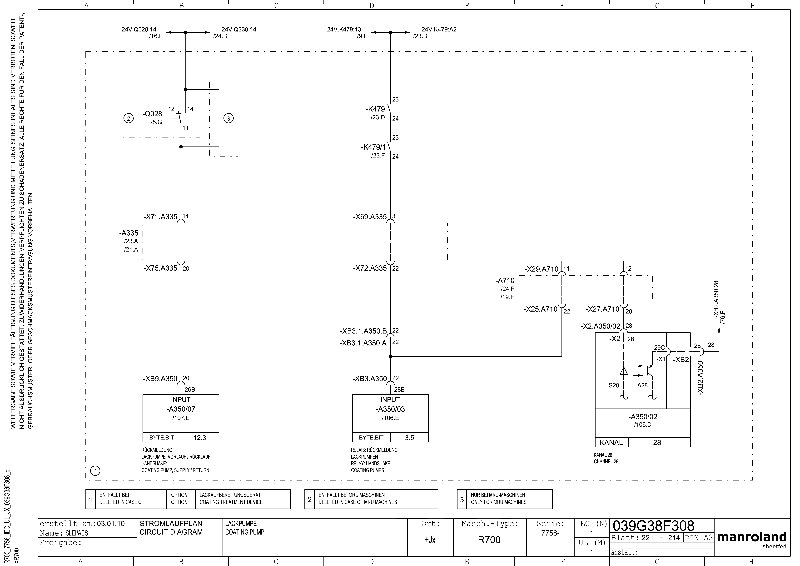

# +Jx — Sheet 22 of 214 — LACKPUMPE

**COATING PUMP**

> Part of the manroland **R700** printing press IEC/UL circuit diagrams.
> Drawing class: **Stromlaufplan / Circuit diagram** (DIN A3).
> Document `+Jx` covers the **1st printing module + feed register** machine section.

## At a glance

| Field | Value |
|---|---|
| Document | `+Jx`  (039G38F308) |
| Sheet | **22** of 214 |
| Section (DE) | LACKPUMPE |
| Section (EN) | COATING PUMP |
| Section type | CIRCUIT — Circuit diagram |
| Machine type | `R700` |
| Series | `7758` |
| Created | 03.01.10 |
| Replaces | — |
| Columns used | A, B, C, D, E, F, G, H |
| Path numbers | — |
| Labels on sheet | 106 |
| Cross-refs out | 15 |
| Cross-refs in | 29 |

**Previous:** [+Jx sheet 21](SHEET_0021.md) · **Next:** [+Jx sheet 23](SHEET_0023.md) · **Document TOC:** [_TOC.md](_TOC.md)  (+Jx) · **Master TOC:** [all sheets](../_MASTER_TOC.md)

## Sheet image (300 DPI, exact vector render)



_Rendered directly from the PDF vector layer at 300 DPI (1-bit), no OCR and no resampling. Use it to confirm anything ambiguous in the text below._

## Cross-references on this sheet

Each entry is a wire leaving this sheet. The printed token is `/sheet.column`; the link resolves to that sheet inside the same document.

| Ref | Target sheet | Col | Path | Destination on target | Target section | From col |
|---|---|---|---|---|---|---|
| `/9.E` | [+Jx sheet 9](SHEET_0009.md) | E | — | 24V.K479:A2 24V.K479:13 | SPANNUNGSVERSORGUNG, SCHALTSCHRANKBELÜFTUNG | D |
| `/16.E` | [+Jx sheet 16](SHEET_0016.md) | E | — | 24V.Q028:14 24V.Q330:14 | ÖLUMLAUFSCHMIERUNG | B |
| `/24.D` | [+Jx sheet 24](SHEET_0024.md) | D | — | — | HILFSANTRIEB, LACKDOSIER /AUFTRAGSWALZEN | B |
| `/23.D` | [+Jx sheet 23](SHEET_0023.md) | D | — | — | LACKPUMPE | E |
| `/23.D` | [+Jx sheet 23](SHEET_0023.md) | D | — | — | LACKPUMPE | D |
| `/5.G` | [+Jx sheet 5](SHEET_0005.md) | G | — | — | SPANNUNGSVERSORGUNG, SCHALTSCHRANKBELÜFTUNG | B |
| `/23.F` | [+Jx sheet 23](SHEET_0023.md) | F | — | — | LACKPUMPE | D |
| `/23.A` | [+Jx sheet 23](SHEET_0023.md) | A | — | — | LACKPUMPE | A |
| `/21.A` | [+Jx sheet 21](SHEET_0021.md) | A | — | — | LACKPUMPE | A |
| `/76.F` | [+Jx sheet 76](SHEET_0076.md) | F | — | XB2.A350:28 | BUSVERBINDUNGEN: SICHERHEITSKREIS | H |
| `/24.F` | [+Jx sheet 24](SHEET_0024.md) | F | — | — | HILFSANTRIEB, LACKDOSIER /AUFTRAGSWALZEN | E |
| `/19.H` | [+Jx sheet 19](SHEET_0019.md) | H | — | — | LACKPUMPE | E |
| `/107.E` | [+Jx sheet 107](SHEET_0107.md) | E | — | — | REFERENZMODUL | B |
| `/106.E` | [+Jx sheet 106](SHEET_0106.md) | E | — | — | REFERENZMODUL | D |
| `/106.D` | [+Jx sheet 106](SHEET_0106.md) | D | — | — | REFERENZMODUL | G |

### Incoming references (sheets that point here)

Every other sheet that sends a wire to this one. `Back-ref` is the token printed on *that* sheet; `Path` is its line number.

| From sheet | Cols | Back-ref | Path | Refs | What continues there |
|---|---|---|---|---|---|
| [+Jx#5](SHEET_0005.md) | F | `/5.F` | — | 1 | — |
| [+Jx#9](SHEET_0009.md) | E | `/9.E` | — | 1 | 24V.K479:13 |
| [+Jx#16](SHEET_0016.md) | E | `/16.E` | — | 1 | — |
| [+Jx#19](SHEET_0019.md) | H | `/19.H` | — | 1 | — |
| [+Jx#21](SHEET_0021.md) | A | `/21.A` | — | 1 | — |
| [+Jx#23](SHEET_0023.md) | A, C, D, F | `/23.A`, `/23.C`, `/23.D`, `/23.F` | — | 4 | 24V.K479:A2 |
| [+Jx#24](SHEET_0024.md) | C, F | `/24.C`, `/24.F` | — | 2 | 24V.Q330:14 |
| [+Jx#76](SHEET_0076.md) | F | `/76.F` | — | 1 | XB2.A350:28 |
| [+Jx#106](SHEET_0106.md) | D, E | `/106.D`, `/106.E` | — | 2 | — |
| [+Jx#107](SHEET_0107.md) | E | `/107.E` | — | 1 | — |
| [+Jx#126](SHEET_0126.md) | F | `/126.F` | — | 2 | — |
| [+Jx#128](SHEET_0128.md) | C, D, F | `/128.C`, `/128.D`, `/128.F` | — | 3 | — |
| [+Jx#134](SHEET_0134.md) | G | `/134.G` | — | 1 | — |
| [+Jx#143](SHEET_0143.md) | A | `/143.A` | — | 1 | — |
| [+Jx#144](SHEET_0144.md) | D | `/144.D` | — | 1 | — |
| [+Jx#147](SHEET_0147.md) | B | `/147.B` | — | 2 | — |
| [+Jx#152](SHEET_0152.md) | G | `/152.G` | — | 1 | — |
| [+Jx#153](SHEET_0153.md) | B, C | `/153.B`, `/153.C` | — | 2 | — |
| [+Jx#155](SHEET_0155.md) | A | `/155.A` | — | 1 | — |


## Devices on this sheet

| Tag | Class | Class meaning (IEC) | Col | Sub | Terminal | Sign |
|---|---|---|---|---|---|---|
| `A335` | A | Baugruppe / assembly, module, PC board | A | — | — | — |
| `Q028` | Q | Leistungsschalter / power switching device | B | — | — | — |
| `K479/1` | K | Relais / relay, contactor | D | 1 | — | — |
| `K479` | K | Relais / relay, contactor | D | — | — | — |
| `A350/07` | A | Baugruppe / assembly, module, PC board | B | 07 | — | — |
| `A350/03` | A | Baugruppe / assembly, module, PC board | D | 03 | — | — |
| `A710` | A | Baugruppe / assembly, module, PC board | E | — | — | — |
| `S28` | S | Schalter / switch | G | — | — | — |
| `A28` | A | Baugruppe / assembly, module, PC board | G | — | — | — |
| `X1` | X | Klemme / terminal, plug connector | G | — | — | — |
| `X2` | X | Klemme / terminal, plug connector | G | — | — | — |
| `XB2` | XB |  | G | — | — | — |
| `A350/02` | A | Baugruppe / assembly, module, PC board | G | 02 | — | — |
| `X75.A335` | — | cross-device reference | B | — | — | — |
| `X71.A335` | — | cross-device reference | B | — | — | — |
| `X72.A335` | — | cross-device reference | D | — | — | — |
| `X69.A335` | — | cross-device reference | D | — | — | — |
| `12.3` | — | cross-device reference | B | — | — | — |
| `XB9.A350` | — | cross-device reference | B | — | — | — |
| `3.5` | — | cross-device reference | D | — | — | — |
| `XB3.A350` | — | cross-device reference | D | — | — | — |
| `XB3.1.A350.B` | — | cross-device reference | D | — | — | — |
| `XB3.1.A350.A` | — | cross-device reference | D | — | — | — |
| `X27.A710` | — | cross-device reference | F | — | — | — |
| `X29.A710` | — | cross-device reference | F | — | — | — |
| `X25.A710` | — | cross-device reference | F | — | — | — |
| `XB2.A350` | — | cross-device reference | G | — | — | — |
| `XB2.A350:28` | — | cross-device reference | H | — | 28 | — |

## Potentials / nets

| Potential | Count | Columns | Attached devices | Terminals |
|---|---|---|---|---|
| `24V` | 4 | B, C, D, E | `K479`, `Q028`, `Q330` | `13`, `14`, `A2` |


A potential such as `L24+/4` or `M24+` is a named supply/return rail; every place it appears on this sheet is electrically common.

## Wire-end annotations (grouped as printed)

A wire that continues elsewhere is annotated with a small cluster: the destination description, the path/line number `#NN`, and the `/sheet.column` cross reference. Each row below is one such cluster exactly as it is grouped on the drawing.

| Col | Y | Path | Cross-ref | Text on the wire |
|---|---|---|---|---|
| B | 39.9 | — | `/16.E` | `24V.Q028:14 24V.Q330:14` |
| D | 39.9 | — | `/9.E` | `24V.K479:13 24V.K479:A2` |
| B | 49.8 | — | `/24.D` | — |
| E | 49.8 | — | `/23.D` | — |
| D | 144.1 | — | — | `23` |
| D | 157.6 | — | — | `K479 24` |
| B | 158.3 | — | — | `Q028 14` |
| B | 158.3 | — | — | `12` |
| D | 170.7 | — | `/23.D` | — |
| B | 173.2 | — | — | `2 3` |
| B | 177.7 | — | `/5.G` | — |
| B | 186.7 | — | — | `11` |
| D | 200.8 | — | — | `23` |
| D | 214.3 | — | — | `K479/1 24` |
| D | 227.3 | — | `/23.F` | — |
| B | 317.7 | — | — | `X71.A335 14` |
| D | 317.7 | — | — | `X69.A335 3` |
| A | 341.8 | — | — | `A335` |
| A | 354.9 | — | `/23.A`, `/21.A` | — |
| B | 394.2 | — | — | `X75.A335 20` |
| D | 394.2 | — | — | `X72.A335 22` |
| F | 395.7 | — | — | `X29.A710 11` |
| G | 395.7 | — | — | `12` |
| E | 412.7 | — | — | `A710` |
| H | 417.5 | — | `/76.F` | `XB2.A350:28` |
| E | 425.8 | — | `/24.F`, `/19.H` | — |
| F | 455.2 | — | — | `X25.A710 22` |
| F | 455.2 | — | — | `X27.A710 28` |
| F | 480.7 | — | — | `X2.A350/02 28` |
| D | 487.8 | — | — | `XB3.1.A350.B 22` |
| G | 499.1 | — | — | `X2` |
| G | 500.6 | — | — | `28 28` |
| D | 504.8 | — | — | `XB3.1.A350.A 22` |
| H | 509.1 | — | — | `28` |
| G | 513.3 | — | — | `29C` |
| G | 530.3 | — | — | `X1` |
| G | 530.3 | — | — | `XB2` |
| G | 536.6 | — | — | `XB2.A350` |
| B | 558.7 | — | — | `XB9.A350 20` |
| D | 558.7 | — | — | `XB3.A350 22` |
| G | 569.3 | — | — | `S28 A28` |
| B | 575.7 | — | — | `26B` |
| D | 575.7 | — | — | `28B` |
| B | 590.2 | — | — | `INPUT` |
| D | 590.2 | — | — | `INPUT` |
| B | 604.0 | — | — | `A350/07` |
| D | 604.0 | — | — | `A350/03` |
| G | 615.4 | — | — | `A350/02` |
| B | 617.8 | — | `/107.E` | — |
| D | 617.8 | — | `/106.E` | — |
| G | 627.8 | — | `/106.D` | — |
| B | 646.9 | — | — | `BYTE.BIT 12.3` |
| D | 646.9 | — | — | `BYTE.BIT 3.5` |
| G | 653.6 | — | — | `KANAL 28` |
| B | 666.9 | — | — | `RÜCKMELDUNG: LACKPUMPE, VORLAUF / RÜCKLAUF HANDSHAKE: COATING PUMP, SUPPLY / RETURN` |
| D | 666.9 | — | — | `RELAIS: RÜCKMELDUNG LACKPUMPEN RELAY: HANDSHAKE COATING PUMPS` |
| F | 674.0 | — | — | `KANAL 28 CHANNEL 28` |
| A | 697.1 | — | — | `1` |
| B | 733.3 | — | — | `1 ENTFÄLLT BEI DELETED IN CASE OF OPTION OPTION` |
| C | 733.3 | — | — | `LACKAUFBEREITUNGSGERÄT COATING TREATMENT DEVICE` |
| D | 733.3 | — | — | `2 ENTFÄLLT BEI MRU MASCHINEN DELETED IN CASE OF MRU MACHINES 3 NUR BEI MRU MASCHINEN ONLY FOR MRU MACHINES` |


## Reconstructed tables

This sheet carries tabular content (pin map / terminal assignment / index). The grid below was rebuilt from the drawing's own rule lines, so each row is exactly one physical row of the table.

### Table 1 — 3 data rows × 3 columns (at x=212.6, y=133.2)

| 12 Q028 /5.G | 11 | 14 |
|---|---|---|
| `X71.A335 X75.A335 XB9.A350` | `14` | `20 20 26B` |
| `INPUT A350/07` | `/107.E` |  |
| `BYTE.BIT` |  | `12.3` |


### Table 2 — 2 data rows × 2 columns (at x=524.4, y=530.1)

| XB3.A350 | 22 28B |
|---|---|
| `INPUT` | `A350/03 /106.E` |
| `BYTE.BIT` | `3.5` |


### Table 3 — 4 data rows × 6 columns (at x=836.2, y=388.3)

| 11 22 | X27.A710 X2.A350/02 | 12 28 28 |  |  | XB2.A350:28 |
|---|---|---|---|---|---|
|  | `X2` | `28` | `29C` |  | `28 28` |
|  | `S28` | `A28` | `X1` | `XB2` | `XB2.A350` |
|  |  | `A350/02 /106.D` |  |  |  |
|  | `KANAL` |  | `28` |  |  |


## Notes and free text on this sheet

| Text | Col | Y (pt) |
|---|---|---|
| `26B` | B | 575.66 |
| `INPUT` | B | 590.18 |
| `BYTE.BIT` | B | 647.44 |
| `RÜCKMELDUNG:` | B | 666.87 |
| `LACKPUMPE, VORLAUF / RÜCKLAUF` | B | 676.84 |
| `HANDSHAKE:` | B | 686.77 |
| `COATING PUMP, SUPPLY / RETURN` | B | 696.72 |
| `28B` | D | 575.66 |
| `INPUT` | D | 590.18 |
| `BYTE.BIT` | D | 647.44 |
| `RELAIS: RÜCKMELDUNG` | D | 666.89 |
| `LACKPUMPEN` | D | 676.84 |
| `RELAY: HANDSHAKE` | D | 686.78 |
| `COATING PUMPS` | D | 696.72 |
| `KANAL 28` | F | 673.97 |
| `CHANNEL 28` | F | 683.91 |
| `29C` | G | 513.34 |
| `KANAL` | G | 653.62 |
| `X2.A350/02` | F | 480.71 |
| `ENTFÄLLT BEI` | A | 733.3 |
| `DELETED IN CASE OF` | A | 743.96 |
| `OPTION` | B | 733.32 |
| `LACKAUFBEREITUNGSGERÄT` | C | 733.34 |
| `COATING TREATMENT DEVICE` | C | 743.97 |
| `ENTFÄLLT BEI MRU MASCHINEN` | D | 733.34 |
| `DELETED IN CASE OF MRU MACHINES` | D | 743.97 |
| `NUR BEI MRU MASCHINEN` | E | 733.35 |
| `ONLY FOR MRU MACHINES` | E | 743.99 |

## Complete label inventory (exact text from the drawing)

Every text object inside the drawing area of this sheet, in DIN reading order (column A→H, then top→bottom). This is the authoritative list: if a string is not here it is not printed on this sheet.

| Col | Y | X | Dir | Type | Text |
|---|---|---|---|---|---|
| A | 173.2 | 189.3 | → | number | `2` |
| A | 341.8 | 177.4 | → | device tag | `A335` |
| A | 354.9 | 184.8 | → | cross-reference | `/23.A` |
| A | 367.3 | 184.8 | → | cross-reference | `/21.A` |
| A | 697.1 | 139.9 | → | number | `1` |
| A | 733.3 | 148.3 | → | text | `ENTFÄLLT BEI` |
| A | 738.6 | 132.1 | → | number | `1` |
| A | 744.0 | 148.3 | → | text | `DELETED IN CASE OF` |
| B | 39.9 | 178.3 | → | potential | `24V.Q028:14` |
| B | 49.8 | 222.0 | → | cross-reference | `/16.E` |
| B | 49.8 | 317.5 | → | cross-reference | `/24.D` |
| B | 158.3 | 250.0 | → | number | `12` |
| B | 158.3 | 278.4 | → | number | `14` |
| B | 164.6 | 212.0 | → | device tag | `Q028` |
| B | 173.2 | 338.2 | → | number | `3` |
| B | 177.7 | 224.5 | → | cross-reference | `/5.G` |
| B | 186.6 | 271.3 | → | number | `11` |
| B | 317.7 | 213.7 | → | device ref | `X71.A335` |
| B | 317.7 | 271.3 | → | number | `14` |
| B | 394.3 | 213.7 | → | device ref | `X75.A335` |
| B | 395.7 | 272.1 | → | number | `20` |
| B | 558.7 | 212.9 | → | device ref | `XB9.A350` |
| B | 558.7 | 272.1 | → | number | `20` |
| B | 575.7 | 275.0 | → | text | `26B` |
| B | 590.2 | 254.4 | → | text | `INPUT` |
| B | 604.0 | 247.7 | → | device tag | `A350/07` |
| B | 617.8 | 256.7 | → | cross-reference | `/107.E` |
| B | 646.9 | 287.9 | → | device ref | `12.3` |
| B | 647.4 | 222.5 | → | text | `BYTE.BIT` |
| B | 666.9 | 210.6 | → | text | `RÜCKMELDUNG:` |
| B | 676.8 | 210.6 | → | text | `LACKPUMPE, VORLAUF / RÜCKLAUF` |
| B | 686.8 | 210.6 | → | text | `HANDSHAKE:` |
| B | 696.7 | 210.9 | → | text | `COATING PUMP, SUPPLY / RETURN` |
| B | 733.3 | 254.8 | → | text | `OPTION` |
| B | 743.9 | 254.8 | → | text | `OPTION` |
| C | 39.9 | 327.1 | → | potential | `24V.Q330:14` |
| C | 733.3 | 297.1 | → | text | `LACKAUFBEREITUNGSGERÄT` |
| C | 738.6 | 457.8 | → | number | `2` |
| C | 744.0 | 297.4 | → | text | `COATING TREATMENT DEVICE` |
| D | 39.9 | 483.9 | → | potential | `24V.K479:13` |
| D | 49.8 | 531.5 | → | cross-reference | `/9.E` |
| D | 144.1 | 583.9 | → | number | `23` |
| D | 157.6 | 544.5 | → | device tag | `K479` |
| D | 170.7 | 551.9 | → | cross-reference | `/23.D` |
| D | 172.5 | 583.9 | → | number | `24` |
| D | 200.8 | 583.9 | → | number | `23` |
| D | 214.3 | 537.4 | → | device tag | `K479/1` |
| D | 227.3 | 552.8 | → | cross-reference | `/23.F` |
| D | 229.2 | 583.9 | → | number | `24` |
| D | 317.7 | 525.5 | → | device ref | `X69.A335` |
| D | 317.7 | 583.7 | → | number | `3` |
| D | 394.3 | 525.5 | → | device ref | `X72.A335` |
| D | 395.7 | 583.9 | → | number | `22` |
| D | 487.8 | 506.0 | → | device ref | `XB3.1.A350.B` |
| D | 487.8 | 583.9 | → | number | `22` |
| D | 504.8 | 583.9 | → | number | `22` |
| D | 505.5 | 505.4 | → | device ref | `XB3.1.A350.A` |
| D | 558.7 | 524.7 | → | device ref | `XB3.A350` |
| D | 558.7 | 583.9 | → | number | `22` |
| D | 575.7 | 586.8 | → | text | `28B` |
| D | 590.2 | 566.2 | → | text | `INPUT` |
| D | 604.0 | 559.6 | → | device tag | `A350/03` |
| D | 617.8 | 568.5 | → | cross-reference | `/106.E` |
| D | 646.9 | 602.6 | → | device ref | `3.5` |
| D | 647.4 | 534.3 | → | text | `BYTE.BIT` |
| D | 666.9 | 522.4 | → | text | `RELAIS: RÜCKMELDUNG` |
| D | 676.8 | 522.4 | → | text | `LACKPUMPEN` |
| D | 686.8 | 522.4 | → | text | `RELAY: HANDSHAKE` |
| D | 696.7 | 522.7 | → | text | `COATING PUMPS` |
| D | 733.3 | 474.2 | → | text | `ENTFÄLLT BEI MRU MASCHINEN` |
| D | 744.0 | 474.2 | → | text | `DELETED IN CASE OF MRU MACHINES` |
| E | 39.9 | 624.8 | → | potential | `24V.K479:A2` |
| E | 49.8 | 615.1 | → | cross-reference | `/23.D` |
| E | 412.7 | 737.6 | → | device tag | `A710` |
| E | 425.8 | 745.5 | → | cross-reference | `/24.F` |
| E | 438.2 | 744.9 | → | cross-reference | `/19.H` |
| E | 733.4 | 701.0 | → | text | `NUR BEI MRU MASCHINEN` |
| E | 738.6 | 684.4 | → | number | `3` |
| E | 744.0 | 701.3 | → | text | `ONLY FOR MRU MACHINES` |
| F | 395.7 | 780.9 | → | device ref | `X29.A710` |
| F | 395.7 | 838.2 | → | number | `11` |
| F | 455.2 | 779.5 | → | device ref | `X25.A710` |
| F | 455.2 | 871.7 | → | device ref | `X27.A710` |
| F | 459.5 | 839.1 | → | number | `22` |
| F | 480.7 | 864.3 | → | text | `X2.A350/02` |
| F | 674.0 | 883.8 | → | text | `KANAL 28` |
| F | 683.9 | 884.1 | → | text | `CHANNEL 28` |
| G | 395.7 | 930.3 | → | number | `12` |
| G | 459.5 | 931.2 | → | number | `28` |
| G | 480.7 | 931.2 | → | number | `28` |
| G | 499.2 | 906.8 | → | device tag | `X2` |
| G | 500.6 | 934.0 | → | number | `28` |
| G | 510.5 | 1033.2 | → | number | `28` |
| G | 513.3 | 973.7 | → | text | `29C` |
| G | 530.3 | 977.1 | → | device tag | `X1` |
| G | 530.3 | 1001.8 | → | device tag | `XB2` |
| G | 536.6 | 1037.7 | ↕ | device ref | `XB2.A350` |
| G | 569.3 | 903.1 | → | device tag | `S28` |
| G | 569.3 | 945.6 | → | device tag | `A28` |
| G | 615.4 | 935.3 | → | device tag | `A350/02` |
| G | 627.8 | 943.9 | → | cross-reference | `/106.D` |
| G | 653.6 | 892.3 | → | text | `KANAL` |
| G | 653.6 | 972.1 | → | number | `28` |
| H | 417.5 | 1061.8 | ↕ | device ref | `XB2.A350:28` |
| H | 461.8 | 1071.7 | ↕ | cross-reference | `/76.F` |
| H | 509.1 | 1053.6 | → | number | `28` |

## Reading-order text block

The same content as a plain block, grouped by DIN column — convenient to paste or to match against a visual description.

```text
=== Column A ===
 173.2  189.3  numeric      2
 341.8  177.4  devtag       A335
 354.9  184.8  xref         /23.A
 367.3  184.8  xref         /21.A
 697.1  139.9  numeric      1
 733.3  148.3  text         ENTFÄLLT BEI
 738.6  132.1  numeric      1
 744.0  148.3  text         DELETED IN CASE OF
=== Column B ===
  39.9  178.3  net          24V.Q028:14
  49.8  222.0  xref         /16.E
  49.8  317.5  xref         /24.D
 158.3  250.0  numeric      12
 158.3  278.4  numeric      14
 164.6  212.0  devtag       Q028
 173.2  338.2  numeric      3
 177.7  224.5  xref         /5.G
 186.6  271.3  numeric      11
 317.7  213.7  devref       X71.A335
 317.7  271.3  numeric      14
 394.3  213.7  devref       X75.A335
 395.7  272.1  numeric      20
 558.7  212.9  devref       XB9.A350
 558.7  272.1  numeric      20
 575.7  275.0  text         26B
 590.2  254.4  text         INPUT
 604.0  247.7  devtag       A350/07
 617.8  256.7  xref         /107.E
 646.9  287.9  devref       12.3
 647.4  222.5  text         BYTE.BIT
 666.9  210.6  text         RÜCKMELDUNG:
 676.8  210.6  text         LACKPUMPE, VORLAUF / RÜCKLAUF
 686.8  210.6  text         HANDSHAKE:
 696.7  210.9  text         COATING PUMP, SUPPLY / RETURN
 733.3  254.8  text         OPTION
 743.9  254.8  text         OPTION
=== Column C ===
  39.9  327.1  net          24V.Q330:14
 733.3  297.1  text         LACKAUFBEREITUNGSGERÄT
 738.6  457.8  numeric      2
 744.0  297.4  text         COATING TREATMENT DEVICE
=== Column D ===
  39.9  483.9  net          24V.K479:13
  49.8  531.5  xref         /9.E
 144.1  583.9  numeric      23
 157.6  544.5  devtag       K479
 170.7  551.9  xref         /23.D
 172.5  583.9  numeric      24
 200.8  583.9  numeric      23
 214.3  537.4  devtag       K479/1
 227.3  552.8  xref         /23.F
 229.2  583.9  numeric      24
 317.7  525.5  devref       X69.A335
 317.7  583.7  numeric      3
 394.3  525.5  devref       X72.A335
 395.7  583.9  numeric      22
 487.8  506.0  devref       XB3.1.A350.B
 487.8  583.9  numeric      22
 504.8  583.9  numeric      22
 505.5  505.4  devref       XB3.1.A350.A
 558.7  524.7  devref       XB3.A350
 558.7  583.9  numeric      22
 575.7  586.8  text         28B
 590.2  566.2  text         INPUT
 604.0  559.6  devtag       A350/03
 617.8  568.5  xref         /106.E
 646.9  602.6  devref       3.5
 647.4  534.3  text         BYTE.BIT
 666.9  522.4  text         RELAIS: RÜCKMELDUNG
 676.8  522.4  text         LACKPUMPEN
 686.8  522.4  text         RELAY: HANDSHAKE
 696.7  522.7  text         COATING PUMPS
 733.3  474.2  text         ENTFÄLLT BEI MRU MASCHINEN
 744.0  474.2  text         DELETED IN CASE OF MRU MACHINES
=== Column E ===
  39.9  624.8  net          24V.K479:A2
  49.8  615.1  xref         /23.D
 412.7  737.6  devtag       A710
 425.8  745.5  xref         /24.F
 438.2  744.9  xref         /19.H
 733.4  701.0  text         NUR BEI MRU MASCHINEN
 738.6  684.4  numeric      3
 744.0  701.3  text         ONLY FOR MRU MACHINES
=== Column F ===
 395.7  780.9  devref       X29.A710
 395.7  838.2  numeric      11
 455.2  779.5  devref       X25.A710
 455.2  871.7  devref       X27.A710
 459.5  839.1  numeric      22
 480.7  864.3  text         X2.A350/02
 674.0  883.8  text         KANAL 28
 683.9  884.1  text         CHANNEL 28
=== Column G ===
 395.7  930.3  numeric      12
 459.5  931.2  numeric      28
 480.7  931.2  numeric      28
 499.2  906.8  devtag       X2
 500.6  934.0  numeric      28
 510.5 1033.2  numeric      28
 513.3  973.7  text         29C
 530.3  977.1  devtag       X1
 530.3 1001.8  devtag       XB2
 536.6 1037.7  devref       XB2.A350
 569.3  903.1  devtag       S28
 569.3  945.6  devtag       A28
 615.4  935.3  devtag       A350/02
 627.8  943.9  xref         /106.D
 653.6  892.3  text         KANAL
 653.6  972.1  numeric      28
=== Column H ===
 417.5 1061.8  devref       XB2.A350:28
 461.8 1071.7  xref         /76.F
 509.1 1053.6  numeric      28
```

---
_Generated from the PDF vector text layer; no OCR. Source: `R700_7758_IEC_UL_JX_039G38F308_p`, sheet 22._
